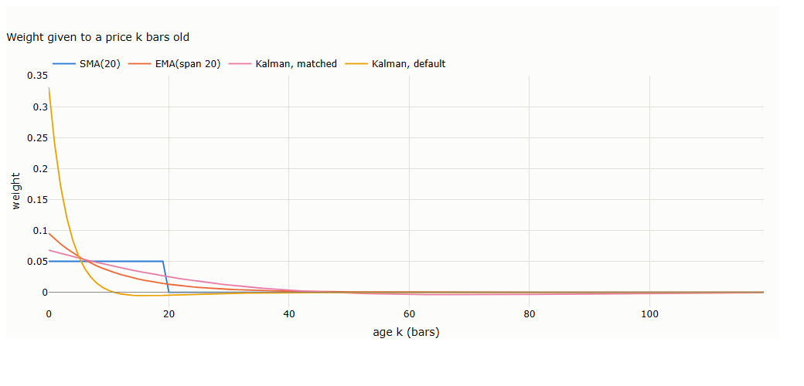
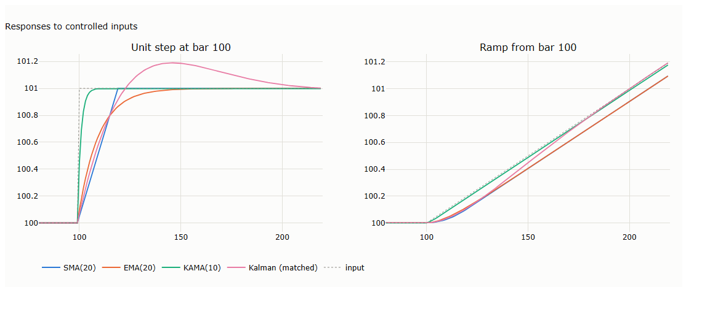

# Lecture 2: OHLCV and Price Smoothing

> A bar compresses a stream of trades into five numbers; a moving average filters many bars into one estimate of the price level.

Part I · Pipeline stage: data (what a bar holds) and signal generation (smoothing the price level)

---

# Compare only at equal memory

> At matched memory, EMA beats SMA on every test, the Kalman filter trades zero trend lag for overshoot, and the window length matters more than the method.

- Every method decides one thing: **how much each past bar counts**
- SMA is flat, then a cliff; EMA decays smoothly
- The default Kalman filter puts a third of its weight on today

---

# A bar is a lossy summary of the tape

> Compression throws information away on purpose: a daily bar says only that price was somewhere in $[L, H]$ and ended at $C$.

| Field | What it does not capture |
|---|---|
| Open, Close | Anything before the window started; everything earlier in the window |
| High, Low | When it happened, or how long price stayed there |
| Volume | The buyer/seller split |

- Two bars with identical $O$, $H$, $L$, $C$ can come from completely different paths
- Adjusted prices: early dollar levels never traded; work in returns and ratios

---

# One bar, seven prices

> A bar's single price is a design choice: on a wide bar it alone can move "the price" by 16%.

- QQQ, 3 January 2001, a surprise Fed rate cut: the range was 21% of the close
- The seven "prices" span 43.93 to 52.56
- None is more correct; each encodes a judgement about what a bar is evidence of

| Construction | Formula | Value |
|---|---|---|
| Close | $C$ | 52.56 |
| Typical Price | $(H + L + C)/3$ | 50.46 |
| Median Price | $(H + L)/2$ | 49.41 |
| Body Midpoint | $(O + C)/2$ | 48.24 |
| Open | $O$ | 43.93 |

---

# Compression and filtering are different operations

> Building a bar shrinks the data; aggregating bars does not. It separates a slower-moving level from bar-specific noise.

$$p_t = \underbrace{\text{slower-moving level}}_{\text{signal}} + \underbrace{\text{bar-specific noise}}_{\text{noise}}$$

$$\hat p_t = g\big(p_{t-N+1},\, \dots,\, p_t;\; \theta\big)$$

- **Causal:** uses only information available at $t$, known only once the bar closes
- The one real degree of freedom: **how much should each past bar count?**

---

# Four weighting schemes

> Read the memory column first: rolling windows drop a bar all at once; expanding filters let old bars fade.

| Method | Weighted by | Memory |
|---|---|---|
| SMA | Equal weight | Rolling (last $N$ bars) |
| EMA / EWMA | Recency, exponential decay | Expanding (recursive) |
| VWAP | Trading activity (volume) | Rolling (last $N$ bars) |
| KAMA | Trend efficiency, adaptive | Hybrid |

$$\mathrm{EMA}_t = \alpha p_t + (1-\alpha)\,\mathrm{EMA}_{t-1}, \qquad \alpha = \frac{2}{N+1}$$

---

# The Kalman filter: a different kind of estimator

> The Kalman filter does not pick weights for past bars: it keeps a running belief about the level and trend, and updates it with each new bar.

- Each bar it **predicts**, then **corrects** by the surprise times the Kalman gain
- Its weights on old bars turn slightly **negative**: zero average lag on a straight-line trend, at the price of overshoot after a jump
- There is no $N$: the noise settings $Q$ and $R$ are the memory dial
- The package default smooths about as much as a **4.5-bar** moving average

---

# Matching memory before comparing

> Without equal memory, any difference may come from how much each method smooths, not from the method.

$$\text{average age} = \sum_{k\ge 0} k\,w_k, \qquad \text{variance reduction factor} = \sum_{k\ge 0} w_k^2$$

| Smoother | Average age (bars) | Variance reduction | Noise-equivalent $N$ |
|---|---|---|---|
| SMA(20) | 9.5 | 0.050 | 20 |
| EMA(span 20) | 9.5 | 0.050 | 20 |
| Kalman, matched ($R = 0.20$) | 0.0 | 0.050 | 20 |
| Kalman, package default | 0.0 | 0.224 | 4.5 |

---

# The rolling-window cliff

> A rolling window does not let a bar fade: it drops it all at once, $N$ bars later, and the level moves with no move in price.

- Toy series: one +7% bar on heavy volume at $t = 7$, $N = 5$
- At $t = 7$, VWAP reacts hardest (105.13): the spike is 56% of its numerator
- At $t = 12$ the spike leaves the window: SMA drops from 104.02 to 103.02, VWAP from 105.63 to 102.96
- KAMA's efficiency ratio is 1.0 at the spike, then collapses to 0.124 and freezes the average
- EMA and Kalman show no cliff, but never fully forget

---

# Lag and overshoot on controlled inputs

> EMA covers half a step three bars sooner than SMA at the same ramp lag; the matched Kalman filter has no ramp lag but overshoots a step by 19%.

- Left: a one-off jump at bar 100
- Right: a price that starts rising at a constant rate
- KAMA's near-instant response is flattered by noise-free inputs

---

# Smoothness against tracking, on QQQ

> At equal roughness, EMA tracks price closest in every period, so its edge over SMA is real, not a by-product of smoothing less.

| Method | Roughness | Tracking gap (%) |
|---|---|---|
| SMA(20) | 0.198 | 3.74 |
| EMA(20) | 0.198 | 3.25 |
| Kalman, matched | 0.199 | 3.84 |
| KAMA(10) | 0.279 | 2.98 |
| Kalman, default | 0.438 | 1.42 |

- Full sample, log prices; roughness 1 = no smoothing, 0 = flat
- Matched Kalman tracks worst: real prices jump, and overshoot costs more than zero lag saves
- KAMA and default Kalman follow price because they smooth less

---

# Window length matters more than method

> Re-running each method at $N = 10$, 20 and 50 through the 2020 crash moves the results far more than switching method at a fixed $N$.

- Short windows follow the crash and the rebound sooner, and are noisier in calm periods
- Long windows are the reverse
- The defaults 20, 50 and 200 are conventions, not results

---

# Warm-up and running live

> No method needs the full history, but expanding filters need a warm-up, and KAMA's depends on the market.

| Method | Warm-up to discard |
|---|---|
| SMA(20), VWAP(20) | 19 bars; exact afterwards |
| EMA(20) | $\approx 70$ bars |
| KAMA(10) on QQQ | median 82, maximum 132 bars |

- In 71% of start dates KAMA's long/short signal differs on at least one day
- Load the longest warm-up before the backtest start; live, update from stored state
- Store data, configuration and checkpoints: a KAMA rebuilt from 30 bars on 20 November 2008 gave a different signal on 6 days

---

# Takeaways

1. **Compression, then filtering:** building a bar shrinks the data; aggregating bars separates signal from noise
2. **Two separate choices:** a bar's single price and the aggregation across bars; the first alone can move "the price" by 16%
3. **Only the weights differ:** how much each past bar counts, and whether memory is rolling, expanding or hybrid
4. **Compare only at equal memory:** at equal memory EMA beats SMA on QQQ in every period tested
5. **Window length moves results more than the choice of method**
