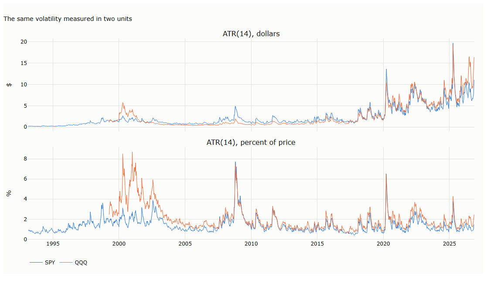
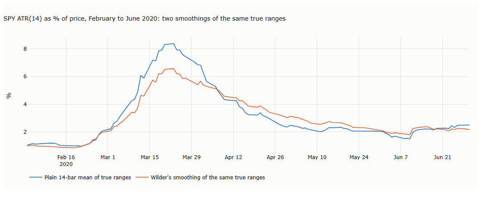
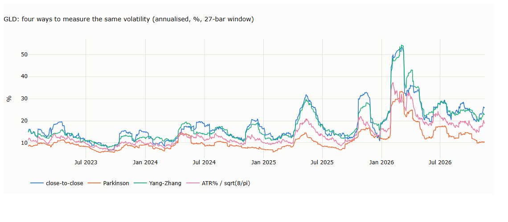
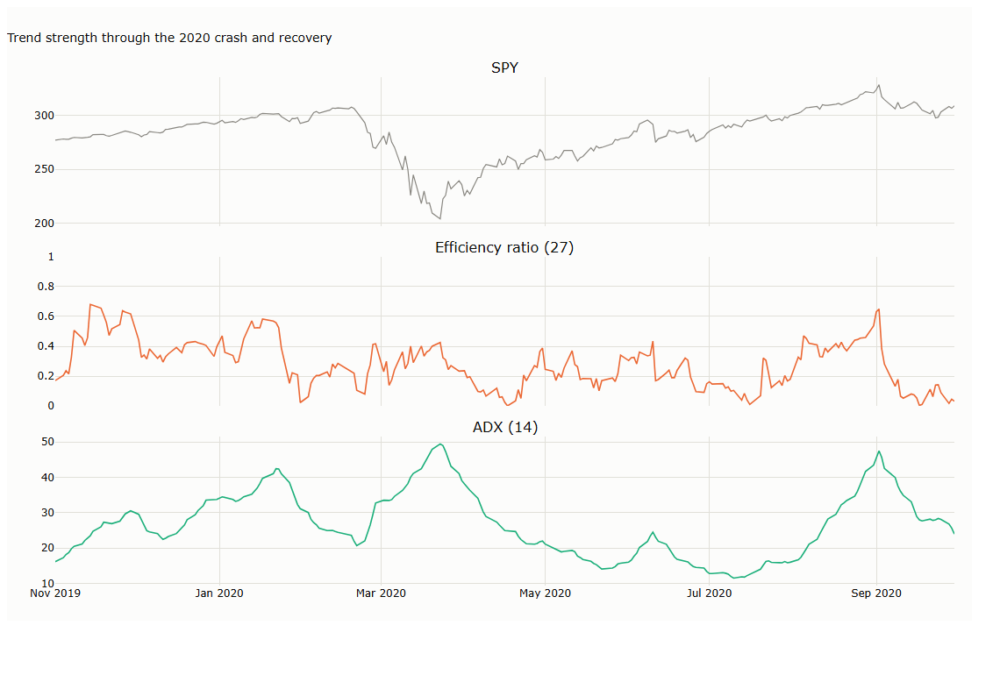
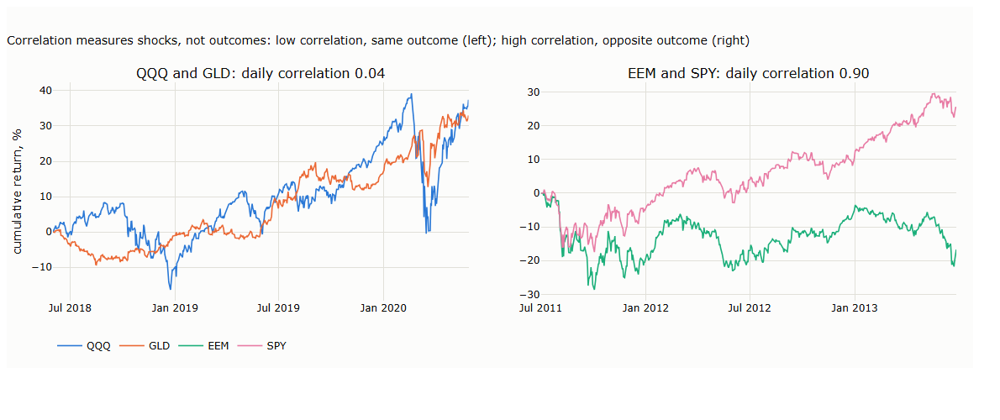
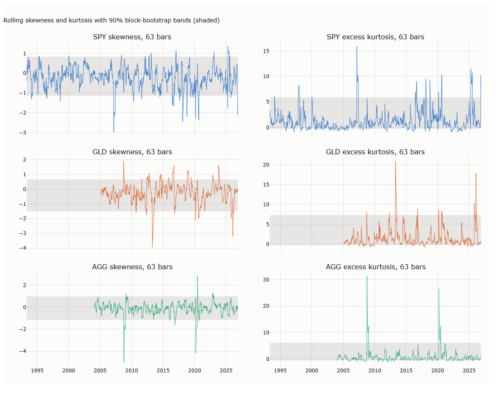
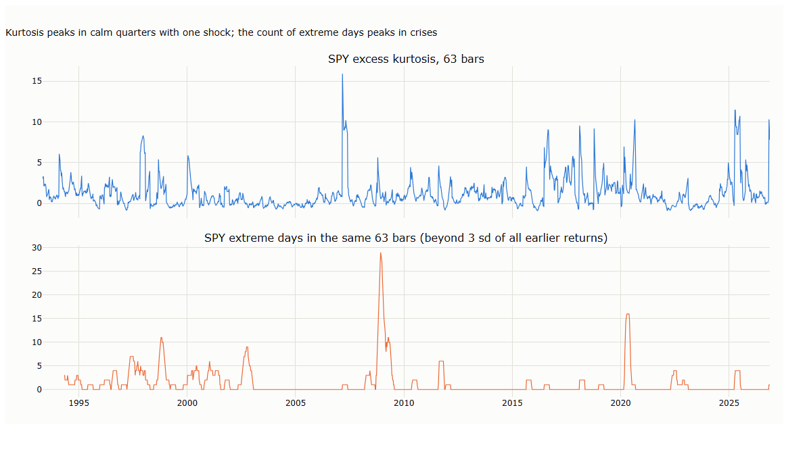

# Lecture 3: Same Bars, Different Questions

> The same bars and the same causal window that smooth price can also estimate volatility, trend strength, order flow, co-movement and distribution shape.

Part I · Pipeline stage: data, and the inputs to risk management

---

# Every statistic has a blind spot

> Every statistic answers one question well and is blind to something else. No measure is the right one; each is right for its question.

| Transformation of the bars | Question it answers |
|---|---|
| Ranges and squared returns | How much is it moving? |
| Net move versus total path | How one-sided is the move? |
| Signed volume | Who is pushing it? |
| Products of two return series | Does it move with something else? |
| Third and fourth powers of returns | Is the path lopsided or fat-tailed? |

Four checks for every statistic: **units, memory, precision, blind spot.**

---

# Units: a dollar figure can point the wrong way

> A dollar volatility rises with the price level even when risk has not changed. Divide by price first.

- SPY's ATR grew 35-fold in dollars since 1994; as a percentage, 1.3×
- QQQ looks three times **more** volatile today in dollars
- As a percentage it was nearly three times more volatile **in 2000**

---

# Wilder's ATR: a longer memory than its period

> ATR($n$) is an EMA with $\alpha = 1/n$: it carries the memory of a $2n-1$ bar window, so ATR(14) looks back like 27 bars, not 14.

- True range: the largest of $H - L$ and the two gaps from the previous close
- March 2020: Wilder's version peaked about 21% below a plain mean
- It then stayed about 25% higher as it forgot slowly

---

# From a range to a volatility

> A classical result turns a range into a standard deviation, and discrete trading biases every range down.

$$\mathbb E[H - L] = \sigma\sqrt{\frac{8T}{\pi}} \approx 1.596\,\sigma\sqrt{T}$$

- From the reflection principle for Brownian motion (Feller, 1951)
- The recorded high and low come from trades: **observed range ≤ true range**
- With $n$ samples per bar the range is understated by about $0.73/\sqrt{n}$: ~7% at 100, ~0.7% at 10,000
- Bid-ask bounce pushes the other way; for liquid daily bars the two roughly offset

---

# Which prices enter decides the volatility

> Session-only estimators report 67–86% of close-to-close volatility; Yang–Zhang, which adds the overnight gap back, reports 100–110%.

- GLD: half its variance arrives while GLD is closed (53%)
- Range estimators are far more efficient than close-to-close
- Yang–Zhang where the level must be right; ATR% / $\sqrt{8/\pi}$ for comparing and sizing

---

# Memory and precision: windows for a reason

> Match memory for statistics read together, and give each higher moment more data.

| Statistic | Standard error | $N = 27$ | $N = 63$ | $N = 252$ |
|---|---|---|---|---|
| Correlation (near 0) | $1/\sqrt{N}$ | 0.19 | 0.13 | 0.06 |
| Skewness | $\sqrt{6/N}$ | 0.47 | 0.31 | 0.15 |
| Excess kurtosis | $\sqrt{24/N}$ | 0.94 | 0.62 | 0.31 |

- Volatility, efficiency ratio and order imbalance: **27 bars**, to match ATR(14) and ADX(14)
- Correlation and the higher moments: **63 bars**, about one quarter
- The defaults 14 and 20 share no basis

---

# Trend strength: one-sided is not a direction

> The efficiency ratio sees a reversal in the close at once; ADX registers a down-move only when a bar sets a new low.

- Toy series: ER falls from 1.00 to 0.12 one bar after the spike; ADX stays near 95
- SPY, 16 March 2020: ADX read 42, efficiency ratio 0.40
- Neither gives direction; a single violent bar can produce a high value

---

# Order flow: who is doing the buying

> OBV's level is meaningless; its change over a window, divided by volume, is a comparable order imbalance in $[-1, 1]$.

$$\mathrm{OIB}^{\text{tick}}_t = \frac{\mathrm{OBV}_t-\mathrm{OBV}_{t-N}}{\sum_{k=0}^{N-1}v_{t-k}}$$

- OBV reads only the sign of each move and never forgets: a round trip stays banked
- SPY, 27 bars to 16 March 2020: order imbalance **−0.46**
- Bulk volume classification splits each bar's volume by the size of its move; the two agree at 0.82 to 0.89
- All three infer who traded from how price moved; none sees actual orders

---

# Correlation measures shocks, not drift

> Low correlation diversifies the path, not the outcome; high correlation hedges the daily risk, not the trend.

- QQQ and GLD: correlation 0.04, yet both ended more than 30% higher
- EEM and SPY: correlation 0.90, yet −18.3% and +22.4%
- Over years drift decides outcomes; it is the least precisely measured quantity in finance

---

# The stock–bond correlation changed sign

> A negative stock–bond correlation means bonds hedge equity sell-offs; since 2022 it has mostly been positive.

| Period | Share of days with negative SPY–AGG correlation |
|---|---|
| 2004–2020 | 77% |
| 2022 onward | 18% |

- The sign flipped with the inflation regime (Campbell, Pflueger and Viceira, 2020)
- **A caution:** measured correlation rises with volatility even if the dependence is unchanged (Forbes and Rigobon, 2002)

---

# Skewness and kurtosis: signal or noise?

> Judge a rolling skewness or kurtosis against a block-bootstrap band: much of the famous fat tails comes from volatility changing over time.

- Short windows pin both at their maximum possible values; use adjusted estimators and 63 bars
- SPY: median 63-bar kurtosis 0.75 against 11.4 for the full sample
- Most of the wandering sits inside the band

---

# Kurtosis measures surprise, not danger

> Kurtosis divides by the window's own volatility, so in a crisis no single day stands out. To see crises, count the extreme days.

- SPY's kurtosis peaks in calm quarters with one shock; the count peaks in 2008 and 2020
- Extreme days cluster: after one, another within 5 days 53% of the time for SPY, against 7.5% after any day

---

# Takeaways

1. **Every statistic has a blind spot:** read it with its blind spot, and pair it with a tool that covers it
2. **Units:** dollar measures can point the wrong way (QQQ); divide by price
3. **Which prices enter decides the volatility:** $\mathbb{E}[H - L] = \sigma\sqrt{8/\pi}$; session-only estimators read 67–86% of close-to-close
4. **Memory and precision:** Wilder's $n$ equals a $2n-1$ bar window; each higher moment needs more data
5. **Signal or noise:** judge rolling statistics against a block-bootstrap band; kurtosis measures surprise, not danger
6. **Correlation measures shocks, not drift:** drift decides outcomes over years
