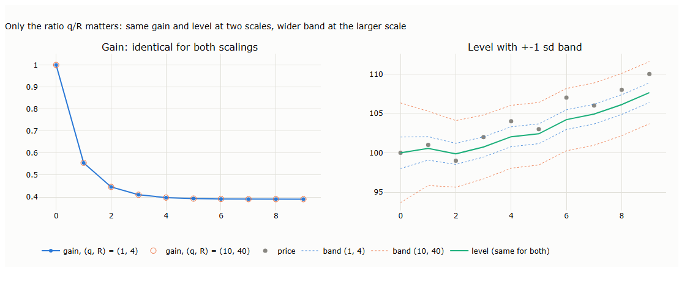
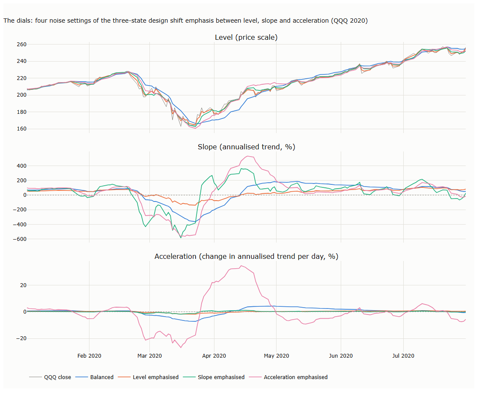
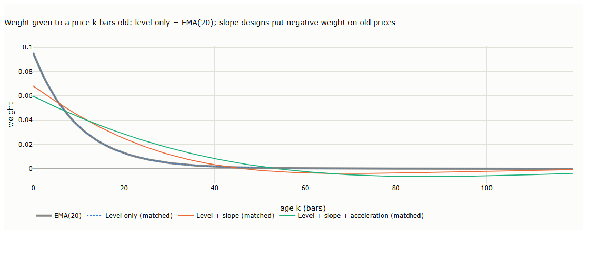
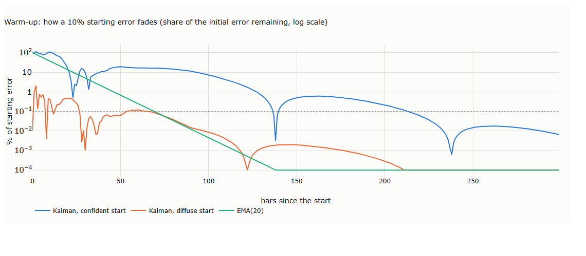

# Lecture 4b: Tracking Hidden States: the Kalman Filter

*Systematic Trading: Lecture Notes (MSc) · Oct 11, 2026 · Max Gnesi · draft, written section by section*

Lecture 2 smoothed prices from the bottom up, by averaging past bars. The Kalman filter works from the top down: it states a model of the state hidden behind prices (a level, and possibly a trend and its acceleration) and revises its estimate of them as each new bar arrives. This lecture builds the linear filter from a single level up to trend speed and acceleration, examines the information each state variable carries, and covers the nonlinear extensions, the extended and unscented filters, for tracking unobserved volatility. Companion notebook: [04b_tracking_hidden_states.ipynb](04b_tracking_hidden_states.ipynb).

## 1. From averaging to modelling

Every method of Lecture 2 ends up as a weighted average of past prices, and in steady state so does the Kalman filter. The difference lies in where the weights come from and in what the filter carries besides an average. This section sets out what genuinely distinguishes the filter, the blueprint of its model, the three designs used in this lecture side by side, and the three steps it applies to every bar.

### 1.1 What sets the Kalman filter apart

Adapting to the data is not what distinguishes it: the EMA already favours recent bars, KAMA speeds up in trends, VWAP weights by volume. Four things do.

**Table 1.1. Bottom-up averages and the top-down Kalman filter: the highlights**

| | Bottom-up (SMA, EMA, KAMA, VWAP) | Top-down (Kalman filter) |
|---|---|---|
| **What it estimates** | **The level only.** A trend needs a separate average | **As many as the design specifies:** the level alone, or the level with a slope, or with a slope and acceleration, all estimated jointly from the same surprises |
| **What gives a bar its influence** | **Recency, volume or trend efficiency** | **Its surprise:** how far the bar lands from the forecast |
| **Forecast and lag** | **Flat,** so the line lags every trend | **Along the trend,** so there is no lasting lag on a steady trend |
| **Uncertainty** | **None** | **A confidence band for every state variable,** a test for unusual bars, and a likelihood for calibrating the model |

Each of these is built up in the sections that follow.

### 1.2 The blueprint

Every design in this lecture is an instance of one pair of equations, a linear Gaussian state-space model:

```math
\begin{aligned}
x_t &= F\,x_{t-1} + w_t, \qquad w_t \sim N(0,\ Q) \qquad &\text{(state equation)}\\
y_t &= H\,x_t + v_t, \qquad v_t \sim N(0,\ r) \qquad &\text{(observation equation)}
\end{aligned}
```

**Table 1.2. The symbols of the blueprint**

| Symbol | Mathematical role | Financial meaning |
|---|---|---|
| $`y_t`$ | Observation at bar $`t`$ | The log price, the only quantity the market shows |
| $`x_t`$ | State vector, $`n \times 1`$ | The hidden state: one vector whose components, the *state variables*, are the level and, in larger designs, the slope and the acceleration. Its size $`n`$ is a modelling choice |
| $`F`$ | Transition matrix, $`n \times n`$ | How the state variables move from one bar to the next, for instance the level drifting by the slope |
| $`w_t`$, $`Q`$ | State noise and its covariance | Genuine, persistent changes in the state variables: a revaluation, a shift in the trend |
| $`H`$ | Observation matrix, $`1 \times n`$ | Which state variable the price reveals: in every design here, the level alone |
| $`v_t`$, $`r`$ | Price noise and its variance | The part of each price that does not persist (§3) |

*Hidden* means unobservable: no state variable is ever measured directly, only inferred from prices. In statistics such quantities are called latent variables, and models built on them unobserved-components models. The filter can nevertheless recover them because each leaves a trace in the sequence of prices, a property control engineers call observability: the level shows in one price, the slope in two, the acceleration in three (Table 1.4).

A control term is sometimes added to the state equation for inputs the user sets, such as an engine's thrust. A trader cannot set prices, so it is absent here.

### 1.3 Three designs, side by side

The designs differ only in the size of $`x_t`$ and in $`F`$, $`H`$ and $`Q`$. With one bar as the unit of time, and $`\ell_t`$, $`s_t`$ and $`a_t`$ for the level, the slope and the acceleration:

```math
\begin{array}{r|c|c|c}
 & \text{L: level only} & \text{LS: level + slope} & \text{LSA: level + slope + acceleration} \\ \hline
x_t & \begin{pmatrix}\ell_t\end{pmatrix} & \begin{pmatrix}\ell_t\\ s_t\end{pmatrix} & \begin{pmatrix}\ell_t\\ s_t\\ a_t\end{pmatrix} \\[3ex]
F & \begin{pmatrix}1\end{pmatrix} & \begin{pmatrix}1 & 1\\ 0 & 1\end{pmatrix} & \begin{pmatrix}1 & 1 & \tfrac12\\ 0 & 1 & 1\\ 0 & 0 & 1\end{pmatrix} \\[3ex]
H & \begin{pmatrix}1\end{pmatrix} & \begin{pmatrix}1 & 0\end{pmatrix} & \begin{pmatrix}1 & 0 & 0\end{pmatrix} \\[2ex]
Q & \begin{pmatrix}q_\ell\end{pmatrix} & \begin{pmatrix}q_\ell & 0\\ 0 & q_s\end{pmatrix} & \begin{pmatrix}q_\ell & 0 & 0\\ 0 & q_s & 0\\ 0 & 0 & q_a\end{pmatrix} \\[3ex]
\text{forecast of } y_{t+1} & \ell_t & \ell_t + s_t & \ell_t + s_t + \tfrac12 a_t
\end{array}
```

Each design adds one state variable, one row and column to $`F`$ and $`Q`$, and one term to the forecast. The first row of $`F`$ is the forecast of the level: flat for L, along the trend for LS, along a bending trend for LSA. Each $`q`$ sets how much its state variable may change per bar, relative to the price noise $`r`$. Section 2 compares the designs.

### 1.4 One bar of the filter: predict, compare, correct

**Table 1.3. The recursion, applied to every bar**

| Step | Calculation | Notebook code (`kalman()`) | Financial meaning |
|---|---|---|---|
| 1. Predict the state | $`x_{t\mid t-1} = F\,x_{t-1\mid t-1}`$ | `state = transition @ state` | Project yesterday's estimate one bar ahead: the level, moved by the trend if there is one |
| 2. Predict its uncertainty | $`P_{t\mid t-1} = F\,P_{t-1\mid t-1}\,F^\top + Q`$ | `uncertainty = transition @ uncertainty @ transition.T + Q` | The projection is less certain than yesterday's estimate, because the state variables may have moved overnight |
| 3. Forecast the price | $`\hat y_t = H\,x_{t\mid t-1}`$ | `forecast = observe @ state` | The price expected before today's bar is seen |
| 4. Expected variance of the surprise | $`S_t = H\,P_{t\mid t-1}\,H^\top + r`$ | `surprise_var = observe @ uncertainty @ observe + r` | How large a surprise would normally be: forecast uncertainty plus price noise |
| 5. Compute the gain | $`K_t = P_{t\mid t-1}\,H^\top / S_t`$ | `gain = uncertainty @ observe / surprise_var` | For each state variable, the share of the coming surprise to accept as genuine |
| 6. Compare | $`e_t = y_t - \hat y_t`$ | `surprise = price - forecast` | The surprise: today's price minus the forecast |
| 7. Correct the state | $`x_{t\mid t} = x_{t\mid t-1} + K_t\,e_t`$ | `state = state + gain * used` | Move each state variable by its share of the surprise |
| 8. Correct its uncertainty | $`P_{t\mid t} = (I - K_t H)\,P_{t\mid t-1}`$ | `uncertainty = uncertainty - np.outer(gain, observe @ uncertainty)` | Having seen today's price, the filter is more certain where the state variables stand |

Today's price enters only at step 6: everything before it, the gain included, is computed without it. Step 8 is written as $`P - K(HP)`$, the same algebra as $`(I - KH)P`$ without building an identity matrix; $`H`$ is stored as a plain vector, so no transpose is needed. In step 7, `used` is the surprise itself unless the optional robust cap of §5 is switched on.

Here $`x_{t\mid t-1}`$ is the estimate before today's price is seen and $`x_{t\mid t}`$ the estimate after; $`P`$ is the uncertainty of the estimate, the covariance of its error. The gain $`K_t`$ is a vector with one entry per state variable, so a single price surprise updates the level, the slope and the acceleration at once. This is how the filter learns a trend it never observes: when prices keep beating the forecast, the surprises are persistently positive, and each one nudges the slope up by its share.

**How the filter starts.** The start is easiest to see on four made-up prices, 50, 52, 55 and 57, filtered with the three-state design LSA. The filter is initialised with the level at the first price and the slope and acceleration at zero, together with a very large starting uncertainty $`P_0`$, which tells it that these zeros are guesses to be overwritten.

**Table 1.4. The first four bars of LSA on made-up prices, step by step** ($`P_0 = 10^6\,I`$, $`r = 1`$; triples are level / slope / acceleration; each column runs down the eight steps of Table 1.3; notebook §1)

| Step | Bar 0 (start) | Bar 1 | Bar 2 | Bar 3 | Bar 4 |
|---|---|---|---|---|---|
| Price $`y_t`$ | — | 50 | 52 | 55 | 57 |
| 1. Predicted state | — | 50 / 0 / 0 | 50 / 0 / 0 | 55.2 / 3.8 / 1.2 | 59.0 / 4.5 / 1.0 |
| 2. Its standard deviations | — | 1,500 / 1,414 / 1,000 | 1,374 / 1,795 / 943 | 485 / 728 / 485 | 4.4 / 4.9 / 2.4 |
| 3. Forecast $`\hat y_t`$ | — | 50 | 50 | 55.2 | **59.0** |
| 4. Expected size of the surprise $`\sqrt{S_t}`$ | — | 1,500 | 1,374 | 485 | 4.5 |
| 5. Gains $`K_t`$ | — | 1.00 / 0.67 / 0.22 | 1.00 / 1.29 / 0.59 | 1.00 / 1.50 / 1.00 | **0.95** / 1.05 / 0.50 |
| 6. Surprise $`e_t`$ | — | 0 | +2.0 | −0.2 | −2.0 |
| 7. Estimates after the bar | **50 / 0 / 0** (initialised) | 50 / 0 / 0 | 52 / 2.6 / 1.2 | 55 / **3.5 / 1.0** | 57.1 / 2.4 / 0.0 |
| 8. Their standard deviations | 1,000 / 1,000 / 1,000 | **1** / 1,000 / 943 | 1 / **243 / 485** | 1 / **2.6 / 2.4** | 1.0 / 1.6 / 1.0 |

Read column by column:

- **Bar 0: initialisation.** The level is set to the first price, slope and acceleration to zero, and all three are declared highly uncertain (standard deviation 1,000).
- **Bar 1: nothing moves.** The price equals the forecast, so there is no surprise to distribute. The level's uncertainty nonetheless collapses to 1, the size of the price noise: one price is enough to know roughly where the level is.
- **Bar 2: the level is set; slope and acceleration are provisional.** The predicted level is uncertain again (1,374) although the level was known after bar 1: projecting it with a slope that is still unknown spreads the slope's uncertainty into the level. Two prices fix one change but cannot separate a trend from its acceleration. The estimates of 2.6 and 1.2 depend only on the starting uncertainty, and their standard deviations of 243 and 485 say exactly that: ignore them.
- **Bar 3: all three are pinned down.** The filter reproduces the parabola through the three prices, whose acceleration is $`(55-52)-(52-50) = 1`$, and the standard deviations of slope and acceleration fall from the hundreds to about 2.5. Gains above one are normal in these first bars: a single surprise must be converted into a whole slope or acceleration.
- **Bar 4: averaging begins.** The forecast of 59.0 is the first to use all three quantities ($`55 + 3.5 + \tfrac12 \times 1`$). The gain on the level falls below one, so each new price is now blended with the past rather than copied.

The filter needs as many prices as it has state variables before each is determined: one for the level, two for the slope, three for the acceleration. The level-only design is set after one bar, the level + slope design after two, LSA after three; afterwards, every design averages. The gains that drive this sequence depend only on the noise settings and the start, never on the prices: any price series would produce the same gains. The standard filter therefore does not react faster when markets turn volatile. In practice gains do move, but only when the model lets them: when the price noise is made to depend on the data, when the settings are re-estimated, or after missing bars, during which the filter only predicts, its uncertainty grows, and the first price after the gap receives a larger gain (§5).

**When is the filter stable?** When its gains stop changing. Because they do not depend on the prices, they can be computed before any data arrive, and the bar at which they settle can be read off directly. For the settings of Table 1.4 ($`q_\ell = 10^{-4}`$, $`q_s = 10^{-6}`$, $`q_a = 10^{-8}`$):

**Table 1.5. Gains of the LSA filter of Table 1.4, computed without any prices**

| Bar | Gain on level | Gain on slope | Gain on acceleration |
|---|---|---|---|
| 4 | 0.950 | 1.050 | 0.500 |
| 10 | 0.618 | 0.259 | 0.046 |
| 50 | 0.167 | 0.014 | 0.0005 |
| 100 | 0.097 | 0.0046 | 0.0001 |
| 200 and after | 0.091 | 0.0043 | 0.0001 |

From bar 121 on, every gain is within 1% of its final value: the filter has become a fixed weighted average of past prices, and stays one. A practical rule follows: the filter is stable once all its gains are within 1% of their final values, a bar fixed by the design and the settings and computable before the backtest starts. Slower settings take longer to settle. How much history must be discarded beyond this, so that the estimates no longer depend on where the data begin, is a separate question (§4).

**The filter runs online.** Each bar needs only three things: yesterday's estimate $`x_{t-1\mid t-1}`$, its uncertainty $`P_{t-1\mid t-1}`$ and today's price. Everything the filter knows about the past is condensed into those two objects, so live, the price can be discarded once it has been processed; a backtest simply loops through the history one bar at a time. A full price history is needed in only two cases. The first is estimating the noise settings from the data (§3). The second is *smoothing*: running a second pass backwards through the history so that each past estimate also uses the prices that came after it (Rauch, Tung and Striebel, 1965). Smoothed estimates are useful for describing the past, but in a trading system they are a serious and common mistake: each one uses prices that were not yet known, so a backtest built on them looks far better than anything that can be traded. The same caution applies to the first case: noise settings estimated on the whole history and then used to backtest that same history leak future information; they must be estimated on data before the evaluation period, or re-estimated as it rolls forward.

### 1.5 From the blueprint to the code

The blueprint names four objects: $`F`$, $`H`$, $`Q`$ and $`r`$. An implementation handles many more, because the filter needs working quantities of its own and a set of choices the blueprint leaves open. They fall into three layers, and keeping them apart is the easiest way to read any Kalman filter code, including the `kalman()` function of the companion notebook.

**Table 1.6. Every object in an implementation, by layer** (names as in the notebook)

| Layer | In the notebook | Symbol | Shape | What it is |
|---|---|---|---|---|
| **Model: what is assumed** | `transition` | $`F`$ | $`n \times n`$ | How the state variables move from bar to bar; fixed by the design (`design()`) |
| | `observe` | $`H`$ | $`1 \times n`$ | Which state variable the price reveals: $`(1, 0, \dots, 0)`$ |
| | `Q` (from `q_diag`, or `full_q`) | $`Q`$ | $`n \times n`$ | How much each state variable may change per bar |
| | `r_price` | $`r`$ | scalar | Variance of the price noise |
| **Filter: computed on every bar** | `state` | $`x_{t\mid t}`$ | $`n`$ | The current estimate of the state variables: level, slope, acceleration |
| | `uncertainty` | $`P_{t\mid t}`$ | $`n \times n`$ | Variances of the estimation errors on the diagonal, their covariances off it |
| | `forecast` | $`H\,x_{t\mid t-1}`$ | scalar | The price expected before today's bar is seen |
| | `surprise` | $`e_t`$ | scalar | Today's price minus the forecast |
| | `surprise_var` | $`S_t`$ | scalar | The variance a surprise should have if the model is right |
| | `gain` | $`K_t`$ | $`n`$ | The share of the surprise each state variable accepts |
| **Settings: chosen by the user** | `start_state` | $`x_0`$ | $`n`$ | The starting guess: first price as level, zero slope and acceleration |
| | `start_uncertainty` | $`P_0`$ | $`n \times n`$ | How much the starting guess is trusted; large means a diffuse start |
| | `Q_REL`, `q_scale` | ratios within $`Q`$ | — | The relative speeds of level, slope and acceleration, and their overall scale |
| **Outputs** | `states`, `sds` | $`x_{t\mid t}`$, $`\sqrt{\mathrm{diag}\,P_{t\mid t}}`$ | $`T \times n`$ | The history of the estimates and of their standard deviations, for charts and readings |

Only the first layer is the model. The second is the machinery of Table 1.3, the same for every design. The third is chosen by the user, and the rest of the lecture shows how; the code's remaining arguments belong to the extensions of §5.

**Table 1.7. What the user must choose, and where the lecture covers it**

| Choice | Covered in |
|---|---|
| The design: which state variables to track ($`F`$ and $`H`$) | §2 |
| How fast each state variable may change, relative to the price noise ($`Q`$ and $`r`$) | §3 |
| The start ($`x_0`$, $`P_0`$) and how much history to load first | §4 |

## 2. Choosing the design: which state variables to track

The design fixes what the filter can follow and what it can report. Each state variable added is one more property of the price, estimated consistently with the others: where the price is, which way and how fast it is moving, and whether that movement is speeding up. This lecture is about smoothing; the section closes with a short preview of how Part II uses these quantities.

### 2.1 Level only: a moving average with a model behind it

Once the gain has settled (§1.4), the level-only filter reduces to one line:

```math
\ell_t = \ell_{t-1} + K\,(y_t - \ell_{t-1}) = K\,y_t + (1-K)\,\ell_{t-1}
```

This is an EMA with smoothing constant $`\alpha = K`$; with $`q_\ell / r = 1/6`$, for instance, $`K = 1/3`$, the $`\alpha`$ of EMA(5) (our derivation; notebook §2). It behaves like a classic moving average, lag included. Three things differ: the smoothing constant follows from a model rather than a chosen window; the filter reports how sure it is of the level; and the same machinery extends to a trend without changing anything else.

### 2.2 Level + slope: read the slope, not the crossing

Adding a slope gives the *local linear trend* model: the level drifts by the slope each bar, and the slope changes slowly. Once settled, the filter is Holt's linear method, the classical exponential smoothing with a trend (Holt, 1957, reprinted 2004), with smoothing constants $`\alpha = K_1`$ and $`\beta = K_2 / K_1`$ (our derivation).

The practical consequence is a change in what to read. With a moving average, price crossing the average is the usual trend reading. Here the level has already been projected along the trend, so price below the level means only that price rose less than the projected trend. The trend is read from the **slope**: its sign gives the direction, its size the speed, and its standard deviation says whether it can be told apart from zero. The gap between price and level, the **stretch**, says how far price has run from its trend.

### 2.3 Level + slope + acceleration: is the trend tiring?

A third state variable tracks the acceleration, the change in the slope: whether the trend is strengthening or fading. Because it enters the forecast through the $`\tfrac12 a_t`$ term, a fading rise lowers the forecast before the slope itself turns. It is also the noisiest state variable, since estimating a change in a trend amplifies the noise in prices twice over.

**Why stop at acceleration?** Further derivatives, often called jerk and snap, could be added in the same way, but each amplifies the noise further and makes the filter overshoot more, and oscillate, after a jump (§2.4). By analogy, high-order polynomials fitted to recent points swing wildly when extrapolated, the Runge phenomenon of interpolation.

### 2.4 What each design can follow

On synthetic prices without noise (notebook §2), the level-only design follows a flat price but lags a steady trend forever; the level + slope design follows a steady trend exactly but overshoots a jump by 17–20%; the three-state design follows a steady acceleration exactly but overshoots by 23–29%. Faster settings shrink a lag but never remove it; only an additional state variable does, and the slope designs pay for it with overshoot, because they extrapolate.

### 2.5 What can be read from the filter

**Table 2.1. What can be read from the filter on every bar, and what it resembles**

| Quantity | What it shows | Plays a role similar to | Typical use (preview of Part II) |
|---|---|---|---|
| Level, with band $`\pm 2\sqrt{P_{\ell\ell}}`$ | A smoothed price; once settled, the band has constant width ([chart C.1](#c1-level-and-its-uncertainty-band-25)) | A moving average | A reference price |
| Slope | The direction and speed of the trend ([chart C.2](#c2-slope-and-acceleration-with-their-uncertainty-25)) | The slope of a moving average | Tracking the general direction: long while positive, out or short while negative |
| Slope ÷ its standard deviation | How clearly the trend stands out from noise | ADX, a trend-strength gauge | Acting only on trends that stand out |
| Stretch $`y_t - \ell_t`$ | How far price has run from its projected trend ([chart C.3](#c3-stretch-25)) | RSI, an overbought and oversold gauge | Buying dips within an uptrend; taking profit when price is stretched far above it |
| Acceleration | Whether the trend is strengthening or fading ([chart C.2](#c2-slope-and-acceleration-with-their-uncertainty-25)) | The MACD histogram, the change in a trend measure | An early warning that a trend is tiring |
| Normalised surprise $`e_t / \sqrt{S_t}`$ | How unusual today's bar is; clusters mark periods the model does not fit ([chart C.4](#c4-normalised-surprises-25)) | No common equivalent | Flagging shocks and checking the model |

The resemblances are analogies, not equivalences: each Kalman quantity comes from one model and one surprise, while the classic indicators are separate calculations with separate windows.

**What the charts show.** On QQQ, with the level reacting like EMA(15), the slope remembering like EMA(90) and the acceleration like EMA(45):

- **The slope tracks the general direction.** It turned negative in the March 2020 crash, through most of 2022 and briefly in late 2023, and was positive in the rallies. Over 2019–2023 it lay more than two standard deviations above zero on 59% of days and below on 17%; on the other 24% the trend could not be told apart from noise ([chart C.2](#c2-slope-and-acceleration-with-their-uncertainty-25)).
- **The acceleration moves first, and often.** It turned up at the March 2020 low and at the 2022 lows before the slope recovered, and down in late 2021 before the slope fell; it also cycles every two to three months in between ([chart C.2](#c2-slope-and-acceleration-with-their-uncertainty-25)).
- **The stretch is usually small.** On nine days in ten price lay between 4.4% below and 4.0% above its projected trend; the extremes came in fast moves, −17% in the March 2020 crash and +9% in the rebound ([chart C.3](#c3-stretch-25)).
- **The level's band does not move.** It stays at about ±1.3% through the crash and the 2022 decline ([chart C.1](#c1-level-and-its-uncertainty-band-25)): a yardstick, not a gauge of volatility.
- **Large surprises come in clusters.** 2000–2002, 2008, 2020 and 2022 hold most of the days beyond ±3: periods when volatility outgrew the model's fixed noise ([chart C.4](#c4-normalised-surprises-25)). The surprises, not the band, carry the information about volatility.

A short preview of what comes next. Part II introduces trend-following systems and shows how such quantities become trading decisions. This lecture stays with what they are and how they behave.

## 3. Setting the knobs: memory and noise

Once the design is chosen, the filter's behaviour is set by a handful of numbers: one $`q`$ for each state variable and the price noise $`r`$. They are the knobs of the filter. This section shows what each one does, how to set them to a target memory, and how to fix their overall scale.

### 3.1 Ratios set the speed; the scale sets the uncertainty

The estimates depend only on the ratios of the $`q`$ to $`r`$. Scale every noise variance by the same factor and the level, slope and acceleration do not move; only the filter's uncertainty changes, by the square root of that factor. The same ten prices, filtered with the level-only design at two scales, show it (notebook §3):

**Table 3.1. Same ratio, two scales**

| Bar | Price | Level at $`(q_\ell, r) = (1, 4)`$ | Level at $`(10, 40)`$ | Gain, both | Band ±1 sd at $`(1, 4)`$ | Band at $`(10, 40)`$ |
|---|---|---|---|---|---|---|
| 1 | 101 | 100.556 | 100.556 | 0.556 | 1.49 | 4.71 |
| 4 | 104 | 102.036 | 102.036 | 0.398 | 1.26 | 3.99 |
| 9 | 110 | 107.633 | 107.633 | 0.390 | 1.25 | 3.95 |

The levels and gains are identical; only the band is $`\sqrt{10}`$ times wider ([chart C.5](#c5-same-ratio-two-scales-31)). An analogy helps: if one variance describes how far a room's temperature can drift in an hour and the other how noisy the thermometer is, scaling both leaves the estimate unchanged and only the stated uncertainty larger.

Two practical rules follow. To change how fast the filter follows prices, change the ratios. To make its uncertainty meaningful, set the scale from data: choose $`r`$ so that the normalised surprises $`e_t / \sqrt{S_t}`$ have a variance of 1 over a period before the one being studied. Set by hand, the scale is easily wrong by a large factor, and every band and normalised surprise with it. The charts of this lecture calibrate it on 2014–2018, which gives a daily price noise of 1.8% for QQQ.

### 3.2 What each knob does

Raising one $`q`$ relative to the others shifts the filter's attention towards that state variable; raising $`r`$ relative to all of them makes every state smoother and slower. Because only ratios matter, "raise $`q_s`$" and "lower everything else" are the same instruction. Four settings of the three-state design on QQQ show the trade-offs, each raising one $`q`$ a hundredfold from a balanced case ($`r = 10^{-4}`$; $`q_\ell, q_s, q_a = 10^{-6}, 10^{-8}, 10^{-11}`$; notebook §3; [chart C.6](#c6-the-knobs-at-work-32)):

**Table 3.2. Turning one knob at a time** (QQQ; 2020 for the turning points)

| Knob raised | What it buys | What it costs |
|---|---|---|
| $`q_\ell`$, the level | The level hugs price: its gap to price (root mean square) is 0.64% instead of 2.24% | The slope barely moves, because the level absorbs every move; the design drifts back towards a moving average |
| $`q_s`$, the slope | Faster turns: the slope turned 3 days after the February 2020 peak and 3 days after the March low, instead of 6 and 15 | Many more false turns: 24.7 sign changes a year instead of 8.0 |
| $`q_a`$, the acceleration | The acceleration responds within days | Overshoot: in April 2020 the slope peaked at +532% a year, nearly twice the fastest 20-day pace QQQ actually reached (285%), and the level ran 7% above price |
| $`r`$, the price noise | Smoother states everywhere | More lag everywhere |

Every knob buys speed in one place and pays for it in noise or overshoot somewhere else; there is no setting that is fast, smooth and accurate at once.

### 3.3 Setting the memory in practice

Practitioners think in memories: "a 15-day level", "a 90-day trend". For the level-only design the translation is exact, because the filter is an EMA: a gain of $`2/(N+1)`$ is EMA(N). For the slope designs it is not, and a common shortcut fails. The gain on the slope is not a memory: with the slope remembering like EMA(90), its steady gain is 0.0023, about a tenth of $`2/91 = 0.022`$. Setting the gain to 0.022 instead produces a slope that remembers like EMA(17), five times faster than intended (our measurement; notebook §3).

The reliable route is to look at what the filter actually does with past prices. In steady state each state variable is a fixed weighted average of past prices, and the weights can be computed from the gains alone. The slope designs put positive weights on recent prices and small negative weights on older ones, which is how a weighted average extrapolates a trend ([chart C.7](#c7-weights-on-past-prices-33)). A memory target is then met by adjusting the $`q`$ until the weights reach back as far as those of the target average. The charts of this lecture were set this way (notebook §2):

**Table 3.3. Memory targets and the settings that meet them** (relative to $`r`$)

| Target | Setting found |
|---|---|
| Level reacts to each surprise like EMA(15) | $`q_\ell = 0.0129\,r`$ (level gain 0.125 = 2/16) |
| Slope remembers like EMA(90) | $`q_s = 6.05 \times 10^{-6}\,r`$ |
| Acceleration remembers like EMA(45), in a separate three-state filter | $`q_a = 2.99 \times 10^{-7}\,r`$ |

One limit applies: within a single filter, the slope cannot keep a longer memory than the acceleration, because the slope accumulates the acceleration. A faster acceleration drags the slope with it; when both a slow trend and a fast acceleration are wanted, two filters are needed.

## 4. Starting and running the filter

Every filter starts from a guess, and every live filter must be restarted, moved or rebuilt at some point. This section covers how long the start takes to be forgotten, how much history to load, and the rule that keeps a live filter's readings from changing after the fact.

### 4.1 Warm-up grows with the number of state variables

**Table 4.1. Warm-up by design** (designs matched to EMA(20) as in chart C.7; starting error 10% in the level, zero slope; notebook §4)

| Design | Gain settles within 1% | Memory reaches back | Level error below 0.1%: diffuse / confident start | Slope within 1% a year for good: diffuse / confident start |
|---|---|---|---|---|
| L | 26 bars | 70 bars | 0 / 73 bars | — |
| LS | 86 bars | 197 bars | 0 / 137 bars | 24 / 163 bars |
| LSA | 184 bars | 436 bars | 23 / 145 bars | 174 / 346 bars |

Three points follow.

- **Each state variable lengthens everything.** Gain, memory and the time to forget a wrong start all grow from one design to the next: the three-state design needs about twice as long as level + slope, and six to seven times as long as the level alone.
- **A diffuse start removes the guess at once.** A very large starting uncertainty $`P_0`$ tells the filter that its starting values are worthless, so the first prices overwrite them (Table 1.4). With a confident but wrong start, the level + slope design takes 137 bars to forget a 10% error, twice as long as EMA(20) ([chart C.8](#c8-how-a-wrong-start-fades-41)).
- **The numbers can be computed in advance.** Since the gains do not depend on prices (§1.4), the warm-up of any design and setting is known before the first price arrives.

### 4.2 How much history to load

Forgetting the guess is not the whole story. A filter started on a given date also differs from the same filter run on a longer history, because it has seen fewer prices. How much history must be loaded before the readings agree depends on the memory, not on the guess. With the trend memory placed on the slope (§3.3), the answer matches the rule for moving averages:

**Table 4.2. Burn-in test** (level + slope, slope remembering like EMA(N); diffuse start at 22 dates across SPY, QQQ, GLD and AGG; agreement with the same filter run on the full history over the following year; notebook §4)

| Trend memory N | Burn-in | Slope direction agrees | Slope gap (% a year) | Price above or below level agrees |
|---|---|---|---|---|
| 252 | N bars | 99% | 1.0 | 99% |
| 252 | 2N bars | 100% | 0.16 | 100% |
| 500 | N bars | 100% | 1.3 | 99% |
| 500 | 2N bars | 100% | 0.18 | 100% |

A practical cut-off follows: load at least twice the longest memory before the first date that counts. For the three-state design, which this test does not cover, three times is the prudent choice. The early bars are not wasted: with a diffuse start each estimate is exactly what a trader starting on that date would have computed, with no look-ahead; it simply rests on fewer prices.

### 4.3 Running live: the same dates must give the same readings

A filter carries its whole past in two objects, the state $`x_t`$ and its uncertainty $`P_t`$ (§1.4). Restart it from a different date, with different settings or on revised data, and it produces different readings on the same historical dates. A trading record built on one run cannot then be reproduced, and yesterday's readings may silently change. The rule is to treat the filter's history as fixed once produced.

**Table 4.3. What to store to keep readings reproducible**

| Store | Why |
|---|---|
| The start date and the data used from it | The same start on the same data reproduces every reading exactly |
| The settings: design, every $`q`$, $`r`$ and $`P_0`$ | Different settings give different readings from the first bar |
| The state $`x_t`$ and uncertainty $`P_t`$ after each bar | Live, each new bar continues from the stored state; nothing is recomputed |
| The readings themselves, with their dates | They are the record; they are never overwritten by a later run |
| A version for every change of settings, with its effective date | A re-estimated $`r`$ or a new memory applies from a stated date onwards, not to the past |

The same rule appeared for moving averages in Lecture 2 (§9.2); for the Kalman filter it matters more, because the state includes the slope and the acceleration, whose memories are long.

## Appendix: charts

From the companion notebook, section 2 ([04b_tracking_hidden_states.ipynb](04b_tracking_hidden_states.ipynb)). All four charts use QQQ daily closes in logs. The level, the slope, the stretch and the surprises come from the level + slope design, with the level reacting to each surprise like EMA(15) and the slope remembering like EMA(90). The acceleration comes from a three-state design whose acceleration remembers like EMA(45): within one filter the slope cannot keep a longer memory than the acceleration, so a second filter is needed. The ratios of the noise variances set these memories; their common scale, which sets the uncertainty, is calibrated so that the normalised surprises have a standard deviation of 1 over 2014–2018, before the period charted. It corresponds to a daily price noise of 1.8%.

### C.1 Level and its uncertainty band (§2.5)


The level follows price closely. Its band, ±2 standard deviations of the level estimate, is about ±1.3% and keeps that width through the 2020 crash and the 2022 decline: once the filter has settled, its uncertainty no longer moves. On a price chart the band therefore adds little; its value lies at the start (Table 1.4) and as a yardstick for the slope (chart C.2). It is not a Bollinger band, which measures how widely prices disperse and widens with volatility; it measures only how sure the filter is of the level.

### C.2 Slope and acceleration with their uncertainty (§2.5)


The slope is the trend in % a year, the grey band ±2 standard deviations. It turned negative in the March 2020 crash, through most of 2022 and briefly in late 2023. Over 2019–2023 it lay more than two standard deviations above zero on 59% of days and below on 17%; on the remaining 24% the trend could not be told apart from noise. The acceleration turned up at the March 2020 low and at the 2022 lows before the slope recovered, and down in late 2021 before the slope fell; it also cycles every two to three months in between, an earlier and noisier layer than the slope.

### C.3 Stretch (§2.5)


Price minus level, in %. On nine days in ten the stretch lay between −4.4% and +4.0% (5th to 95th percentile, 2019–2023); the extremes came in fast moves, −17% in the March 2020 crash and +9% in the rebound. A strongly negative stretch while the slope stays positive marks a pullback within a rising trend; what such readings are worth is a question for Part II.

### C.4 Normalised surprises (§2.5)


Each bar's surprise divided by its expected size $`\sqrt{S_t}`$. Calibrated on 2014–2018, they have a standard deviation of 1 there; over 2000–2026 it is 1.60, and 6.5% of days lie beyond ±3, against 0.27% for a normal distribution. The large surprises come in clusters: 2000–2002, 2008, 2020 and 2022 hold most of them. A cluster means that the model's fixed price noise is too small for that period: volatility has risen, and the standard filter's uncertainty does not follow it. The surprises, not the band, are therefore the filter's gauge of volatility; making the noise follow them is the subject of §5.

### C.5 Same ratio, two scales (§3.1)



Left, the gain; right, the level with its ±1 standard deviation band, for the same ten prices at two scales. The gains coincide and so do the levels; only the band is wider at the larger scale, by a factor of $`\sqrt{10}`$.

### C.6 The knobs at work (§3.2)



Four settings of the three-state design through 2020, each raising one $`q`$ a hundredfold from the balanced case. Emphasising the level makes it hug price while its slope barely moves; emphasising the slope makes it turn within days at both 2020 turning points, at the price of many more sign changes over the years; emphasising the acceleration makes slope and level overshoot in the April rebound.

### C.7 Weights on past prices (§3.3)



The weight each design gives to a price $`k`$ bars old, with the three designs matched to EMA(20) on how much they smooth. The level-only design is EMA(20) exactly. The slope designs weight the middle of their window more and put small negative weights on older prices: this is how a weighted average extrapolates a trend, and why the slope designs overshoot.

### C.8 How a wrong start fades (§4.1)



The share of a 10% starting error that remains, on a log scale. With a diffuse start the error vanishes within a bar; with a confident but wrong start the level + slope design needs 137 bars to forget it, EMA(20) 70.

## References (so far)

- Holt, C.C. (2004). Forecasting seasonals and trends by exponentially weighted moving averages. *International Journal of Forecasting* 20(1), 5–10. Reprint of a 1957 Office of Naval Research report. — exponential smoothing with a trend (§2.2).
- QuanterLab (2026). Kalman filter: trend following. https://quanterlab.com/articles/stochastic-kalman-trend (practitioner article, accessed 11 October 2026). — the slope as the trend signal, the gap between price and level as a stretch filter (§2.2).
- Rauch, H.E., Tung, F. and Striebel, C.T. (1965). Maximum likelihood estimates of linear dynamic systems. *AIAA Journal* 3(8), 1445–1450. — the smoother (§1.4).
