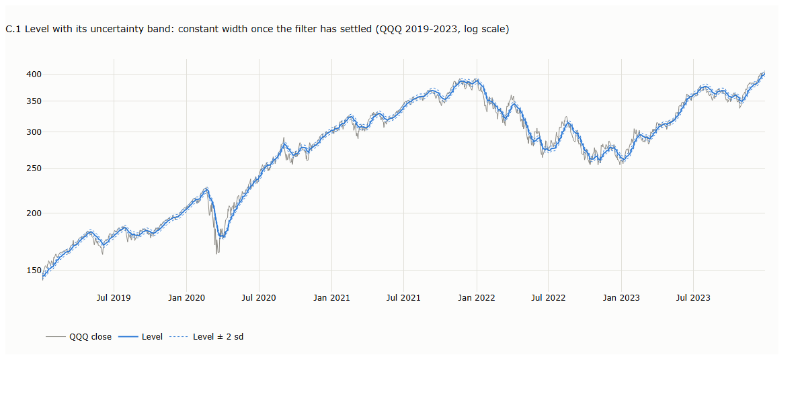
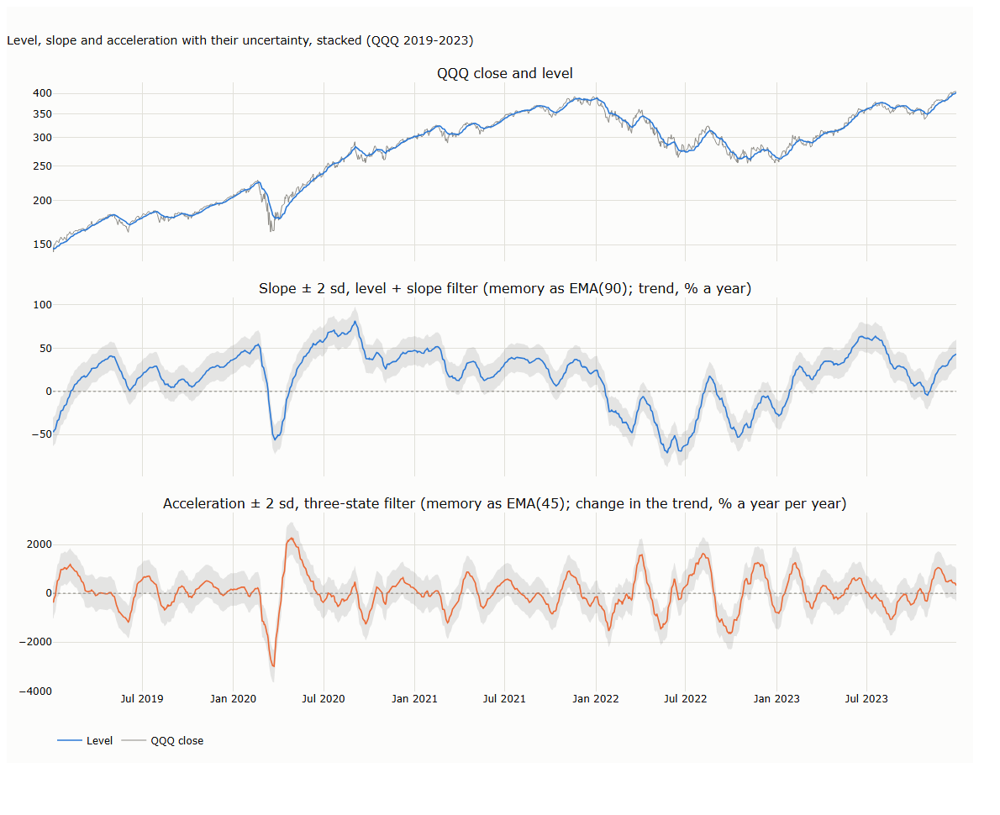
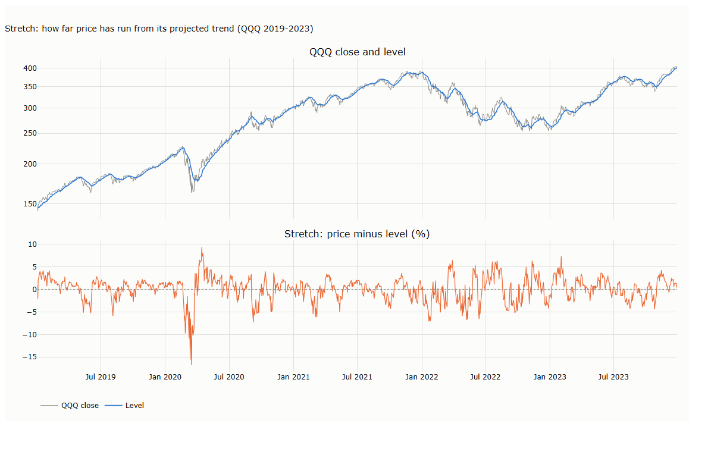
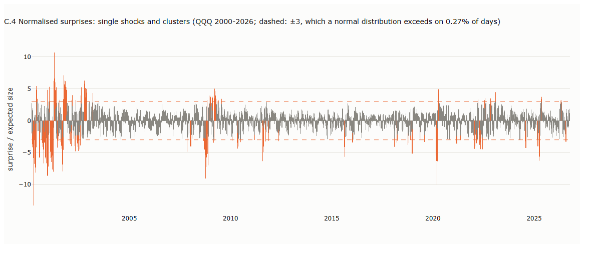

# Lecture 4b: Tracking Hidden States: the Kalman Filter

*Systematic Trading: Lecture Notes (MSc) · Oct 11, 2026 · Max Gnesi · draft, written section by section*

Lecture 2 smoothed prices from the bottom up, by averaging past bars. The Kalman filter works from the top down: it states a model of the state hidden behind prices (a level, and possibly a trend and its acceleration) and revises its estimate of them as each new bar arrives. This lecture builds the linear filter from a single level up to trend speed and acceleration, examines the information each state variable carries, and covers the nonlinear extensions, the extended and unscented filters, for tracking unobserved volatility. Companion notebook: [04_tracking_hidden_states.ipynb](04_tracking_hidden_states.ipynb).

## 1. From averaging to modelling

Every method of Lecture 2 ends up as a weighted average of past prices, and in steady state so does the Kalman filter. The difference lies in where the weights come from and in what the filter carries besides an average. This section sets out what genuinely distinguishes the filter, the blueprint of its model, the three designs used in this lecture side by side, and the three steps it applies to every bar.

### 1.1 What sets the Kalman filter apart

Adapting to the data is not what distinguishes it: the EMA already favours recent bars, KAMA speeds up in trends, VWAP weights by volume. Four things do.

**Table 1.1. Bottom-up averages and the top-down Kalman filter: the highlights**

| | Bottom-up (SMA, EMA, KAMA, VWAP) | Top-down (Kalman filter) |
|---|---|---|
| **What it estimates** | **The level only.** A trend needs a separate average | **As many as the design specifies:** the level alone, or the level with a slope, or with a slope and acceleration, all estimated jointly from the same surprises |
| **What gives a bar its influence** | **Recency, volume or trend efficiency** | **Its surprise:** how far the bar lands from the forecast |
| **Forecast and lag** | **Flat,** so the line lags every trend | **Along the trend,** so there is no lasting lag on a steady trend |
| **Uncertainty** | **None** | **A confidence band for every state variable,** a test for unusual bars, and a likelihood for calibrating the model |

Each of these is built up in the sections that follow.

### 1.2 The blueprint

Every design in this lecture is an instance of one pair of equations, a linear Gaussian state-space model:

```math
\begin{aligned}
x_t &= F\,x_{t-1} + w_t, \qquad w_t \sim N(0,\ Q) \qquad &\text{(state equation)}\\
y_t &= H\,x_t + v_t, \qquad v_t \sim N(0,\ r) \qquad &\text{(observation equation)}
\end{aligned}
```

**Table 1.2. The symbols of the blueprint**

| Symbol | Mathematical role | Financial meaning |
|---|---|---|
| $`y_t`$ | Observation at bar $`t`$ | The log price, the only quantity the market shows |
| $`x_t`$ | State vector, $`n \times 1`$ | The hidden state: one vector whose components, the *state variables*, are the level and, in larger designs, the slope and the acceleration. Its size $`n`$ is a modelling choice |
| $`F`$ | Transition matrix, $`n \times n`$ | How the state variables move from one bar to the next, for instance the level drifting by the slope |
| $`w_t`$, $`Q`$ | State noise and its covariance | Genuine, persistent changes in the state variables: a revaluation, a shift in the trend |
| $`H`$ | Observation matrix, $`1 \times n`$ | Which state variable the price reveals: in every design here, the level alone |
| $`v_t`$, $`r`$ | Price noise and its variance | The part of each price that does not persist (§3) |

*Hidden* means unobservable: no state variable is ever measured directly, only inferred from prices. In statistics such quantities are called latent variables, and models built on them unobserved-components models. The filter can nevertheless recover them because each leaves a trace in the sequence of prices, a property control engineers call observability: the level shows in one price, the slope in two, the acceleration in three (Table 1.4).

A control term is sometimes added to the state equation for inputs the user sets, such as an engine's thrust. A trader cannot set prices, so it is absent here.

### 1.3 Three designs, side by side

The designs differ only in the size of $`x_t`$ and in $`F`$, $`H`$ and $`Q`$. With one bar as the unit of time, and $`\ell_t`$, $`s_t`$ and $`a_t`$ for the level, the slope and the acceleration:

```math
\begin{array}{r|c|c|c}
 & \text{L: level only} & \text{LS: level + slope} & \text{LSA: level + slope + acceleration} \\ \hline
x_t & \begin{pmatrix}\ell_t\end{pmatrix} & \begin{pmatrix}\ell_t\\ s_t\end{pmatrix} & \begin{pmatrix}\ell_t\\ s_t\\ a_t\end{pmatrix} \\[3ex]
F & \begin{pmatrix}1\end{pmatrix} & \begin{pmatrix}1 & 1\\ 0 & 1\end{pmatrix} & \begin{pmatrix}1 & 1 & \tfrac12\\ 0 & 1 & 1\\ 0 & 0 & 1\end{pmatrix} \\[3ex]
H & \begin{pmatrix}1\end{pmatrix} & \begin{pmatrix}1 & 0\end{pmatrix} & \begin{pmatrix}1 & 0 & 0\end{pmatrix} \\[2ex]
Q & \begin{pmatrix}q_\ell\end{pmatrix} & \begin{pmatrix}q_\ell & 0\\ 0 & q_s\end{pmatrix} & \begin{pmatrix}q_\ell & 0 & 0\\ 0 & q_s & 0\\ 0 & 0 & q_a\end{pmatrix} \\[3ex]
\text{forecast of } y_{t+1} & \ell_t & \ell_t + s_t & \ell_t + s_t + \tfrac12 a_t
\end{array}
```

Each design adds one state variable, one row and column to $`F`$ and $`Q`$, and one term to the forecast. The first row of $`F`$ is the forecast of the level: flat for L, along the trend for LS, along a bending trend for LSA. Each $`q`$ sets how much its state variable may change per bar, relative to the price noise $`r`$. Section 2 compares the designs.

### 1.4 One bar of the filter: predict, compare, correct

**Table 1.3. The recursion, applied to every bar**

| Step | Calculation | Notebook code (`kalman()`) | Financial meaning |
|---|---|---|---|
| 1. Predict the state | $`x_{t\mid t-1} = F\,x_{t-1\mid t-1}`$ | `state = transition @ state` | Project yesterday's estimate one bar ahead: the level, moved by the trend if there is one |
| 2. Predict its uncertainty | $`P_{t\mid t-1} = F\,P_{t-1\mid t-1}\,F^\top + Q`$ | `uncertainty = transition @ uncertainty @ transition.T + Q` | The projection is less certain than yesterday's estimate, because the state variables may have moved overnight |
| 3. Forecast the price | $`\hat y_t = H\,x_{t\mid t-1}`$ | `forecast = observe @ state` | The price expected before today's bar is seen |
| 4. Expected variance of the surprise | $`S_t = H\,P_{t\mid t-1}\,H^\top + r`$ | `surprise_var = observe @ uncertainty @ observe + r` | How large a surprise would normally be: forecast uncertainty plus price noise |
| 5. Compute the gain | $`K_t = P_{t\mid t-1}\,H^\top / S_t`$ | `gain = uncertainty @ observe / surprise_var` | For each state variable, the share of the coming surprise to accept as genuine |
| 6. Compare | $`e_t = y_t - \hat y_t`$ | `surprise = price - forecast` | The surprise: today's price minus the forecast |
| 7. Correct the state | $`x_{t\mid t} = x_{t\mid t-1} + K_t\,e_t`$ | `state = state + gain * used` | Move each state variable by its share of the surprise |
| 8. Correct its uncertainty | $`P_{t\mid t} = (I - K_t H)\,P_{t\mid t-1}`$ | `uncertainty = uncertainty - np.outer(gain, observe @ uncertainty)` | Having seen today's price, the filter is more certain where the state variables stand |

Today's price enters only at step 6: everything before it, the gain included, is computed without it. Step 8 is written as $`P - K(HP)`$, the same algebra as $`(I - KH)P`$ without building an identity matrix; $`H`$ is stored as a plain vector, so no transpose is needed. In step 7, `used` is the surprise itself unless the optional robust cap of §5 is switched on.

Here $`x_{t\mid t-1}`$ is the estimate before today's price is seen and $`x_{t\mid t}`$ the estimate after; $`P`$ is the uncertainty of the estimate, the covariance of its error. The gain $`K_t`$ is a vector with one entry per state variable, so a single price surprise updates the level, the slope and the acceleration at once. This is how the filter learns a trend it never observes: when prices keep beating the forecast, the surprises are persistently positive, and each one nudges the slope up by its share.

**How the filter starts.** The start is easiest to see on four made-up prices, 50, 52, 55 and 57, filtered with the three-state design LSA. The filter is initialised with the level at the first price and the slope and acceleration at zero, together with a very large starting uncertainty $`P_0`$, which tells it that these zeros are guesses to be overwritten.

**Table 1.4. The first four bars of LSA on made-up prices, step by step** ($`P_0 = 10^6\,I`$, $`r = 1`$; triples are level / slope / acceleration; each column runs down the eight steps of Table 1.3)

| Step | Bar 0 (start) | Bar 1 | Bar 2 | Bar 3 | Bar 4 |
|---|---|---|---|---|---|
| Price $`y_t`$ | — | 50 | 52 | 55 | 57 |
| 1. Predicted state | — | 50 / 0 / 0 | 50 / 0 / 0 | 55.2 / 3.8 / 1.2 | 59.0 / 4.5 / 1.0 |
| 2. Its standard deviations | — | 1,500 / 1,414 / 1,000 | 1,374 / 1,795 / 943 | 485 / 728 / 485 | 4.4 / 4.9 / 2.4 |
| 3. Forecast $`\hat y_t`$ | — | 50 | 50 | 55.2 | **59.0** |
| 4. Expected size of the surprise $`\sqrt{S_t}`$ | — | 1,500 | 1,374 | 485 | 4.5 |
| 5. Gains $`K_t`$ | — | 1.00 / 0.67 / 0.22 | 1.00 / 1.29 / 0.59 | 1.00 / 1.50 / 1.00 | **0.95** / 1.05 / 0.50 |
| 6. Surprise $`e_t`$ | — | 0 | +2.0 | −0.2 | −2.0 |
| 7. Estimates after the bar | **50 / 0 / 0** (initialised) | 50 / 0 / 0 | 52 / 2.6 / 1.2 | 55 / **3.5 / 1.0** | 57.1 / 2.4 / 0.0 |
| 8. Their standard deviations | 1,000 / 1,000 / 1,000 | **1** / 1,000 / 943 | 1 / **243 / 485** | 1 / **2.6 / 2.4** | 1.0 / 1.6 / 1.0 |

Read column by column:

- **Bar 0: initialisation.** The level is set to the first price, slope and acceleration to zero, and all three are declared highly uncertain (standard deviation 1,000).
- **Bar 1: nothing moves.** The price equals the forecast, so there is no surprise to distribute. The level's uncertainty nonetheless collapses to 1, the size of the price noise: one price is enough to know roughly where the level is.
- **Bar 2: the level is set; slope and acceleration are provisional.** The predicted level is uncertain again (1,374) although the level was known after bar 1: projecting it with a slope that is still unknown spreads the slope's uncertainty into the level. Two prices fix one change but cannot separate a trend from its acceleration. The estimates of 2.6 and 1.2 depend only on the starting uncertainty, and their standard deviations of 243 and 485 say exactly that: ignore them.
- **Bar 3: all three are pinned down.** The filter reproduces the parabola through the three prices, whose acceleration is $`(55-52)-(52-50) = 1`$, and the standard deviations of slope and acceleration fall from the hundreds to about 2.5. Gains above one are normal in these first bars: a single surprise must be converted into a whole slope or acceleration.
- **Bar 4: averaging begins.** The forecast of 59.0 is the first to use all three quantities ($`55 + 3.5 + \tfrac12 \times 1`$). The gain on the level falls below one, so each new price is now blended with the past rather than copied.

The filter needs as many prices as it has state variables before each is determined: one for the level, two for the slope, three for the acceleration. The level-only design is set after one bar, the level + slope design after two, LSA after three; afterwards, every design averages. The gains that drive this sequence depend only on the noise settings and the start, never on the prices: any price series would produce the same gains. The standard filter therefore does not react faster when markets turn volatile. In practice gains do move, but only when the model lets them: when the price noise is made to depend on the data, when the settings are re-estimated, or after missing bars, during which the filter only predicts, its uncertainty grows, and the first price after the gap receives a larger gain (§5).

**When is the filter stable?** When its gains stop changing. Because they do not depend on the prices, they can be computed before any data arrive, and the bar at which they settle can be read off directly. For the settings of Table 1.4 ($`q_\ell = 10^{-4}`$, $`q_s = 10^{-6}`$, $`q_a = 10^{-8}`$):

**Table 1.5. Gains of the LSA filter of Table 1.4, computed without any prices**

| Bar | Gain on level | Gain on slope | Gain on acceleration |
|---|---|---|---|
| 4 | 0.950 | 1.050 | 0.500 |
| 10 | 0.618 | 0.259 | 0.046 |
| 50 | 0.167 | 0.014 | 0.0005 |
| 100 | 0.097 | 0.0046 | 0.0001 |
| 200 and after | 0.091 | 0.0043 | 0.0001 |

From bar 121 on, every gain is within 1% of its final value: the filter has become a fixed weighted average of past prices, and stays one. A practical rule follows: the filter is stable once all its gains are within 1% of their final values, a bar fixed by the design and the settings and computable before the backtest starts. Slower settings take longer to settle. How much history must be discarded beyond this, so that the estimates no longer depend on where the data begin, is a separate question (§4).

**The filter runs online.** Each bar needs only three things: yesterday's estimate $`x_{t-1\mid t-1}`$, its uncertainty $`P_{t-1\mid t-1}`$ and today's price. Everything the filter knows about the past is condensed into those two objects, so live, the price can be discarded once it has been processed; a backtest simply loops through the history one bar at a time. A full price history is needed in only two cases. The first is estimating the noise settings from the data (§3). The second is *smoothing*: running a second pass backwards through the history so that each past estimate also uses the prices that came after it (Rauch, Tung and Striebel, 1965). Smoothed estimates are useful for describing the past, but in a trading system they are a serious and common mistake: each one uses prices that were not yet known, so a backtest built on them looks far better than anything that can be traded. The same caution applies to the first case: noise settings estimated on the whole history and then used to backtest that same history leak future information; they must be estimated on data before the evaluation period, or re-estimated as it rolls forward.

### 1.5 From the blueprint to the code

The blueprint names four objects: $`F`$, $`H`$, $`Q`$ and $`r`$. An implementation handles many more, because the filter needs working quantities of its own and a set of choices the blueprint leaves open. They fall into three layers, and keeping them apart is the easiest way to read any Kalman filter code, including the companion notebook's `kalman()` function.

**Table 1.6. Every object in an implementation, by layer** (names as in the notebook)

| Layer | In the notebook | Symbol | Shape | What it is |
|---|---|---|---|---|
| **Model: what is assumed** | `transition` | $`F`$ | $`n \times n`$ | How the state variables move from bar to bar; fixed by the design (`design()`) |
| | `observe` | $`H`$ | $`1 \times n`$ | Which state variable the price reveals: $`(1, 0, \dots, 0)`$ |
| | `Q` (from `q_diag`, or `full_q`) | $`Q`$ | $`n \times n`$ | How much each state variable may change per bar |
| | `r_price` | $`r`$ | scalar | Variance of the price noise |
| **Filter: computed on every bar** | `state` | $`x_{t\mid t}`$ | $`n`$ | The current estimate of the state variables: level, slope, acceleration |
| | `uncertainty` | $`P_{t\mid t}`$ | $`n \times n`$ | Variances of the estimation errors on the diagonal, their covariances off it |
| | `forecast` | $`H\,x_{t\mid t-1}`$ | scalar | The price expected before today's bar is seen |
| | `surprise` | $`e_t`$ | scalar | Today's price minus the forecast |
| | `surprise_var` | $`S_t`$ | scalar | The variance a surprise should have if the model is right |
| | `gain` | $`K_t`$ | $`n`$ | The share of the surprise each state variable accepts |
| **Settings: chosen by the user** | `start_state` | $`x_0`$ | $`n`$ | The starting guess: first price as level, zero slope and acceleration |
| | `start_uncertainty` | $`P_0`$ | $`n \times n`$ | How much the starting guess is trusted; large means a diffuse start |
| | `Q_REL`, `q_scale` | ratios within $`Q`$ | — | The relative speeds of level, slope and acceleration, and their overall scale |
| **Outputs** | `states`, `sds` | $`x_{t\mid t}`$, $`\sqrt{\mathrm{diag}\,P_{t\mid t}}`$ | $`T \times n`$ | The history of the estimates and of their standard deviations, for charts and readings |

Only the first layer is the model. The second is the machinery of Table 1.3, the same for every design. The third is chosen by the user, and the rest of the lecture shows how; the code's remaining arguments belong to the extensions of §5.

**Table 1.7. What the user must choose, and where the lecture covers it**

| Choice | Covered in |
|---|---|
| The design: which state variables to track ($`F`$ and $`H`$) | §2 |
| How fast each state variable may change, relative to the price noise ($`Q`$ and $`r`$) | §3 |
| The start ($`x_0`$, $`P_0`$) and how much history to load first | §4 |

## 2. Choosing the design: which state variables to track

The design is the first choice and the most consequential: it fixes which kinds of price motion the filter can follow and what it can report about them. Each state variable added to the design is one more property of the price, estimated separately and consistently with the others: where the price is, which way and how fast it is moving, and whether that movement is speeding up. This lecture is about smoothing, and this section describes what each design delivers. It also offers a first glimpse of what comes next: in Part II, these same quantities become the inputs of trend-following systems.

### 2.1 Level only: an EMA with a model behind it

The simplest design tracks the level alone. Once the gain has settled (§1.4), steps 1 to 7 of Table 1.3 reduce to one line:

```math
\ell_t = \ell_{t-1} + K\,(y_t - \ell_{t-1}) = K\,y_t + (1-K)\,\ell_{t-1}
```

This is an EMA whose smoothing constant $`\alpha`$ is the steady gain $`K`$. The gain follows from the ratio $`q_\ell / r`$ alone: with $`q_\ell / r = 1/6`$ it is exactly $`1/3`$, the $`\alpha`$ of EMA(5) (our derivation; notebook §3).

It inherits the EMA's character entirely, including its lag behind any trend; nothing is gained except the uncertainty band, and nothing is lost. The design is the bridge from Lecture 2: it shows that the Kalman filter contains the EMA as its simplest case.

### 2.2 Level + slope: the trend becomes a state

Adding a slope gives the *local linear trend* model. The level drifts by the slope each bar, and the slope itself changes only slowly. The trend is now a number the filter estimates, forecasts with and revises by every surprise.

Once the gains have settled, the two updates of step 7 are

```math
\ell_t = \hat y_t + K_1\,e_t, \qquad s_t = s_{t-1} + K_2\,e_t, \qquad \hat y_t = \ell_{t-1} + s_{t-1}
```

which is Holt's linear method, the classical exponential smoothing with a trend (Holt, 1957, reprinted 2004), with smoothing constants $`\alpha = K_1`$ for the level and $`\beta = K_2 / K_1`$ for the trend (our derivation). The Kalman filter adds what Holt's method lacks: a model from which the two constants follow, and an uncertainty for each.

The slope is the first derivative of the price, its direction and speed. Two consequences matter for what follows.

- **The trend is the slope.** A positive slope means the filter estimates a rising trend, with a standard deviation that says how sure it is.
- **Price against the level changes meaning.** The level has already been projected along the trend, so price below the level means that price rose less than the projected trend, not that the trend has turned. It measures how far price is stretched from its trend. As a preview of Part II: practitioners use the slope to judge the trend and the stretch to judge whether price has run too far, the idea behind overbought and oversold readings (QuanterLab, 2026).

### 2.3 Level + slope + acceleration: the change in the trend

A third state variable models the acceleration, the second derivative of the price: whether the trend is strengthening or fading. Because it also enters the forecast, through the $`\tfrac12 a_t`$ term of Table 1.3, it shifts where the filter expects the next price: a fading rise lowers the forecast before the slope itself turns.

The acceleration is the noisiest of the three state variables: estimating a change in a trend amplifies the noise in prices twice over, once for the trend and once for its change.

**Why stop at acceleration?** Further derivatives, often called jerk and snap, could be added as state variables in the same way. Each one amplifies the noise further and makes the filter overshoot more, and oscillate, after a jump (§2.4). Practice therefore stops at acceleration. By analogy, high-order polynomials fitted to recent points swing wildly when extrapolated; this is the Runge phenomenon, strictly a property of interpolation.

### 2.4 What each design can follow

On synthetic prices without noise (notebook §6), three rules stand out. The level-only design follows a flat price but lags a steady trend forever; the level + slope design follows a steady trend exactly but overshoots a jump by 17–20%; the three-state design follows a steady acceleration exactly but overshoots by 23–29%. Faster settings shrink a lag but never remove it; only an additional state variable does. And following more has a price: the slope designs overshoot because they extrapolate.

### 2.5 What can be read from the filter

Every quantity the filter produces on each bar can be read directly, and each is charted on QQQ in the appendix.

**Table 2.1. What can be read from the filter on every bar**

| Quantity | Computed in | What it shows | Where it leads (Part II) |
|---|---|---|---|
| Level $`\ell_t`$, with band $`\pm\sqrt{P_{\ell\ell}}`$ | Steps 7 and 8 | The smoothed price, and how sure the filter is of it; once the filter has settled, the band keeps a constant width ([chart C.1](#c1-level-and-its-uncertainty-band-25)) | A cleaner price to trade against |
| Slope $`s_t`$, with its standard deviation | Steps 7 and 8 | Direction and speed of the trend; whether it is distinguishable from zero ([chart C.2](#c2-slope-and-acceleration-with-their-uncertainty-25)) | The core of a trend-following signal |
| Acceleration $`a_t`$, with its standard deviation | Steps 7 and 8 | Whether the trend is strengthening or fading ([chart C.2](#c2-slope-and-acceleration-with-their-uncertainty-25)) | An early warning that a trend is tiring |
| Stretch $`y_t - \ell_t`$ | Step 7 | How far price has run from its projected trend ([chart C.3](#c3-stretch-25)) | Overbought and oversold judgements |
| Normalised surprise $`e_t / \sqrt{S_t}`$ | Steps 4 and 6 | How unusual today's bar is, compared with what the model expects; clusters of large surprises mark periods the model does not fit ([chart C.4](#c4-normalised-surprises-25)) | Flagging shocks, and checking whether the model fits |

**What the charts show.** On QQQ, with the level reacting like EMA(15) and the slope remembering like EMA(252):

- **The level's band does not move.** It stays at about ±1.3% through the 2020 crash and the 2022 decline ([chart C.1](#c1-level-and-its-uncertainty-band-25)). Once the filter has settled, its uncertainty is constant, so the band is a yardstick, not a gauge of volatility.
- **The slope separates trend from noise.** Over 2019–2023 it was more than two standard deviations above zero on 67% of days and below on 13%; on the other 20% the trend could not be told apart from noise ([chart C.2](#c2-slope-and-acceleration-with-their-uncertainty-25)).
- **The acceleration moves first, but not cleanly.** It turned negative before the slope fell through zero in early 2022 and positive before the slope turned up in early 2023, yet it also swings in between ([chart C.2](#c2-slope-and-acceleration-with-their-uncertainty-25)).
- **The stretch is usually small.** On nine days in ten price lay between 4.5% below and 3.7% above its projected trend; the extremes came only in fast moves, −17% in the March 2020 crash ([chart C.3](#c3-stretch-25)).
- **Large surprises come in clusters.** 2000–2002, 2008–2009 and 2022 hold most of the days beyond ±3: periods when volatility outgrew the model's fixed noise ([chart C.4](#c4-normalised-surprises-25)). The surprises, not the band, carry the information about volatility.

A short preview of what comes next. With the level alone, a trend shows only as price against a lagging average, which is the EMA's logic. With a slope, the trend is a quantity in its own right, measured with a confidence band; with an acceleration, so is its change. Part II introduces trend-following systems and shows how such quantities become trading decisions. This lecture stays with what they are and how they behave.

## Appendix: charts

From the companion notebook, section 2c ([04_tracking_hidden_states.ipynb](04_tracking_hidden_states.ipynb)). All four charts use QQQ daily closes in logs. The level, the slope, the stretch and the surprises come from the level + slope design, with the level reacting to each surprise like EMA(15) and the slope remembering like EMA(252). The acceleration comes from a three-state design whose acceleration remembers like EMA(156): within one filter the slope cannot keep a longer memory than the acceleration, so a second filter is needed. The ratios of the noise variances set these memories; their common scale, which sets the uncertainty, is calibrated so that the normalised surprises have a standard deviation of 1 over 2014–2018, before the period charted. It corresponds to a daily price noise of 1.8%.

### C.1 Level and its uncertainty band (§2.5)



The level follows price closely. Its band, ±2 standard deviations of the level estimate, is about ±1.3% and keeps that width through the 2020 crash and the 2022 decline: once the filter has settled, its uncertainty no longer moves. On a price chart the band therefore adds little; its value lies at the start (Table 1.4) and as a yardstick for the slope (chart C.2). It is not a Bollinger band, which measures how widely prices disperse and widens with volatility; it measures only how sure the filter is of the level.

### C.2 Slope and acceleration with their uncertainty (§2.5)



The slope is the trend in % a year, the grey band ±2 standard deviations. Over 2019–2023 the slope lay more than two standard deviations above zero on 67% of days and below on 13%; on the remaining 20% the trend could not be told apart from noise. The acceleration turned negative in late 2021, before the slope fell through zero in early 2022, and positive in late 2022, before the slope turned up in early 2023. It also swings in between: an earlier and noisier layer than the slope.

### C.3 Stretch (§2.5)



Price minus level, in %. On nine days in ten the stretch lay between −4.5% and +3.7% (5th to 95th percentile, 2019–2023); the extremes came in fast moves, −17% in the March 2020 crash and +8% in the rebound. A strongly negative stretch while the slope stays positive marks a pullback within a rising trend; what such readings are worth is a question for Part II.

### C.4 Normalised surprises (§2.5)



Each bar's surprise divided by its expected size $`\sqrt{S_t}`$. Calibrated on 2014–2018, they have a standard deviation of 1 there; over 2000–2026 it is 1.61, and 6.4% of days lie beyond ±3, against 0.27% for a normal distribution. The large surprises come in clusters: 2000–2002, 2008–2009 and 2022 hold most of them, with a short burst in 2020. A cluster means that the model's fixed price noise is too small for that period: volatility has risen, and the standard filter's uncertainty does not follow it. The surprises, not the band, are therefore the filter's gauge of volatility; making the noise follow them is the subject of §5.

## References (so far)

- Holt, C.C. (2004). Forecasting seasonals and trends by exponentially weighted moving averages. *International Journal of Forecasting* 20(1), 5–10. Reprint of a 1957 Office of Naval Research report. — exponential smoothing with a trend (§2.2).
- QuanterLab (2026). Kalman filter: trend following. https://quanterlab.com/articles/stochastic-kalman-trend (practitioner article, accessed 11 October 2026). — the slope as the trend signal, the gap between price and level as a stretch filter (§2.2).
- Rauch, H.E., Tung, F. and Striebel, C.T. (1965). Maximum likelihood estimates of linear dynamic systems. *AIAA Journal* 3(8), 1445–1450. — the smoother (§1.4).
