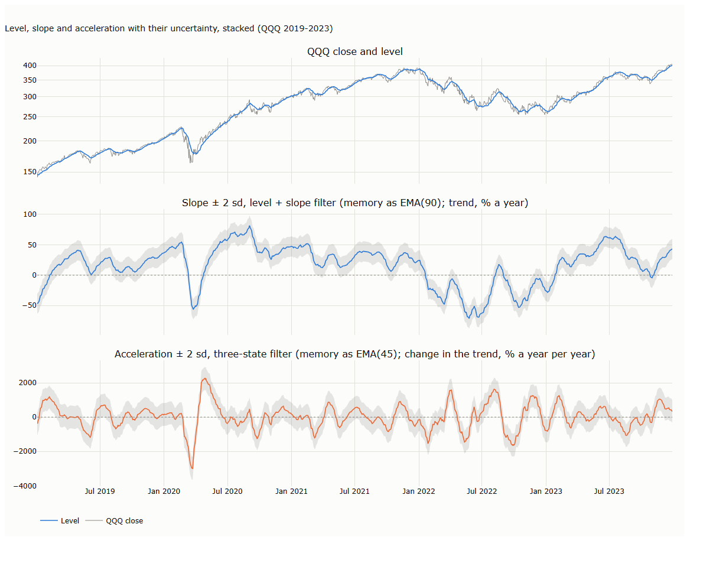
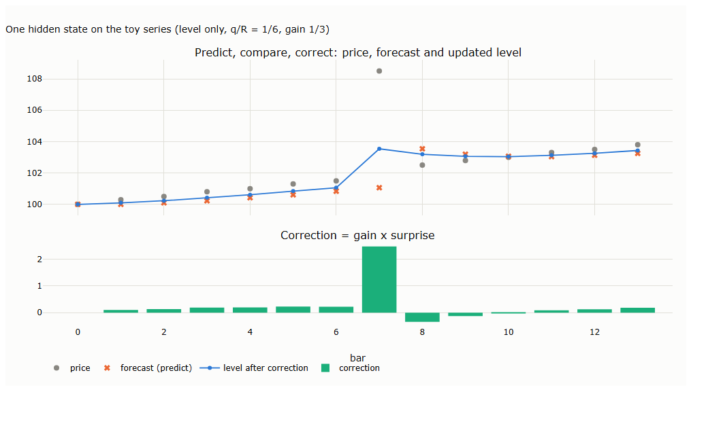
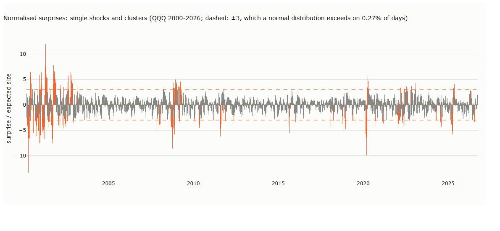
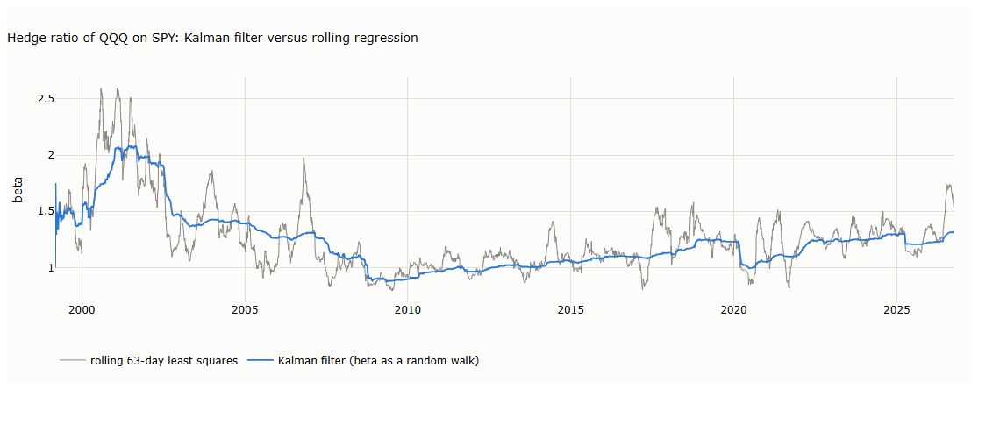

# Lecture 4: Tracking Hidden States: the Kalman Filter

> The Kalman filter works from the top down: it states a model of the quantities hidden behind prices and revises its estimate of them as each new bar arrives.

Part I · Pipeline stage: signal generation (the level and slope of a hidden trend)

---

# One model, several readings

> A single model delivers a level, a trend and its rate of change, and the uncertainty around each.

- Slope more than 2 sd above zero on 59% of days, below on 17%
- On the other 24% the trend could not be told from noise
- The acceleration moves first, and often

---

# Bottom-up versus top-down

> Bottom-up methods average past bars; a state-space model states what is hidden and checks each bar against it.

| | Bottom-up (SMA, EMA, VWAP, KAMA) | Top-down (Kalman filter) |
|---|---|---|
| What it estimates | The level only | Level, slope, acceleration, jointly |
| What gives a bar its influence | Recency, volume or trend efficiency | Its surprise: how far it lands from the forecast |
| Forecast and lag | Flat, so the line lags every trend | Along the trend: no lasting lag on a steady trend |
| Uncertainty | None | A confidence band for every state variable |

---

# The blueprint

> Every design is one pair of equations: how the hidden state moves, and how the price reveals it.

$$\begin{aligned} x_t &= F\,x_{t-1} + w_t, \qquad w_t \sim N(0,\ Q) \qquad &\text{(state equation)}\\ y_t &= H\,x_t + v_t, \qquad v_t \sim N(0,\ r) \qquad &\text{(observation equation)} \end{aligned}$$

- $y_t$: the log price, the only quantity the market shows
- $x_t$: the hidden state, the level and, in larger designs, the slope and the acceleration
- $F$: how the state moves, e.g. the level drifting by the slope
- $Q$: genuine, persistent changes; $r$: the part of each price that does not persist
- The level shows in one price, the slope in two, the acceleration in three

---

# Predict, compare, correct

> Each bar the filter projects its state, measures the surprise, and moves each state variable by its gain times the surprise.

1. **Predict:** project the state one bar ahead
2. **Compare:** surprise = price minus forecast
3. **Correct:** state + gain × surprise

---

# Level only: an EMA with a model behind it

> With one hidden state, the Kalman filter is an EMA whose smoothing constant is set by the ratio of two noise variances.

$$\ell_t = K\,y_t + (1-K)\,\ell_{t-1}$$

- With $q_\ell / r = 1/6$ the steady gain is exactly $1/3$, the $\alpha$ of EMA(5)
- **Only the ratio matters:** scaling both variances leaves the estimates unchanged; the band is $\sqrt{10}$ times wider at ten times the scale
- Ratios set the speed; the scale, calibrated on earlier data, sets the uncertainty

---

# Design versus tuning

> The design decides which motion is followed with no lasting gap and whether jumps are overshot; tuning only sets the speed.

| Design | Forecast of the next price | Follows with no lasting gap | Overshoots a jump |
|---|---|---|---|
| L: level only | $\ell_t$ | A flat price | Never |
| LS: level + slope | $\ell_t + s_t$ | A steady trend | By 17–20% |
| LSA: + acceleration | $\ell_t + s_t + \tfrac12 a_t$ | A steady acceleration | By 23–29% |

- Tuning shrinks a gap but never removes it; only adding a state does
- Any negative weight on past prices forces an overshoot

---

# Read the slope, not the crossing

> In a slope design, price below the level means only that price rose less than the projected trend: the trend is read from the slope.

| Design | Strong advances: position reading pointing up |
|---|---|
| L | 91% |
| LS | 65% |
| LSA | 59% |

- After each update, price minus level = (1 − gain) × surprise
- In the same advances the slope readings point up on 99.9% of days
- Readings of different states agree on only 45–74% of days: three distinct layers of the same price

---

# Each reading captures different behaviour

> Position readings react within days but change sign often; slope readings hold a trend and ignore chop, but turn about a month late.

| Reading | Sign changes a year, choppy | Median delay after turning points |
|---|---|---|
| Position, level only | 38.3 | 5 days |
| Position, level + slope | 26.8 | 4 days |
| Slope, level + slope | 7.4 | 30 days |
| Acceleration | 4.4 | 23 days |

- **2000–2002:** slope, level + slope changed sign 9 times; position, level only 83 times
- **2020:** after the 23 March low, position, level only pointed up in 3 days; slope, level + slope in 30
- No design is best: the two episodes reward opposite behaviours

---

# Setting the knobs

> Every knob buys speed in one place and pays for it in noise or overshoot somewhere else; there is no setting that is fast, smooth and accurate at once.

| Knob raised | What it buys | What it costs |
|---|---|---|
| $q_\ell$, the level | Gap to price 0.64% instead of 2.24% | The slope barely moves |
| $q_s$, the slope | Turned 3 days after the 2020 peak and low, instead of 6 and 15 | 24.7 sign changes a year instead of 8.0 |
| $q_a$, the acceleration | Responds within days | Slope peaked at +532% a year, against a fastest pace of 285% |

Set memory by the weights, not the gain: a slope gain of $2/(N+1)$ remembers like EMA(17), not EMA(90).

---

# Starting and running the filter

> Warm-up is fixed by the design and its settings, so it can be computed in advance; a diffuse start removes the starting guess at once.

| Design | Level error below 0.1%: diffuse / confident start |
|---|---|
| L | 0 / 73 bars |
| LS | 0 / 137 bars |
| LSA | 23 / 145 bars |

- Each state variable lengthens everything; EMA(20) needs 70 bars
- Load at least twice the longest memory: the slope direction then agrees with the full-history run on 100% of days
- Store start, settings and state: the same dates must give the same readings

---

# When the model is wrong: fat-tailed surprises

> Normalised surprises should look like standard normal noise; on QQQ 6.46% of days lie beyond ±3, against 0.27% for a normal distribution.

- Large surprises cluster: 2000–2002, 2008, 2020, 2022
- Scaling every noise variance by a running scale cuts that to 0.73%; the readings stay as they are
- A cap at 3 times the recent typical surprise guards against single outliers

---

# The same machinery, other hidden states

> Any hidden quantity that moves slowly and is measured linearly can be tracked: a Kalman hedge ratio hedges as well as a rolling regression with far less trading.

- **Volatility from daily ranges:** crossed 40% twelve days earlier in 2008
- **Hedge ratio:** hedged volatility 11.68%, against 11.51% for a 63-day regression
- With an eighth of the regression's turnover

---

# Takeaways

1. **A model, not an average:** the design states what is hidden and how it moves; with one state the filter is an EMA, and only ratios matter
2. **The design decides, tuning sets the speed:** which motion is followed with no lasting gap, and whether jumps are overshot
3. **Each state gives its own reading:** position, slope and acceleration capture different layers of the same price
4. **Start diffuse, load twice the longest memory,** and store what was produced
5. **Surprises are fat-tailed and come in clusters:** let the noise follow a running scale
6. **No design is best:** the 2000–2002 and 2020 episodes reward opposite designs
