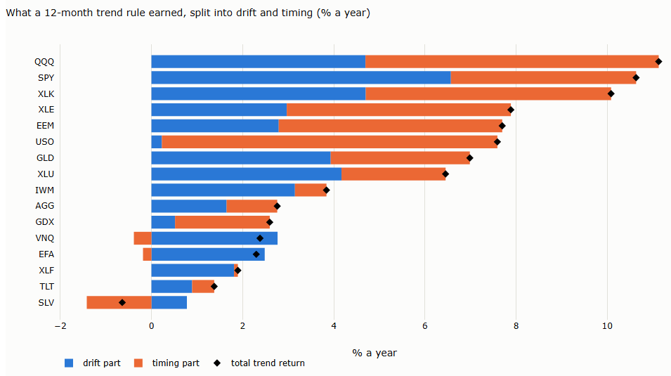
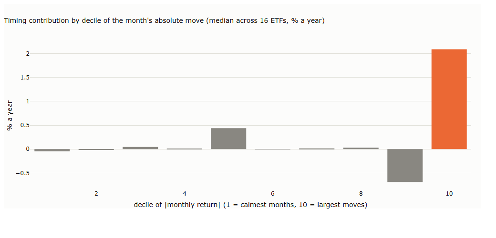

# Lecture 5: What Trend Following Captures

*Systematic Trading: Lecture Notes (MSc) · Oct 18, 2026 · Max Gnesi*

Before building a trend system, it pays to know what a trend system earns. This lecture splits trend profits into two sources, the drift of a market and the persistence of its returns, shows that the second is concentrated in a few episodes, and turns both into questions to ask about any market before trading it. Data: 16 liquid ETFs across equities, bonds, commodities and real estate. Companion notebook: [05_what_trend_following_captures.ipynb](05_what_trend_following_captures.ipynb).

## 1. The question of this lecture

This lecture is about the **market**, not the system: where do the profits of a trend rule come from, and in which markets should we expect them? Lecture 6 then asks how to design a system that captures the part we want.

| | Lecture 5: What Trend Following Captures | Lecture 6: the Map and the Machinery |
|---|---|---|
| Question | Where do trend profits come from, and in which markets? | How do we design a system that captures the part we want? |
| About | The market | The system |
| Key message | Trend profits have two sources, drift and timing; markets differ in how much of each they offer | Design decides what is captured: direction, speed and exits choose between drift and crisis protection |
| Afterwards the reader can | Judge a market before building anything | Read any trend rule as a set of design choices and turn it into positions |

One rule serves throughout as a **measuring instrument**, not as a system to trade: hold a long position in an asset for the next month if its return over the past 12 months was positive, and a short position if it was negative. This is the time-series momentum rule of Moskowitz, Ooi and Pedersen (2012). The results describe one rule on one history of 16 ETFs; they are evidence about these markets, not laws.

## 2. Two sources of trend profits

A trend rule earns from two different things: the **drift** of the asset, which it collects by being long more often than short, and the **timing** of its positions, which pays when returns persist. The two parts can be measured exactly, and they behave very differently.

### 2.1 Drift and timing

With position $`s_t`$ (+1 long, −1 short) and the asset's return $`r_t`$ in month $`t`$, the average return of the rule splits into two parts:

```math
\overline{s\,r} \;=\; \underbrace{\overline{(s-\bar s)(r-\bar r)}}_{\text{timing}} \;+\; \underbrace{\bar s\;\bar r}_{\text{drift}}
```

| Part | Formula | Financial meaning |
|---|---|---|
| Drift | Average position × average return | What the rule earns by leaning long in an asset that rises over time, or short in one that falls; a buy-and-hold investor with the same average exposure would earn it too |
| Timing | Covariance of the position with the return | What the rule earns by being long in the months that turn out good and short in those that turn out bad; it pays only if returns persist |

The split is exact. A six-month toy series shows it:

| Month | 1 | 2 | 3 | 4 | 5 | 6 | Average |
|---|---|---|---|---|---|---|---|
| Position $`s_t`$ | +1 | +1 | +1 | −1 | −1 | +1 | 0.333 |
| Return $`r_t`$ (%) | 2 | 1 | −3 | −2 | 1 | 3 | 0.333 |
| $`s_t r_t`$ (%) | 2 | 1 | −3 | 2 | −1 | 3 | 0.667 |

The rule earns 0.667% a month. The drift part is 0.333 × 0.333 = 0.111%; the timing part is the remaining 0.556%, the covariance of the two rows (notebook §2.1). Moskowitz, Ooi and Pedersen use a decomposition of this kind, following Lo and MacKinlay (1990), and find that positive autocovariance of returns drives most of time-series momentum in futures.

### 2.2 What a trend rule earned on 16 ETFs

**Table 2.1. The 12-month trend rule, split into drift and timing** (% a year; monthly rebalancing; each ETF from its start to September 2026; notebook §2.2)

| ETF | Asset drift | Months long | Trend return | Drift part | Timing part | Long side | Short side |
|---|---|---|---|---|---|---|---|
| SPY | 10.2 | 82% | 10.6 | 6.6 | 4.1 | 10.4 | 0.2 |
| QQQ | 7.9 | 80% | 11.1 | 4.7 | 6.4 | 9.5 | 1.6 |
| IWM | 8.1 | 69% | 3.8 | 3.2 | 0.7 | 6.0 | −2.1 |
| EFA | 7.3 | 67% | 2.3 | 2.5 | −0.2 | 4.8 | −2.5 |
| EEM | 7.9 | 68% | 7.7 | 2.8 | 4.9 | 7.8 | −0.1 |
| XLE | 8.3 | 68% | 7.9 | 3.0 | 4.9 | 8.1 | −0.2 |
| XLF | 5.8 | 66% | 1.9 | 1.8 | 0.1 | 3.8 | −1.9 |
| XLK | 8.5 | 78% | 10.1 | 4.7 | 5.4 | 9.3 | 0.8 |
| XLU | 7.3 | 79% | 6.5 | 4.2 | 2.3 | 6.9 | −0.4 |
| VNQ | 6.1 | 73% | 2.4 | 2.8 | −0.4 | 4.3 | −1.9 |
| AGG | 2.8 | 79% | 2.8 | 1.7 | 1.1 | 2.8 | 0.0 |
| TLT | 3.1 | 64% | 1.4 | 0.9 | 0.5 | 2.2 | −0.9 |
| GLD | 9.8 | 70% | 7.0 | 3.9 | 3.1 | 8.4 | −1.4 |
| SLV | 7.3 | 55% | −0.6 | 0.8 | −1.4 | 3.3 | −4.0 |
| GDX | 5.0 | 55% | 2.6 | 0.5 | 2.1 | 3.8 | −1.2 |
| USO | −5.3 | 48% | 7.6 | 0.2 | 7.4 | 1.0 | 6.6 |
| **Median** | 7.3 | 69% | **5.2** | **2.8** | **2.2** | 5.4 | **−0.7** |

- **Both sources matter, about equally.** Of the median 5.2% a year, 2.8 points come from drift and 2.2 from timing ([chart D.1](#d1-drift-and-timing-by-etf-22)).
- **Where an asset rises steadily, drift dominates.** SPY earns 6.6 points from drift: being long 82% of the time in an asset that rose 10% a year.
- **Where an asset falls, timing does the work.** USO's drift was −5.3% a year, yet the rule earned 7.6%, almost all of it timing: it was short through oil's long declines.
- **Timing can also be negative.** For SLV, EFA and VNQ, trends reversed often enough that the rule's positions lined up with the wrong months.

### 2.3 The long side and the short side live in different markets

The last two columns of Table 2.1 split the same return by the months spent long and short. The long side earns 5.4% a year at the median; the short side loses 0.7%. Being short an asset that drifts upwards costs the drift, so the short side pays only where downtrends persist: QQQ (+1.6), XLK (+0.8) and USO (+6.6).

**Table 2.2. Next month after an up-trend and after a down-trend** (% a year; notebook §2.3)

| ETF | Mean return after an up-trend | Mean return after a down-trend | Volatility after an up-trend | Volatility after a down-trend |
|---|---|---|---|---|
| SPY | 12.7 | −1.2 | 12.9 | 22.0 |
| QQQ | 11.9 | −8.1 | 18.7 | 35.5 |
| IWM | 8.6 | 7.0 | 16.2 | 27.0 |
| USO | 2.1 | −12.7 | 34.7 | 46.5 |
| **Median of 16** | 7.9 | 2.2 | 17.2 | 27.2 |

After a 12-month downtrend, volatility is about 60% higher than after an uptrend. The short side therefore lives in turbulent markets, where large moves in both directions are common: it pays when the decline continues, as for QQQ after 2000 or oil after 2014, and loses when the market rebounds, as IWM's positive returns after downtrends show. Lecture 6 shows what this means for design: whether a system holds short positions at all decides whether it collects drift, protection, or both.

### 2.4 Timing comes in episodes

Linear autocorrelation of monthly returns is close to zero: summed over twelve lags, its median across the 16 ETFs is −0.03. Yet the rule earns 2.2% a year from timing. The two fit together because the persistence is not spread evenly over time; it is concentrated in a few episodes.

**Table 2.3. Where the timing part is earned** (% a year, median across 16 ETFs; notebook §2.4)

| Months | Timing contribution |
|---|---|
| All months | 2.2 |
| The 10% of months with the largest moves | **2.0** |
| The other 90% | **0.1** |

Almost all of the timing profit comes from one month in ten ([chart D.2](#d2-timing-by-size-of-the-months-move-24)). In ordinary months the rule's positions earn nothing from timing; in the largest months, being on the right side of a persistent move pays. A linear autocorrelation, which weights every month equally, averages these episodes away.

The literature points to the mechanisms behind such episodes.

| Mechanism | What happens | Evidence |
|---|---|---|
| Slow diffusion of information | News reaches investors gradually; prices underreact, then traders who follow momentum push them past fair value | Hong and Stein (1999) |
| Forced selling | Investors who must sell, such as funds facing large outflows, push prices down together; the pressure lasts about two quarters before reversing | Coval and Stafford (2007): abnormal returns of −13% to −18% around fire sales, reversed over the following three quarters |
| Liquidity spirals | Falling prices raise margins and cut traders' capital, which reduces liquidity and pushes prices further | Brunnermeier and Pedersen (2009) |
| Hedging flows | Dealers short options and leveraged ETFs must buy after rises and sell after falls, pushing prices in the direction they are already moving | Baltussen, Da, Lammers and Martens (2021): intraday momentum in more than 60 futures |

**Over days, a shock overshoots.** The persistence that a monthly rule earns from is not the immediate reaction to a shock.

**Table 2.4. The week after a large weekly move** (weekly returns standardised by trailing 52-week volatility; median across 16 ETFs; notebook §2.4)

| | After a week beyond 2 standard deviations | After a normal week |
|---|---|---|
| Next week has the same sign | 46% | 49% |
| Next week's return after a large fall | +0.3% | — |

A large weekly move is slightly more likely to be followed by a move the other way, and a large fall by a small rebound: the first days overshoot. What persists is the regime the shock starts, which can last for months, as the fire sales above did. A monthly trend rule is positioned for that persistence, not for the first shock.

### 2.5 Trend or reversion: patterns, not laws

Trend following and mean reversion use the same estimate, the past return, and act on it in opposite directions (Bruder, Dao, Richard and Roncalli, 2011). The literature documents statistical patterns at different horizons, but each was found in particular markets and periods:

| Horizon | Pattern documented | Where it was found |
|---|---|---|
| A week to a month | Reversal | Individual US stocks (Jegadeesh, 1990; Lehmann, 1990) |
| Three to twelve months | Continuation | US stocks, ranked against each other (Jegadeesh and Titman, 1993); 58 futures markets, each against its own past (Moskowitz, Ooi and Pedersen, 2012) |
| Three to five years | Reversal | US stocks (De Bondt and Thaler, 1985); partial reversal of time-series momentum beyond a year in futures (Moskowitz, Ooi and Pedersen) |

These are tendencies, not rules that every market obeys. Our own weekly data show how much they vary (Table 2.4, notebook §2.4): after a large weekly move, the next week had the same sign 46% of the time at the median, a mild tendency to reverse, but 63% of the time for oil (USO) and 56% for silver (SLV), where large moves tended to continue.

The patterns therefore inform the design; they do not make it. The **designer decides**, and the decision rests on two questions:

| Question | Trend | Reversion |
|---|---|---|
| What do we want to capture? | The drift, and persistence in episodes: cascades, rebalancing waves, slow diffusion of news (§2.1–§2.4) | The overshoot after shocks and the pull back towards a level |
| Which risk profile do we accept? | Many small losses in choppy markets, a few large gains when a move persists: the profile of a long option, as Fung and Hsieh (2001) and Moskowitz, Ooi and Pedersen (2012) document | Many small gains while prices oscillate, occasional large losses when a move persists: the mirror image, the profile of a short option |

Only then comes the check that the chosen behaviour exists in the market at hand, and why (§3). The same tools serve either choice: a band around a moving average can be traded as a breakout or as a fade; a breakout that fails is a reversion signal; the Kalman filter that tracks a trend in Lecture 4 can track the spread of a pair in mean-reversion trading. Some tools suit one side better: breakouts are built for persistence, oscillators that measure stretch for reversion. But the choice of side follows from what the designer wants to capture and which risks to carry, not from the tool. Lecture 6 takes this further: within trend following itself, design choices such as direction and speed decide which part of the trend profit a system captures.

**Watch out for** reading the absence of autocorrelation as the absence of trends. Persistence that appears in episodes, at inflection points and in cascades, is invisible to an average over all months and is exactly what a trend rule harvests. Equally, do not credit timing with what is drift: in a rising market, a rule that is mostly long earns the drift whatever its timing.

## 3. Before any system: five questions about a market

*To follow:* is there a drift; which frictions create persistence; how fast cascades can happen and how liquid the market is; how mature the market is; how much intervention there is. For each: why it matters, how to check it on data, and what the literature documents.

## 4. The evidence, and who uses trend

*To follow:* the long-run record and its caveats; CTAs and their history; trend in other hedge-fund strategies; newer forms.

## Appendix: charts

From the companion notebook, [05_what_trend_following_captures.ipynb](05_what_trend_following_captures.ipynb). Its sections carry the lecture's numbers.

### D.1 Drift and timing by ETF (§2.2)



Each bar splits the trend rule's return into the drift part (blue) and the timing part (orange); the diamond marks the total. Equity indices earn from both. Oil (USO) earns almost entirely from timing; silver (SLV) loses on timing.

### D.2 Timing by size of the month's move (§2.4)



The timing contribution of each tenth of months, from the calmest to the largest moves, median across the 16 ETFs. The largest tenth contributes 2.1% a year; the others are close to zero, with the ninth slightly negative.

## References (so far)

- Baltussen, G., Da, Z., Lammers, S. and Martens, M. (2021). Hedging demand and market intraday momentum. *Journal of Financial Economics* 142(1), 377–403. — hedging flows (§2.4).
- Brunnermeier, M. and Pedersen, L.H. (2009). Market liquidity and funding liquidity. *Review of Financial Studies* 22(6), 2201–2238. — liquidity spirals (§2.4).
- Bruder, B., Dao, T.-L., Richard, J.-C. and Roncalli, T. (2011). *Trend Filtering Methods for Momentum Strategies.* Lyxor White Paper. — trend following and mean reversion from one estimate (§2.5).
- Coval, J. and Stafford, E. (2007). Asset fire sales (and purchases) in equity markets. *Journal of Financial Economics* 86(2), 479–512. — forced selling and its reversal (§2.4).
- De Bondt, W. and Thaler, R. (1985). Does the stock market overreact? *Journal of Finance* 40(3), 793–805. — long-term reversal (§2.5).
- Fung, W. and Hsieh, D. (2001). The risk in hedge fund strategies: theory and evidence from trend followers. *Review of Financial Studies* 14(2), 313–341. — trend following as a long-option payoff (§2.5).
- Hong, H. and Stein, J. (1999). A unified theory of underreaction, momentum trading, and overreaction in asset markets. *Journal of Finance* 54(6), 2143–2184. — slow diffusion (§2.4).
- Jegadeesh, N. (1990). Evidence of predictable behavior of security returns. *Journal of Finance* 45(3), 881–898. — short-term reversal (§2.5).
- Jegadeesh, N. and Titman, S. (1993). Returns to buying winners and selling losers: implications for stock market efficiency. *Journal of Finance* 48(1), 65–91. — medium-term continuation (§2.5).
- Lehmann, B. (1990). Fads, martingales, and market efficiency. *Quarterly Journal of Economics* 105(1), 1–28. — short-term reversal (§2.5).
- Lo, A. and MacKinlay, A.C. (1990). When are contrarian profits due to stock market overreaction? *Review of Financial Studies* 3(2), 175–205. — the decomposition of strategy profits (§2.1).
- Moskowitz, T., Ooi, Y.H. and Pedersen, L.H. (2012). Time series momentum. *Journal of Financial Economics* 104(2), 228–250. — the rule, the decomposition, persistence and reversal (§1, §2.1, §2.5).
