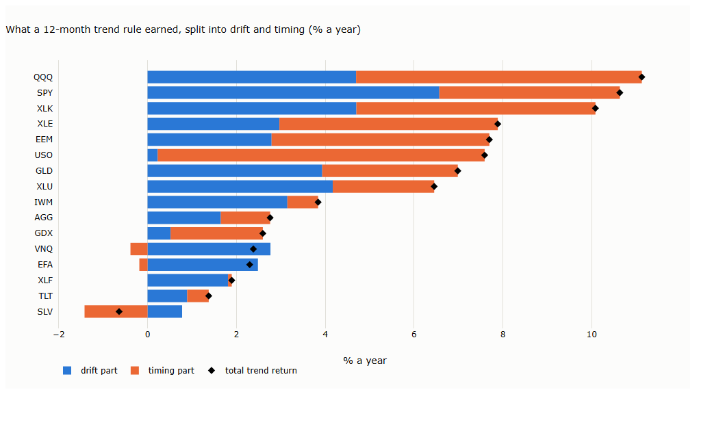
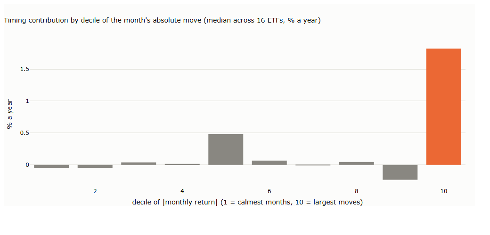

# Lecture 5: What Trend Following Captures

*Systematic Trading: Lecture Notes (MSc) · Oct 18, 2026 · Max Gnesi*

*Pipeline stage (Lecture 1 §2.1): signal generation (what a trend signal captures).*

**Part II: trend, the base strategy.** Part II builds trend once, in order: what it captures (this lecture), the machinery (6), how to compare systems (7), filter them (8) and size them (9), three systems end to end on futures (10), and then **portfolio construction**, in three lectures: the markets (11), the speeds (12) and the baseline portfolio (13). Every later part adds to that portfolio. In the five stages of Lecture 1 §2.1, Part II builds signal generation (5-8, 12), data (11), and portfolio construction and risk management (9, 13); Lecture 10 runs all five end to end.

Before building a trend system, it pays to know what a trend system earns. **A trend rule captures two things: the drift of a market, which is largely the risk premium its asset class pays, and the persistence of its moves.** Moves persist because prices adjust over time rather than at once, for two families of reasons: **information diffuses slowly**, and **frictions make trading slow**: large orders spread over days, money that moves between funds gradually, capital that is slow to arrive, and deleveraging that unfolds over weeks, in buying waves and selling waves alike. This lecture measures the two sources on real data, shows where the persistence is earned (in a few large months), explains why moves persist, turns all of it into questions to ask about any market before trading it, chooses what to capture, and closes with the evidence and the business of trend following. Data: 16 liquid ETFs across equities, bonds, commodities and real estate. Companion notebook: [05_what_trend_following_captures.ipynb](05_what_trend_following_captures.ipynb).

## 1. The question of this lecture

This lecture is about the **market**, not the system: where do the profits of a trend rule come from, and in which markets should we expect them? Lecture 6 then asks how to design a system that captures the part we want.

| | Lecture 5: What Trend Following Captures | Lecture 6: the Map and the Machinery |
|---|---|---|
| Question | Where do trend profits come from, and in which markets? | How do we design a system that captures the part we want? |
| About | The market | The system |
| Key message | Trend captures the drift and the persistence of moves; moves persist because information diffuses slowly and frictions make trading slow; markets differ in how much of each they offer | Design decides what is captured: direction, speed and exits choose between drift and crisis protection |
| Afterwards the reader can | Judge a market before building anything | Read any trend rule as a set of design choices and turn it into positions |

One rule serves throughout as a **measuring instrument**, not as a system to trade: hold a long position in an asset for the next month if its return over the past 12 months was positive, and a short position if it was negative. This is the time-series momentum rule of Moskowitz, Ooi and Pedersen (2012). The results describe one rule on one history of 16 ETFs; they are evidence about these markets, not laws.

## 2. Two sources of trend profits

A trend rule earns from two different things: the **drift** of the asset, which it collects by being long more often than short, and the **timing** of its positions, which pays when returns persist. The two parts can be measured exactly, and they behave very differently.

### 2.1 Drift and timing

With position $`s_t`$ (+1 long, −1 short) and the asset's return $`r_t`$ in month $`t`$, the average return of the rule splits into two parts:

```math
\overline{s\,r} \;=\; \underbrace{\overline{(s-\bar s)(r-\bar r)}}_{\text{timing}} \;+\; \underbrace{\bar s\;\bar r}_{\text{drift}}
```

| Part | Formula | Financial meaning |
|---|---|---|
| Drift | Average position × average return | The asset class's risk premium, collected in proportion to the rule's average net long exposure: what the rule earns by leaning long in an asset that rises over time, or short in one that falls. A buy-and-hold investor with the same average exposure would earn it too |
| Timing | Covariance of the position with the return | What the rule earns by being long in the months that turn out good and short in those that turn out bad; it pays only if returns persist |

The split is exact. A six-month toy series shows it:

| Month | 1 | 2 | 3 | 4 | 5 | 6 | Average |
|---|---|---|---|---|---|---|---|
| Position $`s_t`$ | +1 | +1 | +1 | −1 | −1 | +1 | 0.333 |
| Return $`r_t`$ (%) | 2 | 1 | −3 | −2 | 1 | 3 | 0.333 |
| $`s_t r_t`$ (%) | 2 | 1 | −3 | 2 | −1 | 3 | 0.667 |

The rule earns 0.667% a month. The drift part is 0.333 × 0.333 = 0.111%; the timing part is the remaining 0.556%, the covariance of the two rows (notebook §2.1).

**Time on the drift's side is drift, not timing.** The share of months spent long sets the average position, and so the drift part; timing asks *when* the rule is long. A rule that is long in a random four of the six months, short in the other two, has the same average position. Over the 15 ways to place its two short months, it earns 0.111% a month on average, exactly the drift part, with nothing left for timing. The same holds for SPY: a rule long in a random 82% of months would earn the drift part of 6.6 points a year on average; the trend rule's further 4.1 points come from being long and short in the right months. So a rule long half the time can have large timing, if it picks the right halves, and a rule long 90% of the time can have negative timing, if its short months are rising ones. Moskowitz, Ooi and Pedersen use a decomposition of this kind, following Lo and MacKinlay (1990), and find that positive autocovariance of returns drives most of time-series momentum in futures.

### 2.2 What a trend rule earned on 16 ETFs

**Table 2.1. The 12-month trend rule, split into drift and timing** (% a year; monthly rebalancing; each ETF from its start to September 2026; notebook §2.2)

| ETF | Asset drift | Months long | Trend return | Drift part | Timing part | Long side | Short side |
|---|---|---|---|---|---|---|---|
| SPY | 10.2 | 82% | 10.6 | 6.6 | 4.1 | 10.4 | 0.2 |
| QQQ | 7.9 | 80% | 11.1 | 4.7 | 6.4 | 9.5 | 1.6 |
| IWM | 8.1 | 69% | 3.8 | 3.2 | 0.7 | 6.0 | −2.1 |
| EFA | 7.3 | 67% | 2.3 | 2.5 | −0.2 | 4.8 | −2.5 |
| EEM | 7.9 | 68% | 7.7 | 2.8 | 4.9 | 7.8 | −0.1 |
| XLE | 8.3 | 68% | 7.9 | 3.0 | 4.9 | 8.1 | −0.2 |
| XLF | 5.8 | 66% | 1.9 | 1.8 | 0.1 | 3.8 | −1.9 |
| XLK | 8.5 | 78% | 10.1 | 4.7 | 5.4 | 9.3 | 0.8 |
| XLU | 7.3 | 79% | 6.5 | 4.2 | 2.3 | 6.9 | −0.4 |
| VNQ | 6.1 | 73% | 2.4 | 2.8 | −0.4 | 4.3 | −1.9 |
| AGG | 2.8 | 79% | 2.8 | 1.7 | 1.1 | 2.8 | 0.0 |
| TLT | 3.1 | 64% | 1.4 | 0.9 | 0.5 | 2.2 | −0.9 |
| GLD | 9.8 | 70% | 7.0 | 3.9 | 3.1 | 8.4 | −1.4 |
| SLV | 7.3 | 55% | −0.6 | 0.8 | −1.4 | 3.3 | −4.0 |
| GDX | 5.0 | 55% | 2.6 | 0.5 | 2.1 | 3.8 | −1.2 |
| USO | −5.3 | 48% | 7.6 | 0.2 | 7.4 | 1.0 | 6.6 |
| **Median** | 7.3 | 69% | **5.2** | **2.8** | **2.2** | 5.4 | **−0.7** |

- **Both sources matter, about equally.** Of the median 5.2% a year, 2.8 points come from drift and 2.2 from timing ([chart D.1](#d1-drift-and-timing-by-etf-22)).
- **Where an asset rises steadily, drift dominates.** SPY earns 6.6 points from drift: long 82% of the time and short 18%, its average position is 0.64, and 0.64 × SPY's drift of 10.2% a year gives 6.5%. The rule collects about two thirds of the equity risk premium, because it is net long about two thirds of the time.
- **Where an asset falls, timing does the work.** USO's drift was −5.3% a year, yet the rule earned 7.6%, almost all of it timing: it was short through oil's long declines.
- **Timing can also be negative.** For SLV, EFA and VNQ, trends reversed often enough that the rule's positions lined up with the wrong months.

### 2.3 The long side and the short side live in different markets

The last two columns of Table 2.1 split the same return by the months spent long and short. The long side earns 5.4% a year at the median; the short side loses 0.7%. Being short an asset that drifts upwards costs the drift, so the short side pays only where downtrends persist: clearly in USO (+6.6) and QQQ (+1.6), a little in XLK (+0.8) and SPY (+0.2).

**Table 2.2. Next month after an up-trend and after a down-trend** (% a year; notebook §2.3)

| ETF | Mean return after an up-trend | Mean return after a down-trend | Volatility after an up-trend | Volatility after a down-trend |
|---|---|---|---|---|
| SPY | 12.7 | −1.2 | 12.9 | 22.0 |
| QQQ | 11.9 | −8.1 | 18.7 | 35.5 |
| IWM | 8.6 | 7.0 | 16.2 | 27.0 |
| USO | 2.1 | −12.7 | 34.7 | 46.5 |
| **Median of 16** | 7.9 | 2.2 | 17.2 | 27.2 |

After a 12-month downtrend, volatility is about 60% higher than after an uptrend. The short side therefore lives in turbulent markets, where large moves in both directions are common: it pays when the decline continues, as for QQQ after 2000 or oil after 2014, and loses when the market rebounds, as IWM's positive returns after downtrends show. Lecture 6 shows what this means for design: whether a system holds short positions at all decides whether it collects drift, protection, or both.

### 2.4 Where the timing profit is made

Linear autocorrelation of monthly returns is close to zero: summed over twelve lags, its median across the 16 ETFs is −0.03. Yet the rule earns 2.2% a year from timing. The two fit together because the rule is not linear: it bets on the **direction** of the past twelve months, not on their size. A linear autocorrelation lets a few huge past moves dominate, and a crash followed by a rebound pulls it negative; the rule caps every past year at one unit of position, long or short, and earns when the direction carries on. Two cautions come with the number. It is imprecise: with volatility near 20% a year and about 25 years of data, a typical ETF's timing part of 2% a year has a t-statistic of roughly 0.5, so the median across 16 ETFs says more than any one of them. And it is earned in a few months, as the next table shows.

**Table 2.3. Where the timing part is earned** (% a year, median across 16 ETFs; notebook §2.4)

| Months | Timing contribution |
|---|---|
| All months | 2.2 |
| The 10% of months with the largest moves | **2.0** |
| The other 90% | **0.1** |

Almost all of the timing profit comes from one month in ten ([chart D.2](#d2-timing-by-size-of-the-months-move-24)). In ordinary months the rule's positions earn nothing from timing; in the largest months, being on the right side of the move pays. Part of this concentration is mechanical: each month's contribution grows with the size of its return, so with fat-tailed returns the largest months carry most of any covariance, real or random. The table therefore shows **where** the timing profit is made, not **why**: the rule's payoff is that of a long option (§4.4), many months that cost or earn little and a few large ones on the right side.

### 2.5 Why moves persist: slow information and slow trading

**Key message.** The timing profit needs the trend's side to be the right side in the large months. That happens when prices adjust over time rather than at once. The literature offers two families of reasons, and in prices they are hard to tell apart, since both make a move carry on:

1. **Information diffuses slowly.** News reaches investors gradually; prices underreact at first and catch up over weeks (Hong and Stein, 1999).
2. **Frictions make trading slow,** even when everyone knows the same thing. Large investors spread their trades over days and weeks, so purchases follow purchases and sales follow sales; on our own data, the signs of trades on bitcoin stay correlated a thousand orders later (Lecture 21 §6.2), the footprint of large orders split into pieces (Lillo, Mike and Farmer, 2005). Money moves between funds gradually, and the buying and selling it forces on them carries prices on, then overshoots (Vayanos and Woolley, 2013; Lou, 2012). Capital is slow to arrive where it is needed (Duffie, 2010). And deleveraging unfolds over weeks, as funds meet redemptions and margin calls.

Both work in either direction: buying waves and selling waves. The table lists the mechanisms with their evidence.

| Mechanism | What happens | Evidence |
|---|---|---|
| Flows spread over time | Large buyers and sellers work their orders over days and weeks; money moves between funds gradually; purchases cluster with purchases, sales with sales | Lillo, Mike and Farmer (2005); order signs correlated for a thousand trades on our bitcoin data (Lecture 21 §6.2); fund flows carry prices on, then reverse (Vayanos and Woolley, 2013; Lou, 2012) |
| Slow-moving capital | The capital that would absorb a shock arrives only gradually, so prices adjust over weeks | Duffie (2010) |
| Slow diffusion of information | News reaches investors gradually; prices underreact, then traders who follow momentum push them past fair value | Hong and Stein (1999) |
| Forced selling | Investors who must sell, such as funds facing large outflows, push prices down together; the pressure lasts about two quarters and takes several more to reverse | Coval and Stafford (2007): about −10% in the fire-sale quarter (−13% to −18% in the most intense cases), largely but not fully reversed over the following year |
| Liquidity spirals | Falling prices raise margins and cut traders' capital, which reduces liquidity and pushes prices further | Brunnermeier and Pedersen (2009) |
| Hedging flows | Dealers short options and leveraged ETFs must buy after rises and sell after falls, pushing prices in the direction they are already moving | Baltussen, Da, Lammers and Martens (2021): intraday momentum in more than 60 futures |

**Over days, a slight tendency to reverse.** The persistence that a monthly rule earns from is not the immediate reaction to a shock.

**Table 2.4. The week after a large weekly move** (weekly returns standardised by trailing 52-week volatility; median across 16 ETFs; notebook §2.4)

| | After a week beyond 2 standard deviations | After a normal week |
|---|---|---|
| Next week has the same sign | 46% | 49% |
| Next week's return after a large fall | +0.3% | — |

A large weekly move is slightly more likely to be followed by a move the other way (46% against 49% after normal weeks), and a large fall by a small rebound. The difference is small: with about 70 large weeks per ETF, each share has a standard error of about 6 percentage points, so this is a mild tendency, not proof that shocks overshoot. What persists, when anything does, is the flow a shock sets off, such as the deleveraging of the fire sales above, which can last for months. A monthly trend rule is positioned for that, not for the first days.

**What this means for a trend follower.** The drift is a reward for bearing risk and needs no one to be slow. Persistence needs someone to be slow: investors who learn late, or who cannot trade at once. Neither disappears when it is published, since news will always reach some investors first and large funds will always need days to move, but its strength varies with the market and the regime, which is what §3 asks about.

### 2.6 Trend or reversion: patterns, not laws

Trend following and mean reversion use the same estimate, the past return, and act on it in opposite directions (Bruder, Dao, Richard and Roncalli, 2011). The literature documents statistical patterns at different horizons, but each was found in particular markets and periods:

| Horizon | Pattern documented | Where it was found |
|---|---|---|
| A week to a month | Reversal | Individual US stocks (Jegadeesh, 1990; Lehmann, 1990) |
| Three to twelve months | Continuation | US stocks, ranked against each other (Jegadeesh and Titman, 1993); 58 futures markets, each against its own past (Moskowitz, Ooi and Pedersen, 2012) |
| Three to five years | Reversal | US stocks (De Bondt and Thaler, 1985); partial reversal of time-series momentum beyond a year in futures (Moskowitz, Ooi and Pedersen) |

These are tendencies, not rules that every market obeys. Our own weekly data show how much they vary (Table 2.4, notebook §2.4): after a large weekly move, the next week had the same sign 46% of the time at the median, a mild tendency to reverse, but 63% of the time for oil (USO) and 56% for silver (SLV), where large moves tended to continue.

Which behaviour to exploit is therefore a choice, not a fact of the market. It is made after understanding the market (§3) and deciding what to capture (§4).

**Watch out for** reading the absence of autocorrelation as the absence of a profitable trend rule. A linear autocorrelation measures whether the size of past returns predicts the next one; a trend rule bets only on their direction, and earns in a few large months. Equally, do not credit timing with what is drift: in a rising market, a rule that is mostly long earns the drift whatever its timing.

## 3. Understanding the market first: five questions

Before deciding what to capture, understand the market. Five questions do most of the work. For each, the table below says why it matters for a trend rule; the subsections measure it on the 16 ETFs and say what the literature documents. Where only practitioner experience exists, the text says so.

| Question | Why it matters for a trend rule |
|---|---|
| 1. Is there a drift? | It feeds the long side, and it is what the short side pays (§2.2–§2.3) |
| 2. Which frictions create persistence? | Slow information and slow trading feed the timing part, which is earned in a few large months (§2.4–§2.5) |
| 3. How fast can it fall, and how liquid is it? | A rule on daily bars cannot act inside a gap; stops slip when liquidity disappears |
| 4. How mature is the market, and is the edge decaying? | Patterns that are learned and crowded tend to fade |
| 5. How much intervention is there? | Policy can cut moves short, or create them |

### 3.1 Is there a drift?

**Table 3.1. Average annual return and how precisely it is known** (log returns; standard error = annual volatility / √years; notebook §3.1)

| ETF | Years | Drift (% a year) | Standard error | t-statistic |
|---|---|---|---|---|
| SPY | 33.7 | 10.3 | 2.6 | 4.0 |
| AGG | 23.0 | 2.8 | 0.9 | 3.1 |
| GLD | 21.8 | 9.8 | 3.7 | 2.7 |
| SLV | 20.4 | 6.7 | 7.2 | 0.9 |
| USO | 20.4 | −6.6 | 8.9 | −0.7 |
| **Median of 16** | 24.6 | 6.9 | 4.2 | 2.0 |

Drift is the least precisely measured quantity in this lecture. After a quarter of a century, the median t-statistic is about 2, and for silver, gold miners and oil the drift cannot be told apart from zero. Whether a market has a drift therefore has to come from economics as much as from data: equities and bonds pay a premium for bearing risk. A spot commodity pays nothing; whether commodity **futures** earn a premium for bearing price risk is contested. Gorton and Rouwenhorst (2006) find an equity-like premium for an equally weighted index of futures; Erb and Harvey (2006) find that the average single commodity future earned close to zero, the index's return coming from the roll and from rebalancing. A fund that rolls futures, such as an oil fund, can therefore drift either way for reasons unrelated to the price of the commodity itself (the roll is the carry of Lecture 15).

### 3.2 Which frictions create persistence?

The timing part of §2 is earned in a few large months, and the clustered flows behind them have causes. The question for a given market is which of them operate there:

| Friction | Where it is strong |
|---|---|
| Orders and fund flows spread over time | Markets dominated by large investors and by funds whose trading follows their inflows and outflows (§2.5: Vayanos and Woolley; Lou) |
| Forced selling: margin calls, redemptions, liquidations | Markets with high leverage or fragile funding (§2.5: Coval and Stafford; Brunnermeier and Pedersen) |
| Hedging flows | Markets with large option positions or leveraged products (§2.5: Baltussen et al.) |
| Slow diffusion of information | Markets where news is complex or investors are dispersed (§2.5: Hong and Stein) |
| Rebalancing waves | Markets held by large investors who rebalance on rules or schedules (practitioner experience) |

On the 16 ETFs, the timing part ranges from −1.4% a year (silver) to 7.4% (oil), and volatility after a downtrend is about 60% higher than after an uptrend (Tables 2.1–2.2): the frictions differ by market, and they show up when markets are stressed.

### 3.3 How fast can it fall, and how liquid is it?

**Table 3.2. Worst moves and what happens while the market is closed** (daily data; worst day in units of the trailing 252-day volatility; overnight share = variance of the open-to-previous-close gap as a share of daily variance; notebook §3.3)

| ETF | Worst day | Worst overnight gap | Worst day, in standard deviations | Days beyond 5 sd, per 1,000 | Overnight share of variance |
|---|---|---|---|---|---|
| SPY | −11.6% (16 Mar 2020) | −11.0% | −9.2 | 2.8 | 33% |
| EFA | −11.8% (29 Sep 2008) | −12.7% | −11.2 | 2.6 | 58% |
| USO | −29.2% (9 Mar 2020) | −24.7% | −14.0 | 1.8 | 50% |
| SLV | −33.6% (30 Jan 2026) | −16.7% | −14.6 | 3.3 | 56% |
| AGG | −7.1% (10 Oct 2008) | −3.9% | −17.1 | 2.0 | 44% |
| **Median of 16** | −14.6% | −11.9% | −9.8 | 2.2 | 36% |

- **The worst moves arrive when the market is closed.** The median worst overnight gap, −11.9%, is close to the median worst day, −14.6%. A rule on daily bars, or a stop order, cannot act inside a gap.
- **Extremes are far more common than a normal distribution allows.** Days beyond 5 standard deviations occur about twice in every 1,000 days; a normal distribution expects one in about 1.7 million.
- **Where the underlying trades around the clock, much of the risk is overnight.** For international equities, gold, silver and oil, about half the variance or more arrives while the US fund is closed (50% to 58%), as Lecture 3 found for GLD.

Cascades can be fast. On 6 May 2010, US equity prices fell and recovered within minutes, a sequence reconstructed by the staffs of the CFTC and SEC (2010). On 10–11 October 2025, more than USD 19 billion of leveraged crypto positions were liquidated, about 87% of them long, as Bitcoin fell 14% from its high within hours (CoinGlass data, as reported by CoinGecko). Flash crashes can happen in any market; how far they go depends on liquidity and leverage. A trend system has to be built for the gaps of its market, not for the average day.

### 3.4 How mature is the market, and is the edge decaying?

**Table 3.3. The 12-month rule by period** (% a year; median across the ETFs available in each period; notebook §3.4)

| Period | ETFs | Trend return | Drift part | Timing part | Long side | Short side |
|---|---|---|---|---|---|---|
| 2000–2009 | 11 | 9.1 | 1.3 | **9.2** | 5.2 | 3.3 |
| 2010–2019 | 16 | 2.1 | 2.3 | **−2.5** | 3.2 | −1.9 |
| 2020–2026 | 16 | 6.0 | 4.1 | **−0.3** | 9.7 | −3.1 |

On these ETFs, the timing part was large in the 2000s and has been negative since; what the rule earned after 2010 came from drift, through the long side. The panel changes over time, from 11 ETFs to 16, so the comparison is indicative.

The literature documents such decay. In foreign exchange, simple trend rules (filters and moving averages) earned genuine excess returns in the 1970s and 1980s, after the end of fixed exchange rates, and had lost them by the early 1990s, while less-studied rules declined without quite disappearing (Neely, Weller and Ulrich, 2009), a pattern consistent with Lo's (2004) adaptive markets hypothesis: opportunities attract traders, and traders erode them. In US equities, the returns of 97 published predictors fell by 58% after publication (McLean and Pontiff, 2016). New markets, where prices are still being discovered, show strong time-series momentum, as cryptocurrencies did (Liu and Tsyvinski, 2021). Practitioners add that novel markets tend to trend more than mature ones; the evidence above is consistent with that view.

### 3.5 How much intervention is there?

**Table 3.4. Zero rates against the rest** (months with the 3-month US Treasury bill below 0.25%, roughly December 2008 to late 2015 and March 2020 to early 2022; 2000–2026; % a year, median across ETFs; notebook §3.5)

| Months | Number (SPY) | Trend return | Drift part | Timing part | Long side | Short side |
|---|---|---|---|---|---|---|
| Zero rates | 108 | 3.3 | 2.9 | **−2.7** | 7.4 | **−4.1** |
| Other months | 213 | 7.2 | 1.2 | **6.2** | 5.0 | **2.1** |

When policy rates were at zero, the timing part was negative and the short side lost; in other months both were positive. This is consistent with a view common among practitioners: when central banks lean against every sell-off, downtrends are cut short, and the short side of a trend system suffers.

The evidence is not conclusive. Zero rates coincide with the 2010s (Table 3.3), so the table cannot separate intervention from other changes of that decade. Baltas and Kosowski (2020) attribute the weaker trend-following returns after 2008 to higher correlations across markets. And intervention can also create trends: LeBaron (1999) found that the profits of trend rules in foreign exchange shrank dramatically once the periods when the Federal Reserve intervened were removed: policy leaned against moves that then continued.

**Watch out for** treating a measured pattern as permanent. Every table in this section describes a history; before relying on a pattern, ask whether its cause is still there.

## 4. What to capture: choose what should last

Understanding the market says what has been available. Choosing what to capture is a judgement about what will remain: which sources are stable, which will decay least, and how the market is likely to behave over the medium to long term, given crowding, investor behaviour and the actions of policymakers.

### 4.1 Three criteria

| Criterion | Question to ask | Example from §2–§3 |
|---|---|---|
| A durable mechanism | Is there a reason for the pattern that will outlast its discovery? | Drift in equities is compensation for risk; forced selling and hedging flows follow from leverage and option positions that do not disappear when the pattern is published |
| Decay and crowding | How widely is it known and traded? | FX trend profits faded by the early 1990s; published equity predictors lost 58%; the timing part of our trend rule turned negative after 2009 |
| The secular regime | How will policy, market structure and investor behaviour evolve? | Zero rates coincided with a losing short side; markets that trade around the clock carry more of their risk overnight |

### 4.2 Two routes to a pattern

Patterns are found in two ways, and both are legitimate.

| Route | How it works | What it must still earn |
|---|---|---|
| Hypothesis first | A mechanism is proposed (forced selling, hedging flows, a risk premium), then tested on data | Evidence that the mechanism operates in the market at hand |
| Data first | Data are searched for patterns, and a mechanism is sought afterwards | A mechanism stated before the confirming test, and confirmation in markets and periods the search never saw |

Searching data is a valuable way to find what theory has not yet explained, and it is how many patterns were first noticed. Its weakness is that an explanation found after the result is cheap: almost any pattern can be given a story. Harvey (2017) warns that the incentive to report significant results, unreported tests and the selective choice of specifications mean that many published findings will fail to hold up. The strongest defence is breadth: a pattern that appears in markets it was never fitted to is hard to explain as chance. Time-series momentum is positive in every one of 58 futures markets (Moskowitz, Ooi and Pedersen, 2012), and value and momentum appear in all eight markets and asset classes studied by Asness, Moskowitz and Pedersen (2013).

### 4.3 Rules make ideas testable, and multiply the tests

A systematic rule can be replayed over history. This is what distinguishes it from a discretionary view: one idea becomes an array of signals, every lookback, every threshold, every market, each of which can be tested over time. It is also the trap. Testing many variants and keeping the best inflates the result, because the best of many tries looks good by chance.

| Problem | What the literature proposes |
|---|---|
| The best of many rules looks good by chance | White's (2000) reality check tests whether the best rule truly beats a benchmark, given everything that was tried; Sullivan, Timmermann and White (1999) applied it to thousands of technical rules |
| The usual significance bar is too low | After decades of searching, a new factor needs a t-statistic above 3, not 2 (Harvey, Liu and Zhu, 2016); 65% of 452 published anomalies fail even the ordinary bar, and 82% fail a bar adjusted for multiple testing (Hou, Xue and Zhang, 2020) |
| A backtest's Sharpe ratio overstates | The deflated Sharpe ratio corrects the best backtest for the number of trials and for returns that are not normally distributed (Bailey and López de Prado, 2014) Lecture 7 (§5.2) shows it on these 16 ETFs: the best of 1,000 strategies with no edge matches the best trend system. |

The same caution applies to this lecture. Tables 3.3 and 3.4 are a few of the many ways the data could have been cut; each is one view, not a verdict. Lectures 11-16 return to testing in full.

### 4.4 Trend or reversion: what to capture and which risks to carry

The choice between trend and reversion, and within trend between drift and timing, follows from the criteria above and from the risk profile the designer is willing to carry:

| Question | Trend | Reversion |
|---|---|---|
| What do we want to capture? | The drift, and persistence: moves carried on by slow information and slow trading, from flows spread over time to deleveraging (§2.4–§2.5) | The overshoot after shocks and the pull back towards a level |
| Which risk profile do we accept? | Many small losses in choppy markets, a few large gains when a move persists: the profile of a long option, as Fung and Hsieh (2001) and Moskowitz, Ooi and Pedersen (2012) document | Many small gains while prices oscillate, occasional large losses when a move persists: the mirror image, the profile of a short option |

The same tools serve either choice: a band around a moving average can be traded as a breakout or as a fade; a breakout that fails is a reversion signal; the Kalman filter that tracks a trend in Lecture 4 can track the spread of a pair in mean-reversion trading. Some tools suit one side better, breakouts for persistence and stretch oscillators for reversion, but the choice of side follows from what the designer wants to capture and which risks to carry, not from the tool. Lecture 6 takes the next step: within trend following, design choices such as direction and speed decide which part of the trend profit a system captures.

**Watch out for** choosing what to capture from the backtest alone. The sources that looked best in the past are often the ones most exposed to decay and crowding; the mechanism, not the history, is the better guide to what will last.

## 5. The evidence, and who uses trend

Trend following has the longest record of any systematic strategy, and it is both an industry of its own and a building block inside many others.

### 5.1 The long-run evidence, and what qualifies it

| Study | Finding |
|---|---|
| Moskowitz, Ooi and Pedersen (2012) | Time-series momentum in 58 liquid futures on equity indices, currencies, commodities and bonds; the 12-month strategy is profitable in every contract; a diversified portfolio performs best in extreme markets |
| Hurst, Ooi and Pedersen (2017) | Trend following across 67 markets from 1880 to 2016: positive returns, low correlation with traditional asset classes, and diversification in equity bear markets |
| Kim, Tse and Wald (2016) | Much of time-series momentum's performance comes from volatility scaling, sizing each position inversely to the asset's volatility: monthly alpha falls from 1.27% to 0.41% without it |
| Goyal and Jegadeesh (2018) | For individual stocks, the difference between time-series and cross-sectional momentum comes mostly from time-varying net long exposure |

The record is long and broad, but the last two studies show that how a system is built is part of the result. Sizing by volatility and net exposure matter as much as the signal; Lecture 6 builds both.

### 5.2 CTAs: trend following as an industry

Trend following became an industry through managed futures. Richard Donchian launched Futures Inc. in 1949, generally cited as the first publicly offered managed futures fund, and developed the channel-breakout rules that still carry his name. In 1983–84, Richard Dennis and William Eckhardt trained a group of novices, the "Turtles", to follow a set of breakout rules, a test of whether trading could be taught; one of them later published the rules (Faith, 2007). Managers of futures portfolios are known as commodity trading advisors (CTAs), and most of the large ones trade systematic trend rules across many markets. BarclayHedge estimates the assets of the managed futures industry at about USD 340–365 billion in 2024–2025; the figure depends on which managers are counted, since it includes some large macro funds.

### 5.3 Trend beyond CTAs

Trend signals are used well beyond managed futures. The table separates what is documented from what is practitioner experience.

| Where | How trend enters | Basis |
|---|---|---|
| Quantitative equity | The momentum factor ranks stocks by past return (Jegadeesh and Titman, 1993); momentum in factors themselves times other factors (Ehsani and Linnainmaa, 2022) | Documented |
| Risk parity and balanced portfolios | Diversified trend following as a hedge for a long risk-parity portfolio (Dao, Nguyen, Deremble, Lempérière, Bouchaud and Potters, 2017) | Documented |
| Tail-risk hedging | Trend's long-option profile as protection in prolonged sell-offs (Fung and Hsieh, 2001; Dao et al., 2017) | Documented; Lecture 6 shows it depends on the design |
| Replication products | Exchange-traded funds that replicate the returns of a basket of CTAs with a few liquid futures, such as one launched in 2019 | Fund documentation |
| Global macro and multi-strategy funds | Trend signals as an input to discretionary views, or as a dedicated systematic book | Practitioner experience |

### 5.4 Newer forms

| Form | What is new | Reference |
|---|---|---|
| Machine learning | Networks that learn both the trend estimate and the position size, trained to maximise the Sharpe ratio | Lim, Zohren and Roberts (2019) |
| New markets | Strong time-series momentum in cryptocurrencies | Liu and Tsyvinski (2021) |
| Trend in factors | Momentum applied to equity factors rather than assets | Ehsani and Linnainmaa (2022) |

The questions of §3 and §4 apply to each: is there a drift, which frictions create persistence, how fast can the market fall, how mature is it, and will the source last?

## 6. Summary, exercises and reading

### 6.1 Six takeaways

1. **Trend profits have two sources.** Drift, collected by leaning long in a rising asset, and timing, earned when returns persist. On 16 ETFs they contributed about equally: 2.8 and 2.2 points of a median 5.2% a year.
2. **Trend captures the drift and the persistence of moves.** Moves persist because information diffuses slowly and frictions make trading slow: large orders spread over time, fund flows, slow capital and deleveraging, in buying and selling waves alike (§2.5). The timing profit comes almost all from the largest tenth of months, partly by construction, and a rule that bets on direction earns it although linear autocorrelation is near zero. For any single ETF it is imprecise.
3. **The long and short sides live in different markets.** The long side collects drift; the short side pays it and earns only in persistent declines, in markets far more volatile than usual.
4. **Understand the market first.** Is there a drift (it is imprecisely known), which frictions create persistence, how fast can it fall, how mature is it, how much intervention is there?
5. **Choose what should last.** A durable mechanism, little crowding and a favourable regime matter more than a strong backtest. Searching data is valuable, but a pattern must earn trust in markets it was not found in, and every backtest is one of many tries.
6. **Trend is an industry and a building block.** From Donchian's fund in 1949 to CTAs, replication funds and the momentum factor; what each captures depends on its design, the subject of Lecture 6.

### 6.2 Exercises

- [ ] Recompute Table 2.1 with 3-month and 6-month lookbacks. How do the drift and timing parts change, and why? (notebook §2.2)
- [ ] Set every short position to zero (long or flat). How much of the timing part is left, and in which ETFs? (notebook §2.2)
- [ ] Repeat Table 3.3 on a fixed panel of the ETFs available since mid-2006. Does the decay of the timing part survive? (notebook §3.4)
- [ ] Count the ways this lecture cut the data (lookbacks, periods, regimes). Compute a t-statistic for the timing part of each ETF and apply the hurdle of 3 from §4.3. Which results survive?

### 6.3 Reading

The full reference list closes the lecture, after the charts; each entry names the section that uses it. A short path through it: Moskowitz, Ooi and Pedersen (2012) for the rule and its decomposition; Hong and Stein (1999), Vayanos and Woolley (2013), Coval and Stafford (2007) and Brunnermeier and Pedersen (2009) for why moves persist; Neely, Weller and Ulrich (2009) and McLean and Pontiff (2016) for decay; Harvey, Liu and Zhu (2016) for testing; Hurst, Ooi and Pedersen (2017) for the long-run record.

## Appendix: charts

From the companion notebook, [05_what_trend_following_captures.ipynb](05_what_trend_following_captures.ipynb). Its sections carry the lecture's numbers.

### D.1 Drift and timing by ETF (§2.2)



Each bar splits the trend rule's return into the drift part (blue) and the timing part (orange); the diamond marks the total. Equity indices earn from both. Oil (USO) earns almost entirely from timing; silver (SLV) loses on timing.

### D.2 Timing by size of the month's move (§2.4)



The timing contribution of each tenth of months, from the calmest to the largest moves, median across the 16 ETFs. The largest tenth contributes 2.1% a year; the others are close to zero, with the ninth slightly negative. Table 2.3 gives 2.0 for the same idea because it cuts the months differently (all months at or above the 90th percentile of the move, rather than a tenth of the months by rank), and the median across ETFs moves with the cut.

## References

- Asness, C., Moskowitz, T. and Pedersen, L.H. (2013). Value and momentum everywhere. *Journal of Finance* 68(3), 929–985. — patterns across markets (§4.2).
- Bailey, D. and López de Prado, M. (2014). The deflated Sharpe ratio: correcting for selection bias, backtest overfitting and non-normality. *Journal of Portfolio Management* 40(5), 94–107. — backtests and multiple trials (§4.3).
- Baltas, N. and Kosowski, R. (2020). Demystifying time-series momentum strategies: volatility estimators, trading rules and pairwise correlations. In E. Jurczenko (ed.), *Market Momentum: Theory and Practice*, Wiley, ch. 3, 30–67. Earlier version: SSRN 2140091 (2012). — correlations and trend returns after 2008 (§3.5).
- Baltussen, G., Da, Z., Lammers, S. and Martens, M. (2021). Hedging demand and market intraday momentum. *Journal of Financial Economics* 142(1), 377–403. — hedging flows (§2.4).
- BarclayHedge. CTA industry assets under management (database, accessed October 2026). — industry size (§5.2).
- Brunnermeier, M. and Pedersen, L.H. (2009). Market liquidity and funding liquidity. *Review of Financial Studies* 22(6), 2201–2238. — liquidity spirals (§2.4).
- Bruder, B., Dao, T.-L., Richard, J.-C. and Roncalli, T. (2011). *Trend Filtering Methods for Momentum Strategies.* Lyxor White Paper, December 2011; SSRN 2289097. — trend following and mean reversion from one estimate (§2.5).
- CFTC and SEC (2010). *Findings Regarding the Market Events of May 6, 2010.* Report of the staffs of the CFTC and SEC, 30 September 2010. — the flash crash (§3.3).
- Dao, T.-L., Nguyen, T.-T., Deremble, C., Lempérière, Y., Bouchaud, J.-P. and Potters, M. (2017). Tail protection for long investors: trend convexity at work. *Journal of Investment Strategies* 7(1), 61–84; arXiv 1607.02410. — trend as a hedge (§5.3).
- Coval, J. and Stafford, E. (2007). Asset fire sales (and purchases) in equity markets. *Journal of Financial Economics* 86(2), 479–512. — forced selling and its reversal (§2.4).
- De Bondt, W. and Thaler, R. (1985). Does the stock market overreact? *Journal of Finance* 40(3), 793–805. — long-term reversal (§2.5).
- Duffie, D. (2010). Presidential address: asset price dynamics with slow-moving capital. *Journal of Finance* 65(4), 1237–1267. — capital that arrives gradually (§2.4).
- Ehsani, S. and Linnainmaa, J. (2022). Factor momentum and the momentum factor. *Journal of Finance* 77(3), 1877–1919. — momentum in factors (§5.3–§5.4).
- Faith, C. (2007). *Way of the Turtle.* McGraw-Hill. — the Turtle rules (§5.2).
- Fung, W. and Hsieh, D. (2001). The risk in hedge fund strategies: theory and evidence from trend followers. *Review of Financial Studies* 14(2), 313–341. — trend following as a long-option payoff (§4.4, §5.3).
- Gorton, G. and Rouwenhorst, K.G. (2006). Facts and fantasies about commodity futures. *Financial Analysts Journal* 62(2), 47–68. — an equity-like premium in an index of commodity futures (§3.1).
- Goyal, A. and Jegadeesh, N. (2018). Cross-sectional and time-series tests of return predictability: what is the difference? *Review of Financial Studies* 31(5), 1784–1824. — net exposure (§5.1).
- Erb, C. and Harvey, C. (2006). The strategic and tactical value of commodity futures. *Financial Analysts Journal* 62(2), 69–97. — single commodity futures earned close to zero on average (§3.1).
- Harvey, C. (2017). Presidential address: the scientific outlook in financial economics. *Journal of Finance* 72(4), 1399–1440. — findings that fail to hold up (§4.2).
- Harvey, C., Liu, Y. and Zhu, H. (2016). … and the cross-section of expected returns. *Review of Financial Studies* 29(1), 5–68. — a higher bar for new findings (§4.3).
- Hong, H. and Stein, J. (1999). A unified theory of underreaction, momentum trading, and overreaction in asset markets. *Journal of Finance* 54(6), 2143–2184. — slow diffusion (§2.4).
- Hou, K., Xue, C. and Zhang, L. (2020). Replicating anomalies. *Review of Financial Studies* 33(5), 2019–2133. — published anomalies that fail to replicate (§4.3).
- Hurst, B., Ooi, Y.H. and Pedersen, L.H. (2017). A century of evidence on trend-following investing. *Journal of Portfolio Management* 44(1), 15–29. — the long-run record (§5.1).
- Jegadeesh, N. (1990). Evidence of predictable behavior of security returns. *Journal of Finance* 45(3), 881–898. — short-term reversal (§2.5).
- Jegadeesh, N. and Titman, S. (1993). Returns to buying winners and selling losers: implications for stock market efficiency. *Journal of Finance* 48(1), 65–91. — medium-term continuation (§2.5).
- Kim, A., Tse, Y. and Wald, J. (2016). Time series momentum and volatility scaling. *Journal of Financial Markets* 30, 103–124. — the role of volatility scaling (§5.1).
- LeBaron, B. (1999). Technical trading rule profitability and foreign exchange intervention. *Journal of International Economics* 49(1), 125–143. — trend profits on intervention days (§3.5).
- Lehmann, B. (1990). Fads, martingales, and market efficiency. *Quarterly Journal of Economics* 105(1), 1–28. — short-term reversal (§2.5).
- Lillo, F., Mike, S. and Farmer, J.D. (2005). A theory for long memory in supply and demand. *Physical Review E* 71(6), 066122. — order splitting and clustered flows (§2.4).
- Lou, D. (2012). A flow-based explanation for return predictability. *Review of Financial Studies* 25(12), 3457–3489. — fund flows and persistence (§2.4).
- Lim, B., Zohren, S. and Roberts, S. (2019). Enhancing time-series momentum strategies using deep neural networks. *Journal of Financial Data Science* 1(4), 19–38. — machine-learning trend (§5.4).
- Liu, Y. and Tsyvinski, A. (2021). Risks and returns of cryptocurrency. *Review of Financial Studies* 34(6), 2689–2727. — time-series momentum in a new market (§3.4).
- Lo, A. (2004). The adaptive markets hypothesis: market efficiency from an evolutionary perspective. *Journal of Portfolio Management* 30(5), 15–29. — opportunities that attract traders and fade (§3.4).
- Lo, A. and MacKinlay, A.C. (1990). When are contrarian profits due to stock market overreaction? *Review of Financial Studies* 3(2), 175–205. — the decomposition of strategy profits (§2.1).
- McLean, R.D. and Pontiff, J. (2016). Does academic research destroy stock return predictability? *Journal of Finance* 71(1), 5–32. — decay after publication (§3.4, §4).
- Moskowitz, T., Ooi, Y.H. and Pedersen, L.H. (2012). Time series momentum. *Journal of Financial Economics* 104(2), 228–250. — the rule, the decomposition, persistence and reversal, evidence across markets (§1, §2, §4, §5).
- Neely, C., Weller, P. and Ulrich, J. (2009). The adaptive markets hypothesis: evidence from the foreign exchange market. *Journal of Financial and Quantitative Analysis* 44(2), 467–488. — trend profits in FX and their decay (§3.4).
- Sullivan, R., Timmermann, A. and White, H. (1999). Data-snooping, technical trading rule performance, and the bootstrap. *Journal of Finance* 54(5), 1647–1691. — the reality check applied to technical rules (§4.3).
- Vayanos, D. and Woolley, P. (2013). An institutional theory of momentum and reversal. *Review of Financial Studies* 26(5), 1087–1145. — gradual flows between funds, momentum then reversal (§2.4).
- White, H. (2000). A reality check for data snooping. *Econometrica* 68(5), 1097–1126. — testing the best of many rules (§4.3).

*References checked against Crossref and the publishers' records on 18 November 2026; the October 2025 figures against CoinGlass data reported by CoinGecko.*
