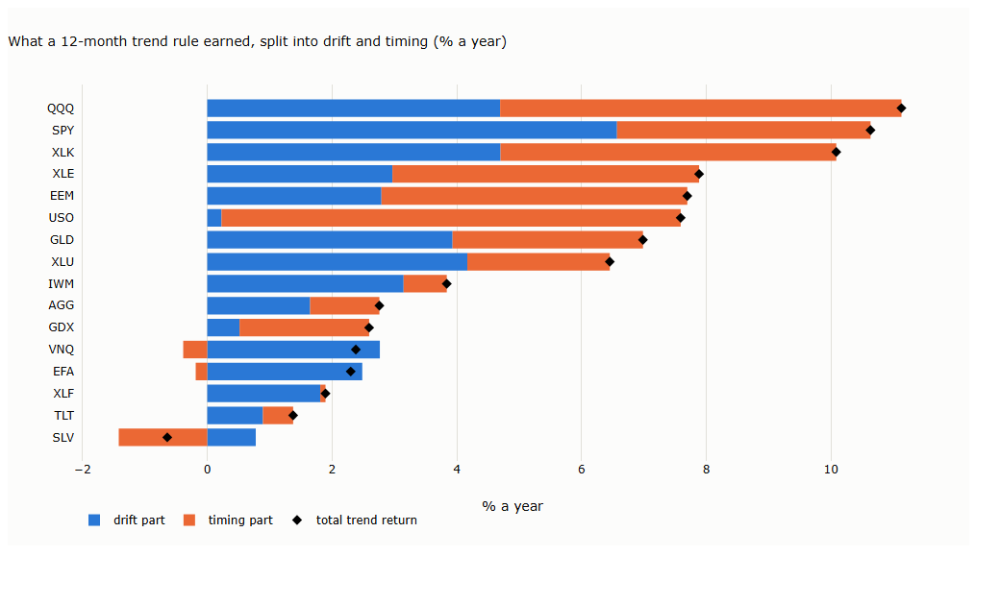
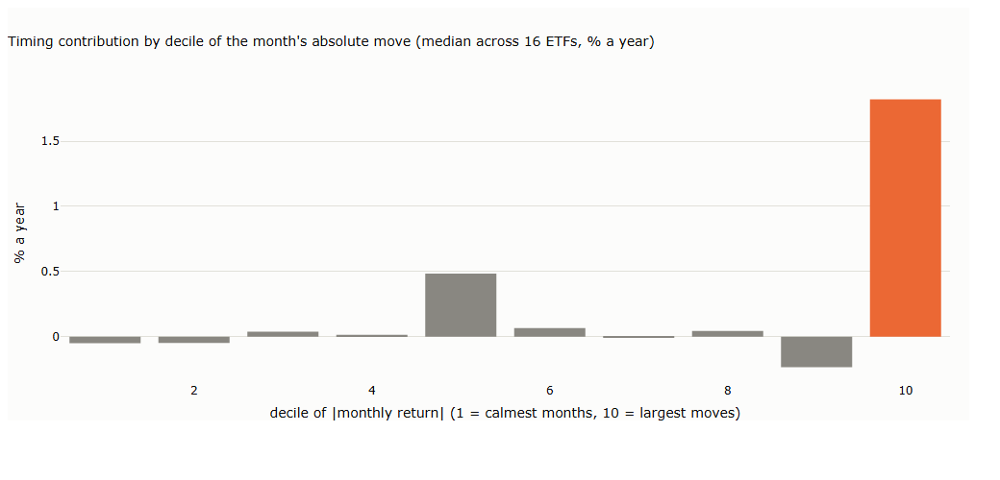

# Lecture 5: What Trend Following Captures

> A trend rule captures the drift of a market and the persistence of its moves; moves persist because information diffuses slowly and frictions make trading slow.

Part II · Pipeline stage: signal generation (what a trend signal captures)

---

# Two sources of trend profits

> On 16 ETFs, both sources matter about equally: of the median 5.2% a year, 2.8 points come from drift and 2.2 from timing.

- **Drift is the asset class's risk premium,** collected in proportion to net long exposure: SPY long 82% of the time, 6.6 points of its 10.2%
- **USO:** drift −5.3% a year, yet the rule earned 7.6%, almost all timing
- **SLV, EFA, VNQ:** timing can be negative

---

# The measuring instrument and the split

> One rule serves as a measuring instrument, not a system to trade: long next month if the past 12 months rose, short if they fell.

$$\overline{s\,r} \;=\; \underbrace{\overline{(s-\bar s)(r-\bar r)}}_{\text{timing}} \;+\; \underbrace{\bar s\;\bar r}_{\text{drift}}$$

- **Drift:** average position × average return; buy-and-hold with the same exposure earns it too
- **Timing:** the covariance of position and return; it pays only if returns persist
- **Time long is drift, not timing:** long in a random 82% of months earns SPY's 6.6 drift points, no timing
- The split is exact; Moskowitz, Ooi and Pedersen (2012) use a decomposition of this kind

---

# The long and the short side live in different markets

> The long side earns 5.4% a year at the median; the short side loses 0.7%. Being short an asset that drifts upwards costs the drift.

| ETF | Mean return after an up-trend (% a year) | After a down-trend | Volatility after up / down |
|---|---|---|---|
| SPY | 12.7 | −1.2 | 12.9 / 22.0 |
| QQQ | 11.9 | −8.1 | 18.7 / 35.5 |
| USO | 2.1 | −12.7 | 34.7 / 46.5 |
| **Median of 16** | 7.9 | 2.2 | 17.2 / 27.2 |

After a 12-month downtrend, volatility is about 60% higher: the short side lives in turbulent markets and pays only where downtrends persist.

---

# Where the timing profit is made

> Almost all of the timing profit comes from one month in ten, partly by construction: the largest months carry most of any covariance.

- Largest 10% of months: **2.0** of the 2.2% a year; the other 90%: **0.1**
- Linear autocorrelation is near zero (median −0.03), yet the rule earns: it bets on the **direction** of the past year, not its size
- Imprecise for any one ETF: a t-statistic of roughly 0.5

---

# Why moves persist: slow information and slow trading

> Prices adjust over time, not at once, in buying waves and selling waves alike.

| Family | Mechanism | Evidence |
|---|---|---|
| Slow information | News reaches investors gradually; prices underreact | Hong and Stein (1999) |
| Slow trading | Large orders spread over days; fund flows move gradually | Lillo, Mike and Farmer (2005); Vayanos and Woolley (2013); Lou (2012) |
| Slow trading | Capital is slow to arrive | Duffie (2010) |
| Slow trading | Deleveraging: fire sales, margin spirals | Coval and Stafford (2007); Brunnermeier and Pedersen (2009) |
| Slow trading | Hedging flows push prices the way they move | Baltussen et al. (2021) |

---

# Trend or reversion: patterns, not laws

> Trend following and mean reversion use the same estimate, the past return, in opposite directions. Which behaviour to exploit is a choice, not a fact of the market.

| Horizon | Pattern documented |
|---|---|
| A week to a month | Reversal |
| Three to twelve months | Continuation |
| Three to five years | Reversal |

- **Over a week, a slight tendency to reverse:** after a large weekly move, the next week had the same sign 46% of the time at the median, against 49% after normal weeks
- But 63% of the time for oil (USO) and 56% for silver (SLV)

---

# Understand the market first: five questions

> Before deciding what to capture, understand the market.

| Question | Why it matters for a trend rule |
|---|---|
| 1. Is there a drift? | It feeds the long side, and it is what the short side pays |
| 2. Which frictions create persistence? | Slow information and slow trading feed the timing part |
| 3. How fast can it fall, and how liquid is it? | A rule on daily bars cannot act inside a gap |
| 4. How mature is the market, and is the edge decaying? | Patterns that are learned and crowded tend to fade |
| 5. How much intervention is there? | Policy can cut moves short, or create them |

---

# Drift is uncertain; gaps are not rare

> Drift is the least precisely measured quantity in this lecture, and the worst moves arrive when the market is closed.

- After a quarter of a century, the median t-statistic of drift is **about 2**; for silver, gold miners and oil it cannot be told apart from zero
- Whether a market has a drift has to come from economics as much as from data
- The median worst overnight gap, **−11.9%**, is close to the median worst day, **−14.6%**: no stop can act inside a gap
- Days beyond 5 standard deviations occur **about twice in every 1,000 days**; a normal distribution expects one in about 1.7 million

---

# Is the edge decaying?

> On these ETFs, the timing part was large in the 2000s and has been negative since; what the rule earned after 2010 came from drift.

| Period | Trend return | Timing part | Short side |
|---|---|---|---|
| 2000–2009 | 9.1 | **9.2** | 3.3 |
| 2010–2019 | 2.1 | **−2.5** | −1.9 |
| 2020–2026 | 6.0 | **−0.3** | −3.1 |

- The panel grows from 11 ETFs to 16, so the comparison is indicative
- With policy rates at zero, the timing part was −2.7 and the short side −4.1; in other months 6.2 and 2.1
- Zero rates coincide with the 2010s: the table cannot separate intervention from other changes

---

# Choose what should last

> Choosing what to capture is a judgement about what will remain: the mechanism, not the history, is the better guide.

| Criterion | Question to ask |
|---|---|
| A durable mechanism | Is there a reason for the pattern that will outlast its discovery? |
| Decay and crowding | How widely is it known and traded? Published equity predictors lost 58% |
| The secular regime | How will policy, market structure and investor behaviour evolve? |

- **The strongest defence is breadth:** time-series momentum is positive in every one of 58 futures markets
- **Rules multiply the tests:** after decades of searching, a new factor needs a t-statistic above 3, not 2

---

# What to capture and which risks to carry

> The choice of side follows from what the designer wants to capture and which risks to carry, not from the tool.

| | Trend | Reversion |
|---|---|---|
| Captures | The drift, and persistence from slow information and slow trading | The overshoot after shocks and the pull back towards a level |
| Risk profile | Many small losses, a few large gains: a long option | Many small gains, occasional large losses: a short option |

- The same tools serve either choice: a band around a moving average can be traded as a breakout or as a fade

---

# The evidence, and who uses trend

> Trend following has the longest record of any systematic strategy, but how a system is built is part of the result.

- **Breadth:** the 12-month strategy is profitable in every one of 58 liquid futures (Moskowitz, Ooi and Pedersen, 2012)
- **Length:** 67 markets from 1880 to 2016, with diversification in equity bear markets (Hurst, Ooi and Pedersen, 2017)
- **Machinery matters:** without volatility scaling, monthly alpha falls from 1.27% to 0.41% (Kim, Tse and Wald, 2016)
- **An industry:** from Donchian's fund in 1949 to CTAs managing about USD 340–365 billion in 2024–2025

---

# Takeaways

1. **Trend profits have two sources:** drift and timing, about equally on 16 ETFs (2.8 and 2.2 points of a median 5.2% a year)
2. **Moves persist because information and trading are slow:** the timing profit comes from the largest tenth of months, for a rule that bets on direction
3. **The long and short sides live in different markets:** the long side collects drift; the short side pays it
4. **Understand the market first:** drift, frictions, gaps, maturity, intervention
5. **Choose what should last:** a durable mechanism matters more than a strong backtest
6. **Trend is an industry and a building block;** what each system captures depends on its design (Lecture 6)

> Before building a trend system, it pays to know what a trend system earns.
