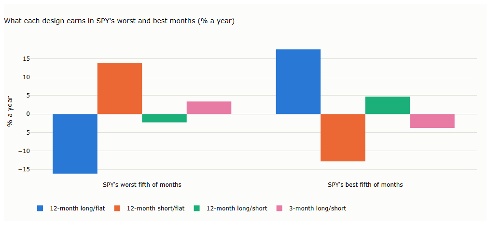
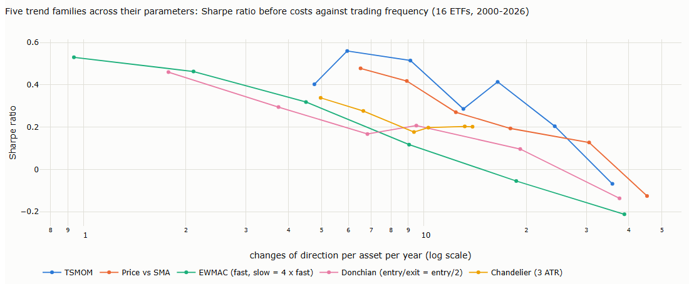
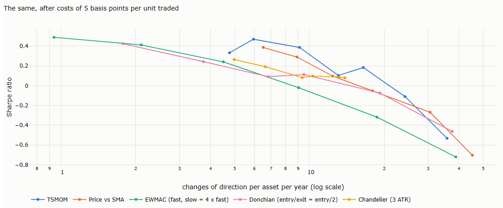

# Lecture 6: Trend Following: the Map and the Machinery

*Systematic Trading: Lecture Notes (MSc) · Oct 18, 2026 · Max Gnesi*

The same market can be traded for different purposes: to collect its drift, to protect against its crashes, or both. Lecture 5 showed what a market makes available to a trend rule; this lecture shows that what a system captures is decided by its design. It draws the map of trend rules, measures how much they overlap, and builds the machinery that turns any rule into positions: forecasts, volatility targeting, costs and the payoff profile. Data: the 16 ETFs of Lecture 5. Companion notebook: [06_trend_following_map_and_machinery.ipynb](06_trend_following_map_and_machinery.ipynb).

## 1. The question of this lecture

Lecture 5 was about the market; this lecture is about the system. Given a market worth trading, how do we design a trend system that captures the part we want, and how do we turn its signals into positions?

| | Lecture 5: What Trend Following Captures | Lecture 6: the Map and the Machinery |
|---|---|---|
| Question | Where do trend profits come from, and in which markets? | How do we design a system that captures the part we want? |
| About | The market | The system |
| Key message | Trend profits have two sources, drift and timing | Design decides what is captured: direction and speed choose between drift and crisis protection; horizon matters more than the family of the rule |
| Afterwards the reader can | Judge a market before building anything | Read any trend rule as a set of design choices, predict what it captures, and turn it into positions |

## 2. The map: three families, two dimensions, five design choices

Trend models appear countless, but they come from three families with distinct literatures. A second dimension says whether an asset is compared with its own past or with other assets, and five design choices explain how members of the same family differ.

### 2.1 Three families of trend signals

| Family | How the signal is built | Members | Literature | Sees | Misses |
|---|---|---|---|---|---|
| **1. Linear filters** | A weighted average of past prices or returns | Moving averages and crossovers, MACD, time-series momentum, EWMAC, the Hodrick–Prescott filter, the Kalman filter once its gains have settled | Econometric trend filtering (Bruder et al., 2011; Levine and Pedersen, 2016) | A smooth, continuous reading of direction | Turning points arrive late; choppy markets cause whipsaws |
| **2. Price-extreme rules** | Running highs and lows: the signal changes when price crosses a level set by its own recent path | Filter rules, support and resistance, channel breakouts (Donchian, the Turtle rules), trailing stops | Technical analysis tested academically (Alexander, 1961; Brock, Lakonishok and LeBaron, 1992; Sullivan, Timmermann and White, 1999) | The moment price escapes its recent range, and how far it has come back from its peak | The signal is on or off, so noise near the level triggers false entries and stop-outs |
| **3. Nonlinear and model-based filters** | A statistical model of the trend that is not a fixed weighted average | L1 filtering, wavelets, nonparametric regression, regime switching, machine learning | Nonlinear filtering (Bruder et al., 2011); regime switching (Hamilton, 1989) | Breaks in the trend, changes of regime, the uncertainty of the estimate | Results depend on the model and its calibration; the more flexible the model, the greater the risk of overfitting |

Two links between the families matter later.

- **The Kalman filter sits on the boundary.** Bruder et al. show that, once its gains have settled, the Kalman filter is an exponential moving average, as Lecture 4 found for the level. Its level and slope therefore belong to the linear family; what it adds beyond that, the uncertainty and the surprises, is model-based.
- **Breakouts and stops share one building block.** A Donchian breakout enters when price reaches its highest high of the last $`N`$ bars; a chandelier stop exits when price falls a fixed multiple of ATR below that same high. One rule acts at the extreme, the other at a distance from it.

### 2.2 The second dimension: own past or other assets

Each family can be used in two ways. A **time-series** rule compares an asset with its own past and decides whether to be long or short that asset; a **cross-sectional** rule ranks assets against each other and decides which to prefer.

| | Time-series: each asset against its own past | Cross-sectional: assets ranked against each other |
|---|---|---|
| Linear filters | Time-series momentum, EWMAC per asset | Relative-strength momentum: buy past winners, sell past losers (Jegadeesh and Titman, 1993) |
| Price-extreme rules | A breakout or a stop per asset | Rank assets by their distance from the channel high |
| Nonlinear and model-based | A regime or a slope estimate per asset | Rank assets by estimated slope or by the strength of the evidence for a trend |

The two answer different questions. A time-series portfolio can be long everything in a broad rally and short everything in a crash, so its net exposure varies; a cross-sectional portfolio is long some assets and short others, usually with no net exposure. Goyal and Jegadeesh (2018) find that across international asset classes, cross-sectional strategies scaled the same way as time-series ones performed better. Lectures 7 and 8 build time-series systems asset by asset; cross-sectional rules come with the portfolio, in the last lecture of Part II.

### 2.3 Modifiers: filters, overlays and hybrids

Some tools do not produce a trend signal; they act on one.

- **Filters and overlays** decide whether a signal is traded: trend strength (ADX and the efficiency ratio of Lecture 3), the volatility regime, or a regime model.
- **Hybrids** combine the trend with another idea, such as entering on a pullback within an uptrend, using the stretch of Lecture 4.

A filter is a second signal. It removes some losing trades and also some winning ones, so it has to be tested like a signal, which Lecture 10 does.

### 2.4 Five design choices

Within each family, rules differ along five choices. Each option sees something and misses something.

| Choice | Option | Sees | Misses |
|---|---|---|---|
| Direction | Long and short | Drift on the long side and protection on the short side (§3.2) | Pays the drift whenever it is short in a rising asset |
| | Long or flat | The drift, with less exposure in downtrends | No protection: it holds market risk and loses in crashes (§3.2) |
| | Short or flat | Protection in persistent declines | Earns about nothing on average: it is insurance |
| What the rule reads | Closes | Net moves, with the overnight gap | The path within each bar |
| | Highs and lows | Where price escaped its range | Sensitive to a single extreme print |
| | A model's estimate | The trend together with its uncertainty | Only as good as the model |
| Signal shape | Continuous | Position scales with the strength of the trend; small changes trade little | Rarely fully out of the market |
| | On or off | Simple and unambiguous | Trades the full position on noise near the threshold |
| What ends a trade | The signal reversing | Symmetric; no extra parameter | Gives back much of a gain before reversing |
| | A stop | Limits the giveback | Hit by noise; the result depends on the path |
| Horizon | Short | Turns early; catches fast crises | More trades, more cost, more false signals |
| | Long | Fewer trades; more robust to noise | Late at turning points; misses fast crises |

These choices, not the names of the rules, decide how two systems differ. §2.5 measures how much.

### 2.5 Why a few representatives suffice

**Every linear rule is a set of weights on past returns** (Levine and Pedersen, 2016). Price minus its $`N`$-day average, for instance, is a weighted sum of the last $`N-1`$ price changes, with weight $`(N-1-k)/N`$ on the change $`k`$ days ago. For $`N = 4`$ and prices 100, 101, 103, 102, 105:

| | Direct | As weights on past changes |
|---|---|---|
| Computation | 105 − (101 + 103 + 102 + 105)/4 | ¾ × 3 + ½ × (−1) + ¼ × 2 |
| Result | 2.25 | 2.25 |

Recent changes count most. The 12-month return sign weights the last 252 returns equally; an EMA crossover weights them by the difference of two exponential decays. Rules that put similar weights on similar horizons behave alike, whatever they are called.

**Five representatives, one from each corner of the map.** Each runs on the 16 ETFs from 2000 to 2026, deciding at each close and sized to 10% annual volatility per asset:

| Rule | Family | Signal |
|---|---|---|
| TSMOM-12 | Linear | Sign of the 252-day return |
| SMA-200 | Linear | Sign of price minus its 200-day average |
| EWMAC 16/64 | Linear, continuous | Difference of 16- and 64-day exponential averages, divided by price volatility, scaled and capped |
| Donchian 55/20 | Price extremes | Long above the 55-day high, out below the 20-day low; short symmetrically |
| Chandelier 55 | Price extremes, with a stop | Enter on the 55-day breakout; exit when price falls 3 ATR(20) below its highest close since entry |

**Table 2.1. Correlation of the rules' daily portfolio returns** (2000–2026; notebook §2.6)

| | TSMOM-12 | SMA-200 | EWMAC 16/64 | Donchian 55/20 |
|---|---|---|---|---|
| SMA-200 | 0.74 | | | |
| EWMAC 16/64 | 0.61 | 0.86 | | |
| Donchian 55/20 | 0.41 | 0.71 | **0.91** | |
| Chandelier 55 | 0.40 | 0.69 | 0.89 | **0.97** |

- **Horizon matters more than family.** EWMAC, a linear filter, and the Donchian breakout, a price-extreme rule, correlate 0.91: they react at similar speeds. The slow 12-month rule correlates only 0.40–0.61 with the three faster ones.
- **The exit matters least here.** The Donchian and chandelier systems share their entry and differ only in how they exit; their returns correlate 0.97.
- **A few representatives cover the field.** What separates trend systems is mainly speed and, as §3 shows, direction; within a speed, the choice of family changes less than its name suggests.

**A fairer comparison: across parameters, at equal trading frequency.** Table 2.1 compares one setting per rule, which mixes the family with the speed that setting happens to give it. Running each family over a range of parameters and plotting its Sharpe ratio against how often it changes direction separates the two ([chart E.2](#e2-sharpe-ratio-against-trading-frequency-25)):

- **Speed dominates.** Within each family, the Sharpe ratio before costs ranges from about −0.2 at 30–45 changes of direction a year to 0.45–0.55 at one to six.
- **At equal frequency, the families are close.** The gaps between families, about 0.1–0.3, are far smaller than the spread across parameters within any one of them.
- **How trading frequency is counted is itself a choice.** EWMAC adjusts its position continuously between changes of sign, and a Donchian system passes through flat; a change of direction is not the same trade in every family.

This is a first look, kept deliberately simple. Which point on these curves to choose, and whether the gaps between families are real, are questions for [Lecture 9, Comparing Trend Systems](../09-comparing-trend-systems/lecture.md) and for Part V: picking the best point on a curve is the multiple-testing problem of Lecture 5, §4.3.

### 2.6 Where each part of the map is taught

| Part of the map | Where |
|---|---|
| Linear filters and model-based estimates, as continuous forecasts | Lecture 7 |
| Price-extreme rules: breakouts and stops | Lecture 8 |
| Measuring performance | Lecture 9 |
| Modifiers: filters, overlays, regime models, hybrids | Lecture 10 |
| Cross-sectional rules and the trend portfolio | Lecture 11 |
| Trends on bars cut by price (point-and-figure, Renko) | Part III |
| Machine learning | After Part V, once honest testing is in place |

Lecture numbers after 6 are planned and may change as the roadmap is settled.

## 3. Design choices and what they capture

### 3.1 Direction and speed decide crisis behaviour

Lecture 5 found that a single-asset trend rule is usually still long when a crash starts. Whether a trend system protects in a crisis is a design choice, and two choices decide it.

**Table 3.1. Monthly time-series momentum by direction and speed** (16 ETFs, positions sized to 10% volatility per asset, 2000–2026; *smile* is the coefficient on SPY's squared monthly return when the portfolio's return is regressed on SPY's return and its square, as in Moskowitz, Ooi and Pedersen, 2012; notebook §3.2)

| Design | Return (% a year) | Beta to SPY | Smile (t-statistic) | In SPY's worst fifth of months (% a year) | 2008 | March 2020 |
|---|---|---|---|---|---|---|
| 12-month long or flat | 4.3 | 0.22 | 0.01 (0.1) | −16.1 | −3.7% | −4.9% |
| 12-month short or flat | 0.2 | −0.19 | 0.60 (4.1) | +13.9 | +12.4% | +4.0% |
| 12-month long and short | 4.5 | 0.03 | 0.61 (2.0) | −2.3 | +8.7% | −0.9% |
| 3-month long and short | 2.3 | −0.08 | 0.69 (2.3) | +3.4 | +10.1% | **+8.0%** |

- **Long or flat collects drift and has no smile.** It keeps a market beta of about 0.2 and loses in crashes; it is a way of holding the asset with less exposure in downtrends, not a hedge.
- **The smile comes from the short side.** Short or flat earns about nothing on average and pays in the worst months, the profile of insurance ([chart E.1](#e1-what-each-design-earns-in-spys-worst-and-best-months-31)).
- **Speed decides which crises are caught.** The 3-month rule turned short in time for March 2020; the 12-month rule did not.

"Crisis alpha", the gains of trend followers in prolonged sell-offs, is therefore not a property of trend following as such. It belongs to designs that hold short positions and react fast enough for the crisis at hand.

### 3.2 The other choices

What the rule reads, the signal's shape and the exit matter less in these data than direction and speed (Table 2.1): an exit by stop and an exit by signal give returns that correlate 0.97, and a linear rule and a breakout at a similar speed correlate 0.91. They matter for costs and for the payoff profile, the subjects of §6 and §7.

## 4. From signal to forecast

A trend rule produces a signal; a system needs a forecast on a common scale, so that rules can be compared and combined and a forecast can be turned into a position.

| Signal type | Example | On a common scale |
|---|---|---|
| On or off | TSMOM-12, SMA-200, Donchian | +1 or −1 (or 0 when flat) |
| Continuous | EWMAC | Divide by the asset's price volatility, so that the forecast has the same meaning in every market; scale so that its average absolute value is fixed; cap extremes, so that one unusual reading cannot dominate the position |

This follows a practitioner convention described by Carver: scale every forecast so that its average absolute value is 10, and cap it at ±20, so that +10 means an average buy in any market (Carver, 2015; 2016). The notebook uses the same convention divided by ten: an average absolute forecast of 1, capped at 2.

## 5. From forecast to position

### 5.1 Volatility targeting

A forecast becomes a position by sizing it to a target risk:

```math
\text{position}_t \;=\; \text{forecast}_t \times \frac{\sigma_{\text{target}}}{\hat\sigma_t}
```

| Symbol | Meaning |
|---|---|
| $`\sigma_{\text{target}}`$ | The risk the system wants to run in each asset: here 10% a year |
| $`\hat\sigma_t`$ | The asset's volatility, estimated with data up to day $`t`$ only: any estimator from Lectures 3 and 4 (a rolling standard deviation, a range estimator, the Kalman filter on log ranges); here an exponential average with a 60-day span |
| position | The exposure as a multiple of the capital assigned to the asset: 0.5 means half the capital, 2 means twice |

Sizing by volatility makes each asset contribute similar risk: without it, a portfolio of bonds and oil is a portfolio of oil.

### 5.2 What volatility scaling adds

**Table 5.1. The 12-month rule with equal notional and with volatility scaling** (monthly, 16 ETFs, 2000–2026; the scaled version is set to the same overall volatility; notebook §5.2)

| Sizing | Return (% a year) | Volatility | Sharpe ratio | Worst month | Maximum drawdown |
|---|---|---|---|---|---|
| Equal notional | 5.8 | 11.8% | 0.50 | −11.2% | −29.4% |
| Volatility-scaled | 8.9 | 11.8% | 0.75 | −9.0% | −26.2% |

At the same overall risk, volatility scaling lifts the Sharpe ratio by half and cuts the worst month. This is the result of Kim, Tse and Wald (2016) seen on our data: a large part of what is credited to trend following comes from sizing positions by volatility. It is part of the machinery, and it should be credited as such.

## 6. Costs and turnover

Every change of position is a trade. Faster rules change position more often and pay more.

**Table 6.1. Turnover and the Sharpe ratio after costs** (one setting per family, as in Table 2.1; daily rules, 2000–2026; turnover = notional traded per year as a multiple of the capital assigned to each asset; cost per unit traded; notebook §6)

| Rule | Turnover per year | Sharpe ratio, no costs | 5 bp | 20 bp |
|---|---|---|---|---|
| TSMOM-12 | 9.9 | 0.56 | 0.47 | 0.20 |
| SMA-200 | 13.8 | 0.42 | 0.29 | −0.09 |
| EWMAC 16/64 | 12.0 | 0.32 | 0.24 | 0.01 |
| Donchian 55/20 | 8.0 | 0.19 | 0.10 | −0.16 |
| Chandelier 55 | 8.2 | 0.18 | 0.08 | −0.20 |

- **Volatility targeting itself creates turnover.** Even the slow 12-month rule trades about ten times its capital a year, because positions are resized every day as volatility changes; SMA-200 trades more, because price crosses its average often.
- **Costs decide which rules survive.** At 5 basis points per unit traded, roughly the cost of trading liquid ETFs, every rule keeps most of its Sharpe ratio; at 20 basis points, only the 12-month rule stays positive.
- **Across parameters the pattern is the same.** After costs of 5 basis points, every family's Sharpe ratio turns negative above about 20–25 changes of direction a year ([chart E.3](#e3-after-costs-6)).
- **Turnover can be reduced without changing the signal**, by trading only when the desired position moves far enough from the current one. Later lectures return to this.

## 7. The payoff profile

**Table 7.1. Monthly returns of each rule's portfolio** (2000–2026; notebook §7)

| Rule | Sharpe ratio | Skewness | Share of months positive | Average win / average loss | Worst month | Maximum drawdown |
|---|---|---|---|---|---|---|
| TSMOM-12 | 0.61 | −0.05 | 57% | 1.15 | −3.9% | −12.2% |
| SMA-200 | 0.46 | 0.09 | 56% | 1.12 | −4.2% | −9.7% |
| EWMAC 16/64 | 0.37 | 0.74 | 52% | 1.23 | −5.0% | −16.0% |
| Donchian 55/20 | 0.21 | 0.86 | 50% | 1.19 | −2.6% | −10.9% |
| Chandelier 55 | 0.20 | 0.99 | 51% | 1.13 | −2.8% | −11.5% |

Each rule here is one setting, one point on its curve in chart E.2; the profile changes with speed. The portfolio volatility is 4–7% a year although each asset targets 10%, because the 16 assets diversify each other.

- **Positive skewness belongs to the faster and breakout rules.** Their monthly returns have skewness of 0.7 to 1.0: many small losses and occasional large gains, the long-option profile of Lecture 5, §4.4. The slow 12-month rule, diversified over 16 assets, has none.
- **Trend systems do not win most of the time, nor lose most of the time.** Half to 57% of months are positive, and the average win is only 12–23% larger than the average loss. The edge is small and must be compounded over many markets and years.
- **The textbook profile is a design outcome.** Like crisis protection in §3.1, positive skewness depends on speed, signal shape and exits; it has to be built, not assumed.

## 8. Side by side, and what to watch out for

| Design choice | What it decides | Watch out for |
|---|---|---|
| Direction | Drift (long or flat), protection (short or flat), or both | Expecting crisis protection from a long-or-flat system |
| Horizon | Which moves and which crises are caught; turnover and costs | Comparing rules of different speeds as if they were different ideas |
| Signal shape | How positions change near the threshold | On-or-off rules trading the full position on noise |
| What ends a trade | How much of a gain is given back | Stops tuned to the past path |
| Sizing | How much each asset contributes to risk | Crediting the signal with what volatility scaling produced |
| Costs | Which rules survive | Ignoring the turnover that volatility targeting creates |

## 9. Summary, exercises and reading

### 9.1 Six takeaways

1. **Design decides what a trend system captures.** The same signal collects drift, buys protection, or both, depending on direction.
2. **Crisis protection is built, not given.** It comes from the short side and from enough speed for the crisis at hand: the 3-month rule caught March 2020, the 12-month rule did not.
3. **Horizon matters more than family.** A linear rule and a breakout at similar speed correlate 0.91; across parameters, the Sharpe ratio varies far more with speed than between families at equal speed. Compare families at equal trading frequency, never one setting against another.
4. **The machinery is part of the result.** Volatility targeting lifted the Sharpe ratio from 0.50 to 0.75 at the same risk; credit it as machinery, not as signal.
5. **Costs select the survivors.** Faster rules and volatility targeting create turnover; at 20 basis points per unit traded only the slow rule stayed positive.
6. **The payoff profile is a design outcome too.** Positive skewness came from fast and breakout rules; monthly win rates were 50–57% with small win-to-loss ratios.

### 9.2 Exercises

- [ ] Add a 1-month and a 6-month long-and-short rule to Table 3.1. At which speed does the smile become significant, and which crises does each catch? (notebook §3.2)
- [ ] Replace the 60-day volatility estimate with a range estimator from Lecture 3. Does Table 5.1 change? (notebook §5.2)
- [ ] Trade only when the desired position differs from the current one by more than 20%. How much turnover does this remove, and what does it cost in gross Sharpe ratio? (notebook §6)
- [ ] Combine the five rules with equal weights. Is the combination's Sharpe ratio higher than the best single rule's, and how does Table 2.1 explain the answer? (notebook §2.6)

### 9.3 Reading

The full reference list closes the lecture. A short path: Levine and Pedersen (2016) for linear rules as weights on past returns; Moskowitz, Ooi and Pedersen (2012) for the smile; Kim, Tse and Wald (2016) for volatility scaling; Fung and Hsieh (2001) for the option-like payoff.

## Appendix: charts

From the companion notebook, [06_trend_following_map_and_machinery.ipynb](06_trend_following_map_and_machinery.ipynb). Its sections carry the lecture's numbers.

### E.1 What each design earns in SPY's worst and best months (§3.1)



Long or flat (blue) loses in SPY's worst months and gains in its best: it holds the market. Short or flat (orange) does the opposite: insurance. Long and short at 12 months (green) is close to neutral; at 3 months (pink) it gains in the worst months, because it turns short in time.

### E.2 Sharpe ratio against trading frequency (§2.5)



Each line is one family run over a range of parameters, from fast (right) to slow (left). All five fall as trading frequency rises; at equal frequency they lie close together. The horizontal axis counts changes of direction per asset per year, on a log scale.

### E.3 After costs (§6)



The same curves after costs of 5 basis points per unit traded. The fast end of every family turns negative; the slow end barely changes.

## References

- Alexander, S. (1961). Price movements in speculative markets: trends or random walks. *Industrial Management Review* 2, 7–26. — filter rules (§2.1).
- Brock, W., Lakonishok, J. and LeBaron, B. (1992). Simple technical trading rules and the stochastic properties of stock returns. *Journal of Finance* 47(5), 1731–1764. — moving-average and trading-range-break rules (§2.1).
- Bruder, B., Dao, T.-L., Richard, J.-C. and Roncalli, T. (2011). *Trend Filtering Methods for Momentum Strategies.* Lyxor White Paper. — linear and nonlinear filtering, the Kalman filter as an exponential moving average (§2.1).
- Carver, R. (2015). *Systematic Trading.* Harriman House. — forecasts on a common scale (§4).
- Carver, R. (2016). pysystemtrade: estimated forecast scalars. Blog post, qoppac.blogspot.com, 18 January 2016. — the average absolute forecast of 10 and the cap of 20 (§4).
- Fung, W. and Hsieh, D. (2001). The risk in hedge fund strategies: theory and evidence from trend followers. *Review of Financial Studies* 14(2), 313–341. — the option-like payoff (§7).
- Goyal, A. and Jegadeesh, N. (2018). Cross-sectional and time-series tests of return predictability: what is the difference? *Review of Financial Studies* 31(5), 1784–1824. — time-series against cross-sectional (§2.2).
- Hamilton, J. (1989). A new approach to the economic analysis of nonstationary time series and the business cycle. *Econometrica* 57(2), 357–384. — regime switching (§2.1).
- Jegadeesh, N. and Titman, S. (1993). Returns to buying winners and selling losers: implications for stock market efficiency. *Journal of Finance* 48(1), 65–91. — cross-sectional momentum (§2.2).
- Kim, A., Tse, Y. and Wald, J. (2016). Time series momentum and volatility scaling. *Journal of Financial Markets* 30, 103–124. — volatility scaling (§5.2).
- Levine, A. and Pedersen, L.H. (2016). Which trend is your friend? *Financial Analysts Journal* 72(3), 51–66. — linear trend rules as weights on past returns (§2.1, §2.5).
- Moskowitz, T., Ooi, Y.H. and Pedersen, L.H. (2012). Time series momentum. *Journal of Financial Economics* 104(2), 228–250. — the time-series momentum smile (§3.1).
- Sullivan, R., Timmermann, A. and White, H. (1999). Data-snooping, technical trading rule performance, and the bootstrap. *Journal of Finance* 54(5), 1647–1691. — technical rules tested with an adjustment for data snooping (§2.1).
