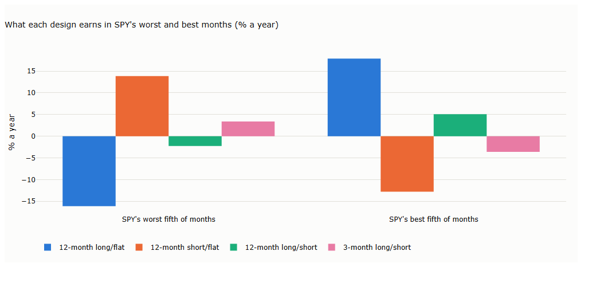
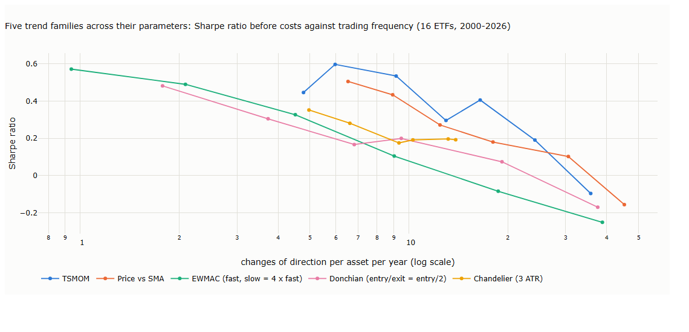
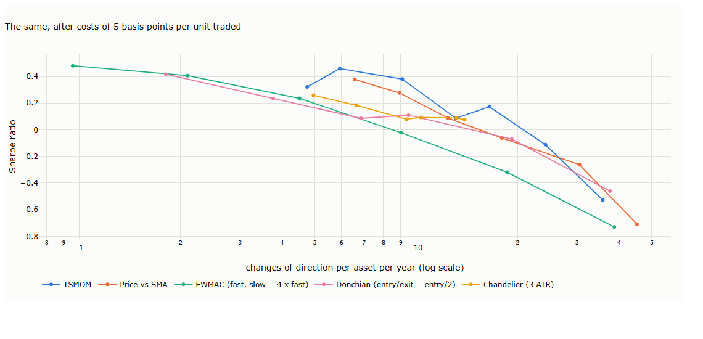

# Lecture 6: Trend Following: the Map and the Machinery

> What a trend system captures is decided by its design: direction and speed choose between drift and crisis protection.

Part II · Pipeline stage: signal generation (the trend machinery)

---

# Design decides what is captured

> Whether a trend system protects in a crisis is a design choice, and two choices decide it: direction and speed.

- **Long or flat** keeps a market beta of about 0.2 and loses in crashes
- **Short or flat** earns about nothing on average: insurance
- **Speed:** the 3-month rule turned short in time for March 2020

---

# Three families

> Trend rules come from three families with distinct literatures; the boundaries blur.

| Family | How the signal is built | Members |
|---|---|---|
| Linear filters | A weighted average of past prices or returns | Moving averages, time-series momentum, EWMAC |
| Channel breakouts | A channel of running highs and lows | Donchian channels, the Turtle rules, trailing stops |
| Nonlinear and model-based filters | A statistical model of the trend | Regime switching, L1 filtering, machine learning |

- Once its gains have settled, the Kalman filter is an exponential moving average: a linear filter
- Each family can be applied to an asset against its own past, or to assets ranked against each other

---

# Five design choices

> Within each family, rules differ along five choices. Each option sees something and misses something.

| Choice | Options |
|---|---|
| Direction | Long and short; long or flat; short or flat |
| What the rule reads | Closes; highs and lows; a model's estimate |
| Signal shape | Continuous; on or off |
| What ends a trade | The signal reversing; a stop |
| Horizon | Short: turns early, costs more. Long: fewer trades, late at turning points |

These choices, not the names of the rules, decide how two systems differ.

---

# Every linear rule is a set of weights on past returns

> Rules that put similar weights on similar horizons behave alike, whatever they are called (Levine and Pedersen, 2016).

Price minus its $N$-day average puts weight $(N-1-k)/N$ on the change $k$ days ago. For $N = 4$ and prices 100, 101, 103, 102, 105:

| | Direct | As weights on past changes |
|---|---|---|
| Computation | 105 − (101 + 103 + 102 + 105)/4 | ¾ × 3 + ½ × (−1) + ¼ × 2 |
| Result | 2.25 | 2.25 |

Recent changes count most.

---

# Horizon matters more than family

> At equal trading frequency the families are close; speed dominates.

- EWMAC and the Donchian breakout correlate **0.91**: similar speed
- Sharpe ratio within a family: about −0.2 fast, 0.45–0.55 slow
- Gaps between families, about 0.1–0.3, are far smaller

---

# Time series or cross-sectional

> A second choice on top of the family: an asset against its own past, or assets ranked against each other.

| | Time series | Cross-sectional |
|---|---|---|
| Bets on | Each asset's own direction | Relative strength |
| Net exposure | Anything from all long to all short | Close to zero by construction |
| In a broad sell-off | Short almost everything | Long the assets falling least, short those falling most |
| Needs | One asset | A universe; results depend on which assets are in it |

- On 30 June 2022, twelve of the sixteen ETFs had fallen over the year: the time-series rule was long four and short twelve; the cross-sectional rule long five and short five

---

# From signal to forecast

> A system needs a forecast on a common scale, so that rules can be compared and combined and a forecast turned into a position.

- **On or off rules:** +1 or −1 (or 0 when flat)
- **Continuous rules:** divide by the asset's price volatility, so that the forecast means the same in every market
- **Scale and cap:** average absolute value of 10, capped at ±20, so that +10 means an average buy in any market (Carver, 2015; 2016)

---

# From forecast to position: volatility targeting

> Sizing by volatility makes each asset contribute similar risk: without it, a portfolio of bonds and oil is a portfolio of oil.

$$\text{position}_t \;=\; \text{forecast}_t \times \frac{\sigma_{\text{target}}}{\hat\sigma_t}$$

| Sizing, 12-month rule, same overall volatility | Return (% a year) | Sharpe ratio | Worst month |
|---|---|---|---|
| Equal notional | 5.8 | 0.50 | −11.2% |
| Volatility-scaled | 8.9 | 0.75 | −9.0% |

The machinery is part of the result: credit it as machinery, not as signal.

---

# Costs select the survivors

> Every change of position is a trade. Even the slow 12-month rule trades about ten times its capital a year, because volatility targeting resizes positions daily.

- At 5 bp every rule keeps most of its Sharpe ratio
- At 20 bp only the 12-month rule stays positive
- At 5 bp, every family turns negative above about 20–25 changes of direction a year

---

# The payoff profile is a design outcome

> Positive skewness belongs to the faster and breakout rules; it has to be built, not assumed.

| Rule | Sharpe ratio | Skewness | Share of months positive |
|---|---|---|---|
| TSMOM-12 | 0.61 | −0.05 | 57% |
| SMA-200 | 0.46 | 0.09 | 56% |
| EWMAC 16/64 | 0.37 | 0.74 | 52% |
| Donchian 55/20 | 0.21 | 0.86 | 50% |
| Chandelier 55 | 0.20 | 0.99 | 51% |

The average win is only 12–23% larger than the average loss: the edge is small and must be compounded over many markets and years.

---

# Side by side, and what to watch out for

> Each design choice decides one thing, and each has a typical mistake.

| Design choice | What it decides | Watch out for |
|---|---|---|
| Direction | Drift, protection, or both | Expecting crisis protection from a long-or-flat system |
| Horizon | Which crises are caught; turnover and costs | Comparing rules of different speeds as if they were different ideas |
| What ends a trade | How much of a gain is given back | Stops tuned to the past path |
| Sizing | How much each asset contributes to risk | Crediting the signal with what volatility scaling produced |
| Costs | Which rules survive | Ignoring the turnover that volatility targeting creates |

---

# Takeaways

1. **Design decides what a trend system captures:** the same signal collects drift, buys protection, or both
2. **Crisis protection is built, not given:** it needs the short side and enough speed
3. **Horizon matters more than family:** compare families at equal trading frequency
4. **The machinery is part of the result:** volatility targeting lifted the Sharpe ratio from 0.50 to 0.75 at the same risk
5. **Costs select the survivors:** at 20 basis points only the slow rule stayed positive
6. **The payoff profile is a design outcome too:** monthly win rates were 50–57%

> Design decides what is captured: direction and speed choose between drift and crisis protection; horizon matters more than the family of the rule.
