# Lecture 7: Comparing Trend Systems

*Systematic Trading: Lecture Notes (MSc) · Oct 18, 2026 · Max Gnesi*

Two trend systems with different Sharpe ratios may not differ at all: one may simply trade at a different speed, the gap may be noise, or the better one may have been picked from many tries. This lecture builds a fair way to compare trend systems, in five questions: compared at what speed, does a system add anything, what do its trades show, is the difference real, and will it last?

Data: the 16 ETFs of Lectures 5 and 6, daily, 2000–2026; every result comes from the notebook.

## 1. The question of this lecture

Lecture 6 compared five trend families across their parameters and found that speed dominates: within each family the Sharpe ratio ranged from about −0.2 to 0.55 as the rule slowed down, while at equal speed the families lay within 0.1–0.3 of each other. Comparing one setting of one rule with one setting of another is therefore close to meaningless. This lecture asks how to compare trend systems properly.

| Question | Why it matters | Sections |
|---|---|---|
| Compared at what speed? | A slow rule and a fast rule differ by speed before they differ by idea | §2 |
| Does a system add anything? | The useful question is not which system is better but whether a second one improves the first | §3 |
| What do the trades show? | Two systems with the same return series can earn it from different trades, on different sides, with different time in the market | §4 |
| Is the difference real? | Strategy returns are noisy; a gap of 0.2 in Sharpe ratio over 25 years may be chance | §5 |
| Will it last? | The best point on a curve is the one most likely to disappoint | §6 |

## 2. A fair axis for speed

To compare families at equal speed, speed must be measured the same way for all of them. Three measures are in use, and each sees something different.

| Measure | What it counts | Sees | Misses |
|---|---|---|---|
| Changes of direction per year | How often the position switches between long, flat and short | Simple; matches how practitioners count trades | Unfair to continuous rules, which trade between changes of sign, and to rules that pass through flat |
| Turnover or holding period | Notional traded per year, or the average time a position is held | The actual trading, and so the cost | Includes the trading created by volatility targeting, which is the same for every family |
| Trend signature (Levine and Pedersen, 2016) | The weights a rule puts on past returns at each horizon | What the rule looks at, independently of how its trades are counted | Defined exactly only for linear rules; breakouts and stops need an approximation |

**On the 16 ETFs**, 2000–2026, after costs of 5 basis points ([chart F.1](#f1-the-same-systems-on-three-axes-of-speed-2); notebook §2):

| Axis | Average gap between the best and the worst family at equal speed, in Sharpe ratio |
|---|---|
| Changes of direction per year | 0.32 |
| Average holding period | 0.28 |
| Trend signature: average horizon of the past returns used | **0.09** |

- **On the signature axis the families almost collapse onto one curve.** Measured by the horizon of the past returns they use, the five families behave like one rule at five speeds. Most of the gaps on the other two axes come from how each family's trades are counted, not from what it looks at.
- **On every axis the Sharpe ratio rises with the horizon**, from below −0.5 for rules that look back about a week to 0.4–0.5 for rules that look back three to five months.
- **The signature has limits.** It is estimated on horizons up to one year, so it saturates at about 100 days (TSMOM over 252 and over 378 days sit at the same point), and for breakouts and stops it is an approximation.

For the rest of the lecture, families are compared at **matched speed**: the parameter whose average holding period is closest to the median of all 31 systems, 24 days. That is TSMOM over 126 days, price against its 200-day average, EWMAC 16/64, Donchian 40 and the chandelier breakout over 20 days. Their trend signatures are compared in [chart F.2](#f2-trend-signatures-at-matched-speed-2).

## 3. Does a system add anything?

A second system is worth adding if it improves the first, not if it beats it. Two systems with similar Sharpe ratios and low correlation are both worth keeping; a system with a higher Sharpe ratio that is almost a copy of the first adds little.

| Method | Idea | What it answers |
|---|---|---|
| Correlation at equal speed | Correlate the returns of two families matched on speed | How different they really are, once speed is removed |
| Spanning or alpha regression (Huberman and Kandel, 1987) | Regress system B's returns on system A's; the intercept is what B earns beyond A | Whether B adds to A, in return per unit of risk |
| Breakeven cost | The cost per unit traded at which a system's Sharpe ratio falls to zero | Edge and turnover combined in one number |

**At matched speed** ([chart F.3](#f3-correlations-at-matched-speed-3)):

| | TSMOM | Price vs SMA | EWMAC | Donchian | Chandelier |
|---|---|---|---|---|---|
| TSMOM | 1 | 0.91 | 0.79 | 0.56 | 0.48 |
| Price vs SMA | | 1 | 0.85 | 0.65 | 0.56 |
| EWMAC | | | 1 | 0.86 | 0.75 |
| Donchian | | | | 1 | 0.92 |

| Family, regressed on the other four (monthly) | Alpha, % a year | t-statistic | R² |
|---|---|---|---|
| TSMOM | +0.71 | 1.89 | 0.78 |
| Price vs SMA | −0.24 | −0.68 | 0.86 |
| EWMAC | +0.20 | 0.54 | 0.91 |
| Donchian | −0.12 | −0.48 | 0.90 |
| Chandelier | −0.05 | −0.14 | 0.82 |

- **Neighbours are near copies**: TSMOM and price against its average correlate 0.91, Donchian and chandelier 0.92. The two ends of the list correlate only 0.48.
- **No family adds a return the others do not already have.** The other four explain 78% to 91% of each family's monthly returns, and no alpha is distinguishable from zero; TSMOM comes closest, with a t-statistic of 1.9.
- **Breakeven costs rise with speed** ([chart F.4](#f4-breakeven-cost-against-speed-3)). Rules that hold positions for less than about ten days lose money even before costs or break even below 5 bp; at a holding period of 25 to 35 days the breakeven is 10 to 30 bp; the slowest rules, EWMAC 64/256 and Donchian 200, reach about 65 bp. The chandelier never exceeds 23 bp, because its stop holds every position for about 25 days whatever the entry channel: its speed is set by the stop, not by the entry.

## 4. Beyond the return series: trades, sides and time in the market

A daily return series hides how a system earns. Three views open it up.

### 4.1 Trades

| Measure | What it shows |
|---|---|
| Number of trades and average holding period | Speed in the units traders use |
| Win rate and average win against average loss | Whether the edge comes from winning often or from winning big |
| Distribution of trade returns: skewness, largest trades | The shape of the payoff, trade by trade |
| Share of profit from the largest tenth of trades | Concentration: Lecture 5 found the timing profit in a tenth of the months; a system that depends on a few trades is fragile to missing them |

### 4.2 The long side and the short side

Compare each system's long and short trades separately. Lecture 5 found that the long side collects drift and the short side earns only in persistent declines; Lecture 6 that the short side carries the crisis protection. Two systems with the same Sharpe ratio can earn it on different sides, and so behave differently in a crash.

### 4.3 Systems that are not always in the market

Systems that can be flat, such as long-or-flat designs or breakouts waiting for a break, are invested only part of the time. The temptation is to drop the idle periods and compute the Sharpe ratio on the active ones only. That number is real but answers a narrow question, and it can point the wrong way when capital has to be allocated.

If a system is in the market a fraction $`p`$ of the time, earns excess return $`\mu`$ with volatility $`\sigma`$ while invested, and its idle capital earns the cash rate, then over the whole period:

```math
\text{Sharpe ratio} \;=\; \frac{p\,\mu}{\sqrt{p}\,\sigma} \;=\; \text{Sharpe ratio while invested} \times \sqrt{p}, \qquad \text{excess return} \;=\; p\,\mu
```

| | System A: in the market 30% of the time | System B: always in the market |
|---|---|---|
| Sharpe ratio while invested | 1.00 | 0.60 |
| Sharpe ratio over the whole period | 1.00 × √0.3 = 0.55 | 0.60 |
| Excess return per unit of capital, if both run at 10% volatility while invested | 0.3 × 10% = 3.0% | 6.0% |

A looks better while it trades; over the whole period it has the lower Sharpe ratio and half the return per unit of capital. Which system deserves the capital depends on what the idle capital can do:

| Situation | What matters | Which system |
|---|---|---|
| Idle capital can be redeployed, to other strategies or by scaling A up when it trades | Sharpe ratio while invested, and how well A's active periods fit with the rest | A can be the better component, but only if switching works in practice |
| Capital is committed and leverage is limited | Return per unit of capital and Sharpe ratio over the whole period | B, despite its lower Sharpe ratio while invested |
| Leverage is available without limit | Sharpe ratio over the whole period, since any Sharpe ratio can be scaled to any return | B here, unless A's idle capital is reused |

Switching allocations is rarely easy. When A becomes active, capital must be pulled from other strategies at short notice, which disturbs their positions, costs money to trade, and runs into margin, mandate and liquidity limits; when A goes flat, the capital must find a use again. In practice the first row of the table is the exception, and the second is the common case.

There is no single right number. Report time in the market, the Sharpe ratio both while invested and over the whole period, and the return per unit of capital, and decide with the capital and leverage constraints in view. Capital that one system leaves idle can be used by another, which turns the comparison into a portfolio question (Lecture 10); how much leverage to run is a sizing question (Lecture 9).

### 4.4 A framework: marginal contribution, measured in what is scarce

The choice between counting idle capital or not resolves into two steps. This framing is a synthesis of standard ideas, opportunity cost, risk budgeting and the spanning test of §3, rather than an established named result.

**Step 1: measure in the unit that is scarce.**

| What is scarce | Typical setting | What idle capital is worth | How to measure a system |
|---|---|---|---|
| Cash | Fully funded, unlevered portfolios such as ETF or long-only mandates | The cash rate, or what that cash would earn elsewhere | Return and Sharpe ratio over the whole period, idle periods earning the cash rate |
| Risk budget | Futures and margin accounts, where cash is mostly collateral and leverage is available | Nothing is wasted: a flat system uses no risk, and a portfolio volatility target (Lecture 9, §4) hands its budget to the active systems | Sharpe ratio while invested, together with its correlation with the other systems |
| Neither | Leverage without limit or cost, which is rare | — | Sharpe ratio over the whole period |

The second row is how switching across strategies becomes practical: capital does not move between systems, only risk does. A portfolio volatility target reallocates risk every day, so the budget of a system that goes flat flows to those that are active, without pulling cash from anyone.

The set-up decides which row applies, and two properties of what is traded decide the set-up: how positions are funded, and how liquid they are.

| | Liquid | Illiquid |
|---|---|---|
| **Margined** (futures, swaps, CFDs: cash is mostly collateral) | Risk budget is scarce; switching risk across systems is cheap and fast. Example: major equity, bond and currency futures | Risk budget is scarce, and so is liquidity: switching costs market impact and is limited by capacity. Example: small or alternative futures markets, bespoke swaps |
| **Fully funded** (ETFs, cash equities: leverage means borrowing) | Cash is scarce; switching is possible but every move uses cash. Example: large ETFs and large-cap stocks | Cash and liquidity are both scarce; capital is effectively locked in, and switching is slow and costly. Example: small caps, niche ETFs |

The further a set-up sits from the top-left corner, the more a system's idle time costs and the more its standalone performance has to be judged on the whole period.

The 16-ETF results of Lectures 5, 6 and 9 size every position to a volatility target. For a bond ETF with 4% volatility, a 10% target means holding about 2.5 times the capital, which requires borrowing. Those results are therefore measured as if risk, not cash, were the constraint, as a futures trader would face it; a fully funded ETF portfolio could not run them without leverage.

**Step 2: decide by marginal contribution.** Whatever the unit, the question that matters for allocation is not how good a system is on its own but what it adds to the systems already run. Take the system's returns over the whole period, zero or the cash rate when it is flat, and regress them on the returns of the existing portfolio, as in §3. The intercept is what the system adds; its idle time is accounted for automatically. A system that is often flat but strong and uncorrelated when active shows a positive intercept; one whose Sharpe ratio while invested only looks good shows none.

Marginal contribution is the criterion that runs through the rest of Part II: it decides which systems to combine, how much risk each receives, and whether a filter or a new market earns its place (Lectures 8 to 10).

**Trades at matched speed** (notebook §4; a trade is a spell of one asset in one direction, its return in units of the 10% risk target):

| | TSMOM | Price vs SMA | EWMAC | Donchian | Chandelier |
|---|---|---|---|---|---|
| Trades per asset per year | 8.0 | 7.8 | 4.2 | 5.0 | 6.6 |
| Average days held | 29 | 29 | 55 | 34 | 29 |
| Win rate | 32% | 14% | 18% | 38% | 38% |
| Average win ÷ average loss | 3.1 | 8.4 | 6.1 | 1.9 | 1.8 |
| Skewness of trade returns | 5.4 | 5.9 | 4.1 | 2.3 | 2.0 |
| Profit of the best tenth of trades, as a multiple of total profit | 2.8 | 3.6 | 3.2 | 4.5 | 5.9 |

| | TSMOM | Price vs SMA | EWMAC | Donchian | Chandelier |
|---|---|---|---|---|---|
| Long side, % a year, before costs | +3.1 | +2.8 | +3.0 | +1.9 | +1.9 |
| Short side, % a year, before costs | −0.5 | −0.8 | −0.8 | −0.9 | −1.0 |

- **Every family wins rarely and wins big** ([chart F.5](#f5-trade-returns-at-matched-speed-4)). One trade in three to one in seven wins, and the winners are two to eight times the size of the losers.
- **The best tenth of trades earns more than all the profit**: between 2.8 and 5.9 times it, so the other nine tenths lose money together. A system that missed its few best trades would lose money; this is the episodic timing of Lecture 5, §2.4, trade by trade.
- **On these ETFs the short side loses in every family** ([chart F.6](#f6-long-and-short-sides-4)): prices mostly rose, and the long side collected the drift (Lecture 5, §2.3). The short side earns its keep only as crisis protection (Lecture 6, §3.1), which a full-period average does not show.
- **Time in the market** ([chart F.7](#f7-sharpe-ratio-against-time-in-the-market-4)). The Donchian rules are in the market 67% to 68% of the time at every entry channel; the chandelier from 81% (entry over 10 days) down to 31% (200 days). For the chandelier over 200 days, the median asset's Sharpe ratio is 0.26 while invested and 0.13 over the whole period, close to what the formula of §4.3 predicts: 0.26 × √0.31 = 0.14.
- **Marginal contribution of the system that is often flat.** Regressing the chandelier over 20 days on EWMAC 16/64, with flat days earning zero, gives an alpha of −0.49% a year (t-statistic −1.0) and an R² of 0.59: although it is out of the market a quarter of the time and looks different, it adds nothing that EWMAC does not already have.

### 4.5 Beyond the Sharpe ratio: Omega and drawdowns

The Sharpe ratio summarises returns by their mean and variance. Two kinds of measure look at what it leaves out.

**The Omega ratio** (Keating and Shadwick, 2002) at a threshold $`\tau`$ is the sum of the gains above the threshold divided by the sum of the shortfalls below it:

```math
\Omega(\tau) \;=\; \frac{\sum_t \max(r_t - \tau,\, 0)}{\sum_t \max(\tau - r_t,\, 0)}
```

with $`r_t`$ the strategy's return in period $`t`$ and, here, $`\tau = 0`$. A value of 1.2 means that the gains add up to 20% more than the losses.

**Drawdowns** measure the path: how far the strategy falls below its previous peak, how long it stays below, and whether two strategies fall at the same time.

| Measure | Catches | Misses |
|---|---|---|
| Omega ratio | The whole distribution: a payoff with rare large gains is credited for them, not penalised as variance | The order of returns; depends on the threshold; close to 1 for daily returns and easier to read on monthly ones |
| Maximum and average drawdown | The worst and the typical loss from a peak, as an investor lives it | A single path: the maximum rests on one episode and is not a stable estimate |
| Longest time under water | How long the strategy must be held without a new peak | Says nothing about the depth |
| Overlap of drawdowns | Whether two systems lose at the same time, the case where diversification is needed | Needs long histories; a few episodes decide it |

At matched speed and equal volatility of 10% a year ([chart F.8](#f8-drawdowns-at-matched-speed-45)):

| | Sharpe ratio | Omega, daily | Omega, monthly | Maximum drawdown | Average drawdown | Longest under water |
|---|---|---|---|---|---|---|
| TSMOM | 0.38 | 1.07 | 1.36 | −18% | −6.5% | 3.3 years |
| Price vs SMA | 0.28 | 1.05 | 1.25 | −18% | −7.3% | 3.3 years |
| EWMAC | 0.24 | 1.04 | 1.21 | −23% | −7.8% | 5.1 years |
| Donchian | 0.11 | 1.02 | 1.09 | −21% | −8.5% | 6.7 years |
| Chandelier | 0.08 | 1.01 | 1.06 | −25% | −9.5% | 6.7 years |

- **Omega ranks the families as the Sharpe ratio does.** For these rules the asymmetry lives in the trades (§4.1) and is averaged away in daily or monthly portfolio returns.
- **Drawdowns separate the families more**: between three and seven years without a new peak.
- **Low correlation of returns carried over to drawdowns.** The drawdown paths of TSMOM and Donchian correlate 0.33, and both were more than 10% under water on 11% of days; for the near copies Donchian and chandelier the figures are 0.83 and 30%.

## 5. Is the difference real?

Strategy returns are noisy, fat-tailed and serially dependent. Before reading a gap between two curves as a difference between two ideas, test it.

| Method | Idea | What it answers |
|---|---|---|
| Block-bootstrap bands | Resample blocks of strategy returns, as in Lecture 3, §10, and redraw each curve many times | Whether the gaps between curves exceed what noise alone produces |
| Test of a Sharpe-ratio difference | Jobson and Korkie (1981), corrected by Memmel (2003), assumes normal returns; Ledoit and Wolf (2008) use a bootstrap that allows fat tails and dependence | Whether two specific systems differ |
| Tests across the whole grid | White's (2000) reality check; Hansen's (2005) test for superior predictive ability; the stepwise procedure of Romano and Wolf (2005) | Whether any system in the grid truly beats a benchmark, given everything that was tried |
| Probability of backtest overfitting (Bailey, Borwein, López de Prado and Zhu, 2017) | Split the history into many combinations of sub-periods; record how often the best system in one combination ranks poorly in its complement | How much choosing the best point overfits |

**Splitting history is not neutral.** Different periods are different macro regimes: a system chosen in a decade of falling rates and tested in a decade of zero rates is compared across regimes, not on skill. Three things reduce the problem. Using many combinations of sub-periods, as the probability of backtest overfitting does, mixes regimes on both sides of each split. Splitting the **assets** instead of the history, choosing on half the markets and testing on the other half over the same period, holds the regime fixed. And splitting by regime explicitly, for example zero-rate months against the rest (Lecture 5, §3.5), turns the problem into a question.

**Results** (notebook §5):

- **The noise is large.** The 90% block-bootstrap bands are on average 0.56 wide, about ±0.28 around each Sharpe ratio ([chart F.9](#f9-curves-with-bootstrap-bands-5)), in line with the standard error of a Sharpe ratio over 26 years, about 0.2 (Lo, 2002). The gaps between families at equal speed found in §2, 0.1 to 0.3, lie inside the bands.
- **No pair of families at equal speed differs significantly.** The bootstrap tests of the Sharpe-ratio difference give p-values from 0.14 (EWMAC against Donchian) to 0.77 (Donchian against chandelier).
- **Choosing a slow rule is not luck; choosing among slow rules is.** The probability of backtest overfitting is low, 0 to 0.15 within each family and 0.07 across all 31 systems, because the slow end is better in almost every sub-period. The best system in sample still earns less out of sample: a median Sharpe ratio of 0.37 against 0.53.
- **The ranking of speeds carries over to other markets** ([chart F.10](#f10-asset-split-5)). Chosen on half of the ETFs and tested on the other half over the same period, the ranks of the parameters correlate 0.83 to 1.00 within four families and 0.87 across all systems; within the chandelier, whose speed hardly varies, only 0.20. In every family the best parameter on one half is also the best on the other.

## 6. Will it last? Robustness instead of the best point

The best point on a curve combines skill with luck, and the luck does not repeat. Three habits reduce the dependence on it.

| Method | Idea | What it protects against |
|---|---|---|
| Judge the whole curve | Compare families by their median or average across parameters, not by their peak; prefer a flat plateau to a sharp peak | Selecting the lucky parameter; needs no selection, so it cannot be overfitted |
| Walk-forward and cross-market selection | Choose parameters on past data, or on half of the assets, and test on the rest | In-sample selection; results are out of sample by construction |
| Several measures at once | Sharpe ratio, skewness, drawdown, behaviour in crises, cost; keep the systems that no other beats on every measure | A single number hiding the payoff profile, which Lecture 6 showed depends on design |

**Results** (notebook §6; Sharpe ratios after 5 bp):

| | Peak | Median across parameters | Walk-forward choice, 2005–2026 | Fixed middle parameter, 2005–2026 | Blend of all parameters, 2005–2026 |
|---|---|---|---|---|---|
| TSMOM | 0.47 | 0.18 | 0.46 | 0.04 | 0.16 |
| Price vs SMA | 0.39 | 0.02 | 0.33 | 0.10 | −0.10 |
| EWMAC | 0.49 | 0.11 | 0.44 | 0.19 | 0.00 |
| Donchian | 0.42 | 0.10 | 0.42 | 0.08 | 0.08 |
| Chandelier | 0.26 | 0.09 | 0.20 | 0.08 | 0.12 |

- **The median lies far below the peak** ([chart F.11](#f11-median-against-peak-6)), because every grid includes fast rules that lose money after costs.
- **Blending all parameters inherits those losses.** A blend diversifies only once the region that does not work has been dropped; Lecture 11 does exactly that, and blends what remains.
- **Walk-forward choice comes close to the peak**, because the ranking of speeds is stable (§5): each year it picks one of the slow rules.
- **Several measures at once** ([chart F.12](#f12-trade-offs-6)): 10 of the 31 systems are beaten by no other on Sharpe ratio, monthly skewness and maximum drawdown together, mostly the slow ends of the families. The fastest EWMAC is among them on its skewness alone, with a Sharpe ratio of −0.72: the undominated set removes systems, it does not choose one.

## 7. A procedure, simplest first

1. **Sweep the parameters** of every family and plot performance against a common measure of speed (§2).
2. **Judge each family by its whole curve**, its median across parameters, not its peak (§6).
3. **Look at the trades and the sides**: concentration of profits, long against short, time in the market (§4).
4. **Decide by marginal contribution**, measured in what is scarce, cash or risk (§4.4).
5. **Put bootstrap bands on the curves** before reading any gap as real (§5).
6. **Compute the breakeven cost** of each family across its parameters (§3).
7. **Ask what each family adds** to the others at equal speed, with correlations and spanning regressions (§3).
8. **Only then test formally**, pairwise with Ledoit and Wolf, and across the grid with Romano and Wolf or the probability of backtest overfitting (§5).

**Watch out for** declaring a winner from a single backtest. Speed, noise and selection each produce differences between systems that are not differences between ideas; the procedure above removes them one at a time.

## 8. Summary, exercises and reading

### 8.1 Five takeaways

1. **Measure speed by what a rule looks at.** On the trend-signature axis the five families nearly collapse onto one curve; most differences between families are differences of speed.
2. **Ask what a system adds, not how good it is.** At equal speed, no family adds a return that the others do not already have.
3. **Look inside the return series.** Trend systems win rarely and win big; the best tenth of trades earns more than all the profit, and the long and short sides earn in different conditions.
4. **Treat every gap as noise until shown otherwise.** Bands of ±0.3 around each Sharpe ratio swallow the differences between families; tests that allow fat tails and dependence find none significant.
5. **Judge the whole curve, then drop what fails and blend the rest.** The peak overstates what a family offers, the median of a grid that includes failing rules understates it.

### 8.2 Exercises

- [ ] Redraw chart F.1 with costs of 10 bp. Which speeds stop working, and does the ordering of families change? (notebook §2)
- [ ] Match the families on the signature axis instead of the holding period and recompute the correlations of §3. Do the near copies stay near copies? (notebook §3)
- [ ] Remove the best tenth of trades of each family. What is left of the Sharpe ratio? (notebook §4)
- [ ] Drop every system with a holding period below 20 days, blend the rest with equal weights, and compare the blend with the walk-forward choice of §6. (notebook §6)

### 8.3 Reading

The comparison methods of this lecture are applied in full to three systems on futures in Lecture 11. For the tests of §5, Ledoit and Wolf (2008) and Bailey et al. (2017) are the practical starting points; Romano and Wolf (2005) for many strategies at once.

## Appendix: charts

### F.1 The same systems on three axes of speed (§2)

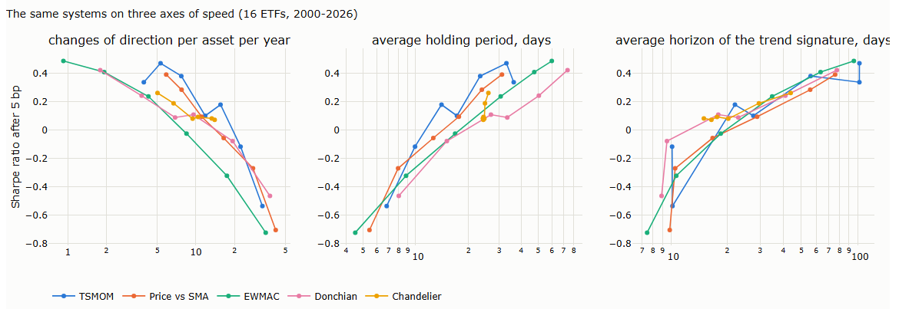

Each line is one family across its parameters. On the right-hand axis, the horizon of the past returns a rule uses, the lines nearly coincide.

### F.2 Trend signatures at matched speed (§2)

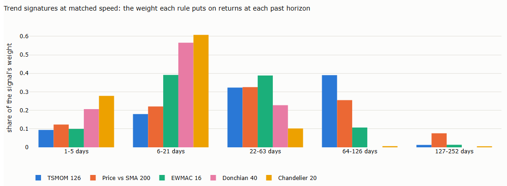

The share of each rule's signal explained by returns over each past horizon, estimated by regression; breakouts and stops are approximated.

### F.3 Correlations at matched speed (§3)

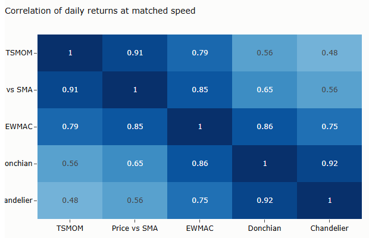

### F.4 Breakeven cost against speed (§3)

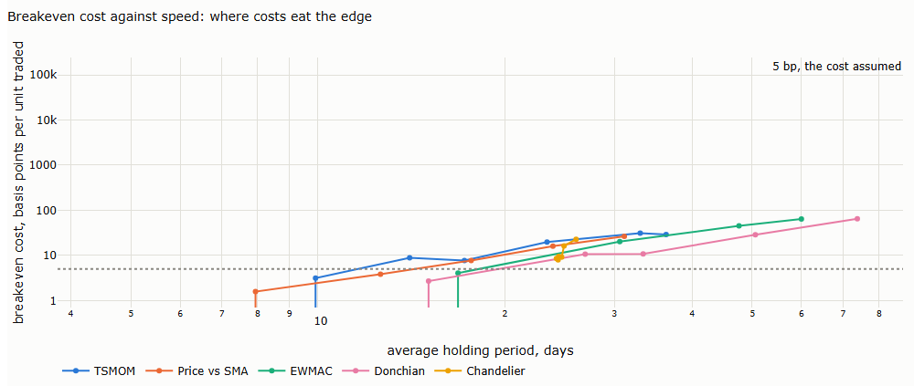

Points above the dotted line survive costs of 5 bp. The chandelier's holding period hardly changes with its entry channel.

### F.5 Trade returns at matched speed (§4)

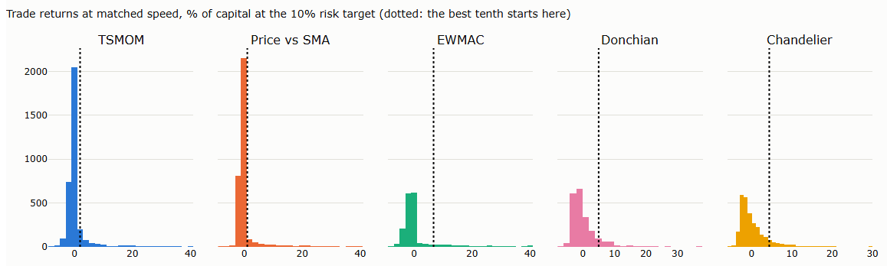

Most trades are small losses; a long right tail of large gains carries the profit. Right of the dotted line: the best tenth.

### F.6 Long and short sides (§4)

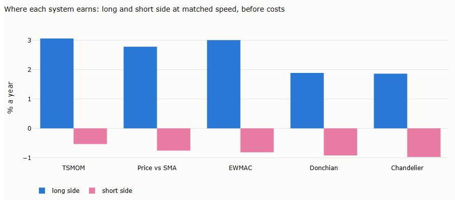

### F.7 Sharpe ratio against time in the market (§4)

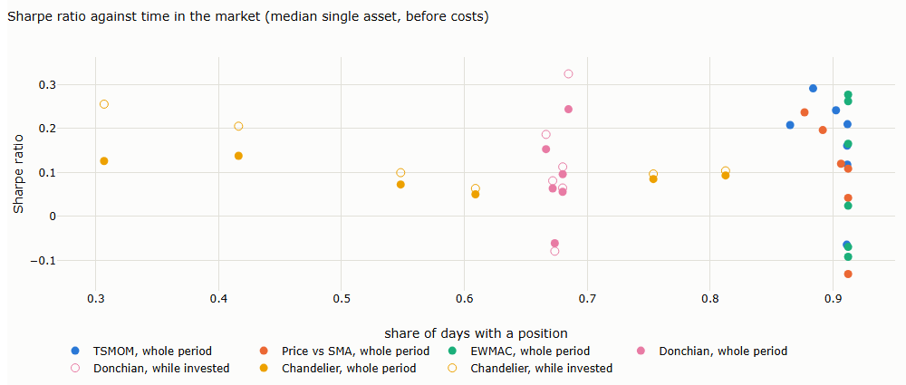

Open markers: the Sharpe ratio while invested, for the two families that are often flat.

### F.8 Drawdowns at matched speed (§4.5)

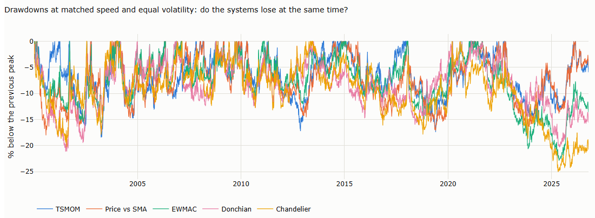

### F.9 Curves with bootstrap bands (§5)

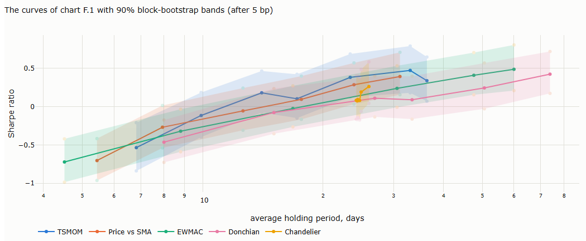

The shaded bands overlap almost everywhere at equal speed.

### F.10 Asset split (§5)

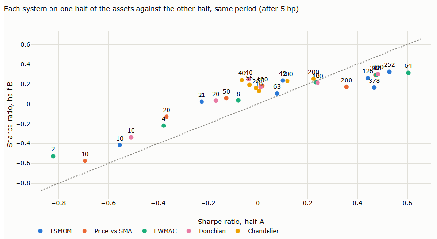

Each point is one system; labels give its parameter. Points along the diagonal rank the same on both halves.

### F.11 Median against peak (§6)

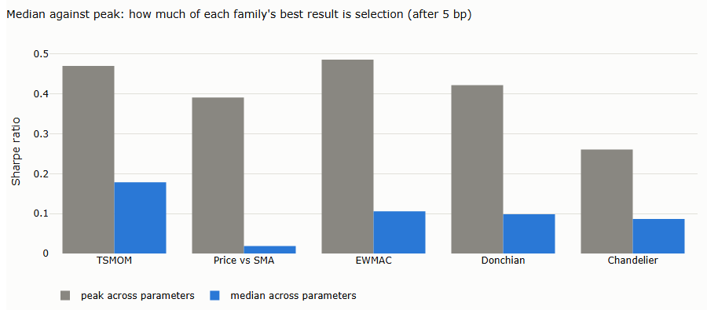

### F.12 Trade-offs (§6)

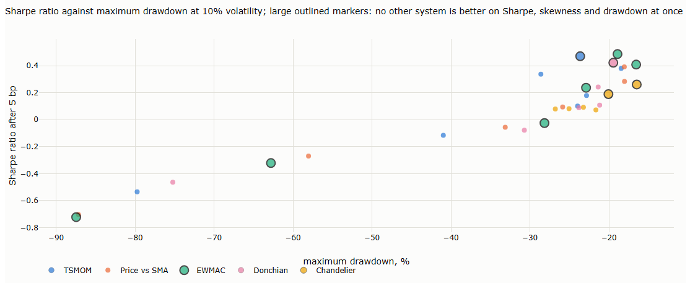

Large outlined markers: no other system is better on Sharpe ratio, skewness and maximum drawdown at once.

## References

- Bailey, D., Borwein, J., López de Prado, M. and Zhu, Q. (2017). The probability of backtest overfitting. *Journal of Computational Finance* 20(4). — how much selecting the best backtest overfits (§5).
- Hansen, P.R. (2005). A test for superior predictive ability. *Journal of Business and Economic Statistics* 23, 365–380. — testing the best of many models (§5).
- Huberman, G. and Kandel, S. (1987). Mean-variance spanning. *Journal of Finance* 42(4), 873–888. — whether one set of assets adds to another (§3).
- Jobson, J.D. and Korkie, B. (1981). Performance hypothesis testing with the Sharpe and Treynor measures. *Journal of Finance* 36(4), 889–908. — the classical test of a Sharpe-ratio difference (§5).
- Keating, C. and Shadwick, W. (2002). A universal performance measure. *Journal of Performance Measurement* 6(3), 59–84. — the Omega ratio (§4.5).
- Ledoit, O. and Wolf, M. (2008). Robust performance hypothesis testing with the Sharpe ratio. *Journal of Empirical Finance* 15(5), 850–859. — a bootstrap test robust to fat tails and dependence (§5).
- Levine, A. and Pedersen, L.H. (2016). Which trend is your friend? *Financial Analysts Journal* 72(3), 51–66. — trend signatures (§2).
- Lo, A. (2002). The statistics of Sharpe ratios. *Financial Analysts Journal* 58(4), 36–52. — the standard error of a Sharpe ratio (§5).
- Memmel, C. (2003). Performance hypothesis testing with the Sharpe ratio. *Finance Letters* 1(1), 21–23. — correction of the Jobson–Korkie test (§5).
- Romano, J. and Wolf, M. (2005). Stepwise multiple testing as formalized data snooping. *Econometrica* 73(4), 1237–1282. — controlling false discoveries across many strategies (§5).
- White, H. (2000). A reality check for data snooping. *Econometrica* 68(5), 1097–1126. — testing the best of many rules (§5).
