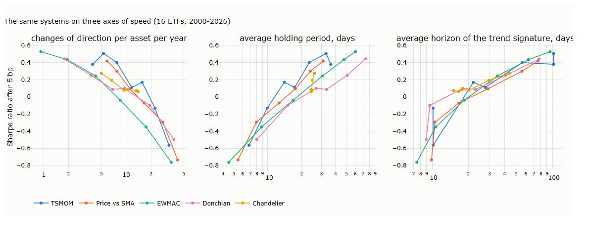
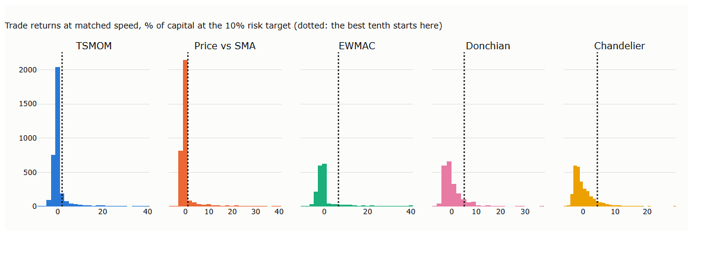
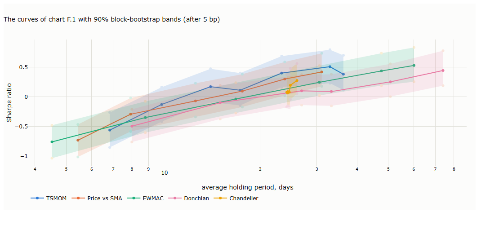
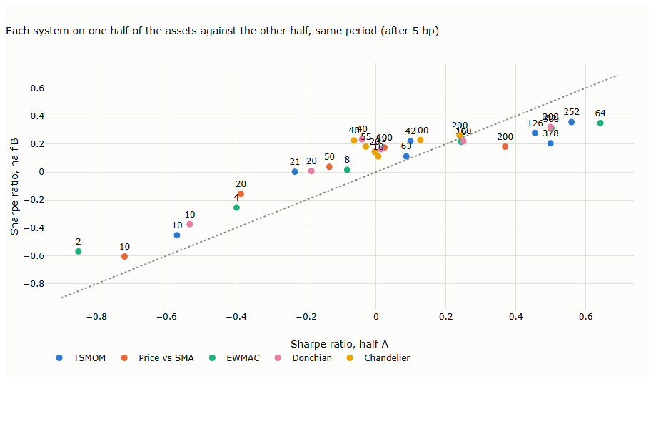
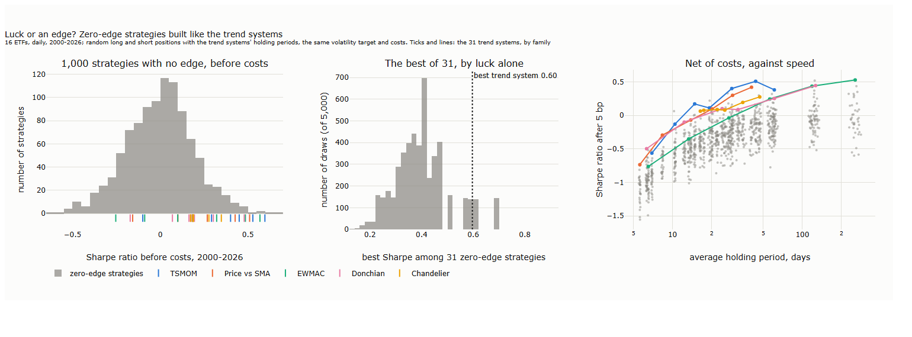
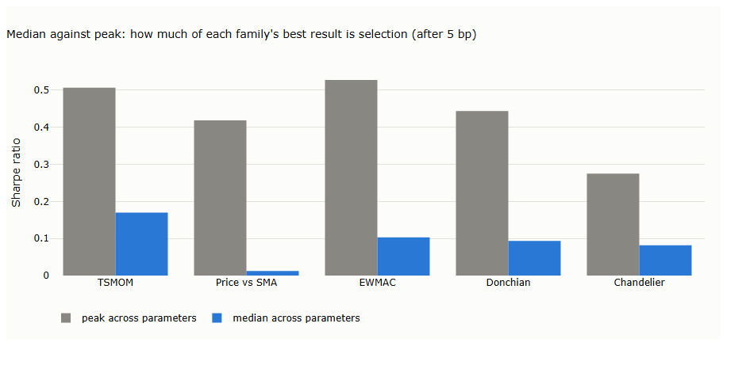

# Lecture 7: Comparing Trend Systems

> Two trend systems with different Sharpe ratios may not differ at all: one may trade at a different speed, the gap may be noise, or the better one may have been picked from many tries.

Part II · Pipeline stage: the feedback loop (how systems are compared and judged)

---

# On a fair axis for speed, the families collapse

> Measured by the horizon of the past returns they use, the five families behave like one rule at five speeds.

Average gap between the best and worst family at equal speed:

- Changes of direction per year: 0.35
- Average holding period: 0.30
- Trend signature: **0.09**

---

# Five questions for a fair comparison

> Comparing one setting of one rule with one setting of another is close to meaningless.

| Question | Why it matters |
|---|---|
| Compared at what speed? | A slow rule and a fast rule differ by speed before they differ by idea |
| Does a system add anything? | The useful question is whether a second system improves the first |
| What do the trades show? | The same returns can come from different trades, sides and time in the market |
| Is the difference real? | A gap of 0.2 in Sharpe ratio over 25 years may be chance |
| Will it last? | The best point on a curve is the one most likely to disappoint |

---

# Does a system add anything?

> At matched speed, no family adds a return the others do not already have.

- **Neighbours are near copies:** TSMOM and price against its average correlate 0.91, Donchian and chandelier 0.92
- **Spanning regression:** regress system B on system A; the intercept is what B earns beyond A
- The other four explain 78% to 91% of each family's monthly returns; no alpha is distinguishable from zero
- **Breakeven costs rise with speed:** 10 to 30 bp at a holding period of 25 to 35 days; about 65 bp for the slowest rules

---

# Trend systems win rarely and win big

> The best tenth of trades earns more than all the profit: the other nine tenths lose money together.

- One trade in three to one in seven wins
- Winners are two to eight times the size of losers
- Best tenth of trades: 2.8 to 5.9 times total profit

---

# Systems that are not always in the market

> Dropping the idle periods flatters a system that is often flat: over the whole period, its Sharpe ratio shrinks with the square root of its time in the market.

$$\text{Sharpe ratio} \;=\; \frac{p\,\mu}{\sqrt{p}\,\sigma} \;=\; \text{Sharpe ratio while invested} \times \sqrt{p}$$

| | A: in the market 30% of the time | B: always in the market |
|---|---|---|
| Sharpe ratio while invested | 1.00 | 0.60 |
| Sharpe ratio over the whole period | 0.55 | 0.60 |
| Excess return per unit of capital | 3.0% | 6.0% |

Report time in the market, both Sharpe ratios and the return per unit of capital.

---

# Marginal contribution, measured in what is scarce

> What matters for allocation is not how good a system is on its own, but what it adds to the systems already run.

| What is scarce | Typical setting | How to measure a system |
|---|---|---|
| Cash | Fully funded, unlevered portfolios | Over the whole period, idle periods earning the cash rate |
| Risk budget | Futures and margin accounts | Sharpe ratio while invested, with its correlation with the other systems |
| Neither | Leverage without limit or cost, which is rare | Sharpe ratio over the whole period |

- With a portfolio volatility target, capital does not move between systems, only risk does
- The chandelier over 20 days adds nothing to EWMAC 16/64: alpha −0.55% a year (t-statistic −1.1)

---

# Is the difference real?

> The noise is large: no pair of families at equal speed differs significantly.

- 90% bootstrap bands: about ±0.28 around each Sharpe ratio
- Gaps between families, 0.1 to 0.3, lie inside the bands
- Pairwise p-values: from 0.08 to 0.77, none below 5%

---

# Choosing a slow rule is not luck; choosing among slow rules is

> The slow end is better in almost every sub-period, and the ranking of speeds carries over to other markets.

- Probability of backtest overfitting: 0.06 across all 31 systems
- Best in sample still earns less out of sample: 0.41 against 0.57
- Ranks on two halves of the ETFs correlate 0.89

---

# Luck or an edge?

> A strategy with no edge at all can produce a backtest as good as the best trend system.

- 1,000 coin-flip strategies: same ETFs, speeds, risk and costs
- Best of 1,000: 0.69; best trend system: 0.60
- Best of 31, as many as this lecture tried: typically 0.40

---

# Luck does not persist; an edge does

> What luck cannot fake is a profit that persists over time and across markets.

| Test, before costs | Trend systems | Zero-edge strategies |
|---|---|---|
| Median Sharpe ratio | 0.19 | 0.01 |
| Correlation of Sharpe ratios, 2000-2012 and 2013-2026 | 0.70 | 0.02 |
| The best in 2000-2012, then 2013-2026 | 0.47 → 0.62 (best 5) | 0.60 → −0.08 (best 31) |
| Rank correlation between the two halves of the ETFs | 0.84 | 0.05 |

---

# The mechanism, tested

> An edge has a mechanism that says where and when it should work and fail; luck cannot meet those predictions.

- **What drives it, large moves:** slow trend profit rises from −0.33 in quiet months to 3.79 in months moving more than three times their volatility
- **What kills it, choppy markets:** −0.54 in the choppiest third of asset-years, 1.22 in the most trending; the luckiest zero-edge strategies 0.02 to 0.10 everywhere
- **When it works:** 0.82 and 0.69 in low and middle volatility, −0.02 in high volatility
- **Two predictions failed, and are reported:** with SPY below its 200-day average, slow trend lost (−0.19, against 0.74)

---

# Will it last? Judge the whole curve

> The best point on a curve combines skill with luck, and the luck does not repeat.

- The median lies far below the peak: every grid includes fast rules that lose after costs
- Walk-forward choice comes close to the peak: the ranking of speeds is stable
- Drop what fails, then blend the rest (Lecture 10)

---

# Takeaways

1. **Measure speed by what a rule looks at:** most differences between families are differences of speed
2. **Ask what a system adds, not how good it is:** at equal speed, no family adds a return the others lack
3. **Look inside the return series:** trend systems win rarely and win big
4. **Treat every gap as noise until shown otherwise:** bands of ±0.3 swallow the differences between families
5. **A good backtest can be luck:** an edge persists over time and across markets, where its mechanism says it should
6. **Judge the whole curve, then drop what fails and blend the rest**

> Speed, noise and selection each produce differences between systems that are not differences between ideas.
