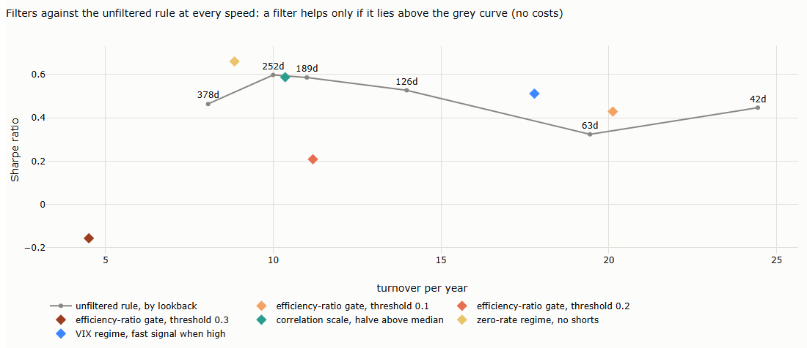
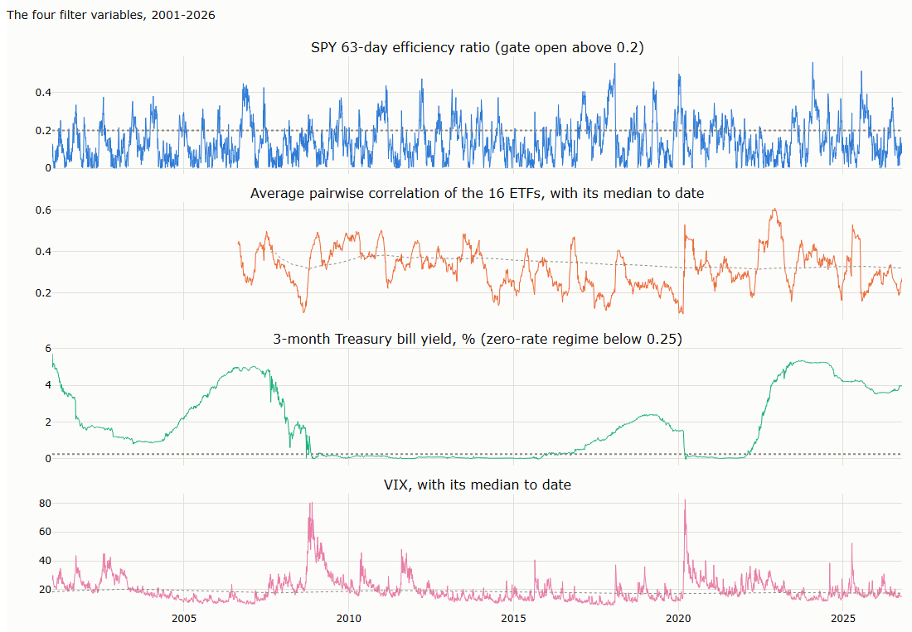

# Lecture 8: Filters and Overlays

*Systematic Trading: Lecture Notes (MSc) · Oct 20, 2026 · Max Gnesi*

A filter decides whether, or how much, to trade a signal, using information the signal does not contain. Filters are where creativity has most room: almost any data can condition a trend system. This lecture maps the sources and the ways a filter can act, sets one common test for all of them, and applies it to four filters on the 16 ETFs of Lectures 5 to 9. Companion notebook: [08_filters_and_overlays.ipynb](08_filters_and_overlays.ipynb).

## 1. The question of this lecture

A trend signal says which way; a filter says whether to listen. It can be built from anything: the price itself, the volume, other markets, the economy, flows, the calendar. That freedom is the attraction and the danger. The more ideas can be tried, the larger the multiple-testing problem of Lecture 5, §4.3, and a filter is also a second signal: it removes some losing trades and some winning ones, and it changes how often the system trades.

**The bottom line.** Be creative about sources and disciplined about testing. Filter research has two purposes, and both are legitimate: to test whether a mechanism we believe in improves a signal, and to explore which variables determine a signal's performance, improve it, or have predictive power for it. What matters is keeping exploration and confirmation apart. A filter earns its place only if what was found is confirmed on data it was not found in, if it beats the unfiltered system at equal speed, and if it adds to the unfiltered system after costs. The filters in §4 are examples, chosen to show how the test works; they could be something completely different. In these examples none passed all three tests, and how a filter is attached to the signal mattered as much as the regime it uses.

**Filter or sizing?** As in Lecture 9, §1.2: a rule that uses only risk and cost information, such as volatility, drawdown or trading costs, is sizing; a rule that uses conditioning information, such as a regime, trend strength, macro data or the calendar, is a filter.

## 2. The map

### 2.1 Where the information comes from

| Source | Examples | Notes |
|---|---|---|
| The price itself, and its transformations | Trend strength (efficiency ratio, ADX), volatility regime, distribution shape, persistence, stretch from the trend | Always available; but it is the data the signal already uses, so the filter may be a second trend rule in disguise |
| Bar data beyond the close | Volume, order imbalance, range expansion, open interest | Open interest needs futures data |
| High-frequency data | Intraday order flow and trade signs, realised volatility from intraday returns, liquidity and spreads | Daily filters built from intraday information; Part III |
| Cross-market structure | Correlations, breadth, dispersion, lead–lag, the futures term structure | Correlation regimes matter for trend (Baltas and Kosowski) |
| Macro data | Policy-rate regime, yield-curve slope, inflation, growth surprises | Only data known at the time: publication lags and revisions |
| Flows and positioning | Trader positioning (Commitments of Traders), ETF and fund flows, dealer gamma estimated from options open interest, estimates of CTA positioning, implied volatility and skew | The mechanism is often clear: who must buy or sell, and when |
| Alternative data | Sentiment, news, search, satellite | Short histories, costly, easy to overfit |
| Calendar and events | Earnings dates and index rebalances for single equities; option expiries and scheduled announcements for volatility strategies; central-bank meetings, data releases, month-end rebalancing and futures rolls for short-term strategies | Key for these strategies, because flows arrive at known times: the rebalancing waves of Lecture 5, scheduled. The risk of data mining is in seasonality without a mechanism, not in scheduled events |

The map covers the main ground without claiming to be complete. Two further sources are common in practice: signals from other strategies used as filters, such as trading a trend only when carry or value agrees, and fundamental data, such as earnings revisions for single equities.

### 2.2 What a filter does to the signal

| Action | How it works | Example |
|---|---|---|
| Gate | The position is held only while a condition is true; flat otherwise | Trade only while the efficiency ratio exceeds a threshold |
| Scale | Every position is multiplied by a factor that depends on the condition | Halve positions while cross-market correlation is high |
| Restrict direction | One side, long or short, is switched off while the condition holds | No short positions while policy rates are at zero |
| Switch speed | A different version of the rule is used in each state | The fast rule in turbulent markets, the slow one in calm markets |
| Delay or confirm | A signal is acted on only once a second condition confirms it | Enter a breakout only if volume is above normal |

## 3. One test for every filter

Every filter, whether it comes from a stated mechanism or from exploring which variables matter, goes through the same five steps.

| Step | What to do | Why |
|---|---|---|
| 1. Know which route you are on | Either state the mechanism before the test, or say that you are exploring which variables determine or predict the signal's performance; then confirm what exploration finds on data it was not found in | Exploration finds candidates and confirmation tests them; mixing the two turns every pattern into a story found after the result (Lecture 5, §4.2) |
| 2. Compare at equal speed | Compare the filtered system with the unfiltered rule at the same turnover, not only with the rule it was applied to | A filter changes how often the system trades; it may only have moved the system along the speed curve of Lecture 6, §2.3 |
| 3. Use only information known at the time | Lag every input; respect publication lags and data revisions; never label a regime with hindsight | Otherwise the filter trades on the future |
| 4. Judge after costs, by marginal contribution | Regress the filtered system's returns on the unfiltered system's; the intercept is what the filter adds | The question is what the filter adds, not whether the filtered system looks good alone (Lecture 7, §4.4) |
| 5. Count the tries | Report every threshold and variant tried, and judge the whole range, not the best one | Many tries make some look good by chance (Lecture 5, §4.3) |

**How step 2 works.** Run the unfiltered rule at several speeds and record its turnover and Sharpe ratio: this is the yardstick curve. A filtered system is then placed on the same chart; it is better only if it lies above the curve at its own turnover.

**Table 3.1. The yardstick: time-series momentum at several speeds** (16 ETFs, positions sized to 10% volatility per asset, 2001–2026; notebook §3)

| Lookback | Turnover per year | Sharpe ratio, no costs | Sharpe ratio, 5 bp |
|---|---|---|---|
| 378 days | 8.1 | 0.46 | 0.39 |
| 252 days | 10.0 | 0.60 | 0.51 |
| 189 days | 11.0 | 0.59 | 0.48 |
| 126 days | 14.0 | 0.53 | 0.40 |
| 63 days | 19.4 | 0.32 | 0.14 |
| 42 days | 24.4 | 0.45 | 0.21 |

The curve is not smooth: the 63-day rule lies below both its neighbours. Comparisons against it near that point carry the curve's own noise.

## 4. Examples: the test at work

### 4.1 Four filters, one per source and per action

The filters in this section are examples, not a recommended set. With eight sources, five actions, three ways of attaching a filter, and any number of variables and thresholds within each, the possible filters run into the millions; no lecture can test them, and no list of results would generalise. What generalises is the method. The examples are chosen to exercise it: one filter per source and per action, each applied to the 12-month rule, each with its mechanism stated before the test.

| Filter | Source | Action | How it works | Mechanism |
|---|---|---|---|---|
| Efficiency-ratio gate | Price | Gate | Each evening, compute each asset's 63-day efficiency ratio (Lecture 3, §6); hold the position only while it exceeds a threshold, flat otherwise | Trends that move in a straight line persist; choppy ones whipsaw |
| Correlation scale | Cross-market | Scale | Each evening, compute the average pairwise 63-day correlation of the 16 ETFs; halve every position while it is above its median to date | When all markets move together, diversification collapses and positions are effectively one bet |
| Zero-rate regime | Macro | Restrict direction | Each evening, check the previous day's 3-month Treasury bill yield; while it is below 0.25%, close short positions | Central banks that hold rates at zero lean against sell-offs, so downtrends are cut short (Lecture 5, §3.5) |
| VIX regime | Implied volatility | Switch speed | Each evening, compare the previous day's VIX with its median to date; above it, use the 3-month signal, below it the 12-month signal | Turbulent markets move fast, and the fast rule catches fast crises (Lecture 6, §3.1) |

**Table 4.1. The four filters against the unfiltered rule** (2001–2026; alpha is the intercept of the filtered system's returns regressed on the unfiltered system's; notebook §4)

| System | Turnover per year | Sharpe ratio, no costs | Unfiltered curve at the same turnover | Sharpe ratio, 5 bp | Alpha over the unfiltered rule, % a year (t) |
|---|---|---|---|---|---|
| Unfiltered 12-month rule | 10.0 | 0.60 | — | 0.51 | — |
| Efficiency-ratio gate, 0.1 | 20.1 | 0.43 | 0.34 | 0.17 | −0.31 (−0.8) |
| Efficiency-ratio gate, 0.2 | 11.2 | 0.21 | 0.58 | −0.03 | −0.37 (−1.0) |
| Efficiency-ratio gate, 0.3 | 4.5 | −0.16 | 0.46 | −0.35 | −0.45 (−2.2) |
| Correlation scale | 10.4 | 0.59 | 0.59 | 0.48 | 0.03 (0.1) |
| Zero-rate regime, no shorts | 8.9 | 0.66 | 0.52 | 0.58 | 0.50 (1.5) |
| VIX regime, fast when high | 17.8 | 0.51 | 0.39 | 0.35 | 0.43 (0.6) |

([chart G.1](#g1-the-filters-against-the-yardstick-4) places each filtered system against the yardstick curve.)

- **The efficiency-ratio gate hurts at every threshold.** A likely reason is that it throws away the timing of Lecture 5: large moves often begin in choppy markets, before the efficiency ratio rises. At a threshold of 0.1 it even doubles turnover, because the gate opens and closes so often. Its alpha is negative throughout, significantly so at 0.3.
- **The correlation scale does nothing.** Its returns correlate 0.97 with the unfiltered rule's and its alpha is zero. A likely reason is that volatility targeting per asset already responds to much of what high correlation signals, since correlations rise when volatility does.
- **The zero-rate regime looks best, and is the trap.** It lies above the curve and earned the highest Sharpe ratio, 0.66. But its idea came from Table 3.4 of Lecture 5, which was measured on the same data; the test is therefore not out of sample, and the alpha, at t = 1.5, is not significant even so. It is the clearest example in these lectures of step 5: an idea found in the data has to be tested on data it was not found in.
- **The VIX regime beats the curve but not the rule.** Switching speed by regime earned more than a fixed rule of the same turnover, 0.51 against 0.39, but less than the 12-month rule itself, and its alpha is not significant. It is the most interesting result and the least conclusive one.

### 4.2 Three more regimes: volatility, correlation across asset classes, stock–bond correlation

Three further variables, each examined both ways. Exploration first: does the signal's performance depend on the variable, so that the variable carries information about when the signal works (Table 4.2)? Then confirmation of a stated hypothesis: does a filter built on the variable improve the signal (Table 4.3)? A hypothesis was written down for each variable before the test.

| Variable | How it is measured | Hypothesis, stated first |
|---|---|---|
| Volatility | Each asset's 60-day volatility against its median to date | Trend earns in turbulent periods (Lecture 5, §2.4), so it should do better when volatility is high |
| Correlation across asset classes | Average 63-day correlation between equal-weighted baskets of equities, bonds and commodities, against its median to date | When one macro driver moves every asset class, its shocks persist, so trend should do better when this correlation is high |
| Stock–bond correlation | 6-month correlation of SPY and TLT returns | A positive correlation marks an inflation regime (Lecture 3, §8.3), when shocks hit stocks and bonds together and persist, so trend should do better |

**Table 4.2. The unfiltered rule by regime** (Sharpe ratio, 2001–2026; regimes measured with data up to the previous day; notebook §4.2)

| Regime | Sharpe ratio | Hypothesis |
|---|---|---|
| Asset volatility above its median | 0.59 | Rejected: no better than in calm periods |
| Asset volatility below its median | 0.65 | |
| Cross-asset-class correlation above its median | 0.51 | Rejected, and reversed: trend did better when asset classes moved independently |
| Cross-asset-class correlation below its median | **0.88** | |
| Stock–bond correlation positive (21% of days) | **0.97** | Supported |
| Stock–bond correlation negative | 0.45 | |

**Table 4.3. Filters built on these regimes** (notebook §4.2)

| Filter | Sharpe ratio | Curve at the same turnover | Alpha over the unfiltered rule (t) |
|---|---|---|---|
| Trade only when asset volatility is high (the hypothesis) | 0.21 | 0.46 | −0.61% (−1.5) |
| Trade only when asset volatility is low (the opposite) | 0.65 | 0.59 | 0.59% (1.4) |
| Cross-asset-class correlation: 1.5 times above its median, 0.5 below (the hypothesis) | 0.52 | 0.48 | −0.12% (−0.2) |
| The same, reversed after seeing Table 4.2 | 0.55 | 0.55 | 0.12% (0.2) |
| Stock–bond correlation: 1.5 times when positive, 0.5 when negative (the hypothesis) | 0.58 | 0.53 | 0.28% (0.7) |

What these results say, so far:

- **Exploration found what the hypotheses missed.** Two of the three hypotheses were wrong as stated, but exploring how performance depends on each variable is a goal in its own right, and it found information: trend earned 0.88 when asset classes moved independently and 0.51 when they did not, the direction Baltas and Kosowski had found. Cross-asset-class correlation is therefore a candidate variable with predictive power for trend performance, to be confirmed on data it was not found in (the fourth exercise of §6.2).
- **Volatility depends.** Trend did slightly better in calm periods here, and a gate on low volatility was the only filter in Table 4.3 to beat the unfiltered rule, yet the result depends on how volatility is measured and on the rule it is applied to.
- **A large gap between regimes did not, so far, make a better filter.** Scaling exposure by the regime did not help in either direction. §4.3 shows that the reason lies partly in how the filter was attached to the signal.

### 4.3 How the filter attaches to the signal

All the filters above act on every day: the position is the trend signal times the filter, so whenever the regime switches, the filter opens or closes a position by itself, in the middle of a trend. A filter can instead be attached to the trend's own entries and exits.

| Attachment | How it works |
|---|---|
| A. Independent | Position = trend signal × filter, every day. The filter creates its own entries and exits |
| B. Entry only, at the next signal | A new position is opened only if the filter is on when the trend signal turns; it is then held until the signal turns again |
| C. Entry only, joining the trend | A position is opened when the signal turns with the filter on, or when the filter turns on during an existing trend; it is closed only when the trend signal turns |

**Table 4.4. The same regimes, attached three ways** (12-month rule, 2001–2026; the unfiltered rule has a Sharpe ratio of 0.60 and is always in the market; notebook §4.3)

| Regime the filter requires | Attachment | Time in the market | Sharpe ratio | Sharpe ratio, 5 bp | Alpha over the unfiltered rule (t) |
|---|---|---|---|---|---|
| Efficiency ratio above 0.2 | A | 20% | 0.22 | −0.01 | −0.33% (−0.9) |
| | B | 16% | 0.35 | 0.31 | −0.05% (−0.2) |
| | C | 74% | **0.51** | 0.46 | −0.36% (−1.5) |
| Cross-asset-class correlation low | A | 32% | 0.44 | 0.31 | 0.38% (0.8) |
| | B | 35% | 0.43 | 0.37 | 0.19% (0.5) |
| | C | 65% | **0.58** | 0.52 | 0.37% (0.8) |
| Stock–bond correlation positive | A | 19% | 0.36 | 0.28 | 0.22% (0.5) |
| | B | 17% | 0.35 | 0.29 | 0.15% (0.4) |
| | C | 37% | **0.50** | 0.46 | 0.39% (0.8) |
| Asset volatility low | A | 52% | **0.65** | 0.52 | 0.56% (1.4) |
| | B | 51% | 0.59 | 0.50 | 0.29% (0.8) |
| | C | 72% | 0.58 | 0.50 | 0.10% (0.3) |
| Asset volatility high | A | 38% | 0.21 | 0.11 | −0.61% (−1.5) |
| | C | 66% | 0.39 | 0.34 | −0.64% (−1.9) |

- **How the filter is attached matters as much as which regime it uses.** For three of the four regimes, attaching the filter to the trend's exits (C) raised the Sharpe ratio sharply: the efficiency-ratio gate from 0.22 to 0.51, the correlation regimes from about 0.4 to 0.5–0.6. A filter that closes positions in the middle of a trend cuts the large gains of Lecture 5, §2.4.
- **These systems are often out of the market.** By Lecture 7, §4.3, the Sharpe ratio over the whole period is the Sharpe ratio while invested times the square root of the time in the market. The cross-asset-class correlation filter (C) earned 0.58 while in the market 65% of the time, about 0.72 while invested. Whether that is worth having depends on what the idle capital or risk can do.
- **Still no significant addition.** The best alphas, for the correlation regimes, are positive but with t-statistics below 1. The yardstick curve of §3 does not extend to such low turnover and time in the market, so the comparison at equal speed is left to the alpha.

None of the examples in §4.1 to §4.3 passes all three requirements: a stated mechanism, a gain at equal speed, and a significant addition after costs. That says little about filters in general and much about the test: with millions of possible variants, a filter that does pass has to be checked for how many variants were tried before it.

## 5. Further ideas

Filters that our daily ETF data cannot test, each with its mechanism and the data it needs. They are starting points, to be put through the test of §3.

| Idea | Source | Mechanism | Data needed |
|---|---|---|---|
| Trade breakouts only on high volume | Bar data | A break on heavy volume reflects real buying or selling | Volume (available) |
| Trend in the futures curve | Cross-market | Backwardation signals scarcity that tends to persist | Futures term structures |
| Positioning extremes | Flows and positioning | When speculators are crowded on one side, trends are prone to reverse | Commitments of Traders reports |
| Dealer gamma | Flows and positioning | When dealers are short gamma, their hedging pushes prices in the direction they move, as in Baltussen et al. (Lecture 5, §2.4) | Options open interest |
| Index events | Calendar | Index additions and rebalances move prices at known dates | Index calendars |
| Growth surprises | Macro | Trends in bonds and currencies follow surprises in growth and inflation | Real-time macro data, as first published |

## 6. Summary, exercises and reading

### 6.1 Five takeaways

1. **Filters can use any information, which is why they need discipline.** Sources range from the price itself to flows, macro data and the calendar; actions from gating to switching speed.
2. **Two purposes, one test.** Explore which variables determine or predict a signal's performance, or confirm a mechanism you believe in; then compare at equal speed, use only information known at the time, judge after costs by marginal contribution, count the tries, and confirm on data the idea was not found in.
3. **The examples teach the method, not a verdict.** With millions of possible filters, the examples could have been entirely different; in these, none added significantly; two of three regime hypotheses were wrong as stated, yet the regime patterns themselves, such as 0.88 against 0.51 by cross-asset-class correlation, are candidates to explain and confirm.
4. **How a filter attaches to the signal matters as much as which regime it uses.** Letting the filter open and close positions on its own hurt; attaching it to the trend's entries and exits recovered most of the loss.
5. **The most promising filters work through mechanisms with a known timing:** flows and positioning, scheduled events, and regimes that change how fast markets move.

### 6.2 Exercises

- [ ] Test the zero-rate filter out of sample: choose it on 2001–2012 only, and apply it to 2013–2026. Does it still help? (notebook §4)
- [ ] Replace the VIX median with fixed thresholds of 20 and 30. How sensitive is the result? Count your tries. (notebook §4)
- [ ] Gate breakouts by volume: enter a Donchian breakout only when volume exceeds its 50-day average. Compare at equal speed. (notebook §4)
- [ ] Choose the cross-asset-class correlation filter on 2006–2015 only and apply it to 2016–2026. Does a regime that separates performance in one decade still do so in the next? (notebook §4.2)
- [ ] Combine the correlation scale with the VIX switch. Do two weak filters add up to a strong one? (notebook §4)

### 6.3 Reading

The full reference list closes the lecture. A short path: Baltas and Kosowski for correlations and trend; Lo (2004) for why edges fade; Harvey, Liu and Zhu (2016) for the bar a new idea must clear.

## Appendix: charts

From the companion notebook, [08_filters_and_overlays.ipynb](08_filters_and_overlays.ipynb).

### G.1 The filters against the yardstick (§4)

The grey curve is the unfiltered rule at six lookbacks; each diamond is a filtered system. A filter helps only if it lies above the curve at its own turnover. The zero-rate filter (yellow) and the VIX switch (blue) lie above it; the efficiency-ratio gates lie below.

### G.2 The four filter variables (§4)

The efficiency ratio swings within weeks; average correlation rises in sell-offs, as in 2008, 2020 and 2022, and starts in 2006, when enough of the 16 ETFs exist; the Treasury bill sits at zero from late 2008 to 2015 and from 2020 to 2022; the VIX spikes in 2008 and 2020.

## References

- Baltas, N. and Kosowski, R. Demystifying time-series momentum strategies: volatility estimators, trading rules and pairwise correlations. Working paper, SSRN 2140091. — correlations and trend returns (§2.1, §4).
- Baltussen, G., Da, Z., Lammers, S. and Martens, M. (2021). Hedging demand and market intraday momentum. *Journal of Financial Economics* 142(1), 377–403. — hedging flows (§5).
- Harvey, C., Liu, Y. and Zhu, H. (2016). … and the cross-section of expected returns. *Review of Financial Studies* 29(1), 5–68. — the bar for new findings (§3).
- Lo, A. (2004). The adaptive markets hypothesis: market efficiency from an evolutionary perspective. *Journal of Portfolio Management* 30, 15–29. — why edges fade (§1).
