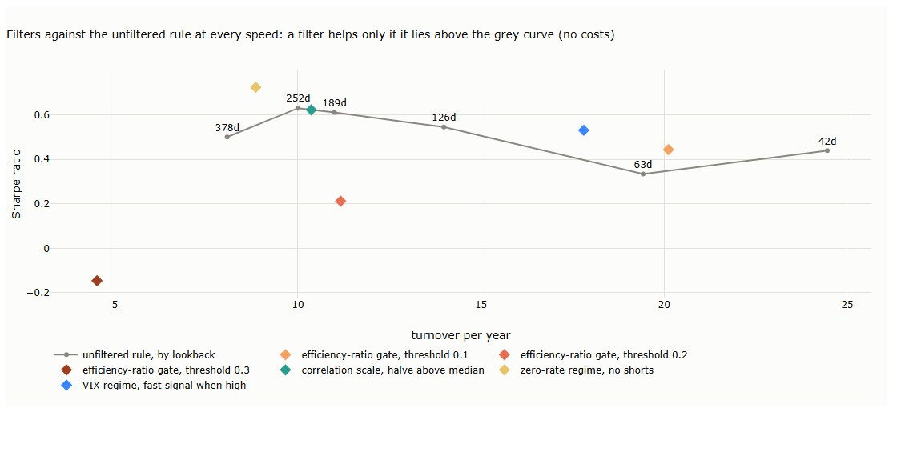
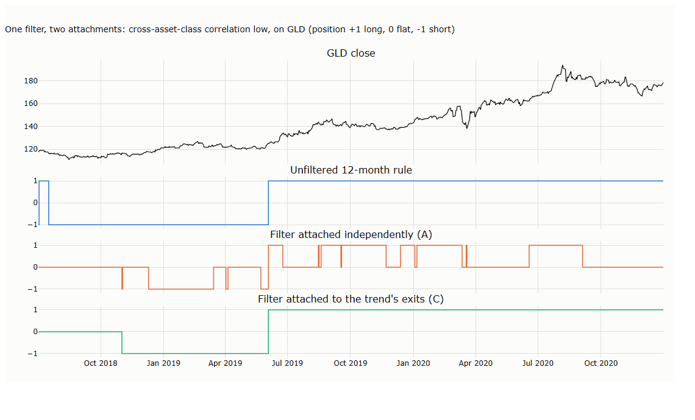
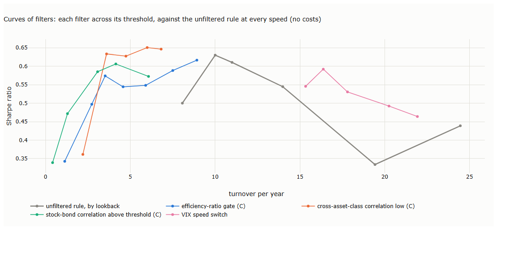
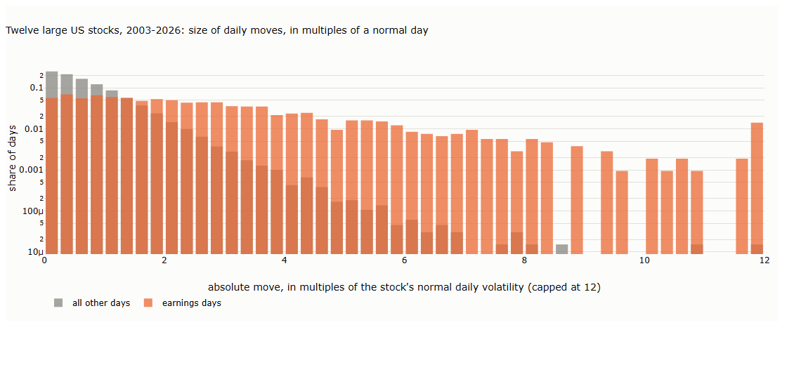

# Lecture 8: Filters and Overlays

> A trend signal says which way; a filter says whether to listen. Be creative about sources and disciplined about testing.

Part II · Pipeline stage: signal generation (filters and overlays on a signal)

---

# The bottom line

> A filter earns its place only if it is confirmed on data it was not found in, beats the unfiltered system at equal speed, and adds after costs.

- None of the examples passed all three tests
- How a filter is attached mattered as much as its regime
- A filter helps only if it lies above the yardstick curve

---

# Where the information comes from

> Almost any data can condition a trend system: that freedom is the attraction and the danger.

- **The price itself:** trend strength, volatility regime; possibly a second trend rule in disguise
- **Cross-market structure and macro data:** correlations, policy-rate regime, yield-curve slope; only data known at the time
- **Flows and positioning:** trader positioning, fund flows, dealer gamma; the mechanism is often clear
- **Calendar and events:** earnings dates, index rebalances, data releases; flows arrive at known times
- **Filter or sizing?** A rule using only risk and cost information is sizing; one using conditioning information is a filter

---

# What a filter does to the signal

> A filter is also a second signal: it removes some losing trades and some winning ones, and it changes how often the system trades.

| Action | How it works |
|---|---|
| Gate | The position is held only while a condition is true; flat otherwise |
| Scale | Every position is multiplied by a factor that depends on the condition |
| Restrict direction | One side, long or short, is switched off while the condition holds |
| Switch speed | A different version of the rule is used in each state |
| Delay or confirm | A signal is acted on only once a second condition confirms it |
| Exit early | The position is closed before the signal turns, on the trade's own open gain |

Example (§4.8): a take-profit at four to five units of a speed's risk left the Sharpe ratio unchanged and raised skew; an option, not an improvement.

---

# One test for every filter

> Exploration finds candidates and confirmation tests them; mixing the two turns every pattern into a story found after the result.

1. **Know which route you are on:** state the mechanism first, or explore, then confirm on data the idea was not found in
2. **Compare at equal speed:** a filter may only have moved the system along the speed curve
3. **Use only information known at the time:** lag every input, never label a regime with hindsight
4. **Judge after costs, by marginal contribution:** the intercept over the unfiltered system is what the filter adds
5. **Count the tries:** judge the whole range, not the best one

---

# Four filters, one per source and per action

> The filters are examples, chosen to exercise the method; each was applied to the 12-month rule with its mechanism stated before the test.

| Filter | Action | Mechanism |
|---|---|---|
| Efficiency-ratio gate | Gate | Trends that move in a straight line persist; choppy ones whipsaw |
| Correlation scale | Scale | When all markets move together, positions are effectively one bet |
| Zero-rate regime | Restrict direction | Central banks at zero lean against sell-offs, cutting downtrends short |
| VIX regime | Switch speed | Turbulent markets move fast, and the fast rule catches fast crises |

---

# What the four filters did

> None added significantly on data it was not found in; the unfiltered rule earned a Sharpe ratio of 0.63.

- **The efficiency-ratio gate hurts at every threshold:** large moves often begin in choppy markets
- **The correlation scale does nothing:** its returns correlate 0.97 with the unfiltered rule's
- **The zero-rate regime looks best, and is the trap:** 0.72 and an alpha at t = 2.1, but its idea came from the same data
- **The VIX regime beats the curve but not the rule:** 0.53 against 0.40 at the same turnover, but less than the 12-month rule itself

---

# Exploration found what the hypotheses missed

> Two of three regime hypotheses were wrong as stated, yet the regime patterns themselves are candidates to explain and confirm.

| Regime | Sharpe ratio | Hypothesis |
|---|---|---|
| Asset volatility above / below its median | 0.60 / 0.70 | Rejected |
| Cross-asset-class correlation above / below its median | 0.59 / **0.91** | Rejected, and reversed |
| Stock–bond correlation positive / negative | **1.10** / 0.49 | Supported |

- Trend did better when asset classes moved independently, the direction Baltas and Kosowski had found
- A large gap between regimes did not, so far, make a better filter

---

# How the filter attaches to the signal

> How a filter is attached matters as much as which regime it uses: a filter that closes positions mid-trend cuts the large gains.

- **A. Independent:** the filter opens and closes positions itself
- **C. Joining the trend:** closed only when the trend signal turns
- Efficiency-ratio gate: 0.23 attached as A, 0.54 as C

---

# Curves of filters, not single points

> A filter has parameters as a rule has speeds: judge it by its whole curve, not its best point.

- Cross-asset-class correlation gate: 0.63 to 0.65 over a range of thresholds
- VIX switch: above the speed curve at all five thresholds
- Gated filters trade less than any unfiltered rule: they need another yardstick

---

# A fair yardstick: the random filter

> A filter that leaves the market must beat random filters with the same share of time on and the same spell length.

| Filter (attached as C) | Real filter | Random filters: median | Random filters: 95th percentile | Random filters beaten |
|---|---|---|---|---|
| Cross-asset-class correlation low | 0.63 | 0.54 | 0.64 | 90% |
| Stock–bond correlation positive | 0.59 | 0.42 | 0.62 | 92% |

- Both variables carry some information about when trend works; neither clears the 95th percentile: suggestive, not conclusive
- Part of the gain is simply being out of the market at random times

---

# Confirmation: the candidate out of sample

> The filter did not survive; the pattern partly did. A pattern that weakens out of sample is still worth knowing; it is not yet worth trading.

| | 2006–2015 (choice) | 2016–2026 (test) |
|---|---|---|
| Unfiltered rule, Sharpe ratio | 0.67 | 0.48 |
| Filter at the threshold chosen in 2006–2015 | 0.71 | 0.44 |
| Unfiltered rule when correlation is low / high | 0.89 / 0.41 | 0.59 / 0.45 |

- The gap between low and high correlation shrank from 0.48 to 0.14

---

# A calendar example: earnings

> For single-stock strategies the calendar is a filter in its own right: earnings moves are brutal and arrive while the market is closed.

- Average move: 2.8 normal days, against 0.7 on other days
- One earnings reaction in three exceeds three normal days
- Median share of the move that is an overnight gap: 88%

---

# Takeaways

1. **Filters can use any information,** which is why they need discipline
2. **Two purposes, one test:** explore or confirm; then equal speed, information known at the time, marginal contribution after costs, counted tries, data the idea was not found in
3. **The examples teach the method, not a verdict:** none added significantly
4. **How a filter attaches matters as much as its regime:** attaching it to the trend's entries and exits recovered most of the loss
5. **Judge filters by curves, against random filters, and out of sample:** the best candidate beat 90% of random filters but did not survive out of sample
6. **Exits are overlays too:** a take-profit is an option with known trade-offs, not an improvement
7. **The most promising filters work through mechanisms with a known timing**

> Be creative about sources and disciplined about testing.
