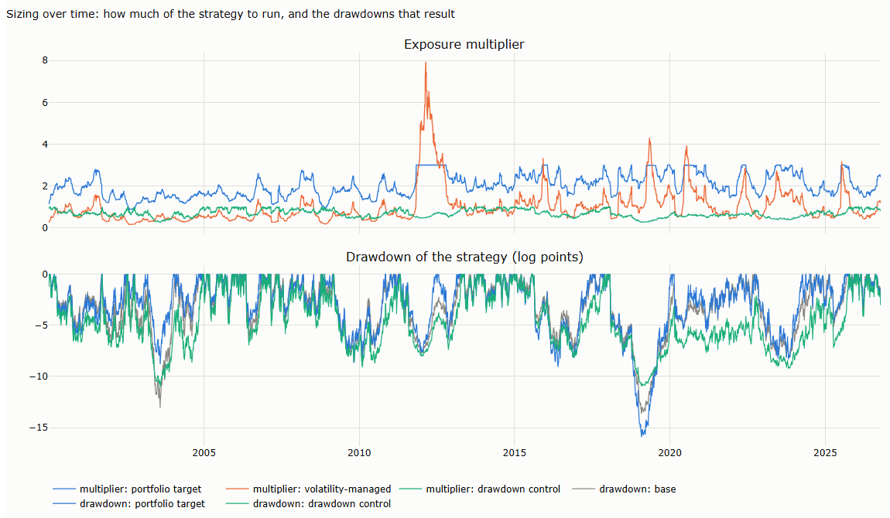

# Lecture 9: Sizing Trend Systems

*Systematic Trading: Lecture Notes (MSc) · Oct 18, 2026 · Max Gnesi*

A signal says which way to trade; sizing says how much. The literature offers many sizing methods, but fewer genuinely different ones. This lecture maps them, measures which ones actually change the result, and explains those in depth, applying each to the same signals on the 16 ETFs of Lectures 5 and 6. Companion notebook: [09_sizing_trend_systems.ipynb](09_sizing_trend_systems.ipynb).

## 1. The question of this lecture

### 1.1 A map of sizing methods

Sizing methods answer six different questions. For each, the table says how it works in practice and what the literature does; §3 then measures which methods change the result, and only those are explained in depth.

| Question | How it works in practice | Literature |
|---|---|---|
| **How much risk per asset?** Inverse volatility | Every day, estimate each asset's volatility from its recent returns and set the position to target volatility divided by that estimate. If oil's volatility doubles, the oil position halves; a bond fund with a quarter of oil's volatility gets four times the position. Each asset then moves the account by about the same amount on a typical day | Moskowitz, Ooi and Pedersen (2012) size each position "so that it has an ex ante annualized volatility of 40%", a scale they call inconsequential, with volatility from exponentially weighted squared returns (centre of mass 60 days). Kim, Tse and Wald (2016): much of time-series momentum's alpha comes from this scaling, 1.27% a month with it and 0.41% without. Baltas and Kosowski: more efficient volatility estimators cut turnover by more than a third |
| **How much total risk now?** Sizing over time | Every day, measure the recent volatility of the whole strategy, not of each asset, and scale every position by the same multiplier: down when the strategy has been turbulent, up when it has been calm. Inverse variance cuts harder than inverse volatility: twice the volatility means a quarter of the exposure, not half | Volatility-managed portfolios (Moreira and Muir, 2017); risk-managed momentum (Barroso and Santa-Clara, 2015; Daniel and Moskowitz, 2016); volatility targeting helps mainly in risk assets but cuts extreme returns everywhere (Harvey et al., 2018); gains weaken out of sample and after costs (DeMiguel, Martín-Utrera and Uppal, 2024) |
| **How much to trade?** Partial trading | Every day, compute the target position as usual, but trade only a fixed fraction of the gap between the current position and the target. With a fraction of a quarter, a position of 0.2 facing a target of 0.5 moves to 0.275 today, then closes a quarter of the remaining gap tomorrow, and so on. Small, noisy changes in the target are mostly never traded | With transaction costs, the optimal policy is to "aim in front of the target" and "trade partially toward the current aim" (Gârleanu and Pedersen, 2013) |
| **How much after losses?** Drawdown control | Fix a floor at a fraction of the highest wealth reached, for example 80% of the peak, and keep exposure proportional to the cushion above it. At a new peak the strategy runs in full; after a 10% loss half the cushion is gone and exposure halves; near the floor exposure goes to zero, and it rebuilds as wealth recovers | Grossman and Zhou (1993) derive this as optimal under a drawdown constraint |
| **Where to stop?** Stop-loss rules | Exit to cash when the loss over a recent window exceeds a threshold, and re-enter after a recovery. A stop is itself a trend rule on the strategy's own returns: it pays only if losses tend to continue. On a trend system, which already exits on its signal, an extra stop mainly changes its speed | Under a random walk, stops always lower expected return; with momentum they can add value (Kaminski and Lo, 2014) |
| **How much on a strong signal?** Conviction | Make the position proportional to the forecast rather than to its sign: a forecast of 20 holds twice the position of a forecast of 10, with a cap so that no single reading dominates | Continuous signals scaled by the strength of the trend (Baltas and Kosowski); forecasts scaled to an average absolute value of 10, capped at ±20 (Carver, 2015) |
| **How much per trade, and given the edge?** Stop distance; Kelly | Stop distance: choose the loss you accept if the stop is hit, say 1% of capital, and divide by the distance to the stop: with a stop 6 points away, risk of USD 10,000 buys 1,667 shares. Kelly: leverage equal to expected excess return over variance | The Turtles' sizing by ATR (Faith, 2007); growth-optimal leverage (Kelly, 1956) |

The academic literature sizes at the portfolio level and on how much to trade; sizing per trade is mostly practitioner territory.

### 1.2 Sizing or filtering?

The two are easy to mix, so the line is drawn by the information used. Sizing decides how much using risk and cost information only: volatility, drawdown, stop distance, trading costs. A rule that decides whether to trade, or how much, using conditioning information, such as a market or macro regime, trend strength or the policy environment, is a filter and belongs to Lecture 8. How much to hold in each of several correlated assets belongs to the portfolio (Lecture 10).

## 2. The formulas, by hand

**Table 2.1. Sizing formulas for one asset** (price 100, capital USD 1 million; notebook §2)

| Method | Inputs | Computation | Result |
|---|---|---|---|
| Stop distance | Risk 1% of capital; stop 3 ATR below entry; ATR 2 | 10,000 / (3 × 2) | 1,667 shares, 17% of capital |
| Inverse volatility | Asset volatility 20%; target 10% | 10% / 20% | Exposure 0.5 × capital |
| Portfolio target | Book running at 15%; target 10% | 10% / 15% | Every position × 0.67 |
| Drawdown control | Drawdown 10%; limit 20% | 1 − 10% / 20% | Exposure × 0.5 |
| Partial trading | Current position 0.2, target 0.5, λ = 0.25 | 0.2 + 0.25 × (0.5 − 0.2) | New position 0.275 |
| Kelly | Expected excess return 5%; volatility 20% | 5% / 20%² | Leverage 1.25 |

## 3. Which methods are really different?

Many methods look different on paper and change little in practice. The test: apply each to the same signal, TSMOM-12 on the 16 ETFs, and compare its returns with the base, inverse volatility per asset.

**Table 3.1. How much each method changes the base** (daily returns, 2000–2026; Sharpe ratio and drawdown at the base's overall volatility; notebook §6)

| Method | Correlation with the base | Sharpe ratio | Maximum drawdown | Where it differs |
|---|---|---|---|---|
| Base: inverse volatility per asset | 1 | 0.56 | −13.6% | — |
| Expected shortfall per asset | 0.98 | 0.52 | −13.5% | Nowhere: sizes correlate 0.94 with inverse volatility |
| Stop distance (breakout signal) | Sizes correlate 0.97 with inverse volatility | | | Nowhere: a stop in ATRs is a volatility measure |
| Partial trading, λ = 0.25 | 0.98 | 0.57 | −13.6% | **Costs** (§6) |
| Drawdown control | 0.97 | 0.42 | **−11.1%** | **Tails** (§5) |
| Portfolio volatility target | 0.96 | 0.61 | −15.9% | Leverage over time (§5) |
| Equal notional, no risk sizing | 0.87 | 0.31 | −15.6% | **Returns** (§4) |
| Volatility-managed | 0.81 | 0.73 | −15.1% | **Returns** (§5) |

"Different" depends on the dimension. Expected-shortfall sizing and stop distance change nothing: they are inverse volatility measured another way. Partial trading leaves gross returns almost unchanged but transforms the returns after costs. Drawdown control changes the tails, volatility management and risk sizing change the returns themselves. The rest of the lecture explains these four.

## 4. Risk per asset

**Table 4.1. The same signals with and without risk sizing** (all versions at the same overall volatility; notebook §3)

| Signal and sizing | Sharpe ratio | Monthly skewness | Maximum drawdown |
|---|---|---|---|
| TSMOM-12, equal notional | 0.31 | 0.27 | −15.6% |
| TSMOM-12, inverse volatility | **0.56** | −0.05 | −13.6% |
| Breakout (55-day, chandelier stop), equal notional | 0.02 | 1.28 | −12.3% |
| Breakout, inverse volatility | 0.18 | 0.99 | −13.6% |
| Breakout, stop distance (1% at risk per trade) | 0.26 | 0.84 | −13.6% |

**How it works.** Each evening: (1) estimate each asset's daily volatility from its recent returns, here an exponential average of squared returns with a 60-day span; (2) set the position to the signal times target volatility divided by that estimate, here 10% a year per asset; (3) trade the difference from yesterday's position at the next open or close. Nothing else is needed: the signal says which way, the volatility estimate says how big.

Sizing by risk nearly doubles the Sharpe ratio: without it, the most volatile assets, oil, silver and gold miners, dominate the portfolio. How risk is measured, by volatility, by the true range behind a stop, or by expected shortfall, matters far less than measuring it at all.

## 5. Total risk over time

The methods of §4 decide the relative size of positions; the methods here decide how much of the whole strategy to run at each moment.

**How it works.** Each evening, compute one multiplier for the whole book and apply it to every position from §4:

| Method | Multiplier | Effect |
|---|---|---|
| Portfolio volatility target | Target volatility divided by the strategy's volatility over the last 60 days, capped | Keeps the book's risk near the target; levers up a well-diversified book |
| Volatility-managed | A constant divided by the strategy's variance over the last 60 days | Cuts exposure sharply after turbulent weeks and raises it after calm ones |
| Drawdown control | One minus the current drawdown divided by the limit, here 20%, never below zero | Full size at a new peak, half size at a 10% drawdown, flat at 20% |

**Table 5.1. Sizing over time** (TSMOM-12 with inverse-volatility sizing as the base; multipliers decided with data up to the previous close; same overall volatility; notebook §4)

| Method | Sharpe ratio | Monthly skewness | Worst month | Maximum drawdown | Average multiplier |
|---|---|---|---|---|---|
| Base | 0.56 | −0.05 | −3.9% | −13.6% | 1 |
| Portfolio volatility target (10%, leverage capped at 3) | 0.61 | 0.05 | −4.4% | −15.9% | 2.0 |
| Volatility-managed: inverse of trailing variance | **0.73** | 1.20 | −4.7% | −15.1% | 1.0 |
| Drawdown control (exposure falls to zero at a 20% drawdown) | 0.42 | 0.25 | −3.8% | **−11.1%** | 0.7 |

- **A portfolio target levers a diversified book.** The 16 assets diversify each other, so the book runs below its target and the rule doubles it on average ([chart H.1](#h1-sizing-over-time-5)); leverage is highest when correlations are low, and drawdowns deepen when correlations rise.
- **Volatility management changes the returns most, and is the most fragile.** It cut exposure to 0.38 of normal in late 2008 and gained a high Sharpe ratio and positive skewness here; the literature reports that such gains weaken out of sample and after costs.
- **Drawdown control changes the tails.** It cut the worst drawdown from 13.6% to 11.1% at the cost of Sharpe ratio: a trend system recovers through a few large gains (Lecture 5, §2.4), and cutting exposure after losses misses part of them.

### Sizing on the strategy's own performance: contrarian or momentum?

A related family of rules sizes the strategy by its own recent results, measured against what is expected of it.

**How it works.** Each evening, compute the strategy's Sharpe ratio over the past year and compare it with an expected Sharpe ratio, for example the long-run estimate or a round 1. Then:

| Rule | Multiplier | Idea |
|---|---|---|
| Contrarian | 1 + k × (expected − rolling Sharpe ratio) | The edge is stable and recent performance is mostly noise: add after a poor year, as when an allocator rebalances back to a risk budget |
| Momentum, or equity-curve trading | 1 + k × (rolling Sharpe ratio − expected) | Performance persists: cut after a poor year, as when a risk manager reduces a strategy in drawdown; drawdown control is a cousin |

**Table 5.2. Sizing on the rolling 1-year Sharpe ratio** (base at 10% volatility, multipliers between 0.25 and 2, same overall volatility; notebook §4.2)

| Rule | Sharpe ratio | Maximum drawdown |
|---|---|---|
| Constant size | 0.56 | −24.7% |
| Contrarian, k = 0.25 to 0.5 | 0.63 to 0.68 | −27.2% to −28.6% |
| Momentum, k = 0.25 to 0.5 | 0.35 to 0.47 | −23.6% to −24.0% |

On this strategy the contrarian rule raised the Sharpe ratio at the cost of deeper drawdowns, and the momentum rule lowered it, consistent with drawdown control above. The reason is that performance mean-reverted: the rolling 1-year Sharpe ratio correlated −0.35 with the next year's return. The evidence is thin, for a structural reason. For independent returns, the standard error of a Sharpe ratio estimated over $`T`$ years is about $`\sqrt{(1 + \text{SR}^2/2)/T}`$ (Lo, 2002), roughly 1 for a single year; here the rolling 1-year Sharpe ratio had a standard deviation of 0.88, as large as the edge itself, and the correlation rests on 26 independent years. Both rules are bets on the predictability of performance, and that predictability is weak and must be tested for each strategy.

**Watch out for** overlays that change the system's speed. A trend system already has a stop built in: its signal reverses. An extra stop, or an equity-curve rule, is itself a trend rule on the system's returns, and it changes the system's trading frequency and average holding period. Before crediting the overlay, compare it with the same system at another parameter, at equal speed (Lecture 6, §2.3; Lecture 7, §2). If the overlay helps, the original speed may simply have been wrong.

## 6. How much to trade

The target position is recomputed every day; the question is how much of the gap to close.

**How it works.** Each evening: (1) compute the target position exactly as in §4; (2) compute the gap between the target and the current position; (3) trade a fixed fraction λ of that gap. With λ = 0.25, the position closes three-quarters of any gap within about five days and nine-tenths within eight. A one-day blip in the target moves the position by only a quarter of the blip, and is mostly undone the next day before it was ever fully traded. A no-trade band, the common alternative, trades the whole gap but only when it exceeds a threshold, here a share of the asset's typical position.

**Table 6.1. Turnover and the Sharpe ratio after costs** (cost per unit traded; notebook §5)

| Signal | Trading rule | Turnover per year | Sharpe ratio, no costs | 5 bp | 20 bp |
|---|---|---|---|---|---|
| TSMOM-12 | Every day, in full | 9.9 | 0.56 | 0.47 | 0.20 |
| | Partial, λ = 0.25 | 3.9 | 0.57 | 0.53 | 0.42 |
| | Partial, λ = 0.1 | 2.4 | 0.55 | 0.53 | **0.46** |
| | Band of 50% of a typical position | 6.6 | 0.54 | 0.47 | 0.27 |
| EWMAC 8/32 | Every day, in full | 21.3 | 0.12 | −0.02 | −0.43 |
| | Partial, λ = 0.25 | 12.8 | 0.21 | 0.12 | −0.14 |
| | Partial, λ = 0.1 | 8.4 | 0.25 | 0.19 | **0.01** |
| | Band of 50% of a typical position | 12.7 | 0.15 | 0.06 | −0.19 |

- **Partial trading removes most of the turnover at almost no cost.** For the 12-month rule, closing a tenth of the gap each day cut turnover by three-quarters and more than doubled the Sharpe ratio after costs of 20 basis points, from 0.20 to 0.46, while the Sharpe ratio before costs barely moved.
- **For a fast rule it is the difference between losing and breaking even.** EWMAC 8/32 went from −0.43 to 0.01 after 20 basis points; its Sharpe ratio before costs rose too, because partial trading smooths the position and slows the rule down.
- **Partial trading beat no-trade bands.** Bands cut less turnover for the same loss of signal, because they trade the whole gap when they trade.

This is the method with the most practical value in the lecture, and the one the literature treats most rigorously: Gârleanu and Pedersen (2013) derive it as the optimal policy under transaction costs.

## 7. Mentioned only

| Method | Why not in depth |
|---|---|
| Conviction | Sizing by forecast strength did not beat the signal's sign here: EWMAC 32/128 continuous earned a Sharpe ratio of 0.46 against 0.54 for its sign, with the same turnover (notebook §3.3). It pays only if stronger forecasts are followed by larger moves, which has to be tested market by market |
| Kelly | Growth-optimal leverage $`f = \mu/\sigma^2`$; a strategy run at full Kelly has volatility equal to its Sharpe ratio. On the base strategy it asked for leverage of about six, with a worst loss of 79% of wealth, 53% at half Kelly (notebook §7). Systematic managers rarely size by Kelly in practice: the edge is estimated with large errors and returns are fat-tailed; it is a ceiling on leverage, and Part IV returns to it |
| Further refinements | Volatility forecasting models (GARCH, or the Kalman filter on log ranges of Lecture 4), risk budgets in expected shortfall, bet sizing from a predicted probability of success, correlation-aware budgets (Lecture 10); regime-dependent sizing is a filter (Lecture 8) |

## 8. Side by side, and what to watch out for

| Method | Changes | Watch out for |
|---|---|---|
| Risk per asset | The returns: nearly doubles the Sharpe ratio | Spending effort on how risk is measured rather than on measuring it |
| Total risk over time | The returns and the leverage | Leverage that peaks just before correlations rise; gains that fail out of sample |
| How much to trade | The costs | Trading every day in full when partial trading would keep the signal at a fraction of the cost |
| Drawdown control | The tails | Cutting exposure before the large gains that end a drawdown |
| Overlays on own performance: extra stops, equity-curve rules | The speed and the holding period | Crediting the overlay for what a different parameter would have done |

## 9. Summary, exercises and reading

### 9.1 Four takeaways

1. **Many methods, few genuinely different.** Stop distance and expected-shortfall sizing are inverse volatility in disguise; test whether a method changes the result before adopting it.
2. **Sizing by risk matters most for returns.** It nearly doubled the Sharpe ratio of the same signal.
3. **How much to trade matters most for costs.** Partial trading cut turnover by three-quarters and more than doubled the Sharpe ratio after 20 basis points.
4. **Sizing over time trades Sharpe ratio, leverage and tails against each other.** Volatility management looked strongest and is the most fragile; drawdown control cut drawdowns and some recoveries.

### 9.2 Exercises

- [ ] Combine partial trading (λ = 0.1) with drawdown control. Do the cost savings and the shallower drawdowns add up? (notebook §4–§5)
- [ ] Repeat Table 6.1 for λ between 0.02 and 1 and plot the Sharpe ratio after 20 basis points against turnover. Where is the best λ, and how flat is the curve around it? (notebook §5)
- [ ] Add a stop-loss overlay to TSMOM-12, then find the TSMOM lookback with the same turnover. Does the overlay beat the plain rule at equal speed? (notebook §5)
- [ ] Set the drawdown limit to 10% and to 30%. How do the Sharpe ratio and the worst drawdown move? (notebook §4)
- [ ] Test conviction directly: sort days by the size of the EWMAC forecast and compare the next day's absolute return in each group. (notebook §3.3)

### 9.3 Reading

The full reference list closes the lecture. A short path: Moskowitz, Ooi and Pedersen (2012) and Kim, Tse and Wald (2016) for risk per asset; Moreira and Muir (2017) and Harvey et al. (2018) for sizing over time; Gârleanu and Pedersen (2013) for how much to trade; Grossman and Zhou (1993) for drawdowns.

## Appendix: charts

From the companion notebook, [09_sizing_trend_systems.ipynb](09_sizing_trend_systems.ipynb).

### H.1 Sizing over time (§5)

Top: the portfolio target (blue) runs the book at about twice its base size; the volatility-managed rule (orange) cuts exposure in turbulent periods and raises it sharply in calm ones, such as 2012; drawdown control (green) stays below one after losses. Bottom: the drawdowns of the base (grey), the portfolio target and drawdown control.

## References

- Baltas, N. and Kosowski, R. Demystifying time-series momentum strategies: volatility estimators, trading rules and pairwise correlations. Working paper, SSRN 2140091. — volatility estimators and continuous signals (§1).
- Barroso, P. and Santa-Clara, P. (2015). Momentum has its moments. *Journal of Financial Economics* 116(1), 111–120. — risk-managed momentum (§1).
- Carver, R. (2015). *Systematic Trading.* Harriman House. — forecasts on a common scale (§1).
- Daniel, K. and Moskowitz, T. (2016). Momentum crashes. *Journal of Financial Economics* 122(2), 221–247. — forecastable crashes and dynamic weighting (§1).
- DeMiguel, V., Martín-Utrera, A. and Uppal, R. (2024). A multifactor perspective on volatility-managed portfolios. *Journal of Finance.* — out-of-sample and cost evidence on volatility management (§1, §5).
- Faith, C. (2007). *Way of the Turtle.* McGraw-Hill. — sizing by stop distance (§1, §4).
- Gârleanu, N. and Pedersen, L.H. (2013). Dynamic trading with predictable returns and transaction costs. *Journal of Finance* 68(6), 2309–2340. — partial trading towards a target (§1, §6).
- Grossman, S. and Zhou, Z. (1993). Optimal investment strategies for controlling drawdowns. *Mathematical Finance* 3(3), 241–276. — drawdown control (§1, §5).
- Harvey, C., Hoyle, E., Korgaonkar, R., Rattray, S., Sargaison, M. and Van Hemert, O. (2018). The impact of volatility targeting. *Journal of Portfolio Management* 45(1), 14–33. — where volatility targeting helps (§1).
- Kaminski, K. and Lo, A. (2014). When do stop-loss rules stop losses? *Journal of Financial Markets* 18, 234–254. — when stops add value (§1).
- Kelly, J.L. (1956). A new interpretation of information rate. *Bell System Technical Journal* 35(4), 917–926. — growth-optimal sizing, as a ceiling (§7).
- Kim, A., Tse, Y. and Wald, J. (2016). Time series momentum and volatility scaling. *Journal of Financial Markets* 30, 103–124. — how much of the result comes from volatility scaling (§1).
- Lo, A. (2002). The statistics of Sharpe ratios. *Financial Analysts Journal* 58(4), 36–52. — the standard error of a Sharpe ratio (§5).
- Moreira, A. and Muir, T. (2017). Volatility-managed portfolios. *Journal of Finance* 72(4), 1611–1644. — scaling exposure by inverse variance (§1, §5).
- Moskowitz, T., Ooi, Y.H. and Pedersen, L.H. (2012). Time series momentum. *Journal of Financial Economics* 104(2), 228–250. — sizing each position to an ex ante volatility of 40% (§1).
