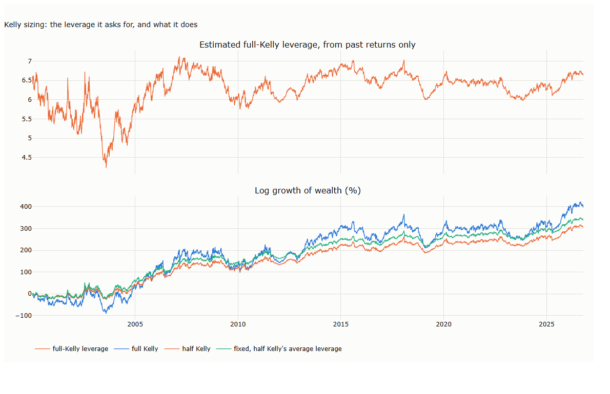

# Lecture 9: Sizing Trend Systems

*Systematic Trading: Lecture Notes (MSc) · Oct 18, 2026 · Max Gnesi*

A signal says which way to trade; sizing says how much. This lecture compares sizing approaches that answer genuinely different questions, applying each to the same signals on the 16 ETFs of Lectures 5 and 6, so that every difference in the results comes from sizing alone. Companion notebook: [09_sizing_trend_systems.ipynb](09_sizing_trend_systems.ipynb).

## 1. The question of this lecture

Lecture 6 used one way of sizing, inverse volatility per asset. There are others, and the useful ones are not variations of each other: each answers a different question.

| Question | Approach | Idea | Section |
|---|---|---|---|
| How much to risk on one trade? | Stop distance | Size so that the loss if the stop is hit is a fixed fraction of capital (the Turtle "unit"; Faith, 2007) | §3.1 |
| How much risk per asset? | Inverse volatility | The same risk in every asset (Lecture 6, §5) | §3.1 |
| How much on a strong signal against a weak one? | Conviction | Position proportional to the forecast, not just its sign | §3.2 |
| How much total risk now? | Portfolio volatility target; volatility-managed sizing | Scale the whole book to a target, or cut it when variance is high (Moreira and Muir, 2017) | §4 |
| How much after losses? | Drawdown control | Reduce exposure as the drawdown deepens (Grossman and Zhou, 1993) | §4 |
| How much given the edge? | Kelly | Leverage proportional to expected return over variance (Kelly, 1956) | §5 |

Two related questions are left to other lectures: how much in each of several correlated assets belongs to the portfolio (Lecture 10), and Kelly on bounded payoffs is treated fully in Part IV.

## 2. Five formulas, by hand

**Table 2.1. Five sizing formulas for one asset** (price 100, capital USD 1 million; notebook §2)

| Approach | Inputs | Computation | Result |
|---|---|---|---|
| Stop distance | Risk 1% of capital; stop 3 ATR below entry; ATR 2 | 10,000 / (3 × 2) | 1,667 shares, 17% of capital |
| Inverse volatility | Asset volatility 20%; target 10% | 10% / 20% | Exposure 0.5 × capital |
| Portfolio target | Book running at 15%; target 10% | 10% / 15% | Every position × 0.67 |
| Drawdown control | Drawdown 10%; limit 20% | 1 − 10% / 20% | Exposure × 0.5 |
| Kelly | Expected excess return 5%; volatility 20% | 5% / 20%² | Leverage 1.25 (half Kelly 0.62) |

## 3. Per trade, per asset, and by conviction

### 3.1 Equal notional, inverse volatility, stop distance

**Table 3.1. The same signals sized three ways** (16 ETFs, daily, 2000–2026; all versions set to the same overall volatility as the inverse-volatility version; notebook §3)

| Signal and sizing | Sharpe ratio | Monthly skewness | Worst month | Maximum drawdown |
|---|---|---|---|---|
| TSMOM-12, equal notional | 0.31 | 0.27 | −3.4% | −15.6% |
| TSMOM-12, inverse volatility | **0.56** | −0.05 | −3.9% | −13.6% |
| Breakout (55-day, chandelier stop), equal notional | 0.02 | 1.28 | −3.0% | −12.3% |
| Breakout, inverse volatility | 0.18 | 0.99 | −2.8% | −13.6% |
| Breakout, stop distance (1% at risk per trade) | 0.26 | 0.84 | −2.7% | −13.6% |

- **Sizing by risk nearly doubles the Sharpe ratio.** Without it, the most volatile assets (oil, silver, gold miners) dominate the portfolio.
- **Stop distance and inverse volatility are one idea.** Across assets and days, the two position sizes correlate 0.97: a stop set in ATRs is a volatility measure. The small difference in results comes from measuring volatility by the true range rather than by close-to-close returns.

### 3.2 Conviction: the forecast or only its sign?

**Table 3.2. EWMAC 32/128, continuous against sign only** (inverse-volatility sizing, same overall volatility; notebook §3.3)

| Sizing | Sharpe ratio | Maximum drawdown | Turnover per year |
|---|---|---|---|
| Continuous forecast | 0.46 | −12.8% | 7.7 |
| Sign only | 0.54 | −15.0% | 7.7 |

Sizing by conviction did not help here: the sign alone earned a higher Sharpe ratio with the same turnover, though with a deeper drawdown. Scaling by the strength of a forecast pays only if stronger forecasts are followed by larger moves, which is an empirical question to test in each market, not a rule.

## 4. Over time: how much total risk now?

The approaches of §3 decide the relative size of positions. The approaches here decide how much of the whole strategy to run at each moment.

**Table 4.1. Sizing over time** (TSMOM-12 with inverse-volatility sizing as the base; multipliers decided with data up to the previous close; time-varying versions set to the base's overall volatility; notebook §4)

| Approach | Sharpe ratio | Monthly skewness | Worst month | Maximum drawdown | Average multiplier |
|---|---|---|---|---|---|
| Base: inverse volatility per asset | 0.56 | −0.05 | −3.9% | −13.6% | 1 |
| Portfolio volatility target (10%, leverage capped at 3) | 0.61 | 0.05 | −4.4% | −15.9% | 2.0 |
| Volatility-managed: inverse of trailing variance | **0.73** | 1.20 | −4.7% | −15.1% | 1.0 |
| Drawdown control (exposure falls to zero at a 20% drawdown) | 0.42 | 0.25 | −3.8% | **−11.1%** | 0.7 |

- **A portfolio target levers a diversified book.** The 16 assets diversify each other, so the book runs below its target and the rule doubles it on average ([chart H.1](#h1-sizing-over-time-4)). The leverage is highest when correlations are low, and drawdowns deepen when correlations rise.
- **Volatility-managed sizing looks best, and should be read with care.** It cut exposure to 0.38 of normal in late 2008 and gained a high Sharpe ratio and positive skewness. Moreira and Muir (2017) document such gains across factors; later studies report that they fail out of sample and after transaction costs (as summarised by DeMiguel, Martín-Utrera and Uppal, 2024). Harvey et al. (2018) find that volatility targeting improves the Sharpe ratio mainly for risk assets such as equities and credit, while it reduces extreme returns in every asset class.
- **Drawdown control buys smaller drawdowns with a lower Sharpe ratio.** It cut the worst drawdown from 13.6% to 11.1%, but a trend system recovers through a few large gains (Lecture 5, §2.4), and cutting exposure after losses misses part of them.

## 5. Kelly: sizing by the edge

Kelly (1956) sizing maximises the long-run growth of wealth. For a strategy with expected excess return $`\mu`$ and volatility $`\sigma`$, the growth-optimal leverage is $`f = \mu/\sigma^2`$, and a strategy run at that leverage has volatility $`f\sigma = \mu/\sigma`$: its Sharpe ratio.

**Table 5.1. Kelly sizing of the base strategy** (base scaled to 10% annual volatility; Kelly leverage estimated each day from past returns only; wealth compounds daily; notebook §5)

| Sizing | Growth of wealth (% a year) | Volatility | Worst month | Worst drawdown of wealth |
|---|---|---|---|---|
| Base at 10% volatility | 5.0 | 8.9% | −6.5% | −20% |
| Full Kelly | 15.9 | 56.5% | −38.2% | **−79%** |
| Half Kelly | 12.1 | 28.1% | −18.7% | −53% |
| Fixed, at half Kelly's average leverage | 13.4 | 28.1% | −20.8% | −53% |

- **Kelly asks for a lot of leverage.** With a Sharpe ratio near 0.6, the estimated full-Kelly leverage ranged from 4.2 to 7.1 times the base, and full Kelly ran at a volatility of about 57%, close to the Sharpe ratio, as the formula implies ([chart H.2](#h2-kelly-sizing-5)).
- **Half Kelly keeps most of the growth for half the risk.** It grew wealth 12.1% a year against 15.9% for full Kelly, with half the volatility and a worst drawdown of 53% instead of 79%.
- **Re-estimating the edge did not help.** A fixed leverage did slightly better than half Kelly updated daily: the estimate of the edge moves with the noise in past returns.

Kelly gives the ceiling for leverage, not a target. Errors in the estimated edge and fat-tailed returns both argue for fractions well below half; Part IV returns to Kelly on bounded payoffs.

## 6. Side by side, and what to watch out for

| Approach | Sees | Misses | Watch out for |
|---|---|---|---|
| Stop distance | The loss per trade | Correlation between positions | It is inverse volatility in disguise |
| Inverse volatility | Equal risk per asset | Correlation; changes in volatility within the window | The volatility estimate lags shocks |
| Conviction | The strength of the signal | Whether strength predicts size | Assuming that it does |
| Portfolio target | The total risk of the book | Correlations that jump in crises | Leverage peaks just before correlations rise |
| Volatility-managed | Turbulent periods | Out-of-sample reliability | Results that fail after costs |
| Drawdown control | Losses already taken | The recoveries that follow | Cutting exposure before the large gains |
| Kelly | The growth-optimal ceiling | Estimation error; fat tails | Leverage of several times the base strategy |

## 7. Summary, exercises and reading

### 7.1 Five takeaways

1. **Sizing answers several questions, not one.** Per trade, per asset, by conviction, over time, after losses, by edge: each approach answers a different one.
2. **Sizing by risk matters most.** Inverse volatility nearly doubled the Sharpe ratio of the same signal; stop-distance sizing is the same idea measured with the true range.
3. **Conviction must earn its place.** Sizing by forecast strength did not beat the sign alone here.
4. **Sizing over time trades Sharpe ratio for drawdowns, or the reverse.** Portfolio targets lever up; volatility management looked strong but is fragile out of sample; drawdown control cut drawdowns and some recoveries.
5. **Kelly is a ceiling.** With a Sharpe ratio near 0.6 it asks for leverage of about six; half Kelly kept three-quarters of the growth with far smaller drawdowns.

### 7.2 Exercises

- [ ] Fix the stop at entry instead of recomputing it from the current ATR each day. How do Table 3.1 and the correlation of 0.97 change? (notebook §3)
- [ ] Set the drawdown limit to 10% and to 30%. How do the Sharpe ratio and the worst drawdown move? (notebook §4)
- [ ] Repeat Table 5.1 at a quarter Kelly. What share of full Kelly's growth does it keep, and at what drawdown? (notebook §5)
- [ ] Test conviction directly: sort days by the size of the EWMAC forecast and compare the next day's absolute return in each group. (notebook §3.3)

### 7.3 Reading

The full reference list closes the lecture. A short path: Moreira and Muir (2017) and Harvey et al. (2018) for sizing over time; Grossman and Zhou (1993) for drawdowns; Kelly (1956) for growth.

## Appendix: charts

From the companion notebook, [09_sizing_trend_systems.ipynb](09_sizing_trend_systems.ipynb). Its sections carry the lecture's numbers.

### H.1 Sizing over time (§4)

Top: the portfolio target (blue) runs the book at about twice its base size; the volatility-managed rule (orange) cuts exposure in turbulent periods and raises it sharply in calm ones, such as 2012; drawdown control (green) stays below one after losses. Bottom: the drawdowns of the base (grey), the portfolio target and drawdown control.

### H.2 Kelly sizing (§5)

Top: the leverage that full Kelly asks for, estimated from past returns only, between about 4 and 7. Bottom: the log growth of wealth under full Kelly, half Kelly and a fixed leverage equal to half Kelly's average.

## References

- DeMiguel, V., Martín-Utrera, A. and Uppal, R. (2024). A multifactor perspective on volatility-managed portfolios. *Journal of Finance.* — out-of-sample and cost evidence on volatility management (§4).
- Faith, C. (2007). *Way of the Turtle.* McGraw-Hill. — sizing by stop distance (§1, §3.1).
- Grossman, S. and Zhou, Z. (1993). Optimal investment strategies for controlling drawdowns. *Mathematical Finance* 3(3), 241–276. — drawdown control (§4).
- Harvey, C., Hoyle, E., Korgaonkar, R., Rattray, S., Sargaison, M. and Van Hemert, O. (2018). The impact of volatility targeting. *Journal of Portfolio Management* 45(1), 14–33. — where volatility targeting helps (§4).
- Kelly, J.L. (1956). A new interpretation of information rate. *Bell System Technical Journal* 35(4), 917–926. — growth-optimal sizing (§5).
- Moreira, A. and Muir, T. (2017). Volatility-managed portfolios. *Journal of Finance* 72(4), 1611–1644. — scaling exposure by inverse variance (§4).
