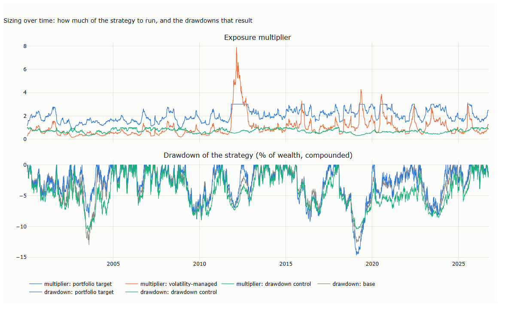

# Lecture 9: Sizing Trend Systems

> A signal says which way to trade; sizing says how much. There are many sizing methods, but fewer genuinely different ones.

Part II · Pipeline stage: portfolio construction and risk management (how much to hold)

---

# Many methods, few genuinely different

> Applied to the same signal, most sizing methods barely change the result; four change it, each in a different dimension.

| Method | Correlation with the base | Sharpe ratio | Where it differs |
|---|---|---|---|
| Base: inverse volatility per asset | 1 | 0.60 | — |
| Expected shortfall per asset | 0.98 | 0.55 | Nowhere |
| Partial trading, λ = 0.25 | 0.98 | 0.61 | **Costs** |
| Drawdown control | 0.97 | 0.47 | **Tails** |
| Volatility-managed | 0.81 | 0.77 | **Returns** |

TSMOM-12 on the 16 ETFs, 2000–2026. Stop distance and expected-shortfall sizing are inverse volatility measured another way.

---

# Six questions, one boundary

> Sizing decides how much using risk and cost information only; a rule that uses a regime or trend strength is a filter (Lecture 8).

- **How much risk per asset?** Inverse volatility
- **How much total risk now?** Sizing over time
- **How much to trade?** Partial trading
- **How much after losses?** Drawdown control
- **Where to stop, how much on a strong signal, per trade, given the edge?** Stops, conviction, stop distance, Kelly

---

# The formulas, by hand

> Each method is one line of arithmetic (price 100, capital USD 1 million).

| Method | Inputs | Computation | Result |
|---|---|---|---|
| Stop distance | Risk 1% of capital; stop 3 ATR below entry; ATR 2 | 10,000 / (3 × 2) | 1,667 shares |
| Inverse volatility | Asset volatility 20%; target 10% | 10% / 20% | Exposure 0.5 × capital |
| Portfolio target | Book running at 15%; target 10% | 10% / 15% | Every position × 0.67 |
| Drawdown control | Drawdown 10%; limit 20% | 1 − 10% / 20% | Exposure × 0.5 |
| Partial trading | Position 0.2, target 0.5, λ = 0.25 | 0.2 + 0.25 × (0.5 − 0.2) | New position 0.275 |

---

# Risk per asset: measure it at all

> Sizing by risk nearly doubles the Sharpe ratio; how risk is measured matters far less than measuring it at all.

| Signal and sizing | Sharpe ratio | Maximum drawdown |
|---|---|---|
| TSMOM-12, equal notional | 0.28 | −17.4% |
| TSMOM-12, inverse volatility | **0.60** | −13.0% |
| Breakout, equal notional | −0.03 | −12.8% |
| Breakout, inverse volatility | 0.18 | −13.3% |
| Breakout, stop distance (1% at risk per trade) | 0.27 | −13.2% |

- Without it, the most volatile assets, oil, silver and gold miners, dominate the portfolio
- Each evening: the signal times target volatility divided by the asset's volatility estimate

---

# Total risk over time

> One multiplier for the whole book trades Sharpe ratio, leverage and tails against each other.

| Method | Sharpe ratio | Maximum drawdown | Average multiplier |
|---|---|---|---|
| Base | 0.60 | −13.0% | 1 |
| Portfolio volatility target (10%, leverage capped at 3) | 0.66 | −14.7% | 2.0 |
| Volatility-managed: inverse of trailing variance | **0.77** | −14.0% | 1.0 |
| Drawdown control (exposure falls to zero at a 20% drawdown) | 0.47 | **−10.9%** | 0.7 |

- **A portfolio target levers a diversified book:** drawdowns deepen when correlations rise
- **Drawdown control changes the tails:** cutting exposure after losses misses part of the large gains that end a drawdown

---

# Volatility management: strongest and most fragile

> Scaling by the inverse of trailing variance changed the returns most here; the literature reports that such gains weaken out of sample and after costs.

- Twice the volatility means a quarter of the exposure
- It cut exposure to 0.38 of normal in late 2008
- Sharpe ratio 0.77 and positive skewness, on our sample

---

# Sizing on the strategy's own performance

> On this strategy performance mean-reverted, so the contrarian rule raised the Sharpe ratio and the momentum rule lowered it; the evidence is thin.

| Rule on the rolling 1-year Sharpe ratio | Sharpe ratio | Maximum drawdown |
|---|---|---|
| Constant size | 0.60 | −22.6% |
| Contrarian: add after a poor year | 0.65 to 0.68 | −23.7% to −24.7% |
| Momentum: cut after a poor year | 0.42 to 0.52 | −21.3% to −22.1% |

$$\text{standard error of a Sharpe ratio over } T \text{ years} \approx \sqrt{(1 + \text{SR}^2/2)/T}$$

- Roughly 1 for a single year: the rolling Sharpe ratio is as noisy as the edge itself

---

# Watch out: overlays change the speed

> An extra stop or an equity-curve rule is itself a trend rule on the system's returns: it changes the system's trading frequency and holding period.

- A trend system already has a stop built in: its signal reverses
- Under a random walk, stops always lower expected return; with momentum they can add value (Kaminski and Lo, 2014)
- Before crediting the overlay, compare it with the same system at another parameter, at equal speed
- If the overlay helps, the original speed may simply have been wrong

---

# How much to trade: partial trading

> Each day, trade only a fixed fraction λ of the gap between the current position and the target: small, noisy changes in the target are mostly never traded.

- With λ = 0.25, the position closes three-quarters of any gap within about five days
- A one-day blip in the target moves the position by only a quarter of the blip
- Gârleanu and Pedersen (2013) derive it as the optimal policy under transaction costs
- A no-trade band, the common alternative, trades the whole gap, but only when it exceeds a threshold

---

# Partial trading: the result after costs

> Closing a tenth of the gap each day cut turnover by three-quarters and more than doubled the Sharpe ratio after 20 basis points, from 0.24 to 0.51.

| Signal | Trading rule | Turnover per year | Sharpe ratio, no costs | 20 bp |
|---|---|---|---|---|
| TSMOM-12 | Every day, in full | 9.9 | 0.60 | 0.24 |
| | Partial, λ = 0.1 | 2.4 | 0.60 | **0.51** |
| | Band of 50% of a typical position | 6.6 | 0.57 | 0.30 |
| EWMAC 8/32 | Every day, in full | 21.3 | 0.10 | −0.45 |
| | Partial, λ = 0.1 | 8.3 | 0.26 | **0.01** |

- For a fast rule it is the difference between losing and breaking even
- Partial trading beat no-trade bands: bands trade the whole gap when they trade

---

# Mentioned only: conviction and Kelly

> Sizing by forecast strength did not beat the signal's sign here, and Kelly is a ceiling on leverage rather than a way to size.

$$f = \mu/\sigma^2$$

- **Conviction:** EWMAC 32/128 continuous earned 0.49 against 0.57 for its sign, with the same turnover
- **Kelly:** on the base strategy it asked for leverage of about six, with a worst loss of 79% of wealth, 53% at half Kelly
- The edge is estimated with large errors and returns are fat-tailed

---

# Takeaways

1. **Many methods, few genuinely different:** test whether a method changes the result before adopting it
2. **Sizing by risk matters most for returns:** it nearly doubled the Sharpe ratio of the same signal
3. **How much to trade matters most for costs:** partial trading more than doubled the Sharpe ratio after 20 basis points
4. **Sizing over time trades Sharpe ratio, leverage and tails:** volatility management looked strongest and is the most fragile
5. **Overlays change the speed:** compare them with the same system at equal speed

> A signal says which way to trade; sizing says how much, using risk and cost information only.
