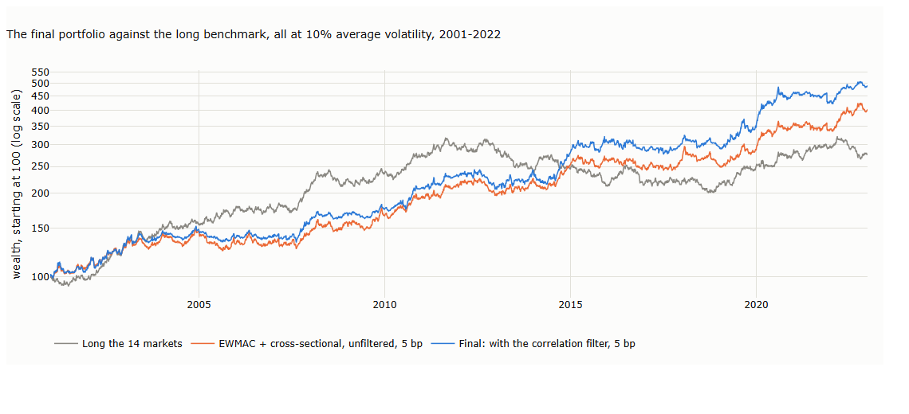
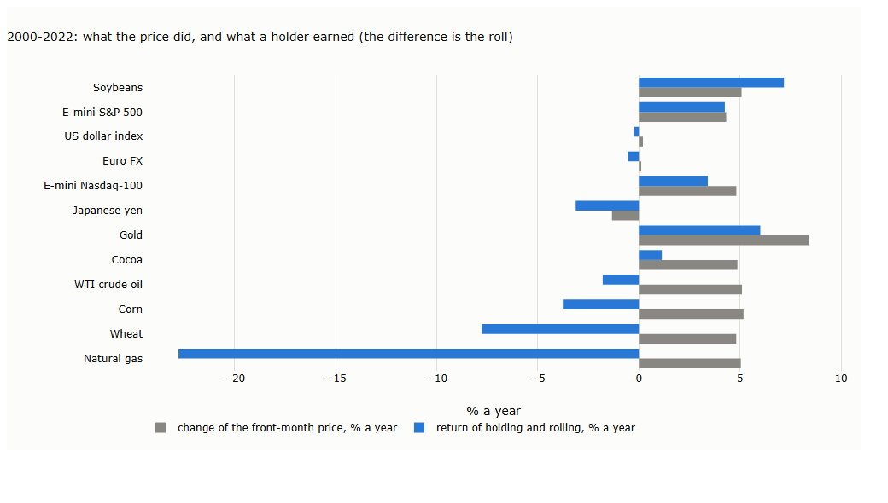
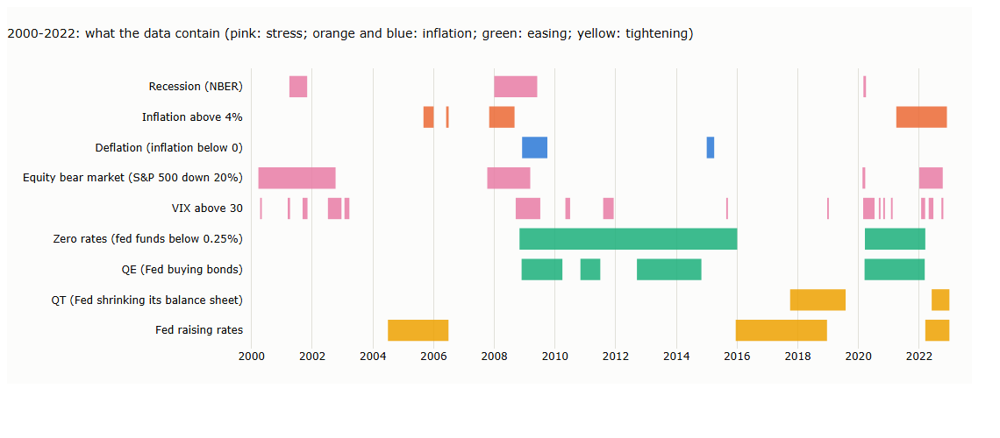
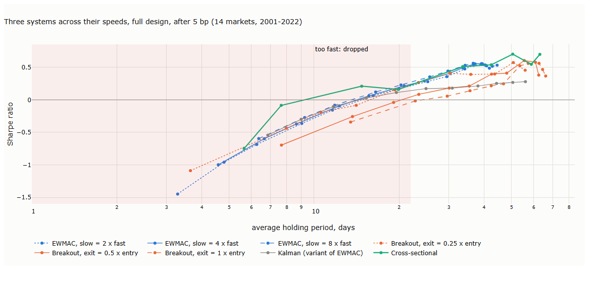
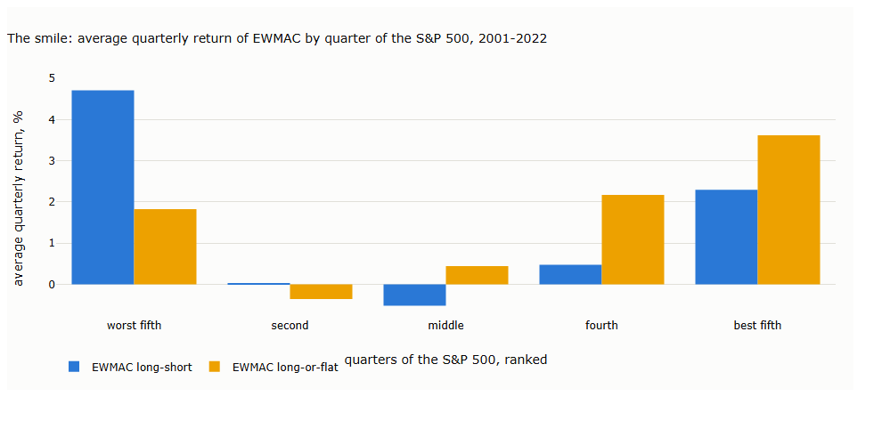

# Lecture 10: Three Trend Systems, End to End

> Three trend systems built end to end on futures, from the raw contracts to a combined portfolio.

Part II · Pipeline stage: all five stages, end to end on futures

---

# The final portfolio against the long benchmark

> EWMAC and cross-sectional momentum at equal risk, with a correlation filter, earned a Sharpe ratio of 0.75 over 2001–2022, against 0.50 for holding the same markets long.

- Maximum drawdown −15.5%, against −36.7% for the long benchmark
- Correlation with it when it is over 10% below its peak: −0.03
- Half long, half trend: 0.80 against 0.50

---

# Three systems, the same steps

> Each system teaches what the others cannot, and each goes through the same steps of Part II: data, design, sizing, comparison, filters, portfolio.

| System | Family (Lecture 6) | What it teaches |
|---|---|---|
| EWMAC, blended over a few speeds | Linear filters | A continuous forecast, always in the market |
| Turtle-style breakout | Channel breakouts | On-or-off positions; stops built into the system |
| Cross-sectional momentum | Linear filters, across markets | A relative trend: net exposure close to zero |

- Twelve futures markets from Kaggle and two Treasury funds, 1999–2022; results from 2001
- The Kalman slope correlates 0.93 to 0.95 with EWMAC at equal speed and earns less: a variant of EWMAC

---

# One roll, three series

> Every contract expires: a raw front-month series shows each roll as a move that no position earned.

| Crude oil, 9 to 13 April 2020 | Change |
|---|---|
| May contract, the one held | −0.35 (−1.5%) |
| **Raw series**, switching to June | **+6.50 (+28.6%)** |
| Additive series (back-adjusted) | −0.35 |
| Ratio series (back-adjusted) | −1.5% |

- The raw gain is the gap of 6.85 dollars between June and May on the roll day
- On 20 April the May contract settled at −37.63 dollars; the rolled position was already in June
- The capstone rolls on a fixed calendar per market, set at the median open-interest crossover

---

# Match the series to the algorithm, and the profit to the position

> The additive series is the exact record of a fixed number of contracts, the ratio series of a fixed amount of money; signals and profit must use matching units.

| What is computed | Series |
|---|---|
| Signals on differences of prices in points (EWMAC, breakout channels) | Additive |
| Signals on returns or log prices (Kalman filter) | Ratio |
| Profit in dollars: contracts × point change × multiplier | Additive, or the raw contract held |
| Contract values, position sizes and costs; never signals | Raw |

- With mixed units, EWMAC forecasts correlate only 0.81–0.89 with the correct ones in crude oil, natural gas and grains
- Booking profit in dollars needs no division by a price, so it works even when a price is negative

---

# Roll yield: what rolling earns or costs

> The price of natural gas rose 5% a year from 2000 to 2022; a holder lost 23% a year, because the market was in steep contango almost throughout.

- Adjusted series include the roll: a trend rule sees the holder's return
- Steady contango shows a downtrend even when the price is flat
- In financial futures the roll yield is small

---

# What the data contain

> Stress is well represented; inflation is not.

- Three recessions and four bear markets: one day in five in a bear market
- One sustained inflation shock, 2021–2022, at the very end
- Rates at zero on 40% of days; the Fed buying bonds on 27%

---

# The design steps of Part II add up

> From one speed with naive sizing to the full design, the Sharpe ratio rises from 0.03 to 0.54; blending speeds is the largest single contribution.

| Step (EWMAC, after 5 bp, 2001–2022) | Sharpe ratio | Full design without this step |
|---|---|---|
| 1. One speed, the same money in each market | 0.03 | |
| 2. + volatility sizing, with floor | 0.17 | 0.44 |
| 3. + seven speeds blended | 0.31 | 0.29 |
| 4. + the two bond funds | 0.34 | 0.50 |
| 5. + equal risk per asset class | 0.43 | 0.43 |
| 6. + portfolio volatility target of 10% | **0.54** | |

The order of the steps changes what each seems to add; the last column is the fair measure of each step.

---

# Choosing speeds: drop the cliff, blend the plateau

> At the fast end every system fails; blend as many speeds of the plateau as possible with equal weights, and never choose the peak.

- Plateau: EWMAC 0.41–0.56, breakout 0.39–0.61, cross-sectional 0.51–0.70
- Even before costs the fastest variants earn almost nothing
- Three speeds spread across the plateau give the same result

---

# Does a system add anything?

> The breakout adds nothing to the other two; cross-sectional momentum adds to EWMAC, and both add to a portfolio that is long the same markets.

| Spanning regression, monthly | Alpha, % a year | t-statistic | R² |
|---|---|---|---|
| Breakout on EWMAC and cross-sectional | +0.4 | 0.5 | 0.89 |
| Cross-sectional on EWMAC | **+2.7** | **3.1** | 0.79 |
| EWMAC on cross-sectional | −1.2 | −1.3 | 0.79 |
| Cross-sectional on the long portfolio | +6.3 | 3.2 | 0.09 |

- The portfolio combines EWMAC and cross-sectional momentum at equal risk, decided in advance
- Dropping EWMAC because it is spanned here would be choosing the best point

---

# Trend's value is its payoff

> Long-short makes money at both ends of the equity distribution, most in the worst quarters; long-or-flat earns as much but loses most of the left end.

- Worst fifth of S&P 500 quarters: +4.7% long-short, +1.8% long-or-flat
- Long-or-flat: out half the time, mostly long what is held
- The short side carries the crisis protection

---

# Two filters

> The correlation filter survived every check and is part of the final portfolio; the term-structure filter added no return.

| Filter | Sharpe ratio, without → with | Beats random filters |
|---|---|---|
| Term structure (threshold 0%), on EWMAC | 0.54 → 0.53 | 87% |
| Correlation regime (median), on the portfolio | 0.66 → 0.75 | 97% |

- When correlation is high the portfolio earns little: a Sharpe ratio of 0.30 above its median, 1.09 below
- On markets it was not chosen on, it mostly holds: 0.51 to 0.63 and 0.61 to 0.67
- It costs return, 6.0% a year instead of 6.8%, and its evidence comes from one period

---

# Out of sample: the plateau survives

> Speeds chosen on one half of the markets carry over to the other: the kept blend earns 0.42 to 0.64, the dropped variants −0.28 to 0.03.

- The kept blend matches or beats the single best variant of the choosing half in four of six cases
- Across the whole grid of 92 variants, the probability of backtest overfitting is 0.10
- Luck alone can produce a best Sharpe ratio of about 0.67, close to the best variant found, 0.70
- Over 22.8 years, a Sharpe ratio of 0.5 to 0.7 has a standard error of about 0.22: differences of 0.1 or 0.2 lie within the noise

---

# Takeaways

1. **Futures need a series that records what a position experienced:** signals and profit in matching units
2. **The design steps of Part II add up:** from 0.03 to 0.54; blending speeds matters most
3. **Choose speeds by dropping what fails and blending the rest:** the rule works on markets it was not made on
4. **Three systems, two in the portfolio:** the breakout adds nothing; the Kalman slope is a variant of EWMAC
5. **Trend's value is its payoff:** its correlation with a long portfolio turned negative in stress
6. **Simple weights and one filter:** equal risk beat equal risk contribution; the correlation filter raised 0.66 to 0.75

> The plateau, not the peak, is what survives out of sample.
