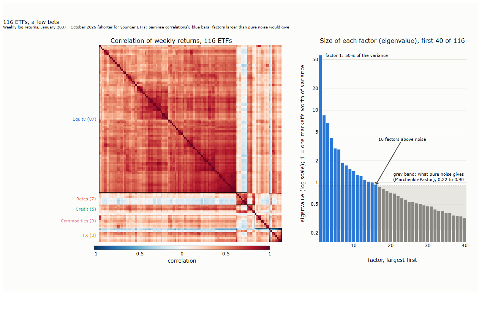
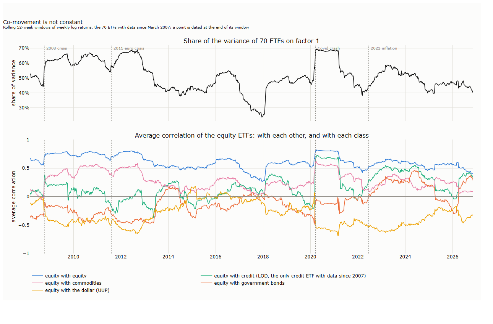
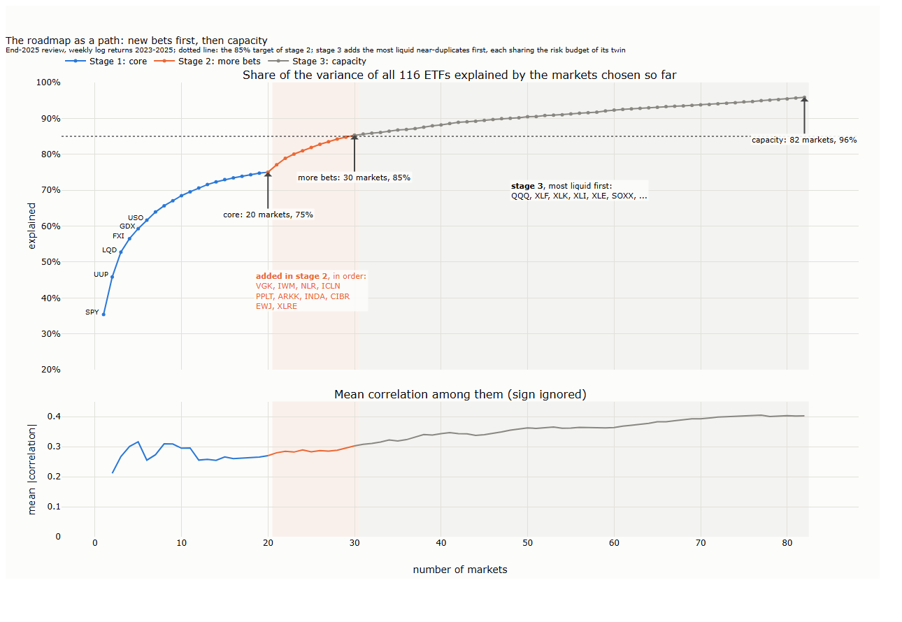

# Lecture 11: Choosing the Markets

> Which markets should be in a trend portfolio at all? A universe that is diverse and tradable, chosen without looking at any strategy's results.

Part II · Pipeline stage: data (the universe of markets)

---

# 116 ETFs, a few bets

> The 116 ETFs move together far more than their number suggests: one factor carries half of all the variance, and only 16 of 116 stand out from noise.

- The equity block: 87 ETFs that mostly rise and fall together
- Bonds sit pale or blue against it
- The dollar moves against almost everything

---

# Counting bets

> Within a class, more ETFs add little; what adds bets is a new class.

| Universe, risk spread equally | Long-only view | Trend follower's view |
|---|---|---|
| Each of the 116 ETFs | 2.32 | 2.18 |
| The 87 equity ETFs alone | 1.71 | 1.71 |
| Equity and government bonds, equal risk per class | 2.97 | 2.48 |
| … and commodities | 3.80 | 3.11 |
| One ETF per class (SPY, IEF, HYG, DBC, UUP) | 5.12 | 2.28 |

Bets counted with the squared diversification ratio; a trend follower ignores the sign of each correlation.

---

# Three steps, kept in order

> Markets are chosen without strategy profits, weights use risk only, and profits judge out of sample without feeding back.

| Step | Uses | Never uses |
|---|---|---|
| 1. Markets (this lecture) | Market returns, liquidity, trend phases | Strategy profits |
| 2. Weights | Volatility and correlation of positioned returns, costs, constraints | Strategy averages or Sharpe ratios |
| 3. Evaluation | Strategy profit and loss, out of sample, against simple baselines | Feeding results back into steps 1 and 2 |

- Choosing the markets where trend made the most would choose the markets where it was luckiest
- A Sharpe ratio measured over 26 years has a standard error of about 0.2

---

# Factors and the noise band

> Random-matrix theory says how large pure-noise factors get: 16 factors lie above the band; the first is risk on or off and carries half the variance.

$$\lambda_{\pm} = \sigma^2 \left(1 \pm \sqrt{N/T}\right)^2, \qquad \sigma^2 = 1 - \lambda_1 / N$$

| Factor | Share | Reading |
|---|---|---|
| 1 | 50% | Risk on or off |
| 2 | 7% | Interest rates |
| 3 | 6% | Growth technology against real assets |

To cover the factors after the first, a universe needs bonds, the dollar and commodities, not more equity funds.

---

# Co-movement is not constant

> Diversification fails when it is needed, and the bond hedge is not permanent: the universe is reviewed once a year on the past three years only.

- Factor 1's share rose from 51% to 69% in the Covid crash
- The equity-bond hedge flipped sign in 2022, with inflation
- The dollar was the steadiest offset

---

# The same market? Correlation misses the drift

> Two ETFs are the same bet for a trend follower when they hold the same position most of the time, not merely when their weekly returns are correlated.

| Correlation, sign ignored | Same trend phase, median | Pairs in the same phase less than 80% of weeks |
|---|---|---|
| 0.9 and above | 90% | 0% |
| 0.8 to 0.9 | 83% | 28% |
| 0.7 to 0.8 | 78% | 68% |
| below 0.5 | 60% | 100% |

- FXE and UUP: weekly correlation −0.96, yet both rose in 2023-2025; interest income decided the trend phase
- **Duplicates:** correlation at least 0.9 in size **and** the same trend phase, sign ignored, in at least 85% of weeks

---

# Trends come class by class

> Markets that move together week by week often do not trend at the same time; across classes, trend strength is nearly unrelated.

| Measure | Returns, sign ignored | Trend strength |
|---|---|---|
| Mean pairwise correlation | 0.45 | 0.19 |
| Pairs within a class | 0.58 | 0.26 |
| Pairs from two classes | 0.29 | 0.09 |
| Share of the variance on the first factor | 50% | 25% |

- Trend strength: the efficiency ratio over 26 weeks, from 0 (back and forth) to 1 (a straight line)
- 0.01 between equity and government bonds: the strongest reason to hold several classes rather than many equity funds

---

# In joint falls, markets move together

> Against what a normal distribution gives in the same weeks, pairs correlate far more in their joint falls: diversification across classes weakens most when it is needed.

- Selecting joint falls lowers the measured correlation by itself: under a normal distribution, a pair correlated at 0.6 shows only about 0.25
- Equity pairs: 0.64 in joint falls, against 0.25 for a normal distribution (medians)
- Equity with other classes: 0.53, against 0.08
- Weeks chosen by one market's falls understate co-movement: 77 groups at 0.8, against 68 over all weeks

---

# Slots per class

> The classes are fixed first, and each class gets as many slots as it has independent bets, before any market is chosen.

| Rule | Value |
|---|---|
| Classes | Equity, government bonds, credit, commodities, currencies |
| Slots per class | The class's factors above the noise band |
| At least, at most | 2 per class; 30 in all |
| Liquidity floor | Median daily dollar volume of at least USD 10 million |
| Review | Once a year, on the past three years only |

Over the 17 reviews: 16 to 21 markets in all, close to the 16 factors above noise.

---

# Filling the slots: a score

> The slots do most of the work; among ways to fill them, a score of representativeness, diversification and liquidity keeps diversification and doubles liquidity.

| Method, out of sample 2010-2026 | Variance of the class explained | Overlap of trend-positioned returns | Median liquidity, USD a day |
|---|---|---|---|
| Greedy diversification | 0.745 | 0.194 | 260 m |
| Explained variance, step by step | **0.773** | 0.204 | 260 m |
| **Score (chosen)** | 0.754 | **0.191** | **400 m** |
| Random, same slots | 0.73 | 0.21 | 90 m |

- Weights: a quarter representativeness, a half diversification, a quarter liquidity
- Diversification weights from 0.5 to 0.6 give the same result: the chosen weights sit in a flat region

---

# The universe at the end of 2025

> 20 markets in five classes, each class ranked top to bottom by the score.

| Class | Markets, in the order of the ranking |
|---|---|
| Equity | SPY, GDX, SMH, XLV, FXI, EWT, XLU, EWZ |
| Government bonds | TLT, SHY, TIP, BNDX |
| Credit | LQD, HYG |
| Commodities | USO, GLD, UNG |
| Currencies | FXE, FXY, UUP |

The first market of each class is its key market: a broad, liquid stand-in for the class's first factor.

---

# A roadmap for growing capital

> As capital grows, add markets first for new bets, then only to spread the trading; an ETF's screen volume misleads about capacity in both directions.

- Core: 20 markets explain 75% of all 116
- More bets: ten more reach 85%
- On screen volume, currency funds cap the portfolio at about USD 3 million

---

# Takeaways

1. **Bets come from classes, not from the number of funds:** 87 equity ETFs make fewer than two bets, all 116 fewer than five
2. **Few factors are real:** 16 of 116 lie above the noise band; the first is risk on or off
3. **Co-movement changes:** the bond hedge flipped in 2022, so the universe is reviewed every year
4. **Correlation misses the drift:** the same trend bet needs shared trend phases too
5. **The slots do most of the work:** a score fills them, keeping diversification and doubling liquidity
6. **Capacity depends on the instrument:** screen volume understates deep markets and can overstate shallow ones

> Markets are chosen on their own properties, never on strategy profits: whether they can be traded, how they move with each other, how often their trends agree.
