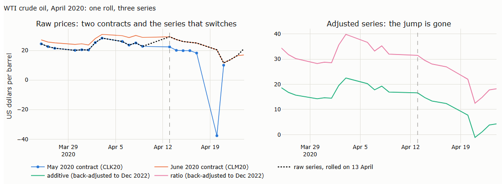
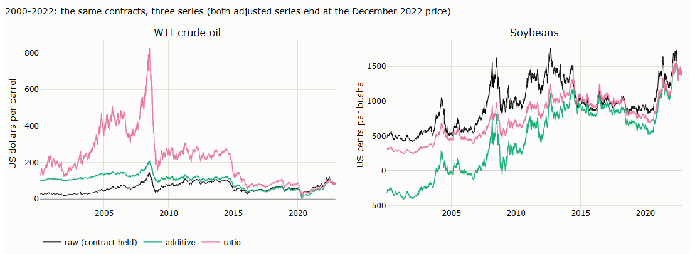
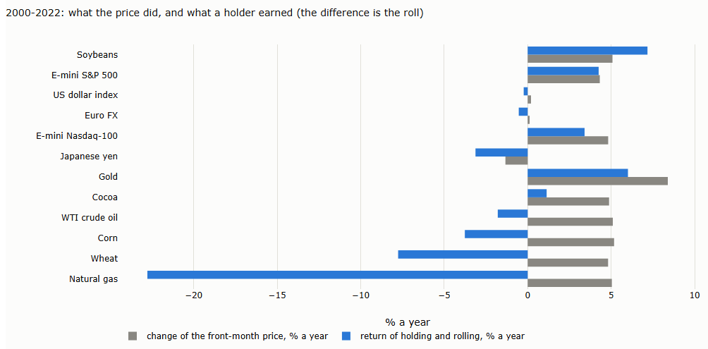
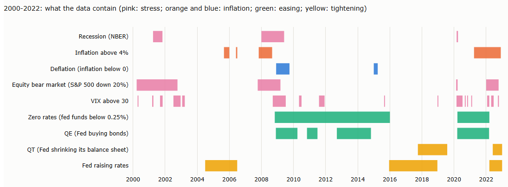

# Lecture 11: Three Trend Systems, End to End

*Systematic Trading: Lecture Notes (MSc) · Oct 20, 2026 · Max Gnesi*

Part II built the pieces one at a time: what a market offers (Lecture 5), how a design decides what is captured (Lecture 6), how to compare systems (Lecture 7), filters (Lecture 8) and sizing (Lecture 9). This capstone puts them together, building three trend systems end to end on futures, one from each family of Lecture 6, from the raw data to a running system. *Draft: written step by step; §1 to §4 so far.*

## 1. The question of this lecture

What does it take to build a trend system properly, from data to positions, and what do the choices of Part II change once they are made together rather than one at a time?

| System | Family (Lecture 6) | What it teaches that the others cannot |
|---|---|---|
| EWMAC, blended over a few speeds | Linear filters | A continuous forecast that is always in the market; partial trading, costs and the choice of speed matter most |
| Turtle-style breakout | Channel breakouts | On-or-off positions with flat periods; stops built into the system; time in the market and the marginal contribution of a system that is often idle |
| Kalman slope, weighted by its uncertainty | Model-based | A system that knows how sure it is: positions scale with the evidence, and the surprises flag when the model is wrong |

Each system goes through the same steps:

| Step | From |
|---|---|
| Get the data and build continuous futures series | §2–§3 of this lecture |
| Check what the market offers: drift, frictions, gaps | Lecture 5 |
| Design: direction, speed, exits | Lecture 6 |
| Signal, forecast, sizing, partial trading, costs | Lectures 6 and 9 |
| Compare fairly; marginal contribution to the other systems | Lecture 7 |
| Filters, if any earn their place | Lecture 8 |
| Combine the three; run them live | This lecture, and Lecture 4b, §4.3, for storing state |

The capstone uses futures rather than the ETFs of Lectures 5 to 9. Futures are what trend followers trade: they are margined, so risk rather than cash is the scarce resource (Lecture 7, §4.4), they cover every asset class, and they are cheap to trade. They also bring a problem ETFs hide: every contract expires, so a backtest needs one series stitched together from many contracts. §3 builds it. Only for government bonds, which the free futures data lack, two Treasury funds stand in (§2.2).

## 2. Getting the data

### 2.1 What a futures backtest needs

| Data | Why |
|---|---|
| Daily open, high, low, close and volume for every contract month, not only the front month | To decide when to roll and to build one continuous series (§3) |
| Open interest per contract | One of the rules for when to roll |
| The contract specifications: tick size, multiplier, expiry calendar | To turn price moves into money and positions into contracts |

Free sources usually provide only a single front-month series, with a jump on every roll date. A trend rule reads those jumps as moves that never happened, and the size of each jump cannot be measured from that series alone, because it never shows two contracts on the same day. A backtest needs the individual contract months.

### 2.2 What we use

| Data | Source | Covers | Cost |
|---|---|---|---|
| Futures: every contract month of twelve markets, daily | Kaggle datasets | Expiries 2000–2022 | Free, with a Kaggle account |
| Government bonds: two Treasury index funds, daily | Yahoo Finance | 1986 and 1991 to today | Free |
| Three-month Treasury bill rate, daily | FRED, Federal Reserve Bank of St. Louis | From 1954 | Free |

The free futures data contain no government bond futures, and a trend portfolio without bonds misses one of its main sources of profit in equity sell-offs (Lecture 5). Two Treasury funds stand in for them over the whole period; the bill rate turns their returns into returns comparable with those of futures (§3).

Paid sources (for example Databento, Norgate Data or a brokerage account) offer every contract month up to the present and Treasury futures as well. The capstone does not need them.

### 2.3 Step by step: the futures from Kaggle

1. **Create an account** at kaggle.com.
2. **For one dataset, download by hand**: open the dataset page, for example kaggle.com/datasets/choweric/cme-es, click *Download* and unzip the file into its own folder. For twelve datasets the API below is faster.
3. **Create an API token** under *Settings → API*. The token identifies you, so treat it like a password.
4. **Store the token outside the code**: save it in the file `.kaggle/access_token` in your home directory, or set it as the environment variable `KAGGLE_API_TOKEN`. Never put it in a notebook or commit it.
5. **Install the client:** `pip install kagglehub`.
6. **Download each dataset.** `dataset_download` saves the files in a local cache and returns the folder; copy them into the project's data folder.
7. **Check the files before using them** (§2.5), and check each dataset's licence on its Kaggle page.

```python
import shutil
from pathlib import Path
import kagglehub

DATASETS = ["cme-es", "cme-nasdaq", "cme-euro", "cme-jpy", "ice-us-dollar-index", "nymex-cl",
            "nymex-ng", "comex-gc", "cbot-corn", "cbot-soybeans", "cbot-wheat", "ice-cocoa"]
for name in DATASETS:
    cache = kagglehub.dataset_download(f"choweric/{name}")      # the token is read from ~/.kaggle or the environment
    shutil.copytree(cache, Path("data/raw/kaggle") / name, dirs_exist_ok=True)
```

The twelve datasets take a few seconds to download. Downloaded files are data from a third party: keep them in their own folder, read them only as data, and do not publish them; the repository publishes results, not data.

### 2.4 Step by step: the bond funds and the bill rate

The funds come from Yahoo Finance and need no account; the bill rate comes from FRED as a CSV file.

```python
import pandas as pd
import yfinance as yf

funds = yf.download(["VFITX", "VUSTX"], start="1999-01-01", end="2023-01-01", auto_adjust=False)
funds.to_csv("data/raw/treasury_funds.csv")                 # Close and Adj Close: §3 explains the difference
bill = pd.read_csv("https://fred.stlouisfed.org/graph/fredgraph.csv?id=DTB3")
bill.to_csv("data/raw/fred_DTB3.csv", index=False)          # annual rate in percent
```

| Fund | Holds | Daily prices from | Stands in for |
|---|---|---|---|
| VFITX, Vanguard Intermediate-Term Treasury | US Treasuries of intermediate maturity | October 1991 | 5-year Treasury note future |
| VUSTX, Vanguard Long-Term Treasury | US Treasuries of long maturity | May 1986 | Treasury bond future |

The first Treasury ETFs, IEF and TLT, started only in July 2002, too late for a backtest from 2000. Over 2002–2022 the funds track them closely: daily returns correlate 0.94 (VFITX with IEF) and 0.98 (VUSTX with TLT). VFITX is somewhat shorter in maturity than IEF, with volatility of 4.7% a year against 6.7%. A fund is priced once a day, which is all a daily system needs; it stands in for a future and is not what a trend follower would trade.

### 2.5 The futures data in brief

Twelve datasets of daily data, one per market, all uploaded by the same author (choweric) with the same layout. Each holds one CSV file per contract month, and the file name gives the contract: `CME_ESZ2022.csv` is the E-mini S&P 500 (ES) contract for December (Z) 2022. In total there are 1,832 contracts, 67 MB.

| Month code | F | G | H | J | K | M | N | Q | U | V | X | Z |
|---|---|---|---|---|---|---|---|---|---|---|---|---|
| Month | Jan | Feb | Mar | Apr | May | Jun | Jul | Aug | Sep | Oct | Nov | Dec |

| Column | Meaning |
|---|---|
| Date | Trading day, one row per day; the files are sorted from newest to oldest |
| Open, High, Low, Close | Daily prices of that contract, as traded: **not adjusted** |
| Volume | Contracts traded that day |
| Open Interest | Contracts open at the end of the day |

| Asset class | Market | Exchange | Contract months | Expiries |
|---|---|---|---|---|
| Equity index | E-mini S&P 500 | CME | Mar, Jun, Sep, Dec | 2000–2022 |
| | E-mini Nasdaq-100 | CME | Mar, Jun, Sep, Dec | 2000–2022 |
| Currencies | Euro FX | CME | Mar, Jun, Sep, Dec; every month from 2017 | 2000–2022 |
| | Japanese yen | CME | Mar, Jun, Sep, Dec | 2000–2022 |
| | US dollar index | ICE | Mar, Jun, Sep, Dec | 2000–2022 |
| Energy | WTI crude oil | NYMEX | Every month | 2000–2022 |
| | Natural gas | NYMEX | Every month | 2000–2022 |
| Metals | Gold | COMEX | Every month (most trading in Feb, Apr, Jun, Aug, Dec) | 2000–2022 |
| Agriculture | Corn | CBOT | Mar, May, Jul, Sep, Dec | 2000–2022 |
| | Soybeans | CBOT | Jan, Mar, May, Jul, Aug, Sep, Nov | 2000–2022 |
| | Wheat | CBOT | Mar, May, Jul, Sep, Dec | 2000–2022 |
| | Cocoa | ICE US | Mar, May, Jul, Sep, Dec | 2000–2022 |

**The prices are raw.** On 9 September 2022 the September E-mini closed at 4,067.25 and the December contract at 4,085.50: two prices for the same market on the same day. A series that switches from one to the other jumps by 18 points that no position earned. The May 2020 crude oil contract closed at −37.63 on 20 April 2020, a price that only raw data show. Turning these contracts into one series is the subject of §3.

What to watch. The raw files are never changed: problem rows are flagged, not deleted, so that every decision can be checked and undone.

| Feature | What it means for the backtest |
|---|---|
| Files sorted newest first | Sort by date before any calculation |
| Contracts are listed long before they trade: days with zero volume make up 12% (cocoa) to 67% (yen) of rows, and before the roll volume and open interest are small | On those days the price is a settlement or a stale quote, not a trade. Keep the rows, but flag them: they must not decide the roll or measure a roll gap; a minimum volume and open interest does it |
| A few rows after expiry, for example four in the E-mini file | Stale rows; keep them, but flag them so that no position is held after the contract's last trading day |
| The expiry is not in the files, and the rule differs by market | Take it from the exchange's contract specifications. E-mini contracts expire on the third Friday of the month; WTI crude three business days before the 25th of the month before delivery |
| A few missing values in volume or open interest (cocoa, dollar index, crude oil, Nasdaq) | The prices are complete; the roll rule needs a fallback when volume or open interest is missing |
| The close may differ from the official settlement price | Check against another source. Against Yahoo's front-month series, 93% to 100% of closes are identical and daily returns differ by less than 1 basis point on average (the yen excepted: Yahoo quotes it per yen, Kaggle per 100 yen) |
| The data end in December 2022 | Enough for a backtest over 22 years; a live system needs a current source |
| File prefixes are those of the uploader, for example `CME_` for NYMEX and COMEX contracts | Only a name; all four exchanges belong to CME Group |

## 3. From contracts to returns

A futures position is held in one contract at a time and moved to the next before expiry. A backtest needs one series per market that records what such a position experienced. This section builds that series: when to roll (§3.2), how to remove the jump at each roll (§3.3), which series each kind of system needs and how to compute its profit (§3.4), where each method breaks (§3.5), what rolling itself earns or costs (§3.6), and the same steps for the two bond funds (§3.7).

### 3.1 One roll, three series

Crude oil in April 2020 shows the problem at its sharpest. The May contract (CLK20) was about to expire into a market with no storage left; the June contract (CLM20) was priced far higher. A position rolled from May into June at the close of 13 April, six trading days before May's expiry ([chart J.1](#j1-one-roll-three-series-31)).

| | 9 April | 13 April | Change |
|---|---|---|---|
| May contract, CLK20 | 22.76 | 22.41 | −0.35 (−1.5%) |
| June contract, CLM20 | 28.82 | 29.26 | +0.44 |
| **Raw series** (the contract held each day) | 22.76 (May) | 29.26 (June) | **+6.50 (+28.6%)** |
| **Additive series** (back-adjusted, §3.3) | 16.94 | 16.59 | −0.35 |
| **Ratio series** (back-adjusted, §3.3) | 32.02 | 31.53 | −1.5% |

Over these two days the position was in the May contract, which lost 35 cents. The raw series shows a gain of 6.50 dollars, 29%: the gap of 6.85 dollars between June and May on the roll day, which no position earned. A trend rule on the raw series would read it as a strong rally. Both adjusted series show what the position actually did: the additive series the loss in dollars, the ratio series the loss in percent. Their levels, 16.59 and 31.53, are not prices that ever traded; §3.3 explains why.

A week later, on 20 April, the May contract settled at **−37.63 dollars**, the first negative settlement of a major physically delivered futures contract. CME had prepared its systems for negative prices twelve days earlier (CME Clearing Advisory 20-152, 8 April 2020). The rolled position was already in June and was not exposed. A position still in May would have lost 55.90 dollars a barrel in one day, 306% of the previous price.

### 3.2 When to roll

| Rule | How it works | Strengths | Weaknesses |
|---|---|---|---|
| Volume crossover | Roll on the first day the next contract trades more than the current one | Follows where trading actually is | Volume swings from day to day and can cross back and forth |
| Open-interest crossover | Roll on the first day the next contract has more open positions | Steadier: it counts positions held, not one day's trading | Lags volume in some markets |
| Fixed calendar | Roll a fixed number of trading days before the last trading day, set per market | Known in advance; the same in a backtest and in practice; no look-ahead | Must be set once from the history of crossovers, and checked from time to time |
| Before first notice | For contracts delivered physically, roll before the first day a holder can be asked to take delivery | Avoids delivery | Applies only to physically delivered contracts; the dates come from the exchange |

On our data, the two crossovers come at these points, in trading days before each contract's last trading day (median, 2000–2022):

| Markets | Volume crossover | Open-interest crossover |
|---|---|---|
| E-mini S&P 500, Nasdaq-100 | 5 | 2–3 |
| Euro, yen, dollar index | 2 | 2 |
| Crude oil | 2 | 7 |
| Natural gas | 2 | 10 |
| Gold | 20 | 23 |
| Corn, soybeans, wheat | 15–18 | 22–23 |
| Cocoa | 24 | 27 |

Gold and the agricultural markets roll three to five weeks before the last trading day, because they are delivered physically and positions leave before the first notice day. The financial contracts are settled in cash and roll in the final days.

**Does the rule matter?** It changes the annual return of holding and rolling by less than 0.2 percentage points in equity indices, currencies and gold, by 1 to 2 points in crude oil and the grains, and by 4.6 points in natural gas, where the gap between neighbouring contracts is largest. This matches the literature: Ma, Mercer and Walker (1992) showed that the choice of roll date can change research results, and Carchano and Pardo (2009) found that for stock index futures the choice makes little difference.

**The capstone uses a fixed calendar per market**, set at the median open-interest crossover: 2 to 3 trading days before the last trading day for equity indices and currencies, 7 for crude oil, 10 for natural gas, and 22 to 27 for gold, grains and cocoa.

### 3.3 The adjustment techniques

**The right adjustment depends on how the position is held.** Each adjusted series is the exact record of one way of holding a futures position through its rolls:

| The position | Its exact record | Why |
|---|---|---|
| A fixed number of contracts | **Additive series** | The profit of one contract is the sum of the point changes of the contracts held. The additive series keeps every point change, so its change times the contract's multiplier is the profit in dollars |
| A fixed amount of money, with the number of contracts reset at each roll | **Ratio series** | The return of such a position is the return of each contract held, compounded across rolls. The ratio series keeps every percentage change |

The six techniques in use, each shown on the April 2020 roll:

| Technique | How it works | Keeps exactly | Distorts | Use for |
|---|---|---|---|---|
| **No adjustment** (raw series) | Chain the price of the contract held each day | The prices that actually traded | Every roll appears as a move: +6.50 dollars on 13 April 2020 | Contract values, position sizes and costs; never for signals or for profit across a roll |
| **Additive** (difference, or "Panama", adjustment) | At each roll, add the gap (new minus old on the roll day) to all earlier prices: every price before 13 April 2020 rises by 6.85 dollars. The latest contract stays unchanged | Point changes, hence profit in dollars per contract; distances such as channel widths and the average true range | Levels far in the past, which drift by the sum of all later gaps and can fall below zero; percentage returns | Signals in price points; profit in dollars |
| **Ratio** (proportional adjustment) | At each roll, multiply all earlier prices by new over old: every price before 13 April 2020 is multiplied by 29.26 / 22.41 = 1.306 | Percentage changes, hence compounded returns and the logarithm of the price | Point changes and distances in the past; fails when a price is zero or negative | Signals on returns or log prices; volatility in percent |
| **Returns index** | Compound the daily returns of the contract held, starting from 100 | The same as the ratio series, anchored at the start instead of today | As for ratio | Research and portfolio returns; the usual construction in academic studies of trend following, for example Moskowitz, Ooi and Pedersen (2012) |
| **Rolling over several days** | Move the position in equal parts over several days instead of at once. The S&P GSCI commodity index moves 20% a day from the fifth to the ninth business day of the month | Less dependence on one day's prices; smaller trades in the market | Still needs one of the methods above to build a series | Large positions and indices |
| **Constant maturity** | Blend the two nearest contracts with weights that keep a fixed time to expiry, for example 60 days | A smooth series, comparable over time | Not one tradable contract: holding it needs two contracts in weights that change every day | Research on the term structure and on carry |

Adjusting backwards, so that the latest prices are the real ones, is the convention: the most recent part of the series, which a live system uses, then shows real prices. Every new roll changes all earlier values of the series again, which is harmless as long as signals use only changes or ratios that the adjustment preserves.

### 3.4 Match the series to the algorithm, and the profit to the position

**Signals.** A signal must be computed on the series whose changes have the same units as the signal.

| What the signal uses | Series | Example in this lecture |
|---|---|---|
| Differences of prices in points, divided by volatility in points | Additive | EWMAC: the difference of two moving averages divided by the volatility of daily point changes (§5) |
| Price levels against recent highs and lows, distances in points | Additive | Breakout: price against its 50-day high and low; stops in multiples of the average true range (§6) |
| Returns, or the logarithm of the price | Ratio | Kalman filter on the log price (§7) |

When the units match, the choice between the two adjusted series hardly matters; when they do not, it does. On our twelve markets, 2000–2022:

| Comparison | Equity indices, currencies, gold | Crude oil, natural gas, grains |
|---|---|---|
| EWMAC forecast, additive against ratio series (correlation) | 1.000 | 0.998–1.000 |
| Breakout position, additive against ratio series (share of days the same) | 99–100% | 98–100% |
| EWMAC forecast, additive against **raw** series (correlation) | 0.99–1.00 | 0.93–0.97 |
| Breakout position, additive against **raw** series (share of days the same) | 96–98% | 85–92% |
| EWMAC forecast with **mixed units**, a difference in points divided by a volatility in percent of the adjusted price (correlation with the correct forecast) | 0.96–1.00 | 0.81–0.89 |

The raw series and the mixed units do the damage, and they do it where roll gaps are large.

**Profit.** The profit must be computed the way the position is held:

| Step | Calculation | Series |
|---|---|---|
| 1. Dollar risk of one contract | Volatility of daily point changes × multiplier | Additive (point changes) |
| 2. Position in contracts | Risk budget in dollars ÷ dollar risk of one contract | — |
| 3. Daily profit in dollars | Contracts held × point change of the contract held × multiplier | Additive, or the raw contract held, which have the same point changes |
| 4. Portfolio return | Total profit in dollars ÷ capital | — |

Two shortcuts are wrong: a percentage return computed from the additive series divides by a price that never traded, and a profit in dollars read from the ratio series uses point changes that the ratio adjustment has rescaled. Booking profit in dollars needs no division by a price, so it works even when a price is negative.

| Market | Multiplier: dollars per point | Tick: size and value |
|---|---|---|
| E-mini S&P 500 | 50 | 0.25 = 12.50 |
| E-mini Nasdaq-100 | 20 | 0.25 = 5.00 |
| Euro FX (125,000 euros) | 125,000 | 0.00005 = 6.25 |
| Japanese yen (12.5 million yen; price per 100 yen) | 125,000 | 0.00005 = 6.25 |
| US dollar index | 1,000 | 0.005 = 5.00 |
| WTI crude oil (1,000 barrels) | 1,000 | 0.01 = 10.00 |
| Natural gas (10,000 MMBtu) | 10,000 | 0.001 = 10.00 |
| Gold (100 troy ounces) | 100 | 0.10 = 10.00 |
| Corn, soybeans, wheat (5,000 bushels; price in cents) | 50 | 0.25 = 12.50 |
| Cocoa (10 tonnes) | 10 | 1 = 10.00 |

Contract sizes and ticks follow the exchanges' specifications; check them against the current ones before trading.

### 3.5 Where each adjustment breaks, and what to do

| Problem | Where it shows in our data | What to do |
|---|---|---|
| **The ratio series needs positive prices** | A series that held the May 2020 crude contract to its last day records a return of −306% on 20 April and has a negative price as the base of the next day's return: the return is undefined | Roll before expiry (the calendar of §3.2 left May on 13 April). Book profit in dollars, which needs no division, and measure returns on capital: a future requires no investment, so its return is profit divided by the capital set aside for it, not by its price. A model that needs log prices, such as the Kalman filter of §7, runs on prices in levels in a market that can go below zero |
| **The additive series drifts and can fall below zero** | Soybeans: the additive series is below zero on 61% of the days from 2000 to 2008, for the last time in December 2008, and as low as −408 cents. Crude oil: −1.10 dollars on 21 April 2020 ([chart J.2](#j2-the-same-contracts-three-series-35)) | Never compute percentage returns or log prices from it; measure volatility from point changes; take percentages from the raw contract held |
| **Level-based rules see levels that never traded** | Both adjusted series: in July 2008 crude oil's ratio series reaches 828 dollars and its additive series 211, against a highest traded price of 146 | Use levels only relative to recent levels of the same series (channels, moving averages), never as absolute prices, for example "buy below 50 dollars" |

**Where the ratio adjustment is unsafe**: markets whose prices can come near zero or go below it, such as crude oil under storage stress, natural gas and power at regional delivery points, calendar spreads, and any series quoted as a difference. **Where the additive adjustment is unsafe for percentages**: long histories in markets with large roll gaps of one sign, such as natural gas, the grains, crude oil and soybeans. For the systems of this lecture the solution is the same in both cases: signals in matching units, profit in dollars.

### 3.6 Roll yield: what rolling earns or costs

When later contracts are more expensive than the one held (**contango**), each roll sells low and buys high, and a holder loses relative to the price; when they are cheaper (**backwardation**), the holder gains. The difference between the change of the price and the return of holding and rolling is the roll yield ([chart J.3](#j3-roll-yield-36)):

| Market | Change of the front-month price, % a year | Return of holding and rolling, % a year | Roll yield, % a year |
|---|---|---|---|
| Natural gas | +5.0 | −22.8 | −27.8 |
| Wheat | +4.8 | −7.8 | −12.6 |
| Corn | +5.2 | −3.8 | −8.9 |
| WTI crude oil | +5.1 | −1.8 | −6.9 |
| Cocoa | +4.9 | +1.1 | −3.7 |
| Gold | +8.4 | +6.0 | −2.4 |
| Japanese yen | −1.3 | −3.1 | −1.8 |
| E-mini Nasdaq-100 | +4.8 | +3.4 | −1.4 |
| Euro FX | +0.1 | −0.5 | −0.7 |
| US dollar index | +0.2 | −0.2 | −0.4 |
| E-mini S&P 500 | +4.3 | +4.3 | −0.1 |
| Soybeans | +5.1 | +7.2 | +2.1 |

The price of natural gas rose 5% a year from 2000 to 2022; a holder lost 23% a year, because the market was in steep contango almost throughout. In financial futures the roll yield is small and reflects the gap between interest rates and the income of the asset: dividends for equity indices, the interest rate of the other currency for currencies. The literature on commodity futures separates the two sources in the same way (Gorton and Rouwenhorst, 2006; Erb and Harvey, 2006).

For a trend follower this matters in two ways. The adjusted series include the roll, so a trend rule sees the holder's return: a market in steady contango shows a downtrend even when its price is flat, and a long-short rule tends to be short it. And the shape of the curve carries information of its own. Traded on its own, the roll yield is a carry strategy, which is not part of this lecture. Used as a condition on a trend signal, it is a filter: take long trends only in backwardation and short trends only in contango, or only when the roll yield is above or below its own average. Studies of commodity futures combine trend and term-structure signals in this way (Fuertes, Miffre and Rallis, 2010); §10 tests one such filter on our markets.

### 3.7 The bond funds: price, total and excess returns

| Series | What it measures | VFITX, % a year, 2000–2022 | VUSTX, % a year, 2000–2022 |
|---|---|---|---|
| Price (Yahoo's Close) | The fund's price, which falls each time it pays out interest | −0.1 | −0.4 |
| Total return (Yahoo's Adj Close) | Price with the payouts reinvested | +4.1 | +5.1 |
| **Excess return** | Total return minus the three-month Treasury bill rate (1.5% a year on average) | **+2.5** | **+3.5** |

The price alone misses almost the whole return of a bond fund, which comes from the interest paid out. The total return includes it, but also includes the cash rate that a futures position does not earn, because a future ties up only margin. The excess return removes the cash rate and puts the funds on the same footing as the futures: daily excess return = daily total return − bill rate of the previous day ÷ 252. Volatility is 4.8% a year for VFITX and 12.2% for VUSTX. The funds pay out monthly and have no roll, so the excess-return series is the only series they need.

### 3.8 What to store

| Stored | Used for |
|---|---|
| The raw contracts, as downloaded, never changed, with problem rows flagged | The source of everything; the prices actually traded; position sizes and costs |
| The roll calendar: date, old and new contract, both prices and the gap | Builds both adjusted series; every roll can be checked; the roll yield |
| The additive series | Signals in points; profit in dollars |
| The ratio series | Signals on returns or log prices; volatility in percent; compounded returns |
| For the bond funds: total and excess returns | Signals and profit |

Both adjusted series are rebuilt from the raw contracts and the roll calendar in seconds. A different roll rule needs no new data, and every number can be traced back to a roll that was observed.

## 4. What the data contain

A backtest can only show how a system behaves in the conditions its history contains. Before building systems, it helps to know which conditions those are. Each episode below is defined by a simple rule that anyone can check, using US data from FRED and Yahoo Finance; spells less than three months apart (monthly data) or one month apart (daily data) count as one episode ([chart J.4](#j4-what-the-data-contain-4)).

| Episode | Rule | Number | When | Share of days |
|---|---|---|---|---|
| Recession | NBER dates (FRED series USREC) | 3 | 2001; 2008–2009; 2020 | 9% |
| Equity bear market | S&P 500 down 20% from its previous peak, counted from the peak to the trough | 4 | Mar 2000–Oct 2002; Oct 2007–Mar 2009; Feb–Mar 2020; Jan–Oct 2022 | 21% |
| High volatility | VIX above 30 for at least five days | 17 | Mostly 2001–2003, 2008–2009, 2011, 2020 and 2022 | 10.5% |
| Inflation above 4% | Consumer prices up more than 4% on a year earlier | 4 | 2005–2006 (twice, briefly); 2007–2008; 2021–2022, peaking at 9.0% in June 2022 | 13% |
| Deflation | Consumer prices lower than a year earlier | 2 | Dec 2008–Oct 2009, as low as −2.0%; Jan–Apr 2015 | 5% |
| Zero rates | Federal funds rate below 0.25% | 2 | Oct 2008–Jan 2016; Mar 2020–Mar 2022 | 40% |
| QE: the Fed buying bonds | Announced programmes | 4 | Nov 2008–Mar 2010; Nov 2010–Jun 2011; Sep 2012–Oct 2014; Mar 2020–Mar 2022 | 27% |
| QT: the Fed shrinking its balance sheet | Announced programmes | 2 | Oct 2017–Jul 2019; from Jun 2022 | 11% |
| The Fed raising rates | From the first to the last increase of a cycle | 3 | Jun 2004–Jun 2006; Dec 2015–Dec 2018; from Mar 2022 | 25% |

What this means for the backtests:

- **Stress is well represented.** Three recessions and four bear markets: on one day in five the S&P 500 was in a bear market. Crisis behaviour can be measured on several episodes, not on 2008 alone. Calm is common too: the VIX was below 15 on 32% of days.
- **Inflation is not.** There is one sustained inflation shock, 2021–2022, and it comes at the very end of the data. No decade resembles the 1970s, and results on inflation hedging rest on a single episode.
- **Monetary policy dominates the middle of the sample.** Rates were at zero on 40% of days and the Fed was buying bonds on 27%. Over the whole period the 10-year Treasury yield fell from 6.6% in January 2000 to 0.5% in August 2020, before rising to 3.9% by the end of 2022. A long bull market in bonds, followed by their worst year in decades, shapes every bond result in this lecture.
- **The rules are US rules.** Other markets had their own episodes, for example negative policy rates in the euro area from 2014 and in Japan from 2016, which the table does not show.

§9 uses these episodes to evaluate the systems in crises and across policy regimes, and some of them return as filters in §10.

*Next: §5, the first system: EWMAC.*

## Appendix: charts

### J.1 One roll, three series (§3.1)



Left: the May and June contracts and the raw series, which jumps from May to June on the roll day (dashed line). The May contract's fall to −37.63 on 20 April happens after the roll. Right: both adjusted series move smoothly through the roll; their levels differ from the traded prices because they are adjusted back from December 2022.

### J.2 The same contracts, three series (§3.5)



All three series end at the December 2022 price. Going back, the additive series moves away from the traded price by the sum of all later roll gaps, and for soybeans falls below zero; the ratio series moves away by their product, and for crude oil reaches 828 dollars in July 2008.

### J.3 Roll yield (§3.6)



Grey: what the price did. Blue: what a holder earned after rolling. Where blue lies left of grey, rolling cost money (contango); for soybeans it earned money (backwardation).

### J.4 What the data contain (§4)



Each bar is one episode under the rules of §4. Stress clusters in 2000–2003, 2008–2009, 2020 and 2022; zero rates and QE fill most of 2009–2015; the only sustained inflation comes at the end.

## References

- Carchano, Ó. and Pardo, Á. (2009). Rolling over stock index futures contracts. *Journal of Futures Markets* 29(7), 684–694. — the roll method matters little for stock index futures (§3.2).
- Carver, R. (2015). Systems building: futures rolling. *This Blog is Systematic*, 18 May 2015. — the additive ("Panama") method and its limits (§3.3).
- CME Group (2020). CME Clearing Advisory 20-152, 8 April 2020. — preparing for negative prices in crude oil (§3.1).
- Federal Reserve Bank of St. Louis. FRED economic data: series USREC (NBER recession indicator), CPIAUCSL, DFF, VIXCLS, DGS10, DTB3. — the episodes of §4 and the bill rate (§2.4, §3.7).
- Erb, C. and Harvey, C. (2006). The strategic and tactical value of commodity futures. *Financial Analysts Journal* 62(2). — roll yield and the term structure (§3.6).
- Fuertes, A.-M., Miffre, J. and Rallis, G. (2010). Tactical allocation in commodity futures markets: combining momentum and term structure signals. *Journal of Banking & Finance* 34(10), 2530–2548. — the term structure as a condition on momentum (§3.6).
- Gorton, G. and Rouwenhorst, K. G. (2006). Facts and fantasies about commodity futures. *Financial Analysts Journal* 62(2). — returns of rolled commodity futures (§3.6).
- Ma, C. K., Mercer, J. M. and Walker, M. A. (1992). Rolling over futures contracts: a note. *Journal of Futures Markets* 12(2), 203–217. — the roll date can change research results (§3.2).
- Moskowitz, T., Ooi, Y. H. and Pedersen, L. H. (2012). Time series momentum. *Journal of Financial Economics* 104(2), 228–250. — returns indices from the contracts held (§3.3).
- S&P Dow Jones Indices. S&P GSCI methodology. — the roll over five business days (§3.3).
