# Lecture 12: Tick Data, the Tape

*Systematic Trading: Lecture Notes (MSc) · Oct 21, 2026 · Max Gnesi*

Parts I and II worked with bars: a day of trading compressed into an open, high, low, close and volume. Part III goes underneath the bar, to the record of every trade, and it works primarily with crypto markets. The choice is practical: the data is complete, free and open every hour of the year, which makes it well suited to teaching. The methods are not specific to crypto; conceptually they apply to the tape of any asset class. This lecture describes that record, which practitioners call the tape: the instrument and what one trade records; how to obtain five years of it and check it; what the market's activity looks like; how trades form prices; and what a bar loses. It is descriptive and builds no strategy.

## 1. The question of this lecture

What does a bar hide, and what does the record of every trade add?

Lecture 2 described a bar as compression: thousands of trades reduced to five numbers. The compression keeps the path's endpoints and extremes and the total volume, and throws away everything else. The tape keeps it all:

| | A daily bar (Lectures 2 to 11) | The tape |
|---|---|---|
| Unit of observation | One day | One trade, or a burst of trades within a tenth of a second |
| Time | The close of the day | The millisecond |
| Price | Four prices: open, high, low, close | Every price traded |
| Size | Total volume | The size of every trade |
| Who traded | Unknown; estimated in Lecture 3 from the bar (on-balance volume, bulk volume classification) | Recorded: whether the buyer or the seller was the aggressor |
| Rows per year, one market | About 250 (futures) or 365 (crypto) | Hundreds of millions |

**The flow of the lecture** follows one line of argument:

| § | Step | Question |
|---|---|---|
| 2 | The instrument | What is traded? |
| 3 | The record | What does one row of the tape mean? |
| 4 | Getting the data | How do we obtain five years of it? |
| 5 | Inspecting the data | Can we trust it? |
| 6 | The market's activity | How much is traded, when, in what sizes, and by which side? |
| 7 | How prices form | How do trades turn into prices? |
| 8 | What a candle loses | What exactly does a bar throw away? |
| 9 | What the tape can and cannot answer | What does this make possible in Lectures 13 to 17? |

Appendix A collects the tools: the Polars library, working with data larger than memory, and the pipeline stage by stage, with the memory it needs.

**Objectives.** After this lecture, a reader can:

1. explain what a perpetual future is, and what one row of aggregated trades records;
2. obtain, convert and check five years of tick data on an ordinary computer;
3. inspect tick data systematically, and decide what to fix, what to flag and what to keep;
4. describe the main regularities of the tape: activity, trade sizes, order flow and its persistence, noise, and large moves;
5. say what a bar loses, and which questions need the tape.

The market throughout is the **BTCUSDT perpetual** on Binance: the most traded futures contract in crypto, open every hour of the year, with a free and complete public archive.

## 2. The instrument: a perpetual future

A perpetual future is a futures contract that never expires. There is no roll, so none of the machinery of Lecture 11, §3, is needed: one contract, one price series. What replaces expiry is a payment that keeps the contract's price close to the price of the coin itself.

| Element | How it works on the BTCUSDT perpetual |
|---|---|
| Contract | Long or short bitcoin against USDT, quantity in bitcoin; profit in USDT = quantity × price change |
| Index price | A weighted average of the bitcoin price on several spot exchanges: what the contract is meant to track |
| Last price | The price of the latest trade on the contract: what the tape records |
| Mark price | The index price adjusted by a smoothed basis; used to value positions and trigger liquidations, so that one trade cannot force them |
| **Funding** | Every 8 hours, at 00:00, 08:00 and 16:00 UTC, longs pay shorts (or shorts pay longs, if the rate is negative) a percentage of their position. The rate has a fixed interest part of 0.01% per period and a premium part that rises when the contract trades above the index and falls when it trades below |
| Margin and leverage | A position needs only margin, a fraction of its value; leverage of up to 125 times is allowed for small positions, less for large ones |
| **Liquidation** | When losses consume a position's margin, the exchange closes it with a market order |
| Tick and lot | Prices move in steps of $0.10 (since February 2022; $0.01 before), quantities in steps of 0.001 bitcoin; orders must be worth at least $50 |

**Funding is the perpetual's carry.** In Lecture 11 a futures holder earned or paid the roll yield at each roll (§3.6); on a perpetual the same carry is paid continuously, three times a day. Over the five years from October 2021:

| Funding, BTCUSDT perpetual, Oct 2021–Sep 2026 | |
|---|---|
| Payments | 5,478, every 8 hours |
| Average rate per payment | 0.0066% |
| Paid by longs to shorts per year, on average | **7.3%** |
| Share of payments positive | 85% |
| Share of payments at exactly the default 0.01% | 29% |
| Range per payment | −0.12% to +0.09% |

A long position paid about 7% a year for holding bitcoin through the perpetual, about what a holder of crude oil futures lost through its rolls in Lecture 11 (6.9% a year). The sign reflects demand: more traders want to be long with leverage than short, and they pay for it.

**Liquidations are forced trades.** When the price moves fast, positions that run out of margin are closed with market orders, which push the price further and can liquidate the next layer. These are the liquidation cascades of Lecture 5, §3.3: one of the frictions that create persistence, here visible in the tape as bursts of aggressive trades on one side. Lecture 15 studies them.

## 3. The record: what a row represents

### 3.1 An aggregated trade

A trade happens when an aggressive order meets a resting order. The resting order was waiting in the order book at its price: its owner is the **maker**, who supplied liquidity. The aggressive order arrived and crossed the spread to take it: its owner is the **taker**. A large aggressive order can be filled against several resting orders at the same price, and several aggressive orders can arrive within a tenth of a second. On USDⓈ-M futures, Binance combines all fills within 100 milliseconds at the same price on the same side into one aggregated trade.

### 3.2 The seven fields

| Field | Unit | Meaning | What it tells a trader |
|---|---|---|---|
| `agg_trade_id` | Integer | Sequence number of the aggregated trade, increasing by one | Completeness: a gap in the sequence is a missing trade (§5) |
| `price` | USDT per bitcoin | The price at which the fills happened | Every traded price, on the $0.10 grid |
| `quantity` | Bitcoin | The total size of the fills | Size of the move a trader made; in dollars, price × quantity |
| `first_trade_id`, `last_trade_id` | Integer | The first and last single fill inside the aggregate | How many fills it combines: last − first + 1 |
| `transact_time` | Milliseconds since 1 January 1970, UTC | When the matching engine executed the fills | Timing to the millisecond; the gaps between trades (§6.3) |
| **`is_buyer_maker`** | True or false | **True: the buyer's order was resting, so the seller was the aggressor. False: the buyer was the aggressor** | **Who was in a hurry.** A sell market order hitting the bids is `true`. The name inverts the usual reading, so it is safest to define a sign once: +1 for aggressive buying (`false`), −1 for aggressive selling (`true`) |

The first six rows of September 2026:

| `agg_trade_id` | `price` | `quantity` | `first_trade_id` | `last_trade_id` | `transact_time` | `is_buyer_maker` | Reading |
|---|---|---|---|---|---|---|---|
| 3435054521 | 78549.6 | 0.025 | 8038326171 | 8038326172 | 1788220800003 | false | 3 ms after midnight UTC, a buyer takes 0.025 BTC ($1,964) at the ask, in 2 fills |
| 3435054522 | 78549.5 | 0.016 | 8038326173 | 8038326177 | 1788220800016 | true | 13 ms later, a seller hits the bid 10 cents lower: 5 fills |
| 3435054523 | 78549.5 | 0.003 | 8038326178 | 8038326178 | 1788220800182 | true | Another sell at the bid, one fill |
| 3435054524 | 78549.5 | 0.139 | 8038326179 | 8038326184 | 1788220800566 | true | A larger sell, $10,918, 6 fills |
| 3435054525 | 78549.6 | 0.038 | 8038326185 | 8038326185 | 1788220800595 | false | A buy at the ask again |
| 3435054526 | 78549.5 | 0.097 | 8038326186 | 8038326187 | 1788220800607 | true | A sell at the bid |

The price bounces between 78,549.5 and 78,549.6 as buyers take the ask and sellers hit the bid: the **bid-ask bounce**. Measured from trade to trade, the price seems to move although the market has not; Lecture 3, §4.4 met the same effect as a source of bias in range-based volatility, and §7.2 measures it.

### 3.3 One month at a glance

| September 2026 | |
|---|---|
| Aggregated trades | 36.0 million, about 14 a second |
| Single fills per aggregated trade | 2.7 on average, up to 2,081 |
| Value of a trade | Median $232, mean $9,532, largest $50 million |
| Value traded | $344 billion |
| Share of trades with an aggressive buyer | 50.0% |
| Price range | $74,909 to $87,385 |

- **Trade sizes are extremely skewed.** The mean is forty times the median: most trades are small, and a few very large ones carry much of the volume. §6.4 shows the whole distribution.
- **Buying and selling aggression balance over a month**, but not over minutes: Lecture 15 asks whether the imbalance predicts the next move.
- **The aggressor flag is the order flow that Lecture 3, §7, could only estimate.** On-balance volume assigned a whole day's volume to buyers or sellers by the sign of the close-to-close change; bulk volume classification split it by the size of the move. Here every trade is labelled, and §8 compares the estimates with the truth.

*Next: §5, a data quality scan over five years.*

## 4. Getting the data

### 4.1 What the archive offers

Binance publishes its market data as daily and monthly files at data.binance.vision, free and without an account.

| Market | Data | What a row is | Used in |
|---|---|---|---|
| Spot, USDⓈ-M futures (settled in USDT), COIN-M futures (settled in the coin) | `trades` | One fill between one aggressive and one resting order | Mentioned only |
| | **`aggTrades`** | **All fills within 100 milliseconds at the same price on the same side, combined** | **This lecture and Part III** |
| | `klines` | A candle: open, high, low, close, volume, at intervals from one second to one month | §8, as a check |
| USDⓈ-M futures | `bookTicker` | The best bid and best ask, with their sizes, at every change | Lecture 16 |
| | `fundingRate`, `metrics` | Funding payments; open interest and positioning | §2 |

**Why aggregated trades.** Single fills multiply the number of rows by about 2.7 without adding information a trader can act on: the fills of one burst share a price, a side and a tenth of a second. Aggregated trades are the standard unit for research on the tape.

### 4.2 Step by step

The data are kept on disk as Parquet, a compressed column format, and every monthly file is checked before its download is deleted.

| Step | What | Why |
|---|---|---|
| 1. Download one month | `BTCUSDT-aggTrades-YYYY-MM.zip` from the folder `futures/um/monthly/aggTrades/BTCUSDT/` | Monthly files keep the number of downloads small |
| 2. Verify | Compare the file's SHA-256 hash with the `.CHECKSUM` file published next to it | Detects a broken or incomplete download before anything is built on it |
| 3. Convert | Read the CSV inside the zip with explicit column types and write it as Parquet with zstd compression | A third smaller than the zip, and read in seconds instead of minutes |
| 4. Check the Parquet file | Same number of rows as the CSV; the trade identifiers increase by exactly one from row to row; no timestamp earlier than the one before | Proves the conversion is complete and the month has no missing rows |
| 5. Delete the zip, log the month | Only after step 4 passes; append rows, first and last identifier and timestamp, sizes and the hash to a manifest | Saves disk space; the manifest records what was checked |

Older files have no header row and newer ones do; step 3 has to handle both. Like the futures data of Lecture 11, the files stay local and are never committed or published.

**Sizes.** September 2026 alone has 36.0 million aggregated trades: 437 MB as a zip, 285 MB as Parquet, converted and checked in 77 seconds. The five years from October 2021 to September 2026 come to about 20 GB of Parquet.

### 4.3 The pipeline

The steps of §4.2 are the first stage of a pipeline that turns the archive into the tables the rest of Part III uses. Each stage reads only the stage before it, so any stage can be rerun alone, and each takes the market and the period as parameters, so the same code serves any symbol.

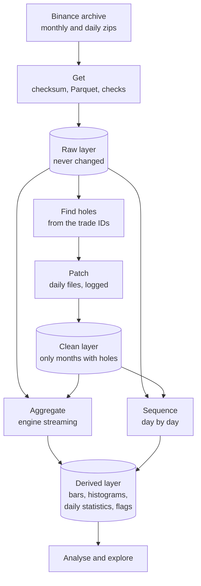

Four principles make it repeatable: the raw layer is never changed; every correction is a separate, logged file; every stage can be rerun alone; and memory is bounded by design, one chunk and one job at a time.

Appendix A gives the details: the Polars library used throughout (A.1), and for each stage, its input and output, how the work is split, what it checks and how much memory and time it needs (A.2).

## 5. Inspecting the data

### 5.1 The process

Five years of tape cannot be checked by eye. The inspection is a process with fixed steps, applied to every month:

| Step | What it does | Why |
|---|---|---|
| 1. Check on arrival | Checksum, row count, ID continuity, time order (§4.2) | Catches broken downloads and gaps at once |
| 2. Find holes | Lists every jump and every repeat in the trade IDs across all files | Locates missing and duplicated data exactly |
| 3. Fix from a second source | Fills holes from the daily files; each patch must close its hole exactly | A fix that cannot be verified is not a fix |
| 4. Flag | Runs a fixed set of rules on every day and records every hit: rule, time, size | Turns "look at the data" into a list that can be worked through |
| 5. Inspect the flags | Tests what each kind of flag really is, and whether the rule itself is right | A flag is a question, not a verdict |
| 6. Record what remains | States every hole that could not be filled and every flag left unexplained | Every later analysis knows what it rests on |

Nothing is deleted at any step. A trade in the exchange's own record almost certainly happened, even when it looks strange; the flags describe it, and each analysis states which flagged trades it uses. The literature on high-frequency data applies the same principles to stock-market data, where the failure modes differ: trades from many exchanges, condition codes, corrections (Brownlees and Gallo, 2006; Barndorff-Nielsen, Hansen, Lunde and Shephard, 2009; Dacorogna et al., 2001). On a single crypto exchange the failure modes are the archive's own.

### 5.2 What the inspection found

| Issue | How it was detected | What was done |
|---|---|---|
| **Eight days missing** from Binance's monthly files: 28–30 August, 1 and 10 September, 29 October, 7 and 14 November 2022 | Jumps of 0.8 to 4.0 million in the trade IDs; days with no trades at all | Filled from Binance's daily files. Each patch closes its hole exactly: for 28–30 August, 1,065,533 + 1,407,753 + 1,504,285 = 3,977,571 trades, the size of the jump |
| **Two days duplicated**: 12 and 13 September 2022 appear twice in the monthly file | Trade IDs repeating instead of rising | Each trade kept once in the clean month |
| **Six minutes missing from the whole archive**: 6 September 2022, 17:14–17:20 UTC, about 31,600 trades | A jump in the IDs that the daily file has too | Cannot be filled; flagged, and left out by every analysis that needs a complete day |
| **Exchange outages**: seven silences of more than a minute, the longest 35 minutes (28 May 2022) | No trade for over 60 seconds | Recorded; these are times when nobody could trade |
| **The tick changed** from $0.01 to $0.10 on 15 February 2022, between 00:00 and 06:00 UTC | 81% of prices off the $0.10 grid before, under 2% after, within hours | The grid check uses the tick in force at each trade |
| **Prices off the tick grid after the change**: about 294,000 trades, fading until September 2024 | Prices not a multiple of $0.10 | Kept. Real trades: each single fill in Binance's raw trade file has the same price. The rule itself was checked (exactly two decimals, every last digit from 1 to 9 represented). They form ladders of orders, for example 0.003 bitcoin every 0.0808% below $57,086.83: the fingerprint of a grid-trading bot. How orders at two decimals could still be placed after the change is not documented; it is an open question |
| **Fill numbers skipped**: about 0.3% of the single-fill numbers never appear | The first fill of a trade does not follow the last fill of the one before | Not missing data: Binance's own raw trade file skips the same numbers. The aggregated tape contains every published fill |

### 5.3 The flag register in numbers

Over five years, 2.6 billion trades on 1,826 days:

| Flag | Rule | Kind | Count | Days |
|---|---|---|---|---|
| Missing trades | Trade IDs jump by more than one | Error | 2 gaps (the six unfillable minutes) | 1 |
| Silence | No trade for more than 60 seconds | Check | 7 | 6 |
| Fill numbers skipped | A trade's first fill does not follow the previous trade's last fill | Check | 3.4 million numbers | every day |
| Unusual print, reverting | At least 0.5% from the median of the 50 trades before it, and more than ten of their standard deviations; the next trades return | Check | 456 | 118 |
| Unusual print, persisting | The same distance, but the price stays | Event | 1,597 | 187 |
| Off the tick grid | Price not a multiple of the tick in force | Event | 294,288 | 767 |
| Quantity off the lot step | Quantity not a multiple of 0.001 bitcoin | Error | 0 | 0 |
| Very large trade | Over $5 million | Event | 42,014 | 1,753 |
| Activity burst | A minute with more than 20 times the day's median number of trades | Event | 3,195 minutes | 929 |

The days with the most unusual prints are recognisable: 21 September 2022, when the Federal Reserve raised rates by 0.75 points; 13 September and 13 October 2022, US inflation releases; 4 December 2021, a weekend crash; 10 October 2025, a day of record liquidations. A rule that singles out these days is measuring stress, not noise.

**A rule must be tested too.** The first version of the unusual-print rule measured distance only in local standard deviations. In a quiet moment, when the last 50 trades were all at the same price, that deviation is close to zero and a one-tick move counts as extreme: the rule flagged 109,000 trades, almost all of them trivial. Adding a minimum distance in price, 0.5%, is the "granularity" term of Brownlees and Gallo (2006); with it, the rule flags 2,053 trades, concentrated on the days above.

### 5.4 Unusual prints, tested

A flagged trade can be a fast market, a poor execution in a thin book, or an error. Four tests on the tape alone tell them apart:

| Test | Error | Genuine fast market |
|---|---|---|
| Persistence: where is the price a few trades later? | Back where it was | Near the new level, or further |
| Path: were the prices in between traded? | One isolated jump | The price walks through the levels |
| Participation: how much trading surrounds it? | One trade, often small | Many trades, real volume |
| Order flow: does the side fit the move? | Random | Aggressive selling on the way down, buying on the way up |

Comparing with Binance's published candles, with other exchanges or with news would add evidence; this lecture uses the tape alone. The largest persisting and the largest reverting print of the five years:


| | 17 August 2023, 21:45:03 UTC | 6 September 2022, 17:12:26 UTC |
|---|---|---|
| The print | $24,800, 3.1% below the median of the trades before it | $28,368.26, 48% above a market at about $19,100, at a two-decimal price |
| Persistence | 98% of the fall still there ten trades later; recovered, and more, within a minute | Gone at once |
| Path | A gap of 2.3% between two consecutive trades | Nothing traded in between |
| Participation | 26 times the usual number of trades, 33 times the dollars | 14 times the usual trades |
| Order flow | Mixed: 46% of aggressive volume in the direction of the fall | Mostly against the move: 29% |
| Reading | A flash crash through an empty book: forced selling gapped the price down, then it snapped back. Real trades, at prices that existed for a few seconds | The closest to an erroneous print in five years: isolated, far away, instantly reversed, and two minutes before the six minutes missing from Binance's own archive. Consistent with a malfunction just before an outage; not documented |

**Neither is deleted.** The first is the market; the second is in the exchange's record and stays there, with its flag. Every analysis uses all trades. Prints flagged as reverting are marked as outliers, not removed: where a measure reacts strongly to a single extreme, such as the highest and lowest price of a bar or realised variance, the result is shown with the outliers marked, so the reader can see how much they move it.

Two other flags are extreme without being suspicious, and they show what the tape looks like at its limits:


| | Largest single trade: 27 April 2026, 06:05:33 UTC | Busiest minute: 21 September 2022, 18:01 UTC |
|---|---|---|
| What happened | $118.9 million at one price, $77,686.50 | 62 times the day's usual pace of trades, 18 times the dollars |
| Price | Did not move: every fill at the same price | Moved with the flow: 68% of aggressive volume in the direction of the move |
| Context | Only three times the usual number of trades around it, but 60 times the dollars: one order, not a crowd | The first minute after the Federal Reserve announced its 0.75-point rate rise at 18:00 UTC |
| Reading | A large order met by resting orders at a single level; nothing to correct | The market absorbing news; the burst flag marks it, nothing to correct |

## 6. The market's activity

With the data checked, the tape can be described. This section asks how much is traded, when, in what sizes and by which side; §7 asks how those trades turn into prices. Each statistic uses all 2.6 billion trades of the five years, flagged prints included (§5.4), and comes from the derived layer of the pipeline (§4.3).

### 6.1 Activity over five years


| | Trades per day | Dollars per day |
|---|---|---|
| Median | 1.3 million | $13.0 billion |
| Busiest | 9.5 million | $68.8 billion (5 March 2024) |
| Quietest | 189,000 (7 January 2023) | |
| Average by year | 1.1 million (2023) to 1.6 million (2021, 2026) | $11.5 billion (2023) to $17.8 billion (2024) |

Activity moves in regimes: quieter in 2023, at its peak in dollars in 2024. The number of trades and the dollars traded do not move together: in 2026 there are as many trades as in 2021 but fewer dollars, so the average trade is smaller. A bar that closes after a fixed number of trades or dollars therefore means something different in different years, which Lecture 13 takes up.

### 6.2 Time of day, and the funding times

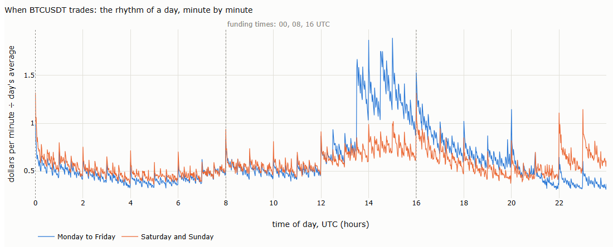

| Measure | What we measure, in plain words | Benchmark | Result | What it means |
|---|---|---|---|---|
| Busiest hour | The hour of the day with the largest share of weekday dollars | 1/24 = 4.2% | 14:00–15:00 UTC, 8.6% | Crypto trades around the clock, but not evenly: the US afternoon dominates |
| Quietest hour | The hour with the smallest share | 4.2% | 23:00–00:00 UTC, 2.6% | Activity at the quietest hour is a third of the busiest |
| Busiest minutes | Weekday minutes with the most trading, relative to the day | 1 | 15:00, 14:00, 14:30, 13:31 UTC: 1.7 to 1.9 times the average | The US stock market opens at 13:30 or 14:30 UTC, depending on daylight saving time, and US economic data are released at 12:30, 13:30, 14:00 or 15:00 UTC: bitcoin trades on the US calendar |
| Weekends | Dollars per weekend day, relative to a weekday | 1 | 0.51 | Half the activity: the professional participants trade on working days |

Two smaller patterns are visible. Every full hour starts with a short spike: orders scheduled by the clock, from rebalancing programs and from traders who use hourly bars. And the three funding times (§2) stand out a little more than other hours.

**Do traders trade around funding?** Funding is paid only on positions open at 00:00, 08:00 or 16:00 UTC; a position closed before that time pays and receives nothing, although Binance notes that the payment itself can be booked up to 15 seconds late (Binance, funding rate FAQ). When funding is high, a long has a reason to close shortly before the payment and reopen after. The test compares the ten minutes before and after each of the 5,477 funding times:

| Funding rate at the payment | Payments | Net aggressive buying, 10 minutes before | 10 minutes after |
|---|---|---|---|
| Above the default 0.01%: longs pay most | 395 | −2.8% (± 0.8%) | −1.0% (± 0.8%) |
| Exactly 0.01% | 1,605 | −1.0% (± 0.4%) | −0.8% (± 0.4%) |
| Positive, below 0.01% | 2,674 | +0.2% (± 0.4%) | +0.1% (± 0.4%) |
| Zero or negative: shorts pay | 803 | −0.8% (± 0.6%) | +1.1% (± 0.6%) |

*Net aggressive buying: aggressive buys minus aggressive sells, as a share of the dollars traded; in brackets, the standard error. Over all days, the average is −0.4%.*

When funding is highest, the last ten minutes before the payment show net aggressive selling of 2.8% of the dollars traded, about three standard errors from the average; after the payment it fades. This is consistent with longs closing positions to avoid the payment, but it is small, and it is one result among four groups: a hypothesis, not a finding. Activity rises after every full hour, funding or not: ten minutes after the hour, it is 1.29 times the day's average at the funding times and 1.01 times at the hours halfway between. 

**Activity, volatility and price around funding.** A wider look, an hour either side of every funding time, minute by minute, with the hours halfway between (04:00, 12:00 and 20:00 UTC) as a control:

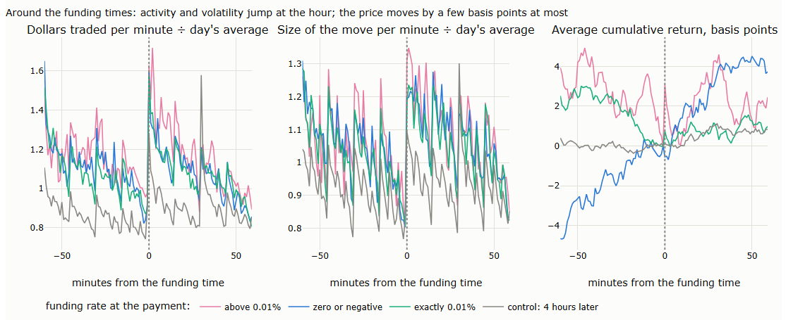

| | Funding above 0.01% | Exactly 0.01% | Zero or negative | Control hours |
|---|---|---|---|---|
| Payments | 395 | 1,605 | 803 | 5,478 |
| Activity in the first minute, relative to the day | 1.63 | 1.58 | 1.59 | 1.29 |
| Size of the move in the first minute, relative to the day | 1.31 | 1.18 | 1.20 | 1.10 |
| Return over the 30 minutes before, basis points | −2.1 (± 2.3) | −2.5 (± 0.9) | +1.4 (± 1.5) | −0.1 (± 0.5) |
| Return over the 5 minutes before | −1.9 (± 0.8) | −0.1 (± 0.3) | +0.2 (± 0.5) | −0.2 (± 0.2) |
| Return over the 30 minutes after | +4.3 (± 2.5) | +1.1 (± 1.0) | +3.3 (± 1.6) | +1.1 (± 0.5) |

*In brackets, the standard error across payments.*

Activity and volatility jump at every full hour, and more at the funding times than at the control hours: in the first minute after a payment, about 1.6 times the day's average activity, against 1.3. Part of the difference is the time of day itself: 16:00 UTC falls in the busy US afternoon (§6.2), 04:00 in the quiet Asian night. The price moves little. When funding is high, it falls by about 2 basis points in the last five minutes before the payment, in line with the net selling above, and recovers afterwards; when funding is negative, it tends to rise. The effects are a few basis points, mostly within two or three standard errors, and the table makes more than a dozen comparisons, so one or two such values would appear by chance. They are much smaller than the cost of trading them: a round trip pays the exchange's fee for aggressive orders twice, 0.05% each way on the standard tier (Binance, fee schedule). Lecture 15 returns to flows around scheduled events.

### 6.3 Time between trades

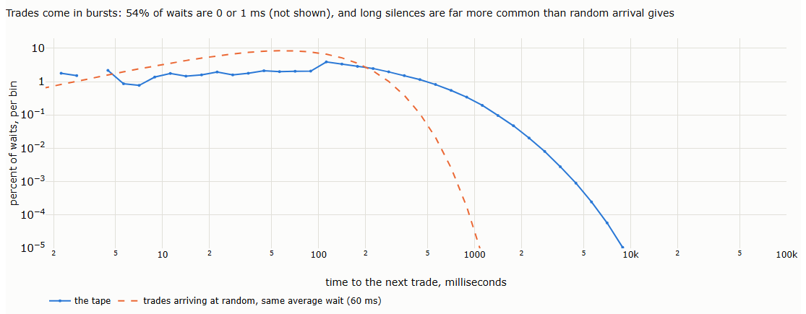

| Measure | What we measure, in plain words | Benchmark: trades arriving at random | Result | What it means |
|---|---|---|---|---|
| Average wait | Mean time between consecutive trades | — | 60 milliseconds | About 17 trades a second, on average |
| Same millisecond | Share of trades with the same timestamp as the previous trade | Almost none | 51% | Half of all trades arrive together with another: one aggressive order filling against resting orders at several prices, which Binance records as one aggregated trade per price (§3.1), or several orders arriving at once |
| Coefficient of variation | Standard deviation of the waits divided by their mean | 1 | 2.3 | Waits are far more uneven than random: bursts of trades, then pauses |
| Clustering | Correlation between one wait and the next | 0 | 0.45 | A short wait is followed by a short wait: busy moments persist |

Random arrival, a Poisson process, would put most waits near the average and almost none above a second. The tape has far more waits near zero and far more long waits, up to several seconds. The market has its own clock, and time bars ignore it: a one-minute bar may hold a hundred trades or ten thousand. Lecture 13 builds bars on the market's clock instead.

### 6.4 Trade sizes

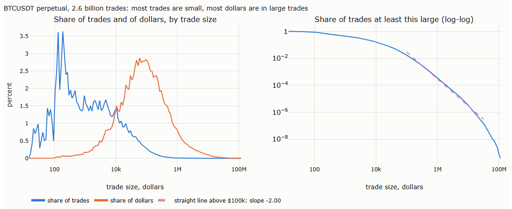

| Measure | What we measure, in plain words | Benchmark | Result | What it means |
|---|---|---|---|---|
| Small trades | Share of trades worth under $1,000 | — | 55% | Most trades are small: retail orders, and slices of larger orders |
| Concentration | Share of all dollars traded in the largest 1% and 10% of trades | Equal sizes: 1% and 10% | 34% and 78% | A small minority of trades carries most of the money |
| Tail exponent | Slope of the right-hand chart above $100,000: how fast very large trades become rare | Thin tails, such as the normal distribution: the line bends down ever faster | About 2 | Each tenfold increase in size makes a trade about a hundred times rarer. A straight line on log-log axes is a power law, the signature of fat tails |

The left-hand chart is the most important picture of this section. The blue curve counts trades, the orange curve counts dollars, and they peak two orders of magnitude apart, between $100 and $200 and near $50,000. A statistic that counts trades describes the small traders; one that weighs by dollars describes the large ones. Tick bars count trades and dollar bars count dollars: Lecture 13 returns to the difference. The jagged blue curve at small sizes comes from the lot size: quantities are multiples of 0.001 bitcoin, so small trades take only a few distinct sizes.

### 6.5 Who is aggressive

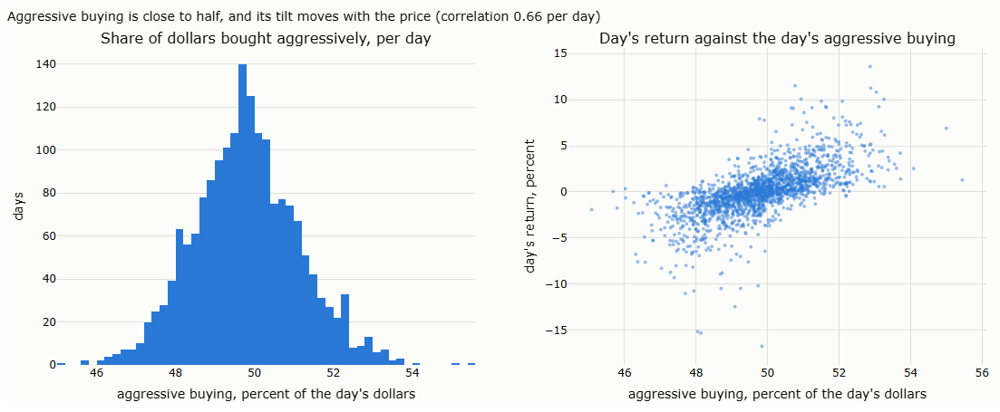

| Measure | What we measure, in plain words | Benchmark | Result | What it means |
|---|---|---|---|---|
| Aggressive buying | Share of each day's dollars where the buyer was the aggressor | 50% | 49.8% on average; 47.7% to 52.1% on nine days in ten | Buying and selling pressure are close to balanced every day; the tilt is small |
| Daily flow and return | Correlation between the day's aggressive buying and the day's return | 0, if flow and price were unrelated | 0.66; flow explains 44% of the variance of daily returns | The small tilt matters: days with more aggressive buying are days the price rises |
| One-minute flow and return | The same, per minute: net aggressive buying as a share of the minute's dollars, against the minute's return | 0 | 0.48; 23% of the variance. The signs agree in 78% of minutes | The link holds minute by minute |

This is the true version of what Lecture 3, §7 could only estimate. On-balance volume assigned all of a day's volume to buyers on up days and to sellers on down days. The tape shows how far that is from the truth: even on strong days, aggressive buying is rarely more than 53% of the dollars. The direction of the day comes from a small excess of one side, not from one side trading alone. §8 measures how far the estimates are from the truth.

The correlation is contemporaneous: flow and price move together, which does not mean that flow predicts the price. Whether it does is a question for Lecture 15.

## 7. How prices form

§6 described the trades. This section asks how they become prices: whether order flow follows itself (§7.1), how much noise trading adds to the price and what that does to measured volatility (§7.2), and what lies behind the largest moves (§7.3).

### 7.1 Persistence of order flow

§6.5 showed that flow and price move together. A second question is whether flow follows itself: is a buy more likely to be followed by another buy? On stock markets the answer is a strong yes. The signs of trades (+1 for a buy, −1 for a sell) are positively correlated over thousands of trades, and the correlation fades slowly, like a power law, roughly as lag^−0.6 on the London Stock Exchange (Lillo and Farmer, 2004). The main cause is **order splitting**: a large investor cuts a large order into many small ones, executed one after another, all on the same side. Herding, different investors trading in the same direction, matters less on horizons of a few hours (Tóth, Palit, Lillo and Farmer, 2015). If the sizes of the large hidden orders follow a power law, splitting alone produces sign correlations that fade as a power law (Lillo, Mike and Farmer, 2005).

**A limit of the aggregated tape.** Binance merges consecutive fills on the same side at the same price into one row (§3.1). Two neighbouring rows are therefore more often different than the underlying fills would be, and the correlation at lags of one or two rows is distorted: the correlation at lag 2 exceeds the one at lag 1. The measures below use lags of five trades or more, and two versions: per trade, and per order, merging trades in the same millisecond on the same side into one, so that a sweep through several prices (§6.3) counts once. A third measure does not depend on the rows at all: the net aggressive dollars of each second, correlated with those of the next second.

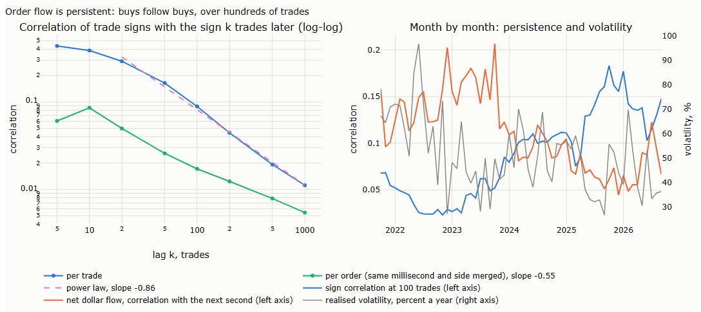

| Measure | What we measure, in plain words | Benchmark: no persistence | Result | What it means |
|---|---|---|---|---|
| Sign correlation, per trade | Correlation between a trade's sign and the sign 10, 100 and 1,000 trades later | 0 | 0.39, 0.09, 0.01 | Buys follow buys over hundreds of trades |
| Decay, per trade | Slope of the left-hand chart from 20 trades on | — | −0.86: a power law | The correlation fades slowly, without a cut-off |
| Sign correlation, per order | The same, with sweeps counted once | 0 | 0.09, 0.02, 0.005; slope −0.55 | Weaker, but the slope is close to the −0.6 of stocks: the same slow decay |
| Net dollar flow, one second | Correlation of one second's net aggressive dollars with the next second's | 0 | 0.11; 0.03 at 10 seconds, 0.006 at a minute | Persistent in money too, over a few seconds |
| Returns, one second | Correlation of one second's return with the next second's | 0 | 0.06 | Much weaker than the flow |

The last two rows contain the central puzzle of this literature. The flow is predictable, at least a little: a second of net buying is likely to be followed by another. If every buy pushed the price up by the same amount, the price would be predictable too. It is almost not. The explanation is that liquidity adapts: when a run of buying is under way, sellers expect more of it, place more resting orders, and each new buy moves the price less. The impact of a trade is not permanent but fades over time, and the persistence of the flow and the fading of the impact offset each other (Bouchaud, Gefen, Potters and Wyart, 2004). What moves prices is the part of the flow that was not expected.

**Over time.** The two measures have moved in opposite directions:

| | First 12 months (Oct 2021–Sep 2022) | Last 12 months (Oct 2025–Sep 2026) |
|---|---|---|
| Sign correlation at 100 trades | 0.04 | 0.14 |
| Net dollar flow, correlation with the next second | 0.13 | 0.07 |
| Realised volatility (5-minute returns) | 70% a year | 46% a year |

Counted trade by trade, flow has become much more persistent; weighted by dollars, second by second, less. A count gives every trade the same weight, so it is dominated by the many small trades of §6.4; a dollar measure is dominated by the large ones. One reading, not tested here, is that more large orders are now executed by algorithms in long sequences of small, same-sided slices, while the money moving from one second to the next has become less one-sided.

Has more or less persistent flow made the market more or less volatile? Month by month, the sign correlation at 100 trades and realised volatility have a correlation of −0.38; the one-second flow correlation and volatility, +0.16. Volatility fell over the five years while trade-by-trade persistence rose. The data do not show that more persistent flow means a more volatile market, which is what the literature leads us to expect: flow that can be anticipated is absorbed before it moves the price. Both series also trend over the five years, so their correlation describes the period, not a cause.

This section only describes. Lecture 15 asks whether the unexpected part of the flow can be measured and used; Lecture 16 measures what it costs to trade against it: the impact of one's own orders, which grows roughly with the square root of their size, on bitcoin as on other markets (Donier and Bonart, 2015).

### 7.2 The bid-ask bounce and the signature plot

| Measure | What we measure, in plain words | Benchmark | Result | What it means |
|---|---|---|---|---|
| Bounce, trade to trade | Correlation between one trade-to-trade return and the next | 0 | −0.65 | Strongly negative: the price alternates between the bid and the ask (§3.3), so an up-tick is usually followed by a down-tick. Trade-to-trade returns are mostly noise |
| Bounce, one second | The same for returns from one second to the next, using the last price of each second | 0 | +0.07 | The bounce has gone; a small positive correlation remains: moves continue for a few seconds |

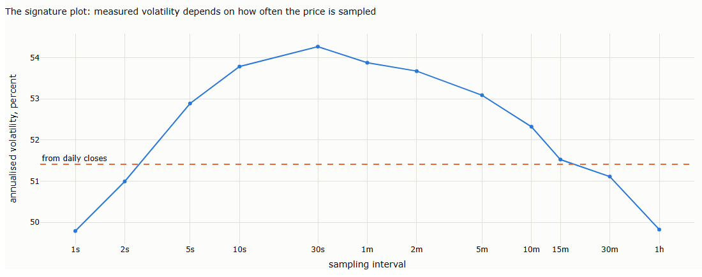

Realised volatility adds up squared returns over short intervals. In theory, the shorter the interval, the more precise the estimate; in practice, the answer depends on the interval. The chart, a **signature plot** (Andersen, Bollerslev, Diebold and Labys, 2000), shows annualised volatility for each interval, averaged over the five years:

| Sampling interval | 1 second | 30 seconds | 5 minutes | 1 hour | Daily closes |
|---|---|---|---|---|---|
| From trade prices | 49.8% | 54.3% | 53.2% | 50.9% | 51.4% |
| From the mid, estimated | 48.7% | 54.2% | 53.2% | 50.9% | |

The shape of the curve has a meaning. If returns were independent, every interval would give the same answer and the curve would be flat. Where it rises with the interval, returns over short intervals are positively correlated: moves continue. Where it falls, they reverse.

For many stocks, the textbook curve is highest at the shortest intervals: the bid-ask bounce adds noise to every sampled price, and the noise adds variance (each return contains two noise terms, so the bias grows with the number of returns). Here the bounce is too small to matter. Half a tick is $0.05 on a price of $20,000 or more, and even if the last trade of every second fell at random on the bid or the ask, it would add 0.04% to the daily variance. What the curve shows instead is continuation over the first 30 seconds, from 49.8% to 54.3%, and a slight reversal beyond, to 50.9% at one hour. Why moves continue for some seconds is not tested here. Large orders executed in slices (§6.3) and prices that adjust to news in steps are candidates; Hansen and Lunde (2006) report that microstructure noise is correlated with changes in the underlying price, which can produce a curve of this shape.

Every day's realised variance covers the full 24 hours, including the return across midnight: the returns of a day must add up to the day's return, as a daily close-to-close return does. For markets that close overnight, Hansen and Lunde (2005) add the overnight return in the same way.

**Trades or the mid?** Studies of stocks usually measure volatility from the mid-price, halfway between the best bid and the best ask, because it does not bounce. The tape has no quotes, but the aggressor flag gives an estimate: a buyer-initiated trade happened at the ask and a seller-initiated trade at the bid, so the last buy and the last sell of each second estimate the ask and the bid, their average the mid, and their difference the spread. The second row of the table uses this mid. It differs from trade prices only at one second, by about a point: that is all the bounce adds. Lecture 16 repeats the check with the exchange's own quotes.

The spread estimated this way is one tick in 77% of the seconds in which both sides trade, 0.016 basis points at the median. It is not always small: in the widest 1% of seconds it reaches 1.2 basis points on a typical day and 5.8 on the worst day of the five years. These are upper estimates, since the price can move within the second; they show that the bounce matters exactly when the market is under stress, and hardly at all otherwise.

The practical result is reassuring: from 15 minutes to an hour, every interval lies within 0.6 points of the 51.4% measured from daily closes. Lecture 3, §4.4 compared volatility estimators from daily bars; §8 compares them with this realised volatility.

### 7.3 What drives large moves

Lecture 2 treated volume as one number per bar. The tape splits it into its two parts: how many trades, and how large each one is. Which of the two goes with volatility? The literature gives a clear answer for stocks. Prices move with the rate at which information arrives, and the number of trades is a good measure of that rate (Clark, 1973). Hour by hour, volatility follows the number of trades, and the average trade size adds almost nothing (Jones, Kaul and Lipson, 1994). At the level of single orders, a large order does not move the price much more than a small one; large price changes come from gaps in the order book, moments when few resting orders stand near the price (Farmer, Gillemot, Lillo, Mike and Sen, 2004).

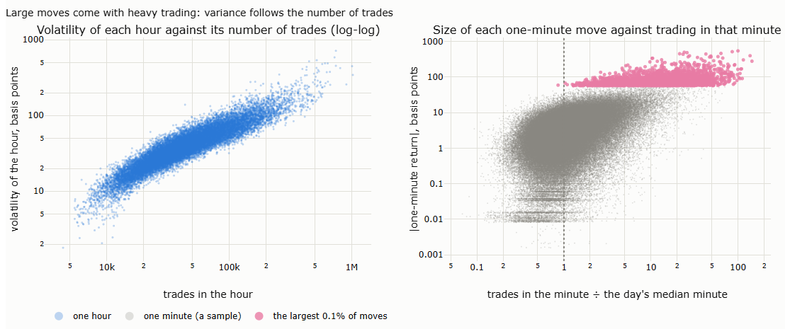

**Activity or size?** Each of the 43,818 hours of the five years, with its variance measured from one-minute returns, its number of trades and its average trade size:

| Explaining the variance of an hour by… | Share of the variation explained (R²) | What it means |
|---|---|---|
| The number of trades | 85% | Almost everything |
| The average trade size | 1% | Almost nothing |
| Dollar volume | 74% | Less than the number of trades alone: the size part of volume adds noise |
| The number of trades and the average size together | 85% | Size adds nothing once the number of trades is known |

*The regression uses logarithms: the logarithm of each hour's variance on the logarithms of the explanatory variables.*

BTCUSDT behaves like the stocks of Jones, Kaul and Lipson. The coefficient on the number of trades is 1.5: an hour with twice the trades has about 2.8 times the variance. If every trade carried the same amount of variance, the coefficient would be 1; in busy hours each trade moves the price more. The number of trades is the market's clock, the observation behind the bars of Lecture 13 (Ané and Geman, 2000).

**The trading behind the largest moves.** Every one-minute move, compared with the number of trades in that minute relative to the day's median minute:

| Minutes | Size of the move | Trades, relative to the day's median minute | Dollars, relative | Share of these minutes with fewer trades than the median minute |
|---|---|---|---|---|
| All | — | 1.0 | 1.0 | 50% |
| Largest 1% of moves | 26 basis points or more | 5.3 | 7.4 | 2% |
| Largest 0.1% of moves | 57 basis points or more | 13.3 | 19.4 | 0.04% |

On BTCUSDT, a large one-minute move almost never happens in a quiet minute. Of the 2,630 largest moves of the five years, one happened in a minute with less trading than usual. This seems to contradict the stock-market finding that jumps come with little volume (Joulin, Lefevre, Grunberg and Bouchaud, 2008), but the two measure different things. Farmer and his co-authors looked at single orders, and on our tape, too, the largest one-minute moves are made of many trades, each moving the price little except where the book has a gap, as in the flash crash of §5.4. Heavy trading and thin books are not alternatives: when the price starts to move, stop orders and liquidations add trades, and resting orders are withdrawn. Which comes first, the trading or the move, the tape cannot tell; trading measured within the same minute includes the reaction to the move. The order book of Part IV can show the gaps directly.

**How concentrated is the variance?** Of all the variance of five years of one-minute returns:

| Minutes | Share of all minutes | Share of the variance |
|---|---|---|
| The largest 0.1% of moves | 0.1% | 17% |
| The largest 1% of moves | 1% | 37% |
| The busiest 1% of minutes, by number of trades | 1% | 22% |
| The bursts flagged in §5 (more than 20 times the day's median minute) | 0.12% | 10% |

A third of the risk of five years sits in 1% of its minutes. A volatility estimate that misses those minutes, or a backtest that assumes trading in them at normal cost, misses much of the risk. The flagged bursts of §5, about one minute in eight hundred, hold a tenth of it. Lecture 15 studies these minutes: how cascades start, and whether trades trigger further trades.

The single moments behind these statistics were shown in §5.4: a flash crash in which aggressive selling swept through an empty book, the busiest minute, with 62 times the usual rate of trades, and the largest trade, met at one price.

## 8. What a candle loses

§1 asked what a bar hides. With the tape described, the question can be answered directly: build candles from the tape, compare them with the candles an exchange publishes, and measure what each part of a candle leaves out. All comparisons use one-minute, hourly or daily candles rebuilt from every trade.

### 8.1 Our candles against Binance's

Binance publishes its own one-minute candles (§4.1). If the tape is complete and our aggregation is right, the two should agree. Over the five years, 2,629,440 minutes:

| Part of the candle | Identical in | Where they differ |
|---|---|---|
| Close | 99.99% of minutes | — |
| High, low | 99.76% | Mostly at the boundary between minutes |
| Open | 93.7% | In the other 6.3%, Binance's open is the previous minute's close (in 99.9% of these cases) |
| Volume | 82% exactly; the rest typically differ by one part in a million | At the boundary between minutes |
| Aggressive buying | 91% exactly | At the boundary |
| Number of trades | Never: Binance counts single fills, 2.5 per aggregated trade | A different unit, not an error |

Three causes explain every difference. The first is a convention and accounts for almost all of them; the other two are rare.

**1. When one row straddles the start of a minute.** A trade stamped 18:00:00.001 belongs to the 18:00 candle; there is nothing to decide. The difficulty lies elsewhere: one aggregated row combines all fills at the same price on the same side within up to 100 milliseconds (§3.1), and it carries **one** timestamp, as the numbers indicate the time of its first fill. When those 100 milliseconds straddle the start of a minute, the row hides the exact time of some of its fills:

| Single fill | Its real time | In the aggregated tape | Binance's candle, built from single fills | Candle rebuilt from the tape |
|---|---|---|---|---|
| Fill A | 17:59:59.950 | One row, stamped 17:59:59.950 | 17:59 | 17:59 |
| Fill B | 18:00:00.020 | The same row; its own time is not recorded | **18:00**: it becomes that candle's open | 17:59, with the rest of its row |
| The next row | 18:00:00.300 | Its own row | 18:00 | 18:00: the open of the rebuilt candle |

*An illustration of the mechanism, not a particular trade.*

Both candles agree on where 18:00 is; they differ because the tape does not show fill B's time. Binance's 18:00 candle opens at the price of the last row of 17:59, and holds fill B's volume; the rebuilt candle opens at the next row. This is why, in 6.3% of minutes, Binance's open equals the previous close; why volume differs in 18% of minutes, but typically by one part in a million; and why 98% of the differing highs and lows match the previous minute's close. The mechanism fits all the numbers; Binance does not document it. Binance's file of single fills would settle each case, at 2.5 times the size of the aggregated tape. Any source that aggregates trades or stamps them coarsely has the same issue at every bar boundary.

**2. The six minutes missing from the archive** (§5.2). For 6 September 2022, 17:14–17:20 UTC, Binance's candles contain about 72,000 fills that its published tape does not.

**3. Errors in Binance's candle file.** In 192 minutes, the candles show no trades and a flat price, while the tape has 202,340 trades worth $2.2 billion. They fall in four stretches: 10 November 2023, 15:07–16:45 UTC (99 minutes); 28 October 2024, 20:00–21:13 (74 minutes); 29 January 2025, 01:23–02:44 (17 minutes); and two minutes on 14 January 2025.

Causes 2 and 3 together affect 198 of 2.6 million minutes, less than one in ten thousand. They are rare, but they fall on specific days, and a backtest on those days would be wrong.

No single source is perfect. The tape is the primary record, and the candles are a product derived from it, with their own conventions and their own gaps. Comparing the two confirms the tape almost everywhere and locates exactly where each source fails. A backtest on Binance's candles would have seen a market without trades for an hour and a half on 10 November 2023.

### 8.2 The same candle, different flow

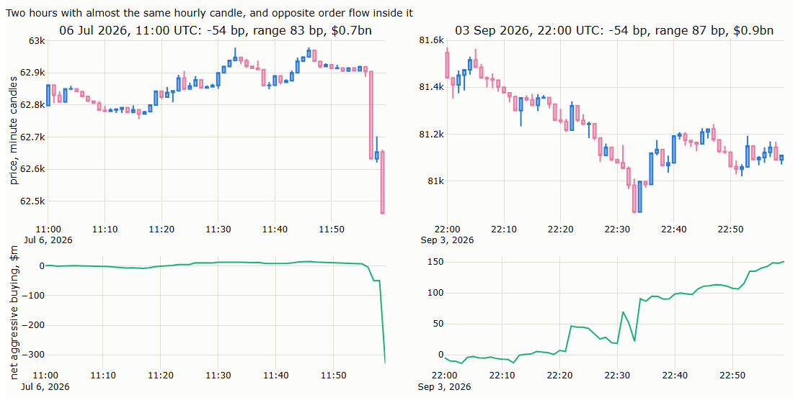

| | 6 July 2026, 11:00 UTC | 3 September 2026, 22:00 UTC |
|---|---|---|
| Hourly return | −54 basis points | −54 basis points |
| Hourly range, high to low | 83 basis points | 87 basis points |
| Dollars traded | $0.7 billion | $0.9 billion |
| Net aggressive buying | −48% of the dollars: heavy selling | +16%: net buying |
| What happened | Flat for 55 minutes, then a burst of selling in the last five | A steady decline, against aggressive buying |

As hourly candles, the two are almost identical. On the tape they are opposites. In the first hour, sellers took liquidity in one burst and pushed the price down. In the second, buyers took liquidity all hour, and the price still fell: the resting sell orders were lowered faster than the buyers could lift them. A rule that reads the candle sees the same signal twice; the tape shows two different markets.

### 8.3 Order flow from a candle

Lecture 3, §7 estimated order flow from bars. The **tick rule**, the signed volume behind on-balance volume, gives all of a bar's volume to buyers if the close rose and to sellers if it fell. **Bulk volume classification** (Easley, López de Prado and O'Hara, 2012) splits the volume by the size of the move: the share bought is the probability of the move under a normal distribution, Φ(return ÷ volatility), with the volatility measured over past bars only. The tape gives the true answer for every bar:

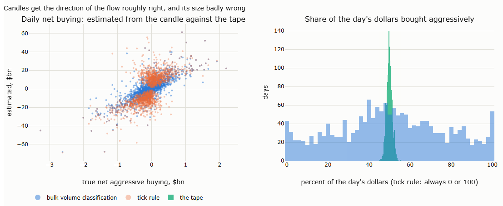

| Measure | What we measure, in plain words | One minute | One hour | One day |
|---|---|---|---|---|
| Direction right | Share of bars where the estimate has the sign of the true net buying (both methods take the sign of the return) | 77% | 79% | 79% |
| Correlation, tick rule | Correlation between estimated and true net buying | 0.74 | 0.67 | 0.67 |
| Correlation, bulk volume classification | The same | 0.78 | 0.73 | 0.78 |
| Error in the share bought, tick rule | Typical distance between estimated and true share of dollars bought aggressively | 38 points | 47 points | 49 points |
| Error, bulk volume classification | The same | 13 points | 14 points | 19 points |
| True imbalance | Typical size of net buying, as a share of the bar's dollars | 27% | 6% | 1.8% |
| Imbalance, bulk volume classification | The same, as estimated | 37% | 33% | 39% |

The candle gets the direction of the flow right four times in five, and its size badly wrong. On a typical day, aggressive buying and selling differ by 1.8% of the dollars traded (§6.5); bulk volume classification estimates 39%, more than twenty times too much, and the tick rule assumes 100%. The longer the bar, the more the true imbalance cancels out, and the larger the error. Bulk volume classification is much better than the tick rule at estimating how much was bought, and, as Lecture 3, §7.4 warned, worse on daily bars than on short ones; neither measures the imbalance itself: the candle only knows that the price moved.

### 8.4 Volatility from a candle

Lecture 3, §4.2 estimated volatility from the high, low, open and close of daily bars, and §4.4 there argued that every range estimate is biased down. The tape gives the benchmark: realised volatility from five-minute returns (§7.2). Each estimator is averaged over 28-day windows and compared with realised volatility over the same window:

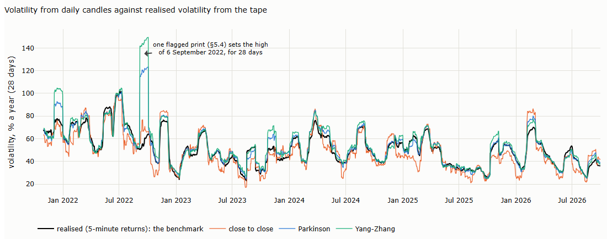

| Estimator | Uses | Level relative to realised volatility | Typical error over 28 days | Correlation with realised variance, day by day |
|---|---|---|---|---|
| Close to close | Closes | 0.97 | 15% | 0.53 |
| Parkinson | High, low | 1.06 | 11% | 0.91 |
| Garman–Klass | Open, high, low, close | 1.09 | 12% | 0.92 |
| Rogers–Satchell | Open, high, low, close | 1.12 | 14% | 0.90 |
| Yang–Zhang | All four, with the gap between the previous close and the open | 1.10 | 13% | — |

*Level: the estimator's average variance over its windows relative to realised, as a volatility. Typical error: the standard deviation of the logarithm of the ratio. Yang–Zhang is defined over a window, not for one day.*

The range-based estimators do what they promise: day by day, they track realised variance far better than the close alone (correlation 0.9 against 0.5), and over 28 days their errors are smaller. But on this market they overstate volatility by 6% to 12%. The bias of Lecture 3, §4.4 is downward, because a price observed only at discrete times misses the true extremes; the tape records every trade, so that bias is gone, and the opposite appears, because the high and low of a day include brief extremes that realised variance at five minutes smooths away. With no overnight gap on a market that never closes, Yang–Zhang's extra term adds nothing.

**One print can dominate.** On 6 September 2022, the isolated print at $28,368 (§5.4) set the day's high. Parkinson's estimate for that day is 548% a year; realised volatility, 61%. The print stays in the data, with its flag (§5.4), and the chart shows its effect: the range-based estimates of the next 28 days are lifted by one trade.

### 8.5 The close against the average price

The close is one trade, the last of the bar. The **volume-weighted average price (VWAP)** is the average price of all the bar's trades, weighted by size: the price a patient trader, spreading an order over the bar, would roughly have paid.

| Measure | What we measure, in plain words | Result | What it means |
|---|---|---|---|
| Daily close against daily VWAP | Typical distance between them | 0.66% (66 basis points); one day in ten, more than 2.2% | The close says little about where the day's trading happened |
| One-minute close against one-minute VWAP | The same, per minute | 1.5 basis points; 13 in the most distant 1% of minutes | Within a minute, the two are close |
| Daily returns, close to close against VWAP to VWAP | Correlation | 0.67 | Two different series |
| Volatility of daily returns | Close to close; VWAP to VWAP | 51%; 42% a year | Averaging smooths |

A backtest of a daily strategy that trades at the close, as in Parts I and II, assumes a price that only the last trade of the day got. A strategy that trades through the day gets something closer to the VWAP, which on a typical day is 0.66% away. Lecture 14 trades on bars of its own and fills on the tape after each signal.

### 8.6 Volume by price

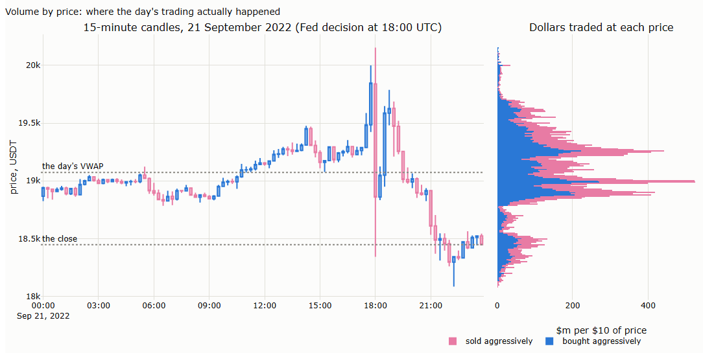

A candle reports four prices. The tape shows where the trading actually happened. On 21 September 2022, the day of a 0.75-point rate rise, 2.7 million trades:

| | Price | |
|---|---|---|
| Open | $18,867 | |
| High | $20,154 | Touched for a few seconds after the decision at 18:00 UTC, on little volume |
| Most traded price | $18,990 | The center of the day's trading |
| VWAP | $19,073 | |
| Low | $18,084 | |
| Close | $18,448 | Below most of the day's trading |

The daily candle spans $2,070, but most of the dollars traded within a few hundred dollars around $19,000. The high was a brief spike, and the close lies in a region where little traded. A support or resistance level drawn from the candle's extremes marks prices where almost nothing happened; the volume profile marks where the market did its business. This chart, a **volume profile**, differs from the trade-size chart of §6.4: that one counts trades by size, this one counts dollars by price.

### 8.7 Summary: what a candle loses

| The candle reports | What it loses | Evidence |
|---|---|---|
| Open and close | Everything between: the close differs from the day's average traded price by 0.66% on a typical day | §8.5 |
| High and low | Whether the extremes were traded or touched: brief spikes and flagged prints set them, and range-based volatility is 6% to 12% too high | §8.4, §8.6 |
| Volume | Which side was aggressive, and by how much: estimates get the direction four times in five and overstate the imbalance twentyfold | §8.3 |
| One shape per bar | The path and the flow inside it: identical candles can hold opposite flows | §8.2 |
| Four prices | Where the trading happened | §8.6 |
| A published series | Its own conventions and errors: Binance's candles miss 192 minutes of trading | §8.1 |

## Appendix A. Working with the tape

This appendix collects the tools behind §4: how the tape is read without loading it into memory, which statistics can be computed in chunks, and the pipeline stage by stage.

### A.1 Reading the tape with Polars

Five years of tape hold 2.6 billion rows: far more than a computer's memory, and far more than pandas, the library of the earlier notebooks, can handle. Part III uses **Polars**, a DataFrame library like pandas, built for data of this size. It is not a database: the data stay in the Parquet files, and Polars reads them.

The main difference is **when the work happens**. Take the dollar volume of one day, 10 January 2024, from the January file of 57 million trades:

| Step | pandas: **eager**, every line runs at once | Polars: **lazy**, the whole query is written first, then run once |
|---|---|---|
| 1. Open the file | Reads all 57 million rows and all seven columns: several gigabytes | Reads nothing; notes the file |
| 2. Keep 10 January | Keeps 3 million rows; 54 million were read for nothing | Reads nothing; notes the filter |
| 3. Keep the columns needed: time, price and quantity | Already in memory | Reads nothing; notes the columns |
| 4. Sum price × quantity | The answer | Now plans the whole query: reads only that day and those three columns, about 3 million rows, then sums |

Eager code cannot know at step 1 what step 3 will need; lazy code sees the whole query before reading anything. This works because Parquet stores each block's minimum and maximum, so the blocks outside 10 January are never opened. Polars also uses all processor cores, and a streaming mode processes data larger than memory in chunks.

Four operations cover most of Part III:

| Operation | What it does |
|---|---|
| `pl.scan_parquet(files)` | Points at the files without reading them |
| `.filter(...)`, `.select(...)` | Keep only some rows or columns; on a scan, this decides what is read at all |
| `.group_by_dynamic("time", every="1m")` | Builds bars: every trade falls into its minute (or second, hour, day), then is aggregated |
| `.collect()` | Runs the planned query and returns the result |

Daily trade counts and dollar volume for five years, in one pass, without loading the tape into memory:

```python
import polars as pl

tape = pl.scan_parquet("data/raw/binance/um/aggTrades/BTCUSDT/parquet/*.parquet")   # nothing is read yet
daily = (tape.with_columns(pl.from_epoch("transact_time", time_unit="ms").alias("time"))
             .group_by_dynamic("time", every="1d")
             .agg(pl.len().alias("trades"), (pl.col("price") * pl.col("quantity")).sum().alias("usd"))
             .collect(engine="streaming"))                                           # five years, in chunks
```

DuckDB does the same with SQL queries instead of Python, for readers who prefer SQL; this course uses Polars throughout.

**Working with data larger than memory.** Streaming works because the tape can be cut into chunks, processed one at a time, and the partial results combined. That is exact for some statistics and not for others:

| Kind of statistic | Examples | Chunks combine… | What we do |
|---|---|---|---|
| Additive | Counts, sums, dollar volume, buy and sell volume, highest and lowest price, histograms with fixed bins; means and variances, from sums and sums of squares | Exactly: add up the parts | Let the engine chunk: Polars' streaming mode |
| Dependent on neighbouring trades | Returns from trade to trade, time between trades, bars that cross a chunk's edge, rolling windows, the flags of §5 | Exactly, if the last trades of each chunk are carried into the next | Chunk by hand: one day at a time, the last trades carried over |
| Dependent on the whole sample | Median and other quantiles, ranks, "the top 1% of trades", the number of distinct prices | Not by adding: they need all the data at once, a second pass, or an approximation | Exact within a month; across months from a histogram whose bins are about 12% wide, so a quantile is known to within about 12% |

The rule is to let the engine chunk where it can, and to chunk by hand where the statistic needs its neighbours. A.2 shows where each kind sits in the pipeline.

**Plotting the tape** needs the same care: a chart of 36 million trades overwhelms any plotting library. Most charts in Part III plot aggregates (bars, histograms, profiles), which stay small. Two tools handle the raw trades: **plotly-resampler** shows a thinned line and fetches more detail as one zooms in, from a day down to milliseconds; **Datashader** turns millions of points into an image of their density. The notebook's explorer uses both.

### A.2 The pipeline, stage by stage

| Stage | Input → output | How the work is split | Checks and records |
|---|---|---|---|
| Get | Archive zips → raw layer: one Parquet file per month | Blocks of 32 MB while converting | Checksum, row count, ID continuity, time order; one log line per file |
| Find holes | Raw layer → a list of missing and repeated trade IDs | One block of rows at a time, two columns | — |
| Patch | Daily archive files for the days with holes → patch files | One day at a time | Each patch must fill its hole exactly, or is recorded as not filled |
| Clean | Raw month + patches − duplicates → clean month, only where needed | One day at a time | Every later stage reads the clean month if it exists, otherwise the raw month |
| Aggregate | Clean or raw month → counts, volumes, histograms, quantiles | Polars' streaming engine | — |
| Sequence | Clean or raw month → bars, realised variance, durations, flags | One day at a time, with the last trades of each day carried into the next | Flags counted per rule and day; nothing deleted |

**What to expect.** Measured over the five years on a machine with 16 GB of memory and four processor threads:

| Stage | Peak memory, typical / highest | Time per month, typical | Five years |
|---|---|---|---|
| Get | about 2.3 GB | 1–2 minutes, mostly downloading | about 1.5 hours |
| Find holes, patch, clean | 3.2 GB | — | a few minutes |
| Aggregate | 2.5 / 3.1 GB | 5 seconds | 9 minutes |
| Sequence | 1.9 / 3.2 GB | 27 seconds | 31 minutes |

Memory grows with the busiest day and with the number of threads. On a smaller machine, fewer threads (the environment variable `POLARS_MAX_THREADS`) and smaller CSV blocks lower the peak at the cost of time; each stage also waits until enough memory is free before it starts.

## References

- Binance. USDⓈ-M futures API documentation: compressed aggregate trades list; exchange information; funding rate history. — definitions and contract terms (§2–§4).
- Binance. Introduction to Binance Futures funding rates (FAQ, updated March 2026). — funding paid only on positions open at the funding times (§2, §6.2).
- Binance. Futures trading fee rates (FAQ). — 0.02% for resting orders, 0.05% for aggressive orders, standard tier (§6.2).
- Andersen, T. G., Bollerslev, T., Diebold, F. X. and Labys, P. (2000). Great realizations. *Risk* 13, 105–108. — the volatility signature plot (§7.2).
- Ané, T. and Geman, H. (2000). Order flow, transaction clock, and normality of asset returns. *Journal of Finance* 55(5), 2259–2284. — the number of trades as the market's clock (§7.3).
- Barndorff-Nielsen, O. E., Hansen, P. R., Lunde, A. and Shephard, N. (2009). Realized kernels in practice: trades and quotes. *Econometrics Journal* 12(3), C1–C32. — cleaning rules for high-frequency data (§5).
- Bouchaud, J.-P., Gefen, Y., Potters, M. and Wyart, M. (2004). Fluctuations and response in financial markets: the subtle nature of 'random' price changes. *Quantitative Finance* 4(2), 176–190. — persistent flow, transient impact (§7.1).
- Brownlees, C. T. and Gallo, G. M. (2006). Financial econometric analysis at ultra-high frequency: data handling concerns. *Computational Statistics & Data Analysis* 51(4), 2232–2245. — outlier detection with a granularity term (§5).
- Clark, P. K. (1973). A subordinated stochastic process model with finite variance for speculative prices. *Econometrica* 41(1), 135–155. — volatility and the rate of information (§7.3).
- Dacorogna, M. M., Gençay, R., Müller, U. A., Olsen, R. B. and Pictet, O. V. (2001). *An Introduction to High-Frequency Finance*. Academic Press, chapter "Adaptive data cleaning". — filtering as a process (§5).
- Donier, J. and Bonart, J. (2015). A million metaorder analysis of market impact on the Bitcoin. *Market Microstructure and Liquidity* 1(2); arXiv:1412.4503. — square-root impact on bitcoin (§7.1).
- Easley, D., López de Prado, M. and O'Hara, M. (2012). Flow toxicity and liquidity in a high-frequency world. *Review of Financial Studies* 25(5), 1457–1493. — bulk volume classification (§8.3).
- Farmer, J. D., Gillemot, L., Lillo, F., Mike, S. and Sen, A. (2004). What really causes large price changes? *Quantitative Finance* 4(4), 383–397. — gaps in the book (§7.3).
- Hansen, P. R. and Lunde, A. (2005). A realized variance for the whole day based on intermittent high-frequency data. *Journal of Financial Econometrics* 3(4), 525–554. — including the return outside the sampled hours (§7.2).
- Hansen, P. R. and Lunde, A. (2006). Realized variance and market microstructure noise. *Journal of Business & Economic Statistics* 24(2), 127–161. — noise correlated with the efficient price (§7.2).
- Jones, C. M., Kaul, G. and Lipson, M. L. (1994). Transactions, volume, and volatility. *Review of Financial Studies* 7(4), 631–651. — number of trades versus trade size (§7.3).
- Joulin, A., Lefevre, A., Grunberg, D. and Bouchaud, J.-P. (2008). Stock price jumps: news and volume play a minor role. arXiv:0803.1769. — jumps without volume (§7.3).
- Lillo, F. and Farmer, J. D. (2004). The long memory of the efficient market. *Studies in Nonlinear Dynamics & Econometrics* 8(3). — persistence of order signs (§7.1).
- Lillo, F., Mike, S. and Farmer, J. D. (2005). Theory for long memory in supply and demand. *Physical Review E* 71, 066122. — order splitting and persistence (§7.1).
- Tóth, B., Palit, I., Lillo, F. and Farmer, J. D. (2015). Why is equity order flow so persistent? *Journal of Economic Dynamics and Control* 51, 218–239. — splitting versus herding (§7.1).
