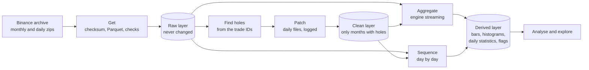
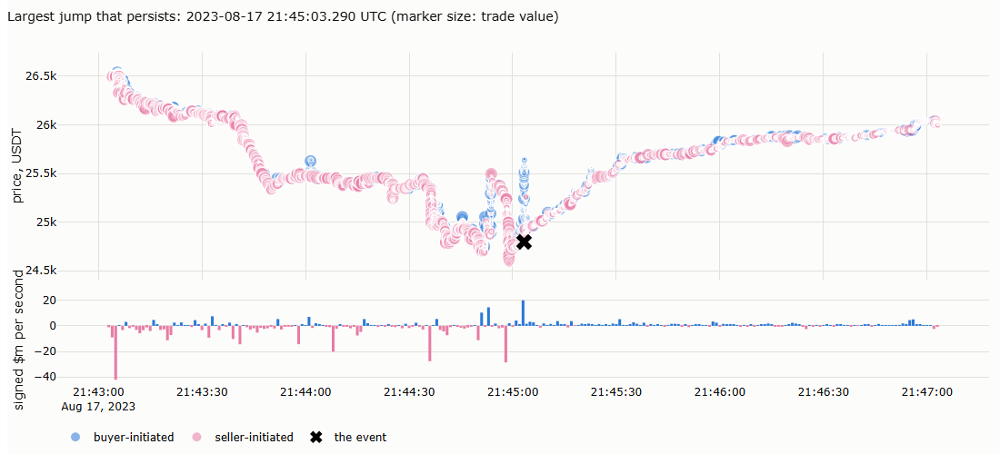
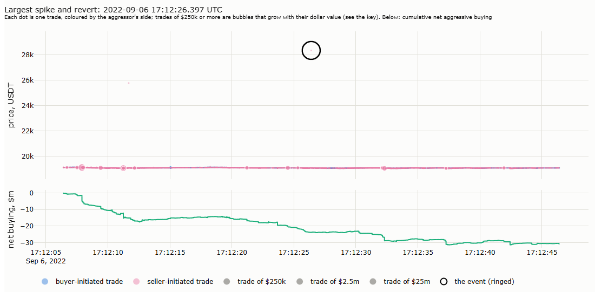
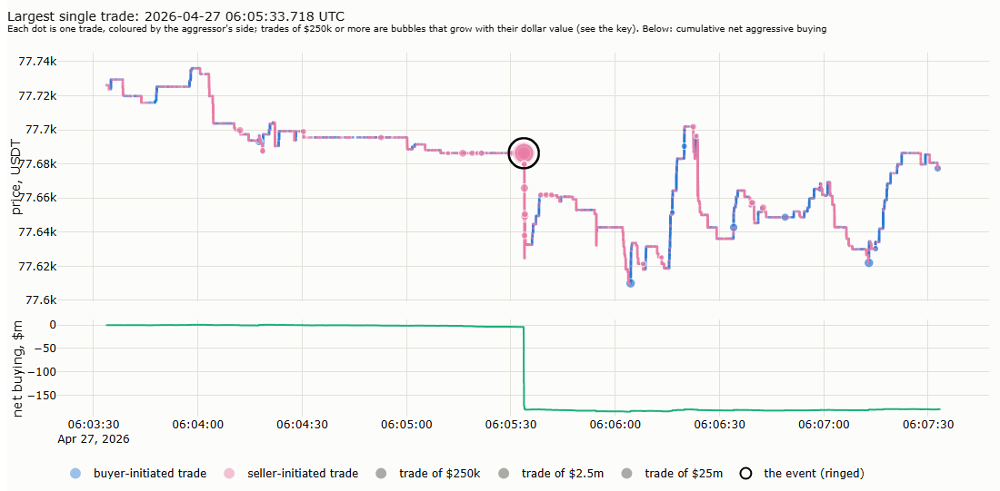
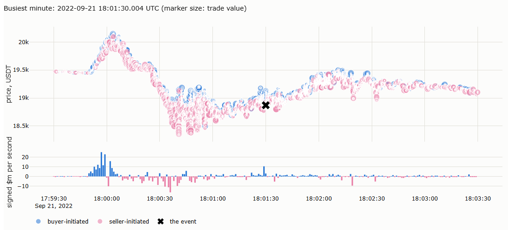
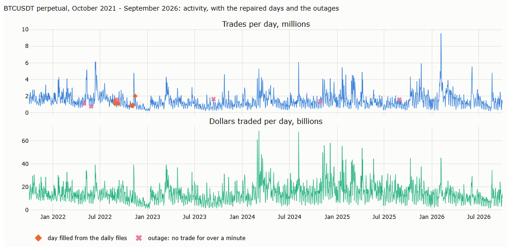

# Lecture 12: Tick Data, the Tape

*Systematic Trading: Lecture Notes (MSc) · Oct 21, 2026 · Max Gnesi*

Parts I and II worked with bars: a day of trading compressed into an open, high, low, close and volume. Part III goes underneath the bar, to the record of every trade, and it works primarily with crypto markets. The choice is practical: the data is complete, free and open every hour of the year, which makes it well suited to teaching. The methods are not specific to crypto; conceptually they apply to the tape of any asset class. This lecture describes that record, which practitioners call the tape: how to get it, what one row of it means, how to check it, and what it shows that a bar cannot. It builds no strategy; Lectures 13 to 17 do. *Draft: written step by step; §1 to §5 so far.*

## 1. The question of this lecture

What does a bar hide, and what does the record of every trade add?

Lecture 2 described a bar as compression: thousands of trades reduced to five numbers. The compression keeps the path's endpoints and extremes and the total volume, and throws away everything else. The tape keeps it all:

| | A daily bar (Lectures 2 to 11) | The tape |
|---|---|---|
| Unit of observation | One day | One trade, or a burst of trades within a tenth of a second |
| Time | The close of the day | The millisecond |
| Price | Four prices: open, high, low, close | Every price traded |
| Size | Total volume | The size of every trade |
| Who traded | Unknown; estimated in Lecture 3 from the bar (on-balance volume, bulk volume classification) | Recorded: whether the buyer or the seller was the aggressor |
| Rows per year, one market | About 250 (futures) or 365 (crypto) | Hundreds of millions |

| Question | Section |
|---|---|
| Where does the data come from, and how is it stored? | §2 |
| What is the instrument? | §3 |
| What does one row mean? | §4 |
| Is the data clean? | §5 |
| What does the tape look like statistically? | §6 |
| What exactly does a bar lose? | §7 |

The market throughout is the **BTCUSDT perpetual** on Binance: the most traded futures contract in crypto, open every hour of the year, with a free and complete public archive.

## 2. Getting the data

### 2.1 What the archive offers

Binance publishes its market data as daily and monthly files at data.binance.vision, free and without an account.

| Market | Data | What a row is | Used in |
|---|---|---|---|
| Spot, USDⓈ-M futures (settled in USDT), COIN-M futures (settled in the coin) | `trades` | One fill between one aggressive and one resting order | Mentioned only |
| | **`aggTrades`** | **All fills within 100 milliseconds at the same price on the same side, combined** | **This lecture and Part III** |
| | `klines` | A candle: open, high, low, close, volume, at intervals from one second to one month | §7, as a check |
| USDⓈ-M futures | `bookTicker` | The best bid and best ask, with their sizes, at every change | Lecture 16 |
| | `fundingRate`, `metrics` | Funding payments; open interest and positioning | §3 |

**Why aggregated trades.** Single fills multiply the number of rows by about 2.7 without adding information a trader can act on: the fills of one burst share a price, a side and a tenth of a second. Aggregated trades are the standard unit for research on the tape.

### 2.2 Step by step

The data are kept on disk as Parquet, a compressed column format, and every monthly file is checked before its download is deleted.

| Step | What | Why |
|---|---|---|
| 1. Download one month | `BTCUSDT-aggTrades-YYYY-MM.zip` from the folder `futures/um/monthly/aggTrades/BTCUSDT/` | Monthly files keep the number of downloads small |
| 2. Verify | Compare the file's SHA-256 hash with the `.CHECKSUM` file published next to it | Detects a broken or incomplete download before anything is built on it |
| 3. Convert | Read the CSV inside the zip with explicit column types and write it as Parquet with zstd compression | A third smaller than the zip, and read in seconds instead of minutes |
| 4. Check the Parquet file | Same number of rows as the CSV; the trade identifiers increase by exactly one from row to row; no timestamp earlier than the one before | Proves the conversion is complete and the month has no missing rows |
| 5. Delete the zip, log the month | Only after step 4 passes; append rows, first and last identifier and timestamp, sizes and the hash to a manifest | Saves disk space; the manifest records what was checked |

Older files have no header row and newer ones do; step 3 has to handle both. Like the futures data of Lecture 11, the files stay local and are never committed or published.

**Sizes.** September 2026 alone has 36.0 million aggregated trades: 437 MB as a zip, 285 MB as Parquet, converted and checked in 77 seconds. The five years from October 2021 to September 2026 come to about 20 GB of Parquet.

### 2.3 Reading the tape with Polars

Five years of tape hold 2.6 billion rows: far more than a computer's memory, and far more than pandas, the library of the earlier notebooks, can handle. Part III uses **Polars**, a DataFrame library like pandas, built for data of this size. It is not a database: the data stay in the Parquet files, and Polars reads them.

The main difference is **when the work happens**. Take the dollar volume of one day, 10 January 2024, from the January file of 57 million trades:

| Step | pandas: **eager**, every line runs at once | Polars: **lazy**, the whole query is written first, then run once |
|---|---|---|
| 1. Open the file | Reads all 57 million rows and all seven columns: several gigabytes | Reads nothing; notes the file |
| 2. Keep 10 January | Keeps 3 million rows; 54 million were read for nothing | Reads nothing; notes the filter |
| 3. Keep the columns needed: time, price and quantity | Already in memory | Reads nothing; notes the columns |
| 4. Sum price × quantity | The answer | Now plans the whole query: reads only that day and those three columns, about 3 million rows, then sums |

Eager code cannot know at step 1 what step 3 will need; lazy code sees the whole query before reading anything. This works because Parquet stores each block's minimum and maximum, so the blocks outside 10 January are never opened. Polars also uses all processor cores, and a streaming mode processes data larger than memory in chunks.

Four operations cover most of Part III:

| Operation | What it does |
|---|---|
| `pl.scan_parquet(files)` | Points at the files without reading them |
| `.filter(...)`, `.select(...)` | Keep only some rows or columns; on a scan, this decides what is read at all |
| `.group_by_dynamic("time", every="1m")` | Builds bars: every trade falls into its minute (or second, hour, day), then is aggregated |
| `.collect()` | Runs the planned query and returns the result |

Daily trade counts and dollar volume for five years, in one pass, without loading the tape into memory:

```python
import polars as pl

tape = pl.scan_parquet("data/raw/binance/um/aggTrades/BTCUSDT/parquet/*.parquet")   # nothing is read yet
daily = (tape.with_columns(pl.from_epoch("transact_time", time_unit="ms").alias("time"))
             .group_by_dynamic("time", every="1d")
             .agg(pl.len().alias("trades"), (pl.col("price") * pl.col("quantity")).sum().alias("usd"))
             .collect(engine="streaming"))                                           # five years, in chunks
```

DuckDB does the same with SQL queries instead of Python, for readers who prefer SQL; this course uses Polars throughout.

**Working with data larger than memory.** Streaming works because the tape can be cut into chunks, processed one at a time, and the partial results combined. That is exact for some statistics and not for others:

| Kind of statistic | Examples | Chunks combine… | What we do |
|---|---|---|---|
| Additive | Counts, sums, dollar volume, buy and sell volume, highest and lowest price, histograms with fixed bins; means and variances, from sums and sums of squares | Exactly: add up the parts | Let the engine chunk: Polars' streaming mode |
| Dependent on neighbouring trades | Returns from trade to trade, time between trades, bars that cross a chunk's edge, rolling windows, the flags of §5 | Exactly, if the last trades of each chunk are carried into the next | Chunk by hand: one day at a time, the last trades carried over |
| Dependent on the whole sample | Median and other quantiles, ranks, "the top 1% of trades", the number of distinct prices | Not by adding: they need all the data at once, a second pass, or an approximation | Exact within a month; across months from a histogram whose bins are about 12% wide, so a quantile is known to within about 12% |

The rule is to let the engine chunk where it can, and to chunk by hand where the statistic needs its neighbours. §2.4 shows where each kind sits in the pipeline.

**Plotting the tape** needs the same care: a chart of 36 million trades overwhelms any plotting library. Most charts in Part III plot aggregates (bars, histograms, profiles), which stay small. Two tools handle the raw trades: **plotly-resampler** shows a thinned line and fetches more detail as one zooms in, from a day down to milliseconds; **Datashader** turns millions of points into an image of their density. §6 and the notebook's explorer use both.

### 2.4 The pipeline

The steps of §2.2 are the first stage of a pipeline that turns the archive into the tables the rest of Part III uses. Each stage reads only the stage before it, so any stage can be rerun alone, and each takes the market and the period as parameters, so the same code serves any symbol.



| Stage | Input → output | How the work is split | Checks and records |
|---|---|---|---|
| Get | Archive zips → raw layer: one Parquet file per month | Blocks of 32 MB while converting | Checksum, row count, ID continuity, time order; one log line per file |
| Find holes | Raw layer → a list of missing and repeated trade IDs | One block of rows at a time, two columns | — |
| Patch | Daily archive files for the days with holes → patch files | One day at a time | Each patch must fill its hole exactly, or is recorded as not filled |
| Clean | Raw month + patches − duplicates → clean month, only where needed | One day at a time | Every later stage reads the clean month if it exists, otherwise the raw month |
| Aggregate | Clean or raw month → counts, volumes, histograms, quantiles | Polars' streaming engine | — |
| Sequence | Clean or raw month → bars, realised variance, durations, flags | One day at a time, with the last trades of each day carried into the next | Flags counted per rule and day; nothing deleted |

Four principles make it repeatable: the raw layer is never changed; every correction is a separate, logged file; every stage can be rerun alone; and memory is bounded by design, one chunk and one job at a time.

**What to expect.** Measured over the five years on a machine with 16 GB of memory and four processor threads:

| Stage | Peak memory, typical / highest | Time per month, typical | Five years |
|---|---|---|---|
| Get | about 2.3 GB | 1–2 minutes, mostly downloading | about 1.5 hours |
| Find holes, patch, clean | 3.2 GB | — | a few minutes |
| Aggregate | 2.5 / 3.1 GB | 5 seconds | 9 minutes |
| Sequence | 1.9 / 3.2 GB | 27 seconds | 31 minutes |

Memory grows with the busiest day and with the number of threads. On a smaller machine, fewer threads (the environment variable `POLARS_MAX_THREADS`) and smaller CSV blocks lower the peak at the cost of time; each stage also waits until enough memory is free before it starts.

## 3. What a perpetual is

A perpetual future is a futures contract that never expires. There is no roll, so none of the machinery of Lecture 11, §3, is needed: one contract, one price series. What replaces expiry is a payment that keeps the contract's price close to the price of the coin itself.

| Element | How it works on the BTCUSDT perpetual |
|---|---|
| Contract | Long or short bitcoin against USDT, quantity in bitcoin; profit in USDT = quantity × price change |
| Index price | A weighted average of the bitcoin price on several spot exchanges: what the contract is meant to track |
| Last price | The price of the latest trade on the contract: what the tape records |
| Mark price | The index price adjusted by a smoothed basis; used to value positions and trigger liquidations, so that one trade cannot force them |
| **Funding** | Every 8 hours, at 00:00, 08:00 and 16:00 UTC, longs pay shorts (or shorts pay longs, if the rate is negative) a percentage of their position. The rate has a fixed interest part of 0.01% per period and a premium part that rises when the contract trades above the index and falls when it trades below |
| Margin and leverage | A position needs only margin, a fraction of its value; leverage of up to 125 times is allowed for small positions, less for large ones |
| **Liquidation** | When losses consume a position's margin, the exchange closes it with a market order |
| Tick and lot | Prices move in steps of $0.10 (since February 2022; $0.01 before), quantities in steps of 0.001 bitcoin; orders must be worth at least $50 |

**Funding is the perpetual's carry.** In Lecture 11 a futures holder earned or paid the roll yield at each roll (§3.6); on a perpetual the same carry is paid continuously, three times a day. Over the five years from October 2021:

| Funding, BTCUSDT perpetual, Oct 2021–Sep 2026 | |
|---|---|
| Payments | 5,478, every 8 hours |
| Average rate per payment | 0.0066% |
| Paid by longs to shorts per year, on average | **7.3%** |
| Share of payments positive | 85% |
| Share of payments at exactly the default 0.01% | 29% |
| Range per payment | −0.12% to +0.09% |

A long position paid about 7% a year for holding bitcoin through the perpetual, about what a holder of crude oil futures lost through its rolls in Lecture 11 (6.9% a year). The sign reflects demand: more traders want to be long with leverage than short, and they pay for it.

**Liquidations are forced trades.** When the price moves fast, positions that run out of margin are closed with market orders, which push the price further and can liquidate the next layer. These are the liquidation cascades of Lecture 5, §3.3: one of the frictions that create persistence, here visible in the tape as bursts of aggressive trades on one side. Lecture 15 studies them.

## 4. What a row represents

### 4.1 An aggregated trade

A trade happens when an aggressive order meets a resting order. The resting order was waiting in the order book at its price: its owner is the **maker**, who supplied liquidity. The aggressive order arrived and crossed the spread to take it: its owner is the **taker**. A large aggressive order can be filled against several resting orders at the same price, and several aggressive orders can arrive within a tenth of a second. On USDⓈ-M futures, Binance combines all fills within 100 milliseconds at the same price on the same side into one aggregated trade.

### 4.2 The seven fields

| Field | Unit | Meaning | What it tells a trader |
|---|---|---|---|
| `agg_trade_id` | Integer | Sequence number of the aggregated trade, increasing by one | Completeness: a gap in the sequence is a missing trade (§5) |
| `price` | USDT per bitcoin | The price at which the fills happened | Every traded price, on the $0.10 grid |
| `quantity` | Bitcoin | The total size of the fills | Size of the move a trader made; in dollars, price × quantity |
| `first_trade_id`, `last_trade_id` | Integer | The first and last single fill inside the aggregate | How many fills it combines: last − first + 1 |
| `transact_time` | Milliseconds since 1 January 1970, UTC | When the matching engine executed the fills | Timing to the millisecond; the gaps between trades (§6) |
| **`is_buyer_maker`** | True or false | **True: the buyer's order was resting, so the seller was the aggressor. False: the buyer was the aggressor** | **Who was in a hurry.** A sell market order hitting the bids is `true`. The name inverts the usual reading, so it is safest to define a sign once: +1 for aggressive buying (`false`), −1 for aggressive selling (`true`) |

The first six rows of September 2026:

| `agg_trade_id` | `price` | `quantity` | `first_trade_id` | `last_trade_id` | `transact_time` | `is_buyer_maker` | Reading |
|---|---|---|---|---|---|---|---|
| 3435054521 | 78549.6 | 0.025 | 8038326171 | 8038326172 | 1788220800003 | false | 3 ms after midnight UTC, a buyer takes 0.025 BTC ($1,964) at the ask, in 2 fills |
| 3435054522 | 78549.5 | 0.016 | 8038326173 | 8038326177 | 1788220800016 | true | 13 ms later, a seller hits the bid 10 cents lower: 5 fills |
| 3435054523 | 78549.5 | 0.003 | 8038326178 | 8038326178 | 1788220800182 | true | Another sell at the bid, one fill |
| 3435054524 | 78549.5 | 0.139 | 8038326179 | 8038326184 | 1788220800566 | true | A larger sell, $10,918, 6 fills |
| 3435054525 | 78549.6 | 0.038 | 8038326185 | 8038326185 | 1788220800595 | false | A buy at the ask again |
| 3435054526 | 78549.5 | 0.097 | 8038326186 | 8038326187 | 1788220800607 | true | A sell at the bid |

The price bounces between 78,549.5 and 78,549.6 as buyers take the ask and sellers hit the bid: the **bid-ask bounce**. Measured from trade to trade, the price seems to move although the market has not; Lecture 3, §4.4 met the same effect as a source of bias in range-based volatility, and §6 measures it.

### 4.3 One month at a glance

| September 2026 | |
|---|---|
| Aggregated trades | 36.0 million, about 14 a second |
| Single fills per aggregated trade | 2.7 on average, up to 2,081 |
| Value of a trade | Median $232, mean $9,532, largest $50 million |
| Value traded | $344 billion |
| Share of trades with an aggressive buyer | 50.0% |
| Price range | $74,909 to $87,385 |

- **Trade sizes are extremely skewed.** The mean is forty times the median: most trades are small, and a few very large ones carry much of the volume. §6 shows the whole distribution.
- **Buying and selling aggression balance over a month**, but not over minutes: Lecture 15 asks whether the imbalance predicts the next move.
- **The aggressor flag is the order flow that Lecture 3, §7, could only estimate.** On-balance volume assigned a whole day's volume to buyers or sellers by the sign of the close-to-close change; bulk volume classification split it by the size of the move. Here every trade is labelled, and §7 compares the estimates with the truth.

*Next: §5, a data quality scan over five years.*

## 5. Inspecting the data

### 5.1 The process

Five years of tape cannot be checked by eye. The inspection is a process with fixed steps, applied to every month:

| Step | What it does | Why |
|---|---|---|
| 1. Check on arrival | Checksum, row count, ID continuity, time order (§2.2) | Catches broken downloads and gaps at once |
| 2. Find holes | Lists every jump and every repeat in the trade IDs across all files | Locates missing and duplicated data exactly |
| 3. Fix from a second source | Fills holes from the daily files; each patch must close its hole exactly | A fix that cannot be verified is not a fix |
| 4. Flag | Runs a fixed set of rules on every day and records every hit: rule, time, size | Turns "look at the data" into a list that can be worked through |
| 5. Inspect the flags | Tests what each kind of flag really is, and whether the rule itself is right | A flag is a question, not a verdict |
| 6. Record what remains | States every hole that could not be filled and every flag left unexplained | Every later analysis knows what it rests on |

Nothing is deleted at any step. A trade in the exchange's own record almost certainly happened, even when it looks strange; the flags describe it, and each analysis states which flagged trades it uses. The literature on high-frequency data applies the same principles to stock-market data, where the failure modes differ: trades from many exchanges, condition codes, corrections (Brownlees and Gallo, 2006; Barndorff-Nielsen, Hansen, Lunde and Shephard, 2009; Dacorogna et al., 2001). On a single crypto exchange the failure modes are the archive's own.

### 5.2 What the inspection found

| Issue | How it was detected | What was done |
|---|---|---|
| **Eight days missing** from Binance's monthly files: 28–30 August, 1 and 10 September, 29 October, 7 and 14 November 2022 | Jumps of 0.8 to 4.0 million in the trade IDs; days with no trades at all | Filled from Binance's daily files. Each patch closes its hole exactly: for 28–30 August, 1,065,533 + 1,407,753 + 1,504,285 = 3,977,571 trades, the size of the jump |
| **Two days duplicated**: 12 and 13 September 2022 appear twice in the monthly file | Trade IDs repeating instead of rising | Each trade kept once in the clean month |
| **Six minutes missing from the whole archive**: 6 September 2022, 17:14–17:20 UTC, about 31,600 trades | A jump in the IDs that the daily file has too | Cannot be filled; flagged, and left out by every analysis that needs a complete day |
| **Exchange outages**: seven silences of more than a minute, the longest 35 minutes (28 May 2022) | No trade for over 60 seconds | Recorded; these are times when nobody could trade |
| **The tick changed** from $0.01 to $0.10 on 15 February 2022, between 00:00 and 06:00 UTC | 81% of prices off the $0.10 grid before, under 2% after, within hours | The grid check uses the tick in force at each trade |
| **Prices off the tick grid after the change**: about 294,000 trades, fading until September 2024 | Prices not a multiple of $0.10 | Kept. Real trades: each single fill in Binance's raw trade file has the same price. The rule itself was checked (exactly two decimals, every last digit from 1 to 9 represented). They form ladders of orders, for example 0.003 bitcoin every 0.0808% below $57,086.83: the fingerprint of a grid-trading bot. How orders at two decimals could still be placed after the change is not documented; it is an open question |
| **Fill numbers skipped**: about 0.3% of the single-fill numbers never appear | The first fill of a trade does not follow the last fill of the one before | Not missing data: Binance's own raw trade file skips the same numbers. The aggregated tape contains every published fill |

### 5.3 The flag register in numbers

Over five years, 2.6 billion trades on 1,826 days:

| Flag | Rule | Kind | Count | Days |
|---|---|---|---|---|
| Missing trades | Trade IDs jump by more than one | Error | 2 gaps (the six unfillable minutes) | 1 |
| Silence | No trade for more than 60 seconds | Check | 7 | 6 |
| Fill numbers skipped | A trade's first fill does not follow the previous trade's last fill | Check | 3.4 million numbers | every day |
| Unusual print, reverting | At least 0.5% from the median of the 50 trades before it, and more than ten of their standard deviations; the next trades return | Check | 456 | 118 |
| Unusual print, persisting | The same distance, but the price stays | Event | 1,597 | 187 |
| Off the tick grid | Price not a multiple of the tick in force | Event | 294,288 | 767 |
| Quantity off the lot step | Quantity not a multiple of 0.001 bitcoin | Error | 0 | 0 |
| Very large trade | Over $5 million | Event | 42,014 | 1,753 |
| Activity burst | A minute with more than 20 times the day's median number of trades | Event | 3,195 minutes | 929 |

The days with the most unusual prints are recognisable: 21 September 2022, when the Federal Reserve raised rates by 0.75 points; 13 September and 13 October 2022, US inflation releases; 4 December 2021, a weekend crash; 10 October 2025, a day of record liquidations. A rule that singles out these days is measuring stress, not noise.

**A rule must be tested too.** The first version of the unusual-print rule measured distance only in local standard deviations. In a quiet moment, when the last 50 trades were all at the same price, that deviation is close to zero and a one-tick move counts as extreme: the rule flagged 109,000 trades, almost all of them trivial. Adding a minimum distance in price, 0.5%, is the "granularity" term of Brownlees and Gallo (2006); with it, the rule flags 2,053 trades, concentrated on the days above.

### 5.4 Unusual prints, tested

A flagged trade can be a fast market, a poor execution in a thin book, or an error. Four tests on the tape alone tell them apart:

| Test | Error | Genuine fast market |
|---|---|---|
| Persistence: where is the price a few trades later? | Back where it was | Near the new level, or further |
| Path: were the prices in between traded? | One isolated jump | The price walks through the levels |
| Participation: how much trading surrounds it? | One trade, often small | Many trades, real volume |
| Order flow: does the side fit the move? | Random | Aggressive selling on the way down, buying on the way up |

Comparing with Binance's published candles, with other exchanges or with news would add evidence; this lecture uses the tape alone. The largest persisting and the largest reverting print of the five years:





| | 17 August 2023, 21:45:03 UTC | 6 September 2022, 17:12:26 UTC |
|---|---|---|
| The print | $24,800, 3.1% below the median of the trades before it | $28,368.26, 48% above a market at about $19,100, at a two-decimal price |
| Persistence | 98% of the fall still there ten trades later; recovered, and more, within a minute | Gone at once |
| Path | A gap of 2.3% between two consecutive trades | Nothing traded in between |
| Participation | 26 times the usual number of trades, 33 times the dollars | 14 times the usual trades |
| Order flow | Mixed: 46% of aggressive volume in the direction of the fall | Mostly against the move: 29% |
| Reading | A flash crash through an empty book: forced selling gapped the price down, then it snapped back. Real trades, at prices that existed for a few seconds | The closest to an erroneous print in five years: isolated, far away, instantly reversed, and two minutes before the six minutes missing from Binance's own archive. Consistent with a malfunction just before an outage; not documented |

**Neither is deleted.** The first is the market; the second is in the exchange's record and stays there, with its flag. Every analysis uses all trades. Prints flagged as reverting are marked as outliers, not removed: where a measure reacts strongly to a single extreme, such as the highest and lowest price of a bar or realised variance, the result is shown with the outliers marked, so the reader can see how much they move it.

Two other flags are extreme without being suspicious, and they show what the tape looks like at its limits:





| | Largest single trade: 27 April 2026, 06:05:33 UTC | Busiest minute: 21 September 2022, 18:01 UTC |
|---|---|---|
| What happened | $118.9 million at one price, $77,686.50 | 62 times the day's usual pace of trades, 18 times the dollars |
| Price | Did not move: every fill at the same price | Moved with the flow: 68% of aggressive volume in the direction of the move |
| Context | Only three times the usual number of trades around it, but 60 times the dollars: one order, not a crowd | The first minute after the Federal Reserve announced its 0.75-point rate rise at 18:00 UTC |
| Reading | A large order met by resting orders at a single level; nothing to correct | The market absorbing news; the burst flag marks it, nothing to correct |

### 5.5 Activity over five years



| | Trades per day | Dollars per day |
|---|---|---|
| Median | 1.3 million | $13.0 billion |
| Busiest | 9.5 million | $68.8 billion (5 March 2024) |
| Quietest | 189,000 (7 January 2023) | |
| Average by year | 1.1 million (2023) to 1.6 million (2021, 2026) | $11.5 billion (2023) to $17.8 billion (2024) |

Activity moves in regimes: quieter in 2023, at its peak in dollars in 2024. The number of trades and the dollars traded do not move together: in 2026 there are as many trades as in 2021 but fewer dollars, so the average trade is smaller. A bar that closes after a fixed number of trades or dollars therefore means something different in different years, which Lecture 13 takes up.

## References

- Binance. USDⓈ-M futures API documentation: compressed aggregate trades list; exchange information; funding rate history. — definitions and contract terms (§2–§4).
- Barndorff-Nielsen, O. E., Hansen, P. R., Lunde, A. and Shephard, N. (2009). Realized kernels in practice: trades and quotes. *Econometrics Journal* 12(3), C1–C32. — cleaning rules for high-frequency data (§5).
- Brownlees, C. T. and Gallo, G. M. (2006). Financial econometric analysis at ultra-high frequency: data handling concerns. *Computational Statistics & Data Analysis* 51(4), 2232–2245. — outlier detection with a granularity term (§5).
- Dacorogna, M. M., Gençay, R., Müller, U. A., Olsen, R. B. and Pictet, O. V. (2001). *An Introduction to High-Frequency Finance*. Academic Press, chapter "Adaptive data cleaning". — filtering as a process (§5).
