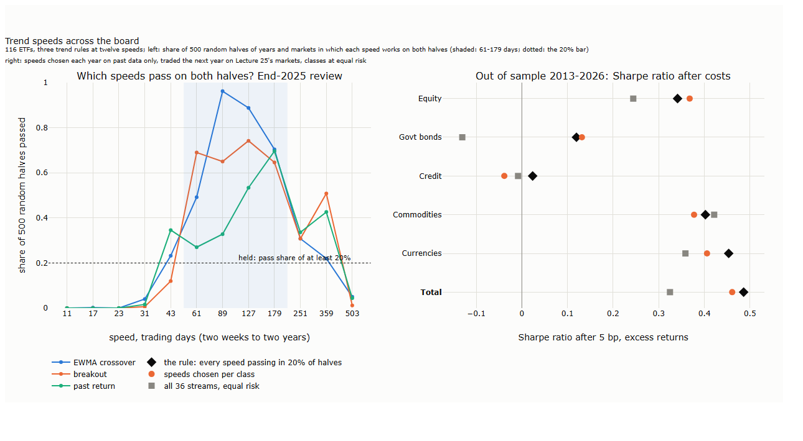
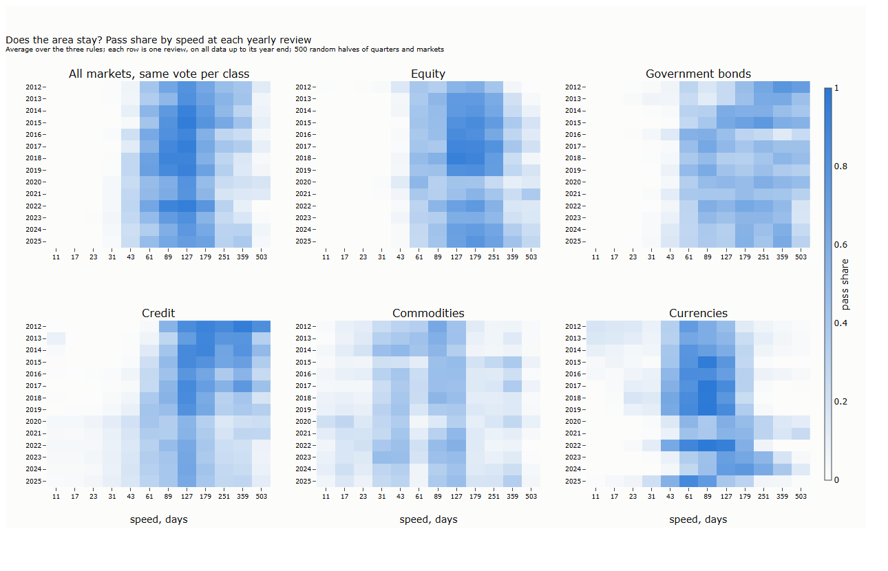
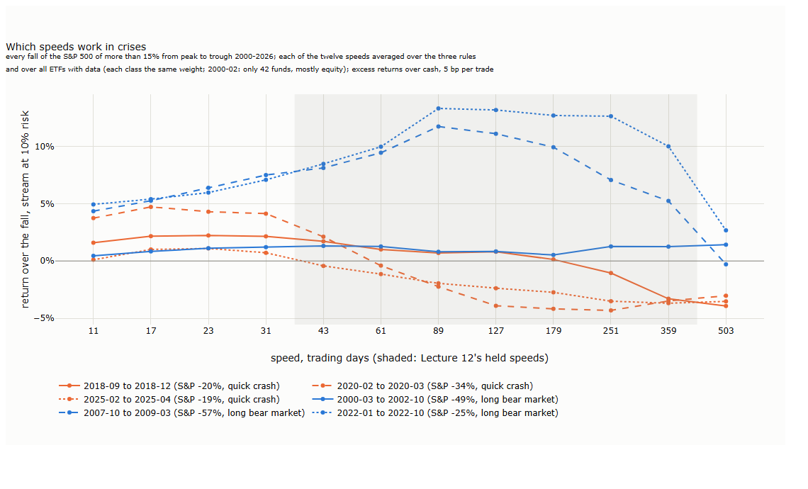

# Lecture 12: Portfolio Construction 2: Trend Speeds That Work Across the Board

> Choose the speeds of the trend rules so that they work on all asset classes and their markets, and judge the choice on years it never saw.

Part II · Pipeline stage: signal generation at portfolio scale (the speeds)

---

# Speeds that work across the board

> Speeds of three to nine months pass in most random halves; chosen each year on past data only, they beat holding all 36 streams out of sample (0.49 against 0.32).

- Two to five weeks almost never pass: they trade too often
- Beyond a year the pass share falls but does not vanish
- Choosing per asset class did not do better (0.46)

---

# Overfitting has two parts

> Dependence on the sample can be measured in advance; a future unlike the past cannot.

| | Measurable in advance? | What we do about it |
|---|---|---|
| **Dependence on the sample** | Yes: rerun the choice on other slices of the same past | Keep only what holds on most slices |
| **A future unlike the past** | No | Prefer choices with a mechanism; review every year; judge out of sample |

- Moving away from today's best speed has an expected gain of zero against an unknown future
- Spreading over a region only narrows the spread of outcomes
- Each market's best speed rests on the least evidence; one set for all classes rests on all of it

---

# The streams: three rules at twelve speeds

> 36 streams per market: three trend rules from Lecture 6 at twelve speeds from two weeks to two years, each about 1.4 times the one before.

| Rule | At speed h |
|---|---|
| EWMA crossover | Sign of the average of the log price with span h/4 minus that with span h |
| Breakout | Long after a new h-day high, short after a new h-day low, flat after crossing back over the h/2-day channel |
| Past return | Sign of the h-day return |

- Speeds of 11, 17, 23, 31, 43, 61, 89, 127, 179, 251, 359 and 503 trading days, each a prime number
- Spaced by ratio first, made of primes second: away from the crowd's round lookbacks

---

# Returns over cash

> The account earns the cash rate once, plus each position times its return over cash; on total returns, a levered bond position collects interest on money it never paid for.

$$r_{\text{account}} = r_f + \sum_i w_i\,(\mathrm{TR}_i - r_f)$$

- Government bond streams at 89 days: Sharpe ratio 0.60 on total returns, 0.28 over cash
- Position: the rule's sign times 10% divided by six-month volatility
- Each day, close a tenth of the gap to the target; 5 bp of the value traded

---

# Why fast speeds fail: costs

> On IEF the fastest crossover earned as much before costs as the slow speeds; costs of 5 bp took 1.5% a year.

| EWMA crossover on IEF, 2007-2026 | Sharpe ratio before costs | Costs, % a year | Sharpe ratio after costs |
|---|---|---|---|
| 11 days | 0.32 | 1.5 | 0.08 |
| 89 days | 0.30 | 0.5 | 0.25 |
| 251 days | 0.31 | 0.2 | 0.29 |

The fast speeds' failure here is a matter of cost, not of an absence of trend.

---

# The rule

> For all markets at once, 500 times, split the years and the markets at random into two halves, and hold, with equal risk, every speed that works on both halves in at least 20% of the splits.

| Term | Meaning |
|---|---|
| Half | A random half of the quarters of the past and a random half of the markets |
| Works | Sharpe ratio after costs in the top half of the 36 streams |
| Vote | Each asset class the same total weight; within a class, by the log of dollar volume |
| Passes | Works on the half where it is found and on the other half too |
| Held | Passes in at least 20% of the 500 splits |

A speed that worked because of one crisis, or in one market, passes only when that crisis or market falls on both sides, which happens rarely.

---

# Markets that disagree

> SPY's trend paid best at the slowest speeds, Europe's only at medium speeds; the rule holds both regions without knowing in advance which market favours which.

| EWMA crossover, 2007-2026 | 61 days | 359 days | The rule's blend |
|---|---|---|---|
| SPY | 0.18 | 0.56 | 0.37 |
| EFA | 0.16 | −0.12 | 0.03 |

- The rule holds every EWMA speed from 43 to 359 days
- On each market alone the blend earns less than its best speed in hindsight: the price of not knowing in advance

---

# The areas, and whether they stay

> The rule holds 16 to 20 of the 36 streams at each review; thirteen are held at every review from 2012 to 2025.

- Nothing faster than 43 days is ever held
- Bonds and credit lean slower, currencies and commodities faster
- 82% to 100% kept from one year to the next

---

# Super-long speeds in US equity are drift

> At 503 days SPY's crossover was long on 90% of the days and close to buying and holding it; outside the US the same speeds lost.

| Sharpe ratio, 2007-2026 | |
|---|---|
| SPY, EWMA crossover at 503 days | 0.56 |
| SPY, buying and holding | 0.54 |
| EFA, at 503 days | −0.13 |
| EEM, at 503 days | −0.39 |
| VGK, at 503 days | −0.10 |

- A trend follower who wants US equity's drift should hold it as a deliberate long bias
- Adding slow speeds for a scenario we cannot foresee is a bet with no expected gain, not insurance

---

# Out of sample, 2013-2026

> Choosing helps by leaving out what fails; choosing per class or the fine details of the rule add nothing measurable on our data.

| Version | Total Sharpe ratio | The rule minus this (90% band) |
|---|---|---|
| **The rule** | **0.49** | — |
| Weighted by pass share | 0.48 | +0.00 (−0.02 to +0.03) |
| Speeds chosen per class | 0.46 | +0.03 (−0.05 to +0.09) |
| Union (passes at least once) | 0.46 | +0.03 (−0.03 to +0.08) |
| All 36 streams, equal risk | 0.32 | **+0.16 (+0.03 to +0.29)** |

- In government bonds all 36 streams lost (−0.13) while the rule earned 0.12
- A benefit of choosing per class below about 0.1 in Sharpe ratio cannot be detected here

---

# Framework choices matter more than they look

> Returns over cash, not total returns; volatility over months, not weeks.

- Volatility over 36 days, each stream's own speed or six months: 0.47, 0.50 and 0.49
- In early 2026 the 36-day version held HYG at three to five times its value and lost about 11% in a year
- Credit earned least (0.02): a credit fund's rise is mostly coupon income, which a trend rule gives back when it is short
- A future unlike the past remains: the yearly review follows a change after it shows but does not foresee it

---

# Static or dynamic speeds?

> The rule holds one set of speeds for a year; no dynamic choice beat it out of sample on our data.

- **Momentum** (recent best): −0.06 to −0.11
- **Reversal** (recent worst): +0.03 to +0.05, no mechanism
- **Market state:** failed on the futures
- **Crises:** no speed passed; quick crashes and long bear markets need opposite speeds

---

# Takeaways

1. **Overfitting has two parts:** dependence on the sample can be measured in advance; a future unlike the past cannot
2. **One rule, one sentence:** a region of speeds chosen on 500 random halves, not a point
3. **Medium speeds work across the board:** three to nine months pass; two to five weeks never do, because costs eat them
4. **Super-long speeds in US equity are drift, not timing:** they fail where markets drifted less
5. **Choosing helps by leaving out what fails:** per class or the fine details add nothing measurable
6. **Framework choices matter more than they look:** returns over cash; volatility over months, not weeks
7. **Static beat dynamic:** timing the speeds and crisis speeds did not beat holding the region

> Hold every speed that works on one random half of years and markets and still works on the other, in at least 20% of 500 splits.
