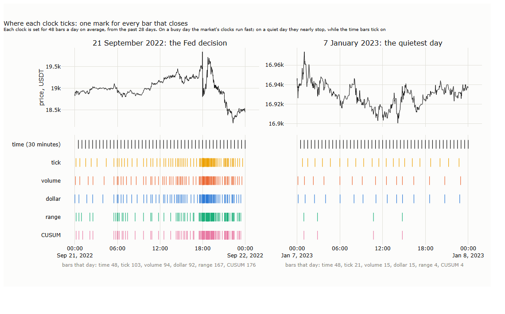
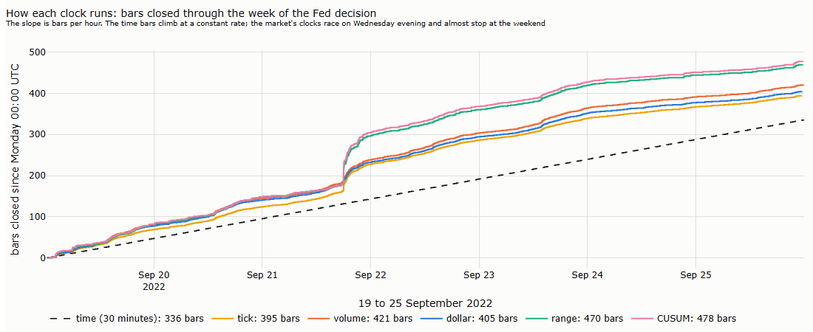
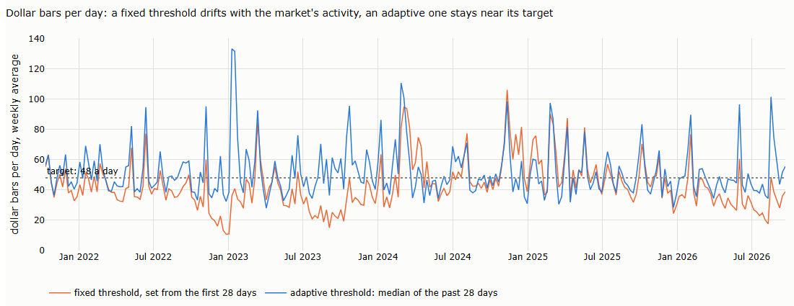
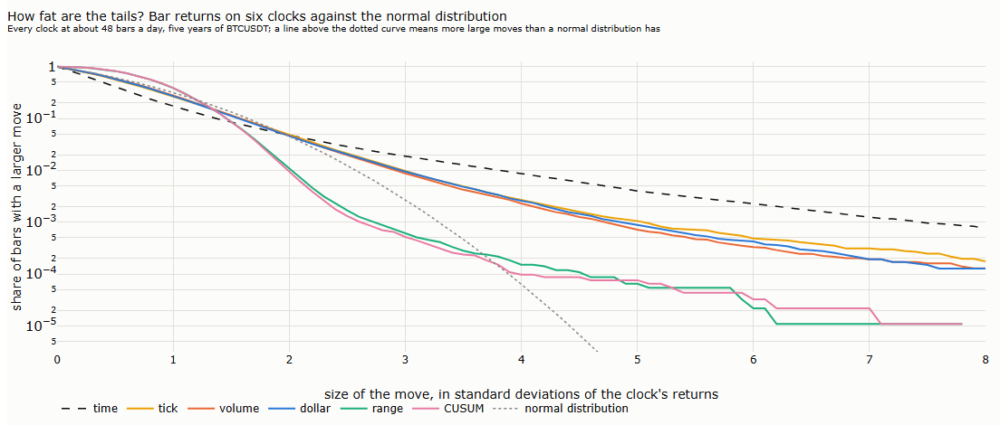

# Lecture 13: When the Market Trades: Clocks and Seasonality

*Systematic Trading: Lecture Notes (MSc) · Oct 21, 2026 · Max Gnesi*

Every bar so far closed on the clock: at the end of a day in Parts I and II, at the end of a minute in Lecture 12. This lecture asks when the market trades. It builds bars that close after a fixed amount of trading, of one-sided pressure, or of price movement, from the same five years of BTCUSDT trades as Lecture 12, and asks whether they describe the market better; then it maps the market's rhythms: the time of day, the week, the round clock times and the scheduled events. The two halves belong together: the market's clocks take the rhythm out of the bars, while seasonality maps that rhythm in calendar time, where orders are placed. It covers the first and fourth of Part III's six uses of the tape (the course guide, §1.1b): a clock, and seasonality.

## 1. Which clock should a bar follow?

Every bar closes when a counter reaches a threshold. For a one-hour bar the counter is seconds, and the threshold is 3,600. The counter can be anything that rises as the market trades: the number of trades, the dollars traded, the distance the price has moved. This counter is the bar's **clock**, and the literature uses the word in exactly this sense: business or intrinsic time (Mandelbrot and Taylor, 1967; Dacorogna et al., 2001), the transaction clock (Ané and Geman, 2000), the volume clock (Easley, López de Prado and O'Hara, 2012). A dollar bar follows a clock, one that counts dollars instead of seconds.

**Why change the clock.** Lecture 12 found the market's activity very uneven: the busiest hour of the day trades three times as much as the quietest, a weekend day half as much as a weekday, and 1% of the minutes hold a third of five years' variance (Lecture 12, §6.2 and §7.3). A one-minute bar at 4 a.m. and a one-minute bar after a Federal Reserve decision measure very different amounts of market. Volatility follows the number of trades, not the passing of time: the number of trades explains 85% of the variation in hourly variance (Lecture 12, §7.3). A bar that closes after a fixed amount of trading should therefore hold a more constant amount of information.

**The hypothesis, and its limits.** If prices move in trading time rather than in calendar time, returns measured on a trading clock should be closer to the normal distribution, with thinner tails and steadier volatility from bar to bar (Clark, 1973; Ané and Geman, 2000). The claim is contested: on stock data, the normality of returns on a transaction clock does not hold as cleanly as first reported (Murphy and Izzeldin, 2005). This lecture tests it on our data.

| § | Step | Question |
|---|---|---|
| 2 | The four families | Which clocks are there, and what is each one for? |
| 3 | Building bars from the tape | How is each bar type cut, and how is its threshold set? |
| 4 | Do they differ? | Do different clocks close their bars in the same hours? |
| 5 | Are returns closer to normal? | Tails, volatility clustering and autocorrelation, bar type by bar type |
| 6 | Imbalance bars, two versions | Does the published construction behave well on our data? *(deep dive)* |
| 7 | Seasonality | When does the market trade: the time of day, the week, the round clock times, scheduled events, and how they have changed? |
| 8 | For the two examples | What the trend rule (Lecture 16) and the grid (Lecture 17) take from this lecture |

**Data.** The derived layer of Lecture 12: BTCUSDT perpetual on Binance, October 2021 to September 2026, 2.6 billion trades, checked and patched (Lecture 12, §5). The bars are built with the same day-by-day machinery (Lecture 12, Appendix A).

## 2. The four families

The clocks fall into four families, by what their counter measures.

| Family | The counter, the bar's clock | A bar closes when… | Examples |
|---|---|---|---|
| **Time** | Seconds | a fixed time has passed | One-minute, one-hour, daily bars |
| **Activity** | Trades, coins or dollars | a fixed amount of trading has happened | Tick, volume and dollar bars |
| **Information** | One-sided trading | buying or selling has become more one-sided than usual | Imbalance and run bars |
| **Price** | Price movement | the price has moved a fixed distance | Range bars, Renko bricks, the CUSUM filter |

Every family still produces bars with an open, high, low, close and volume: what changes is only when a bar ends (Lecture 12, §8).

### 2.1 Time

Time bars are the benchmark. They are simple, every data vendor supplies them, and returns over equal times are directly comparable: a daily volatility can be annualised, and two markets' bars close at the same moments. Their weakness is the one of §1: a fixed time holds a variable amount of trading, little at night and very much after a central-bank decision.

### 2.2 Activity: tick, volume and dollar bars

| Bar | Closes after | Strength | Weakness |
|---|---|---|---|
| **Tick** | a fixed number of trades | Follows activity automatically; the number of trades is what volatility follows (Lecture 12, §7.3) | What counts as one trade depends on the data: Binance's aggregated tape has 2.5 times fewer rows than its file of single fills (Lecture 12, §8.1), and an order split into pieces counts many times |
| **Volume** | a fixed number of coins | Not changed by splitting an order | The same number of coins is worth very different amounts over time: one bitcoin cost about $20,000 in 2022 and over $100,000 in 2025 |
| **Dollar** | a fixed amount of money | Each bar is the same amount of economic activity, whatever the price | The amount of trading itself drifts: on average, $11.5 billion a day in 2023 and $17.8 billion in 2024 (Lecture 12, §6.1). A fixed threshold gives far fewer bars in a quiet year; §3 sets it from the recent past instead |

Dollar bars are the natural representative of the family, and the one López de Prado (2018, ch. 2) recommends: they measure activity in the unit a trader cares about.

### 2.3 Information: imbalance and run bars

Information bars close when the order flow becomes more one-sided than usual, using the aggressor flag of each trade (Lecture 12, §3.2), which candles do not have (Lecture 12, §8.3).

| Bar | Closes when | What it aims to catch |
|---|---|---|
| **Imbalance** | the running sum of buys minus sells, in trades, coins or dollars, exceeds what is normally seen | The moments when one side takes over: informed trading, forced liquidations |
| **Run** | the longest sequence of trades on one side exceeds what is normally seen | A large order executed in many small pieces, all on the same side (Lecture 12, §7.1) |

Both are defined by López de Prado (2018, ch. 2), with thresholds estimated from past bars. The idea is attractive, since one-sided flow is exactly what moves prices (Lecture 12, §6.5), but the construction has two known weaknesses: the threshold depends on the bars it produces, which can make bar sizes run away, and it falls to almost nothing when buying and selling are balanced. §6 builds the published version and a stabilised one side by side, on our data.

### 2.4 Price: range bars, Renko and the CUSUM filter

| Bar | Closes when | What it aims to catch | Weakness |
|---|---|---|---|
| **Range** | the high and low of the bar are a fixed distance apart | Every bar holds the same price movement, so a trend rule sees moves, not minutes | The number of bars explodes in volatile markets; the high and low carry no information, being fixed; a gap, like the 2.3% jump of the flash crash in Lecture 12, §5.4, overshoots the bar |
| **Renko** | the price has moved a fixed distance beyond the last brick; a reversal needs twice that | A trend-following picture: small back-and-forth moves draw nothing | Discards time and volume; reversals are recognised late; a brick's price is not a traded price, an easy source of optimistic backtests |
| **CUSUM filter** | the cumulative movement of the price since the last event exceeds a threshold, in either direction (Page, 1954) | Not a bar but a trigger for *when to look*: a strategy evaluates its signal only after a real move | The threshold decides everything; events cluster in stress |

The CUSUM filter is a sampling rule rather than a bar, and López de Prado (2018, ch. 2) uses it to decide when a strategy should take a decision at all: fewer decisions, made after real moves, mean less turnover and lower costs. It belongs here because it is a clock that ticks only when the price moves.

### 2.5 What every clock shares

Three rules apply to every family, and to every later lecture that uses these bars:

| Rule | Why |
|---|---|
| A bar is known only when it closes, at the trade that crosses the threshold | Its close is a trade that has already happened; an order sent on it fills at a later trade, on its own side (Lecture 12, §9.2) |
| Thresholds use past data only | A threshold set from the whole sample tells each bar how much trading lies ahead |
| Bar types are compared at the same number of bars per day | A clock that closes more often looks smoother only because it is finer; equal frequency is the bar equivalent of equal speed in Lecture 7 |

From each family the lecture builds one representative, plus time bars as the benchmark: **dollar bars** for activity, **dollar-imbalance bars** for information (in both versions of §6), **range bars** for price, and the **CUSUM filter** as a sampling rule. Tick and volume bars are built too, briefly, to show why dollar bars are preferred.

## 3. Building bars from the tape

Every clock is built by one rule: a counter runs through the trades, and a bar closes at the trade that takes it past a threshold. What differs from clock to clock is the counter and the threshold.

### 3.1 One rule for every clock

| Clock | The counter | The threshold on day *t* |
|---|---|---|
| Time | Seconds | 30 minutes |
| Tick | Trades | Median number of trades per day over days *t*−28 to *t*−1, divided by 48 |
| Volume | Bitcoin traded | The same, for bitcoin |
| Dollar | Dollars traded | The same, for dollars |
| Range | High minus low of the bar, in log price | A fixed multiple of the typical daily volatility over days *t*−28 to *t*−1, divided by √48 |
| CUSUM | The cumulative move since the last event, up or down (Page, 1954) | The same form as for range bars |

*48 bars a day is the target for every clock: the number of 30-minute bars in a day, so that all clocks are compared at the same frequency (§2.5).*

Three choices are common to all of them:

- **The threshold uses past data only.** It is set each day from the 28 days before, so no bar knows how much trading lies ahead. A fixed threshold would drift with the market's activity, as §3.4 shows.
- **A bar does not break at midnight.** The trades of the unfinished last bar of a day are carried into the next.
- **The two price clocks are scaled once, to the same frequency.** The multiple in their thresholds is set on one month, March 2024, so that they produce as many bars as the dollar clock that month, and never changed. It equalises frequency, as the comparison requires; nothing is chosen for performance.

Over the five years, the six clocks produce:

| Clock | Time | Tick | Volume | Dollar | Range | CUSUM |
|---|---|---|---|---|---|---|
| Bars per day, on average | 48.0 | 53.2 | 51.5 | 51.6 | 51.4 | 51.2 |

The market's clocks run slightly above the target of 48. The threshold divides the *median* day's activity by 48, but bars accumulate on every day, and a few very busy days lift the average above the median. The difference is the same for all of them, so the comparison stays fair.

### 3.2 Where each clock ticks

| Bars that day | Time | Tick | Volume | Dollar | Range | CUSUM |
|---|---|---|---|---|---|---|
| 21 September 2022, the Fed decision | 48 | 103 | 94 | 92 | 148 | 156 |
| 7 January 2023, the quietest day | 48 | 21 | 15 | 15 | 5 | 5 |

Time bars tick on regardless. The market's clocks run twice as fast as usual on the busiest day and at a third of the usual pace on the quietest: they follow the market. The activity clocks (tick, volume, dollar) bunch where trading is heavy, around the decision at 18:00 UTC; the price clocks (range, CUSUM) bunch where the price moves, and almost stop on a day when it barely moves at all.

### 3.3 How each clock runs

The slope of each line is the number of bars per hour. The time bars climb at a constant rate, 336 in the week. The market's clocks keep pace on quiet days, jump at the Fed decision on Wednesday evening, and slow at the weekend: 395 to 478 bars in the same week. A clock that follows the market is a clock that changes speed.

### 3.4 Thresholds from the past

| Dollar bars per day | 2021 | 2022 | 2023 | 2024 | 2025 | 2026 |
|---|---|---|---|---|---|---|
| Fixed threshold | 44.7 | 38.8 | 34.9 | 53.6 | 50.6 | 35.4 |
| Adaptive threshold | 49.3 | 50.1 | 55.0 | 53.0 | 50.1 | 50.1 |

*A fixed threshold is set once, from the first 28 days. 2021 covers October to December.*

A fixed threshold makes a bar mean something different each year: in the quiet year 2023 it produces a third fewer bars than in 2024. The adaptive threshold keeps the number of bars near its target in every year: about three weeks in four lie within 25% of it, against half the weeks with the fixed threshold. It is not perfect: when activity jumps faster than a 28-day median can follow, as after the quiet holidays of early 2023, the number of bars spikes for a few weeks before the threshold catches up.

**Is 28 days a lucky choice?** A setting that works only at one value is a fitted parameter, not a method (Lecture 7, §5). The same measure for three windows:

| Window of the adaptive threshold | 14 days | 28 days | 56 days |
|---|---|---|---|
| Weeks within 25% of the target | 74% | 74% | 65% |

Fourteen and 28 days are equally good; 56 days follows changes in activity too slowly. Any window from two to four weeks works; 28 days, four whole weeks, contains every weekday equally often.

### 3.5 A price clock needs a price

The first version of the range clock read every trade, and on the day of the Fed decision it produced over a thousand bars in the ten minutes after 18:00. The trades were real; the clock was not measuring what it should.

**Example: one second after the decision.** In the second 18:00:02 UTC on 21 September 2022, 1,846 trades took place at 1,253 different prices, the price swinging between about $19,880 and $20,120. At 18:00:02.805, a single sell order filled at 49 prices, from $20,090 down to $19,880, 1% of the price, in one millisecond; moments later buy orders swept it back. A clock that reads every fill counts each of these sweeps as a move of 1%.

The Fed decision was not the most extreme moment. Among the 20 days with the largest one-minute price ranges of the five years, the busiest second was 18:39:03 UTC on 28 October 2021: 7,990 trades at 6,913 different prices. The largest single sweep came in the crash of 10 October 2025.

**Example: the bottom of 10 October 2025.** That day, after the US announced new tariffs on imports from China, crypto markets saw the largest liquidations on record, about $19 billion within a day, as reported from Bloomberg data (Business Today, 2025). On BTCUSDT the price fell from $122,497 to $101,517, 17%, reaching its low at 21:20:08 UTC; the day traded $45 billion, more than twice the days either side. Two seconds after the low, at 21:20:10.325, a single buy order took 326 bitcoin, $33.7 million, filling at 407 prices from $101,881 to $104,750: 2.8% in one millisecond, about $83,000 at each price. A second later the price was back at $101,697, just above the low; then it turned, to $106,016 ten seconds later and $109,314 ten minutes later. Whether the order was a buyer stepping in or a forced closing of short positions, the tape does not say, since it does not mark liquidations. It shows a book so thin that one order moved the price by almost 3%, within seconds of the day's low.

*Deep dive: can be skipped on a first reading.*

**The most extreme days.** The ten days with the largest price range within one minute, with the busiest second of each:

| Day | Largest range in one minute | Busiest second (UTC) | Trades in that second | Different prices |
|---|---|---|---|---|
| 6 September 2022 | 48.8% | 17:05:31 | 2,065 | 1,634 |
| 21 September 2022 | 9.9% | 18:00:40 | 5,072 | 4,003 |
| 4 December 2021 | 9.3% | 05:27:49 | 1,872 | 1,538 |
| 10 October 2025 | 7.2% | 21:43:49 | 3,569 | 2,831 |
| 5 December 2024 | 6.7% | 22:28:15 | 3,971 | 3,428 |
| 23 October 2023 | 6.3% | 18:44:39 | 3,520 | 2,897 |
| 8 November 2022 | 6.0% | 16:32:43 | 2,330 | 1,544 |
| 5 May 2022 | 5.6% | 15:08:20 | 2,491 | 1,990 |
| 28 October 2021 | 5.6% | 18:39:03 | 7,990 | 6,913 |
| 10 November 2022 | 5.5% | 13:30:01 | 2,441 | 1,999 |

*Our measurement for these notes, from the 20 days with the largest one-minute ranges. The range of 6 September 2022 comes from the isolated print of Lecture 12, §5.4.*

Three things stand out. Most of these moments last seconds: the busiest second of a day can hold more trades than an average minute. Several fall at fixed clock times: 12:30, 13:30 and 18:00 UTC, the times of US inflation releases (8:30 a.m. in New York) and of Fed decisions (2 p.m.), among them 18:00:40 on the Fed day and 13:30:01 on 10 November 2022; §7 returns to these scheduled events. And the largest single orders are not always on the most volatile days: after 10 October 2025, the next largest sweeps came on 3 January 2024 (one sell order through 218 prices, $3.5 million) and in the flash crash of 17 August 2023 (94 prices, 3.3%).

**Why it explodes, and why one price per second does not.** A range bar closes each time the price has moved a fixed distance *R*. Over a day, the number of bars is therefore roughly proportional to the day's realised variance divided by *R*²: a range clock counts variance. Measured from every fill, realised variance contains a noise term that grows with the number of observations and with the noise in each of them (Lecture 12, §7.2). In a burst, both rise sharply, and the count follows the number of fills instead of the movement of the price. Measured at a resolution where the signature plot of Lecture 12 is flat, from about a second to an hour, the noise term is negligible: the count follows the true variance of the day, and a clock can close at most one bar per observed price. The price clocks therefore follow one price per second, the volume-weighted average price of that second's trades.

**Is one second a lucky choice?** The same test over five resolutions, on 62 days spread over the five years, including the Fed decision, the quietest day and the flash crash of 17 August 2023; range bars at 48 a day:

| The clock's price | Busiest day ÷ typical day | Fed decision ÷ typical day | Bars of three trades or fewer | Scale of the threshold needed |
|---|---|---|---|---|
| Every fill | 109 | 109 | 21% | 1.37 |
| 100 milliseconds | 11 | 6.9 | 0% | 1.34 |
| 1 second | 9.9 | 3.9 | 0% | 1.30 |
| 5 seconds | 8.0 | 2.9 | 0% | 1.24 |
| 30 seconds | 5.9 | 2.2 | 0% | 1.08 |

*Typical day: the median of the 62 days. The busiest day had 25 times the typical day's realised variance, the Fed decision 7.8 times. The CUSUM clock and the targets of 12 and 192 bars a day give the same picture.*

Every fill fails at every setting: a hundredfold explosion and a fifth of the bars made of three trades or fewer. Every resolution from 100 milliseconds to 30 seconds works: no degenerate bars, a similar scale, and counts that grow less than the variance of the day, never more. One second lies in the middle of this range. The rule that carries over to any market: a price clock samples the price where the signature plot is flat.

## 4. Do the clocks differ?

Six clocks need not mean six different views of the market. The test: count each clock's bars hour by hour over the five years, and correlate the counts. Clocks that close their bars in the same hours are, for practical purposes, the same clock.

| Correlation of bars per hour | Tick | Volume | Dollar | Range | CUSUM |
|---|---|---|---|---|---|
| Tick | 1 | 0.93 | 0.92 | 0.89 | 0.87 |
| Volume | | 1 | 0.96 | 0.83 | 0.82 |
| Dollar | | | 1 | 0.81 | 0.80 |
| Range | | | | 1 | 1.00 |

*Time bars close twice every hour, so their count does not vary and has no correlation.*

| | Time | Tick | Volume | Dollar | Range | CUSUM |
|---|---|---|---|---|---|---|
| Minutes per bar: 10% of bars shorter than | 30 | 4.6 | 3.7 | 3.7 | 1.0 | 0.9 |
| Median | 30 | 21 | 20 | 20 | 11 | 11 |
| 10% of bars longer than | 30 | 57 | 63 | 63 | 72 | 73 |
| Dollars per bar: dispersion (standard deviation ÷ mean) | 1.20 | 0.39 | 0.31 | 0.29 | 0.84 | 0.84 |

The six clocks fall into three groups:

- **Time bars** hold very different amounts of trading: the dollars in a bar vary by more than their own average.
- **The activity clocks** (tick, volume, dollar) close in the same hours, with correlations of 0.92 to 0.96. Volume and dollar bars are nearly the same clock, because the price changes little within the four weeks that set a threshold. Dollar bars do what they are built for: the dollars per bar vary only a quarter as much as in time bars.
- **The price clocks** (range, CUSUM) are the same clock twice: a correlation of 1.00. Both close when the price has moved, and their bars are the shortest in a burst and the longest in a calm.

Activity and price clocks differ more (0.80 to 0.89): a busy hour is not always a volatile one. For the rest of the lecture, one clock represents each group: **dollar bars** for activity and **range bars** for price, against **time bars** as the benchmark.

## 5. Are returns closer to normal?

The hypothesis of §1: on a clock that follows trading, returns should look more like the normal distribution. The test uses the return from one bar's close to the next on each clock, all at about 48 bars a day over the same five years, so that no clock looks smoother only because it is finer (§2.5).

| Measure | What we measure, in plain words | Normal distribution | Time | Tick | Volume | Dollar | Range | CUSUM |
|---|---|---|---|---|---|---|---|---|
| Excess kurtosis | How fat the tails are | 0 | 23.8 | 4.3 | 2.6 | 4.4 | −1.0 | −1.1 |
| Moves beyond 4 standard deviations | How often, per 10,000 bars | 0.6 | 86 | 27 | 23 | 26 | 1.5 | 1.0 |
| Skew | Whether large moves lean one way | 0 | −0.33 | −0.04 | −0.01 | −0.04 | 0.01 | 0.01 |
| Return, one bar to the next | Whether a bar's return predicts the next | 0 | −0.01 | −0.02 | −0.02 | −0.02 | 0.00 | 0.00 |
| Squared return, one bar to the next | Whether large moves follow large moves: volatility clustering | 0 | 0.22 | 0.28 | 0.26 | 0.25 | 0.36 | 0.34 |

*Our measurement for these notes. Excess kurtosis is the fourth moment of the standardised returns minus 3.*

**The activity clocks bring returns much closer to normal, but not all the way.** On 30-minute bars, moves beyond four standard deviations happen 86 times in 10,000 bars, 140 times as often as under the normal distribution, and the excess kurtosis is 24. On dollar bars they happen 26 times, a third as often, and the kurtosis falls to about 4; the lean of time-bar returns towards large falls almost disappears. This is the effect Mandelbrot and Taylor (1967), Clark (1973) and Ané and Geman (2000) predicted: much of the fat tail of time-bar returns comes from bars that hold very different amounts of trading. The tails that remain are still forty times the normal, as Murphy and Izzeldin (2005) found on stock data: a trading clock removes part of the non-normality, not all of it.

**The price clocks are thin-tailed by construction, not by nature.** Their kurtosis is below zero, and moves beyond four standard deviations are almost absent. This says little about the market: a range bar closes when the price has moved a set distance, so most of its returns are close to that distance by design. The rare large returns that remain are gaps, where the price jumped past the threshold in one step, as in a sweep (§3.5). Returns on a price clock are a measurement of how far the price moved, already fixed in advance.

**Volatility clustering stays on every clock.** A large move is followed by another large move on all six clocks, with correlations of 0.22 to 0.36 between successive squared returns. A clock that follows activity spreads the busy periods over more bars, but it does not make the size of moves independent from one bar to the next. Lecture 14 measures and forecasts this clustering.

**Returns are almost unpredictable on every clock.** The correlation of one bar's return with the next is about −0.02 on time and activity clocks, a slight tendency to reverse, and zero on the price clocks. No clock turns the price into something a simple rule could predict.

## References

- Ané, T. and Geman, H. (2000). Order flow, transaction clock, and normality of asset returns. *Journal of Finance* 55(5), 2259–2284. — the transaction clock; normality in trading time (§1).
- Business Today (11 October 2025). Crypto crash: $19 bn wiped out as Trump's 100% China tariff sparks largest liquidation in history. — the liquidations of 10 October 2025, from Bloomberg data (§3.5).
- Clark, P. K. (1973). A subordinated stochastic process model with finite variance for speculative prices. *Econometrica* 41(1), 135–155. — volume as the clock of prices (§1).
- Dacorogna, M. M., Gençay, R., Müller, U. A., Olsen, R. B. and Pictet, O. V. (2001). *An Introduction to High-Frequency Finance*. Academic Press. — intrinsic time (§1).
- Easley, D., López de Prado, M. and O'Hara, M. (2012). The volume clock: insights into the high-frequency paradigm. *Journal of Portfolio Management*, Fall 2012. — the volume clock (§1).
- López de Prado, M. (2018). *Advances in Financial Machine Learning*. Wiley, ch. 2. — tick, volume, dollar, imbalance and run bars; the CUSUM filter (§2).
- Mandelbrot, B. and Taylor, H. M. (1967). On the distribution of stock price differences. *Operations Research* 15(6), 1057–1062. — prices in transaction time (§1).
- Murphy, A. and Izzeldin, M. (2005). Order flow, transaction clock and normality of asset returns: a comment on Ané and Geman (2000). Working paper. — the limits of normality in trading time (§1).
- Page, E. S. (1954). Continuous inspection schemes. *Biometrika* 41(1/2), 100–115. — the CUSUM test (§2.4).
