# Lecture 13: When the Market Trades: Clocks and Seasonality

*Systematic Trading: Lecture Notes (MSc) · Oct 21, 2026 · Max Gnesi*

Every bar so far closed on the clock: at the end of a day in Parts I and II, at the end of a minute in Lecture 12. This lecture asks when the market trades. It builds bars that close after a fixed amount of trading, of one-sided pressure, or of price movement, from the same five years of BTCUSDT trades as Lecture 12, and asks whether they describe the market better; then it maps the market's rhythms: the time of day, the week, the round clock times and the scheduled events. The two halves belong together: the market's clocks take the rhythm out of the bars, while seasonality maps that rhythm in calendar time, where orders are placed. It covers the first and fourth of Part III's six uses of the tape (the course guide, §1.1b): a clock, and seasonality.

> **What to take away**
>
> 1. **We do not choose the time; we choose the clock, and the clock decides when we trade.** Time bars decide on round minutes and in thin hours, dollar bars in the deep hours and in bursts.
> 2. **Activity clocks bring returns closer to normal, but not all the way:** dollar bars have a third of the four-standard-deviation moves of 30-minute bars, and volatility clustering stays on every clock.
> 3. **A clock must be stable by design, not by patches:** thresholds from the past 28 days, price clocks on one price per second; López de Prado's imbalance bars collapse or run away, and our stable version gives no better returns than dollar bars.
> 4. **The market keeps US hours:** its busiest hour moves with US daylight saving time, it trades at half the pace at weekends, it jumps at every full hour, and US inflation releases and Fed decisions are its largest scheduled events.

## 1. Which clock should a bar follow?

Every bar closes when a counter reaches a threshold. For a one-hour bar the counter is seconds, and the threshold is 3,600. The counter can be anything that rises as the market trades: the number of trades, the dollars traded, the distance the price has moved. This counter is the bar's **clock**, and the literature uses the word in exactly this sense: business or intrinsic time (Mandelbrot and Taylor, 1967; Dacorogna et al., 2001), the transaction clock (Ané and Geman, 2000), the volume clock (Easley, López de Prado and O'Hara, 2012). A dollar bar follows a clock, one that counts dollars instead of seconds.

**Why change the clock.** Lecture 12 found the market's activity very uneven: the busiest hour of the day trades three times as much as the quietest, a weekend day half as much as a weekday, and 1% of the minutes hold a third of five years' variance (Lecture 12, §6.2 and §7.3). A one-minute bar at 4 a.m. and a one-minute bar after a Federal Reserve decision measure very different amounts of market. Volatility follows the number of trades, not the passing of time: the number of trades explains 85% of the variation in hourly variance (Lecture 12, §7.3). A bar that closes after a fixed amount of trading should therefore hold a more constant amount of information.

**The hypothesis, and its limits.** If prices move in trading time rather than in calendar time, returns measured on a trading clock should be closer to the normal distribution, with thinner tails and steadier volatility from bar to bar (Clark, 1973; Ané and Geman, 2000). The claim is contested: on stock data, the normality of returns on a transaction clock does not hold as cleanly as first reported (Murphy and Izzeldin, 2005). This lecture tests it on our data.

| § | Step | Question |
|---|---|---|
| 2 | The four families | Which clocks are there, and what is each one for? |
| 3 | Building bars from the tape | How is each bar type cut, and how is its threshold set? |
| 4 | Do they differ? | Do different clocks close their bars in the same hours? |
| 5 | Are returns closer to normal? | Tails, volatility clustering and autocorrelation, bar type by bar type |
| 6 | Imbalance bars: the published construction and a stable one | Does López de Prado's construction work on our data, and what does a stable imbalance clock look like? *(deep dive)* |
| 7 | Seasonality | When does the market trade: the time of day, the week, the round clock times, scheduled events, and how they have changed? |
| 8 | For the two examples | What the trend rule (Lecture 16) and the grid (Lecture 17) take from this lecture |

**Data.** The derived layer of Lecture 12: BTCUSDT perpetual on Binance, October 2021 to September 2026, 2.6 billion trades, checked and patched (Lecture 12, §5). The bars are built with the same day-by-day machinery (Lecture 12, Appendix A).

## 2. The four families

The clocks fall into four families, by what their counter measures.

| Family | The counter, the bar's clock | A bar closes when… | Examples |
|---|---|---|---|
| **Time** | Seconds | a fixed time has passed | One-minute, one-hour, daily bars |
| **Activity** | Trades, coins or dollars | a fixed amount of trading has happened | Tick, volume and dollar bars |
| **Information** | One-sided trading | buying or selling has become more one-sided than usual | Imbalance and run bars |
| **Price** | Price movement | the price has moved a fixed distance | Range bars, Renko bricks, the CUSUM filter |

Every family still produces bars with an open, high, low, close and volume: what changes is only when a bar ends (Lecture 12, §8).

### 2.1 Time

Time bars are the benchmark. They are simple, every data vendor supplies them, and returns over equal times are directly comparable: a daily volatility can be annualised, and two markets' bars close at the same moments. Their weakness is the one of §1: a fixed time holds a variable amount of trading, little at night and very much after a central-bank decision.

### 2.2 Activity: tick, volume and dollar bars

| Bar | Closes after | Strength | Weakness |
|---|---|---|---|
| **Tick** | a fixed number of trades | Follows activity automatically; the number of trades is what volatility follows (Lecture 12, §7.3) | What counts as one trade depends on the data: Binance's aggregated tape has 2.5 times fewer rows than its file of single fills (Lecture 12, §8.1), and an order split into pieces counts many times |
| **Volume** | a fixed number of coins | Not changed by splitting an order | The same number of coins is worth very different amounts over time: one bitcoin cost about $20,000 in 2022 and over $100,000 in 2025 |
| **Dollar** | a fixed amount of money | Each bar is the same amount of economic activity, whatever the price | The amount of trading itself drifts: on average, $11.5 billion a day in 2023 and $17.8 billion in 2024 (Lecture 12, §6.1). A fixed threshold gives far fewer bars in a quiet year; §3 sets it from the recent past instead |

Dollar bars are the natural representative of the family, and the one López de Prado (2018, ch. 2) recommends: they measure activity in the unit a trader cares about.

### 2.3 Information: imbalance and run bars

Information bars close when the order flow becomes more one-sided than usual, using the aggressor flag of each trade (Lecture 12, §3.2), which candles do not have (Lecture 12, §8.3).

| Bar | Closes when | What it aims to catch |
|---|---|---|
| **Imbalance** | the running sum of buys minus sells, in trades, coins or dollars, exceeds what is normally seen | The moments when one side takes over: informed trading, forced liquidations |
| **Run** | the longest sequence of trades on one side exceeds what is normally seen | A large order executed in many small pieces, all on the same side (Lecture 12, §7.1) |

Both are defined by López de Prado (2018, ch. 2), with thresholds estimated from past bars. The idea is attractive, since one-sided flow is exactly what moves prices (Lecture 12, §6.5), but the construction has two known weaknesses: the threshold depends on the bars it produces, which can make bar sizes run away, and it falls to almost nothing when buying and selling are balanced. §6 builds the published version on our data, shows both failures, and builds our own version, stable without caps.

### 2.4 Price: range bars, Renko and the CUSUM filter

| Bar | Closes when | What it aims to catch | Weakness |
|---|---|---|---|
| **Range** | the high and low of the bar are a fixed distance apart | Every bar holds the same price movement, so a trend rule sees moves, not minutes | The number of bars explodes in volatile markets; the high and low carry no information, being fixed; a gap, like the 2.3% jump of the flash crash in Lecture 12, §5.4, overshoots the bar |
| **Renko** | the price has moved a fixed distance beyond the last brick; a reversal needs twice that | A trend-following picture: small back-and-forth moves draw nothing | Discards time and volume; reversals are recognised late; a brick's price is not a traded price, an easy source of optimistic backtests |
| **CUSUM filter** | the cumulative movement of the price since the last event exceeds a threshold, in either direction (Page, 1954) | Not a bar but a trigger for *when to look*: a strategy evaluates its signal only after a real move | The threshold decides everything; events cluster in stress |

The CUSUM filter is a sampling rule rather than a bar, and López de Prado (2018, ch. 2) uses it to decide when a strategy should take a decision at all: fewer decisions, made after real moves, mean less turnover and lower costs. It belongs here because it is a clock that ticks only when the price moves.

### 2.5 What every clock shares

Three rules apply to every family, and to every later lecture that uses these bars:

| Rule | Why |
|---|---|
| A bar is known only when it closes, at the trade that crosses the threshold | Its close is a trade that has already happened; an order sent on it fills at a later trade, on its own side (Lecture 12, §9.2) |
| Thresholds use past data only | A threshold set from the whole sample tells each bar how much trading lies ahead |
| Bar types are compared at the same number of bars per day | A clock that closes more often looks smoother only because it is finer; equal frequency is the bar equivalent of equal speed in Lecture 7 |

From each family the lecture builds one representative, plus time bars as the benchmark: **dollar bars** for activity, **dollar-imbalance bars** for information (§6), **range bars** for price, and the **CUSUM filter** as a sampling rule. Tick and volume bars are built too, briefly, to show why dollar bars are preferred.

## 3. Building bars from the tape

Every clock is built by one rule: a counter runs through the trades, and a bar closes at the trade that takes it past a threshold. What differs from clock to clock is the counter and the threshold.

### 3.1 One rule for every clock

| Clock | The counter | The threshold on day *t* |
|---|---|---|
| Time | Seconds | 30 minutes |
| Tick | Trades | Median number of trades per day over days *t*−28 to *t*−1, divided by 48 |
| Volume | Bitcoin traded | The same, for bitcoin |
| Dollar | Dollars traded | The same, for dollars |
| Range | High minus low of the bar, in log price | A fixed multiple of the typical daily volatility over days *t*−28 to *t*−1, divided by √48 |
| CUSUM | The cumulative move since the last event, up or down (Page, 1954) | The same form as for range bars |

*48 bars a day is the target for every clock: the number of 30-minute bars in a day, so that all clocks are compared at the same frequency (§2.5).*

Three choices are common to all of them:

- **The threshold uses past data only.** It is set each day from the 28 days before, so no bar knows how much trading lies ahead. A fixed threshold would drift with the market's activity, as §3.4 shows.
- **A bar does not break at midnight.** The trades of the unfinished last bar of a day are carried into the next.
- **The two price clocks are scaled once, to the same frequency.** The multiple in their thresholds is set on one month, March 2024, so that they produce as many bars as the dollar clock that month, and never changed. It equalises frequency, as the comparison requires; nothing is chosen for performance.

Over the five years, the six clocks produce:

| Clock | Time | Tick | Volume | Dollar | Range | CUSUM |
|---|---|---|---|---|---|---|
| Bars per day, on average | 48.0 | 53.2 | 51.5 | 51.6 | 51.4 | 51.2 |

The market's clocks run slightly above the target of 48. The threshold divides the *median* day's activity by 48, but bars accumulate on every day, and a few very busy days lift the average above the median. The difference is the same for all of them, so the comparison stays fair.

### 3.2 Where each clock ticks

| Bars that day | Time | Tick | Volume | Dollar | Range | CUSUM |
|---|---|---|---|---|---|---|
| 21 September 2022, the Fed decision | 48 | 103 | 94 | 92 | 148 | 156 |
| 7 January 2023, the quietest day | 48 | 21 | 15 | 15 | 5 | 5 |

Time bars tick on regardless. The market's clocks run twice as fast as usual on the busiest day and at a third of the usual pace on the quietest: they follow the market. The activity clocks (tick, volume, dollar) bunch where trading is heavy, around the decision at 18:00 UTC; the price clocks (range, CUSUM) bunch where the price moves, and almost stop on a day when it barely moves at all.

### 3.3 How each clock runs

The slope of each line is the number of bars per hour. The time bars climb at a constant rate, 336 in the week. The market's clocks keep pace on quiet days, jump at the Fed decision on Wednesday evening, and slow at the weekend: 395 to 478 bars in the same week. A clock that follows the market is a clock that changes speed.

### 3.4 Thresholds from the past

| Dollar bars per day | 2021 | 2022 | 2023 | 2024 | 2025 | 2026 |
|---|---|---|---|---|---|---|
| Fixed threshold | 44.7 | 38.8 | 34.9 | 53.6 | 50.6 | 35.4 |
| Adaptive threshold | 49.3 | 50.1 | 55.0 | 53.0 | 50.1 | 50.1 |

*A fixed threshold is set once, from the first 28 days. 2021 covers October to December.*

A fixed threshold makes a bar mean something different each year: in the quiet year 2023 it produces a third fewer bars than in 2024. The adaptive threshold keeps the number of bars near its target in every year: about three weeks in four lie within 25% of it, against half the weeks with the fixed threshold. It is not perfect: when activity jumps faster than a 28-day median can follow, as after the quiet holidays of early 2023, the number of bars spikes for a few weeks before the threshold catches up.

**Is 28 days a lucky choice?** A setting that works only at one value is a fitted parameter, not a method (Lecture 7, §5). The same measure for three windows:

| Window of the adaptive threshold | 14 days | 28 days | 56 days |
|---|---|---|---|
| Weeks within 25% of the target | 74% | 74% | 65% |

Fourteen and 28 days are equally good; 56 days follows changes in activity too slowly. Any window from two to four weeks works; 28 days, four whole weeks, contains every weekday equally often.

### 3.5 A price clock needs a price

The first version of the range clock read every trade, and on the day of the Fed decision it produced over a thousand bars in the ten minutes after 18:00. The trades were real; the clock was not measuring what it should.

**Example: one second after the decision.** In the second 18:00:02 UTC on 21 September 2022, 1,846 trades took place at 1,253 different prices, the price swinging between about $19,880 and $20,120. At 18:00:02.805, a single sell order filled at 49 prices, from $20,090 down to $19,880, 1% of the price, in one millisecond; moments later buy orders swept it back. A clock that reads every fill counts each of these sweeps as a move of 1%.

The Fed decision was not the most extreme moment. Among the 20 days with the largest one-minute price ranges of the five years, the busiest second was 18:39:03 UTC on 28 October 2021: 7,990 trades at 6,913 different prices. The largest single sweep came in the crash of 10 October 2025.

**Example: the bottom of 10 October 2025.** That day, after the US announced new tariffs on imports from China, crypto markets saw the largest liquidations on record, about $19 billion within a day, as reported from Bloomberg data (Business Today, 2025). On BTCUSDT the price fell from $122,497 to $101,517, 17%, reaching its low at 21:20:08 UTC; the day traded $45 billion, more than twice the days either side. Two seconds after the low, at 21:20:10.325, a single buy order took 326 bitcoin, $33.7 million, filling at 407 prices from $101,881 to $104,750: 2.8% in one millisecond, about $83,000 at each price. A second later the price was back at $101,697, just above the low; then it turned, to $106,016 ten seconds later and $109,314 ten minutes later. Whether the order was a buyer stepping in or a forced closing of short positions, the tape does not say, since it does not mark liquidations. It shows a book so thin that one order moved the price by almost 3%, within seconds of the day's low.

The crash itself, on the tape:

| 10 October 2025, UTC | |
|---|---|
| The day's high | $122,497 at 13:39 |
| The steep fall | From $117,145 at 20:44 to $101,517 at 21:20: 13.3% in 36 minutes |
| Traded during the fall | $11.4 billion, with net aggressive selling of 14.5% of the dollars |
| The busiest minute | 21:19: 75,273 trades, 107 times the typical minute of the day before |
| The sweep | 21:20:10, two seconds after the low |
| One hour after the low | 11.6% higher |

*Our measurement for these notes.*

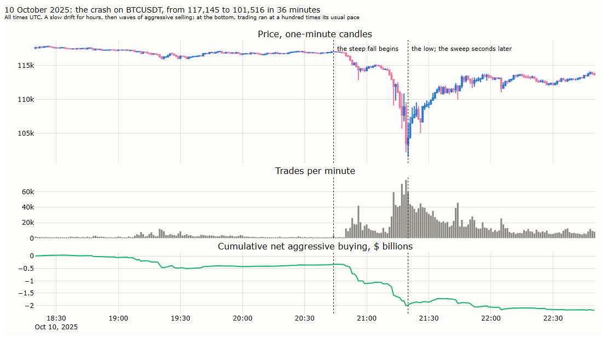

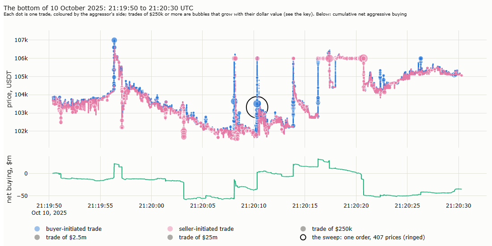

The evening shows the anatomy of a cascade (Lecture 12, §2): hours of slow drift, then waves of aggressive selling in which trading ran a hundred times faster than usual, then a sharp reversal. Around the bottom, buy orders swept the thin book upwards several times within seconds; the largest of them is the one described above.

*Deep dive: can be skipped on a first reading.*

**The most extreme days.** The ten days with the largest price range within one minute, with the busiest second of each:

| Day | Largest range in one minute | Busiest second (UTC) | Trades in that second | Different prices |
|---|---|---|---|---|
| 6 September 2022 | 48.8% | 17:05:31 | 2,065 | 1,634 |
| 21 September 2022 | 9.9% | 18:00:40 | 5,072 | 4,003 |
| 4 December 2021 | 9.3% | 05:27:49 | 1,872 | 1,538 |
| 10 October 2025 | 7.2% | 21:43:49 | 3,569 | 2,831 |
| 5 December 2024 | 6.7% | 22:28:15 | 3,971 | 3,428 |
| 23 October 2023 | 6.3% | 18:44:39 | 3,520 | 2,897 |
| 8 November 2022 | 6.0% | 16:32:43 | 2,330 | 1,544 |
| 5 May 2022 | 5.6% | 15:08:20 | 2,491 | 1,990 |
| 28 October 2021 | 5.6% | 18:39:03 | 7,990 | 6,913 |
| 10 November 2022 | 5.5% | 13:30:01 | 2,441 | 1,999 |

*Our measurement for these notes, from the 20 days with the largest one-minute ranges. The range of 6 September 2022 comes from the isolated print of Lecture 12, §5.4.*

Three things stand out. Most of these moments last seconds: the busiest second of a day can hold more trades than an average minute. Several fall at fixed clock times: 12:30, 13:30 and 18:00 UTC, the times of US inflation releases (8:30 a.m. in New York) and of Fed decisions (2 p.m.), among them 18:00:40 on the Fed day and 13:30:01 on 10 November 2022; §7 returns to these scheduled events. And the largest single orders are not always on the most volatile days: after 10 October 2025, the next largest sweeps came on 3 January 2024 (one sell order through 218 prices, $3.5 million) and in the flash crash of 17 August 2023 (94 prices, 3.3%).

**Why it explodes, and why one price per second does not.** A range bar closes each time the price has moved a fixed distance *R*. Over a day, the number of bars is therefore roughly proportional to the day's realised variance divided by *R*²: a range clock counts variance. Measured from every fill, realised variance contains a noise term that grows with the number of observations and with the noise in each of them (Lecture 12, §7.2). In a burst, both rise sharply, and the count follows the number of fills instead of the movement of the price. Measured at a resolution where the signature plot of Lecture 12 is flat, from about a second to an hour, the noise term is negligible: the count follows the true variance of the day, and a clock can close at most one bar per observed price. The price clocks therefore follow one price per second, the volume-weighted average price of that second's trades.

**Is one second a lucky choice?** The same test over five resolutions, on 62 days spread over the five years, including the Fed decision, the quietest day and the flash crash of 17 August 2023; range bars at 48 a day:

| The clock's price | Busiest day ÷ typical day | Fed decision ÷ typical day | Bars of three trades or fewer | Scale of the threshold needed |
|---|---|---|---|---|
| Every fill | 109 | 109 | 21% | 1.37 |
| 100 milliseconds | 11 | 6.9 | 0% | 1.34 |
| 1 second | 9.9 | 3.9 | 0% | 1.30 |
| 5 seconds | 8.0 | 2.9 | 0% | 1.24 |
| 30 seconds | 5.9 | 2.2 | 0% | 1.08 |

*Typical day: the median of the 62 days. The busiest day had 25 times the typical day's realised variance, the Fed decision 7.8 times. The CUSUM clock and the targets of 12 and 192 bars a day give the same picture.*

Every fill fails at every setting: a hundredfold explosion and a fifth of the bars made of three trades or fewer. Every resolution from 100 milliseconds to 30 seconds works: no degenerate bars, a similar scale, and counts that grow less than the variance of the day, never more. One second lies in the middle of this range. The rule that carries over to any market: a price clock samples the price where the signature plot is flat.

## 4. Do the clocks differ?

Six clocks need not mean six different views of the market. The test: count each clock's bars hour by hour over the five years, and correlate the counts. Clocks that close their bars in the same hours are, for practical purposes, the same clock.

| Correlation of bars per hour | Tick | Volume | Dollar | Range | CUSUM |
|---|---|---|---|---|---|
| Tick | 1 | 0.93 | 0.92 | 0.89 | 0.87 |
| Volume | | 1 | 0.96 | 0.83 | 0.82 |
| Dollar | | | 1 | 0.81 | 0.80 |
| Range | | | | 1 | 1.00 |

*Time bars close twice every hour, so their count does not vary and has no correlation.*

| | Time | Tick | Volume | Dollar | Range | CUSUM |
|---|---|---|---|---|---|---|
| Minutes per bar: 10% of bars shorter than | 30 | 4.6 | 3.7 | 3.7 | 1.0 | 0.9 |
| Median | 30 | 21 | 20 | 20 | 11 | 11 |
| 10% of bars longer than | 30 | 57 | 63 | 63 | 72 | 73 |
| Dollars per bar: dispersion (standard deviation ÷ mean) | 1.20 | 0.39 | 0.31 | 0.29 | 0.84 | 0.84 |

The six clocks fall into three groups:

- **Time bars** hold very different amounts of trading: the dollars in a bar vary by more than their own average.
- **The activity clocks** (tick, volume, dollar) close in the same hours, with correlations of 0.92 to 0.96. Volume and dollar bars are nearly the same clock, because the price changes little within the four weeks that set a threshold. Dollar bars do what they are built for: the dollars per bar vary only a quarter as much as in time bars.
- **The price clocks** (range, CUSUM) are the same clock twice: a correlation of 1.00. Both close when the price has moved, and their bars are the shortest in a burst and the longest in a calm.

Activity and price clocks differ more (0.80 to 0.89): a busy hour is not always a volatile one. For the rest of the lecture, one clock represents each group: **dollar bars** for activity and **range bars** for price, against **time bars** as the benchmark.

## 5. Are returns closer to normal?

The hypothesis of §1: on a clock that follows trading, returns should look more like the normal distribution. The test uses the return from one bar's close to the next on each clock, all at about 48 bars a day over the same five years, so that no clock looks smoother only because it is finer (§2.5).

**How to read the chart.** Each line starts at 1, since every move is larger than zero, and falls to the right: at each size of move, measured in standard deviations of that clock's own returns, it gives the share of bars with a larger move. The vertical axis is logarithmic, so each gridline down is a factor of ten: 10⁻⁴ is one bar in 10,000. The dotted curve is the normal distribution; a line above it has more large moves than the normal distribution allows. Below about 1.5 standard deviations the order reverses: returns with fat tails also have more very small moves, many quiet bars and a few large ones.

| Measure | What we measure, in plain words | Normal distribution | Time | Tick | Volume | Dollar | Range | CUSUM |
|---|---|---|---|---|---|---|---|---|
| Excess kurtosis | How fat the tails are | 0 | 23.8 | 4.3 | 2.6 | 4.4 | −1.0 | −1.1 |
| Moves beyond 4 standard deviations | How often, per 10,000 bars | 0.6 | 86 | 27 | 23 | 26 | 1.5 | 1.0 |
| Skew | Whether large moves lean one way | 0 | −0.33 | −0.04 | −0.01 | −0.04 | 0.01 | 0.01 |
| Return, one bar to the next | Whether a bar's return predicts the next | 0 | −0.01 | −0.02 | −0.02 | −0.02 | 0.00 | 0.00 |
| Squared return, one bar to the next | Whether large moves follow large moves: volatility clustering | 0 | 0.22 | 0.28 | 0.26 | 0.25 | 0.36 | 0.34 |

*Our measurement for these notes. Excess kurtosis is the fourth moment of the standardised returns minus 3.*

**The activity clocks bring returns much closer to normal, but not all the way.** On 30-minute bars, moves beyond four standard deviations happen 86 times in 10,000 bars, 140 times as often as under the normal distribution, and the excess kurtosis is 24. On dollar bars they happen 26 times, a third as often, and the kurtosis falls to about 4; the lean of time-bar returns towards large falls almost disappears. This is the effect Mandelbrot and Taylor (1967), Clark (1973) and Ané and Geman (2000) predicted: much of the fat tail of time-bar returns comes from bars that hold very different amounts of trading. The tails that remain are still forty times the normal, as Murphy and Izzeldin (2005) found on stock data: a trading clock removes part of the non-normality, not all of it.

**The price clocks are thin-tailed by construction, not by nature.** Their kurtosis is below zero, and moves beyond four standard deviations are almost absent. This says little about the market: a range bar closes when the price has moved a set distance, so most of its returns are close to that distance by design. The rare large returns that remain are gaps, where the price jumped past the threshold in one step, as in a sweep (§3.5). Returns on a price clock are a measurement of how far the price moved, already fixed in advance.

**Volatility clustering stays on every clock.** A large move is followed by another large move on all six clocks, with correlations of 0.22 to 0.36 between successive squared returns. A clock that follows activity spreads the busy periods over more bars, but it does not make the size of moves independent from one bar to the next. Lecture 14 measures and forecasts this clustering.

**Returns are almost unpredictable on every clock.** The correlation of one bar's return with the next is about −0.02 on time and activity clocks, a slight tendency to reverse, and zero on the price clocks. No clock turns the price into something a simple rule could predict.

## 6. Imbalance bars: the published construction and a stable one

*Deep dive: can be skipped on a first reading.*

The information clocks of §2.3 are the most ambitious of the four families: they try to sample the market when someone with information is trading. This section builds López de Prado's construction on our tape, shows how it breaks, explains why the usual repairs do not repair it, and builds our own version, stable by construction. The verdict is descriptive: what the clock does, how stable it is, and how its returns compare with dollar bars. Whether its bars carry a trading signal is a question for Lecture 15.

### 6.1 What imbalance bars aim to catch

Every trade carries its aggressor's side (Lecture 12, §3.2). Give a buy the sign +1 and a sell the sign −1, multiply by the dollars traded, and add up from the start of a bar: the running total is the bar's **imbalance**, θ (theta), the net dollars that buyers have pushed into the market since the bar opened. When buyers and sellers take turns, θ wanders around zero. When one side takes over, a large investor working an order or a cascade of forced liquidations, θ grows quickly in one direction. An imbalance bar closes when θ has become larger than usual, so that its bars bunch where the flow is one-sided.

**Orders, not fills.** A single order that sweeps the book fills at many prices and appears as many trades (§3.5). Counted as trades, one sweep would look like a long run of buyers, all on the same side. Both constructions below therefore read **orders**: consecutive trades in the same millisecond on the same side are merged into one. On the day of the Fed decision, 21 September 2022, this turns 2.74 million trades into 1.54 million orders.

### 6.2 López de Prado's construction

López de Prado (2018, ch. 2; 2017) sets "larger than usual" as the imbalance a bar is expected to build up:

| Step | Quantity | Financial meaning | How it is estimated |
|---|---|---|---|
| 1 | E[T] | The expected number of orders in a bar | A moving average of the lengths of past bars |
| 2 | E[bv] | The expected net dollars per order: buying minus selling, on average | A moving average of past signed dollars |
| 3 | E[T] × \|E[bv]\| | The imbalance a bar is expected to accumulate | Their product |
| 4 | Close the bar | when \|θ\| reaches E[T] × \|E[bv]\| | |

*b is the order's sign, v its dollars. The moving averages are exponentially weighted, over a span of a few past bars.*

The construction is self-referential: the threshold is set by past bars, and past bars were cut by the threshold. Nothing outside the clock anchors the size of a bar.

### 6.3 How it breaks: collapse and runaway

Step 2 leaves one choice open. "A moving average of past signed dollars" can average over the **orders** of recent bars, or over the **bars** themselves, each bar giving its net dollars per order. Both readings appear in practice, and both fail on our tape:

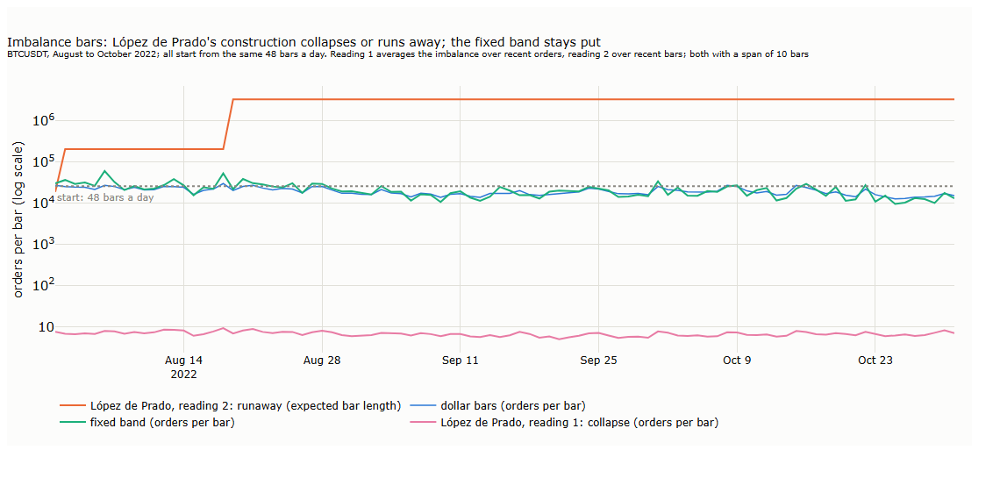

| Reading | What goes wrong | On our tape |
|---|---|---|
| 1. Average over orders | **Collapse.** Buying and selling are nearly balanced: aggressive buying is 49.8% of dollars (Lecture 12, §6.5). E[bv] is close to zero, so the threshold is close to zero, and a bar closes after a handful of orders. Short bars then pull E[T] down as well | A median of 6.6 orders per bar and about 140,000 bars a day, in August to October 2022 and again in January to March 2023 |
| 2. Average over bars | **Runaway.** A bar closes only once its imbalance is large, so each finished bar reports a large imbalance per order. The threshold rises, the next bar takes longer, E[T] rises, and the threshold rises again | No bar at all on 89 of 92 days; the expected bar length climbs to 3.3 million orders, two to three days of trading |

*Our measurement for these notes; moving averages over a span of 10 bars, both started from the same 48 bars a day. Spans of 3, 10 and 30 bars and starting values from a tenth to ten times the target end in the same two places.*

Neither failure depends on the settings: every combination tried ends in the same collapse, or in the same runaway within one or two days. Practitioners who implemented the bars report the same. Bars "that within 10 steps (10 bars) goes from consisting of 50-100 ticks to suddenly 200000 ticks", and settings that "sharply divide parameters into 2 territories: one that produces many bars only few ticks big ... and one that runs wild" (BlackArbsCEO, GitHub issues #1 and #9); on bitcoin, the bar sizes "end up exploding ... in a positive-feedback loop that keeps increasing the candle size until infinity" (Martínez, 2019). We found no academic study that tests the stability of these bars.

### 6.4 Why caps are not a repair

The common remedy is to limit the bars. A widely used library offers minimum and maximum limits on the expected bar length (Hudson & Thames, mlfinlab); public code closes a bar after at most 1,000 ticks and not before 10 (Rachnog, Advanced-Deep-Trading); another implementation sets a floor under the expected imbalance "so the threshold does not collapse to zero on a perfectly symmetric tape" (Njoroge, MQL5). Such limits do not repair the construction; they replace it. Martínez (2019) capped the expected size at 200 ticks and found that every bar soon became 200 ticks long: the cap took over, and the imbalance clock turned into a tick clock.

A cap also falsifies what this lecture measures. A cap on bar length cuts off the longest bars, which hold the largest moves; a floor merges the shortest. Returns from capped bars look closer to normal because the clock has been clipped, not because of the market, and §5's comparison would become circular. A rule that needs a cap to behave is the wrong rule.

### 6.5 A threshold anchored outside the clock

The repair is to give the threshold an anchor outside the clock's own bars, as every other clock in this lecture has: the past 28 days (§3.4).

**A first idea, and why it fails.** Measure θ against what random signs would produce: its standard deviation grows with the square root of the number of orders, so close the bar when |θ| exceeds z standard deviations, with z fixed, say 3. This does not work. The boundary grows at exactly the speed at which a random walk spreads, and the time a random walk needs to leave such a boundary has an infinite expected value for every z above 1 (Blackwell and Freedman, 1964; Breiman, 1967; Shepp, 1967). Many bars would never close on their own, and a cap would again end them.

**A fixed band.** Close the bar when |θ| reaches a level h that is fixed for the day and set from the past 28 days. A random walk leaves a fixed band in a finite time, and Wald's identity (Wald, 1944) gives that time:

| Flow in the bar | Expected number of orders before the bar closes | What it means |
|---|---|---|
| Balanced: buys and sells offset on average | h² ÷ σ², with σ² the variance of the flow per order | The bar takes its normal length |
| One-sided, with an average push of μ dollars per order | about h ÷ \|μ\| | The more one-sided the flow, the sooner the bar closes |

The first row sizes the band, the second is what an imbalance clock is for. The construction is the range bar of §3 applied to the flow instead of the price: a range bar closes when the price has moved a set distance, and its count is about the realised variance divided by the squared distance; the band closes when the flow has moved a set distance, and its count is about the flow's variance divided by h².

**Persistence: the flow wanders faster than random signs.** Sized from the variance of single orders, the band produced 208 bars on the Fed day instead of 48. Order signs are persistent: buys follow buys, because large investors split their orders into many small ones (Lillo and Farmer, 2004; Lecture 12, §7.1). Net flow therefore drifts further than independent signs would allow, and its variance grows faster than the number of orders (Bouchaud, Farmer and Lillo, 2009). On our tape, the variance of the net flow over five minutes is about ten times the sum of the squared sizes of its orders; over one second it is three times, over 30 minutes 9 to 18 times. A band sized for independent signs is crossed far too often. López de Prado's construction does not see this problem, because its threshold uses only an average; any construction that measures how unusual the flow is must account for it.

The remedy follows from the reason: measure the variance of the flow over the time a bar lasts, where the persistence has done its work. At 48 bars a day, a bar lasts 30 minutes on average. This fixes the horizon before any test is run; it is not fitted.

| Step | Quantity | Financial meaning |
|---|---|---|
| 1 | Orders | Trades in the same millisecond on the same side, merged |
| 2 | Q | Over each of the past 28 days, the sum of the squared net flow of each half hour; then the median of these 28 values. The variance of a day's flow at the scale of a bar, persistence included |
| 3 | h = K × √(Q ÷ 48) | The net flow of a typical half hour, times a constant |
| 4 | Close the bar | when the net flow since the bar opened reaches h in either direction |
| 5 | K = 0.82 | Set once on the first three months of data, October to December 2021, so that the band closes as many bars as the dollar clock there; never changed afterwards |

In plain words: **a bar closes when the flow has become as one-sided as it normally becomes in a whole half hour.** K plays the role of the constants of the range and CUSUM clocks: it makes the clocks comparable at the same number of bars, and it is set on data that precede everything evaluated. Theory alone would give K = 1. The measured 0.82 probably reflects single large orders that jump past the band, and bars that are mostly much shorter than their 30-minute average; we have not tested this.

### 6.6 Does it work?

**It is stable, in and out of sample.** The two windows of the comparison were chosen for contrast; the third, September to November 2025 with the crash of 10 October 2025, was run once, after every setting had been fixed:

| Window | Bars per day: average | Fewest in a day | Most in a day | López de Prado, reading 1 / reading 2 |
|---|---|---|---|---|
| August to October 2022 (stress) | 48 | 9 | 136 | about 137,000 a day / none on 89 of 92 days |
| January to March 2023 (calm) | 62 | 6 | 248 | about 142,000 a day / — |
| September to November 2025 (out of sample) | 44 | 7 | 156 | — |

*Our measurement for these notes. Early 2023 runs above target for the reason dollar bars do (§3.4): activity rose faster than a 28-day median follows; dollar bars made 68 a day in the same window.*

On 10 October 2025 the band closed 156 bars, the most of any day in the window, and 46 the day after: it runs fast in a crash and slows down again, with no limit imposed.

**It holds across its settings.** The plateau test of Lecture 7, §5, for each choice the construction makes:

| Setting | Values tried | Bars per day, stress / calm | Moves beyond 4 standard deviations per 10,000 bars, stress / calm | What it means |
|---|---|---|---|---|
| Horizon of the variance | 1, 5, 30 minutes, each with its own constant | 46–48 / 61–65 | 18–24 / 7–11 | Once the number of bars is equalised, the horizon hardly matters |
| Minimum bar length | 0 and 5 seconds; 0 to 30 seconds in a second run | changes by 12% at most | no systematic change | A minimum length, which merges bars without cutting any move, is harmless |
| Window of the threshold | 14, 28, 56 days | ±5% / ±15% | no systematic change | The same dependence on the activity regime as dollar bars |
| Size of the band | K × 0.5 to K × 2 | ×3 to ÷3 | no systematic change | Bars per day move with the band as Wald's identity says, though less steeply than its 1 ÷ K² (×4 and ÷4): large orders overshoot the band |

*With about 4,000 bars per window, one bar more or less beyond four standard deviations changes the measure by 2.5; differences of a few units are noise.*

**Where it ticks.** On the Fed day the band closed 76 bars, against 92 dollar bars and 48 time bars, in a pattern of its own:

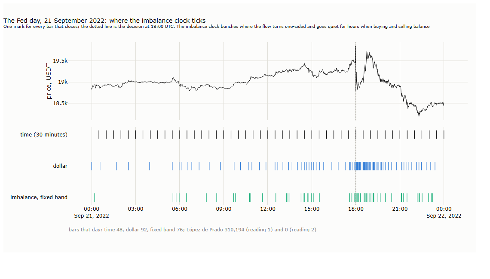

The band went quiet for five hours after midnight, when the dollar clock still ticked every hour or so: there was trading, but it was two-sided. It bunched in the afternoon and around the decision, when one side pushed. Only 23% to 39% of its closes fall within a minute of a dollar bar's close. The imbalance clock is a third kind of clock, next to activity and price: it follows how one-sided the flow is.

**Its bars are uneven.** A tenth of the bars last less than 10 seconds in the windows of the comparison (25 seconds out of sample), the median 6 to 12 minutes, a tenth more than an hour, and the longest out of sample 16 hours; dollar bars range from 2 to 6 minutes for the shortest tenth to 3 to 4 hours at most. The dollars per bar vary as much as in time bars (dispersion 0.9 to 1.2, against 0.1 to 0.5 for dollar bars). This is the clock's purpose, not a defect: it runs when the flow is one-sided and waits when it is balanced.

**Its returns are no closer to normal than on dollar bars.**

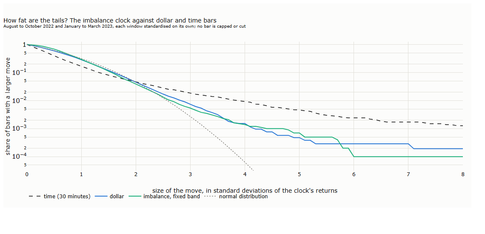

| Measure | What we measure | Time bars | Dollar bars | Fixed band | What it means |
|---|---|---|---|---|---|
| Beyond 4 standard deviations, two windows | How often, per 10,000 bars | 94 | 15 | 14 | Within the windows of the comparison, as thin as dollar bars |
| Same, out of sample | | 53 | 29 | 40 | Out of sample, fatter than dollar bars |
| Same, out of sample without 10–11 October 2025 | | 63 | 12 | 26 | Not only the crash: twice as many large moves as dollar bars |
| Excess kurtosis, two windows / out of sample | How fat the tails are | 23 / 18 | 3 / 4 | 1 / 10 | The same picture |
| Absolute return, one bar to the next, two windows / out of sample | Volatility clustering | 0.22–0.33 / 0.36 | 0.09–0.16 / 0.24 | 0.19–0.26 / 0.33 | Clustering stays, closer to time bars than to dollar bars |

*Our measurement for these notes; each window standardised on its own. No bar is capped or cut.*

The reason lies in what the clock counts. When the price moves hard with heavy trading on both sides, a two-sided panic, the flow stays balanced, the band does not fill, and one bar holds the whole move. Dollar bars close on every dollar, one-sided or not. A clock that follows one-sidedness was never designed to equalise the amount of trading per bar, and so it does not equalise the size of moves either.

### 6.7 What we take from it

- **The published construction does not work as published.** On our tape, López de Prado's imbalance bars collapse to a few orders or run away to none, from any starting point, in either reading of the rule.
- **Caps hide the problem.** They turn the clock into a fixed-size bar and clip the tails this lecture measures.
- **A stable imbalance clock is possible.** Our version, a fixed band, set from the past 28 days, sized by Wald's identity on the half-hour variance of the flow, is stable in and out of sample and across its settings, with no limit imposed. It is our design for these notes, not an established method: its parts are textbook probability (Wald) and the persistence of order flow (Lillo and Farmer). We did not find the combination in the papers or the practitioners' code we searched, which does not mean that no one has built it.
- **It is a different clock, not a better one for returns.** It ticks where the flow is one-sided, which no other clock does, but its returns are no closer to normal than on dollar bars, and out of sample their tails are fatter. For the comparisons of this lecture and for the two examples, dollar bars remain the activity clock.
- **Whether its bars carry information is open.** The clock marks the moments when one side pushes hardest; what the price does after them is a question about order flow, and Lecture 15 takes it up. Run bars, the second information clock of §2.3, rest on an expected run length that assumes independent signs; the persistence of order signs suggests the same problem, untested here.

## 7. Seasonality: when the market trades

The clocks of §3 to §6 take the market's rhythm out of the bars. This section maps that rhythm in calendar time, for two reasons. It explains why the market's clocks speed up and slow down. And orders are sent in calendar time: whatever clock a strategy follows, its trades happen at a particular hour of a particular day, in a deep or a thin market. All figures use the one-minute bars of Lecture 12, five years, and measure activity in dollars traded.

### 7.1 The time of day

Bitcoin trades around the clock, but not evenly. The busiest hour of a weekday carries 8.8% of the day's dollars, against 4.2% if trading were spread evenly (Lecture 12, §6.2). The question is whose day this is.

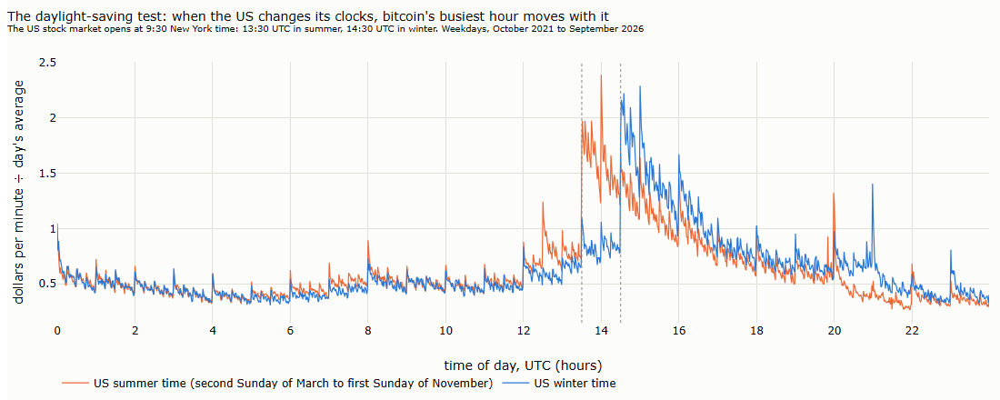

**The daylight-saving test.** The US moves its clocks twice a year, Europe on different dates and Asia not at all. If bitcoin's busiest hours follow the US, they must move by an hour, in UTC, when the US changes its clocks:

| | US summer time | US winter time |
|---|---|---|
| The US stock market opens (9:30 a.m. in New York) | 13:30 UTC | 14:30 UTC |
| Bitcoin's busiest hour | 14:00 to 15:00 UTC | 15:00 to 16:00 UTC |
| Jump in activity in the minute of the US open, against the minute before | 2.5 times | 2.4 times |

They do. The busiest hour moves by exactly one hour, and the minute the US stock market opens is the minute bitcoin's trading jumps, in both seasons. Smaller spikes move with it: 12:30 or 13:30 UTC, when US economic data are published at 8:30 a.m. New York time, and 20:00 or 21:00 UTC, when the US stock market closes.

**Why.** A large part of the money that trades bitcoin keeps US hours: funds and trading firms, and since January 2024 the US exchange-traded funds that hold bitcoin and trade only while the stock market is open. Their decisions follow the stock market's day and the US data calendar, and the rest of the market trades with them. The tape shows the timing; who exactly trades is not on it.

### 7.2 The week

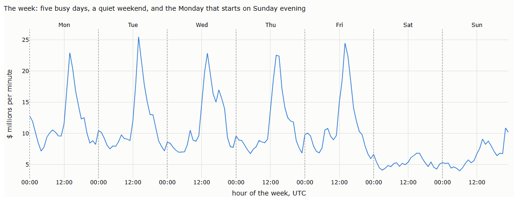

| Dollars per day, relative to the average day | Monday | Tuesday | Wednesday | Thursday | Friday | Saturday | Sunday |
|---|---|---|---|---|---|---|---|
| | 1.19 | 1.17 | 1.18 | 1.13 | 1.15 | 0.53 | 0.66 |

Weekdays are alike; the weekend trades at half the pace. The market does not close, but the professionals behind most of its money do. Sunday is busier than Saturday, and activity rises through Sunday afternoon and evening, UTC, as the new week approaches. US public holidays that fall on a weekday trade at 71% of an ordinary weekday (55 days in five years): the US calendar shows even in a market that never closes.

### 7.3 The clock itself: round times

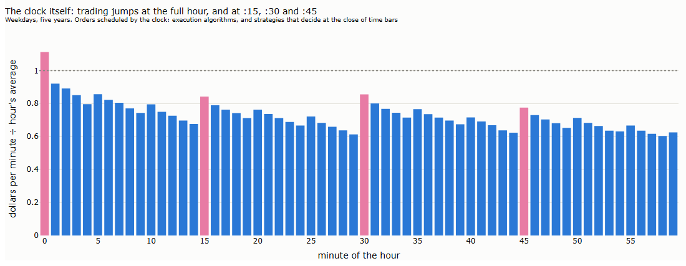

Trading jumps in the first minute of every hour, and less at :15, :30 and :45. Against a typical minute of the same hour, the first minute of the hour carries 56% more dollars, the minutes at :30 and :15 about 20% more, and the minute before the hour 11% less. Trades in the first minute are 10% larger than elsewhere.

**How long does it last?** At one-second resolution, on weekdays of 43 sample days:

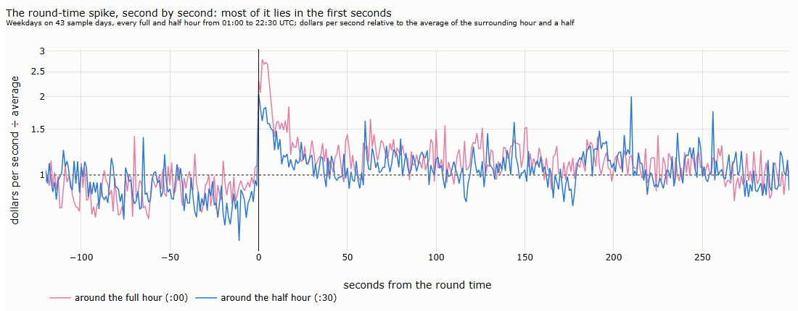

| Around the full hour | Dollars per second ÷ the average |
|---|---|
| The last minute before | 0.92 |
| The first 5 seconds | 2.5 |
| From second 10 to the end of the first minute | 1.24 |
| Minutes 1 to 5 | 1.12 |

The crowd lasts about ten seconds: activity stays above twice its average for 7 seconds and falls below 1.5 times after 9; at the half hour, the spike lasts 2 seconds. A little elevated activity lingers for a few minutes, and the minute before the hour is quieter than average, as orders wait for the round time.

**Why.** These rhythms come from how people trade, not from when the world is awake:

- **Machines trade on the clock.** Execution algorithms cut large orders into equal pieces, one every few minutes (Lecture 12, §7.1), and many start their schedules on round times.
- **Strategies on time bars decide at the close of their bars.** Every system built on hourly or 15-minute candles, as in Parts I and II, computes its signal at :00, :15, :30 and :45, all at the same moment. The time bars of other traders make the spikes.
- **People do.** Alerts, reports and decisions are set for the full hour.

**What it means.** Trading at :00 means trading in a crowd: more liquidity, and larger trades, but also more competition for the same prices. The first minute of the hour is not more one-sided than others; its flow is slightly better balanced. A strategy of our own should not fire exactly on the hour: sending its orders 10 to 15 seconds after the round time, or a few seconds before it, avoids most of the crowd.

### 7.4 Scheduled events

Some moments are known in advance: data releases, central-bank decisions, option expiries, funding payments, and the full hour itself. Every event is measured the same way, at its time *T*, against a control: the same clock time a week earlier, or for funding and full hours, clock times without the event.

| Measure | Window | The question |
|---|---|---|
| Activity | *T* to *T* + 5 minutes | How busy, relative to the day's average minute? |
| Size of moves | *T* to *T* + 5 minutes | How volatile, relative to the day's average minute? |
| Typical first reaction | *T* to *T* + 5 minutes | How far does the price move, median, in basis points? |
| Drift into the event | *T* − 30 minutes to *T* | Does the price tend to move one way beforehand? Average, with its standard error |
| Follow-through | The reaction against *T* + 5 to *T* + 35 minutes | Does the first reaction carry on or turn back? Correlation, and the share of events in which both point the same way |

**How busy and how volatile.**

| Event | Times | Activity, first 5 minutes | Control | Size of moves | Control | Typical first reaction | Control |
|---|---|---|---|---|---|---|---|
| US inflation release (CPI) | 59 | 13.2 | 1.2 | 4.7 | 1.1 | 50 bp | 12 bp |
| Fed decision | 40 | 10.3 | 0.7 | 4.5 | 1.1 | 47 bp | 10 bp |
| Quarterly option expiry | 20 | 1.5 | 0.9 | 1.3 | 0.9 | 11 bp | 10 bp |
| Monthly option expiry | 40 | 1.1 | 0.8 | 1.1 | 0.9 | 9 bp | 7 bp |
| Weekly option expiry | 201 | 0.8 | 0.9 | 0.8 | 0.9 | 7 bp | 8 bp |
| Funding payment | 5,475 | 1.0 | 0.8 | 1.0 | 0.9 | 8 bp | 7 bp |
| Any full hour | 43,813 | 0.8 | 0.7 | 0.9 | 0.9 | 7 bp | 7 bp |

**Direction.**

| Event | Drift into the event, basis points | Control | Follow-through: correlation (p) | Control | Same direction as the reaction | Control |
|---|---|---|---|---|---|---|
| US inflation release (CPI) | +11 (± 4) | +6 (± 5) | +0.45 (< 0.01) | −0.06 | 42% | 53% |
| Fed decision | +25 (± 10) | −5 (± 6) | −0.32 (0.04) | +0.06 | 42% | 57% |
| Quarterly option expiry | −20 (± 8) | −6 (± 8) | +0.04 (0.86) | −0.09 | 45% | 35% |
| Monthly option expiry | −15 (± 5) | −6 (± 6) | +0.13 (0.43) | +0.14 | 53% | 55% |
| Weekly option expiry | −4 (± 2) | −7 (± 2) | +0.05 (0.46) | +0.07 | 52% | 52% |
| Funding payment | −1.0 (± 0.5) | −0.1 (± 0.5) | −0.08 (< 0.01) | −0.07 | 48% | 48% |
| Any full hour | −0.1 (± 0.2) | +0.1 (± 0.2) | −0.04 (< 0.01) | −0.00 | 48% | 49% |

*Our measurement for these notes; p: the probability of a correlation at least this strong if there were no effect. Release dates: the Federal Reserve's meeting calendars and the Bureau of Labor Statistics' release schedules (CPI at 8:30 a.m., Fed statements at 2:00 p.m. New York time, following US daylight saving time); the October 2025 CPI report was not published as a separate release. Controls: the same clock time a week earlier; for funding payments, the full hours halfway between them; for full hours, 17 minutes past. On 29 of the 40 Fed days, the busiest minute of the afternoon falls within 15 minutes of 2:00 or of the press conference at 2:30 p.m., which confirms the release time from the tape itself.*

**The US data calendar dominates.** In the five minutes after a CPI release, trading runs at 13 times the day's average pace and the typical first move is 50 basis points, four times the control; Fed decisions come close. Option expiries leave a small trace, the quarterly ones the largest; weekly expiries, funding payments and the full hour hardly differ from their controls in size.

**Direction differs by event.** After a CPI release, the first reaction carries on: its correlation with the next 30 minutes is +0.45, the strongest result in the table, driven by the large reactions, which keep going, while small ones are noise (only 42% point the same way). After a Fed decision, the first reaction tends to turn back: −0.32, on 40 decisions; a plausible reason, not tested here, is the press conference 30 minutes later, which can change how the statement is read. Before both, the price drifted up on average, and into option expiries it drifted down. Every hour shows a slight reversal after its first five minutes (−0.04, and −0.08 at funding times), too small to trade.

**Both belong to the inflation shock.** One explanation fits: in 2021 to 2023, inflation kept surprising forecasters, so each CPI release carried real news, which took the market more than five minutes to absorb; the Fed, reacting to the same inflation, mostly decided what the CPI had already led markets to expect, so the first reaction to its statement was partly noise. If so, both effects should fade once inflation stopped surprising. They do:

| Event | Period | Releases | Typical first reaction | Follow-through: correlation (p) |
|---|---|---|---|---|
| CPI | 2021–2022 | 15 | 187 bp | +0.51 (0.05) |
| CPI | 2023 | 12 | 29 bp | +0.62 (0.03) |
| CPI | 2024–2026 | 32 | 43 bp | +0.13 (0.49) |
| Fed decision | 2021–2022 | 10 | 130 bp | −0.51 (0.14) |
| Fed decision | 2023 | 8 | 28 bp | +0.06 (0.89) |
| Fed decision | 2024–2026 | 22 | 40 bp | −0.05 (0.84) |

*Our measurement for these notes. 2021 covers October to December.*

The follow-through after CPI releases came from 2021 to 2023 and has gone since; the reversal after Fed decisions came almost entirely from 2021 to 2022. With 8 to 32 events per period this is consistent with the explanation, not a proof of it: testing it directly would need the economists' consensus forecast for each release, to measure the surprise, which the tape does not contain. The lesson for a strategy is general: an effect found in one regime can vanish in the next, and a rule fitted on 2022 would have stopped working in 2024.

**How much to trust it.** The table makes seven comparisons of three kinds of direction; at the usual threshold of 5%, one or two would look significant by chance. Only the follow-through after CPI releases is strong enough to stand on its own; the reversal after Fed decisions and the drifts before events are hypotheses for Lecture 15, which tests them with order flow.

**Option expiries.** Bitcoin options on Deribit, the largest exchange for them, expire on Fridays at 08:00 UTC; the largest expiries are on the last Friday of each month, and the largest of all on the last Friday of March, June, September and December. The settlement price is the average of Deribit's bitcoin index over the 30 minutes from 07:30 to 08:00 UTC, measured every four seconds, so that no single trade can set it (Deribit, Settlement; Coinbase, Settlement). Positions are hedged and closed while that average is formed.

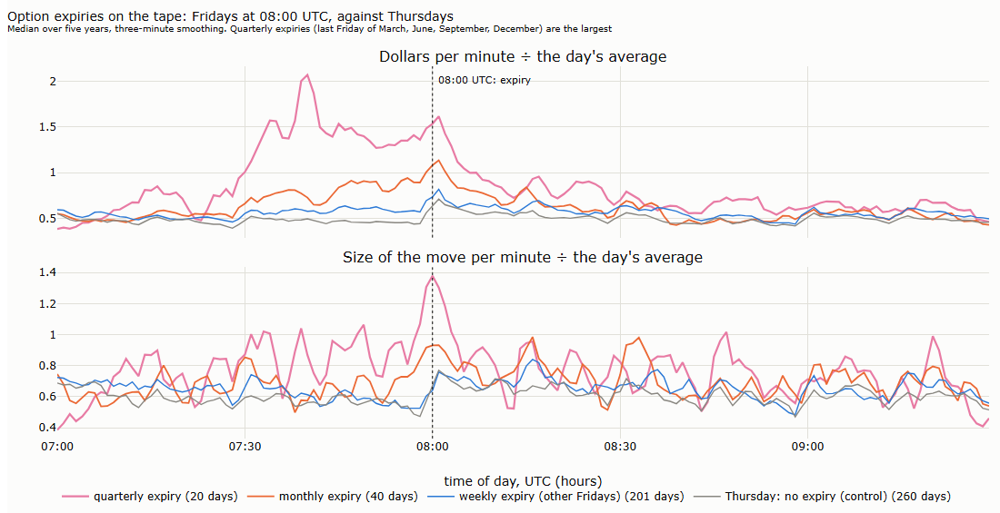

| The minute of 08:00 UTC | Days | Activity ÷ the day's average | Size of the move ÷ the day's average |
|---|---|---|---|
| Quarterly expiry | 20 | 1.77 | 1.46 |
| Monthly expiry | 40 | 1.28 | 0.99 |
| Weekly expiry, other Fridays | 201 | 0.96 | 0.77 |
| Thursday: nothing expires | 260 | 0.81 | 0.83 |

*Our measurement for these notes; medians.*

On quarterly expiry days, trading rises from 07:30, exactly when the settlement window opens, peaks at twice its usual pace around 07:40, and the price moves most at 08:00 itself; monthly expiries show a smaller version, weekly expiries hardly any.

**Volatility, direction and order flow.** The same days, half hour by half hour:

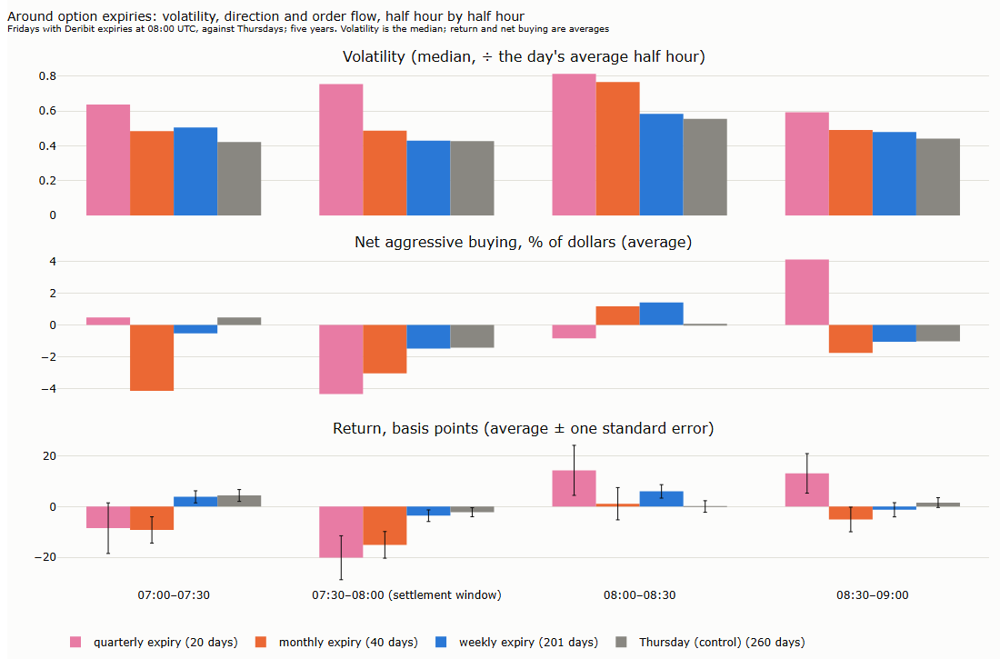

| | 07:00–07:30 | 07:30–08:00, the settlement window | 08:00–08:30 | 08:30–09:00 |
|---|---|---|---|---|
| Volatility, quarterly expiry | 0.64 | 0.76 | 0.81 | 0.59 |
| Volatility, monthly expiry | 0.49 | 0.49 | 0.77 | 0.49 |
| Volatility, Thursday | 0.42 | 0.43 | 0.56 | 0.44 |

*Our measurement for these notes. Volatility: the half hour's realised variance divided by the day's average half hour, median over days.*

**Volatility** is the clear result. On quarterly expiries it is already high in the settlement window, at 1.8 times a Thursday; after 08:00 it rises on every day, Thursdays included, around the start of the European working day, but most on expiry days.

**Direction** is not: the drift into expiries and the follow-through after them are in the direction table above, and neither holds. One more test is specific to expiries: does the price move back towards the settlement average after 08:00? On the 60 monthly and quarterly expiries, the correlation is +0.19 (p = 0.14) and the price moved back on 60% of days (p = 0.16); on Thursdays, +0.05 and 55%. Around expiries the market is busier and more volatile, but its direction is not predictable from the tape. Option traders also speak of pinning, the price held near a large strike before expiry; testing it needs the options' open interest by strike, which the tape does not have.

### 7.5 How the rhythm has changed

*Deep dive: can be skipped on a first reading.*

| Share of weekday dollars | 2021 | 2022 | 2023 | 2024 | 2025 | 2026 |
|---|---|---|---|---|---|---|
| During US stock-market hours | 34.6% | 39.0% | 41.7% | 42.4% | 42.5% | 41.8% |
| From 00:00 to 08:00 UTC, the Asian day | 26.3% | 25.2% | 22.9% | 24.3% | 26.0% | 25.8% |

*2021 covers October to December; 2026, January to September. US stock-market hours: 9:30 a.m. to 4 p.m. New York time.*

The US share of the trading day rose from 35% to 42% between 2021 and 2023 and has stayed there since. The rise came before the US bitcoin funds started trading in January 2024, so they did not cause it; they arrived in a market that already kept US hours.

### 7.6 When each clock makes you trade

A strategy on bars takes one decision each time a bar closes: buy, sell or hold. It does not choose the time it trades; it chooses a clock, and the clock decides when the decisions fall. The seasonality maps above show where they fall for each clock:

| Share of bar closes… | Time | Dollar | Range | For comparison |
|---|---|---|---|---|
| in the busiest quarter of the week's hours | 25% | 42% | 44% | These hours carry 42% of all dollars |
| in the quietest quarter | 25% | 14% | 12% | These hours carry 14% of all dollars |
| at :00, :15, :30 or :45 | 100% | 8% | 7% | 4 minutes in 60 is 6.7% |
| in a burst minute (over 20 times the day's median pace) | 0.09% | 3.4% | 5.8% | Burst minutes are 0.12% of all minutes |

*Our measurement for these notes; tick and volume bars are close to dollar bars, CUSUM to range bars.*

**Time bars** decide at 00:00, 00:30, 01:00 and so on, whatever the market does. A quarter of their decisions therefore fall in the quietest quarter of the week's hours, nights and weekends, when the market is thin; and every decision falls on a round minute, together with every other clock-driven order (§7.3).

**Activity clocks** decide where the money is. A dollar bar closes after a fixed amount of trading, so bars close quickly when much is traded and slowly when little is: the busiest quarter of the week's hours carries 42% of the dollars, and 42% of the dollar bars close in it, against 14% in the quietest quarter. They almost never close on a round minute, so they also avoid that crowd.

**The price is bursts.** A burst minute, with more than twenty times the day's usual pace of trading, comes about once in 800 minutes: after a Fed decision, in a liquidation cascade. In a burst the money flows so fast that several dollar bars close within the same minute. One dollar-bar decision in 30 falls in a burst, 28 times as often as decisions spread evenly in time would; for range bars it is one in 17, 50 times as often, because bursts are also when the price moves most. Time bars meet a burst by chance only, one decision in 1,100. Bursts are the most expensive moments to trade: spreads widen, the flow is one-sided, prices jump (Lecture 12, §7.3).

Neither is better in general. Which execution profile is cheaper, the crowd at the round minute or the bursts, is a question of costs: Lecture 15 measures them, and Lecture 16 applies them to a trend rule on time and on dollar bars.

## 8. For the two examples

Lectures 16 and 17 apply Part III to two strategies: a trend rule, held for days, and an intraday grid, held for minutes or hours (Lecture 12, §9.3). Each takes something different from this lecture.

### 8.1 The trend rule (Lecture 16)

A trend rule decides at each bar's close, so its clock decides when it trades.

| From this lecture | What the trend rule takes |
|---|---|
| The clock (§3 to §5) | The same rule runs on time bars and on dollar bars, at the same average number of bars per day, so that neither is smoother only because it is finer (§2.5). Look-back windows are counted in bars: on dollar bars, a 20-bar average spans less time in a busy week than in a quiet one |
| Thresholds (§3.4) | The dollar threshold is set from the past 28 days, and every constant from the first three months of data, so that no bar uses the future |
| Returns (§5) | On dollar bars, a third as many moves beyond four standard deviations: a volatility estimate from bar returns is disturbed less by single bars. Volatility clustering remains on every clock, so the rule still needs position sizes that follow volatility (Lecture 14) |
| When decisions fall (§7.6) | On time bars, every decision on a round minute and a quarter of them in the thinnest hours; on dollar bars, decisions in the deep hours, one in 30 in a burst. Lecture 16 prices both profiles with the costs of Lecture 15 |
| Scheduled events (§7.4) | A bar that closes in the five minutes after a CPI release or a Fed decision trades in the most violent minutes of the month. The dates are known in advance, so a rule can skip decisions in these windows without looking ahead; Lecture 16 tests whether it should |
| Imbalance bars (§6) | Not used as a clock: their returns are no closer to normal than on dollar bars |

### 8.2 The grid (Lecture 17)

A grid does not decide at bar closes. It leaves buy orders below the price and sell orders above it, and earns when the price swings back and forth through them. What it needs from the market is swings; what it fears is a one-way move that runs through all its orders. Its results depend on the path inside bars (Lecture 14), and from this lecture it takes mainly the calendar.

| From this lecture | What the grid takes |
|---|---|
| The time of day and the week (§7.1, §7.2) | The busiest hour of a weekday trades twice its even share, a weekend day half as much as a weekday. A spacing that suits the US afternoon fills rarely at night: the spacing should follow volatility as it changes through the day and the week (Lecture 14) |
| Round times (§7.3) | Trading jumps in the first seconds of every hour: the fills of resting orders bunch there, and so does the competition for them |
| Scheduled events (§7.4) | After a CPI release or a Fed decision, the typical first move is about 50 basis points in five minutes, four times the same minute a week earlier, and after CPI releases in 2021 to 2023 it kept going. A one-way move of this size is what runs through a grid. The dates are known in advance, so a grid can step aside before them without looking ahead; Lecture 17 tests the rule. Option expiries raise volatility but not direction: a reason for wider spacing in the settlement window, not for stepping aside |
| The clock (§3) | A grid is re-centred and its spacing updated from time to time. On a dollar clock the updates come faster when the market is busy and slower when it is quiet |
| The imbalance clock (§6) | It marks the moments when one side pushes hardest, when a grid collects inventory on the losing side. Whether it can serve as a filter is a question for Lecture 15, then for Lecture 17 |

The two examples use the lecture in opposite ways: the trend rule takes a clock, the grid takes a calendar.

## 9. Summary, exercises and reading

### 9.1 Seven takeaways

1. **A bar follows a clock, and the clock can be anything that rises as the market trades.** Seconds, trades, coins, dollars, the distance the price has moved, or how one-sided the flow has become. Each clock closes its bars at different moments.
2. **Thresholds must come from the past.** A fixed threshold makes a bar mean something different each year; a threshold from the median of the past 28 days keeps the number of bars near its target. Every constant is set on the first months of data and never again.
3. **The clocks fall into groups.** Tick, volume and dollar bars close in the same hours; range and CUSUM bars are the same clock twice; time bars stand apart. One representative per group is enough: time, dollar, range.
4. **Activity clocks bring returns closer to normal, but not all the way.** Dollar bars have a third as many moves beyond four standard deviations as 30-minute bars, still forty times the normal; volatility clustering remains on every clock. Price clocks are thin-tailed by construction, which says nothing about the market.
5. **A clock must be stable by design, not by patches.** A price clock reads one price per second, not every fill; López de Prado's imbalance bars collapse or run away on our tape; our fixed-band version is stable without limits, but its returns are no closer to normal than on dollar bars.
6. **The market keeps US hours.** The busiest hour moves with US daylight saving time, the weekend trades at half the pace, trading jumps in the first seconds of every hour, and US inflation releases and Fed decisions are the largest scheduled events. Option expiries raise volatility, not a predictable direction, and effects found in one regime can vanish in the next.
7. **We do not choose the time; we choose the clock, and the clock decides when we trade.** Time bars decide on round minutes and in thin hours; dollar bars in the deep hours and in bursts.

### 9.2 Exercises

- [ ] Build dollar bars at 24 and at 96 bars a day and repeat the tail measures of §5. Does the reduction in fat tails depend on how fine the bars are?
- [ ] Set the dollar threshold from the past 7, 14, 28 and 56 days. How many weeks lie within 25% of the target (§3.4)? Where does the plateau end?
- [ ] Build range bars on the Fed day, 21 September 2022, from every fill and from one price per second. How many bars does each give in the ten minutes after 18:00 (§3.5)?
- [ ] Build López de Prado's imbalance bars with a cap of 200 orders on the expected bar length. How long are the bars after a week (§6.4)?
- [ ] Build the fixed-band imbalance clock at 96 bars a day, with the variance measured over 15 minutes. Is the constant from October to December 2021 close to the one for 48 bars a day (§6.5)?
- [ ] Repeat the daylight-saving test of §7.1 for ETHUSDT. Does it keep US hours too?
- [ ] Add the US employment report (the first Friday of the month, 8:30 a.m. New York time) to the event tables of §7.4. Where does it rank?

### 9.3 Reading

For prices in trading time, Mandelbrot and Taylor (1967), Clark (1973) and Ané and Geman (2000), with the comment of Murphy and Izzeldin (2005). For bars on activity and information clocks, López de Prado (2018, ch. 2) and Easley, López de Prado and O'Hara (2012). For intraday seasonality, Dacorogna et al. (2001). For the persistence of order flow behind §6, Lillo and Farmer (2004).

## References

- Ané, T. and Geman, H. (2000). Order flow, transaction clock, and normality of asset returns. *Journal of Finance* 55(5), 2259–2284. — the transaction clock; normality in trading time (§1).
- BlackArbsCEO. Adv_Fin_ML_Exercises, GitHub issues #1 and #9. — practitioners' reports of runaway and collapsing imbalance bars (§6.3).
- Blackwell, D. and Freedman, D. (1964). A remark on the coin tossing game. *Annals of Mathematical Statistics* 35(3). — leaving a square-root boundary takes infinitely long on average (§6.5).
- Bouchaud, J.-P., Farmer, J. D. and Lillo, F. (2009). How markets slowly digest changes in supply and demand. In Hens, T. and Schenk-Hoppé, K. R. (eds.), *Handbook of Financial Markets: Dynamics and Evolution*. North-Holland. — net order flow grows faster than with independent signs (§6.5).
- Breiman, L. (1967). First exit times from a square root boundary. *Proceedings of the Fifth Berkeley Symposium on Mathematical Statistics and Probability*, vol. 2. — the same, for general random walks (§6.5).
- Business Today (11 October 2025). Crypto crash: $19 bn wiped out as Trump's 100% China tariff sparks largest liquidation in history. — the liquidations of 10 October 2025, from Bloomberg data (§3.5).
- Clark, P. K. (1973). A subordinated stochastic process model with finite variance for speculative prices. *Econometrica* 41(1), 135–155. — volume as the clock of prices (§1).
- Coinbase. Settlement (Global Derivatives), help centre. — the 30-minute settlement window of Deribit's contracts (§7.4).
- Dacorogna, M. M., Gençay, R., Müller, U. A., Olsen, R. B. and Pictet, O. V. (2001). *An Introduction to High-Frequency Finance*. Academic Press. — intrinsic time (§1).
- Deribit. Settlement, support centre. — settlement on the 30-minute time-weighted average of the index, 07:30 to 08:00 UTC (§7.4).
- Easley, D., López de Prado, M. and O'Hara, M. (2012). The volume clock: insights into the high-frequency paradigm. *Journal of Portfolio Management*, Fall 2012. — the volume clock (§1).
- Hudson & Thames. mlfinlab documentation: imbalance bars, `exp_num_ticks_constraints`. — limits on the expected bar length (§6.4).
- Lillo, F. and Farmer, J. D. (2004). The long memory of the efficient market. *Studies in Nonlinear Dynamics & Econometrics* 8(3). — persistence of order signs (§6.5).
- López de Prado, M. (2017). The 7 reasons most machine learning funds fail. SSRN 3031282. — the imbalance threshold and its estimation from past bars (§6.2).
- López de Prado, M. (2018). *Advances in Financial Machine Learning*. Wiley, ch. 2. — tick, volume, dollar, imbalance and run bars; the CUSUM filter (§2).
- Mandelbrot, B. and Taylor, H. M. (1967). On the distribution of stock price differences. *Operations Research* 15(6), 1057–1062. — prices in transaction time (§1).
- Martínez, G. (2019). Information-driven bars for financial machine learning: imbalance bars. *Towards Data Science*, 20 May 2019. — runaway bar sizes on bitcoin; a cap turns into a fixed size (§6.3, §6.4).
- Murphy, A. and Izzeldin, M. (2005). Order flow, transaction clock and normality of asset returns: a comment on Ané and Geman (2000). Working paper. — the limits of normality in trading time (§1).
- Njoroge, P. Imbalance bars, MQL5 article 22063. — a floor under the expected imbalance (§6.4).
- Page, E. S. (1954). Continuous inspection schemes. *Biometrika* 41(1/2), 100–115. — the CUSUM test (§2.4).
- Rachnog. Advanced-Deep-Trading, `bars.py`, GitHub. — minimum and maximum bar lengths in ticks (§6.4).
- Shepp, L. A. (1967). A first passage problem for the Wiener process. *Annals of Mathematical Statistics* 38(6), 1912–1914. — the square-root boundary for Brownian motion (§6.5).
- Wald, A. (1944). On cumulative sums of random variables. *Annals of Mathematical Statistics* 15(3), 283–296. — Wald's identity (§6.5).
