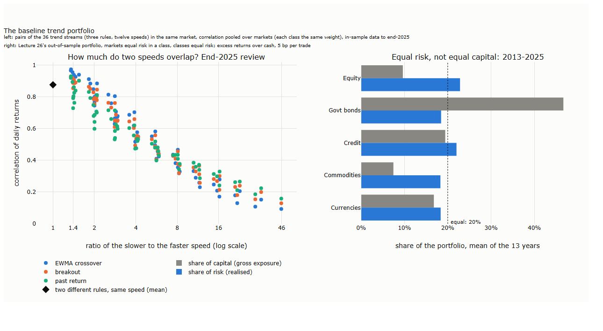
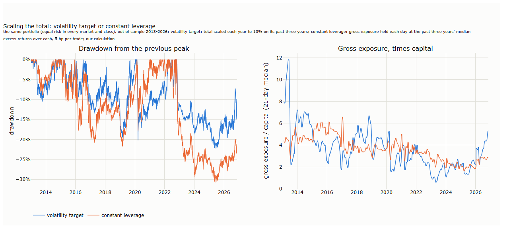
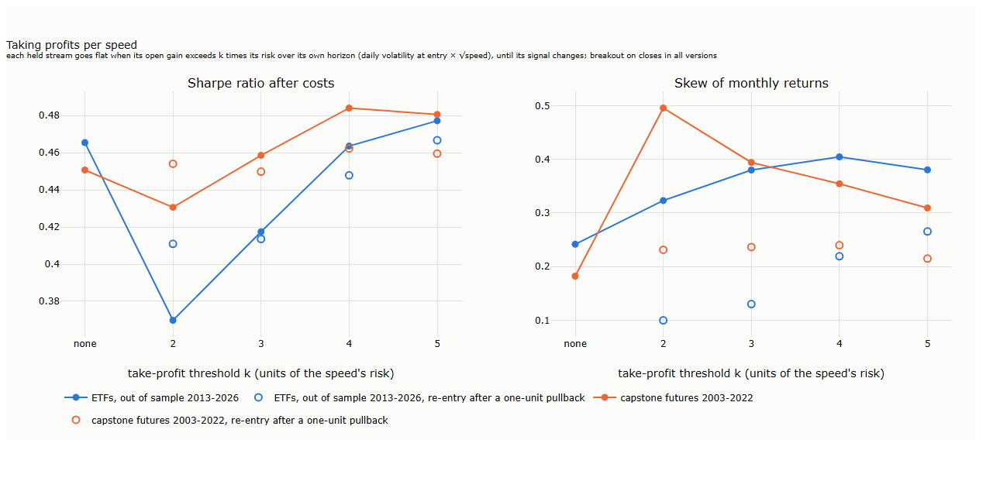
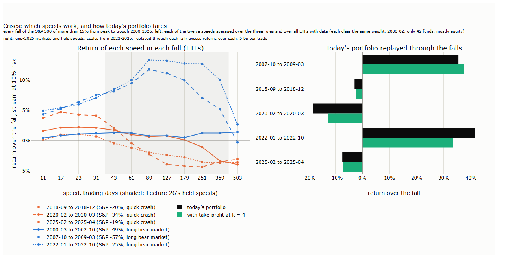

# Lecture 13: The Baseline Trend Portfolio

*Systematic Trading: Lecture Notes (MSc) · draft, Nov 14, 2026 · Max Gnesi*

*Pipeline stage (Lecture 1 §2.1): portfolio construction and risk management (weights across markets and speeds, the volatility target).*

Lecture 11 chose the markets and Lecture 12 the speeds of the trend rules that trade them. This lecture puts the two together into one portfolio: it blends the speeds inside each market, the markets inside each asset class, the classes into one account, and scales the total. Each step uses the same method, **equal risk**, and each could be done differently. The result is the **baseline**, which closes Part II: the portfolio every later lecture changes in one part and must beat out of sample. The lecture's question is which choices matter at each step and what each costs, not which portfolio is best. The plan was fixed before any result was computed, and every change made after seeing results is dated and labelled ([results/hypotheses.md](results/hypotheses.md)).

## 1. Equal risk at every level

The lecture's result fits in one chart.


<sub><b>How to read the figure.</b> <b>Axes.</b> Left: the ratio of the slower to the faster speed of two trend streams in the same market (x, log scale) against the correlation of their daily returns (y), pooled over the markets with each asset class the same weight, data to end-2025; one dot per pair of speeds, coloured by rule; the black diamond is the mean over pairs of different rules at the same speed. Right: each asset class's share of the portfolio's gross exposure (grey) and of its realised risk (blue, x), mean over the years 2013-2025; dotted: an equal share of 20%. Excess returns over cash, 5 bp per trade; our calculation.</sub>

Two trend streams in the same market overlap by how far apart their speeds are, not by which rule they use. Two speeds a step apart (a ratio of 1.4) are 0.84 to 0.93 correlated; a ratio of 8 brings it to about 0.4 and the extremes of the grid (a ratio of 46) to 0.1 to 0.2. Different rules at the same speed overlap by 0.88. Held together, Lecture 12's 20 streams in a market amount to about **1.4 independent bets**. Across classes the opposite happens: the classes carry about the same risk (18% to 23%) with very different capital, because a calm government bond fund must be held at several times the size of an equity fund to carry the same risk (47% of the gross exposure against 10%).

| § | Step | Question |
|---|---|---|
| 2 | Speeds inside a market | How should streams that overlap this much be blended, and does anything beat equal weights? |
| 3 | Markets and classes | Equal risk or equal capital? Asset classes or groups found in the data? |
| 4 | The total | Scale to a volatility target or hold leverage constant? |
| 5 | Taking profits | Does closing a trend after a large gain help? |
| 6 | Crises | Which speeds work in crises, and how does today's portfolio fare in them? |

**The workflow.** Lecture 11 (§1) set the order for the whole portfolio part: markets first, then weights from risk only, and the strategy's profit and loss last, as the judge.

| Step | Uses | Lecture |
|---|---|---|
| Markets | Liquidity, history, overlap | 25 |
| Speeds | Strategy performance, in sample, as a region rather than a point | 26 |
| Weights | Risk only: volatilities, correlations, costs | **27** (baseline), 30 (other methods) |
| Judge | Profit and loss, out of sample | every lecture |

Profit and loss never feeds back into the weights silently: where a weight depends on past performance (maximum Sharpe ratio in §2, speed timing in §2.4), the lecture says so and shows the cost.

**The baseline in one sentence.** *Hold Lecture 12's speeds with equal risk in each market, the markets with equal risk in each asset class, the classes with equal risk, and scale the total each year to 10% volatility on its past three years.* All weights are set at each year end from 2012 on past data only and traded the following year; the results are out of sample, 2013-2026, on Lecture 11's markets (Sharpe ratio 0.49 after costs).

**Two steps, not one.** The portfolio is built in two steps: the speeds inside each market (§2), then the markets and classes (§3). A single step would weigh every stream in every market at once, here 20 streams in each of about 20 markets: some 400 weights from a 400 × 400 correlation matrix estimated on three years of data. Two steps are a **convention** with two reasons behind it:

- **Evidence.** The speeds' overlap is much the same in every market (it follows the speed ratio, left panel), so it can be estimated once on all markets pooled; a weight per stream and market would rest on one market's history, the least evidence there is (Lecture 12 §2).
- **Separate questions.** How to blend speeds is a question about the trend rules; how to blend markets is a question about the assets. Two steps keep each answer readable and each check separate.

When the speeds' overlap is the same in every market, the two steps give the same portfolio as one step with that structure imposed. When it is not, one step can use the differences, at the price of estimating far more numbers. Large funds that run one optimisation over all their streams do so with heavy constraints that bring back much of this structure. A one-step allocation is an exercise (§7.2).

## 2. Speeds inside a market

### 2.1 The methods

Lecture 12 held every speed that passed in at least 20% of random halves, with equal risk each. Equal weights are consistent with the rest of the portfolio only if every stream is equally useful. The streams are not: neighbouring speeds overlap by 0.9, and fast speeds cost more to trade. Four ways to blend them, from the simplest to the most demanding:

| Method | Weights from | What it assumes | Label |
|---|---|---|---|
| Equal weight per stream | Nothing | Every stream equally useful and equally distinct | Convention |
| Equal risk contributions | The streams' correlations | Every stream equally useful; overlap differs | Definition (Maillard, Roncalli and Teïletche, 2010) |
| Equal risk, net of costs | Correlations and each stream's cost | Every stream equally useful **before** costs | Our proposal |
| Maximum Sharpe ratio | Correlations and past Sharpe ratios after costs | Past Sharpe ratios predict the future | Definition (Markowitz) |

**Equal risk contributions.** Each stream contributes the same share of the blend's risk. With $`C`$ the streams' correlation matrix (the streams are first scaled to the same volatility) and $`w`$ the weights, stream $`i`$ contributes $`w_i\,(Cw)_i`$ to the blend's variance. The weights solve

```math
\min_{w > 0}\; \tfrac12\, w^\top C\, w \;-\; \sum_i b_i \log w_i ,
```

whose solution has risk contributions proportional to the budgets $`b_i`$ (all equal here), then normalised to sum to one. A stream that overlaps much with the others gets a smaller weight; a stream that adds something different gets a larger one.

**Equal risk, net of costs.** The budget of each stream is cut by what it costs to trade: $`b_i = \text{prior} - c_i`$, where the prior is a Sharpe ratio before costs assumed the same for every stream (0.3; 0.2 and 0.5 reported) and $`c_i`$ is the stream's **marginal cost** in the blend, in Sharpe-ratio units a year. The marginal cost is what the stream adds to the blend's trading, not what it would cost alone: when a fast and a slow stream trade against each other, their trades net inside the market's combined position and neither pays in full. At the speeds held here the costs are small (0.003 to 0.03 Sharpe-ratio units a year at the end-2025 review). The method is written in general because at higher frequency, where costs are a large share of the gross return, the same budget would move weights decisively away from the fast streams.

**Maximum Sharpe ratio.** The weights that maximise the blend's past Sharpe ratio after costs, long only. It is the only method that uses the streams' past performance, and Michaud (1989) called it an *error maximiser*: it puts the most weight on the streams whose past Sharpe ratio was overestimated the most. It is shown as a warning, not as a candidate.

### 2.2 Results

| Method | Sharpe ratio, out of sample 2013-2026 | Independent bets per market (end-2025) | Streams with more than 1% weight (end-2025) |
|---|---|---|---|
| Equal weight per stream (baseline) | 0.486 | 1.39 | 20 of 20 |
| Equal risk contributions | 0.482 | 1.41 | 20 of 20 |
| Equal risk, net of costs (prior 0.2 / 0.3 / 0.5) | 0.483 / 0.482 / 0.482 | 1.41 | 20 of 20 |
| Maximum Sharpe ratio | 0.455 | 1.29 | 5 of 20 |

<sub><b>How to read the table.</b> Each method blends the held speeds inside every market; the rest of the portfolio (markets, classes, total) is the baseline's. Sharpe ratio after 5 bp per trade, excess returns over cash. Independent bets: the number of uncorrelated streams of equal risk that would give the blend's diversification, $`(\sum_i w_i)^2 / w^\top C w`$ with the streams at unit risk. Our calculation.</sub>

Equal weights, equal risk contributions and the cost-adjusted budgets give the same portfolio in practice: the equal-risk weights at the end-2025 review range from 4.5% to 5.8% around the equal 5%. Their correlations leave little to choose: when every pair of neighbours overlaps by about 0.9, no weighting finds a second independent bet that is not there. Maximum Sharpe ratio concentrates on five streams that changed from year to year (at the 2012 review mostly the 179-day crossover, at 2018 the 89-day crossover and the 127-day breakout) and earned 0.03 less.

**Reading.** On our sample the choice between the three risk-based methods does not matter, and equal weights are the simplest. The result is specific to streams that overlap this much and cost this little: with distinct strategies, or at speeds where costs bite, equal risk contributions and cost budgets would move the weights, and that is where Lecture 16 takes them up.

### 2.3 Streams that are not always in the market

The breakout rule is flat after the price crosses back over its half-length channel (Lecture 12 §3.1), so its streams are **often flat**: on Lecture 11's markets the held breakout speeds had a signal on 71% of days over 2007-2026 (median over markets and speeds). This raises a question that has no single answer: are the flat days zeros or missing?

| Purpose | Flat days count as | Why | Label |
|---|---|---|---|
| Profit and loss of the account | Zero return | The capital is there and earns cash (zero over cash) | Definition |
| How the strategy behaves while it trades (volatility, correlation with other streams) | Missing | Zeros would dilute the volatility and pull correlations towards zero | Convention |
| Risk budget in the portfolio | Either: on average or while active | A choice with known trade-offs | Our proposal (Lecture 15) |

The two give different numbers. The breakout streams earned a Sharpe ratio of 0.20 over all days and 0.26 on the days with a signal (median over markets and speeds), consistent with Lecture 7 §4.3: the Sharpe ratio over the whole period is roughly the Sharpe ratio while invested times the square root of the share of time invested ($`0.26 \times \sqrt{0.71} \approx 0.22`$). The difference is not an edge; it is the idle capital, which Lecture 7 §4.3 showed can be used elsewhere.

In the baseline the breakout streams are blended as they are, with zeros on flat days: their volatility is measured on all days and their risk is the average risk. Strategies that are in the market much less often, and how to combine them with strategies that always are, are the subject of Lectures 14 and 15.

### 2.4 Timing the speeds

Could the weights move with what has worked lately within the held set? Two opposite rules are both plausible:

- **Momentum.** Tilt towards the speeds that did best over the past three or six months: if a speed suits the current market, it may keep suiting it.
- **Reversal.** Tilt towards the speeds that did worst: the held speeds all work over the long run, so a recent laggard may be due to catch up.

Each tilts the equal weights at the start of every quarter by the speeds' rank over the past three or six months, at half or full strength (weights between zero and twice equal), within Lecture 12's held set only, so it never brings in a speed that was not chosen. Reweighting pays 5 bp on the change in each position.

| Tilt | Lookback | Sharpe ratio difference to equal weights | 90% band |
|---|---|---|---|
| Momentum, half / full | 3 months | −0.06 / −0.11 | −0.08 to −0.03 / −0.16 to −0.06 |
| Momentum, half / full | 6 months | −0.05 / −0.10 | −0.07 to −0.03 / −0.14 to −0.06 |
| Reversal, half / full | 3 months | +0.02 / +0.04 | −0.00 to +0.05 / −0.01 to +0.09 |
| Reversal, half / full | 6 months | +0.03 / +0.05 | +0.00 to +0.05 / +0.00 to +0.10 |

<sub><b>How to read the table.</b> Each row tilts the speed weights inside every market each quarter by the rank of each held speed's recent Sharpe ratio; the rest of the portfolio is the baseline's. Difference to equal weights in Sharpe ratio after costs, out of sample 2013-2026; 90% band from a block bootstrap over calendar months. Our calculation.</sub>

Momentum lost clearly; reversal gained a little, and two of its four bands only just exclude zero. With eight variants tried and no mechanism beyond "the held speeds catch up", this is weak evidence, and the baseline keeps equal weights. A third way conditions on the state of the market rather than on past performance; Goulding, Harvey and Mazzoleni (2023) blend fast and slow trends by whether they agree, which marks turning points. A version of it did not hold here: leaning towards fast speeds in volatile markets and slow speeds in calm ones looked promising on the ETFs (calm: slow speeds led; storms: fast speeds led) but did not survive a test on the capstone futures (difference −0.02, 90% band −0.07 to +0.03; [results/hypotheses.md](results/hypotheses.md)).

**Is there anything to time?** A descriptive check, with nothing fitted: in each market, rank the held speeds by their Sharpe ratio in one window and again in the next. Over three months the ranks persist slightly (rank correlation +0.06 to +0.08, standard error 0.014), over six months less (+0.04), over a year not at all (−0.03). The persistence that momentum needs is there but small, and it fades within the quarter the tilt holds: momentum pays to reweight and concentrates the blend for a difference that is mostly gone by the time it is traded. Reversal's small gain runs against the measured persistence, so it has no mechanism on our data; it stays an open question (§7.2).

## 3. Markets and classes

### 3.1 Equal risk, not equal capital

Inside each asset class the baseline gives every market the same risk, measured as the volatility of its blended streams over the past three years; the classes then get the same risk. Equal risk is the same method as for the speeds (§2), applied one level up. Its price is leverage: a fund of short-term Treasuries (SHY) moves about a tenth as much as an equity fund, so equal risk holds it at many times its value. Over 2013-2026 the portfolio's gross exposure had a median of 3.4 times capital, and government bonds were 47% of it (key chart, right).

**Equal capital** is the natural alternative: inside each class every market gets the same average gross exposure, and the classes still get equal risk.

| | Equal risk (baseline) | Equal capital inside classes |
|---|---|---|
| Sharpe ratio after costs, 2013-2026 | 0.49 | 0.44 |
| Worst drawdown | −22% | −24% |
| Gross exposure, median | 3.4 × capital | 2.2 × capital |
| Correlation of daily returns with the baseline | | 0.98 |

<sub><b>How to read the table.</b> The same speeds, classes and total scaling; only the weights of the markets inside each class differ. Volatility about 10.5% for both. Excess returns over cash, 5 bp per trade; our calculation.</sub>

The two portfolios are nearly the same (correlation 0.98). Equal capital carries a third less gross exposure, which matters where leverage is limited or costs money (Lecture 16), and earns a little less because the calm markets in each class barely count: within government bonds, the long Treasury fund carries almost all the risk. It also breaks the one method used at every other level, so the baseline keeps equal risk and treats equal capital as a remark on leverage.

**Equal risk per class is a convention.** It gives a class of two credit funds the same risk as a class of eight equity funds, and it would give a single Bitcoin future the risk of all equity. Classes could instead be weighted by how many independent bets they contain, or by size; Lecture 16 compares such methods, and an exercise asks how much the class weights matter (§7.2).

### 3.2 Asset classes or groups found in the data?

Asset classes are labels. Markets in different classes can trend together (gold and the yen; oil and Brazil's equity), and markets in the same class can trend apart. The rival replaces the five classes by five **groups found each year in the data**: markets clustered on how often their trends point the same way over the past three years (the concordance of trend phases of Lecture 11), with Ward linkage (and average linkage, as first fixed), each group then given equal risk.

| | Sharpe ratio after costs | Difference to classes, 90% band | Worst drawdown | Sum of the 12 worst months |
|---|---|---|---|---|
| Asset classes (baseline) | 0.49 | | −22% | −68% |
| Groups, Ward linkage | 0.52 | +0.04 (−0.12 to +0.18) | −21% | −56% |
| Groups, average linkage | 0.53 | +0.05 (−0.15 to +0.25) | −25% | −49% |

<sub><b>How to read the table.</b> Same markets, speeds and total scaling; only the grouping of markets into five equal-risk blocks differs, chosen at each year end on the past three years. Band: block bootstrap over calendar months. Twelve worst months: the sum of the twelve worst monthly returns, at about 10.8% volatility for all three. Our calculation.</sub>

The groups did a little better, but no difference is distinguishable from zero, and none of the comparisons fixed in advance passes the Benjamini-Hochberg correction. The groups also changed from year to year (with average linkage, gold, gold miners, the yen and the Australian dollar formed one group in 2013; in 2014 gold sat with US equity), so each year's portfolio rests on three years of co-movement in a few dozen markets. Classes are kept: they are stable and equally good on our sample. Whether data-driven groups add something is a question for Lecture 16, with more markets.

## 4. The total


<sub><b>How to read the figure.</b> <b>Axes.</b> Left: date (x) against the drawdown from the previous peak (y) for the same portfolio scaled two ways: a volatility target (blue) and constant leverage (orange). Right: date (x) against gross exposure in multiples of capital (y, 21-day median). Out of sample 2013-2026, excess returns over cash, 5 bp per trade; our calculation.</sub>

Once the speeds, markets and classes are blended, one number remains: how large the whole portfolio is. Two ways are both in use, and they answer different questions.

| | Volatility target (baseline) | Constant leverage |
|---|---|---|
| Rule | At each year end, scale the total so that its volatility over the past three years would have been 10% | Each day, scale the total so that gross exposure stays at its median of the past three years |
| What stays fixed | Risk, as forecast once a year | Gross exposure |
| What moves | Gross exposure (it rises when markets calm down) | Risk (it rises when markets get rough) |
| Assumes | Volatility persists: calm markets stay calm long enough | The portfolio's size should not depend on recent calm |

| | Volatility target | Constant leverage |
|---|---|---|
| Sharpe ratio after costs | 0.49 | 0.39 |
| Volatility, whole period | 10.7% | 12.4% |
| Volatility over three months, 5th to 95th percentile | 5.7% to 15.6% | 5.7% to 22.9% |
| Worst month | −9.7% | −14.6% |
| Worst drawdown | −22% | −31% |
| Gross exposure, median (5th to 95th percentile) | 3.4 (1.3 to 6.9) | 3.6 (2.0 to 5.6) |
| Covid crash, Feb-Mar 2020 | −14.8% | −11.3% |
| Rate shock, 2022 | +25.6% | +33.3% |

<sub><b>How to read the table.</b> The same portfolio, scaled two ways. Rows 1-6: out of sample 2013-2026. The last two rows: return over each episode. Our calculation.</sub>

The volatility target earned more per unit of risk, but the difference is not distinguishable from zero (−0.10 for constant leverage, 90% band −0.25 to +0.06). The two differ mainly in *when* they carry risk. The volatility target holds risk steady and lets leverage swing, from 1.3 to 6.9 times capital: it was most levered in calm years (2013-2014), and lost more in the quick crash of 2020, which came after a calm spell. Constant leverage holds exposure steady and lets risk swing: its risk rose in rough markets, which cost it in 2016 and 2023 and paid in 2022. The choice is largely a matter of taste: which number should stay steady, risk or exposure. On our sample neither wins clearly.

**A lesson from scaling daily.** A natural improvement would be to scale the total each day on today's positions rather than once a year. It did worse (Sharpe ratio 0.46, volatility 16% instead of 10%). When markets chop, the speeds disagree, long and short streams offset inside each market, and the net position shrinks. A daily target reads the small position as low risk and scales it back up to full size, levering the portfolio exactly when the trend signals are weakest: in 2023 the daily version lost 15.6%, the yearly one 6.3%. Scaling once a year on the realised volatility of the whole portfolio keeps weak signals small. Scaling with correlations across markets, which a daily forecast would add, belongs to Lecture 16.

## 5. Taking profits


<sub><b>How to read the figure.</b> <b>Axes.</b> Take-profit threshold k, in units of each speed's risk over its own horizon (x), against the Sharpe ratio after costs (left, y) and the skew of monthly returns (right, y). Filled markers and lines: the stream stays flat until its signal changes; hollow markers: it re-enters after a pullback of one unit. Blue: ETFs out of sample 2013-2026 with the baseline's structure; orange: capstone futures 2003-2022 with Lecture 12's end-2025 speeds. Breakout on closes in all versions, so the ETF baseline earns 0.465 here. Our calculation.</sub>

Trends end, and a trend follower gives back part of every large gain before its signal turns. A take-profit closes the trade earlier: when a stream's open gain since its signal last changed exceeds **k units of its risk**, it goes flat until the signal changes. The unit is the speed's own scale: daily volatility at entry times the square root of the speed, so a slow stream needs a larger gain than a fast one before it counts as large.

| | none | k = 3 | k = 4 | k = 5 |
|---|---|---|---|---|
| ETFs: Sharpe ratio | 0.47 | 0.42 | 0.46 | 0.48 |
| ETFs: difference, 90% band | | −0.05 (−0.17 to +0.07) | −0.00 (−0.09 to +0.09) | +0.01 (−0.06 to +0.08) |
| ETFs: skew of monthly returns | 0.24 | 0.38 | 0.41 | 0.38 |
| ETFs: Covid crash 2020 | −13.8% | −10.2% | −10.7% | −11.3% |
| ETFs: rate shock 2022 | +26.1% | +13.7% | +17.7% | +20.1% |
| Futures: Sharpe ratio | 0.45 | 0.46 | 0.48 | 0.48 |
| Futures: difference, 90% band | | +0.01 (−0.07 to +0.09) | +0.03 (−0.02 to +0.09) | +0.03 (−0.00 to +0.07) |
| Futures: skew of monthly returns | 0.18 | 0.39 | 0.35 | 0.31 |

<sub><b>How to read the table.</b> Differences in Sharpe ratio against no take-profit; 90% band from a block bootstrap over calendar months. Episode rows: return from the peak to the trough of the S&P 500. Our calculation.</sub>

At k = 4 to 5 the Sharpe ratio is unchanged, on both datasets; at lower thresholds it falls (ETFs at k = 2 to 3, futures at k = 2), because the exit cuts too many trends that would have run on. Skew rises at every threshold: the take-profit removes the giving-back at the end of a trend, the part of a large win that would have been returned. Quick crashes that follow a run-up lose less (ETFs 2020: −13.8% to −10.7% at k = 4), and long bear markets give some of their gain back (2022: +26% to +18%). Re-entering after a one-unit pullback did not improve on waiting for the signal to change. No difference is distinguishable from zero: the take-profit is **an option with known trade-offs**, not an improvement. The baseline does without it, and §6 shows what it does to today's portfolio in crises.

## 6. Crises


<sub><b>How to read the figure.</b> <b>Axes.</b> Left: trend speed in trading days (x) against the return over each fall of the S&P 500 of more than 15%, for a stream at 10% risk (y), averaged over the three rules and over the ETFs with data, each class the same weight; orange: quick crashes (under four months), blue: long bear markets; shaded: Lecture 12's held speeds. Right: return of today's portfolio (end-2025 markets and held speeds, scales from 2023-2025) replayed through each fall (x), without (black) and with take-profit at k = 4 (green). Excess returns over cash, 5 bp per trade; our calculation.</sub>

### 6.1 Which speeds work in crises?

Trend following is often sold as crisis insurance. If some speeds outside Lecture 12's held set worked reliably in crises, they could be added as a small sleeve. The test, fixed in advance: a speed works in crises if it beats the held set in at least two thirds of the S&P 500's falls of more than 15%, on the ETFs and on the capstone futures.

**No speed passed.** What works depends on the crisis's own speed (left panel):

- **Quick crashes** (2018 Q4, Feb-Mar 2020, Feb-Apr 2025: one to three months): fast speeds of 11 to 31 days earned up to 5%; the held speeds earned little or lost, the slowest the most. A trend measured over months cannot turn within a five-week crash; it enters the crash long.
- **Long bear markets** (2007-09 and 2022: a year or more): the held speeds earned most (89 to 251 days: +7% to +13%), the fast speeds about half as much or less. 2000-02 shows the same shape on the futures; on the ETFs only 42 funds, mostly equity, existed and every speed earned about 1%.

A fast sleeve would have paid in the quick crashes and cost in the long ones, and in the years between, where Lecture 12 showed the fast speeds lose to costs. Crisis protection here is a matter of which kind of crisis comes, which is not known in advance.

### 6.2 Today's portfolio in past crises

The out-of-sample results mix portfolios of different years. A different question is what the portfolio held today would do in a repeat of past crises: the end-2025 markets and speeds, with all scales from 2023-2025, replayed through each episode (right panel).

| Episode | S&P 500 | Today's portfolio | With take-profit at k = 4 | Drawdown inside the episode, without / with |
|---|---|---|---|---|
| 2007-09 | −57% | +35% | +38% | −13% / −11% |
| 2018 Q4 | −20% | −3% | −2% | −7% / −7% |
| Feb-Mar 2020 | −34% | **−18%** | −13% | −24% / −17% |
| 2022 | −25% | +41% | +33% | −11% / −7% |
| Feb-Apr 2025 | −19% | −7% | −7% | −8% / −7% |

<sub><b>How to read the table.</b> Return over the fall of the S&P 500 from peak to trough. 2000-02 is left out: only 5 of today's 20 markets traded then. Our calculation.</sub>

The worst case is a quick crash that hits a long, levered position sized on calm years: in 2020 today's portfolio would lose 18%, 16 points of it in credit (corporate bond funds held long at several times their value after a calm run), partly offset by commodities (+8%). Its worst day was −7.3%. The take-profit cuts that loss by about a third and gives up about a fifth of the 2022 gain, the trade-off §5 found over the whole sample. Two long bear markets would have paid well. The stress test does not predict the next crisis; it shows where today's portfolio is exposed: to a fast reversal of a calm, long-held trend in a levered class.

## 7. Summary

### 7.1 Takeaways

- **The baseline:** equal risk at every level, for the speeds in each market, the markets in each class and the classes, with the total scaled each year to 10% on its past three years. Sharpe ratio 0.49 after costs, out of sample 2013-2026. Every later lecture changes one part and must beat it.
- **Speeds overlap by their ratio.** Neighbouring speeds are 0.9 correlated, and different rules at the same speed are too; 20 streams make about 1.4 independent bets in a market. Equal weights, equal risk contributions and cost-adjusted budgets gave the same result; maximum Sharpe ratio concentrated on a few streams and did worse.
- **Timing the speeds did not help.** Momentum lost clearly; reversal's small gain has no mechanism on our data; a volatility-state tilt failed on the capstone futures.
- **Equal risk costs leverage.** Equal capital holds a third less gross exposure, earns a little less, and moves almost identically.
- **Volatility target or constant leverage** is a choice between steady risk and steady exposure, not a winner and a loser on our sample. Scaling daily on today's positions re-levers weak signals.
- **A take-profit at four to five units** of a speed's risk leaves the Sharpe ratio unchanged and raises skew; it cuts quick crashes and trims long bear markets. An option, not an improvement.
- **No crisis speed.** Fast speeds help only in fast crashes. Today's portfolio is most exposed to a quick reversal of a calm, levered long trend, as in 2020.

### 7.2 Exercises

- [ ] **One step.** Allocate every market × speed stream at once with equal risk contributions on their full correlation matrix, instead of two steps. How far are the weights from the two-step baseline? Does the out-of-sample result change?
- [ ] **Halve, do not exit.** In §5, halve the position at the threshold instead of going flat. Plot Sharpe ratio and skew against k next to the full exit.
- [ ] **Class weights by bets.** Weight each class by its number of independent bets (§2's formula applied to the markets' correlation) instead of equally. How much do the class weights matter?
- [ ] **Bitcoin, with hindsight.** Add the CME Bitcoin future (Yahoo BTC=F, from December 2017) as its own class, and as one market in commodities. What risk share does it get each way, and what does that do to the 2018 and 2022 drawdowns? Why is any result here hindsight?
- [ ] **Reversal, again.** The reversal tilt in §2.4 gained a little with no mechanism behind it. Test it on the capstone futures with the rule fixed before you look. Does it hold?
- [ ] **Crowding.** The CFTC's Commitments of Traders reports show how speculators are positioned in each future. Is today's portfolio's worst stress case (§6.2) worse when speculators are crowded on the same side?

### 7.3 Reading list

- Maillard, S., Roncalli, T. and Teïletche, J. (2010). The properties of equally weighted risk contribution portfolios. *Journal of Portfolio Management*, 36(4), 60-70. The equal-risk-contribution portfolio of §2.
- Michaud, R. O. (1989). The Markowitz optimization enigma: is "optimized" optimal? *Financial Analysts Journal*, 45(1), 31-42. Why maximum Sharpe ratio maximises estimation error.
- DeMiguel, V., Garlappi, L. and Uppal, R. (2009). Optimal versus naive diversification: how inefficient is the 1/N portfolio strategy? *Review of Financial Studies*, 22(5), 1915-1953. Equal weights against fitted portfolios, out of sample.
- Levine, A. and Pedersen, L. H. (2016). Which trend is your friend? *Financial Analysts Journal*, 72(3), 51-66. Crossovers and past returns as the same filters, which is why the rules overlap at the same speed.
- Goulding, C. L., Harvey, C. R. and Mazzoleni, M. G. (2023). Momentum turning points. *Journal of Financial Economics*, 149(3), 378-406. Blending fast and slow trends by whether they agree.
- Hurst, B., Ooi, Y. H. and Pedersen, L. H. (2017). A century of evidence on trend-following investing. *Journal of Portfolio Management*, 44(1), 15-29. Trend following across crises.
- Kaminski, K. M. and Lo, A. W. (2014). When do stop-loss rules stop losses? *Journal of Financial Markets*, 18, 234-254. When rules that exit early add value, the frame for §5.
