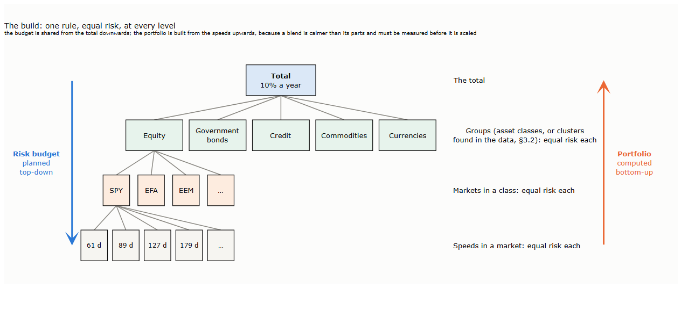
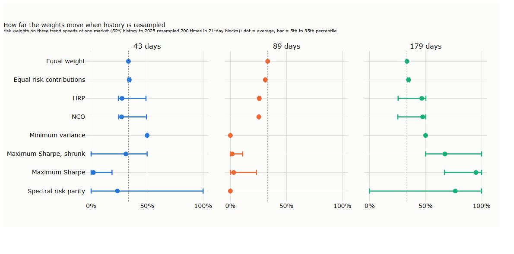
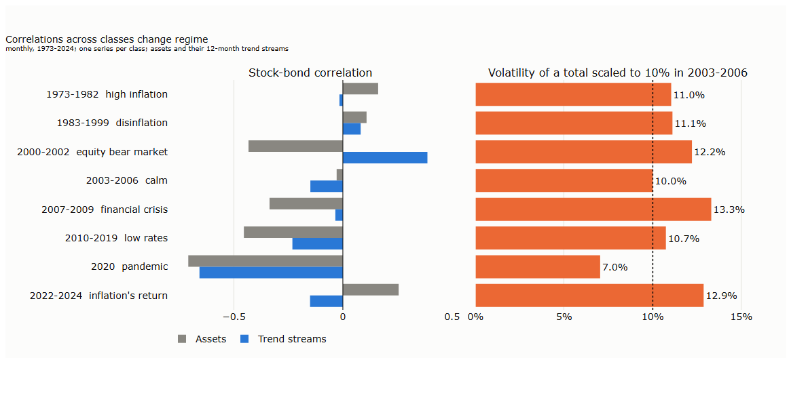
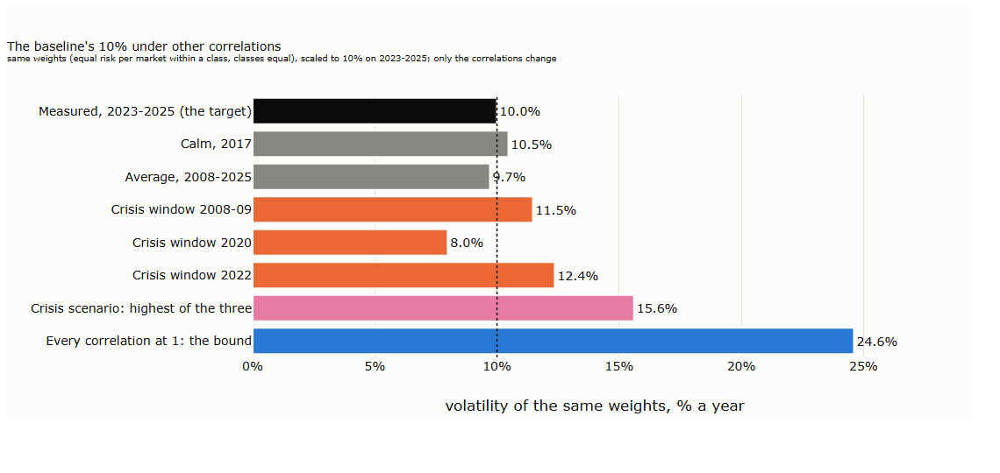
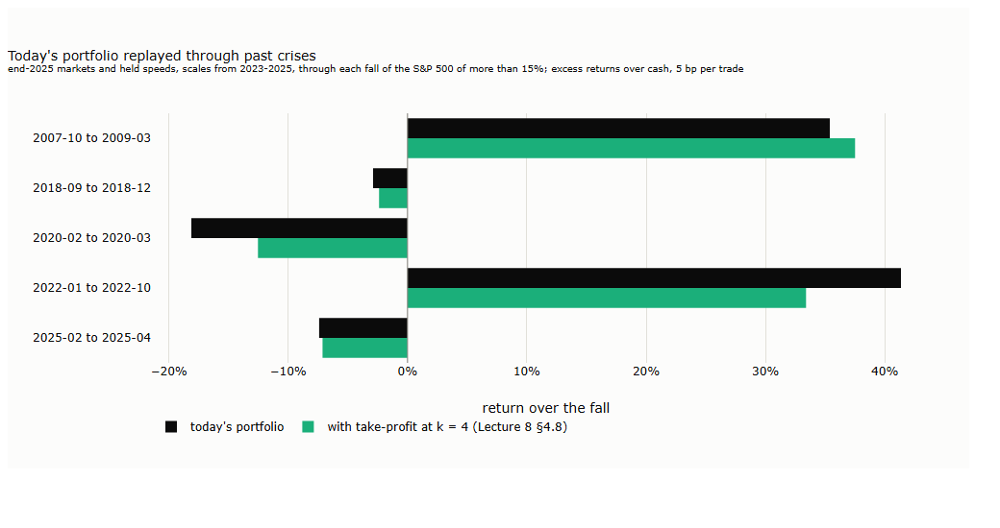

# Lecture 13: Portfolio Construction 3: The Baseline Trend Portfolio

*Systematic Trading: Lecture Notes (MSc) · draft, Nov 14, 2026 · Max Gnesi*

*Pipeline stage (Lecture 1 §2.1): portfolio construction and risk management (weights across markets and speeds, the volatility target).*

Lecture 11 chose the markets and Lecture 12 the speeds of the trend rules that trade them. This lecture is where portfolio construction comes together: the markets and speeds just chosen, the sizing of Lecture 9 and the comparisons of Lecture 7 meet in one portfolio. It blends the speeds inside each market, the markets inside each asset class, the classes into one account, and scales the total. Each step uses the same method, **equal risk**, and each could be done differently. The result is the **baseline**, which closes Part II: the portfolio every later lecture changes in one part and must beat out of sample. The lecture's question is which choices matter at each step and what each costs, not which portfolio is best. The plan was fixed before any result was computed, and every change made after seeing results is dated and labelled ([results/hypotheses.md](results/hypotheses.md)).

**The build, end to end.** Lectures 11 to 13 are one process, run once a year on the past three years only. Each step uses the steps before it and nothing after it; profits judge the result at the end and never set a choice or a weight.

| Step | Decision | What it uses | Result | Lecture |
|---|---|---|---|---|
| 1. Choose the markets | Which markets enter | Liquidity, history and overlap with the others, sign ignored; no strategy profits | 16 to 21 of 116 ETFs | 11 |
| 2. Choose the speeds | Which trend streams run | Each asset class's in-sample results, read as a region of speeds, not a point | 16 to 20 of 36 streams per market | 12 |
| **3. Weigh the speeds (this lecture)** | How much of each stream in a market | Risk only: each stream at equal risk; their correlations come from construction | One blended trend per market | 13 §2 |
| **4. Weigh the markets and the classes (this lecture)** | How much of each market, then of each class | Risk only: equal standalone risk; no correlations across classes | Markets equal within a class, classes equal | 13 §4 |
| **5. Scale the total (this lecture)** | How much leverage overall | The portfolio's volatility over three years, to 10% a year | The baseline trend portfolio | 13 §5 |

<sub><b>How to read the table.</b> One row per decision, in the order they are taken; the rows in bold are this lecture's. "What it uses": the only information the step may use. Steps 1 and 2 choose; steps 3 to 5 weigh, by risk alone.</sub>

**Two directions, one portfolio.** The risk budget is planned **top-down**: the total gets 10% a year; it is split equally across the asset classes; each class's share is split equally across its markets; each market's share across its speeds. The portfolio is computed **bottom-up**, because each level can be sized only once the level below exists: diversification makes a blend calmer than its parts, so its risk must be measured before it can be scaled. The held speeds are blended into one stream per market; each market stream is scaled to equal risk and combined into one stream per class; each class stream is scaled to equal risk and combined; the total is scaled to 10%. The groups can be the asset classes, known in advance and stable, or clusters of markets found each year in the data; §4.2 compares the two (no difference beyond the noise on our sample, and the clusters changed from year to year), so the baseline uses the classes and treats clusters as a check. **The build is a hierarchical risk parity in the general sense, with the tree fixed in advance:** equal risk at each level of total, classes, markets and speeds. It is not López de Prado's HRP (2016), which estimates a tree from correlations but then splits the sorted list in halves by count; §3 shows that this does not fix bunched speeds, while equal risk between natural groups does.


<sub><b>How to read the figure.</b> A stylised diagram, not data. From top to bottom: the total, the five groups (asset classes in the baseline), the markets of one group, the speeds of one market; every box at a level gets the same risk. Left arrow: the risk budget is shared out from the total downwards. Right arrow: the portfolio is computed from the speeds upwards.</sub>

**Why weigh in nested steps, not in one optimisation.** Steps 3 to 5 could be one optimisation over every stream in every market. They are kept apart for three reasons. (1) **The two kinds of correlation deserve different treatment:** across speeds the correlation comes from construction, is much the same in every market and can be estimated once on all markets pooled (§1); across markets and classes it is estimated and changes with regimes (§4.3). One matrix would mix the two, and the unreliable part would decide the answer. (2) **One large matrix is mostly noise:** about 20 streams in about 20 markets make some 400 streams and tens of thousands of correlations, far more than a few years of data can pin down. (3) **Nesting removes duplication:** in one step, a market with many held speeds would get more risk only because it has more streams; nested, each market first becomes one blended stream, and markets then compete on equal terms. Large funds that run one optimisation over all their streams add heavy constraints that bring back much of this structure; a one-step allocation is an exercise (§7.2).

## 1. Equal risk at every level

The lecture's result fits in one chart.


<sub><b>How to read the figure.</b> <b>Axes.</b> Left: the ratio of the slower to the faster speed of two trend streams in the same market (x, log scale) against the correlation of their daily returns (y), pooled over the markets with each asset class the same weight, data to end-2025; one dot per pair of speeds, coloured by rule; the black diamond is the mean over pairs of different rules at the same speed. Right: each asset class's share of the portfolio's gross exposure (grey) and of its realised risk (blue, x), mean over the years 2013-2025; dotted: an equal share of 20%. Excess returns over cash, 5 bp per trade; our calculation.</sub>

Two trend streams in the same market overlap by how far apart their speeds are, not by which rule they use. Two speeds a step apart (a ratio of 1.4) are 0.84 to 0.93 correlated; a ratio of 8 brings it to about 0.4 and the extremes of the grid (a ratio of 46) to 0.1 to 0.2. Different rules at the same speed overlap by 0.88. Held together, Lecture 12's 20 streams in a market amount to about **1.4 independent bets**. Across classes the opposite happens: the classes carry about the same risk (18% to 23%) with very different capital, because a calm government bond fund must be held at several times the size of an equity fund to carry the same risk (47% of the gross exposure against 10%).

| § | Step | Question |
|---|---|---|
| 2 | How weighting methods choose | Why do optimisers pick corners, what does each weighting assume about returns, and which is more correct? |
| 3 | Speeds inside a market: the easy case | Does the method matter when the correlations are known, and what if the speeds are unevenly spaced? |
| 4 | Markets and classes: the hard case | Why are correlations across markets shaky? Equal risk or equal capital, classes or groups found in the data, and how bad can the correlations get? |
| 5 | The total | Scale to a volatility target or hold leverage constant? |
| 6 | Today's portfolio in past crises | How would the portfolio held today fare in a repeat of past crises? |

**The workflow** is the build table above: markets first, then weights from risk only, and the strategy's profit and loss last, as the judge. Profit and loss never feeds back into the weights silently: where a weight depends on past performance (maximum Sharpe ratio in §2), the lecture says so and shows the cost. Weights that follow the speeds' recent performance are a question about the speeds, tested in Lecture 12 §8; exits such as taking profits act on the signal and are in Lecture 8 §4.8.

**The baseline in one sentence.** *Hold Lecture 12's speeds with equal risk in each market, the markets with equal risk in each asset class, the classes with equal risk, and scale the total each year to 10% volatility on its past three years.* All weights are set at each year end from 2012 on past data only and traded the following year; the results are out of sample, 2013-2026, on Lecture 11's markets (Sharpe ratio 0.49 after costs).

## 2. How weighting methods choose

### 2.1 The methods

Every level of the build, speeds in a market, markets in a class, classes in the portfolio, faces the same question: how to weigh things that overlap and differ in what they cost to hold. The methods compared in this lecture, from the simplest to the most demanding (Appendix A gives one card each):

| Method | Weights from | What it assumes | Label |
|---|---|---|---|
| Equal weight | Nothing | Every stream equally useful and equally distinct | Convention |
| Equal risk contributions | The streams' correlations | Every stream equally useful; overlap differs | Definition (Maillard, Roncalli and Teïletche, 2010) |
| Equal risk, net of costs | Correlations and each stream's cost | Every stream equally useful **before** costs | Our proposal |
| Minimum variance | Correlations, inverted | The lowest risk is the goal; implicitly, every stream earns the same (§2.3) | Definition |
| Maximum Sharpe ratio | Correlations and past Sharpe ratios after costs | Past Sharpe ratios predict the future | Definition (Markowitz) |
| HRP | A correlation tree, then halves of the sorted list by count | Groups can be found in the data | Definition (López de Prado, 2016) |
| Grouped at natural gaps | Groups drawn in advance, equal risk between and within them | The groups are known | Our proposal, the nesting of the build (§1) |

**Equal risk contributions.** Each stream contributes the same share of the blend's risk. With $`C`$ the streams' correlation matrix (the streams are first scaled to the same volatility) and $`w`$ the weights, stream $`i`$ contributes $`w_i\,(Cw)_i`$ to the blend's variance. The weights solve

```math
\min_{w > 0}\; \tfrac12\, w^\top C\, w \;-\; \sum_i b_i \log w_i ,
```

whose solution has risk contributions proportional to the budgets $`b_i`$ (all equal here), then normalised to sum to one. A stream that overlaps much with the others gets a smaller weight; a stream that adds something different gets a larger one.

**Equal risk, net of costs.** The budget of each stream is cut by what it costs to trade: $`b_i = \text{prior} - c_i`$, where the prior is a Sharpe ratio before costs assumed the same for every stream (0.3; 0.2 and 0.5 reported) and $`c_i`$ is the stream's **marginal cost** in the blend, in Sharpe-ratio units a year. The marginal cost is what the stream adds to the blend's trading, not what it would cost alone: when a fast and a slow stream trade against each other, their trades net inside the market's combined position and neither pays in full. At the speeds held here the costs are small (0.003 to 0.03 Sharpe-ratio units a year at the end-2025 review). The method is written in general because at higher frequency, where costs are a large share of the gross return, the same budget would move weights decisively away from the fast streams.

**Maximum Sharpe ratio.** The weights that maximise the blend's past Sharpe ratio after costs, long only. It is the only method that uses the streams' past performance, and Michaud (1989) called it an *error maximiser*: it puts the most weight on the streams whose past Sharpe ratio was overestimated the most. It is shown as a warning, not as a candidate.

### 2.2 Two rules: minimum variance against equal risk contributions

> **This section in five lines.** (1) Two rules decide everything: minimum variance equalises each stream's *marginal* risk, equal risk contributions its *total* contribution. (2) On near-duplicate speeds the first drops or shorts the middle speed, for about 3% less risk; the second keeps it. (3) Every weighting implies a view on returns: minimum variance assumes all speeds earn exactly the same. (4) If returns differ, the best weights swing wildly, and neither rule is safer in every direction. (5) The middle speed sits in the centre of the plateau, so think before setting its weight to zero; use correlation to share risk, not to hedge.

Why do optimisers pick corners, and why do the simple rules not? The whole question comes down to two rules, minimum variance and equal risk contributions, and to why the first eliminates the middle of a group of similar streams while the second keeps it. Every other method is a variant of one of the two. This section is about the mechanism and the philosophy, not about which method happened to earn most; Appendix A summarises the methods for practical use. The example uses three trend speeds because their correlations are known (§1); the mechanics hold for any assets, and §4 shows what changes when the correlations must be estimated.

**The example.** Three speeds, 50, 100 and 200 days, each scaled to the same risk, with correlations of 0.8 between neighbours and 0.5 between the slowest and the fastest (an illustration):

| Method | 50 days | 100 days | 200 days | Volatility of the blend |
|---|---|---|---|---|
| Equal weight | 33.3% | 33.3% | 33.3% | 0.894 |
| Equal risk contributions | 34.6% | 30.8% | 34.6% | 0.892 |
| Minimum variance, long only | 50% | **0%** | 50% | 0.866 |
| Minimum variance, shorts allowed | 67% | **−33%** | 67% | |

<sub><b>How to read the table.</b> Risk weights that each method gives three streams of equal risk (volatility 1) with the correlations above; illustrative numbers, not estimates. Last column: the blend's volatility in the same units. With correlations of 0.9 between neighbours and 0.7 at the ends, equal risk contributions barely move (34.1% / 31.7% / 34.1%), while minimum variance with shorts goes to +100% / −100% / +100%.</sub>

**Two rules, one difference.** Both methods look at how much each stream adds to the blend's risk. The **marginal risk** of stream $`i`$ is how much the blend's variance rises when a little more of it is added, $`(Cw)_i`$; its **risk contribution** is its weight times that, $`w_i\,(Cw)_i`$, and the contributions add up to the blend's variance.

| | Minimum variance | Equal risk contributions |
|---|---|---|
| What it equalises | The **marginal** risk of every stream held: $`(Cw)_i = \lambda`$ | The **total** contribution of every stream: $`w_i\,(Cw)_i = c`$ |
| What that implies for a weight | A stream whose marginal risk stays above the others' even at zero weight is dropped ($`w_i = 0`$, or negative if shorts are allowed) | $`w_i = c \,/\, (Cw)_i`$: the weight is inversely proportional to the marginal risk, so it shrinks but never reaches zero |

| Symbol | Meaning |
|---|---|
| $`C`$ | Correlation matrix of the streams, each scaled to the same volatility |
| $`w`$ | Risk weights, summing to one |
| $`(Cw)_i`$ | Marginal risk of stream $`i`$: its covariance with the blend |
| $`\lambda, c`$ | Constants: the common marginal risk, the common contribution |

**Why the middle speed goes.** The 100-day stream is correlated 0.8 with both neighbours; each end is correlated 0.8 with one stream and only 0.5 with the other. So the middle stream overlaps most with the rest of the blend. At equal weights its marginal risk is 0.867 against 0.767 for the ends: adding to it raises the blend's risk more than adding to either end. Minimum variance moves weight away from it until the marginal risks are equal. They never become equal: even at zero weight the middle's marginal risk is 0.80 against 0.75, so the middle is dropped, and with shorts allowed it is sold until the ends' extra exposure is offset. Equal risk contributions take the same marginal risks and simply give the middle less: 30.8% against 34.6%, which is almost exactly the ratio 0.767 to 0.867.

**What the elimination buys, and what it costs.** Dropping a third of the speeds lowers the blend's volatility from 0.892 to 0.866, by about 3%. In exchange, the blend holds two speeds instead of three, and with shorts it carries a bet on the **curvature** of the speeds, that middle speeds do worse than both neighbours: a trade nobody designed, which falls out of the arithmetic as a curve trade falls out of a bond optimiser. A long-only constraint does not remove the problem; it turns the short into a zero, which is clipping by another name.

| | Minimum variance | Equal risk contributions |
|---|---|---|
| **Pros** | The lowest risk the correlations allow; uses no return estimates; the right method when the goal truly is the lowest risk | Keeps every stream; uses no return estimates; weights move little when inputs change; a unique solution; the maximum-Sharpe portfolio when all streams have the same Sharpe ratio and the same correlation with each other (Maillard, Roncalli and Teïletche, 2010); its risk lies between minimum variance and equal weight |
| **Cons** | Assumes, without saying so, that every stream earns exactly the same: a stream with the same expected return as the others is dropped because it overlaps; concentrates in the least-correlated or calmest streams; with shorts, bets on curvature; across markets, where correlations must be estimated, it magnifies their errors | Gives up the small risk reduction of minimum variance; ignores genuine differences in return; **duplication**: adding a near-copy of a stream gives that stream a larger total share (a second 50-day stream would lift the 50-day speed from 34.6% to 48.7% of the weight) |

<sub><b>How to read the table.</b> Pros and cons of the two rules on near-duplicate streams. Numbers from the example above.</sub>

**Everything else derives from these two.**

| Method | Derived from | What it changes |
|---|---|---|
| Maximum Sharpe ratio | Minimum variance | Adds expected returns: $`w \propto C^{-1}\,\mathrm{SR}`$, so it inherits the inversion and adds the least reliable input (below) |
| Shrinkage of returns | Maximum Sharpe ratio | Pulls the Sharpe ratios towards their average; when they cannot be told apart it falls back to minimum variance and its corner |
| Shrinkage of correlations | Minimum variance, maximum Sharpe | Cleans the matrix before it is inverted; helps with many assets and short histories |
| Equal weight, equal risk | Equal risk contributions | Ignore correlations entirely |
| Grouping at the natural gaps | Equal risk contributions | Shares risk equally between natural groups first, then within them: the fix for duplication (§3). HRP as published (López de Prado, 2016) estimates the groups but splits them by count and did not fix it in §3 |

<sub><b>How to read the table.</b> Each method in terms of the two rules: the family it belongs to and what it adds or changes.</sub>

Other methods met in the literature, nested clustered optimisation, maximum diversification and spectral risk parity, are variants of the same two rules; the course does not use them (Appendix A, last line).

**Maximum Sharpe ratio: the minimum-variance corner, plus noise.** With two streams of correlation $`\rho`$, the maximum-Sharpe weights are $`w_1 \propto \mathrm{SR}_1 - \rho\,\mathrm{SR}_2`$ and $`w_2 \propto \mathrm{SR}_2 - \rho\,\mathrm{SR}_1`$. With $`\rho = 0.9`$ and past Sharpe ratios of 0.50 and 0.45, the second weight is $`0.45 - 0.9 \times 0.50 = 0`$: a difference of 0.05 sends all the weight to one stream. That difference is noise: the standard error of the gap between two Sharpe ratios correlated $`\rho`$ is about $`\sqrt{2(1-\rho)/T}`$, about 0.12 for $`\rho = 0.9`$ over 13 years ($`T`$ in years). Michaud (1989) called it an error maximiser.

### 2.3 Every weighting implies a view on returns

**Every weighting implies a view on returns.** Any set of weights is the maximum-Sharpe portfolio for some expected returns: those proportional to each stream's marginal risk, $`Cw`$. Reading them off (reverse optimisation) shows what each method assumes about performance, without saying so:

| Method | Weights, 50 / 100 / 200 days | Implied return of the middle speed, relative to the ends |
|---|---|---|
| Minimum variance, shorts allowed | 67% / −33% / 67% | Equal (×1.00) |
| Minimum variance, long only | 50% / 0% / 50% | Equal, or anything up to ×1.07 |
| Equal weight | 33% / 33% / 33% | ×1.13 |
| Equal risk contributions | 34.6% / 30.8% / 34.6% | ×1.13 |

<sub><b>How to read the table.</b> The example above. Last column: the expected return the middle speed would need, relative to each end, for the weights to be the best portfolio. Long only, any value up to ×1.07 keeps the middle at zero.</sub>

The result runs against intuition. Minimum variance does not assume the middle speed performs worst: it assumes all speeds earn exactly the same, and then drops the middle because, for the same return, it adds the most risk. Equal weight and equal risk contributions act as if the middle earned about 13% more, a difference well within the noise of any Sharpe ratio estimate; they hold no such view, they simply do not trade on the fine structure of the correlations.

**What if the returns are not equal?** Suppose the middle speed truly earns 0.8 to 1.2 times what the ends earn, with the correlations known exactly:

| Middle speed's return, relative to the ends | ×0.8 | ×0.9 | ×1.0 | ×1.1 | ×1.2 |
|---|---|---|---|---|---|
| Best weights, 50 / 100 / 200 days | 113% / −125% / 113% | 90% / −81% / 90% | 67% / −33% / 67% | 41% / 17% / 41% | 14% / 71% / 14% |
| Share of the best Sharpe ratio: minimum variance, shorts allowed | 0.92 | 0.98 | 1.00 | 0.97 | 0.90 |
| Minimum variance, long only | 0.86 | 0.94 | 0.99 | 1.00 | 0.96 |
| Equal risk contributions | 0.78 | 0.88 | 0.96 | 1.00 | 0.99 |

<sub><b>How to read the table.</b> The three-speed example with the middle speed's expected return set to each value in turn. First row: the maximum-Sharpe weights if that return were known. Other rows: the Sharpe ratio each method's fixed weights achieve, as a share of that best one. Our calculation.</sub>

Two lessons, one of them uncomfortable. The best weights are extremely sensitive: a 20% change in one return swings the middle speed from −125% to +71%, so an optimiser that estimates returns jumps between corners. But as fixed portfolios, minimum variance gives up little when the returns are unequal, at most about a tenth here, while equal risk contributions give up more when the middle speed earns less (about a fifth at ×0.8) and nothing when it earns more. Equal risk contributions are therefore not more robust in every direction. The case against minimum variance on speeds lies in what this example leaves out: the short version holds 167% gross exposure for 100% of risk and must trade and pay for its short leg; across markets its inversion also magnifies errors in estimated correlations; and on our data, across 86 markets out of sample, it trailed equal risk contributions beyond the noise in 13 markets and led in 1 (results/hypotheses.md). The baseline's choice rests on that: no leverage, no curvature bet, a simple rule and the out-of-sample record, together with where the middle speed sits (§3.2), not on a claim that equal risk contributions are safer in every case.

**Use what is known best: correlation to share risk, not to hedge.** For speeds, the inputs rank by how sure we can be. The correlation is the surest, because it comes largely from construction. The volatility is set by design, since every stream is scaled to the same risk. The expected return is the least sure: differences between speeds are smaller than their noise and could change sign. Portfolio construction on speeds should therefore lean on the correlation and not on expected returns, which is what equal risk contributions do. One subtlety: if the correlations were certain and the speeds earned the same, theory would prefer minimum variance with shorts, long the ends and short the middle. That long-short position has very little risk of its own, so it must be levered, and its profit depends entirely on the middle speed earning exactly what the ends earn: the input known least. Sharing risk by overlap uses what we know best; a hedge between near-duplicates turns the certain correlation into a bet on the uncertain return difference. Across markets and classes the correlation is no longer the surest input, which is the subject of §4.

### 2.4 More correct, or a matter of taste?

Both, at different levels. Some choices are worse whatever one believes, because they fail tests that do not depend on opinion: weights that jump when history is resampled, bets on differences smaller than their own noise, trades nobody designed. Among the methods that pass, the choice follows from beliefs that can be stated and checked:

| If you believe… | The consistent choice |
|---|---|
| The streams earn exactly the same, and their overlap is known exactly | Minimum variance, shorts allowed (the maximum-Sharpe portfolio under exactly these beliefs) |
| The streams earn about the same, and only the broad shape of their overlap is trusted | Equal risk contributions (the maximum-Sharpe portfolio if Sharpe ratios and correlations were all equal; robust when they are only roughly so) |
| The streams earn the same, are spread evenly (a geometric grid of speeds, no bunching), and correlations are not worth using | Equal weight, equal risk |
| The streams earn the same but bunch or include near-copies | Group them at the natural gaps, drawn in advance, then share risk within each; HRP as published does not do this (§3) |
| The goal is the lowest risk, not return per unit of risk | Minimum variance, long only |
| One stream earns more for a reason that should last | A modest tilt, stated in advance and tested elsewhere |

<sub><b>How to read the table.</b> Left: a belief about the streams. Right: the method consistent with it. The error is not choosing one row over another; it is choosing a method whose assumptions contradict one's beliefs, such as maximum Sharpe ratio while believing the streams cannot be told apart.</sub>

**Why the baseline uses equal risk contributions.** Every weight is a claim, and this rule makes only the claims the data support: that the streams' Sharpe ratios cannot be told apart and that the fine structure of their correlations should not be traded on, which is what Lecture 7's noise bands and Lecture 15's deflated Sharpe ratio say about most differences. Its mistakes are bounded: if the streams really differ, it gives up a little, at most about a fifth in the example above, while an optimiser that estimates returns can swing to extreme long-short weights. It keeps weights and performance apart, so the backtest does not mark its own homework. And one rule serves every level, speeds in a market, markets in a class and classes in the portfolio, with groups first wherever near-copies would otherwise count twice.

## 3. Speeds inside a market: the easy case

**Bottom line.** Across speeds the correlations are known by construction (§1), so the methods of §2 differ only by their objective, and **the grid of speeds matters more than the method**. On an evenly spaced grid even equal weight is fair; on an uneven one every method fails in its own way, and only sharing risk between natural groups repairs most of it. Three examples show the problems; a table then collects where each method fails.

### 3.1 Results on our data

| Method | Sharpe ratio, out of sample 2013-2026 | Independent bets per market (end-2025) | Streams with more than 1% weight (end-2025) |
|---|---|---|---|
| Equal weight per stream (baseline) | 0.486 | 1.39 | 20 of 20 |
| Equal risk contributions | 0.482 | 1.41 | 20 of 20 |
| Equal risk, net of costs (prior 0.2 / 0.3 / 0.5) | 0.483 / 0.482 / 0.482 | 1.41 | 20 of 20 |
| Maximum Sharpe ratio | 0.455 | 1.29 | 5 of 20 |

<sub><b>How to read the table.</b> Each method blends the held speeds inside every market; the rest of the portfolio (markets, classes, total) is the baseline's. Sharpe ratio after 5 bp per trade, excess returns over cash. Independent bets: the number of uncorrelated streams of equal risk that would give the blend's diversification, $`(\sum_i w_i)^2 / w^\top C w`$ with the streams at unit risk. Our calculation.</sub>

Equal weights, equal risk contributions and the cost-adjusted budgets give the same portfolio in practice: the equal-risk weights at the end-2025 review range from 4.5% to 5.8% around the equal 5%. §3.2 shows why: Lecture 12's speeds are evenly spaced.

Their correlations leave little to choose: when every pair of neighbours overlaps by about 0.9, no weighting finds a second independent bet that is not there. Maximum Sharpe ratio concentrates on five streams that changed from year to year (at the 2012 review mostly the 179-day crossover, at 2018 the 89-day crossover and the 127-day breakout) and earned 0.03 less.

**Reading.** On our sample the choice between the three risk-based methods does not matter, and equal weights are the simplest. The result is specific to streams that overlap this much and cost this little: with distinct strategies, or at speeds where costs bite, equal risk contributions and cost budgets would move the weights, and that is where Lecture 16 takes them up.

### 3.2 Three examples

**Example 1: the grid.** The correlation between two speeds depends on their ratio, not their difference (§1), so evenly spaced should mean evenly spaced in ratio. Six speeds between 40 and 400 days, each held with equal weight:

| Six speeds, 40 to 400 days | Risk in the fast / middle / slow third, equal weight |
|---|---|
| Same ratio: 40, 63, 100, 159, 252, 400 | 32 / 35 / 32 |
| Same day difference: 40, 112, 184, 256, 328, 400 | 13 / 34 / 52 |

<sub><b>How to read the table.</b> The range is split into three thirds by ratio: fast 40-86 days, middle 86-186, slow 186-400. Cells: the share of the blend's risk in each third, in %; 33 each would be fair. Correlations from the speed ratio as measured in §1; illustrative, not estimates ([scripts/l27_edge_cases.py](scripts/l27_edge_cases.py), [results/spacing.json](results/spacing.json)).</sub>

Spaced by days, 150 and 200 days are nearly the same speed (a ratio of 1.33) while 40 and 100 are very different (2.5), so the slow third ends up with half the risk. On a same-ratio grid even the simplest method is fair, which is why Lecture 12 steps each speed up by about 1.4 times (Lecture 12 §3.1). In the baseline every held speed carries all three rules, so the speeds are triplicated equally; the exception, the 251-day speed held only as the EWMA crossover, gets a little less risk than its region would alone.

**Example 2: three even speeds.** The example of §2.2 is the even case: 50, 100 and 200 days. Equal weight and equal risk contributions keep all three; minimum variance drops the middle one (50% / 0% / 50%) for about 3% less risk.

**Before setting a weight to zero, look where the speed sits.** The middle speed sits in the centre of the region of speeds that work (Lecture 12): its neighbours on both sides work too, so if the market's rhythm shifts a little it stays inside the region, while the ends sit at its edge. Lecture 7 §6 prefers the centre of a plateau to its edge; minimum variance does the opposite, keeping the edges and dropping the centre because of how it overlaps with them. That is a reason to think twice before a rule sets the middle speed's weight to zero.

**Example 3: a bunch.** Speeds of 50, 60 and 70 days, nearly copies of one another, and one of 200 days. Two regions, so a fair split gives each half of the risk.

| Method | Risk in the bunch |
|---|---|
| Equal weight | 78% |
| Equal risk contributions | 75% |
| Minimum variance | 52% |
| HRP | 76% |
| Grouped by region | 50% |

<sub><b>How to read the table.</b> The share of the blend's risk carried by the three bunched speeds; 50% would be fair. Correlations from the speed ratio as measured in §1: 0.93 inside the bunch, 0.67 to the far speed. Minimum variance: long only. HRP: hierarchical risk parity as published (López de Prado, 2016). Grouped by region: equal risk between the two regions, then equal risk contributions within each. Illustrative, not estimates.</sub>

Equal weight lets each near-copy count as a full speed, so the bunch takes three quarters of the risk. Equal risk contributions barely help: each near-copy still gets its own share. HRP sorts the speeds by correlation but then splits the list in halves by count, not at the gap between the regions, so it keeps the bunch together. Minimum variance balances the regions, but picks members of the bunch almost at random. Only sharing the risk between the regions first gives each its half: the nesting of the build (§1), applied inside a market.

**The erratic part, shown.** Take the bunch again (50, 60 and 70 days, and 200) and move one correlation, between the 50- and 60-day speeds, by at most 0.02 either side of its value of 0.93: a change far smaller than any estimate can resolve.


<sub><b>How to read the figure.</b> Axes. x: the change in the correlation between the 50- and 60-day speeds, from −0.02 to +0.02; y: the weight of each speed, in %. One panel per method; one line per speed (blue 50 days, orange 60, green 70, black 200). Correlations from the speed ratio, as in the table above; minimum variance long only ([scripts/l27_bunch_stability_chart.py](scripts/l27_bunch_stability_chart.py)).</sub>

Minimum variance trades the bunch's members against each other: on a change of 0.04 the 60-day speed falls from 12.6% to zero and the 70-day speed rises from 2.6% to 10.3%, while the bunch as a whole barely moves. HRP is flat until the tree reorders, then jumps by 4.4 points. Equal weight, equal risk contributions and grouping barely move (0.2 points at most), and only grouping is also fair between the regions. The bunch's members are near-copies, so the data cannot say which of them deserves the weight; a method that chooses anyway is choosing on noise.

### 3.3 Where each method fails

| Method | Fails when | On the examples |
|---|---|---|
| Equal weight, equal risk contributions | Speeds bunch or include near-copies: each copy counts as a full speed | The bunch: 75-78% of the risk; spaced by days: the slow third 50-52% |
| Minimum variance | Always: it starves the middle, and inside a bunch it picks members on noise; it assumes every speed earns the same | Even grid: middle third 12%; the bunch: the chart above |
| HRP, as published | Speeds bunch: it splits the sorted list by count, not at the gap, and reorders when a correlation shifts | The bunch: 76%, and a jump of 4.4 points |
| Grouped at natural gaps | Someone has to draw the groups (below) | |
| All of them | Speeds are missing: no method puts back a middle that is not there | Speeds only at 40-52 and 310-400 days: the middle gets nothing |

<sub><b>How to read the table.</b> One row per method; the middle column says when it fails, the right column where the examples above show it. Seven spacing patterns weighed by all five methods are in [results/bunching.json](results/bunching.json) ([scripts/l27_edge_cases.py](scripts/l27_edge_cases.py)).</sub>

Grouping has problems of its own, because someone has to draw the regions. A lone speed gets a whole region's share: with 50, 60 and 70 days and one speed at 500, grouping puts 50% of the risk on the 500-day speed alone (equal risk contributions, 25%), and a lone speed at the edge of the plateau is the least reliable place for it (Lecture 7 §6). On an even grid the cut decides the weights: for 50, 70, 100, 140 and 200 days, the 100-day speed gets 17.1% if the cut falls after 70 or after 100 days, 32.6% if it stands as a region of its own, and 19.1% under equal risk contributions with no cut at all.

**On random grids.** The seven patterns are chosen examples. On 500 grids of six speeds placed at random between 40 and 400 days:

| Method | Three parts | Whole range |
|---|---|---|
| Equal weight | 19 / 36 | 17 / 28 |
| Equal risk contributions | 17 / 33 | 16 / 26 |
| Minimum variance | 22 / 26 | 26 / 33 |
| HRP | 18 / 29 | 16 / 26 |
| Grouped by third | 2 / 2 | 10 / 15 |

<sub><b>How to read the table.</b> How unfairly each method spreads the risk along the speeds, in percentage points of the portfolio's risk; lower is fairer; typical grid (median) / worst tenth of grids. <b>Three parts</b>: the range is split into thirds by ratio and the number is how far the worst third is from a third of the risk. <b>Whole range</b>: nothing is split; walking from the fastest speed to the slowest, the risk collected so far is compared with the share of the range covered so far (each speed covering the stretch halfway to its neighbours, by ratio), and the number is the biggest difference along the way. Example: on the erratic grid with equal weight, the three fast speeds carry 53% of the risk but cover 25% of the range, so the grid scores 27. Grids with an empty third are left out ([results/random_grids.json](results/random_grids.json)).</sub>

Grouping is fairest on both measures, though by less on the whole range (10 against 16), which does not favour it. HRP equals equal risk contributions on the whole range; its small edge on three parts came from the way of measuring. Minimum variance is least fair on both. And no method makes a random grid fair: 10 to 26 points remain, which is why the grid comes first. Limits: the correlations come from a ratio model, and random grids bunch more than Lecture 12's contiguous held speeds.

**Robust weights, and a right objective, are different things.** A method's weights are robust when they hardly change if history had come out slightly differently. That is measured by resampling the history; watching the weights over yearly reviews proves nothing, since with an expanding window each review adds only a sliver of data and a corner held by a constraint does not move at all.


<sub><b>How to read the figure.</b> <b>Axes.</b> x: the risk weight of one speed; y: one row per method. Three panels, one per speed (43, 89 and 179 days, EWMA crossover, one market, SPY). The history up to 2025 is resampled 200 times in blocks of 21 days and each method recomputes its weights: the dot is the average weight, the bar runs from the 5th to the 95th percentile. Dotted line: one third. Our calculation ([results/optimisers_many.json](results/optimisers_many.json)).</sub>

The methods that use past returns scatter: maximum Sharpe ratio moves by tens of points from one resampled history to the next, and spectral risk parity jumps between speeds. Equal risk contributions move by about one point. Minimum variance does not move at all, since the speeds' correlations are fixed by construction, and it drops the middle speed in every draw: its weights are robust, its objective is the question. Out of sample, across 86 markets, no method gained reliably on equal risk contributions ([results/hypotheses.md](results/hypotheses.md)).

**What to do.** (1) **Fix the grid first**: space the speeds by ratio (Lecture 12 §3.1); it is the one remedy that works for every method. (2) **If the held set ends up uneven anyway**, because some speeds fail Lecture 12's selection, group at the natural gaps, drawn in advance from the speeds themselves and never tuned to results, then share risk within each group. (3) **Never leave the middle empty**: no method puts back speeds that are not there. Lecture 12's grid steps each speed up by about 1.4 times and its held speeds are contiguous, so the baseline is the even case, where equal weight is fair.

## 4. Markets and classes: the hard case

Across speeds the correlations are built in. Across markets they are not, and that changes which methods can be trusted.

| | Speeds inside a market | Markets inside a class | Asset classes |
|---|---|---|---|
| Where the correlation comes from | Construction: windows on the same price | A shared driver: rates for bonds, earnings for equities | The economy: growth, inflation, policy |
| How far it can be trusted | Well: much the same in every market | Roughly, but it can break when a market starts trading apart from its class | Little: it changes with regimes, even in sign (§4.3) |
| What goes wrong if a method relies on it | Near-copies and uneven spacing (§3) | A member that decouples is weighed on a correlation it no longer has | Weights built on calm years meet crisis correlations (§4.4) |

<sub><b>How to read the table.</b> One column per level of the build. The rows: where the correlation between two streams comes from, how far an estimate of it can be trusted, and what goes wrong when a weighting method leans on it.</sub>

Two speeds of one rule are windows on the same price, so much of their correlation is mechanical. On our data the correlations of the 43-, 89- and 179-day streams at the end of 2025 are almost the same in an equity index, crude oil and long bonds: 0.82 to 0.86 between the faster pair, 0.77 to 0.80 between the slower pair, 0.52 to 0.59 between the ends. So across speeds the minimum-variance corner of §2.2 is not an artefact of noise in the correlations: it is structural, and the objection to it is its objective. Across markets, correlations come from the economy, change with regimes and are far harder to estimate (Lecture 11 §5, Lecture 14): every method that inverts the matrix then magnifies estimation error as well. Inside a class the shared driver usually holds the markets together, but not always: while the Bank of Japan held Japanese government bond yields near zero (2016-2024), those bonds moved little with other government bonds; an example outside our data. Across classes the overlap of trend streams roughly triples in a crisis (§4.4).

**The consequence.** Weights across markets and classes should lean little on estimated correlations, and least of all across classes; a method that does use them must be judged with the correlations assumed to be very unstable. That is why steps 3 and 4 of the build use standalone risk only, and why §4.4 stresses the total with correlations the portfolio has not yet seen.

### 4.1 Equal risk, not equal capital

Inside each asset class the baseline gives every market the same risk, measured as the volatility of its blended streams over the past three years; the classes then get the same risk. Equal risk is the same method as for the speeds (§2), applied one level up. Its price is leverage: a fund of short-term Treasuries (SHY) moves about a tenth as much as an equity fund, so equal risk holds it at many times its value. Over 2013-2026 the portfolio's gross exposure had a median of 3.4 times capital, and government bonds were 47% of it (key chart, right).

**Equal capital** is the natural alternative: inside each class every market gets the same average gross exposure, and the classes still get equal risk.

| | Equal risk (baseline) | Equal capital inside classes |
|---|---|---|
| Sharpe ratio after costs, 2013-2026 | 0.49 | 0.44 |
| Worst drawdown | −22% | −24% |
| Gross exposure, median | 3.4 × capital | 2.2 × capital |
| Correlation of daily returns with the baseline | | 0.98 |

<sub><b>How to read the table.</b> The same speeds, classes and total scaling; only the weights of the markets inside each class differ. Volatility about 10.5% for both. Excess returns over cash, 5 bp per trade; our calculation.</sub>

The two portfolios are nearly the same (correlation 0.98). Equal capital carries a third less gross exposure, which matters where leverage is limited or costs money (Lecture 16), and earns a little less because the calm markets in each class barely count: within government bonds, the long Treasury fund carries almost all the risk. It also breaks the one method used at every other level, so the baseline keeps equal risk and treats equal capital as a remark on leverage.

**Equal risk per class is a convention.** It gives a class of two credit funds the same risk as a class of eight equity funds, and it would give a single Bitcoin future the risk of all equity. Classes could instead be weighted by how many independent bets they contain, or by size; Lecture 16 compares such methods, and an exercise asks how much the class weights matter (§7.2).

### 4.2 Asset classes or groups found in the data?

Asset classes are labels. Markets in different classes can trend together (gold and the yen; oil and Brazil's equity), and markets in the same class can trend apart. The rival replaces the five classes by five **groups found each year in the data**: markets clustered on how often their trends point the same way over the past three years (the concordance of trend phases of Lecture 11), with Ward linkage (and average linkage, as first fixed), each group then given equal risk.

| | Sharpe ratio after costs | Difference to classes, 90% band | Worst drawdown | Sum of the 12 worst months |
|---|---|---|---|---|
| Asset classes (baseline) | 0.49 | | −22% | −68% |
| Groups, Ward linkage | 0.52 | +0.04 (−0.12 to +0.18) | −21% | −56% |
| Groups, average linkage | 0.53 | +0.05 (−0.15 to +0.25) | −25% | −49% |

<sub><b>How to read the table.</b> Same markets, speeds and total scaling; only the grouping of markets into five equal-risk blocks differs, chosen at each year end on the past three years. Band: block bootstrap over calendar months. Twelve worst months: the sum of the twelve worst monthly returns, at about 10.8% volatility for all three. Our calculation.</sub>

The groups did a little better, but no difference is distinguishable from zero, and none of the comparisons fixed in advance passes the Benjamini-Hochberg correction. The groups also changed from year to year (with average linkage, gold, gold miners, the yen and the Australian dollar formed one group in 2013; in 2014 gold sat with US equity), so each year's portfolio rests on three years of co-movement in a few dozen markets. Classes are kept: they are stable and equally good on our sample. Whether data-driven groups add something with many more markets is research direction 5 of Lecture 16 §8.2: construction that uses only what is known.

### 4.3 When correlations across classes change regime

Steps 3 and 4 of the build use no correlations across classes. Step 5 does: the total is scaled on the portfolio's volatility over three years, and that volatility depends on how the classes move together. Correlations across classes come from the economy, not from construction, and they change with regimes. The stock-bond correlation is the classic case (Lecture 3 §8.3, Lecture 11 §3.5). This section asks three questions on five decades of monthly data, one series per class (equities, government bonds, credit, commodities, the dollar), each taken both as the asset and as its 12-month trend stream, which is what the portfolio holds (results/hypotheses.md).


<sub><b>How to read the figure.</b> <b>Axes.</b> Left: x, the correlation of US equities with US 10-year government bonds in each regime window; y, one row per window. Grey: the assets' monthly returns; blue: their 12-month trend streams. Right: x, the volatility the total would carry in each window if it had been scaled to 10% in the calm years 2003-2006, with equal risk across the five class trend streams; y, the same windows. Dotted line: the 10% target. Windows named before the data were loaded; 2020 holds 11 months and 2023-2024 holds 24, so their correlations are noisy. Our calculation ([results/regimes.json](results/regimes.json)).</sub>

**1. The regimes are real, and trend sees them differently.** The stock-bond correlation of the assets was positive in 1973-1982 (+0.16) and 1983-1999 (+0.11), negative from 2000 to 2020 (down to −0.71 in 2020), and positive again in 2022-2024 (+0.26). Across all five classes the average overlap of the assets was highest in 2020 (0.68), 2007-2009 (0.42) and 2022-2024 (0.36). The trend streams overlap less in every window (0.06 to 0.46), and their correlation is not the assets': in 2000-2002 the assets were correlated −0.43, the trend streams +0.39, because trend was short equities and long bonds, and both earned.

**2. Calm years overstate diversification, so choose markets on their bad regimes.** Measured on trend streams, the overlap of each class with the others rose from the recent three years to the worst window: credit from 0.18 to 0.38, equities from 0.18 to 0.33; government bonds (0.25 to 0.27) and commodities (0.13 to 0.20) changed least. A market that diversifies only in calm years should not earn its slot on them. For markets with a short history, such as thematic ETFs, three working assumptions keep this simple: a short history borrows the long one of its closest parent (here the Kenneth French industry portfolio it tracks best); it is judged in the parent's bad regimes; and its own past returns are never used, since themes tend to be launched after strong runs. Judged this way, the median overlap of 34 thematic ETFs with US equities rises from 0.41 on their last three years to 0.69 in their parents' worst windows: most are equity in another form. Biotech (0.39) and gold miners (0.22) stay separate bets. Where no parent fits, as for Chinese internet stocks, the method says so rather than guessing.

**3. Size the total for the correlations it may face.** A total scaled to 10% on the calm years 2003-2006 would have carried 13.3% in 2007-2009 and 12.9% in 2022-2024, about a third more than its target; scaled on 2010-2019, 12.4% and 12.0%. Scaled on the baseline's own recent years, already a high-overlap period, the worst window gives 11.2%. The overshoot depends on how calm the measuring years were. Two defences follow, both design choices rather than caps: measure the target on a window long enough to hold a bad regime, or check the total against the worst windows before committing leverage. The baseline keeps its rule; any change is a proposal to be tested on data it was not built on.

**The takeaway.** *Across speeds, correlation comes from construction; across classes it comes from the economy and changes regime. Choose markets on their bad-regime overlap, keep the weights of steps 3 and 4 independent of estimated cross-class correlations, and size the total for the correlations it may face, not only those it has seen.*

### 4.4 The correlations to assume, and a stress test

§4.3 showed that correlations across classes change regime. A portfolio manager should therefore state the correlations the portfolio assumes, and check the total against the ones it may face. This section does both for the baseline as it stood at the end of 2025: 20 markets in five classes, each market's trend stream the equal-risk blend of the speeds Lecture 12 held at every review (results/hypotheses.md).

**The correlations to assume.** The average correlation of the trend streams within each class and across classes, in three scenarios fixed before the data were read:

| Average correlation of trend streams | Equity | Government bonds | Credit | Commodities | Currencies | Across classes |
|---|---|---|---|---|---|---|
| Calm (2017) | +0.13 | +0.40 | +0.07 | −0.00 | +0.49 | +0.11 |
| Average (September 2008 to 2025) | +0.17 | +0.35 | +0.33 | +0.04 | +0.46 | +0.07 |
| Crisis (for each pair, the highest of 2008-09, 2020 and 2022) | +0.64 | +0.58 | +0.81 | +0.34 | +0.69 | +0.32 |

<sub><b>How to read the table.</b> Each cell is the average correlation of the daily trend streams of the baseline's markets: within a class (first five columns) or between markets of different classes (last column). Calm and average are single windows; the crisis row takes, for each pair of markets, the highest correlation of three crisis windows, so it is deliberately harsher than any one crisis. Our calculation ([results/corr_stress.json](results/corr_stress.json)).</sub>

In a crisis the markets of a class move together: credit's two markets from 0.07 to 0.81, equity's eight from 0.13 to 0.64. Across classes the correlation roughly triples. These are the numbers to state, and to plan for.

**The stress test.** The baseline's weights, scaled to 10% on the correlations of its own three years, held under each scenario. Only the correlations change; the volatilities of the streams are held fixed, so the test isolates what the correlations alone do.


<sub><b>How to read the figure.</b> <b>Axes.</b> x: the volatility the same weights would carry, % a year; y: one bar per correlation scenario. Black: the target, 10% on the correlations of 2023-2025. Grey: calm and average years. Orange: the three crisis windows. Pink: the crisis scenario of the table above. Blue: every correlation equal to 1, a bound that needs no model, the sum of the standalone risks. Dotted line: 10%. Our calculation.</sub>

The real crises took the 10% portfolio to between 8.0% (2020, when its trend streams diversified unusually well) and 12.4% (2022). The harsher crisis scenario gives 15.6%. If every correlation went to 1, the same weights would carry 24.6%, about two and a half times the target: no portfolio of these markets can lose more of its diversification than that. The range from 12% to 16%, with a hard ceiling of 25%, is what a manager accepts by targeting 10% on three calm-enough years; whether to scale the total on a stressed matrix instead is a proposal to be tested, not a change to the baseline.

**Splitting a class gave nothing.** Clustering could split an asset class into two more homogeneous groups. Tested at every review, the two-way split of equity was not stable from one year to the next (agreement 0.43, below the 0.5 fixed in advance). Government bonds, commodities and currencies did split stably, but only by setting one market apart (international bonds, gold, the yen), which equal risk within the class already treats fairly. The effective number of bets did not rise (equity 5.2 against 5.1; commodities 3.1 against 2.8). The classes are kept.

**Where clustering and related tools fit.** Pragmatically, and only as measurements or options: hierarchical clustering checks for duplicates and groups when markets are chosen (Lecture 11) and offers an alternative to asset classes as the groups (§4.2); principal components count a class's independent bets (Lecture 11). Denoising a correlation matrix would matter only if many markets were weighed with estimated correlations, which the baseline does not do; and it cleans noise, not regime change, so for the total the stress test above matters more.

## 5. The total


<sub><b>How to read the figure.</b> <b>Axes.</b> Left: date (x) against the drawdown from the previous peak (y) for the same portfolio scaled two ways: a volatility target (blue) and constant leverage (orange). Right: date (x) against gross exposure in multiples of capital (y, 21-day median). Out of sample 2013-2026, excess returns over cash, 5 bp per trade; our calculation.</sub>

Once the speeds, markets and classes are blended, one number remains: how large the whole portfolio is. Two ways are both in use, and they answer different questions.

| | Volatility target (baseline) | Constant leverage |
|---|---|---|
| Rule | At each year end, scale the total so that its volatility over the past three years would have been 10% | Each day, scale the total so that gross exposure stays at its median of the past three years |
| What stays fixed | Risk, as forecast once a year | Gross exposure |
| What moves | Gross exposure (it rises when markets calm down) | Risk (it rises when markets get rough) |
| Assumes | Volatility persists: calm markets stay calm long enough | The portfolio's size should not depend on recent calm |

| | Volatility target | Constant leverage |
|---|---|---|
| Sharpe ratio after costs | 0.49 | 0.39 |
| Volatility, whole period | 10.7% | 12.4% |
| Volatility over three months, 5th to 95th percentile | 5.7% to 15.6% | 5.7% to 22.9% |
| Worst month | −9.7% | −14.6% |
| Worst drawdown | −22% | −31% |
| Gross exposure, median (5th to 95th percentile) | 3.4 (1.3 to 6.9) | 3.6 (2.0 to 5.6) |
| Covid crash, Feb-Mar 2020 | −14.8% | −11.3% |
| Rate shock, 2022 | +25.6% | +33.3% |

<sub><b>How to read the table.</b> The same portfolio, scaled two ways. Rows 1-6: out of sample 2013-2026. The last two rows: return over each episode. Our calculation.</sub>

The volatility target earned more per unit of risk, but the difference is not distinguishable from zero (−0.10 for constant leverage, 90% band −0.25 to +0.06). The two differ mainly in *when* they carry risk. The volatility target holds risk steady and lets leverage swing, from 1.3 to 6.9 times capital: it was most levered in calm years (2013-2014), and lost more in the quick crash of 2020, which came after a calm spell. Constant leverage holds exposure steady and lets risk swing: its risk rose in rough markets, which cost it in 2016 and 2023 and paid in 2022. The choice is largely a matter of taste: which number should stay steady, risk or exposure. On our sample neither wins clearly.

**A lesson from scaling daily.** A natural improvement would be to scale the total each day on today's positions rather than once a year. It did worse (Sharpe ratio 0.46, volatility 16% instead of 10%). When markets chop, the speeds disagree, long and short streams offset inside each market, and the net position shrinks. A daily target reads the small position as low risk and scales it back up to full size, levering the portfolio exactly when the trend signals are weakest: in 2023 the daily version lost 15.6%, the yearly one 6.3%. Scaling once a year on the realised volatility of the whole portfolio keeps weak signals small. Scaling with correlations across markets, which a daily forecast would add, belongs to Lecture 16.

## 6. Today's portfolio in past crises

The out-of-sample results mix portfolios of different years. A different question is what the portfolio held today would do in a repeat of past crises: the end-2025 markets and speeds, with all scales from 2023-2025, replayed through each fall of the S&P 500 of more than 15%. Where §4.4 stressed the correlations alone, this replays the whole history of each episode. Which speeds worked in these crises is a question about the speeds, in Lecture 12 §8.2; the take-profit column is the exit rule of Lecture 8 §4.8.


<sub><b>How to read the figure.</b> <b>Axes.</b> x: the return of today's portfolio (end-2025 markets and held speeds, scales from 2023-2025) over each fall of the S&P 500, from peak to trough; y: one row per fall. Black: the portfolio as it is; green: with a take-profit at k = 4 (Lecture 8 §4.8). Excess returns over cash, 5 bp per trade; our calculation.</sub>

| Episode | S&P 500 | Today's portfolio | With take-profit at k = 4 | Drawdown inside the episode, without / with |
|---|---|---|---|---|
| 2007-09 | −57% | +35% | +38% | −13% / −11% |
| 2018 Q4 | −20% | −3% | −2% | −7% / −7% |
| Feb-Mar 2020 | −34% | **−18%** | −13% | −24% / −17% |
| 2022 | −25% | +41% | +33% | −11% / −7% |
| Feb-Apr 2025 | −19% | −7% | −7% | −8% / −7% |

<sub><b>How to read the table.</b> Return over the fall of the S&P 500 from peak to trough. 2000-02 is left out: only 5 of today's 20 markets traded then. Our calculation.</sub>

The worst case is a quick crash that hits a long, levered position sized on calm years: in 2020 today's portfolio would lose 18%, 16 points of it in credit (corporate bond funds held long at several times their value after a calm run), partly offset by commodities (+8%). Its worst day was −7.3%. The take-profit cuts that loss by about a third and gives up about a fifth of the 2022 gain, the trade-off Lecture 8 §4.8 found over the whole sample. Two long bear markets would have paid well. The stress test does not predict the next crisis; it shows where today's portfolio is exposed: to a fast reversal of a calm, long-held trend in a levered class.

## 7. Summary

### 7.1 Takeaways

- **The baseline:** equal risk at every level, for the speeds in each market, the markets in each class and the classes, with the total scaled each year to 10% on its past three years. Sharpe ratio 0.49 after costs, out of sample 2013-2026. Every later lecture changes one part and must beat it.
- **Speeds overlap by their ratio.** Neighbouring speeds are 0.9 correlated, and different rules at the same speed are too; 20 streams make about 1.4 independent bets in a market. Equal weights, equal risk contributions and cost-adjusted budgets gave the same result; maximum Sharpe ratio concentrated on a few streams and did worse.
- **Uneven speeds: fix the grid first, then group at the natural gaps.** Equal weight and equal risk contributions give a bunch too much risk, minimum variance picks inside it on noise, HRP as published keeps the bunch together; only grouping gives each region its share (§3).
- **Minimum variance drops the middle speed; equal risk contributions keep it.** The first equalises marginal risk, the second total contributions; on near-duplicates the first ends in a corner for about 3% less risk. For speeds, use the correlation, the input known best, to share risk out, not to hedge one speed against another. Every other method derives from these two (§2, Appendix A).
- **State the correlations you assume, and stress the total with them.** In crises the trend streams of a class move together (credit 0.81, equity 0.64) and across classes the correlation triples; the baseline's 10% would carry 8% to 12% in the real crises, 15.6% in a harsh scenario and at most 24.6% if every correlation went to 1 (§4.4).
- **Correlations across classes change regime.** The stock-bond correlation changed sign twice since 1973, and a total scaled to 10% in calm years carried about a third more in 2007-2009 and 2022-2024. Choose markets on their bad-regime overlap and size the total for the correlations it may face (§4.3).
- **Equal risk costs leverage.** Equal capital holds a third less gross exposure, earns a little less, and moves almost identically.
- **Volatility target or constant leverage** is a choice between steady risk and steady exposure, not a winner and a loser on our sample. Scaling daily on today's positions re-levers weak signals.
- **Today's portfolio is most exposed to a quick reversal of a calm, levered long trend,** as in 2020 (−18%, most of it in credit); the two long bear markets would have paid well (§6).

### 7.2 Exercises

- [ ] **One step.** Allocate every market × speed stream at once with equal risk contributions on their full correlation matrix, instead of two steps. How far are the weights from the two-step baseline? Does the out-of-sample result change?
- [ ] **Class weights by bets.** Weight each class by its number of independent bets (§3.1's formula applied to the markets' correlation) instead of equally. How much do the class weights matter?
- [ ] **Bitcoin, with hindsight.** Add the CME Bitcoin future (Yahoo BTC=F, from December 2017) as its own class, and as one market in commodities. What risk share does it get each way, and what does that do to the 2018 and 2022 drawdowns? Why is any result here hindsight?
- [ ] **Crowding.** The CFTC's Commitments of Traders reports show how speculators are positioned in each future. Is today's portfolio's worst stress case (§6) worse when speculators are crowded on the same side?
- [ ] **Bunching, on your own correlations.** Repeat the random-grid test of §3 ([scripts/l27_edge_cases.py](scripts/l27_edge_cases.py)) with the correlations measured between real trend streams of one market instead of the ratio model. Draw 500 sets of six held speeds, weigh each by equal weight, equal risk contributions, minimum variance, HRP and grouping at the natural gaps, and compare how far each strays from an even split and how steady it is. Does the ranking hold on both measures, the three parts and the whole range?

### 7.3 Reading list

- Maillard, S., Roncalli, T. and Teïletche, J. (2010). The properties of equally weighted risk contribution portfolios. *Journal of Portfolio Management*, 36(4), 60-70. The equal-risk-contribution portfolio of §2.
- Michaud, R. O. (1989). The Markowitz optimization enigma: is "optimized" optimal? *Financial Analysts Journal*, 45(1), 31-42. Why maximum Sharpe ratio maximises estimation error.
- DeMiguel, V., Garlappi, L. and Uppal, R. (2009). Optimal versus naive diversification: how inefficient is the 1/N portfolio strategy? *Review of Financial Studies*, 22(5), 1915-1953. Equal weights against fitted portfolios, out of sample.
- Levine, A. and Pedersen, L. H. (2016). Which trend is your friend? *Financial Analysts Journal*, 72(3), 51-66. Crossovers and past returns as the same filters, which is why the rules overlap at the same speed.
- Hurst, B., Ooi, Y. H. and Pedersen, L. H. (2017). A century of evidence on trend-following investing. *Journal of Portfolio Management*, 44(1), 15-29. Trend following across crises.

## Appendix A. Portfolio construction methods, in plain terms

A practical guide to the methods of §2, one card each: what the method does, what it trusts, when it works and how it fails. "Trusts" refers to the three layers of §2: what is known by construction, what can be estimated roughly, what is barely knowable.

| Method | What it does | What it trusts | Works when | Fails when |
|---|---|---|---|---|
| **Equal weight** | The same capital in each asset | Nothing | Assets have similar risk and are equally distinct | Risks differ: the most volatile asset dominates |
| **Equal risk (inverse volatility)** | Capital inversely proportional to volatility, so each asset has the same risk | Volatilities | Assets are roughly equally correlated | A group of near-duplicates gets as much risk each as a lone diversifier |
| **Equal risk contributions** | Each asset contributes the same share of the portfolio's risk | Volatilities; correlations in broad shape | Almost always a sound default; the maximum-Sharpe portfolio if all Sharpe ratios and correlations are equal | Assets earn very differently for a known reason (then tilt deliberately) |
| **Minimum variance** | The lowest-risk combination | The full correlation matrix, inverted; implicitly, equal expected returns | The goal really is the lowest risk | Near-duplicates: drops or shorts the middle one; concentrates in the calmest assets |
| **Maximum Sharpe ratio (mean-variance)** | The highest expected return per unit of risk | Correlations, inverted, and expected returns | Expected returns are known far better than they ever are | Almost always in practice: corners, extreme long-short weights, choices that follow the noise (Michaud, 1989) |
| **Shrinkage** | Pulls estimates towards a simple structure before optimising: Sharpe ratios towards their average, correlations towards a constant (Ledoit and Wolf, 2004) | The structure it shrinks towards | The structure is close to the truth | Shrinking returns alone does not help when the corner comes from the correlations (§2: the shrunk optimiser falls back to minimum variance) |
| **Hierarchical Risk Parity (HRP)** | Sorts assets by a correlation tree, then splits the sorted list in halves recursively, sizing each half by inverse variance (López de Prado, 2016) | Correlations, to sort the assets | Many assets and noisy or near-singular correlations: no matrix is inverted | Near-copies and bunches: it splits by count, not at the natural gaps, so a bunch keeps most of the risk; small changes in correlations can reorder the tree (§3) |

<sub><b>How to read the table.</b> One row per method, from those that use the least estimated information to those that use the most, then the methods that tame an optimiser. "Inverted": the weights depend on the inverse of the correlation matrix. Results on our data are in §2 and results/hypotheses.md.</sub>

**Also met in the literature, not used here.** Nested clustered optimisation (López de Prado, 2020) optimises inside clusters and then across them, so it behaves like the optimiser it runs. Maximum diversification (Choueifaty and Coignard, 2008) inverts the correlations as minimum variance does. Spectral risk parity (Meucci, 2009) spreads risk over principal components; on three speeds it put everything on one speed and jumped between resampled histories (§2). Denoising (López de Prado, 2020) is a cleaner input rather than a method, useful with many assets and short histories.

**How to choose, in two steps.** First rule out what fails tests that do not depend on opinion: weights that jump when the history is resampled, bets on differences smaller than their noise, trades nobody designed. Then choose among the rest by the belief you hold (the table at the end of §2), state it in advance, and keep it the same at every level of the portfolio.

**References for this appendix.** Choueifaty, Y. and Coignard, Y. (2008). Toward maximum diversification. *Journal of Portfolio Management* 35(1), 40-51. · Ledoit, O. and Wolf, M. (2004). Honey, I shrunk the sample covariance matrix. *Journal of Portfolio Management* 30(4), 110-119. · López de Prado, M. (2016). Building diversified portfolios that outperform out of sample. *Journal of Portfolio Management* 42(4), 59-69. · López de Prado, M. (2020). *Machine Learning for Asset Managers*. Cambridge University Press. · Maillard, S., Roncalli, T. and Teïletche, J. (2010). The properties of equally weighted risk contribution portfolios. *Journal of Portfolio Management* 36(4), 60-70. · Meucci, A. (2009). Managing diversification. *Risk* 22(5), 74-79. · Michaud, R. O. (1989). The Markowitz optimization enigma: is "optimized" optimal? *Financial Analysts Journal* 45(1), 31-42.
