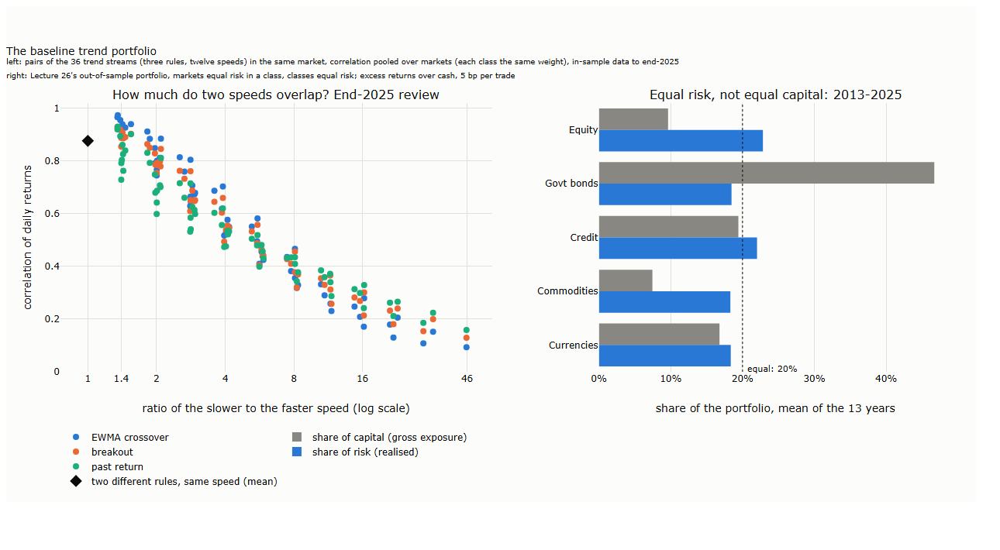
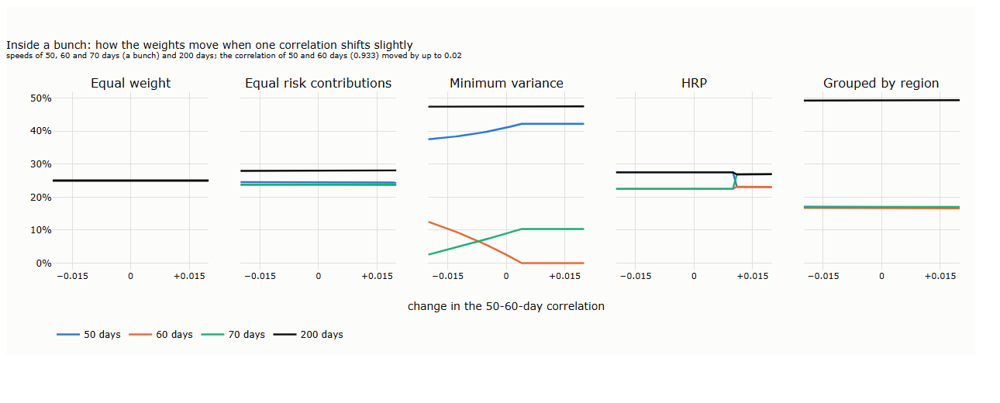
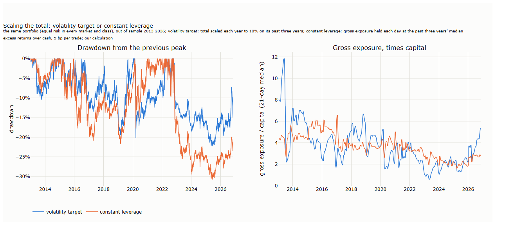
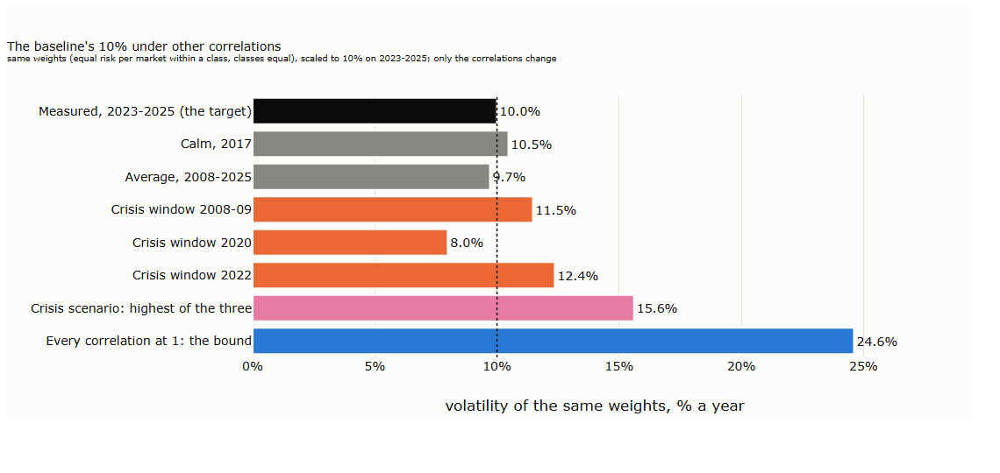
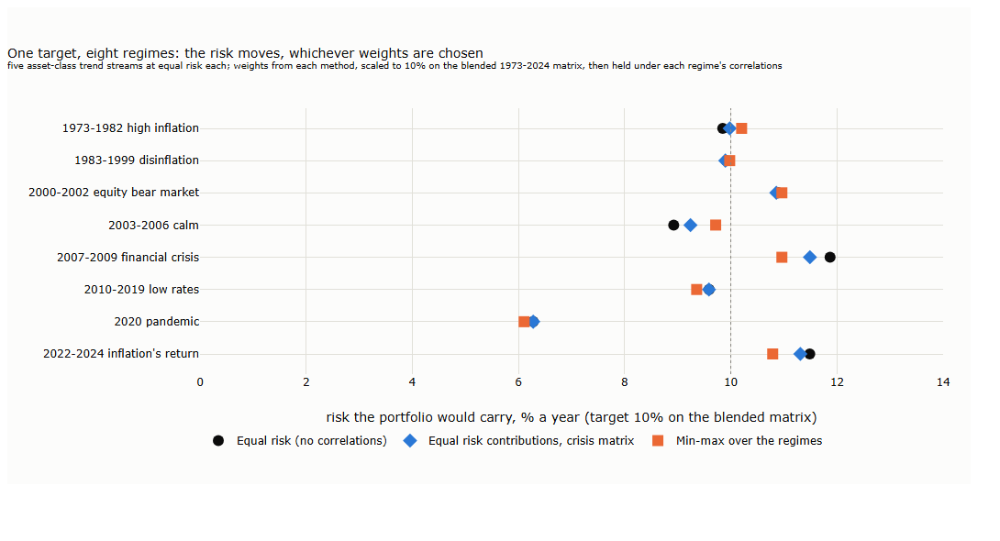

# Lecture 13: Portfolio Construction 3: The Baseline Trend Portfolio

> One portfolio from Lecture 11's markets and Lecture 12's speeds, built with one method at every level: equal risk.

Part II · Pipeline stage: portfolio construction and risk management (weights across markets and speeds, the volatility target)

---

# Equal risk at every level

> Speeds overlap by their ratio, not by their rule: Lecture 12's 20 streams in a market amount to about 1.4 independent bets.

- Speeds a step apart: 0.84 to 0.93 correlated
- Classes carry about the same risk (18% to 23%) with very different capital
- Government bonds: 47% of the gross exposure, equities 10%

---

# The baseline: the yardstick for Lectures 14-16

> Every later lecture changes one part of the baseline and must beat it out of sample.

1. **Speeds** with equal risk in each market
2. **Markets** with equal risk in each asset class
3. **Classes** with equal risk
4. **The total** scaled each year to 10% volatility on its past three years
- Weights set at each year end from 2012 on past data only: Sharpe ratio **0.49** after costs, out of sample 2013-2026

---

# Weights from risk only

> Profit and loss never feeds back into the weights silently: where a weight depends on past performance, the lecture says so and shows the cost.

| Step | Uses |
|---|---|
| Markets | Liquidity, history, overlap |
| Speeds | Strategy performance, in sample, as a region rather than a point |
| Weights | Risk only: volatilities, correlations, costs |
| Judge | Profit and loss, out of sample |

Two steps, speeds inside a market and then markets and classes, are a **convention**: the speeds' overlap is much the same in every market.

---

# Blending the speeds: equal weights suffice

> Equal weights, equal risk contributions and cost-adjusted budgets give the same portfolio in practice; maximum Sharpe ratio concentrated on five streams and earned 0.03 less.

| Method | Sharpe ratio, 2013-2026 | Independent bets per market |
|---|---|---|
| Equal weight per stream (baseline) | 0.486 | 1.39 |
| Equal risk contributions | 0.482 | 1.41 |
| Maximum Sharpe ratio | 0.455 | 1.29 |

$$\text{independent bets} = \frac{(\sum_i w_i)^2}{w^\top C w}$$

When neighbours overlap by about 0.9, no weighting finds a second independent bet that is not there.

---

# Why optimisers drop the middle speed

> Minimum variance equalises each speed's marginal risk, $(Cw)_i$; equal risk contributions equalise its total contribution, $w_i\,(Cw)_i$. The middle speed overlaps both neighbours, so only the first drops it.

| Three speeds, correlation 0.8 / 0.8 / 0.5 | 50 days | 100 days | 200 days |
|---|---|---|---|
| Equal risk contributions | 34.6% | 30.8% | 34.6% |
| Minimum variance, long only | 50% | 0% | 50% |
| Minimum variance, shorts | 67% | −33% | 67% |

- Dropping the middle buys about 3% less risk, and with shorts a curvature bet nobody designed
- For speeds, correlation is the input known best: use it to share risk, not to hedge

---

# Every weighting implies a view on returns

> Minimum variance does not assume the middle speed is worst: it assumes all speeds earn exactly the same, and drops the middle because it adds the most risk.

| Method | 50 / 100 / 200 days | Implied return, middle against the ends |
|---|---|---|
| Minimum variance, shorts | 67% / −33% / 67% | Equal (×1.00) |
| Equal risk contributions | 34.6% / 30.8% / 34.6% | ×1.13 |

- If returns differ, the best weights swing from −125% to +71% on the middle speed: neither rule is safer in every direction
- The middle speed sits in the centre of the plateau: think before setting its weight to zero

---

# When the speeds are not evenly spaced

> Fix the grid first; if the held speeds still bunch, share risk between the natural groups, then within each.

Speeds 50, 60, 70 and 200 days; a fair split is 50 / 50:

- **Equal weight, equal risk contributions:** the bunch gets 75-78%
- **HRP as published:** 76%
- **Minimum variance:** 52%, but picks inside the bunch on noise
- **Grouped by region:** 50%, steady

---

# Equal risk, not equal capital

> Equal risk costs leverage: equal capital holds a third less gross exposure, earns a little less, and moves almost identically.

| | Equal risk (baseline) | Equal capital inside classes |
|---|---|---|
| Sharpe ratio after costs, 2013-2026 | 0.49 | 0.44 |
| Worst drawdown | −22% | −24% |
| Gross exposure, median | 3.4 × capital | 2.2 × capital |
| Correlation with the baseline | | 0.98 |

Groups found in the data instead of asset classes did a little better (0.52), but no difference is distinguishable from zero; classes are kept, being stable.

---

# The total: volatility target or constant leverage

> A choice between steady risk and steady exposure, not a winner and a loser: on our sample neither wins clearly.

- Sharpe ratio 0.49 against 0.39; difference not distinguishable from zero
- The target levers up in calm years: Covid crash −14.8% against −11.3%
- Constant leverage paid in 2022: +33.3% against +25.6%

---

# The correlations to assume, and a stress test

> State the correlations the portfolio assumes, and check the total against the ones it may face.

- In crises, trend streams within a class move together: credit 0.07 to 0.81, equity 0.13 to 0.64
- The baseline's 10% carried 8.0% to 12.4% in the real crises, 15.6% in a harsh scenario
- If every correlation went to 1: 24.6%, the bound that needs no model

---

# Weighing when correlations are unstable

> One matrix over the whole history blends regimes into a number the portfolio may never meet; size by volatility, read correlations regime by regime, and use them to check the total.

- Equity-bond trend correlation by regime: from −0.66 (2020) to +0.39 (2000-02); blended over all years: −0.03
- Across classes every method lands near equal risk; the regime risk sits in the **total**: 6% to 12% on a 10% target
- Weights by the worst regime, a turbulent-tilted blend or min-max; never an average of regimes

---

# Is correlation important for a trend book?

> For return, no; for risk and breadth, yes. Correlation decides **which markets** to hold; equal risk weighs them; correlation checks the total.

| Average correlation of the trend streams | Book Sharpe ratio, 20 markets at 0.3 each |
|---|---|
| 0 | 1.34 |
| 0.1 | 0.79 |
| 0.3 | 0.52 |

- **The sign does not matter:** at −1 a trend follower holds the mirror image, one bet, not a hedge
- **Do the streams lose together?** Little more than chance (16% of months vs 14%); they gain together more (27% vs 24%)

---

# Today's portfolio in past crises

> The worst case is a quick crash that hits a long, levered position sized on calm years: in 2020 today's portfolio would lose 18%.

| Episode | S&P 500 | Today's portfolio |
|---|---|---|
| 2007-09 | −57% | +35% |
| Feb-Mar 2020 | −34% | **−18%** |
| 2022 | −25% | +41% |
| Feb-Apr 2025 | −19% | −7% |

16 points of the 2020 loss came from credit: corporate bond funds held long at several times their value after a calm run.

---

# Choosing the settings

> When methods built on different assumptions agree, the choice does not matter: take the simplest, and look for the risk elsewhere. Agreement is not safety.

| Where the portfolio would fail | On our data |
|---|---|
| A quick crash after a calm run | 2020: today's portfolio −18%, 16 points in credit |
| Correlations jump inside a class | 10% target becomes 15.6% in a harsh scenario |
| A regime where classes move together | 11.5% to 11.9% on a 10% target |
| Volatility scaled on a calm window | 13.3% in 2007-09 |

- Decide from what is known about the inputs, rule out what fails objective tests, then compare one setting at a time against the noise

---

# Takeaways

1. **Equal risk at every level:** speeds, markets, classes; the total scaled to 10%
2. **Speeds overlap by their ratio:** 20 streams make about 1.4 independent bets; equal weights matched the risk-based blends
3. **Uneven speeds:** fix the grid first, then group at the natural gaps; HRP as published does not fix a bunch
4. **Equal risk costs leverage:** equal capital holds a third less exposure and moves almost identically
5. **State the correlations you assume and stress the total:** 15.6% in a harsh crisis scenario, 24.6% at most
6. **Volatility target or constant leverage** is a choice between steady risk and steady exposure; scaling daily re-levers weak signals
7. **Today's portfolio is most exposed to a quick reversal** of a calm, levered long trend, as in 2020

> The baseline in one sentence: hold Lecture 12's speeds with equal risk in each market, the markets with equal risk in each asset class, the classes with equal risk, and scale the total each year to 10% volatility on its past three years.
