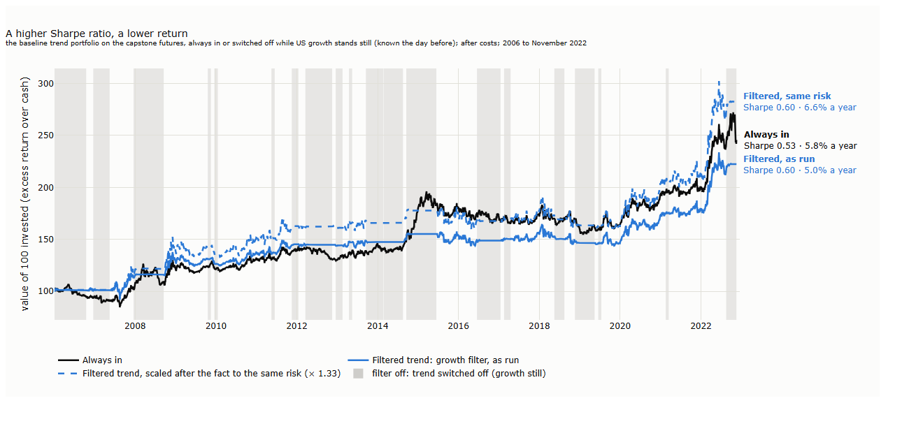
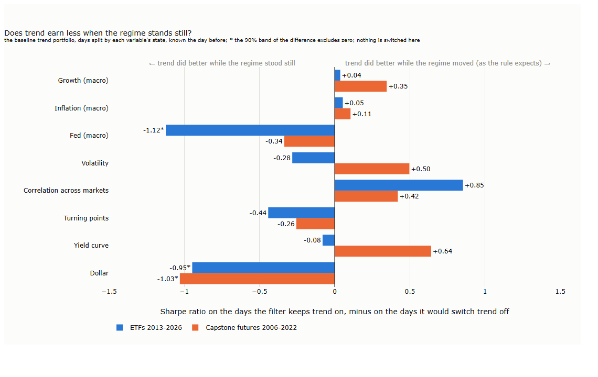
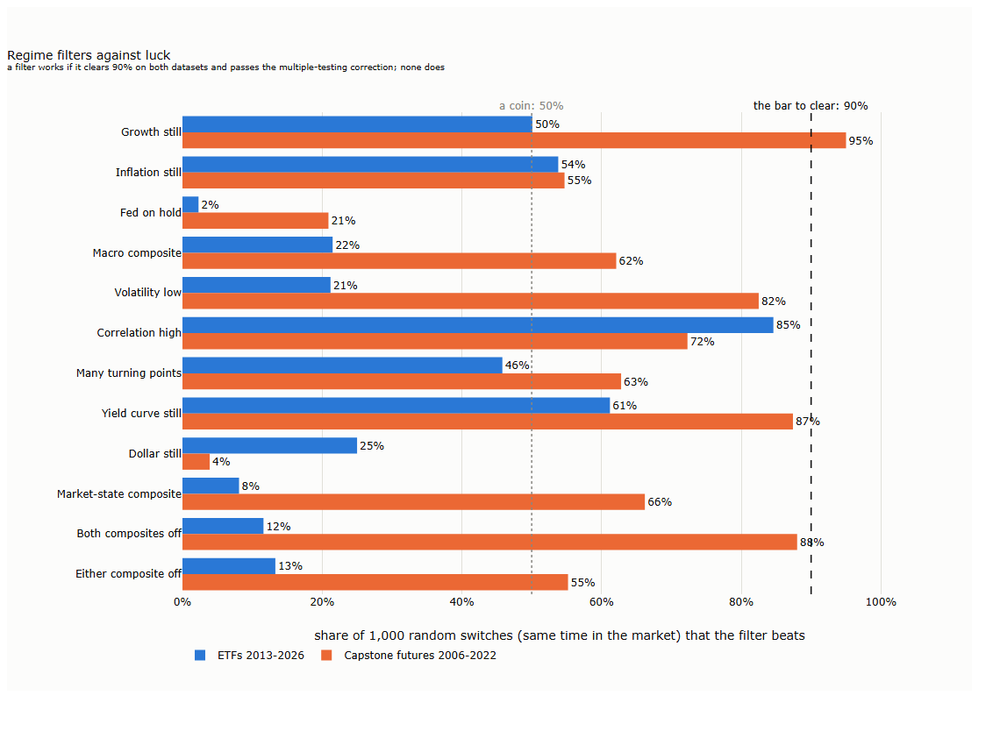
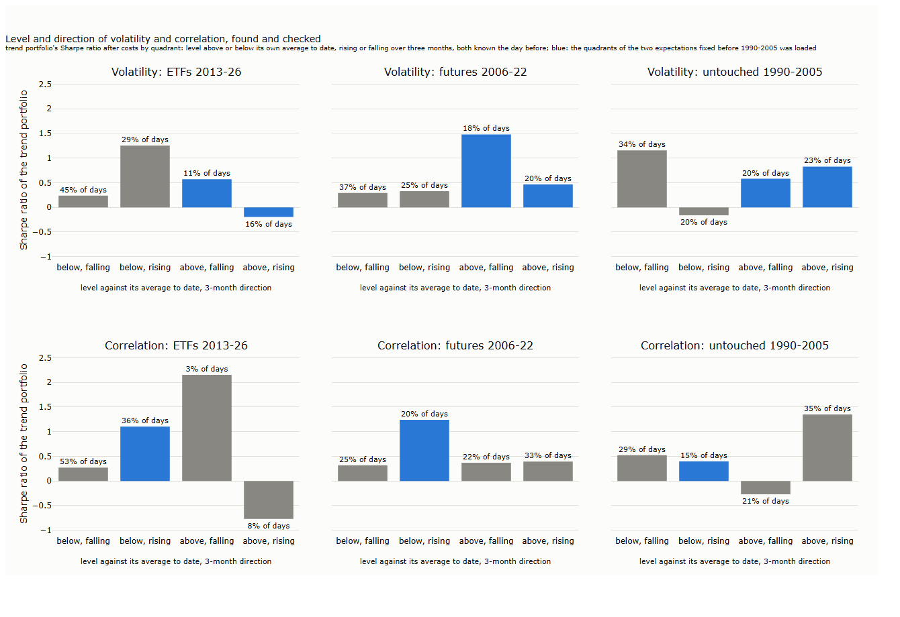
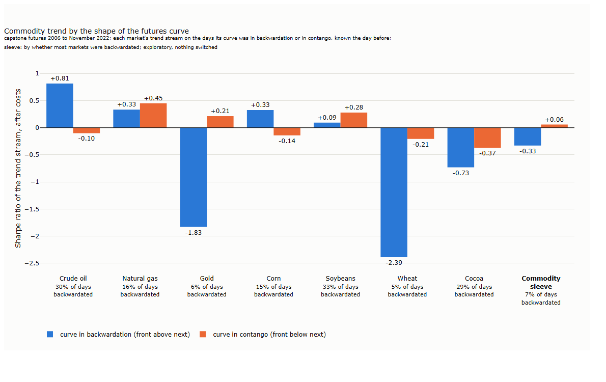

# Lecture 14: Regime Filters: When to Hold Trend

> A regime filter turns the baseline into filtered trend: trend that steps aside when the economy or the markets are in a state where trend is expected to fail.

Part III · Pipeline stage: risk management (a regime switch as an overlay on trend)

---

# Several filters beat chance clearly

> The growth filter on the futures beat 95% of its random switches: a higher Sharpe ratio (0.60 against 0.53), yet less money.

- Off 41% of the time: 5.0% a year against 5.8%
- Its capital is idle during the grey bands
- Strongest lead: trend after large dollar moves, 94% on untouched years

---

# Promising paths

> Several filters are well beyond chance and worth further research; none yet clears the strict bar fixed in advance, so none is ready to be a rule.

| Path | Evidence on our data |
|---|---|
| **Trend after large dollar moves** | Beat 94% of random switches on 1990-2005, untouched years; same direction on ETFs and futures |
| **Commodity trend and the curve** | Crude oil trend 0.81 in backwardation, −0.10 in contango |
| **Growth standing still** | Beat 95% of random switches on the futures, 50% on the ETFs |
| **The Fed moving** | Reversed Fed filter beat 78% on 1990-2005 |
| **Scaling instead of switching** | A switch leaves capital idle, whatever its timing |

---

# A switch, or a second business

> Trend loses money in some regimes: switch it off when the regime is bad (this lecture), or hold strategies that earn for different reasons next to it (Lecture 15).

| | Switching trend | Adding strategies to trend |
|---|---|---|
| Question | Does the regime tell us when trend works? | Is there a strategy that earns when trend does not? |
| Judged against | Always-in and random switching with the same time in the market | What it adds to trend, against random strategies |
| Idle capital | Stays idle: a switch can only take away | None: every strategy is always in |

**The rule in one sentence:** *trade trend while the regime is moving; step aside while it stands still.*

---

# The bar a switch must clear

> A filter that knew nothing would lower the Sharpe ratio over all days by the factor √p: off half the time, it must pick days 41% better than average.

$$\text{Sharpe ratio, all days} \;\approx\; \text{Sharpe ratio while on} \times \sqrt{p}$$

| Share of days on, $p$ | 90% | 75% | 60% | 50% |
|---|---|---|---|---|
| Sharpe ratio needed while on, as a multiple of always-in | 1.05 | 1.15 | 1.29 | 1.41 |

The formula is a guide; the yardstick is the **random filter** with the same time in the market, the same spell lengths and the same attachment.

---

# Six questions, six numbers

> No single number compares filtered trend with always-in: two describe the strategy, two the account, two whether the timing carries information.

- **The strategy:** Sharpe ratio over all days; Sharpe ratio while on
- **The account:** excess return a year as run; return and drawdown scaled to the same risk
- **The timing:** share of random filters beaten; alpha over always-in
- A filter can beat luck and still lose to always-in

---

# The regime variables

> Two families tested side by side, each with an unfavourable state fixed before any result: for most, "still", the regime not moving.

| | Macro variables | Market-state variables |
|---|---|---|
| Examples | Growth, inflation, the Fed | Volatility, correlation, turning points, yield curve, dollar |
| Updated | Monthly, published weeks late | Daily, known at the close |
| Revised later | Yes: only data as published at the time are used | Never |
| Independent episodes in twenty years | A handful | Many |

---

# Data as first published

> On revised data, 19% of days on the ETFs and 22% on the futures fall in a different growth × inflation quadrant than on data as first published.

- The trend portfolio's Sharpe ratio by quadrant changes with them
- On the futures, the best quadrant moves from "growth down, inflation up" (1.12) to "growth up, inflation up" (1.18)
- Industrial production and CPI come from the Philadelphia Fed's Real-Time Data Set (free), one vintage a month
- A regime map drawn on revised data describes a history no trader saw

---

# The scan: does trend earn less when the regime stands still?

> No variable separates the days in the planned direction on both datasets; two separate in the opposite direction.

- **Dollar still:** ETFs 1.06 against 0.11, futures 1.31 against 0.28
- **Fed on hold:** ETFs 1.13 against 0.01
- A regime's effect on trend changes between periods

---

# The filters against luck

> Several filters did clearly better than chance on at least one dataset; none beat 90% of its random filters on both.

- Missing a strict bar means *not shown yet*, not *shown not to work*
- Worst filters: the dollar and the Fed, switching off good days
- Both families together did not beat either alone

---

# The dollar, on untouched years

> The dollar repeated, reversed: on 1990-2005 trend lost money after large dollar moves (−0.11) and earned 0.83 on the other days.

| 1990-2005 (always in: 0.64) | Correlation high | Fed moving | Dollar moving |
|---|---|---|---|
| Trend on the days kept / switched off | 0.55 / 0.76 | 1.07 / 0.47 | **0.83 / −0.11** |
| Filter, Sharpe ratio over all days | 0.47 | 0.47 | **0.69** |
| Random filters beaten | 54% | 78% | **94%** |

- The one pattern that held in all three samples; it misses the multiple-testing bar only narrowly (p = 0.06 against 0.05)
- A possible mechanism, a hypothesis: after a large, mature dollar move, a dollar reversal turns many trend positions at once

---

# Patterns found after looking need fresh data

> Volatility and correlation quadrants looked consistent on 2006-2026 and did not repeat on 1990-2005.

- Two statements fixed before the third sample was loaded
- Neither repeats: bands about one Sharpe-ratio unit wide on each side
- The lesson is the method: state, then check on other years

---

# One class at a time: commodity curves

> Some regimes belong to one class: crude oil trend earned 0.81 in backwardation and −0.10 in contango.

- Difference 0.91; 90% band 0.13 to 1.74
- Seven markets, no correction: one or two bands excluding zero is close to chance
- Trend and carry pulling the same way: the step to Lecture 15

---

# Takeaways

1. **Compare filtered trend on several numbers, not one:** a higher Sharpe ratio can come with a lower return, because idle capital earns nothing
2. **Use macro data as first published:** on revised data a fifth of the days change quadrant
3. **Several regime filters beat chance clearly; none yet clears a strict bar fixed in advance.** The most promising pattern ran against the plan: trend did worse after large dollar moves
4. **Patterns found after looking need data they were not found in:** the quadrants did not repeat on 1990-2005
5. **Some regimes belong to one class:** crude oil trend did better when its curve was backwardated

> A regime pattern found on twenty years of data rests on a few episodes, so it has to be found, stated in advance and confirmed on other years, one step at a time.
