# Lecture 14: How the Price Moves: Volatility and the Path

*Systematic Trading: Lecture Notes (MSc) · Oct 22, 2026 · Max Gnesi*

A bar keeps four prices of everything that happened inside it. This lecture looks at what it throws away, the path between those prices, and at the number that summarises how much a price moves, its volatility. The path decides whether a stop or a target is hit first, how often a grid's orders fill, and how far a position runs against its owner before it is closed; volatility decides how large a position may be, how wide a grid should be spaced and where a stop belongs. Both are measured on the same five years of BTCUSDT trades as Lectures 12 and 13. The lecture covers the second and third of Part III's six uses of the tape (the course guide, §1.1b): the path between bars, and volatility measured precisely.

> **What to take away**
>
> 1. **A candle loses the order and the distance travelled:** which level was hit first, and whether the price got there in one move or in many.
> 2. **The path is close to a random walk, but not on every day:** on BTCUSDT it turns back on ordinary days and runs on explosive ones, and the average describes neither.
> 3. **Levels on the path are not what variance promises:** fewer crossings than a random walk, rare excursions far larger, stops cheap in the median and expensive in the tail.
> 4. **Volatility is best measured inside the bar,** in any of its forms; each measure captures a different shade of the same risk, and on any clock a day's risk is the number of bars times the risk per bar.

## 1. What a bar does not tell

| § | Step | Question |
|---|---|---|
| 2 | What a candle loses | What does a bar not record, and when does that matter? |
| 3 | The path against a random walk | Does the price behave like a path without memory, and does that hold on every day? |
| 4 | Levels on the path | How often is a level crossed, how far does a position run against its owner, and what happens when the price jumps a level? |
| 5 | Volatility, built up | How is the number made, where should it be measured, and which measure forecasts the next bars? |
| 6 | Risk on any clock | How is risk measured on dollar or range bars, where √t no longer applies? |
| 7 | For the two examples | What the trend rule (Lecture 16) and the grid (Lecture 17) take from this lecture |

**A unit before we start.** Every statement about the path needs a scale: is a move of 50 basis points large or small? The scale is volatility, the typical size of the price's moves over a given time. Here it is measured in the simplest way the tape allows: square each one-minute return of a day and add them up. The sum is the day's **realised variance**, its square root the day's volatility. A random walk spreads its moves evenly, so its variance grows in proportion to time and its volatility with the square root of time, √t: four times the time, twice the move. §3 tests whether the price follows that rule; the second half of the lecture asks how volatility should be measured and used.

**Data.** As in Lectures 12 and 13: the BTCUSDT perpetual on Binance, October 2021 to September 2026, from the tape of Lecture 12. The path is followed minute by minute, from one-minute closes; where single trades matter, from the trades themselves.

## 2. What a candle loses

A candle records the first and last price of a bar and its extremes. It records neither **what happened first** nor **how far the price travelled** in between.

**What came first.** A backtest on candles must guess whether the high or the low came first; on the tape, the order is known. Two common guesses, checked against the tape:

| Bar | "The bar's direction": a rising bar went to its low first | "The open nearer the high": then the high came first |
|---|---|---|
| 5 minutes | right on 90% of bars | 81% |
| 1 hour | 88% | 80% |
| 1 day | 88% | 81% |
| A random walk, any length | 89% | 81% |

*Our measurement for these notes; the random walk by simulation.*

The better guess is wrong on about one bar in eight, at every bar length, and a random walk gets it wrong just as often. The error is not a feature of bitcoin; it is built into candles.

It matters only when two levels lie inside the same bar. A rule that enters at the open with a stop and a target the same distance away must know which was hit first, and on hourly bars of BTCUSDT:

| Stop and target, × the typical range of an hour | Bars that touch both | The best guess right, on those |
|---|---|---|
| 0.25 | 40% | 68% |
| 0.5 | 13% | 76% |
| 1 | 2% | 80% |

*Our measurement for these notes; the truth from the first minute in which each level was touched; the typical range is the median of the past 28 days.*

**The distance travelled.** Measured minute by minute, the typical hour travels about four times its own range: up, down and up again before it closes. Among hours with almost the same candle, the distance runs from 3 to 5.3 times the range (10th to 90th percentile).

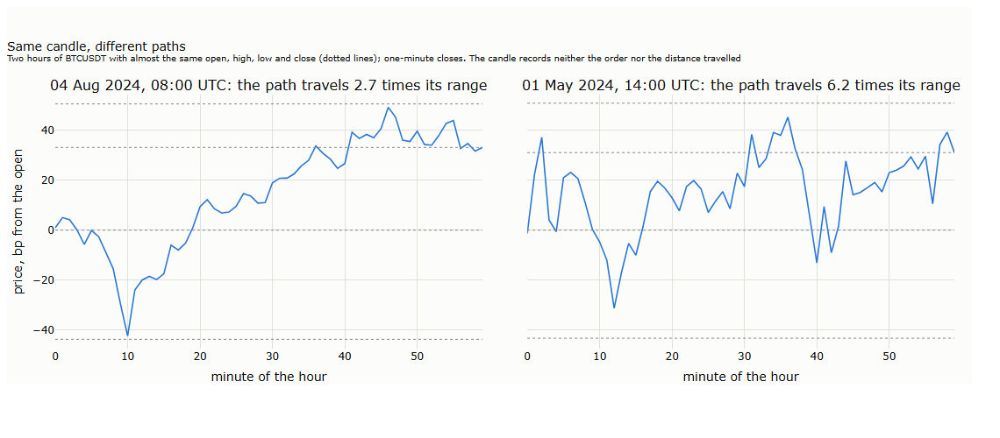

The two hours in the figure have the same candle to within a few basis points. The first rose almost steadily from its low; the second swung back and forth and travelled more than twice as far. A trend rule sees no difference; a grid, which earns each time the price swings through one of its levels, would have earned more than twice as much in the second hour.

**What it means.** The stop distance relative to a bar's range decides whether a candle backtest can be trusted: wide stops are hardly affected, tight ones are guessed wrong on a large share of bars. And everything that depends on the distance travelled, a grid's earnings or a measure of volatility, needs the path, not the candle. §3 and §4 measure the path; the second half of the lecture measures volatility from it.

## 3. The path against a random walk

A random walk has no memory: after a move up, the next move is up or down with equal chance. A grid needs the price to turn back; a trend rule needs it to carry on. The question for both: after the price has moved one step, does it move another step the same way, or turn back?

**How it is measured.** Lay a ladder of levels a fixed step apart over five years of one-minute prices. Each time the price reaches a new rung, record whether it came from below or above; then count how often the next rung reached lies in the same direction. For a random walk the answer is one half.

**The benchmark matters.** Counted this way, the price of bitcoin seems to carry on far more often than a random walk: two steps in three at 10 basis points. But the same count on the same one-minute returns **shuffled into a random order**, which keeps every move's size and removes all memory, gives almost the same result: a minute that jumps over several rungs makes all of them look like continuation. The fair comparison is the tape against its own shuffled returns, not against one half.

| Step | Tape: continues | Shuffled: continues | Difference, points | In every year? |
|---|---|---|---|---|
| 10 bp | 66.8% | 68.8% | −2.0 | yes |
| 20 bp | 61.3% | 62.7% | −1.4 | yes |
| 50 bp | 56.4% | 57.2% | −0.8 | yes, more weakly |
| 100 bp | 54.6% | 54.8% | −0.2 | no difference |

*Our measurement for these notes; one-minute closes, October 2021 to September 2026.*

At small steps bitcoin turns back slightly more often than a path without memory; at a percent and more there is no difference. That is the five-year average. It hides two different markets.

**Two regimes.** The same test, with the days grouped by their realised variance:

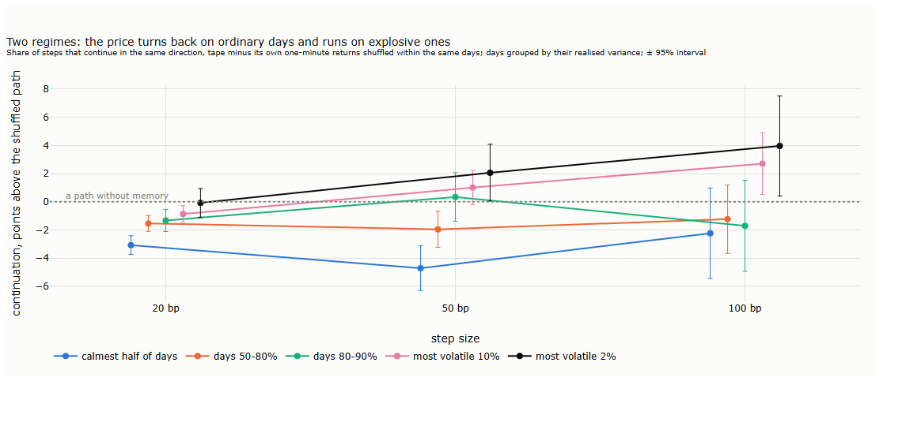

| Days | 20 bp | 50 bp | 100 bp |
|---|---|---|---|
| The calmest half (913 days) | −3.1 | −4.7 | −2.2 |
| The most volatile 10% (183 days) | −0.9 | +1.0 | +2.7 |
| The most volatile 2% (37 days) | −0.1 | +2.1 | +4.0 |

*Points of continuation, tape minus its own returns shuffled within the same days; the figure shows all groups with their 95% intervals.*

On calm and ordinary days the price turns back clearly more often than chance, at every step size. On the most volatile days the picture reverses at larger steps: moves of half a percent and more tend to carry on. The average of five years describes neither: a grid that relies on it is right on ordinary days and wrong on exactly the days that can ruin it.

**Can the regime be seen in advance?** Grouped by the *previous* day's volatility, which is known in the morning, the runs disappear: yesterday's volatility does not say whether today will be an explosive day. The regime has to be recognised within the day, from what the market is doing now. Lecture 15 looks for such signals in the order flow, and Lecture 17 uses them to decide when a grid steps aside.

**And √t?** If the price turns back, its moves over longer horizons are smaller than √t predicts from one-minute moves. The variance ratio measures by how much: the variance of returns over a horizon, divided by what the one-minute returns of the same weeks imply.

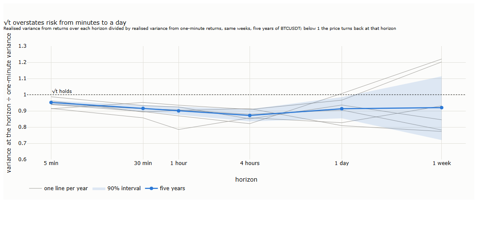

At four hours the variance is 13% below what one-minute returns imply (90% interval: 9% to 16%), and the shortfall appears in every year.

Scaling one-minute volatility with √t overstates the variance of a position held for hours by 5% to 13%, every year; at a day by about 9%; beyond a day the data cannot tell. The volatility half of the lecture returns to this: risk should be measured at a fine interval and scaled to the horizon a strategy holds with the measured ratio, not with √t.

**Key message.** Bitcoin's path is close to a random walk, but not quite, and not in the same way every day: it turns back on ordinary days and runs on explosive ones. A rule built on the average is built for a market that does not exist.

## 4. Levels on the path

A grid lives on the number of times the price crosses its levels; a stop on what happens when the price reaches it. Both are questions about the path at a level.

### 4.1 Crossings: what a grid can earn

For a random walk the number of steps of a given size per day is simple: the day's variance divided by the step squared. A grid that expects that many round trips is disappointed:

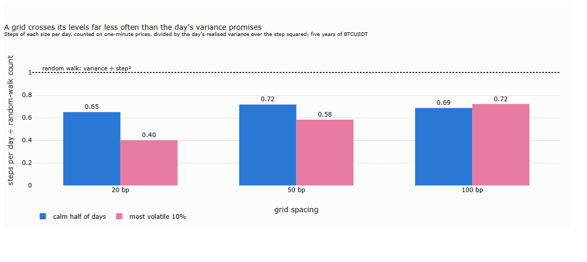

The price completes only 40% to 72% of the steps the day's variance promises. The main reason is the size of the moves, not their order: a jump of 3% crosses six levels 50 bp apart, but it counts in the variance like 36 small moves. Large moves inflate variance much more than they cross levels, which is why the shortfall is largest for tight grids on volatile days. On calm days the turning back of §3 costs crossings as well: a price that keeps returning does not travel far. **A grid's spacing should be planned on counted crossings, not on variance.**

### 4.2 Excursions: what a position must survive

Open a position at every full hour, hold it four hours, and record the worst move against it, in units of the volatility expected for four hours (σ√T, with σ from the past 28 days):

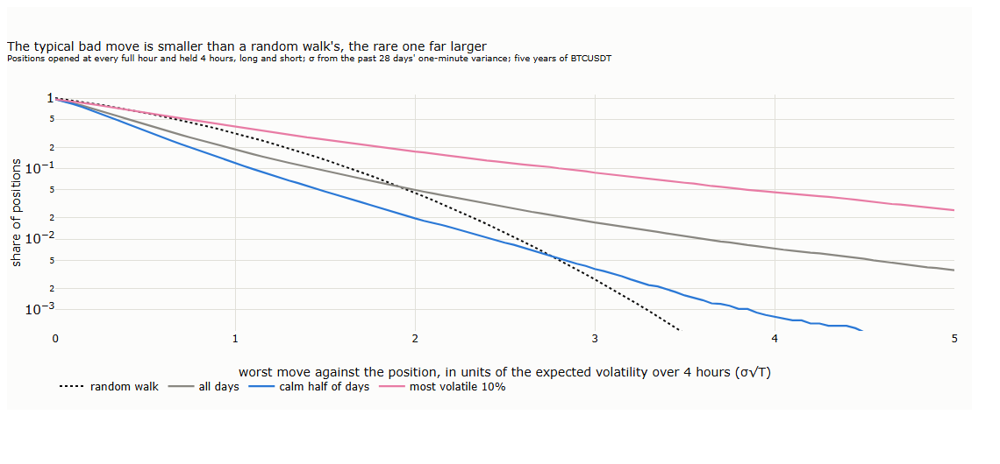

The typical bad move is smaller than a random walk's: 0.64 σ√T on average, against 0.80. The rare one is far larger: a move beyond 3 σ√T, which a random walk makes 0.27% of the time, comes in 1.7% of positions, six times as often, and in 8.8% on the most volatile days, thirty times. A stop set on √t is too wide most of the time and too close in the tail. What a stop should be depends on its purpose: an active stop, which ends a trade that is not working, belongs where the typical excursion would rarely reach; a ring-fence, which only guards against disaster, is reached in the tail, and there the question is what it gets.

### 4.3 Gaps: what a stop gets

Measured with the right side of the trades (a sell stop is filled by sellers, at the bids), the path hardly ever skips a level on BTCUSDT: at the trigger, the first trade on the stop's side lies within 0.2 bp of the level in 99% of cases, on calm and on volatile days. And a resting order at a level was traded through, filled for certain, on more than 99.7% of visits: with a tick of ten cents the price almost never turns at exactly that price, so the place in the queue rarely decides whether it is filled. On a market with a coarser tick it would.

**What a stop gets, approximately.** The tape does not show the order book, so it cannot say what a stop-market order would have received. It shows what the sellers who followed the trigger actually got. Read within a second, it approximates what an instant order meets; within ten seconds, what a larger order spread over time would face, including the market's move meanwhile. The worst price any of them got is a conservative estimate, valid for orders no larger than what traded in that time.

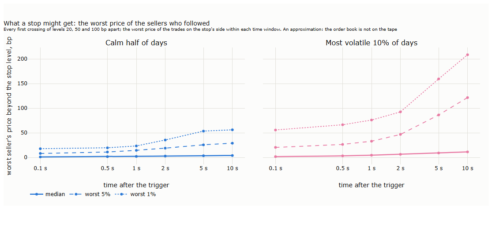

| Worst seller's price beyond the level | Median | Worst 5% | Worst 1% |
|---|---|---|---|
| Within 1 second, calm days | 2 bp | 14 bp | 23 bp |
| Within 1 second, volatile days | 4 bp | 33 bp | 76 bp |
| Within 10 seconds, volatile days | 11 bp | 122 bp | 209 bp |

*Our measurement for these notes; every first crossing of levels 20, 50 and 100 bp apart, 120 calm and 183 volatile days. Even in a slow second, at least $0.3 million (calm) to $0.7 million (volatile) was sold in nine cases out of ten.*

A typical stop costs a few basis points; the tail is fat and depends on the regime. The worst cases are short runs: the price breaks a level and runs 50 to 100 bp in a few seconds, often ending at a round price (19,200; 30,250; 105,000), where resting orders seem to stand. That is a hypothesis; the order book would show it.

A stop-market order waits until its trigger price trades and then becomes a market order (Lecture 12, §3.4); a stop-limit order caps the price instead and may not fill at all. The rule below is for the first kind.

**A building block for backtests.** *A stop fills at the worst price of the next second, at a chosen percentile of this distribution*: an explicit, conservative fill rule that a backtest on bars can use without the tape. It is valid up to the size that traded in that second, and in a backtest the regime must be judged from what is known at the trigger, such as the volatility of the last hour, not from the whole day. Lecture 15 measures the order book, how much size a level absorbs and how fast it recovers, and turns this rule into a fair cost of stops; Lectures 16 and 17 use it.

## 5. Volatility, built up

The path half of this lecture measured its moves in units of volatility. This half asks how that number is made. There are many ways to measure the same day's risk, and each captures a different shade of it.

### 5.1 How the number is built

Every volatility measure adds up the price's moves in some way. Realised variance squares each move between sampling points and adds them; a range estimator takes the distance between the highest and the lowest price (Parkinson's estimator, the basis of ATR); bipower adds up products of neighbouring moves, so that a single sudden jump among calm neighbours hardly counts. The chart builds each of them through two days, one ordinary and one with a central-bank decision:

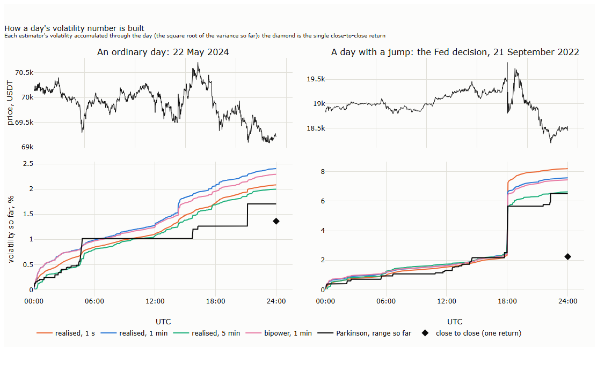

On the ordinary day the measures agree within a factor of about one and a half: 1.7% to 2.4%. The single close-to-close return says 1.4%: it sees only where the day ended. On the Fed day the gap is large: the price moved 7.6% measured minute by minute, but closed only 2.3% from its open, and close-to-close sees nothing of the rest. Measured on every single trade, both days would look absurd, 9% and 80%: each sweep through the book (Lecture 13, §3.5) counts as a move. Bipower, finally, rose at 18:00 almost as much as realised variance: the reaction to the decision was a burst of large minutes in a row, not one isolated jump.

**How precise is each measure?** Over five years, each day's estimate divided by the day's one-minute realised variance:

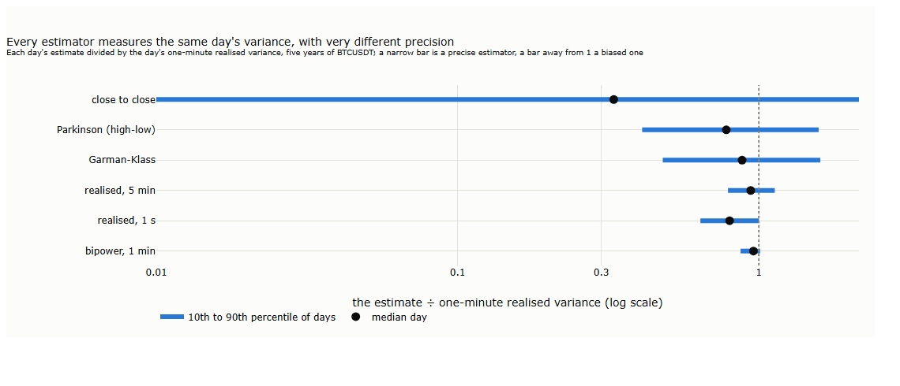

A single close-to-close return is almost useless for one day: on one day in ten it is below a hundredth of the day's variance, on another in ten more than twice it. The day's range is far better, but still scatters by a factor of two either way. Realised variance at five minutes stays within 20% of the one-minute value on four days in five, bipower within 13%.

| Measure | Built from | Captures | Weak spot |
|---|---|---|---|
| Close to close | one return per bar | where the price ended | sees nothing inside the bar |
| Range (Parkinson, ATR) | the highest and lowest price | how far the price reached | needs enough trades per bar (§5.2); one wild print sets it |
| Realised variance | squared moves at a fine interval | the net moves a position's value goes through | counts noise if the interval is too fine |
| Bipower | neighbouring moves multiplied | the smooth part of the movement | misses jumps on purpose |

**Bipower: smooth moves and jumps.** The difference between realised variance and bipower is the part of a day's risk that came as jumps: on a typical day 4%, on one day in ten 13% or more. Its use is not forecasting (§5.3) but knowing what kind of risk the market is producing: smooth risk is the kind a stop handles well, jump risk the kind that makes it slip (§4.3). A rising jump share flags a market that moves in bursts. On bitcoin those bursts are not moves without trades: minutes with jumps have four to fourteen times the trades of a typical minute. News in a market that never closes is traded at once; a price jumps without trades only where a market closes, as a stock does overnight.

### 5.2 Where to measure

§3 found that realised variance changes with the interval it is measured at. The other measures change too, but differently:

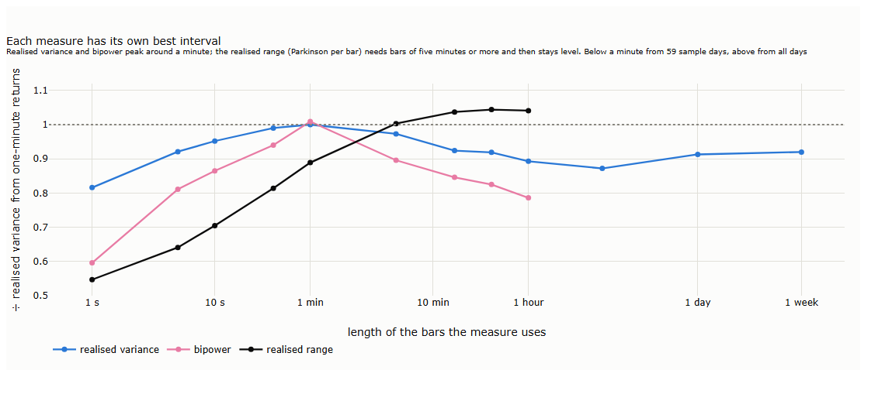

Realised variance and bipower peak around one minute: below it, trades continue in the same direction for a few seconds and the measures fall short; above it, the turning back of §3 lowers them. The range does the opposite. On short bars it is far too low, because a one-second bar has only a few trades and its high and low miss much of the movement; from about five minutes on it is reliable and stays level up to an hour, because a candle's high and low capture the extremes that the turning back hides from closing prices.

So each measure has its own best interval. Realised variance belongs at about a minute; ranges belong to bars of five minutes and more. On hourly bars, the hourly ranges give about the right level of risk (1.04 times the one-minute value), while squared hourly returns understate it by 11%.

### 5.3 Which measure forecasts the next bars?

A strategy needs the risk of its next bars, not of the past. The test: on hourly bars, forecast the realised variance of the next 1, 4 and 24 hours from each measure over the past 24 hours, adjusted for the time of day (Lecture 13, §7); fit one constant on October 2021 to June 2023; score the forecasts from July 2023 to September 2026.

**The yardstick must not be built like the forecast.** Scored against a target made of one-minute returns, the one-minute measure wins at every horizon, but partly at home: forecast and target share the same construction and its quirks. Scored against targets built differently, from five-minute returns or from the ranges of five-minute bars, each measure does best against the yardstick built like itself. A forecast should be judged against a target that does not share its construction, just as §3 judged the path against its own shuffled returns.

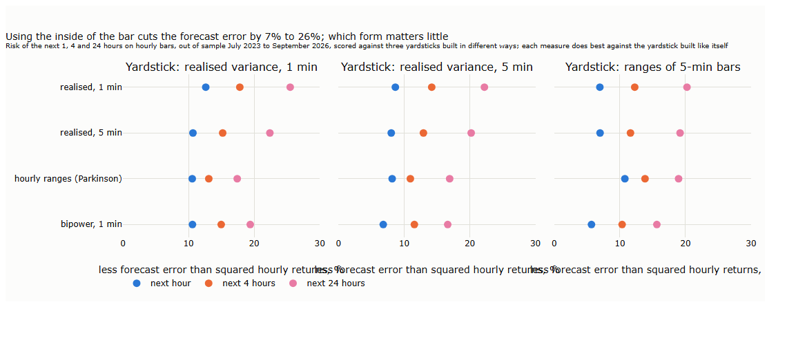

What survives every yardstick: any measure that uses the inside of the bar beats the bar's own squared returns, by 7% to 26% less forecast error, more for longer horizons. Which form of the inside matters little; ranges from ordinary candles do about as well as minute data. Bipower alone forecasts slightly worse: the jumps it leaves out carry information about the risk ahead. Given both parts, smooth and jumps, with separate weights, it forecasts as well as realised variance, and slightly better for the next day against the return-based yardsticks only: no gain that holds across yardsticks.

**Key message.** Each measure captures a different shade of the same risk. On our sample, BTCUSDT from 2021 to 2026, return-based measures describe the net moves a position's value goes through, ranges describe how far the price reaches, and bipower how much of the risk comes in jumps; and any measure that uses the inside of the bar forecasts the next bars better than the bar's own returns. Whether choosing the measure by the risk being managed, returns for sizing, ranges for stops and grid levels, actually improves those decisions is an open question: §7 tests it for sizing, and the reader is invited to test the rest on other markets and periods.

## 6. Risk on any clock

On time bars, risk lives in the size of the returns, and √t turns the risk of one bar into the risk of a day. Lecture 13 built bars on other clocks, where the number of bars in a day is itself random. How is risk measured there?

**One identity.** On any clock, a day's variance is the number of bars in the day times the average variance of a bar's move. Which of the two carries the day's risk depends on the clock:

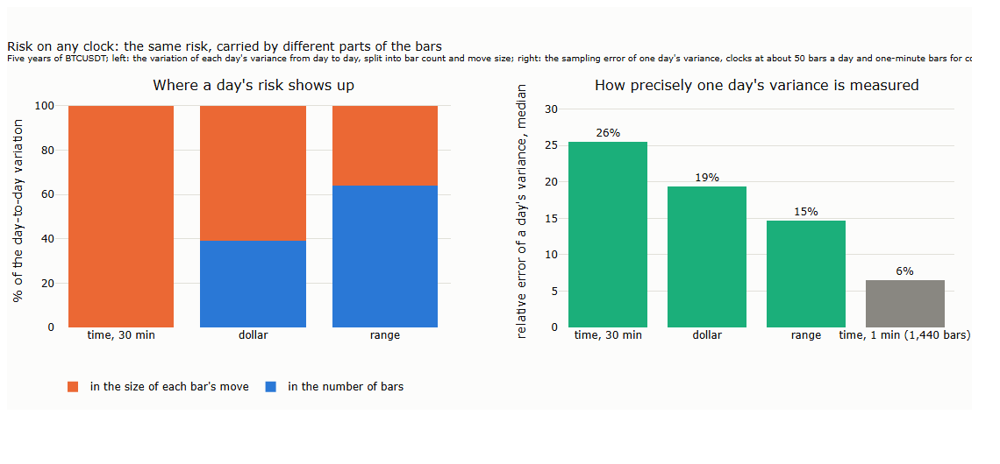

On time bars the number of bars never changes, so all of the risk is in the size of the moves: volatility feels like a property of time because, on a time clock, it is one. On price clocks each bar's move is about the same by construction, so most of the risk is in how many bars there are: volatility becomes the speed of the clock. Dollar bars lie between: busier days have more bars and, on top, larger moves per bar.

**The square-root rule on a random clock.** If a period contains a random number of bars, each with variance σ² and no drift, the period's variance is the expected number of bars times σ² (Wald's identity, met in Lecture 13, §6): its volatility is σ times the square root of the expected number of bars. The same √ as on time bars, with the expected count in place of a fixed one. The rule assumes that the number of bars and the size of their moves are unrelated:

| Clock | Average daily variance ÷ (bars per day × variance per bar) |
|---|---|
| Time, 30 minutes | 1.00 |
| Range | 0.97 |
| Dollar | 1.15 |

*Our measurement for these notes, five years.*

On price clocks the rule holds almost exactly. On dollar bars it underestimates a day's variance by 15%, about 7% in volatility, because the two factors move together (a correlation of +0.42 between a day's bar count and its variance per bar). The random number of bars has a second effect: a period made of a random number of moves has fatter tails than one made of a fixed number, the explanation Clark (1973) gave for the fat tails of time-bar returns (Lecture 13, §5).

**Precision.** At the same number of bars, a clock that spreads the day's variance evenly over its bars measures it more precisely: one day's variance has a sampling error of 26% on 30-minute bars, 19% on dollar bars and 15% on range bars. Sampling in trading time rather than calendar time is known to reduce the error of realised variance (Oomen, 2006). But the number of samples matters more than the clock: one-minute time bars, 1,440 a day, give 6%. The clock matters for precision when a strategy can only measure risk on its own bars.

**A measure made for price clocks: the duration.** On a range clock, risk can be read from how fast the bars come. For a random walk, a range bar (high minus low reaches R) takes on average R²/(2σ²), so a day's variance is about the number of range bars times R²/2 (Andersen, Dobrev and Schaumburg, 2008, a working paper; Nolte, Taylor and Zhao add half a bar for the bar left open at the end of the day). The range clock of Lecture 13 therefore yields a volatility measure for free: a count of events, without squaring any return.

On our sample it is precise, as tight as realised variance at five minutes (0.71 to 0.99 times the one-minute value on four days in five), and in the forecasting test of §5.3 it comes first or close behind against every yardstick: the only measure without a home advantage, because it is built from something else, a count.

It runs low, by 14%, and the bias can be taken apart. First, test the measure where the truth is known: on a simulated random walk with a set variance, run exactly the same clock. Then add the market's features one at a time and see which brings the simulation close to the tape:

| Simulated market, one price per second, about 48 bars a day | Estimate ÷ true variance |
|---|---|
| A random walk | 0.92 |
| + busy and quiet hours | 0.94 |
| + fat-tailed moves | 0.92 |
| + a component that turns back over minutes, and the clock's averaged price | 0.83 |
| BTCUSDT | 0.86 |

*Our simulation; the market's features added one at a time.*

About a third of the bias belongs to the method: a clock that looks at the price once a second misses ranges completed and reversed between two looks. It has a textbook correction, a slightly larger threshold in the formula, R plus 1.165 times the typical one-second move (our check of the barrier correction of Broadie, Glasserman and Kou, 1997, for ranges), which lifts the estimate from 0.86 to 0.91. The rest belongs to the market: bitcoin's turning back over minutes (§3) completes fewer ranges than a random walk would. The remaining bias is stable across volatility regimes and drifts only slowly over the years, so one constant per setting corrects it. Directional-change counts (Glattfelder, Dupuis and Olsen, 2011) rest on the same idea with a different event.

**Our results and the literature.**

| The literature | Our result on BTCUSDT | |
|---|---|---|
| Intraday measures forecast volatility better than daily returns (Andersen, Bollerslev, Diebold and Labys, 2003, on currencies) | 7% to 26% less forecast error than the bar's own returns | in line |
| Forecasts are ranked correctly only against a target without bias of its own (Patton, 2011) | Each measure wins against the yardstick built like itself | in line: yardsticks built differently carry different biases |
| On stocks, realised variance falls as sampling gets finer, because the noise moves against the price (Hansen and Lunde, 2006) | Lower at one second than at one minute | in line |
| Bitcoin reverses over one to four hours (De Nicola, 2021); its autocorrelation turns negative at five to ten minutes (Takaishi, 2018) | The variance ratio stays below 1 from minutes to a day (§3) | in line; on explosive days we find runs instead |
| On currencies, stocks and bonds, jumps say little about future volatility (Andersen, Bollerslev and Diebold, 2007) | On bitcoin, the next day's risk weighs yesterday's jumps more | different, as in bitcoin studies: jumps cluster (Scaillet, Treccani and Trevisan, 2020) and help forecast its volatility (Shen, Urquhart and Wang, 2020) |
| Duration estimators are precise, biased down by discrete sampling, and correctable (Andersen, Dobrev and Schaumburg, 2008; Nolte, Taylor and Zhao) | All three, with a bias of the predicted size | in line |

Where our methods are established, the results agree with the literature; where bitcoin differs from stocks, studies of bitcoin point the same way. No published study reports bitcoin's variance ratio at these horizons; ours is a result on this sample, for readers to test on others.

**Key message.** On any clock, a day's risk is the number of bars times the risk per bar. On BTCUSDT, price clocks put most of the risk into the clock's speed, dollar bars split it, and the square-root rule needs the expected bar count and fails by 15% where count and size move together. Risk per bar suits per-trade decisions such as stops; risk per period needs both a forecast of activity and a forecast of risk per bar.

## 7. For the two examples

Lectures 16 and 17 apply Part III to a trend rule and to an intraday grid. Each takes something different from this lecture; only results measured here are listed, with their section.

### 7.1 The trend rule (Lecture 16)

| From this lecture | What the trend rule takes |
|---|---|
| Candles and stops (§2) | A backtest on candles is reliable for stops wider than a bar's typical range; for tight stops it guesses the order wrong on a large share of bars |
| √t (§3) | Scaling one-minute risk with √t overstates the variance of a position held for hours by 5% to 13%; the measured variance ratio is the better scale |
| Excursions (§4.2) | Moves beyond 3 σ√T are six times as frequent as a random walk implies, thirty times on explosive days |
| Measuring risk (§5.3) | Any measure from inside the bar forecasts the next bars' risk 7% to 26% better than the bar's own returns |
| Dollar bars (§6) | A day's risk is bars times risk per bar; the simple product is 15% low on dollar bars, because the two move together |

### 7.2 The grid (Lecture 17)

| From this lecture | What the grid takes |
|---|---|
| Crossings (§4.1) | The price completes 40% to 72% of the crossings the day's variance promises; spacing should be planned on counted crossings |
| Two regimes (§3) | On ordinary days the price turns back more often than chance, on explosive days it runs; yesterday's volatility does not tell which day it is |
| Fills at a level (§4.3) | On BTCUSDT a resting order at a level is traded through on more than 99.7% of visits: a fill is certain once the price trades beyond it |
| Stops (§4.3) | The worst seller of the next second gives an explicit, conservative fill rule, valid up to the size that traded |

### 7.3 What needs to be investigated

The results above hold on BTCUSDT from 2021 to 2026. These questions are open, and readers are invited to test them, on this market and on others:

- Does sizing by a measure from inside the bar keep a strategy's risk more constant, after the cost of resizing? (Lectures 16 and 17 test it for their rules.)
- Do stops placed by ranges or by measured excursions do better than stops placed by √t?
- Can the explosive regime of §3 be recognised within the day, from activity, order flow or the share of jumps? (Lecture 15.)
- Which approach to value at risk and expected shortfall gets the tail right on intraday data: a normal tail, the empirical tail of returns divided by forecast volatility, or the distribution of excursions?
- Do the variance ratio, the two regimes and the duration measure look the same on a thinner market, such as SOLUSDT, or on a market that closes?
- Do the short runs that end at round prices (§4.3) reflect resting orders clustered there? The order book would show it.

## 8. Summary, exercises and reading

### 8.1 Seven takeaways

1. **A candle records neither the order nor the distance travelled.** The better guess at the order is wrong on one bar in eight, as for any random walk; a typical hour travels four times its range.
2. **Test the path against itself.** Counted naively, the path looks as if it trends; compared with its own shuffled returns, BTCUSDT turns back slightly at small steps.
3. **Two regimes, not one average.** On ordinary days the price turns back more often than chance; on explosive days, moves of half a percent and more carry on.
4. **√t is an assumption.** From minutes to a day it overstates BTCUSDT's variance by 5% to 13%.
5. **Levels are reached less often and passed more violently than variance suggests:** fewer crossings, a fat tail of excursions, and stops cheap in the median but expensive in the tail.
6. **Each volatility measure has its own best interval and captures its own shade of risk;** any measure from inside the bar forecasts the next bars better than the bar's own returns, provided the forecast is judged against a yardstick not built like itself.
7. **On any clock, a day's risk is the number of bars times the risk per bar;** a duration measure read from the range clock is as precise as minute-by-minute variance and has no home advantage.

### 8.2 Exercises

- [ ] Repeat the step test of §3 on ETHUSDT and on SOLUSDT for one year. Is the turning back weaker on the thinner market, or stronger?
- [ ] Count the steps of §3 without the shuffled benchmark, then with it. How large is the illusion of trending at 10 basis points?
- [ ] Choose a yardstick of your own for §5.3, for instance realised variance from 15-minute returns, and repeat the forecasting test. Which measure wins at home, and which survives?
- [ ] Simulate a random walk, build range bars on it at one price per second, and measure the bias of the duration measure. Then add a component that turns back over minutes, as in §6, and see how much of BTCUSDT's bias it explains.
- [ ] Use the stop-fill distribution of §4.3 as a fill rule in a simple stop-loss backtest on hourly bars. How much does the result change between the median and the worst 1%?
- [ ] Pick one question from §7.3 and investigate it on a market of your choice.

### 8.3 Reading

For realised variance and forecasting with it, Andersen, Bollerslev, Diebold and Labys (2003); for comparing forecasts fairly, Patton (2011); for jumps, Andersen, Bollerslev and Diebold (2007). For microstructure noise and signature plots, Hansen and Lunde (2006). For volatility from price durations, Andersen, Dobrev and Schaumburg (2008) and Hong, Nolte, Taylor and Zhao (2023). For bitcoin's intraday behaviour and jumps, De Nicola (2021) and Scaillet, Treccani and Trevisan (2020).

## References

- Andersen, T. G., Bollerslev, T. and Diebold, F. X. (2007). Roughing it up: including jump components in the measurement, modeling, and forecasting of return volatility. *Review of Economics and Statistics* 89(4), 701–720. — jumps and the predictability of volatility (§6).
- Andersen, T. G., Bollerslev, T., Diebold, F. X. and Labys, P. (2003). Modeling and forecasting realized volatility. *Econometrica* 71(2), 579–625. — intraday measures forecast volatility better than daily returns (§6).
- Andersen, T. G., Dobrev, D. and Schaumburg, E. (2008). Duration-based volatility estimation. Working paper. — passage times, their bias and their correction (§6).
- Broadie, M., Glasserman, P. and Kou, S. G. (1997). A continuity correction for discrete barrier options. *Mathematical Finance* 7(4), 325–349. — the barrier shift for discrete monitoring (§6).
- Clark, P. K. (1973). A subordinated stochastic process model with finite variance for speculative prices. *Econometrica* 41(1), 135–155. — random trading time and fat tails (§6).
- De Nicola, G. (2021). On the intraday behavior of bitcoin. *Ledger* 6. — mean reversion over one to four hours (§6).
- Glattfelder, J. B., Dupuis, A. and Olsen, R. B. (2011). Patterns in high-frequency FX data: discovery of 12 empirical scaling laws. *Quantitative Finance* 11(4), 599–614. — directional changes (§6).
- Hansen, P. R. and Lunde, A. (2006). Realized variance and market microstructure noise. *Journal of Business & Economic Statistics* 24(2), 127–161. — signature plots on stocks (§6).
- Hong, S. Y., Nolte, I., Taylor, S. J. and Zhao, X. (2023). Volatility estimation and forecasts based on price durations. *Journal of Financial Econometrics* 21(1), 106–144. — duration estimators in forecasting (§6).
- Nolte, I., Taylor, S. J. and Zhao, X. (2016). Working paper, precursor of Hong et al. (2023). — the count-based estimator and its end-of-day correction (§6).
- Oomen, R. C. A. (2006). Properties of realized variance under alternative sampling schemes. *Journal of Business & Economic Statistics* 24(2), 219–237. — sampling in trading time (§6).
- Patton, A. J. (2011). Volatility forecast comparison using imperfect volatility proxies. *Journal of Econometrics* 160(1), 246–256. — robust loss functions (§6).
- Scaillet, O., Treccani, A. and Trevisan, C. (2020). High-frequency jump analysis of the bitcoin market. *Journal of Financial Econometrics* 18(2), 209–232. — jumps cluster (§6).
- Shen, D., Urquhart, A. and Wang, P. (2020). Forecasting the volatility of bitcoin: the importance of jumps and structural breaks. *European Financial Management* 26(5), 1294–1323. — jumps in bitcoin volatility forecasts (§6).
- Takaishi, T. (2018). Statistical properties and multifractality of bitcoin. *Physica A* 506, 507–519. — negative autocorrelation at five to ten minutes (§6).
