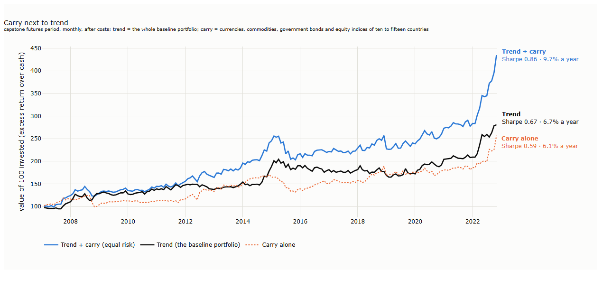

# Lecture 15: Carry and Value

> Hold, next to trend, strategies that earn for different reasons, so that they tend to earn when trend does not, without anyone forecasting the regime.

Part III · Pipeline stage: signal generation (two new signals, carry and value)

---

# Carry next to trend

> Carry alone earned about what trend did, but at different times: held together at the same total risk, they earned more than either.

- Carry 0.59, trend 0.67; correlation 0.06
- Together: 0.86, 9.7% a year against 6.7%
- Worst loss −20.6% against trend's −19.3%

---

# A switch against a second business

> A switch needs a forecast of when trend will do badly; a second strategy needs only a different reason to earn.

| | Switching trend (Lecture 14) | A second strategy (this lecture) |
|---|---|---|
| What it needs | A forecast, on the day, of when trend will do badly | A different reason to earn; no forecast |
| Idle capital | Stays idle: a switch can only take away | None: every strategy is always in |
| Judged against | Random switching with the same time in the market | Random strategies on the same markets, added to trend the same way |

Trend earns when prices keep moving; carry earns the income of a position while prices stand still; value earns when prices return towards a long-run level.

---

# The published versions and ours

> Checking a rebuild against the published series early is cheap, and it catches errors that a backtest alone does not.

| Group | Our value against AQR's (correlation) |
|---|---|
| Currencies | 0.79 |
| Commodities | 0.56 |
| Government bonds | 0.69 |
| Equity indices | 0.46 |

- **Bonds as two US maturities:** a bet on the shape of the US curve; agreement 0.19. Rebuilt as nine countries: 0.69
- **Equities as two US indices:** agreement 0.07. Rebuilt as fifteen countries: 0.46

---

# Carry: one idea, four measures

> Carry is what a position earns if prices stand still; each group earns a little, the four together much more, because their income is paid for different risks.

| Group | Carry | Sharpe ratio |
|---|---|---|
| Currencies | The foreign 3-month rate minus the US rate | 0.24 |
| Commodities | Front futures contract against the one about 12 months later | 0.18 |
| Government bonds | The 10-year yield minus the 3-month rate | 0.28 |
| Equity indices | Earnings yield (US) or dividend yield minus the real rate | 0.46 |
| **All four** | | **0.57** |

---

# From carry to positions

> Score the carry level and its 3-month change, half in absolute terms and half per unit of risk; hold each market in proportion to its score.

$$s_i = \tfrac{1}{2}\Big[\tfrac{1}{2}\big(z(c_i) + z(c_i/\sigma_i)\big) + \tfrac{1}{2}\big(z(\Delta c_i) + z(\Delta c_i/\sigma_i)\big)\Big], \qquad w_i = \frac{s_i}{\sum_j |s_j|}$$

- $c_i$: carry of market $i$; $\Delta c_i$: its 3-month change; $\sigma_i$: its volatility; $z$: the z-score within the group
- Each position sized on the market's volatility over 36 months: carry positions last many months
- Groups at equal risk, the total scaled to 10%, as trend (Lecture 13)

---

# Value needs fundamentals

> Measured by price against its past, value lost; measured from fundamentals it earned a little and held trend steady, but did not add to it.

| 2006 to October 2022 | Price version | Fundamental version |
|---|---|---|
| Value, all four groups | −0.09 | +0.14 |
| Correlation with trend | −0.35 | −0.32 |
| Trend + value (trend alone 0.67) | 0.47 | 0.65 |
| Random strategies beaten, alone | 48% | 77% |

- Fundamentals: real yields, purchasing power, the yield gap of stocks over bonds, inventories
- 0.14 is close to AQR's own 0.16 in this period

---

# Against luck, with the tries counted

> Carry beats all of 1,000 random strategies, but counting the 21 versions tried leaves a deflated Sharpe ratio of 0.90.

| | Carry | Random: median | Random: 95th percentile | Share beaten |
|---|---|---|---|---|
| Carry alone | 0.57 | −0.11 | 0.28 | 100% |
| Trend + carry | 0.86 | 0.36 | 0.65 | 100% |

$$\text{effective tries} = \bar\rho + (1-\bar\rho)M$$

- 21 tries with average correlation 0.71: 6.8 effective tries
- The best of 6.8 tries of noise would show a Sharpe ratio of 0.20; the rule, on the same months, 0.53

---

# How much evidence to expect

> About 90% is good evidence: a stricter bar would mostly measure the length of the sample.

To be 95% sure that a Sharpe ratio is above zero takes about $(1.65/\text{SR})^2$ years:

| Sharpe ratio | 1.0 | 0.5 | 0.3 | 0.2 |
|---|---|---|---|---|
| Years of data to clear 95% once | 3 | 11 | 30 | 68 |

A lasting edge is judged on several things together: **the probability** (0.90), **breadth** (all four groups), **a reason it persists** (carry is paid for bearing crash risk) and **what it adds** (its value is next to trend).

---

# What carry costs

> Carry improves trend on every measure, crash measures included; the cost is in the tail.

| 2006 to October 2022 | Sharpe | Calmar | Omega | Skew | Worst month |
|---|---|---|---|---|---|
| Trend | 0.67 | 0.35 | 1.67 | +0.41 | −7.4% |
| Carry | 0.57 | 0.26 | 1.61 | +0.29 | −12.0% |
| **Trend + carry** | **0.86** | **0.47** | **1.95** | −0.15 | −11.4% |

Trend's positive skew, its habit of earning in crises, turns negative. Carry is often described as picking up coins in front of a steamroller; the table shows both the coins and the steamroller.

---

# Where carry earned, and where it did not

> Carry beat trend in four of the six regimes where trend was weak: it earns when trend does not, without a forecast of when that will be.

- The six weak quadrants were fixed in advance from Lecture 14
- The cells are small; the pattern across them, not any one number, is the evidence
- **The weak spot, 2013-2026:** carry earned 0.23, and trend plus carry (0.45) did slightly worse than trend alone (0.48)
- An edge of this size can disappear for a decade by chance alone

---

# A second business, or a filter in disguise?

> Most of carry's return came from the markets trend also trades, in the months when trend held the same side.

| Part of carry's return, 2006-2022 | Share of carry's return | Sharpe ratio |
|---|---|---|
| Same market as trend, same side | 83% | 0.75 |
| Same market as trend, opposite side | −8% | −0.13 |
| Markets or months trend does not hold | 25% | 0.15 |

- Their *timing* is unrelated (correlation 0.06), their *profits* are not
- Five refinements tried after the first results: none improved carry reliably; buying carry on the dip made it worse at every weight

---

# Takeaways

1. **A second strategy needs no forecast:** it helps by earning for a different reason
2. **Check a rebuild against the published series early:** it exposed two design flaws the backtests did not show
3. **Carry earns little in any one group and much more in four:** 0.18 to 0.46 alone, 0.57 together
4. **Value needs fundamentals:** it earned a little (0.14) and held trend steady, but did not add to it
5. **Evidence is weighed, not passed:** a deflated Sharpe ratio of 0.90, breadth, a reason it persists, what it adds
6. **Carry's price is in the tail, and its profits lean on trend**

> Trend, carry and value are now built on the same machinery and judged the same way; Lecture 16 puts them together once, on fixed rules.
