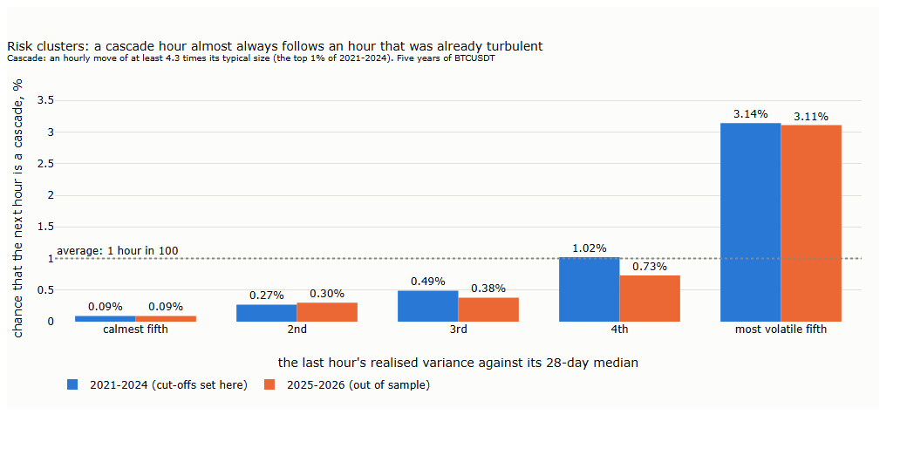
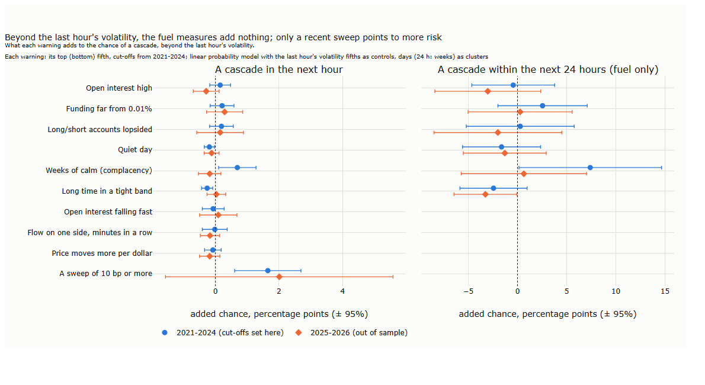
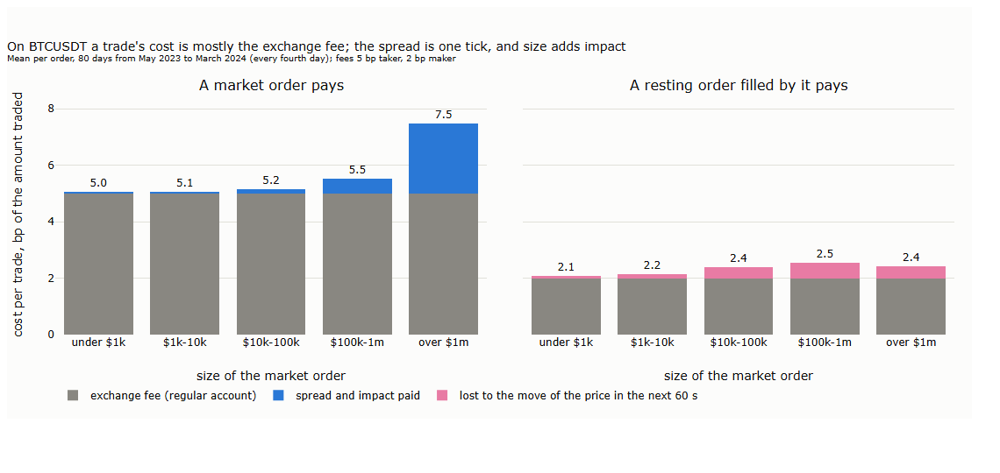
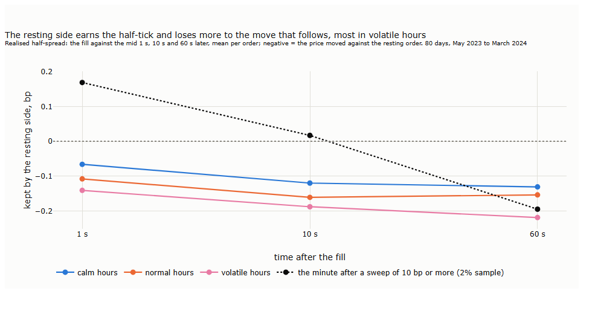

# Lecture 15: Who Trades and What It Costs: Order Flow, Costs and Capacity

*Systematic Trading: Lecture Notes (MSc) · Oct 24, 2026 · Max Gnesi*

Every trade on the tape has a buyer and a seller, but only one of them was in a hurry: the aggressor, who took the price offered rather than waiting for a better one. This lecture asks what that hurry tells us and what it costs. The first part is about order flow: does one-sided buying or selling predict where the price goes next, what happens when a single order sweeps through the book, and can the explosive days of Lecture 14 be seen coming? The second part is about costs: what a trade really pays, when a resting order is filled, and how large a strategy can grow before its costs eat its edge. It covers the fifth and sixth of Part III's six uses of the tape (the course guide, §1.1b): order flow, and costs and capacity.

## 1. Who was in a hurry

| § | Step | Question |
|---|---|---|
| 2 | Does one-sided flow predict the price? | After strong net buying, does the price carry on or come back? |
| 3 | Sweeps and absorption | When one order sweeps through the book, does the price come back? |
| 4 | Cascades | Can the explosive regime of Lecture 14 be recognised within the day? |
| 5 | What a trade costs | What does a market order really pay, and how much is lost to the price moving on? |
| 6 | Resting orders and stops | When is a resting order filled, and what does a stop really get? |
| 7 | Capacity | How large can a strategy trade before its costs eat its edge? |
| 8 | For the two examples | What the trend rule (Lecture 16) and the grid (Lecture 17) take from this lecture |

**Three words.** The **aggressor** of a trade is the side that sent the order which executed at once, against an order already resting in the book (Lecture 12, §3.2). **Net aggressive buying**, or flow, is the dollars bought by aggressors minus the dollars sold by aggressors, here divided by all dollars traded, so that it runs from −1 (only sellers in a hurry) to +1 (only buyers). The **spread** is the gap between the best price at which someone is willing to buy and the best price at which someone is willing to sell; a market order pays at least half of it.

**Data.** The tape of Lecture 12: the BTCUSDT perpetual on Binance, October 2021 to September 2026. Where the best bid and ask are needed (§5 and §6), Binance published them only from May 2023 to March 2024; those results are labelled with that period. Depth near the price comes from Binance's snapshots every 30 seconds, from 2023 on. The full order book, every level and every change, is the subject of Part IV.

## 2. Does one-sided flow predict the price?

When buyers hurry, the price rises: they take the offers in the book, one level after another. The question here is what comes next. If the buyers knew something, the price should stay up or rise further; if they only needed to trade, the market makers who sold to them should push it partly back (Bouchaud, Gefen, Potters and Wyart, 2004).

**How it is measured.** Cut five years into windows of equal length: 1, 5 and 30 minutes. In each window measure the flow and sort the windows into fifths, from most selling to most buying. For each fifth, record the return during the window, the impact, and over the next window of the same length, what follows. Repeat for three volatility regimes, defined by the last hour's realised variance against its median over the past 28 days, so that the regime is known before the window starts.

| | 1 minute | 5 minutes | 30 minutes |
|---|---|---|---|
| Return during the window, most selling to most buying | −5 to +5 bp | −11 to +12 bp | −27 to +28 bp |
| Next window, most buying minus most selling | −0.08 bp | −0.51 bp | −0.99 bp |
| Same, in volatile hours | −0.21 bp | −0.91 bp | −3.02 bp |

*Our measurement for these notes; the differences in the second row are 4.5 to 7.7 standard errors from zero, with days as clusters.*

Flow moves the price strongly while it happens. Afterwards a small part comes back: about 1 bp after a move of 28 bp in 30 minutes, a few percent of the impact, and almost all of it in volatile hours. The reversal is reliable, but far smaller than what a market order costs (§5): it is not a strategy on its own. It is the trace of impact that is partly temporary, as the literature describes for stocks and for bitcoin.

**With or against the trend?** The reversal could depend on what the flow pushes against. The same test, now only on the strongest flow (the top and bottom fifths), split by the slower trend known at the time (the past three days' return, divided by its typical size: up, down, or no clear trend beyond half a standard deviation) and by the volatility regime:

The price comes back reliably in one corner only: after strong flow **with** the slower trend, in normal and volatile hours, by 0.2 to 0.5 bp after five-minute windows and 1.7 bp after thirty-minute windows in volatile hours. After flow against the trend, or with no clear trend, nothing is distinguishable from zero. When the market piles in on the side the trend already favours, at a moment of stress, the price overshoots and gives some back. In some cells the average and the day-based test point different ways, because a few extreme windows pull the average; the figure shows the day-based statistics, which are not dominated by them.

**At scheduled releases.** At a CPI release or a Fed decision, flow and price both explode. Three examples, minute by minute:

In November 2022 buyers sent $118 million of net buying in the first minute and the price kept rising; in September 2022 sellers sent $165 million and the price kept falling; at the Fed decision of September 2022 heavy selling and heavy buying followed within two minutes and the price reversed over the hour. Across all releases, the first five minutes' **move** predicts the next thirty minutes (a correlation of +0.45 for CPI releases, −0.32 for Fed decisions, Lecture 13, §7.4), but the first five minutes' **flow** does not (+0.15 and −0.10, neither distinguishable from zero). At a release the book reprices itself: the move carries the news, and the aggressive trades are only part of it.

**Our results and the literature.**

| The literature | Our result on BTCUSDT | |
|---|---|---|
| Order flow moves the price strongly and linearly within the same interval (Cont, Kukanov and Stoikov, 2014; for bitcoin, Silantyev, 2019) | ±28 bp during 30-minute windows, more in volatile hours | in line |
| The impact of trades is partly transient: it decays and partly reverses (Bouchaud, Gefen, Potters and Wyart, 2004; Bouchaud, Farmer and Lillo, 2009; for bitcoin, Donier and Bonart) | A small part comes back in the next window | in line |
| Daily price pressure in bitcoin is mostly permanent (Makarov and Schoar, 2020) | Only a few percent of the impact comes back | in line |
| Forecasting from order flow fades within seconds to a few price changes (Kolm, Turiel and Westray, 2023, on stocks; a 2026 thesis finds nothing beyond 30 seconds on Binance's bitcoin perpetual) | Reliable but a fraction of a basis point at minutes, below the cost of trading | in line |
| Trade imbalance explains price changes about half as well as the imbalance of the whole book (Cont, Kukanov and Stoikov, 2014) | At releases, the move predicts what follows and the flow does not | consistent: the book carries information the trades do not |
| — | The reversal is reliable only after flow with the slower trend, in normal and volatile hours | not found in the literature; a result on this sample |

**Key message.** On BTCUSDT, one-sided flow moves the price while it lasts and leaves almost all of its impact in place; the small part that comes back appears after flow with the slower trend in stressed hours. At releases the price move, not the flow, carries the information. None of it pays a market order's cost by itself; whether it helps a strategy that rests its orders, a grid, is a question for §5 and Lecture 17.

## 3. Sweeps and absorption

Section 2 looked at flow added up over minutes. A single order can do the same in a millisecond: a market order larger than the depth at the best price takes the next level, and the next, until it is filled. This is a **sweep**. Behind the price it leaves a gap, and the question is who fills it and how fast. If the book refills quickly, most of the move comes back; if the sweep carried news, it stays.

**Hypotheses.** Fixed before the measurement:

| | Hypothesis | Why one might expect it |
|---|---|---|
| H1 | A large part of a sweep's move comes back within seconds | The gap behind the sweep is refilled by new resting orders: the book's resilience |
| H2 | A sweep against the slower trend comes back more than one with it | It fights the market's direction; a sweep with the trend joins it |

**How it is measured.** A sweep is one aggressive order, all fills in the same millisecond on the same side, that moves the price by at least 5, 10 or 20 bp from its first to its last fill. Over five years there are 622,818 of at least 5 bp and 179,082 of at least 10 bp. Sweeps come in bursts, so only the first in each 10-minute block is kept; with a clear slower trend, this leaves about 19,000, 5,800 and 1,600 independent sweeps for the three sizes. For each, the price is read just before it, at its last fill, and 10 seconds, 1 minute, 10 minutes and 1 hour later. The slower trend is the one of §2, the past three days' return divided by its typical size, read in the minute before the sweep.

*The time axis is in steps, not to scale.*

**H1 holds.** Within ten seconds, about half of the move is gone: a sweep of 13 bp is at 5 to 7 bp after ten seconds, one of 26 bp at 10 to 14. This is the same for both directions and all sizes. The gap fills almost at once.

**H2 fails, the other way round.** After the first ten seconds, the two kinds part:

- A sweep **with** the slower trend keeps losing ground and is back near where it started within the hour. The buyer who chases a rising market overshoots, and the market takes it back.
- A sweep **against** the slower trend keeps the half that survived the first ten seconds. Over the next ten minutes the price drifts a few basis points back towards the trend, and after an hour nothing is distinguishable from zero.

The control is the same return at moments without a sweep, every tenth minute with a clear trend, in the same volatility regime. There the trend's direction says nothing about the next ten minutes or the next hour (between −3 and +2 bp on average). The table gives the return in the trend's direction after the sweep's last fill, minus that control:

| Sweep | Size | Next 10 minutes | Next hour |
|---|---|---|---|
| with the trend | ≥ 5 bp | −4.8 bp (−8.8)\*\*\* | −7.4 bp (−4.3)\*\*\* |
| | ≥ 10 bp | −11.4 bp (−9.9)\*\*\* | −14.8 bp (−5.6)\*\*\* |
| | ≥ 20 bp | −20.6 bp (−6.6)\*\*\* | −26.1 bp (−5.0)\*\*\* |
| against the trend | ≥ 5 bp | +2.8 bp (4.9)\*\*\* | +1.2 bp (0.7) |
| | ≥ 10 bp | +4.1 bp (3.4)\*\* | −1.6 bp (−0.6) |
| | ≥ 20 bp | +7.5 bp (2.4)\* | −12.7 bp (−2.1)\* |

*Our measurement for these notes. Negative: the price moves back against the trend, that is against the sweep. In brackets the t-statistic, with days as clusters; stars after the Benjamini–Hochberg correction over the 16 tests (including the hourly-block variant below): \* q < 0.05, \*\* q < 0.01, \*\*\* q < 0.001.*

**Robustness.** The reversal after sweeps with the trend appears in every year from 2021 to 2026 (between −5 and −16 bp after ten minutes for sweeps of at least 10 bp), in calm, normal and volatile hours, and when only the first sweep per hour is kept (−8.6 bp after ten minutes, t −6.6). After sweeps against the trend the picture is less stable: the ten-minute drift towards the trend survives the hourly blocks (t 4.0); the hour after does not, and its sign changes from year to year.

**An open question.** In volatile hours, sweeps against the trend are followed by large moves further against it in some years (a median of −18 bp over the hour for sweeps of at least 10 bp), but the effect is not significant after correction, vanishes with hourly blocks and flips sign between years. Whether such a sweep marks the first crack of a trend, the forced selling of a liquidation cascade, is a question for §4, not a result here.

**Our results and the literature.**

| The literature | Our result on BTCUSDT | |
|---|---|---|
| After large trades the book is replenished quickly; new orders flow into a thin book (Biais, Hillion and Spatt, 1995) | About half of a sweep's move is gone within ten seconds | in line |
| The impact of aggressive orders is partly reversed in later trades, but a longer-term effect remains (Degryse, de Jong, van Ravenswaaij and Wuyts, 2005; for single trades, Bouchaud, Gefen, Potters and Wyart, 2004) | Part comes back, part stays | in line; the ten-second scale of a single sweep is our measurement |
| Trades in the direction of the prevailing flow meet more liquidity and move the price less permanently (Farmer, Gerig, Lillo and Mike, 2006); after a long price run-up, block purchases carry less permanent impact (Saar, 2001) | Sweeps with the slower trend are taken back almost completely | consistent in spirit; neither conditions on the trend as we do |
| Moves that trigger clustered stop-loss orders run on (Osler, 2005, for currencies) | Sweeps against the trend keep their remaining half | a possible mechanism, not tested here |
| — | The reversal depends on the sweep's relation to the slower trend | not found in the literature; a result on this sample, open to independent tests |

**Key message.** About half of a sweep comes back within seconds, whatever its direction: the book refills. What remains depends on the slower trend. A sweep that chases the trend overshoots and is taken back within the hour; one against the trend keeps its remaining half. For a strategy that rests orders in the book, a grid, this is the difference between a fill that is soon in profit and one that stays at a loss. Whether that pays after costs is a question for §5 and Lecture 17.

## 4. Cascades

Lecture 14 found an explosive regime: hours in which the price moves many times its usual amount. Some of these hours feed on themselves: the price falls, leveraged buyers are liquidated, their forced sales push it further, and more liquidations and stop orders follow. This is a **cascade**. For a strategy the question is practical: can it be seen coming, early enough to cut size, widen stops or pull resting orders?

**In short.** A cascade can be seen coming, but only from the turbulence already under way: after a volatile hour the next is thirty-five times as likely to be a cascade as after a calm one. Beyond that, a recent sweep may add a warning minutes ahead. The measures said to load the market hours or days in advance add nothing.

**Fuel and spark.** Two kinds of warning were tested, each read from data known at the start of the hour and counted when in its top (or bottom) fifth. **Fuel** is the state that would make a cascade possible: open interest high against its 28-day median, funding far from its usual 0.01%, a lopsided ratio of long to short accounts, a quiet day, weeks of calm, a long time in a tight band. **Spark** is what would show in the last 15 minutes once the self-feeding has begun: open interest falling fast, net flow on one side minute after minute, the price moving more per dollar traded, a sweep of 10 bp or more (§3).

**How it is measured.** A cascade is an hour whose move, over its typical size, is in the top 1%: at least 4.3 typical hourly moves. Each warning must add something to the simplest one, the last hour's own volatility, so the chance of a cascade is regressed on the warning and on the fifth of the last hour's realised variance, with days as clusters. Cut-offs are set on 2021–2024 and applied unchanged to 2025–2026. Open interest and the account ratio come from Binance's five-minute statistics; there is no public archive of individual liquidations, so falling open interest stands in for them.

**Risk clusters.**

After the calmest fifth of hours the next hour is a cascade about once in a thousand; after the most volatile fifth, three times in a hundred, in both periods. The reason is the mechanism itself: a cascade takes time to build, each round of forced selling triggering the next, so its first stages are visible in the volatility before the worst hour comes. This is volatility clustering (Lecture 14, §5.3) at its extreme, and it answers the question Lecture 14 (§3) left open: yesterday's volatility does not say whether today will be explosive, but within the day the last hour's volatility does.

**What the warnings add.**

Only a sweep adds to the warning: after one in the last 15 minutes, the next hour is a cascade four to five times as often, 1.7 percentage points beyond the control in 2021–2024 (t 3.1). There is a reason to expect it: a single order that clears several levels shows that the book is thin, and a thin book is where forced sales move the price most. Out of sample sweeps are rarer and the effect, though as large, is not significant; it is a lead, not an established result.

The fuel measures add nothing.\* At the next hour the intervals are narrow (about ±0.4 percentage points on a base rate of 1%), so a warning that raised the risk by half would have shown; within 24 hours they are wide, and there the honest verdict is only "not found". Falling open interest does come with cascades, but adds nothing once the last hour's volatility is known: it describes the turbulence rather than announcing it. The squeeze fails too: breaks after long stays in a tight band are not larger than after short ones, and the 3- and 7-day highs and lows do not draw closer to the band as it lasts, as they would if many models' stops were gathering at the same prices.

*\* Two checks were added after the first results: the direction (crowded longs followed by cascades down, crowded shorts by cascades up) and the extremes (top 5% instead of the top fifth). None passes the Benjamini–Hochberg correction; extreme funding and the deepest calm point the expected way. In 2025–2026 funding never rose above 0.01%, so crowded longs by funding cannot be tested out of sample.*

**Our results and the literature.**

| The literature | Our result on BTCUSDT | |
|---|---|---|
| Large changes are followed by large changes: volatility clusters (Mandelbrot, 1963; Engle, 1982; Cont, 2001) | The last hour's volatility raises the chance of a cascade thirty-five-fold | in line, at the extreme |
| Long periods of low volatility predict banking crises, years ahead (Danielsson, Valenzuela and Zer, 2018); a high crypto carry predicts crashes at daily and longer horizons (Schmeling, Schrimpf and Todorov, BIS working paper, 2023) | Calm and funding add nothing within 24 hours | a different horizon, not a contradiction |
| Across seven bitcoin perpetual cascades, no early-warning variable holds for every event (Garcia Seuma, 2026, preprint) | The fuel measures add nothing beyond current volatility | in line |
| A market maker's optimal spread widens with the variance of the price (Avellaneda and Stoikov, 2008) and with informed trading (Glosten and Milgrom, 1985); market makers withdraw together in broad stress (Anand and Venkataraman, 2016; Brogaard et al., 2018) | Risk is visible in the last hour's volatility and in recent sweeps | the rule below follows; Lecture 17 tests it |

**Key message.** Risk clusters: the best early warning of a cascade is the turbulence already under way, and a recent sweep may add to it. Leverage, crowding, calm and tight ranges add nothing measurable once current volatility is known. For a strategy that rests orders in the book, a market maker or a grid, the rule to test is therefore reactive rather than predictive: widen or pull the quotes as the last hour's volatility rises, and step aside for a few minutes after a sweep. Section 6 measures what resting orders earn and lose in such hours; Lecture 17 tests the rule.

## 5. What a trade costs

A market order pays three things: the exchange's fee, half the spread (it buys at the ask, not at the mid), and, if it is large, the impact of walking through several price levels. A resting order pays a lower fee and earns the half-spread, but it is filled exactly when someone in a hurry wants to trade with it, and the price often moves on against it. This section measures all four on BTCUSDT.

**In short.** On BTCUSDT a trade's cost is almost all exchange fee. The spread is one tick, about 0.015 bp of the price, and only orders above $100,000 pay a noticeable impact. The resting side earns its half-tick and loses a little more to the move that follows, most in volatile hours: a resting order is still much cheaper than a market order, but not because it earns the spread.

**Hypotheses.** Fixed before the measurement:

| | Hypothesis | Measure |
|---|---|---|
| H1 | The quoted spread is almost always one tick, so the fee dominates the cost of small orders | Quoted half-spread over time, against the fee |
| H2 | The cost of a market order rises with its size and in volatile hours | Effective half-spread: the order's average fill price against the mid just before it |
| H3 | The resting side loses to adverse selection: the price moves against it after the fill by more than the half-spread it earns | Realised half-spread: the fill against the mid 1, 10 and 60 seconds later |

**How it is measured.** Binance published its best bid and ask, every change of them, only from May 2023 to March 2024; every fourth day of that window is used, 80 days and 1,903 hours. Each aggressive order (all fills in the same millisecond on the same side, as in §3) is matched to the best bid and ask in force just before it; 98.5% of orders find a quote less than a second old. The effective half-spread splits into two parts that add up to it: the **impact**, how far the mid moves in the order's direction over the next seconds, and the **realised half-spread**, what the resting side keeps against that later mid. Fees are those of a regular account in Binance's USDⓈ-M futures: 5 bp for a market (taker) order and 2 bp for a resting (maker) order, lower at higher volume tiers.

**H1 holds.** The book sits at one tick 99.6% of the time; the quoted half-spread averages 0.015 bp. For orders under $10,000 the spread and impact together cost 0.04 to 0.07 bp, a hundredth of the 5 bp fee.

**H2 holds.** The cost rises with size, from 0.04 bp under $1,000 to 0.5 bp between $100,000 and $1 million and 2.5 bp above, where an order walks through several levels. It roughly doubles from calm to volatile hours, from 0.05 to 0.12 bp per order. Only the largest orders pay a cost comparable to the fee.

**H3 holds.** For every order size and in every regime, the mid moves against the resting side by more than the half-tick it earned: it keeps −0.13 bp after 60 seconds in calm hours and −0.22 bp in volatile ones (t-statistics from −8 to −34, with days as clusters). The loss is largest, in basis points, against large orders (−0.55 bp against orders of $100,000 to $1 million). One reading, not tested here: a large order is more likely to carry information, or to start a move. In the minute after a sweep the resting side does better for the first ten seconds, when half of the sweep comes back (§3), and the same as at any other time after sixty.

**What this means.** For a strategy that can wait to be filled, a resting order costs about 2.1 to 2.5 bp against 5.0 to 5.5 bp for a market order: the saving is the fee difference, less a small loss to adverse selection. Market making for the spread itself does not pay at these fees: the spread is a fraction of a basis point and the maker fee two. Binance pays its largest market makers to rest orders instead: in 2023 its programme paid rebates of 0.1 to 0.5 bp per resting fill (negative maker fees), about the size of the adverse-selection loss measured here. Market making on BTCUSDT is a business of fractions of a basis point, open only to those who earn the rebate. For the grid of Lecture 17 the cost of a fill is therefore the maker fee plus a fraction of a basis point; what decides its profit is not the spread but whether the price comes back (§3) and how often it runs away (§4).

**Our results and the literature.**

| The literature | Our result on BTCUSDT | |
|---|---|---|
| The effective spread splits into price impact and a realised spread, the part the liquidity provider keeps (Huang and Stoll, 1996; Bessembinder and Kaufman, 1997); US rules long measured the realised spread five minutes after the trade, and since 2024 at several horizons | We measure it at 1, 10 and 60 seconds | the same method, at the horizons of a fast market |
| Informed traders alone create a spread, even for a market maker who makes no profit (Glosten and Milgrom, 1985; Kyle, 1985) | After a fill the price moves against the resting side, more against large orders and in volatile hours | in line |
| When the spread is almost always one tick, the observed spread no longer measures the cost of trading (Dayri and Rosenbaum, 2015) | One tick 99.6% of the time; the cost is in the fee and, for large orders, the impact | in line |
| Posted quotes adjust to the split between maker and taker fees; what a taker pays in all is unchanged (Malinova and Park, 2015) | The fee, not the spread, is the cost | consistent |
| On Binance's bitcoin perpetual, the more likely a resting order is filled, the worse the return after the fill; common market-making strategies lose (Albers, Cucuringu, Howison and Shestopaloff, 2025, preprint) | The resting side keeps −0.13 to −0.22 bp after 60 seconds | in line |
| On earlier bitcoin exchanges, spreads were wide and adverse selection a large part of them (Dimpfl, 2017, working paper) | The spread is now one tick; the adverse selection remains | a different era of the market |

**Key message.** On BTCUSDT the spread is one tick and the cost of a trade is the exchange's fee: 5 bp for a market order, 2 bp for a resting one, with impact adding to it only above about $100,000. A resting order loses a fraction of a basis point to the move that follows its fill, most in volatile hours, so it saves about 3 bp against a market order but earns nothing from the spread. For the two examples this sets the cost to use in backtests: the taker fee plus the effective half-spread for the trend rule's market orders, the maker fee plus the adverse selection for the grid's resting ones.
