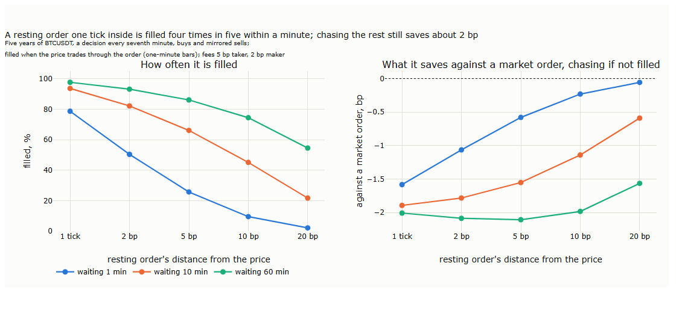
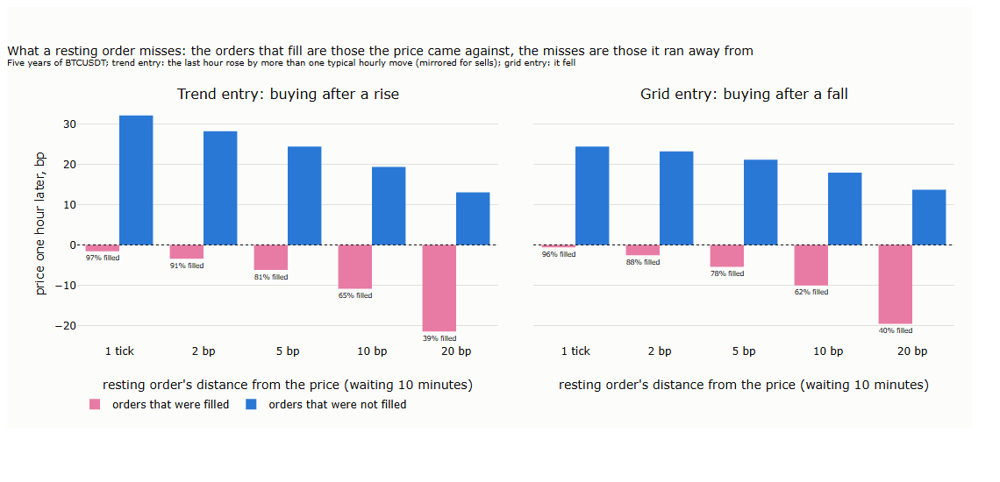
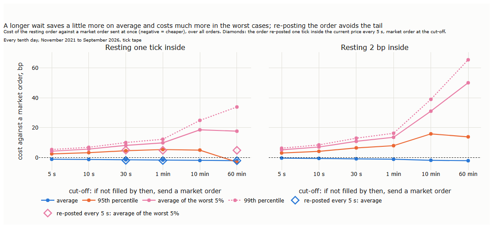
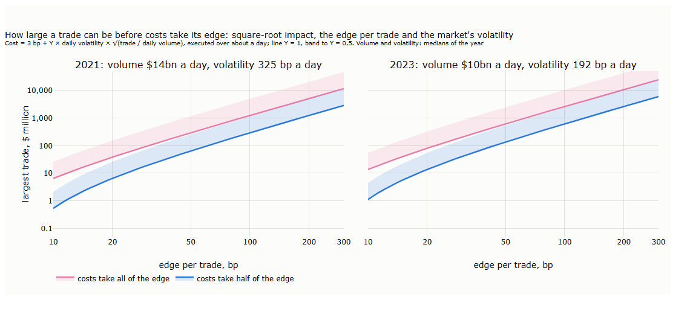
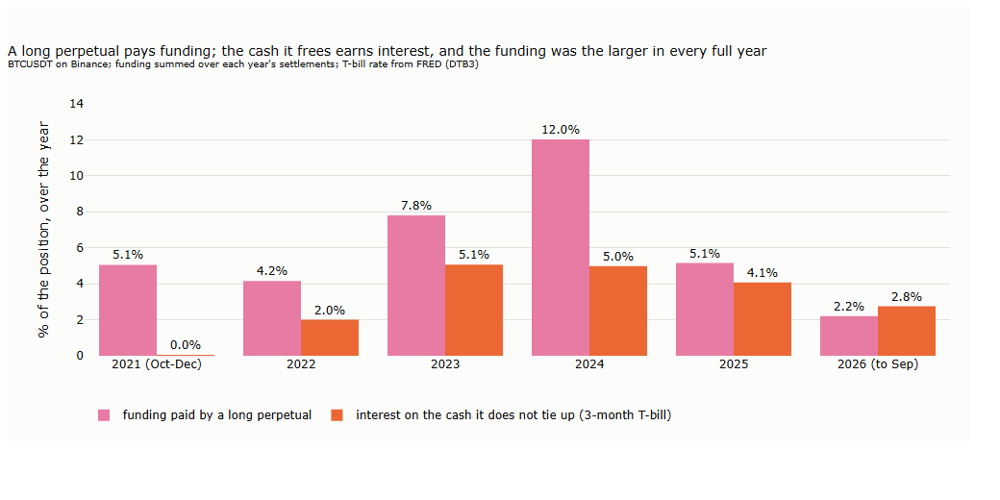
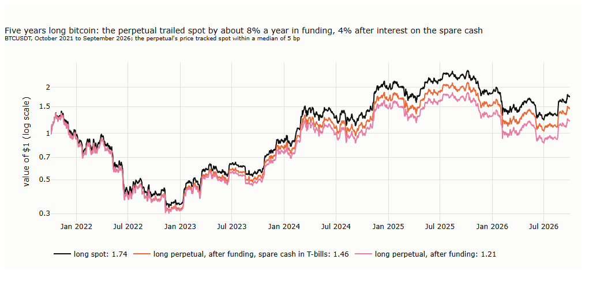
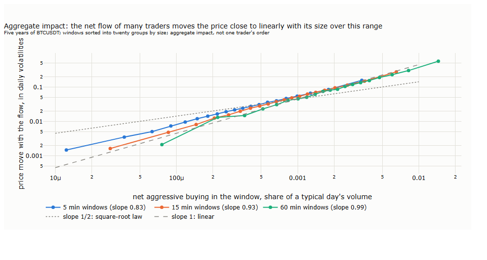

# Lecture 15: Who Trades and What It Costs: Order Flow, Costs and Capacity

*Systematic Trading: Lecture Notes (MSc) · Oct 24, 2026 · Max Gnesi*

Every trade on the tape has a buyer and a seller, but only one of them was in a hurry: the aggressor, who took the price offered rather than waiting for a better one. This lecture asks what that hurry tells us and what it costs. The first part is about order flow: does one-sided buying or selling predict where the price goes next, what happens when a single order sweeps through the book, and can the explosive days of Lecture 14 be seen coming? The second part is about costs: what a trade really pays, when a resting order is filled, and how large a strategy can grow before its costs eat its edge. It covers the fifth and sixth of Part III's six uses of the tape (the course guide, §1.1b): order flow, and costs and capacity.

> **What to take away**
>
> 1. **One-sided flow moves the price while it lasts and keeps almost all of its impact;** a sweep that chases the slower trend is taken back, one against it keeps half.
> 2. **Risk clusters:** the best warning of a cascade is the turbulence already under way; leverage, funding and calm add nothing measurable to it.
> 3. **On BTCUSDT a trade's cost is the exchange fee;** the spread is one tick, and a resting order re-posted at the price every few seconds saves about 2 bp against a market order.
> 4. **Funding, not impact, limits a trend rule:** a long perpetual trailed long spot by about 4% a year after interest.

## 1. Who was in a hurry

| § | Step | Question |
|---|---|---|
| 2 | Does one-sided flow predict the price? | After strong net buying, does the price carry on or come back? |
| 3 | Sweeps and absorption | When one order sweeps through the book, does the price come back? |
| 4 | Cascades | Can the explosive regime of Lecture 14 be recognised within the day? |
| 5 | What a trade costs | What does a market order really pay, and how much is lost to the price moving on? |
| 6 | Resting orders | How often is a resting order filled, what does it miss, and how long should it wait? |
| 7 | Capacity | How large can a strategy trade before its costs eat its edge? |
| 8 | For the two examples | What the trend rule (Lecture 16) and the grid (Lecture 17) take from this lecture |
| 9 | Summary, exercises and reading | |

**Three words.** The **aggressor** of a trade is the side that sent the order which executed at once, against an order already resting in the book (Lecture 12, §3.2). **Net aggressive buying**, or flow, is the dollars bought by aggressors minus the dollars sold by aggressors, here divided by all dollars traded, so that it runs from −1 (only sellers in a hurry) to +1 (only buyers). The **spread** is the gap between the best price at which someone is willing to buy and the best price at which someone is willing to sell; a market order pays at least half of it.

**Data.** The tape of Lecture 12: the BTCUSDT perpetual on Binance, October 2021 to September 2026. Where the best bid and ask are needed (§5), Binance published them only from May 2023 to March 2024; those results are labelled with that period. The order book beyond the best prices, every level and every change, is the subject of Part IV.

## 2. Does one-sided flow predict the price?

When buyers hurry, the price rises: they take the offers in the book, one level after another. The question here is what comes next. If the buyers knew something, the price should stay up or rise further; if they only needed to trade, the market makers who sold to them should push it partly back (Bouchaud, Gefen, Potters and Wyart, 2004).

**How it is measured.** Cut five years into windows of equal length: 1, 5 and 30 minutes. In each window measure the flow and sort the windows into fifths, from most selling to most buying. For each fifth, record the return during the window, the impact, and over the next window of the same length, what follows. Repeat for three volatility regimes, defined by the last hour's realised variance against its median over the past 28 days, so that the regime is known before the window starts.

| | 1 minute | 5 minutes | 30 minutes |
|---|---|---|---|
| Return during the window, most selling to most buying | −5 to +5 bp | −11 to +12 bp | −27 to +28 bp |
| Next window, most buying minus most selling | −0.08 bp | −0.51 bp | −0.99 bp |
| Same, in volatile hours | −0.21 bp | −0.91 bp | −3.02 bp |

*Our measurement for these notes; the differences in the second row are 4.5 to 7.7 standard errors from zero, with days as clusters.*

Flow moves the price strongly while it happens. Afterwards a small part comes back: about 1 bp after a move of 28 bp in 30 minutes, a few percent of the impact, and almost all of it in volatile hours. The reversal is reliable, but far smaller than what a market order costs (§5): it is not a strategy on its own. It is the trace of impact that is partly temporary, as the literature describes for stocks and for bitcoin.

**With or against the trend?** The reversal could depend on what the flow pushes against. The same test, now only on the strongest flow (the top and bottom fifths), split by the slower trend known at the time (the past three days' return, divided by its typical size: up, down, or no clear trend beyond half a standard deviation) and by the volatility regime:

The price comes back reliably in one corner only: after strong flow **with** the slower trend, in normal and volatile hours, by 0.2 to 0.5 bp after five-minute windows and 1.7 bp after thirty-minute windows in volatile hours. After flow against the trend, or with no clear trend, nothing is distinguishable from zero. When the market piles in on the side the trend already favours, at a moment of stress, the price overshoots and gives some back. In some cells the average and the day-based test point different ways, because a few extreme windows pull the average; the figure shows the day-based statistics, which are not dominated by them.

**At scheduled releases.** At a CPI release or a Fed decision, flow and price both explode. Three examples, minute by minute:

In November 2022 buyers sent $118 million of net buying in the first minute and the price kept rising; in September 2022 sellers sent $165 million and the price kept falling; at the Fed decision of September 2022 heavy selling and heavy buying followed within two minutes and the price reversed over the hour. Across all releases, the first five minutes' **move** predicts the next thirty minutes (a correlation of +0.45 for CPI releases, −0.32 for Fed decisions, Lecture 13, §7.4), but the first five minutes' **flow** does not (+0.15 and −0.10, neither distinguishable from zero). At a release the book reprices itself: the move carries the news, and the aggressive trades are only part of it.

**Our results and the literature.**

| The literature | Our result on BTCUSDT | |
|---|---|---|
| Order flow moves the price strongly and linearly within the same interval (Cont, Kukanov and Stoikov, 2014; for the BitMEX bitcoin perpetual, Silantyev, 2019) | ±28 bp during 30-minute windows, more in volatile hours | in line |
| The impact of trades is partly transient: it decays and partly reverses (Bouchaud, Gefen, Potters and Wyart, 2004; Bouchaud, Farmer and Lillo, 2009; for bitcoin, Donier and Bonart, 2015) | A small part comes back in the next window | in line |
| Daily price pressure in bitcoin is mostly permanent (Makarov and Schoar, 2020) | Only a few percent of the impact comes back | in line |
| Forecasting from order flow fades within about two average price changes (Kolm, Turiel and Westray, 2023, on stocks) | Reliable but a fraction of a basis point at minutes, below the cost of trading | in line |
| On stocks, trade imbalance explains price changes about half as well as the imbalance of the whole book (Cont, Kukanov and Stoikov, 2014); on the BitMEX bitcoin perpetual, trade imbalance explained them better (Silantyev, 2019) | At releases, the move predicts what follows and the flow does not | mixed: on BTCUSDT at releases the book, not the trades, carried the information |
| — | The reversal is reliable only after flow with the slower trend, in normal and volatile hours | not found in the literature; a result on this sample |

**Key message.** On BTCUSDT, one-sided flow moves the price while it lasts and leaves almost all of its impact in place; the small part that comes back appears after flow with the slower trend in stressed hours. At releases the price move, not the flow, carries the information. None of it pays a market order's cost by itself; whether it helps a strategy that rests its orders, a grid, is a question for §5 and Lecture 17.

## 3. Sweeps and absorption

Section 2 looked at flow added up over minutes. A single order can do the same in a millisecond: a market order larger than the depth at the best price takes the next level, and the next, until it is filled. This is a **sweep**. Behind the price it leaves a gap, and the question is who fills it and how fast. If the book refills quickly, most of the move comes back; if the sweep carried news, it stays.

**Hypotheses.** Fixed before the measurement:

| | Hypothesis | Why one might expect it |
|---|---|---|
| H1 | A large part of a sweep's move comes back within seconds | The gap behind the sweep is refilled by new resting orders: the book's resilience |
| H2 | A sweep against the slower trend comes back more than one with it | It fights the market's direction; a sweep with the trend joins it |

**How it is measured.** A sweep is one aggressive order, all fills in the same millisecond on the same side, that moves the price by at least 5, 10 or 20 bp from its first to its last fill. Over five years there are 622,818 of at least 5 bp and 179,082 of at least 10 bp. Sweeps come in bursts, so only the first in each 10-minute block is kept; with a clear slower trend, this leaves about 19,000, 5,800 and 1,600 independent sweeps for the three sizes. For each, the price is read just before it, at its last fill, and 10 seconds, 1 minute, 10 minutes and 1 hour later. The slower trend is the one of §2, the past three days' return divided by its typical size, read in the minute before the sweep.

*The time axis is in steps, not to scale.*

**H1 holds.** Within ten seconds, about half of the move is gone: a sweep of 13 bp is at 5 to 7 bp after ten seconds, one of 26 bp at 10 to 14. This is the same for both directions and all sizes. The gap fills almost at once.

**H2 fails, the other way round.** After the first ten seconds, the two kinds part:

- A sweep **with** the slower trend keeps losing ground and is back near where it started within the hour. The buyer who chases a rising market overshoots, and the market takes it back.
- A sweep **against** the slower trend keeps the half that survived the first ten seconds. Over the next ten minutes the price drifts a few basis points back towards the trend, and after an hour nothing is distinguishable from zero.

The control is the same return at moments without a sweep, every tenth minute with a clear trend, in the same volatility regime. There the trend's direction says nothing about the next ten minutes or the next hour (between −3 and +2 bp on average). The table gives the return in the trend's direction after the sweep's last fill, minus that control:

| Sweep | Size | Next 10 minutes | Next hour |
|---|---|---|---|
| with the trend | ≥ 5 bp | −4.8 bp (−8.8)\*\*\* | −7.4 bp (−4.3)\*\*\* |
| | ≥ 10 bp | −11.4 bp (−9.9)\*\*\* | −14.8 bp (−5.6)\*\*\* |
| | ≥ 20 bp | −20.6 bp (−6.6)\*\*\* | −26.1 bp (−5.0)\*\*\* |
| against the trend | ≥ 5 bp | +2.8 bp (4.9)\*\*\* | +1.2 bp (0.7) |
| | ≥ 10 bp | +4.1 bp (3.4)\*\* | −1.6 bp (−0.6) |
| | ≥ 20 bp | +7.5 bp (2.4)\* | −12.7 bp (−2.1)\* |

*Our measurement for these notes. Negative: the price moves back against the trend, that is against the sweep. In brackets the t-statistic, with days as clusters; stars after the Benjamini–Hochberg correction over the 16 tests (including the hourly-block variant below): \* q < 0.05, \*\* q < 0.01, \*\*\* q < 0.001.*

**Robustness.** The reversal after sweeps with the trend appears in every year from 2021 to 2026 (between −5 and −16 bp after ten minutes for sweeps of at least 10 bp), in calm, normal and volatile hours, and when only the first sweep per hour is kept (−8.6 bp after ten minutes, t −6.6). After sweeps against the trend the picture is less stable: the ten-minute drift towards the trend survives the hourly blocks (t 4.0); the hour after does not, and its sign changes from year to year.

**An open question.** In volatile hours, sweeps against the trend are followed by large moves further against it in some years (a median of −18 bp over the hour for sweeps of at least 10 bp), but the effect is not significant after correction, vanishes with hourly blocks and flips sign between years. Whether such a sweep marks the first crack of a trend, the forced selling of a liquidation cascade, is a question for §4, not a result here.

**Our results and the literature.**

| The literature | Our result on BTCUSDT | |
|---|---|---|
| After large trades the book is replenished quickly; new orders flow into a thin book (Biais, Hillion and Spatt, 1995) | About half of a sweep's move is gone within ten seconds | in line |
| The impact of aggressive orders is partly reversed in later trades, but a longer-term effect remains (Degryse, de Jong, van Ravenswaaij and Wuyts, 2005; for single trades, Bouchaud, Gefen, Potters and Wyart, 2004) | Part comes back, part stays | in line; the ten-second scale of a single sweep is our measurement |
| Trades in the direction of the prevailing flow meet more liquidity and move the price less permanently (Farmer, Gerig, Lillo and Mike, 2006); after a long price run-up, block purchases carry less permanent impact (Saar, 2001) | Sweeps with the slower trend are taken back almost completely | consistent in spirit; neither conditions on the trend as we do |
| Moves that trigger clustered stop-loss orders run on (Osler, 2005, for currencies) | Sweeps against the trend keep their remaining half | a possible mechanism, not tested here |
| — | The reversal depends on the sweep's relation to the slower trend | not found in the literature; a result on this sample, open to independent tests |

**Key message.** About half of a sweep comes back within seconds, whatever its direction: the book refills. What remains depends on the slower trend. A sweep that chases the trend overshoots and is taken back within the hour; one against the trend keeps its remaining half. For a strategy that rests orders in the book, a grid, this is the difference between a fill that is soon in profit and one that stays at a loss. Whether that pays after costs is a question for §5 and Lecture 17.

## 4. Cascades

Lecture 14 found an explosive regime: hours in which the price moves many times its usual amount. Some of these hours feed on themselves: the price falls, leveraged buyers are liquidated, their forced sales push it further, and more liquidations and stop orders follow. Both are market orders fired by a price, the mark price for liquidations and, by default on both venues, the last price for stops (Lecture 12, §3.4), which is why they arrive together. This is a **cascade**. For a strategy the question is practical: can it be seen coming, early enough to cut size, widen stops or pull resting orders?

**In short.** A cascade can be seen coming, but only from the turbulence already under way: after a volatile hour the next is thirty-five times as likely to be a cascade as after a calm one. Beyond that, a recent sweep may add a warning minutes ahead. The measures said to load the market hours or days in advance add nothing.

**Fuel and spark.** Two kinds of warning were tested, each read from data known at the start of the hour and counted when in its top (or bottom) fifth. **Fuel** is the state that would make a cascade possible: open interest high against its 28-day median, funding far from its usual 0.01%, a lopsided ratio of long to short accounts, a quiet day, weeks of calm, a long time in a tight band. **Spark** is what would show in the last 15 minutes once the self-feeding has begun: open interest falling fast, net flow on one side minute after minute, the price moving more per dollar traded, a sweep of 10 bp or more (§3).

**How it is measured.** A cascade is an hour whose move, over its typical size, is in the top 1%: at least 4.3 typical hourly moves. Each warning must add something to the simplest one, the last hour's own volatility, so the chance of a cascade is regressed on the warning and on the fifth of the last hour's realised variance, with days as clusters. Cut-offs are set on 2021–2024 and applied unchanged to 2025–2026. Open interest and the account ratio come from Binance's five-minute statistics; there is no public archive of individual liquidations, so falling open interest stands in for them.

**Risk clusters.**

After the calmest fifth of hours the next hour is a cascade about once in a thousand; after the most volatile fifth, three times in a hundred, in both periods. The reason is the mechanism itself: a cascade takes time to build, each round of forced selling triggering the next, so its first stages are visible in the volatility before the worst hour comes. This is volatility clustering (Lecture 14, §5.3) at its extreme, and it answers the question Lecture 14 (§3) left open: yesterday's volatility does not say whether today will be explosive, but within the day the last hour's volatility does.

**What the warnings add.**

Only a sweep adds to the warning: after one in the last 15 minutes, the next hour is a cascade four to five times as often, 1.7 percentage points beyond the control in 2021–2024 (t 3.1). There is a reason to expect it: a single order that clears several levels shows that the book is thin, and a thin book is where forced sales move the price most. Out of sample sweeps are rarer and the effect, though as large, is not significant; it is a lead, not an established result.

The fuel measures add nothing.\* At the next hour the intervals are narrow (about ±0.4 percentage points on a base rate of 1%), so a warning that raised the risk by half would have shown; within 24 hours they are wide, and there the honest verdict is only "not found". Falling open interest does come with cascades, but adds nothing once the last hour's volatility is known: it describes the turbulence rather than announcing it. The squeeze fails too: breaks after long stays in a tight band are not larger than after short ones, and the 3- and 7-day highs and lows do not draw closer to the band as it lasts, as they would if many models' stops were gathering at the same prices.

*\* Two checks were added after the first results: the direction (crowded longs followed by cascades down, crowded shorts by cascades up) and the extremes (top 5% instead of the top fifth). None passes the Benjamini–Hochberg correction; extreme funding and the deepest calm point the expected way. In 2025–2026 funding never rose above 0.01%, so crowded longs by funding cannot be tested out of sample.*

**Our results and the literature.**

| The literature | Our result on BTCUSDT | |
|---|---|---|
| Large changes are followed by large changes: volatility clusters (Mandelbrot, 1963; Engle, 1982; Cont, 2001) | The last hour's volatility raises the chance of a cascade thirty-five-fold | in line, at the extreme |
| Long periods of low volatility predict banking crises, years ahead (Danielsson, Valenzuela and Zer, 2018); a high crypto carry predicts crashes at daily and longer horizons (Schmeling, Schrimpf and Todorov, BIS working paper, 2023) | Calm and funding add nothing within 24 hours | a different horizon, not a contradiction |
| Across seven bitcoin perpetual cascades, no early-warning variable holds for every event (Garcia Seuma, 2026, preprint) | The fuel measures add nothing beyond current volatility | in line |
| A market maker's optimal spread widens with the variance of the price (Avellaneda and Stoikov, 2008) and with informed trading (Glosten and Milgrom, 1985); market makers withdraw together in broad stress (Anand and Venkataraman, 2016; Brogaard et al., 2018) | Risk is visible in the last hour's volatility and in recent sweeps | the rule below follows; Lecture 17 tests it |

**Key message.** Risk clusters: the best early warning of a cascade is the turbulence already under way, and a recent sweep may add to it. Leverage, crowding, calm and tight ranges add nothing measurable once current volatility is known. For a strategy that rests orders in the book, a market maker or a grid, the rule to test is therefore reactive rather than predictive: widen or pull the quotes as the last hour's volatility rises, and step aside for a few minutes after a sweep. Section 6 measures what resting orders earn and lose in such hours; Lecture 17 tests the rule.

## 5. What a trade costs

A market order pays three things: the exchange's fee, half the spread (it buys at the ask, not at the mid), and, if it is large, the impact of walking through several price levels. A resting order pays a lower fee and earns the half-spread, but it is filled exactly when someone in a hurry wants to trade with it, and the price often moves on against it. This section measures all four on BTCUSDT.

**In short.** On BTCUSDT a trade's cost is almost all exchange fee. The spread is one tick, about 0.015 bp of the price, and only orders above $100,000 pay a noticeable impact. The resting side earns its half-tick and loses a little more to the move that follows, most in volatile hours: a resting order is still much cheaper than a market order, but not because it earns the spread.

**Hypotheses.** Fixed before the measurement:

| | Hypothesis | Measure |
|---|---|---|
| H1 | The quoted spread is almost always one tick, so the fee dominates the cost of small orders | Quoted half-spread over time, against the fee |
| H2 | The cost of a market order rises with its size and in volatile hours | Effective half-spread: the order's average fill price against the mid just before it |
| H3 | The resting side loses to adverse selection: the price moves against it after the fill by more than the half-spread it earns | Realised half-spread: the fill against the mid 1, 10 and 60 seconds later |

**How it is measured.** Binance published its best bid and ask, every change of them, only from May 2023 to March 2024; every fourth day of that window is used, 80 days and 1,903 hours. Each aggressive order (all fills in the same millisecond on the same side, as in §3) is matched to the best bid and ask in force just before it; 98.5% of orders find a quote less than a second old. The effective half-spread splits into two parts that add up to it: the **impact**, how far the mid moves in the order's direction over the next seconds, and the **realised half-spread**, what the resting side keeps against that later mid. Fees are those of a regular account in Binance's USDⓈ-M futures: 5 bp for a market (taker) order and 2 bp for a resting (maker) order, lower at higher volume tiers.

**H1 holds.** The book sits at one tick 99.6% of the time; the quoted half-spread averages 0.015 bp. For orders under $10,000 the spread and impact together cost 0.04 to 0.07 bp, a hundredth of the 5 bp fee.

**H2 holds.** The cost rises with size, from 0.04 bp under $1,000 to 0.5 bp between $100,000 and $1 million and 2.5 bp above, where an order walks through several levels. It roughly doubles from calm to volatile hours, from 0.05 to 0.12 bp per order. Only the largest orders pay a cost comparable to the fee.

**H3 holds.** For every order size and in every regime, the mid moves against the resting side by more than the half-tick it earned: it keeps −0.13 bp after 60 seconds in calm hours and −0.22 bp in volatile ones (t-statistics from −8 to −34, with days as clusters). The loss is largest, in basis points, against large orders (−0.55 bp against orders of $100,000 to $1 million). One reading, not tested here: a large order is more likely to carry information, or to start a move. In the minute after a sweep the resting side does better for the first ten seconds, when half of the sweep comes back (§3), and the same as at any other time after sixty.

**What this means.** For a strategy that can wait to be filled, a resting order costs about 2.1 to 2.5 bp against 5.0 to 5.5 bp for a market order: the saving is the fee difference, less a small loss to adverse selection. Market making for the spread itself does not pay at these fees: the spread is a fraction of a basis point and the maker fee two. Binance pays its largest market makers to rest orders instead: in 2023 its programme paid rebates of 0.1 to 0.5 bp per resting fill (negative maker fees), about the size of the adverse-selection loss measured here. Market making on BTCUSDT is a business of fractions of a basis point, open only to those who earn the rebate. For the grid of Lecture 17 the cost of a fill is therefore the maker fee plus a fraction of a basis point; what decides its profit is not the spread but whether the price comes back (§3) and how often it runs away (§4).

**Our results and the literature.**

| The literature | Our result on BTCUSDT | |
|---|---|---|
| The effective spread splits into price impact and a realised spread, the part the liquidity provider keeps (Huang and Stoll, 1996; Bessembinder and Kaufman, 1997); US rules long measured the realised spread five minutes after the trade, and since 2024 at several horizons | We measure it at 1, 10 and 60 seconds | the same method, at the horizons of a fast market |
| Informed traders alone create a spread, even for a market maker who makes no profit (Glosten and Milgrom, 1985; Kyle, 1985) | After a fill the price moves against the resting side, more against large orders and in volatile hours | in line |
| When the spread is almost always one tick, the observed spread no longer measures the cost of trading (Dayri and Rosenbaum, 2015) | One tick 99.6% of the time; the cost is in the fee and, for large orders, the impact | in line |
| Posted quotes adjust to the split between maker and taker fees; what a taker pays in all is unchanged (Malinova and Park, 2015) | The fee, not the spread, is the cost | consistent |
| On Binance's bitcoin perpetual, the more likely a resting order is filled, the worse the return after the fill; common market-making strategies lose (Albers, Cucuringu, Howison and Shestopaloff, 2025, preprint) | The resting side keeps −0.13 to −0.22 bp after 60 seconds | in line |
| On earlier bitcoin exchanges, spreads were wide and adverse selection a large part of them (Dimpfl, 2017, working paper) | The spread is now one tick; the adverse selection remains | a different era of the market |

**Key message.** On BTCUSDT the spread is one tick and the cost of a trade is the exchange's fee: 5 bp for a market order, 2 bp for a resting one, with impact adding to it only above about $100,000. A resting order loses a fraction of a basis point to the move that follows its fill, most in volatile hours, so it saves about 3 bp against a market order but earns nothing from the spread. For the two examples this sets the cost to use in backtests: the taker fee plus the effective half-spread for the trend rule's market orders, the maker fee plus the adverse selection for the grid's resting ones.

## 6. Resting orders

Section 5 showed that a resting order pays 2 bp where a market order pays 5. But a resting order is filled only if the price comes to it, and the orders that are not filled are not a random selection. This section asks the question that decides whether waiting pays: how often is a resting order filled, what does it miss when it is not, and how long should it wait before giving up and sending a market order?

**In short.** A resting order one tick inside the price is filled four times in five within a minute. Its misses are the trades where the price ran away, so a strategy that drops them loses its best trades; one that chases them with a market order at a cut-off still saves 1 to 2 bp against trading at once. The cut-off sets the risk: a longer wait saves a little more on average and costs much more in the worst cases. Re-posting the order at the current price every few seconds removes that tail: it saves about 2 bp with the worst cases near 5 bp.

**Hypotheses.** Fixed before the measurement:

| | Hypothesis | Why |
|---|---|---|
| H1 | The chance of a fill falls quickly with the distance from the price | The price must travel to the order (Lecture 14, §4.1) |
| H2 | Fills are adverse and misses run away | An order is filled when the price comes against it; the trades it misses are those that moved the other way |
| H3 | For a trend rule's entries, buying after a rise, a resting order costs more than it saves; for a grid's entries, buying after a fall, it saves | A trend entry chases a moving price; a grid entry waits for one to come back |

**How it is measured.** At every seventh minute of the five years a trader decides to buy, and, mirrored, to sell, so that the drift of the price cancels. The choice is between a market order at once, paying the taker fee and the half-spread of §5, and a resting order one tick or a few basis points inside the last price, which pays the maker fee if filled. If it is not filled by a cut-off, it becomes a market order at the price then. Both choices end with the same position, so the difference in what they paid is the whole comparison. A resting order counts as filled only when a later trade goes strictly through its price, a conservative rule, since our place in the queue is unknown; a trade at the price would fill it sooner. The grid of distances and waiting times uses one-minute bars over the five years; the cut-offs shorter than a minute use the tick tape on every tenth day, 180 days. Fees are those of a regular account. The t-statistics below use days as clusters. All fills are simulated from the tape; simulated fills can differ from real ones (Lo, MacKinlay and Zhang, 2002), an open question that Part IV, with the order book, takes up.

**H1 holds.** One tick inside, an order is filled 79% of the time within a minute and 94% within ten; 5 bp away, 26% and 66%; 20 bp away, 2% and 22%. Moving the order away from the price does not pay: it is filled less often, and the chases eat what the better price saves. One tick inside is the best distance at every waiting time.

**H2 holds.** The orders that are filled are those the price came against: an hour after the decision the price stands about where the order was filled, and after the fill it moves on against it by a further 1 to 1.7 bp. The orders that are not filled are those it ran away from: 5 bp away with a ten-minute wait, the price an hour later is 6 bp against the filled orders and 11 bp in favour of the missed ones. Much of this is geometry, since an order is filled only if the price reaches it, but for a strategy with an edge it is decisive: dropping the misses removes the trades that moved its way.

**H3 is rejected, provided the order chases.** Trend entries and grid entries alike save about 1.7 bp with a one-minute cut-off (t −65 and −51), because a resting order one tick inside is filled so often that the rare chases cost less than the fee saved. Without the chase the trend rule would lose its runaway entries, which is where its profit comes from (Lecture 16).

**The cut-off.**

| Cut-off, one tick inside | 10 s | 30 s | 1 min | 10 min | 60 min |
|---|---|---|---|---|---|
| Filled before the cut-off | 58% | 72% | 79% | 94% | 98% |
| Average against a market order | −1.2 bp | −1.5 bp | −1.6 bp | −1.9 bp | −2.0 bp |
| Average of the worst 5% | +5.7 bp | +8.2 bp | +9.9 bp | +18.6 bp | +17.7 bp |
| 95th percentile among the chased orders | +5 bp | +9 bp | +12 bp | +45 bp | +117 bp |

*Our measurement for these notes; tick tape, every tenth day from November 2021 to September 2026. The averages are 48 to 77 standard errors from zero. Percentiles are over all orders; the last row is among those that reached the cut-off.*

The average saving grows slowly, and half of it is there after five seconds; the tail grows fast. A long wait rarely ends in a chase, but when it does the price has run: after an hour, by more than 100 bp at the 95th percentile. Read over all orders, such a rare chase can even hide below the 95th percentile; the average of the worst 5% and the tail among the chased orders show it. A resting order with a long cut-off is in effect a short option: it collects a little almost always and pays a lot when the price moves away.

**Re-posting the order.** The tail comes from waiting at a price the market has left. An order that is cancelled and re-posted one tick inside the current price every five seconds follows the price in small steps instead, and pays a runaway move a little at a time:

| One tick inside | Average against a market order | Average of the worst 5% | Sent as a market order at the end |
|---|---|---|---|
| Static, market order after 1 minute | −1.6 bp | +9.9 bp | 21% |
| Static, market order after 10 minutes | −1.9 bp | +18.6 bp | 6% |
| Re-posted every 5 s, market order after 30 seconds | −1.8 bp | +5.0 bp | 13% |
| Re-posted every 5 s, market order after 60 seconds | −2.0 bp | +4.9 bp | 6% |

*Same sample as above; t-statistics from −68 to −86.*

Re-posted every five seconds with a market order after a minute, the order saves more than a static order waiting ten minutes, with a quarter of its tail, after two re-posts on average. The most any resting order could save is about 3 bp, the fee difference and the half-spread less the tick it gives away; this keeps two thirds of it. Each re-post loses its place in the queue, which the fill rule already assumes, and one message every five seconds is far below the exchange's limits.

**Our results and the literature.**

| The literature | Our result on BTCUSDT | |
|---|---|---|
| Implementation shortfall: the cost of a trade is measured against the price at the decision, including the trades that are delayed or never made (Perold, 1988) | The comparison of this section: both choices end with the same position, and the misses are chased or counted | the framework used |
| Limit orders at or better than the quote outperform market orders even after a penalty for not being executed (Harris and Hasbrouck, 1996, on the New York Stock Exchange) | One tick inside saves 1.6 to 2 bp after the chases | in line |
| A limit order risks being filled when it is no longer wanted and missing when it is (Handa and Schwartz, 1996); a posted quote is an option written to the market (Copeland and Galai, 1983) | Fills are adverse and misses run away; a long wait behaves like a short option | in line |
| Execution times are very sensitive to the limit price; simulated executions are poor proxies for real ones (Lo, MacKinlay and Zhang, 2002) | Fill rates fall quickly with distance; our fills are simulated | in line; a caveat for this section |
| On Binance's bitcoin perpetual, fill probability and the return after the fill move in opposite directions (Albers, Cucuringu, Howison and Shestopaloff, 2025, preprint) | Filled orders are followed by a further 1 to 1.7 bp against them | in line |
| — | Re-posting every few seconds keeps the saving and removes the tail | a result on this sample |

**Key message.** On BTCUSDT a resting order one tick inside is filled most of the time and saves 1 to 2 bp against a market order, provided it chases the misses: the trades it misses are the ones where the price ran away. A static order must trade a little more saving against a heavier tail; an order re-posted one tick inside the current price every five seconds, sent as a market order after a minute, saves about 2 bp and keeps the worst cases near 5 bp. For the trend rule (Lecture 16), which makes its money on the trades that run, this is the entry to use; for the grid (Lecture 17), which never chases, the misses are its risk: they are the trends. What a stop gets when it is triggered was measured in Lecture 14 (§4.3).

## 7. Capacity

A strategy's edge per trade is fixed by its rule; its costs are not. Some are the same for every trade (the fee and the spread of §5), one grows with the size of the trade (impact), and one grows with the time a position is held (funding). Capacity is the size at which these costs take the edge.

**In short.** On BTCUSDT impact allows trades of tens to hundreds of millions of dollars before it takes a trend rule's edge; it binds later in calm years than in volatile ones. The cost that matters more is funding: a long perpetual paid 4 to 12% a year in each full year, and over five years trailed long spot by about 8% a year, 4% after interest on the cash it frees.

**Size as a share of the market.** A trade of $1 million is large when the market trades $5 billion a day and small when it trades $50 billion. The measure of size used here is therefore the trade as a share of a day's volume, Q / V. BTCUSDT traded a median of $10 to 16 billion a day in each year from 2021 to 2026, with a daily volatility of 190 to 330 bp.

**Impact: the square-root law.** Across markets, the price impact of a metaorder, a trade split into many small orders over hours, follows

| Symbol | Financial meaning |
|---|---|
| impact = Y × σ × √(Q / V) | the average move of the price against the trade while it is executed |
| Q | the size of the trade, in dollars |
| V | the market's volume over a day, in dollars |
| σ | the market's volatility over a day |
| Y | a constant of order one |

The impact grows with the square root of size: a trade four times as large moves the price twice as much (Tóth et al., 2011). On bitcoin, Donier and Bonart (2015) measured Y = 0.9 (standard deviation 0.35) on a million metaorders, close to the values of mature markets; their metaorders lasted minutes to an hour, so applying the law to trades executed over a day, as below, extends it beyond their data. Our tape cannot calibrate it: it is anonymous, so the small orders that belong to one trader's metaorder cannot be told apart. What it can measure, the net flow of all traders together, is a different object, aggregate impact, with a different shape (Patzelt and Bouchaud, 2018; the appendix shows it on our tape).

**The capacity map.** With a cost of 3 bp per trade for fee and spread (the re-posted entry of §6) and impact from the square-root law, the largest trade at which costs take half or all of a given edge is:

A trend trade with an edge of 50 bp loses half of it to costs at about $65 million in 2021 and $135 million in 2023, all of it at about $290 million and $620 million. The capacity rises with the square of the edge left after the fixed cost, and falls with the square of volatility: the calm year 2023 allowed twice the size of the volatile 2021, with less volume. A grid, whose fills earn a few basis points each, would reach its limit in the low millions per level; but its fills are passive, and for them the binding cost is the adverse selection of §5, not impact.

**Funding: the cost of holding.** A perpetual has no expiry; instead, every eight hours longs pay shorts, or shorts pay longs, an amount that keeps its price close to spot. On Binance the rate has an interest component of 0.01% per eight hours, 0.03% a day, plus a premium when the perpetual trades above spot. On BTCUSDT longs paid in 74 to 99% of the eight-hour periods each year.

A long perpetual needs only margin, so the rest of its capital can earn interest; long spot ties up all of it. In every full year the funding was the larger, most of all in the rising year 2024, when longs paid 12% against 5% on cash: those who want to be long when the market rises pay most to stay long.

Over the five years the perpetual's price tracked spot within a median of 5 bp, but a dollar held long grew to $1.74 in spot, $1.21 in the perpetual after funding, and $1.46 with the spare cash in Treasury bills: the perpetual trailed spot by about 8% a year, and by 4% after interest. The gap between the two is, period by period, the funding paid plus the change in the basis, the perpetual's price over spot; over these five years the basis ended where it began, within a few basis points, so the gap is the funding (Lecture 16, §6, measures the long-spot, short-perpetual structure that earns it). A trend trade held long for 20 days paid 16 to 110 bp in funding, depending on the year, against 4 to 10 bp to enter and leave; a short received it.

**Our results and the literature.**

| The literature | Our result on BTCUSDT | |
|---|---|---|
| A metaorder's impact grows with the square root of its size relative to daily volume, scaled by daily volatility, with a constant of order one (Tóth et al., 2011) | Taken from the literature; our anonymous tape cannot isolate metaorders | used, not tested |
| On bitcoin the constant is 0.9, on metaorders of minutes to an hour (Donier and Bonart, 2015) | The capacity map uses 0.5 to 1, for trades over about a day | an extrapolation in time, stated |
| Aggregate impact, the net flow of all traders, follows a nonlinear curve of the same shape across timescales, distinct from a single trader's (Patzelt and Bouchaud, 2018) | On our tape it rises close to linearly with size over the range observed (appendix) | different object; consistent with a curve that is not a square root |
| The perpetual's price is tied to spot by funding; deviations are larger in crypto than in traditional markets and have shrunk over time (He, Manela, Ross and von Wachter, working paper, 2022–2026) | The price tracked spot within 5 bp; funding cost a long 4 to 12% in each full year | in line |
| — | Longs paid in 74 to 99% of periods; a long perpetual trailed spot by 8% a year, 4% after interest | a result on this sample |

**Key message.** On BTCUSDT the size of a trade is limited by impact only at tens to hundreds of millions of dollars, later in calm years than in volatile ones. The cost a trend rule cannot avoid is funding: a long perpetual trailed long spot by about 4% a year after interest, while a short received it. Lecture 16 books funding at every settlement, and asks whether the trend rule should hold its longs in spot.

## 8. For the two examples

Lectures 16 and 17 apply Part III to a trend rule and to an intraday grid. Each takes something different from this lecture; only results measured here are listed, with their section.

### 8.1 The trend rule (Lecture 16)

| From this lecture | What the trend rule takes |
|---|---|
| One-sided flow (§2) | The price keeps almost all of the impact of flow; the small reversal after flow with the slower trend is below the cost of trading, not a signal |
| Sweeps (§3) | A sweep with the slower trend is taken back within the hour: an entry that chases it pays the overshoot |
| Cascades (§4) | Risk clusters: the last hour's volatility is the warning to size by; a recent sweep adds to it |
| Costs (§5) | A market order costs the 5 bp taker fee plus 0.04 bp (small orders) to 2.5 bp (over $1 million) |
| Entry (§6) | Rest one tick inside, re-post every 5 seconds, send a market order after a minute: about 2 bp saved, worst cases near 5 bp |
| Funding (§7) | Longs paid 4 to 12% a year in each full year, shorts received it; book it at every settlement, and compare holding the longs in spot |

### 8.2 The grid (Lecture 17)

| From this lecture | What the grid takes |
|---|---|
| Sweeps (§3) | After a sweep with the slower trend the price returns to where the sweep started within the hour; after one against it, only half of the move comes back |
| Cascades (§4) | Widen or pull the orders as the last hour's volatility rises; step aside for a few minutes after a sweep |
| Costs (§5) | A fill costs the 2 bp maker fee plus 0.13 to 0.22 bp lost to the next minute's move; the spread itself earns nothing |
| Resting orders (§6) | Fills come when the price moves against the order; the levels the grid misses are the moves that run away, the trends |
| Capacity (§7) | The grid's fills are passive: its limit is adverse selection and the rate of fills, not impact |

### 8.3 What needs to be investigated

The results above hold on BTCUSDT from 2021 to 2026, and, for the best bid and ask, from May 2023 to March 2024. These questions are open, and readers are invited to test them, on this market and on others:

- Does a sweep against the trend in volatile hours mark the turn of a trend (§3, §4)?
- Do extreme funding or long calm warn of cascades at horizons longer than a day (§4)?
- Are the fills simulated in §6 those a real order gets? Part IV, with the order book, measures queue positions and what a resting order really gets.
- Does the square-root law hold for bitcoin trades executed over a day, with a constant near 0.9? Only data that identify traders can tell.
- Does the re-posted entry of §6 keep its saving on a thinner market, such as SOLUSDT, and at higher fee tiers?
- When does holding a trend rule's longs in spot, and its shorts in the perpetual, beat holding both in the perpetual (§7)?

## 9. Summary, exercises and reading

### 9.1 Seven takeaways

1. **Flow moves the price while it lasts and keeps almost all of its impact.** The small part that comes back appears after flow with the slower trend, in stressed hours, and is below the cost of trading.
2. **Half of a sweep comes back within seconds;** what remains depends on the trend: a sweep that chases it is taken back, one against it stays.
3. **Risk clusters.** A cascade grows out of turbulence that is already visible; the measures said to load the market in advance add nothing to it.
4. **The spread is one tick; the cost is the fee.** Size adds impact only above about $100,000, and volatile hours double the small part that is not fee.
5. **A resting order is cheaper only if it chases its misses,** because they are the trades where the price ran away; re-posted every few seconds, it saves about 2 bp with a small tail.
6. **Capacity is set by impact only at tens to hundreds of millions of dollars,** and is larger in calm years than in volatile ones.
7. **Funding is the cost a trend rule cannot trade away:** a long perpetual trailed long spot by about 8% a year, 4% after interest.

### 9.2 Exercises

- [ ] Repeat the sweep test of §3 on ETHUSDT for one year. Is a sweep with the trend taken back as fully?
- [ ] Define a cascade by a move of 2% in an hour instead of the top 1% of scaled moves, and repeat the test of the control in §4. Does risk still cluster as strongly?
- [ ] Using the cost figures of §5, compute the cost per year of a strategy that trades its whole capital once a day with market orders, and with resting orders as in §6.
- [ ] Simulate the re-posted entry of §6 with re-posts every 1, 5 and 20 seconds. Where does the saving stop growing, and where does the tail start to grow?
- [ ] Over the five years, how much funding would a rule that is long when the 50-day average is above the 200-day, and flat otherwise, have paid? Compare it with the rule's return.
- [ ] Pick one question from §8.3 and investigate it on a market of your choice.

### 9.3 Reading

For the impact of trades and why it is partly transient, Bouchaud, Farmer and Lillo (2009); for order flow and price changes, Cont, Kukanov and Stoikov (2014). For the components of the spread, Glosten and Milgrom (1985) and Huang and Stoll (1996). For limit orders against market orders, Harris and Hasbrouck (1996) and Handa and Schwartz (1996); for implementation shortfall, Perold (1988). For the square-root law, Tóth et al. (2011), and on bitcoin, Donier and Bonart (2015). For perpetual futures and funding, He, Manela, Ross and von Wachter (working paper).

## References

- Albers, J., Cucuringu, M., Howison, S. and Shestopaloff, A. Y. (2025). The market maker's dilemma: navigating the fill probability vs. post-fill returns trade-off. arXiv preprint 2502.18625. — fill probability and the return after the fill on Binance's bitcoin perpetual (§5, §6).
- Anand, A. and Venkataraman, K. (2016). Market conditions, fragility, and the economics of market making. *Journal of Financial Economics* 121(2), 327–349. — market makers withdraw together in poor conditions (§4).
- Avellaneda, M. and Stoikov, S. (2008). High-frequency trading in a limit order book. *Quantitative Finance* 8(3), 217–224. — the market maker's spread widens with variance (§4).
- Bessembinder, H. and Kaufman, H. M. (1997). A comparison of trade execution costs for NYSE and NASDAQ-listed stocks. *Journal of Financial and Quantitative Analysis* 32(3), 287–310. — effective and realised spreads (§5).
- Biais, B., Hillion, P. and Spatt, C. (1995). An empirical analysis of the limit order book and the order flow in the Paris Bourse. *Journal of Finance* 50(5), 1655–1689. — the book refills after large trades (§3).
- Bouchaud, J.-P., Farmer, J. D. and Lillo, F. (2009). How markets slowly digest changes in supply and demand. In T. Hens and K. R. Schenk-Hoppé (eds), *Handbook of Financial Markets: Dynamics and Evolution*, Elsevier, 57–160. — review of price impact (§2).
- Bouchaud, J.-P., Gefen, Y., Potters, M. and Wyart, M. (2004). Fluctuations and response in financial markets: the subtle nature of 'random' price changes. *Quantitative Finance* 4(2), 176–190. — the impact of a trade is transient (§2, §3).
- Brogaard, J., Carrion, A., Moyaert, T., Riordan, R., Shkilko, A. and Sokolov, K. (2018). High frequency trading and extreme price movements. *Journal of Financial Economics* 128(2), 253–265. — liquidity provision in extreme moves (§4).
- Cont, R. (2001). Empirical properties of asset returns: stylized facts and statistical issues. *Quantitative Finance* 1(2), 223–236. — volatility clustering (§4).
- Cont, R., Kukanov, A. and Stoikov, S. (2014). The price impact of order book events. *Journal of Financial Econometrics* 12(1), 47–88. — order flow imbalance and price changes (§2).
- Copeland, T. E. and Galai, D. (1983). Information effects on the bid-ask spread. *Journal of Finance* 38(5), 1457–1469. — a posted quote as an option written to the market (§6).
- Danielsson, J., Valenzuela, M. and Zer, I. (2018). Learning from history: volatility and financial crises. *Review of Financial Studies* 31(7), 2774–2805. — long low volatility precedes crises (§4).
- Dayri, K. and Rosenbaum, M. (2015). Large tick assets: implicit spread and optimal tick size. *Market Microstructure and Liquidity* 1(1), 1550003. — when the spread is one tick (§5).
- Degryse, H., de Jong, F., van Ravenswaaij, M. and Wuyts, G. (2005). Aggressive orders and the resiliency of a limit order market. *Review of Finance* 9(2), 201–242. — impact partly reversed, partly permanent (§3).
- Dimpfl, T. (2017). Bitcoin market microstructure. SSRN Working Paper 2949807. — spreads and adverse selection on earlier bitcoin exchanges (§5).
- Donier, J. and Bonart, J. (2015). A million metaorder analysis of market impact on the Bitcoin. *Market Microstructure and Liquidity* 1(2), 1550008. — square-root impact on bitcoin, Y = 0.9 (§2, §7).
- Engle, R. F. (1982). Autoregressive conditional heteroscedasticity with estimates of the variance of United Kingdom inflation. *Econometrica* 50(4), 987–1007. — volatility clustering (§4).
- Farmer, J. D., Gerig, A., Lillo, F. and Mike, S. (2006). Market efficiency and the long-memory of supply and demand: is price impact variable and permanent or fixed and temporary? *Quantitative Finance* 6(2), 107–112. — asymmetric liquidity (§3).
- Garcia Seuma, R. M. (2026). Where does the criticality live? Early-warning signals are event-heterogeneous across seven crypto-perpetual liquidation cascades. arXiv preprint 2607.27070. — no early warning holds for every cascade (§4).
- Glosten, L. R. and Milgrom, P. R. (1985). Bid, ask and transaction prices in a specialist market with heterogeneously informed traders. *Journal of Financial Economics* 14(1), 71–100. — the spread from informed trading (§4, §5).
- Handa, P. and Schwartz, R. A. (1996). Limit order trading. *Journal of Finance* 51(5), 1835–1861. — the risks of a limit order (§6).
- Harris, L. and Hasbrouck, J. (1996). Market vs. limit orders: the SuperDOT evidence on order submission strategy. *Journal of Financial and Quantitative Analysis* 31(2), 213–231. — limit orders beat market orders after non-execution (§6).
- He, S., Manela, A., Ross, O. and von Wachter, V. (2022). Fundamentals of perpetual futures. arXiv preprint 2212.06888. — perpetual prices, funding and their deviations (§7).
- Huang, R. D. and Stoll, H. R. (1996). Dealer versus auction markets: a paired comparison of execution costs on NASDAQ and the NYSE. *Journal of Financial Economics* 41(3), 313–357. — components of execution cost (§5).
- Kolm, P. N., Turiel, J. and Westray, N. (2023). Deep order flow imbalance: extracting alpha at multiple horizons from the limit order book. *Mathematical Finance* 33(4), 1044–1081. — the horizon of order-flow forecasts (§2).
- Kyle, A. S. (1985). Continuous auctions and insider trading. *Econometrica* 53(6), 1315–1335. — informed trading and price impact (§5).
- Lo, A. W., MacKinlay, A. C. and Zhang, J. (2002). Econometric models of limit-order executions. *Journal of Financial Economics* 65(1), 31–71. — execution times and simulated fills (§6).
- Makarov, I. and Schoar, A. (2020). Trading and arbitrage in cryptocurrency markets. *Journal of Financial Economics* 135(2), 293–319. — order flow and bitcoin returns; daily price pressure mostly permanent (§2).
- Malinova, K. and Park, A. (2015). Subsidizing liquidity: the impact of make/take fees on market quality. *Journal of Finance* 70(2), 509–536. — quotes adjust to the fee split (§5).
- Mandelbrot, B. (1963). The variation of certain speculative prices. *Journal of Business* 36(4), 394–419. — large changes follow large changes (§4).
- Osler, C. L. (2005). Stop-loss orders and price cascades in currency markets. *Journal of International Money and Finance* 24(2), 219–241. — stop-loss cascades (§3, §4).
- Patzelt, F. and Bouchaud, J.-P. (2018). Universal scaling and nonlinearity of aggregate price impact in financial markets. *Physical Review E* 97(1), 012304. — aggregate impact (§7, appendix).
- Perold, A. F. (1988). The implementation shortfall: paper versus reality. *Journal of Portfolio Management* 14(3), 4–9. — measuring cost against the decision price (§6).
- Saar, G. (2001). Price impact asymmetry of block trades: an institutional trading explanation. *Review of Financial Studies* 14(4), 1153–1181. — impact after a price run-up (§3).
- Schmeling, M., Schrimpf, A. and Todorov, K. (2023). Crypto carry. BIS Working Paper 1087. — carry predicts crashes (§4).
- Silantyev, E. (2019). Order flow analysis of cryptocurrency markets. *Digital Finance* 1, 191–218. — order flow and prices on the BitMEX bitcoin perpetual (§2).
- Tóth, B., Lempérière, Y., Deremble, C., de Lataillade, J., Kockelkoren, J. and Bouchaud, J.-P. (2011). Anomalous price impact and the critical nature of liquidity in financial markets. *Physical Review X* 1(2), 021006. — the square-root law (§7).

## Appendix: aggregate impact on our tape

The square-root law describes one trader's metaorder. The net flow of all traders together, measured on our tape over windows of 5, 15 and 60 minutes, moves the price close to linearly with its size over the range observed, with slopes of 0.8 to 1.0 on a log-log scale, not 0.5:

The two do not contradict each other: a window's net flow mixes many traders, informed and not, and the price responds to their sum, not to the size of any one order (Patzelt and Bouchaud, 2018). The square-root law cannot be tested on an anonymous tape, which is why §7 takes it from the literature.
