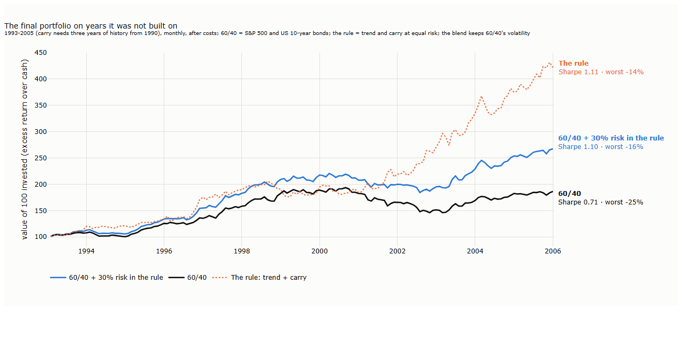

# Lecture 16: The Final Portfolio

*Systematic Trading: Lecture Notes (MSc) · draft, Nov 16, 2026 · Max Gnesi*

*Pipeline stage (Lecture 1 §2.1): portfolio construction and risk management (two signals combined at equal risk, one volatility target), with execution costs.*

**Part IV: the portfolio.** The base layer is assembled here, stage by stage of Lecture 1 §2.1: signals already built, combined by allocation and held to one risk target, with execution costs (§3). Lecture 17 closes the part with how such research is done well with an AI assistant. Part V then goes below the daily bar.

The base layer ends with one portfolio and an honest number. The portfolio is the simplest combination the evidence of Lectures 12-15 supports: trend and carry at equal risk. The number is what such a portfolio can be expected to deliver, not what its best backtest shows. Both are tested on years no lecture used to build them, 1990-2005, and judged the way an investor would judge them: as an addition to an ordinary portfolio of stocks and bonds. The plan was fixed before any result was computed, and every change made after seeing results is dated and labelled ([results/hypotheses.md](results/hypotheses.md)).

## 1. The final portfolio on years it was not built on

| § | Topic | Question |
|---|---|---|
| 1 | The key chart | What does the portfolio add to a stock-and-bond investor, on untouched years? |
| 2 | Realistic expectations | What should a simple, rule-based portfolio be expected to earn, and why does the expectation matter? |
| 3 | The portfolio and the test | What exactly is held, and on which data is it judged? |
| 4 | Results | Does it hold up on 1990-2005? |
| 5 | The investor's view | How much of a 60/40 portfolio's risk should it get, and what does that buy? |
| 6 | What it costs | Costs, crashes and the period |
| 7 | The realistic number | What remains after each haircut? |
| 8 | Where higher Sharpe ratios come from | What larger funds add, how to improve on a fixed base layer, and where to focus next |
| 9 | Summary | Takeaways, exercises, reading |

<b>How to read the figure.</b> <b>Axes.</b> x: time, January 1993 to December 2005, monthly (carry needs three years of data from 1990 before it trades); y: the value of 100 invested, excess return over cash, after costs. Black: 60/40, the S&P 500 and US 10-year government bonds, rebalanced monthly. Dotted orange: the rule, trend and carry at equal risk. Blue: 60/40 with 30% of its risk budget moved to the rule, at 60/40's volatility. At the right: each line's Sharpe ratio and worst loss. Our calculation ([results/test.json](results/test.json)).

On years no lecture used to build it, the portfolio did what Lecture 15 found on later years, and more: trend and carry together earned a Sharpe ratio of 1.11, against 0.71 for 60/40, with a correlation to 60/40 near zero (−0.03). Moved into a 60/40 portfolio at 30% of its risk, it raised that portfolio's Sharpe ratio from 0.71 to 1.10 and cut its worst loss from −25% to −16%. The rest of the lecture explains why 1.11 is not the number to expect (§6-7): these were carry's best years, and costs matter. The number to expect is about 0.6 to 0.7, comparable to a stock-and-bond portfolio, with almost no correlation to it. That is the realistic result of the course, and a valuable one.

## 2. Realistic expectations

A simple, rule-based portfolio built from public ideas and free data can be expected to earn about what a long-only portfolio earns per unit of risk, with low correlation to it. Not twice as much.

The expectation is part of the method, not a footnote. A researcher who expects a simple rule to deliver a Sharpe ratio of 1.5 will keep adjusting it until the backtest agrees: one more filter, one more parameter, one more market dropped. That is curve fitting by another name (Lecture 1 §5.3). A researcher who aims for "comparable to long-only, moving differently" stops at a robust rule, and a robust rule is what survives the future.

And the modest target is valuable. Most investors already hold stocks and bonds. A strategy that earns like them but moves differently improves their whole portfolio far more than one that earns more but moves with the market (§5). In practice that is what investors pay to add.

## 3. The portfolio and the test

| | |
|---|---|
| **The rule** | Trend (Lecture 13's baseline across all its markets) and carry (Lecture 15's rule, unchanged: four groups, level and change, the score) at equal risk; the total scaled to 10% a year |
| **The rival** | Trend, carry and value from fundamentals (Lecture 15 §5.4) at equal thirds; value enters only through this rival, a decision fixed before the test |
| **Yardsticks** | Trend alone; US equities (S&P 500, total return over cash); 60/40 (S&P 500 and US 10-year bonds) |
| **The test** | 1990-2005, never used to build or tune carry or value |
| **For reference** | 2006-2022, the years Lectures 13-15 used |

<b>How to read the table.</b> What is held, what it is compared with, and on which years. Every choice was fixed in the plan before any result of this lecture.

**The portfolio, stage by stage.** Every part of the final portfolio sits in one stage of Lecture 1's pipeline, and was built in the lecture named.

| Stage | In the final portfolio | Built in |
|---|---|---|
| **Data** | Futures and ETFs; for 1990-2005, long free series: exchange rates and 3-month rates (FRED, OECD), central-bank 10-year yields, Shiller's earnings, country equity funds | 11, 13, 15 |
| **Signal generation** | Trend: the baseline's rules and speeds. Carry: the score on level and 3-month change, within each of four groups | 12-13, 15 |
| **Portfolio construction and allocation** | Within each strategy, markets at equal risk within groups and groups at equal risk; between strategies, trend and carry at equal risk | 13, 15, this lecture |
| **Risk management** | Each position sized by its own volatility (trend over its speed, carry over 36 months); each group and the total scaled each year to 10% on its past. No drawdown rule or leverage cap: drawdowns, Calmar and skew are measured, not clipped | 9, 12-13, 15 |
| **Execution** | Monthly rebalancing at 5 bp per trade; 10 and 20 bp as checks (§6). How to trade it cheaper is Part V | §6, Part V |

<b>How to read the table.</b> One row per stage of Lecture 1 §2.1. Middle: what the final portfolio does at that stage. Right: where it was built. The combination of trend and carry is an allocation and risk decision, not a new signal: the signals are unchanged from Lectures 13 and 15.

The 1990-2005 data are partial, and the test says so. Trend is Lecture 14's 12-market portfolio built with the baseline's rules from long free series. Carry's groups join as their data begin: currencies trade from 1990 (the euro before 1999 through the German mark at the fixed conversion rate, from monthly average rates, which smooth those years' returns a little; Japan's call-money rate before its 3-month rate begins in 2002); government bonds from 1995; equities from 2001; commodities from 2004. So for most of the test, carry rests on currencies and bonds.

## 4. Results

| | 1990-2005 (the test) | | | 2006-2022 (reference) | | |
|---|---|---|---|---|---|---|
| | **Sharpe** | **Worst drawdown** | **Calmar** | **Sharpe** | **Worst drawdown** | **Calmar** |
| Trend | 0.78 | −12.6% | 0.66 | 0.67 | −19.3% | 0.35 |
| Carry | 0.99 | −18.5% | 0.48 | 0.54 | −20.8% | 0.27 |
| **The rule: trend + carry** | **1.11** | −14.4% | 0.81 | **0.84** | −19.3% | 0.48 |
| Rival: trend + carry + value | 0.89 | −9.8% | 0.95 | 0.81 | −21.3% | 0.44 |
| US equities | 0.57 | −46.3% | 0.13 | 0.56 | −51.1% | 0.13 |
| 60/40 | 0.71 | −24.6% | 0.20 | 0.66 | −30.0% | 0.17 |

<b>How to read the table.</b> One row per portfolio; Sharpe ratio, worst drawdown and Calmar (return a year over the worst drawdown), monthly, excess returns over cash, after costs, on the months the rule exists in each period (1993-2005 and 2007-2022). Our calculation ([results/test.json](results/test.json)).

The three expectations fixed in the plan all hold on the untouched years:

1. **Carry earned with low correlation to trend** (0.99; correlation 0.19), led by currencies (0.74) and bonds (0.74).
2. **Trend + carry earned more per unit of risk than trend alone** (1.11 against 0.78).
3. **A 20-30% share of a 60/40 portfolio's risk raised its Sharpe ratio and cut its worst loss** (§5).

Against luck, carry and the rule beat all of 1,000 random strategies on 1990-2005 (95th percentiles 0.36 and 0.83). Value from fundamentals earned a little (0.26 in 1990-2005, 0.09 in 2006-2022); in the rival it lowered the Sharpe ratio but gave the shallowest worst loss in 1990-2005. As fixed, the portfolio is the rule without value; value remains a small diversifier worth a place in a larger portfolio, not a pillar.

## 5. The investor's view

| Share of a 60/40 portfolio's risk moved to the rule | 1990-2005: Sharpe | Worst drawdown | 2006-2022: Sharpe | Worst drawdown |
|---|---|---|---|---|
| 0% (60/40 alone) | 0.71 | −24.6% | 0.66 | −30.0% |
| 20% | 0.97 | −19.4% | 0.84 | −27.4% |
| 30% | 1.10 | −16.4% | 0.93 | −25.0% |
| 50% | 1.31 | −9.7% | 1.04 | −20.7% |

<b>How to read the table.</b> One row per share of the risk budget given to the rule; each blend is scaled to 60/40's own volatility, so it carries the same risk. Monthly, excess returns over cash, after costs. Our calculation.

Both periods tell the same story: a modest share, 20-30% of the risk, lifts a stock-and-bond portfolio's Sharpe ratio by a quarter to a half and cuts its worst loss, without taking more risk. This is the practical meaning of "comparable to long-only with low correlation". The rule does not need to beat 60/40 to be worth holding; it needs to move differently from it, and it does: its correlation with 60/40 is −0.03 in 1990-2005 and 0.09 in 2006-2022. Carry raises that correlation a little above trend's alone, since carry is a pro-risk strategy that loses when markets panic (Lecture 15 §6.3).

## 6. What it costs

**Costs.** The backtests charge 5 bp per trade. Carry's scores move every month, so it trades more than trend, and its edge is sensitive to costs:

| Cost per trade, carry | 1990-2005: trend + carry | 2006-2022: trend + carry |
|---|---|---|
| 5 bp (the rule) | 1.11 | 0.84 |
| 10 bp | 1.01 | 0.68 |
| 20 bp | 0.82 | 0.36 |

<b>How to read the table.</b> The rule's Sharpe ratio when carry's trades cost more; trend's costs unchanged. At 20 bp in 2006-2022 the rule falls below trend alone (0.67). Our calculation.

At 20 bp the combination does worse than trend alone in 2006-2022. Execution is therefore not a detail for carry: Part V's lessons (Lectures 21-23: slicing, timing, cost as a distribution) are what keep its edge. A slower carry signal, or trading only when a score changes enough, are the obvious next steps (§9.2). A flat cost per trade also understates the problem. Part V measures trading costs on the tape and in the order book as a distribution, not a constant: they widen in fast markets and grow with the size traded (Lectures 19 and 22), which is exactly when trend and carry rebalance the most. Measuring each market's own costs, and trading the rebalancing with Part V's methods, is the first improvement of §8.1.

**Crashes.** Carry adds sudden losses: in 2006-2022 the combination's worst month was −11.4% against trend's −7.4% (Lecture 15 §6.3). That is the price of carry's premium, and the reason it persists.

**The period.** The rule earned 1.11 in 1990-2005, 0.84 in 2006-2022 and 0.45 in 2013-2026 (Lecture 15 §6.5). 1990-2005 were the years before the 2008 unwind, when currency carry was widely traded and earned well; no one knows which kind of decade comes next.

## 7. The realistic number

| The rule, Sharpe ratio | 1990-2005 | 2006-2022 | 2013-2026 |
|---|---|---|---|
| Backtest (monthly) | 1.11 | 0.84 | 0.45 |
| Measured on daily returns | 1.10 | 0.78 | 0.43 |
| With carry's costs at 10 bp | 1.00 | 0.64 | – |
| **Average across the three periods** | | **about 0.69** (range 0.43 to 1.00) | |

<b>How to read the table.</b> The rule's Sharpe ratio, cut one source at a time. "Measured on daily returns": the monthly figure times the ratio of trend's daily to monthly Sharpe ratio over the same months (0.99 and 0.94). The 2013-2026 row is Lecture 15's ETF period. Our calculation ([results/expect.json](results/expect.json)).

The realistic number is about **0.6 to 0.7**: comparable to 60/40 in the same years (0.66 to 0.71), with a correlation near zero. Three lessons sit behind it.

- **The period is the largest uncertainty.** Across three periods the same rule earned 0.43 to 1.00 after haircuts. A single backtest window tells little about the next decade.
- **The start date alone moves a Sharpe ratio.** An earlier draft of this lecture compared a monthly Sharpe ratio starting in 1993 with a daily one starting in 1990 and concluded that monthly measurement flattered the result by a fifth. Over the same months the difference is 1% to 6%. One weak year at the start was the whole effect.
- **The search is counted.** Lecture 15 tried 21 versions of carry; its deflated Sharpe ratio on 2006-2022 was 0.90. The 1990-2005 test involved no choice among versions, which is why it carries more weight than any in-sample result.

## 8. Where higher Sharpe ratios come from

Large multi-strategy funds often report higher Sharpe ratios than this portfolio's realistic range. Not because they have a better carry signal, but because they run far more, far smaller edges. Grinold's law (Lecture 1 §5.4) says the information ratio grows with the square root of breadth: many weakly correlated small edges add up.

| Source | This portfolio | A large multi-strategy fund | Where the course touched it |
|---|---|---|---|
| Breadth of markets | about 40 | thousands: single stocks, credit names, options, many futures | Lecture 11 |
| Breadth of strategies | two or three styles | dozens, often market-neutral | Lecture 1 §5.4 |
| Granularity | monthly or daily, whole countries | intraday, single names, sectors within countries | Part V |
| Niches | none | capacity-limited markets, too small for large money | Lecture 11 (capacity) |
| Execution and technology | a flat cost per trade | measured costs, smart execution, fast infrastructure | Lectures 21-23 |
| Research | free data, one team | paid data, many teams, years of testing | – |

<b>How to read the table.</b> One row per source of a higher Sharpe ratio; the last column points to where the course introduced it. A description of how such funds are organised, not a result.

This portfolio is the base layer: simple, robust, and realistic about what it can earn. Higher Sharpe ratios come from adding breadth and granularity, at a cost in data, infrastructure and capacity.

### 8.1 Getting better with the base layer fixed

The base layer stays as it is: trend and carry on the rules of Lectures 13 and 15, not re-tuned. Improvement comes from what is added on top, and every addition is judged the way carry was judged in Lecture 15: by what it adds to the fixed base, fixed in a plan before it is tested, counted as a try, and checked on data it was not built on. Re-tuning the base itself, instead, would spend the evidence the base was built on.

| Order | What to add | Why it should help | What it needs | Course |
|---|---|---|---|---|
| 1 | **Cheaper execution of what is already held** | Trend + carry falls from 0.84 to 0.36 between 5 and 20 bp in 2006-2022 (§6): costs are the cheapest gain | Rebalancing thresholds, slower carry signals, Part V's execution | Lectures 21-23 |
| 2 | **More markets for the same styles** | Breadth: by Grinold's law, four times the independent markets doubles the information ratio of a style | More free data: emerging-market currencies, more commodity futures and bond countries, equity sectors | Lectures 11, 15 (exercises) |
| 3 | **New strategies that earn for different reasons** | A second business next to the first (Lecture 15 §2), ideally market-neutral and uncorrelated with trend and carry | A mechanism stated in advance; the same tests | Lecture 14 (economic trend, the Fed day), Lecture 15 (value, equity factors) |
| 4 | **Finer granularity** | Single names and intraday horizons hold many more independent bets | Tick data, infrastructure, capacity limits | Part V |
| 5 | **Smarter allocation between strategies** | Small gains once the parts differ; little to gain while they are few (Lecture 13) | More strategies first | Lecture 13 |

<b>How to read the table.</b> One row per kind of addition, in the order we would pursue them: cheapest and most certain first. "Course": where the ideas and tools were introduced. Our proposal, not a result.

The order follows cost and certainty. Execution improves what is already known to earn; more markets extend a known edge; new strategies need new evidence; granularity needs new infrastructure; allocation pays only once there is more to allocate between. Each step is a small edge added to a fixed base, which is the course's idea of a systematic portfolio: many robust small edges, not one ace.

### 8.2 Where to focus next: seven research directions

The course ends with questions its results raise but do not answer. They are ranked by what they would add to the fixed base layer, cheapest and surest first, and each is phrased as a question a reader can test, with the plan fixed in advance (Lecture 1 §5.5, Lecture 17).

| # | Direction | The question | Set up in |
|---|---|---|---|
| 1 | **Cheaper execution of what is held** | Do resting orders that chase their misses, trading in the deep hours and reading the book before an order cut the portfolio's own costs on futures and ETFs, as they do on bitcoin? Trend + carry falls from 0.84 to 0.36 between 5 and 20 bp in 2006-2022 (§6) | Lectures 18, 19, 21 |
| 2 | **Regime information as a tilt, not a switch** | Does scaling trend's size by a regime signal keep the information without leaving capital idle? Does trend suffer after mature dollar moves, and is crude oil's curve effect trend and carry agreeing? | Lecture 14 §6.6 |
| 3 | **More breadth for the same styles** | How much independent breadth do free data add (emerging-market currencies, more commodities and bond countries, equity sectors), after costs and capacity? | Lectures 11, 15; §8 |
| 4 | **A faster horizon next to slow trend** | Is a trend held for days correlated weakly enough with the base layer's trend to pass $`\mathrm{SR}_B > \rho \times \mathrm{SR}_A`$, after funding and costs? | Lecture 20 |
| 5 | **Construction that uses only what is known** | Across markets, where correlations must be estimated, do grouping methods (HRP, NCO) or denoising beat equal risk contributions by more than the noise as the universe grows? How should near-copies be handled? | Lecture 13 §2.3, Appendix A |
| 6 | **Kill switches from the book and the flow** | Can a rule read from liquidity pause a strategy before liquidity breaks, with a gain above the cost of being out? Nothing in our data warned before the news of 10 October | Lectures 21, 22 |
| 7 | **The live strategy against its backtest** | How far do live fills and results drift from the backtest, and which assumption breaks first? | Lecture 24 |

<b>How to read the table.</b> One row per direction, in the order we would pursue them. "The question": what a study would have to answer; open, not a result. "Set up in": where the course introduced the tools and the evidence.

Directions 1, 6 and 7 make what is held cheaper and safer; 2, 3 and 4 add small edges that earn for other reasons; 5 decides how to combine them without betting on noise. Underneath all seven is the method of Lecture 17: lock the scope before the search, count every try, check on data the idea was not found in, and ask for a mechanism.

## 9. Summary

### 9.1 Takeaways

1. **Set the expectation first.** A simple, rule-based portfolio can be expected to earn about what long-only portfolios earn per unit of risk, with low correlation to them. Expecting more invites curve fitting (§2).
2. **The portfolio held up on untouched years.** Trend + carry earned 1.11 on 1990-2005, all three expectations held, and it beat all of 1,000 random strategies (§4).
3. **Its value is what it adds.** A 20-30% share of a 60/40 portfolio's risk raised its Sharpe ratio by a quarter to a half and cut its worst loss, in both periods (§5).
4. **Costs and periods decide the realistic number.** At 20 bp carry's edge mostly disappears in 2006-2022, and the same rule earned 0.43 to 1.00 across decades; about 0.6 to 0.7 is the honest expectation (§6, §7).
5. **Improve on a fixed base layer.** Higher Sharpe ratios come from what is added on top, in order: cheaper execution, more markets, new strategies that earn for different reasons, finer granularity. Each addition is judged by what it adds to the base, on data it was not built on; the base itself is not re-tuned (§8).

**The base layer in one sentence.** Build simple rules on reasons that should last, judge them against luck and on data they were not built on, count every try, and expect what such rules can honestly deliver.

### 9.2 Exercises

1. **Trade carry less.** Rebalance carry only when a market's score changes by more than a threshold, fixed before you look. How much of the cost penalty of §6 does it recover, and what does it cost in signal?
2. **The investor's share.** Choose a 60/40 investor's share of risk for the rule using only 1990-2005, then apply it to 2006-2022. How close is the result to the best share in hindsight?
3. **Your own base layer.** Add one strategy of your own to trend and carry, fixed in a dated plan before you look, and test it on 1990-2005. Count it as a try, and report its deflated Sharpe ratio.
4. **One step of breadth.** Take one row of §8 and estimate, with free data, how much breadth it would add: for example, carry across twenty emerging-market currencies, or trend across the sectors of the S&P 500. What would Grinold's law predict, and what does the data say?

### 9.3 Reading

- Lecture 1 §5.3-5.4 (overfitting; many small edges), Lecture 11 (markets and capacity), Lectures 12-13 (trend), Lecture 14 (regimes), Lecture 15 (carry and value), Part V (execution).
- Grinold, R. C. (1989). The fundamental law of active management. *Journal of Portfolio Management* 15(3).
- Koijen, R. S. J., Moskowitz, T. J., Pedersen, L. H. and Vrugt, E. B. (2018). Carry. *Journal of Financial Economics* 127(2), 197-225.
- Asness, C. S., Moskowitz, T. J. and Pedersen, L. H. (2013). Value and momentum everywhere. *Journal of Finance* 68(3), 929-985.
- Bailey, D. H. and López de Prado, M. (2014). The deflated Sharpe ratio: correcting for selection bias, backtest overfitting, and non-normality. *Journal of Portfolio Management* 40(5), 94-107.
