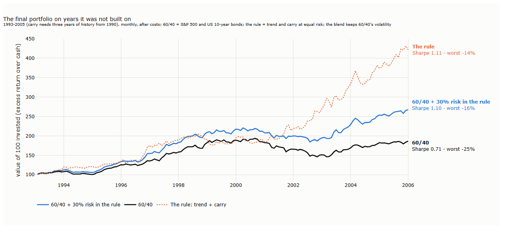
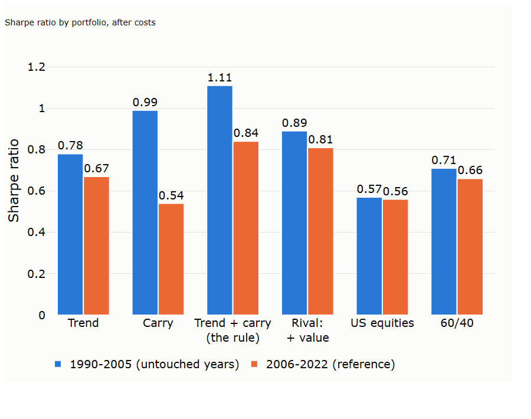
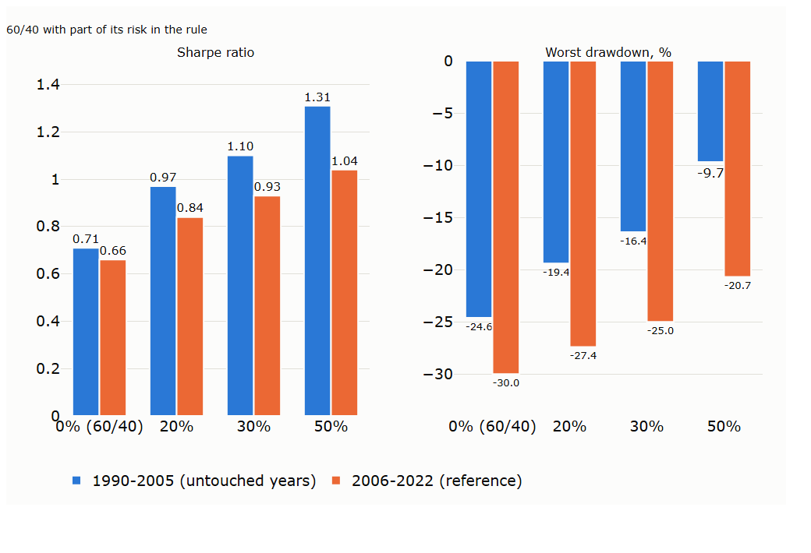
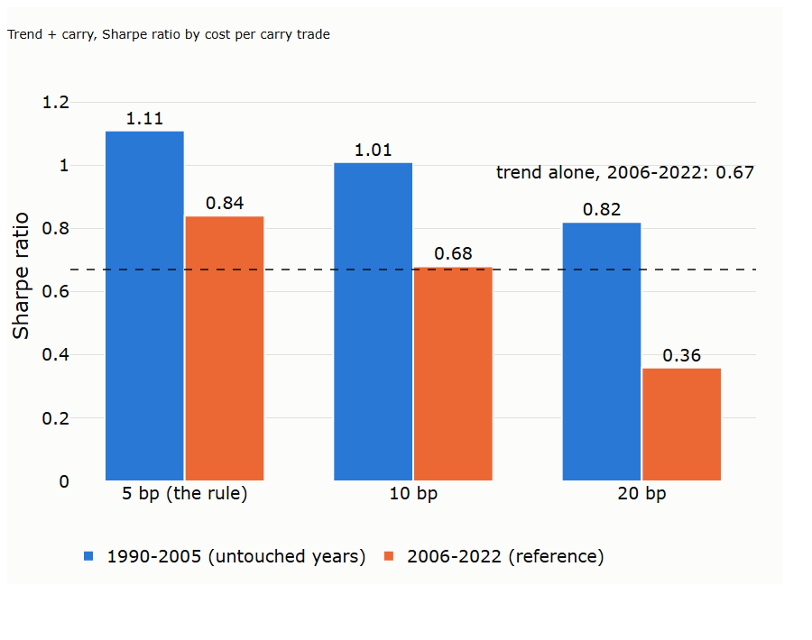
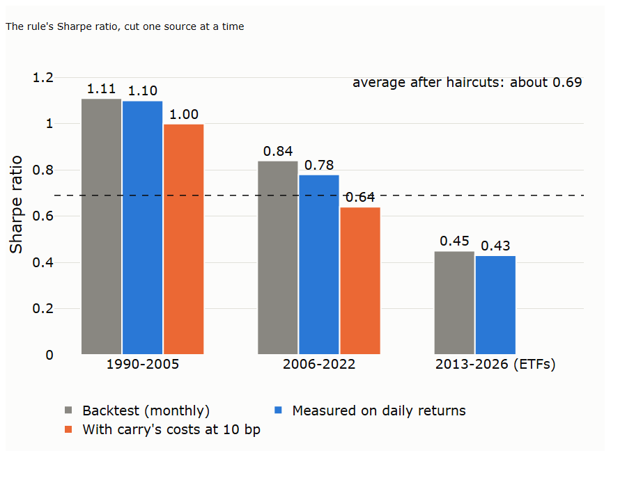

# Lecture 16: The Final Portfolio

> One portfolio built from simple rules, tested on years it was never built on, and one honest number to expect from it.

Part IV · Pipeline stage: portfolio construction and risk management, with execution costs

---

# The result on untouched years

> Trend + carry earned a Sharpe ratio of 1.11 on 1990-2005, against 0.71 for 60/40, with a correlation to 60/40 near zero (−0.03).

- At 30% of a 60/40 portfolio's risk, it lifted 60/40 from 0.71 to 1.10 and cut its worst loss from −25% to −16%
- 1.11 is **not** the number to expect: these were carry's best years, and costs matter
- The number to expect: **about 0.6 to 0.7**

---

# Set the expectation first

> A simple rule-based portfolio from public ideas and free data should earn about what long-only earns per unit of risk, moving differently. Not twice as much.

- Expecting a Sharpe ratio of 1.5 leads to adjusting until the backtest agrees: curve fitting by another name (Lecture 1 §5.3)
- Aiming for "comparable to long-only, moving differently" stops at a robust rule, and robust rules survive the future
- The modest target is valuable: investors already hold stocks and bonds; what moves differently improves the whole portfolio most

---

# The portfolio and the test, fixed in advance

| | |
|---|---|
| **The rule** | Trend (Lecture 13) and carry (Lecture 15) at equal risk; total scaled to 10% a year |
| **The rival** | Trend, carry and value from fundamentals at equal thirds |
| **Yardsticks** | Trend alone; US equities; 60/40 |
| **The test** | 1990-2005: never used to build or tune carry or value |
| **Reference** | 2006-2022, the years Lectures 13-15 used |

Combining trend and carry is an **allocation and risk decision**, not a new signal: both signals are unchanged.

---

# Stage by stage

> Every part of the final portfolio sits in one stage of Lecture 1's pipeline.

| Stage | In the final portfolio |
|---|---|
| Data | Futures and ETFs; long free series for 1990-2005 |
| Signals | Trend: the baseline's rules and speeds. Carry: level and 3-month change in four groups |
| Allocation | Equal risk within groups, between groups, and between trend and carry |
| Risk | Each position sized by its own volatility; 10% target; drawdowns measured, never clipped |
| Execution | Monthly rebalancing at 5 bp; 10 and 20 bp as checks |

---

# Results: trend + carry beats each part

> All three expectations fixed in the plan held on the untouched years.

1. Carry earned with low correlation to trend (0.99; correlation 0.19)
2. Trend + carry beat trend alone (1.11 against 0.78)
3. A 20-30% share of 60/40's risk raised its Sharpe ratio and cut its worst loss
- Carry and the rule beat **all** of 1,000 random strategies

---

# The investor's view

> A modest share, 20-30% of the risk, lifts a stock-and-bond portfolio's Sharpe ratio by a quarter to a half and cuts its worst loss, at the same total risk.

- The rule does not need to beat 60/40; it needs to **move differently**, and it does
- Its correlation with 60/40 is near zero in both periods

---

# What it costs

> Carry trades every month, so its edge is fragile to costs: at 20 bp, trend + carry falls below trend alone in 2006-2022.

- Execution is not a detail for carry: Part V's methods are what keep its edge
- Costs are a distribution, not a constant: they widen exactly when trend and carry rebalance most
- Carry also adds sudden losses: the price of its premium

---

# The realistic number: about 0.6 to 0.7

> Cut one source at a time, the rule averages about 0.69 across three periods: comparable to 60/40, with a correlation near zero.

- **The period is the largest uncertainty:** the same rule earned 0.43 to 1.00 after haircuts
- **Even the start date moves a Sharpe ratio**
- **The search is counted:** the untouched test involved no choice among versions

---

# Where higher Sharpe ratios come from

> Large funds' higher Sharpe ratios come mostly from breadth and granularity, not a better signal: many weakly correlated small edges add up.

$$IR \approx IC \times \sqrt{\text{breadth}}$$

| Source | This portfolio | A large multi-strategy fund |
|---|---|---|
| Markets | about 40 | thousands |
| Strategies | two or three styles | dozens, often market-neutral |
| Granularity | monthly or daily | intraday, single names |
| Execution | a flat cost per trade | measured costs, fast infrastructure |

---

# Getting better with the base layer fixed

> The base stays as it is; improvement comes from what is added on top, each addition planned in advance, counted as a try and checked on new data.

1. **Cheaper execution** of what is already held: the cheapest gain
2. **More markets** for the same styles: breadth
3. **New strategies** that earn for different reasons
4. **Finer granularity:** single names, intraday (Part V)
5. **Smarter allocation**, once there is more to allocate between

---

# Where to focus next

> Seven open questions, ranked by what they would add to the fixed base layer: cheapest and surest first.

1. **Cheaper execution** of what is held (Lectures 18, 19, 21)
2. **Regime information as a tilt**, not a switch (Lecture 14)
3. **More breadth** for the same styles (Lectures 11, 15)
4. **A faster horizon** next to slow trend (Lecture 20)
5. **Construction that uses only what is known** (Lecture 13)
6. **Kill switches** from the book and the flow (Lectures 21, 22)
7. **The live strategy against its backtest** (Lecture 24)

---

# Takeaways

1. **Set the expectation first:** comparable to long-only, moving differently
2. **It held on untouched years:** 1.11, all three expectations, beats 1,000 random strategies
3. **Its value is what it adds** to a 60/40 portfolio
4. **Costs and periods decide the realistic number:** about 0.6 to 0.7
5. **Improve on a fixed base layer:** execution, markets, new strategies, granularity

> The base layer in one sentence: build simple rules on reasons that should last, judge them against luck and on data they were not built on, count every try, and expect what such rules can honestly deliver.
