# Lecture 16: A Trend Rule on the Tape: Deciding, Measuring and Trading on Three Clocks

*Systematic Trading: Lecture Notes (MSc) · Oct 27, 2026 · Max Gnesi*

Lectures 12 to 15 measured what the tape adds to bars: when the market trades, how the price moves inside a bar, who is in a hurry and what a trade costs. This lecture applies those measurements to the first of Part III's two examples, the trend rule of Part II, on five years of BTCUSDT. The question is practical: what does the tape change for a trend rule, and what does it leave as it was? The answer is organised around one idea, that a strategy runs on three clocks, not one, and that each of them can be chosen separately.

> **What to take away**
>
> 1. **A strategy runs on three clocks:** when it decides, what it measures on, and how it trades. Keeping the decision on the calendar makes every test fair.
> 2. **On BTCUSDT the trend rule works at speeds of one to three days, decided once an hour;** information from activity clocks adds nothing to its signal, and averages counted in bars hurt it.
> 3. **Of the tape's tools, the patient entry pays;** a sharper forecast of risk steadies the rule without raising its return.
> 4. **Funding is the cost of holding a perpetual and must be charged at every settlement;** the rule's shorts earned little on average and much in the one bear market of the sample.

## 1. Three clocks

| § | Step | Question |
|---|---|---|
| 2 | The rule on BTCUSDT | Which speeds work on this market, and how often should the rule look? |
| 3 | The information clock | How does information from another clock reach an hourly rule, and does it help? |
| 4 | Risk | Does sizing by a sharper forecast of risk improve the rule? |
| 5 | The execution clock | What does a patient entry save? |
| 6 | Holding | Perpetual or spot: what does it cost to hold a position? |
| 7 | The rule built up | What each step adds, after all costs |
| 8 | For the grid | What the grid of Lecture 17 takes from this lecture |
| 9 | Summary, exercises and reading | |

**The promise of other clocks.** Lecture 13 cut the tape into bars by trades, by volume and by dollars instead of by time, and found returns that behave better: fewer extreme bars, a steadier variance. The classic results say the same: returns measured in trading time come closer to the normal distribution than returns measured in clock time (Clark, 1973; Ané and Geman, 2000), and López de Prado (2018) recommends bars cut by activity for financial machine learning for this reason. It is tempting to conclude that a strategy run on such bars will do better.

**What the evidence says.** Better-behaved returns are a statement about measurement, not about profit. We found no published study showing that a trend rule earns more on bars cut by activity than on bars cut by time. The closest test, on the same market as this lecture, the Binance bitcoin perpetual, finds that dollar bars have the best statistical properties of all the bars it compares, yet predict no better and lose money in every backtest; in its authors' words, statistical quality and predictability appear to be largely orthogonal (Fayyaz et al., 2026, preprint). Whether a clock helps a trend rule is therefore an open question, and this lecture treats it as one.

**Three clocks, not one.** The usual way of putting the question, time bars against dollar bars, mixes three choices that a strategy makes separately:

| Clock | The question it answers | In this lecture's rule |
|---|---|---|
| **Decision clock** | When does the rule decide? | At every hourly close |
| **Information clock** | On which samples are its measurements built? | Hourly closes, or dollar bars |
| **Execution clock** | How is an order worked once it is decided? | A patient entry, worked over seconds (§5) |

The decision clock stays on the calendar throughout. Funding is paid every eight hours, risk limits and reports run by the day, and results must be comparable across strategies; an hourly decision keeps all of this simple. It also makes every test in this lecture fair: when the decision times are fixed, a change in the result can only come from the information the rule uses or from the way it trades, not from the moments it happens to decide.

**How the clocks communicate.** The clocks share one thing: time. Every trade on the tape carries an exchange timestamp to the millisecond, so every dollar bar carries one too, the moment its last trade happened. On one ordinary day, the two clocks look like this:

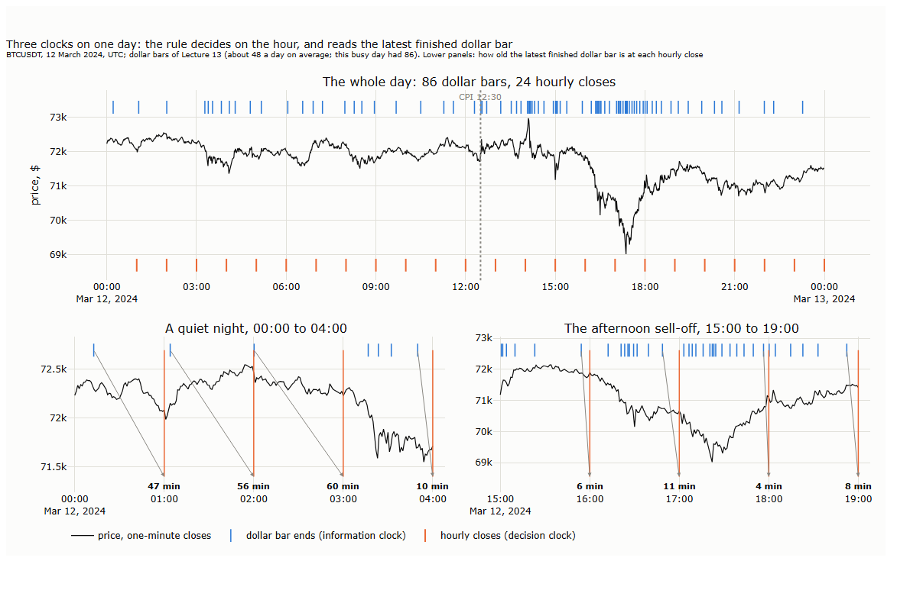
<b>How to read the figure.</b> <b>Black line:</b> the price, from one-minute closes. <b>Blue dashes along the top of each panel:</b> each marks the moment a dollar bar finished, when another fixed amount of dollars, about a 48th of a typical day's trading, had changed hands (the information clock). <b>Columns:</b> how many dollar bars finished in each hour; the dotted line is an average day's two an hour. <b>Orange lines (lower panels):</b> the hourly closes, at which the rule decides (the decision clock). <b>Shaded bands (lower panels):</b> from the last dollar bar finished before an hourly close to that close; the width written above each is how old the newest dollar-bar information is when the rule decides.

Each dash marks the moment a dollar bar finished, and the columns count them hour by hour. Dollar bars are sparse at night, one an hour or fewer, and bunch when the market is busy: on this day 86 of them, against 48 on an average day, 15 in the single hour of the afternoon sell-off. The hourly closes do not move. In the lower panels, the shaded band runs from the last finished dollar bar to each hourly close: it is how old the information is that the rule can read, an hour at night, a few minutes in the sell-off.

A value computed on dollar bars, such as a moving average or a volatility, is therefore a staircase in clock time: it steps when a bar finishes and stays flat until the next one. An hourly rule reads that staircase at each of its closes:

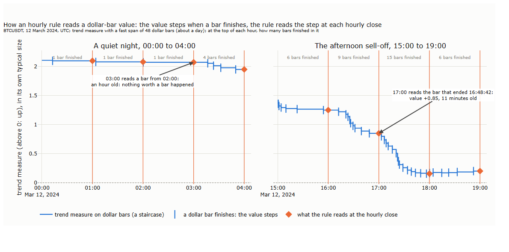
<b>How to read the figure.</b> <b>Blue staircase:</b> the trend measure computed on dollar bars (fast span 48 bars, about a day); above 0 the price has been rising. <b>Blue dashes:</b> a dollar bar finishes and the value steps; between dashes it stays flat. <b>Orange lines:</b> the hourly closes. <b>Orange diamonds:</b> the value the rule reads at each close, the height of the step at that moment. <b>Grey text at the top:</b> how many dollar bars finished during each hour.

At 17:00 the rule reads the value of the bar that ended at 16:48:42, eleven minutes earlier; at 03:00 it reads a bar that is an hour old, because nothing worth a bar happened during the night. Three rules make this exact:

| Step | What to do | Why |
|---|---|---|
| 1. Measure on the other clock | Compute the value on dollar bars, bar by bar | The measurement uses the clock it was designed for |
| 2. Read it as of the decision | At each hourly close, take the value of the last bar that has **finished**; in code, an "as-of join" on timestamps | A bar still forming contains trades after the decision: reading it would use the future |
| 3. Convert the units if needed | A trend measure has no units; a risk per dollar bar becomes a risk per hour by multiplying by the number of bars expected in the hour | The decision is about the next hour, not the next bar |

There is a second way to bring dollar bars into an hourly rule: to summarise the bars that finished during the hour instead of reading the last one. Their number measures the hour's activity, the sum of their squared returns its risk; §4 uses both.

**The instrument: what holding a perpetual costs.** The rule trades the BTCUSDT perpetual, and a perpetual has a cost that a backtest on prices alone does not see. A perpetual has no expiry. What ties its price to spot is funding: every eight hours, at 00:00, 08:00 and 16:00 UTC, longs pay shorts, or shorts pay longs, an amount set by how far the perpetual has traded from the spot index. On Binance the rate is the interval's average premium plus an interest part of 0.01% per interval, with the difference between the two clamped to ±0.05%, so that it stays at 0.01% unless the premium moves far. Funding is a cost of holding, paid whatever the position earns, and it is the component of a perpetual strategy to watch. Section 6 measures what it cost this lecture's rule.

**Two measures that are easy to confuse.** The **basis** is the gap between the perpetual's price and spot at the same moment, log(perpetual ÷ spot): what a trader sees on the screen. The **premium index** is Binance's construction from the order book, comparing the prices at which a sizeable order could buy or sell the perpetual with the spot index; it is the input to funding. They move together but are not the same number.

**What sets funding: the premium index.** Binance publishes the premium index, the perpetual against the spot index, in candles aligned with the funding intervals: 8-hour candles open at exactly 00:00, 08:00 and 16:00, and each of the 5,470 intervals from October 2021 to September 2026 matches a settlement. Rebuilt from the hourly premium by the formula above, funding comes out with a correlation of 0.90 and a median gap of 0.15 bp to the rates actually paid; the rest comes from Binance averaging the premium every five seconds, not every hour.

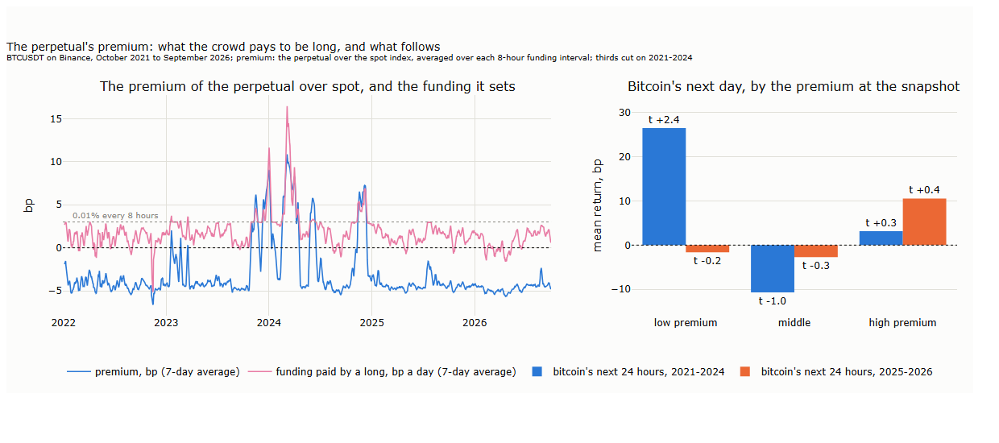
<b>How to read the figure.</b> <b>Left, blue:</b> the premium of the perpetual over the spot index, averaged over each 8-hour funding interval, then over 7 days, in bp. <b>Left, pink:</b> the funding paid by a long, bp per day, 7-day average; the dotted line is the usual 0.01% every 8 hours. <b>Right:</b> bitcoin's mean return over the 24 hours after each snapshot, by the third of the premium at that snapshot (thirds cut on 2021–2024), with the t-statistic, days as clusters.

The premium sits slightly below zero most of the time, about −4 bp, and funding near its usual 0.01% per interval; both jump together when the crowd wants to be long, as in the rallies of early and late 2024, when a long paid up to about 16 bp a day. Funding is highest exactly when the market rises and the rule is long.

**The pure premium.** The premium can be earned without any view on the price: buy spot and sell the perpetual in the same amount. The price moves of the two legs cancel, and what remains is exactly

| Return of long spot, short perpetual, per period | Financial meaning |
|---|---|
| + funding received | the sum of the funding rates settled in the period, received by the short when longs pay |
| − change in the basis | if the perpetual's premium over spot widens, the short leg loses it; if it narrows, it gains |
| − costs | fees to open and close both legs |

and, since the capital sits in spot rather than in a riskless asset, the return is judged against the risk-free rate, here the 3-month US Treasury-bill rate. Measured daily at 00:00 UTC, with spot and perpetual prices at the same moment:

| Long spot, short perpetual, Oct 2021 – Sep 2026 | Total | A year |
|---|---|---|
| Funding received | +36.4% | +7.3% |
| Change in the basis | about 0 | about 0 |
| Costs, one round trip in each leg | −0.3% | |
| **Total return of the structure**, compounded | **+43.5%** | **+7.5%** |
| Risk-free rate over the same period (3-month Treasury bill) | +20.8% | +3.9% |
| **Excess over the risk-free rate** | | **+3.6%** |

*By year, the excess over the risk-free rate was 2.1% in 2022, 2.6% in 2023, 7.1% in 2024, 1.1% in 2025 and −0.5% in 2026 to September.*

The structure earned about 7.5% a year, and about 3.6% a year more than the risk-free rate. Over five years the basis returned to where it started, within a few basis points, so the structure earned the funding and nothing else; day to day the basis does move, and the worst day lost 19 bp. The excess over the risk-free rate was largest in the bull year 2024, and slightly negative in 2026. Three caveats belong with the number: the short perpetual needs margin on top of the spot purchase, so the return on all the capital used is lower; in a sharp rally the short leg must be topped up or it is liquidated, unless the exchange lets the spot serve as collateral; and both legs sit at one exchange. The same formula underlies every comparison of perpetual and spot in these notes, including that of Lecture 15, §7, and §6 below.

**Data.** The tape of Lecture 12, the BTCUSDT perpetual on Binance from October 2021 to September 2026, as hourly closes and as the dollar bars of Lecture 13 (about 48 a day, thresholds from the past 28 days). Costs come from Lecture 15: 5 bp for a market order and 2 bp for a resting one, a regular account's fees, plus the measured spread; funding is charged at every eight-hour settlement. Every choice of speed or setting is made on 2021–2024; 2025–2026 is shown as well, and played no part in any choice.

## 2. The rule on BTCUSDT

The rule is the one Part II built and the capstone of Lecture 11 carried into its final portfolio: EWMAC, the gap between a fast and a slow exponentially weighted moving average of the price, divided by the volatility of price changes, so that a trend is measured in units of its own noise. Its parts, and what changes on bitcoin:

| Part | As in Part II | On BTCUSDT |
|---|---|---|
| Signal | Fast average minus slow average, the slow span four times the fast, divided by the volatility of price changes | The same, on hourly closes |
| Scale | The signal divided by its own average absolute size so far, so that 1 is a typical signal | The same; no cap on large signals, so that the rule's output is not trimmed by hand |
| Position | Signal × target volatility ÷ the market's volatility, here a 10% annual target and the past 36 days' volatility of hourly returns | The same |
| Trading | Change the position when the target has moved | Only when the target is more than 10% of its average size away from the position held: a buffer that keeps the rule from paying fees for small adjustments |
| Costs | A cost per unit traded | The 5 bp fee of a market order and the measured half-spread (Lecture 15, §5), and funding at every eight-hour settlement on the position held |

Without a cap, large signals give large positions, and the rule's realised volatility comes out near 19% a year rather than the 10% it targets. The comparisons below are in Sharpe ratios, which the scale of the positions does not change.

**Which speeds?** Part II found a plateau of fast spans from about 16 to 128 days on futures, and found that faster rules failed. Bitcoin is a different market, so the speed is chosen again, on 2021–2024 only: the same rule, fast spans from 3 hours to 3 weeks, each about 1.6 times the last, so that the curve is spaced evenly in what matters: 1 to 2 hours doubles the speed, 13 to 14 days hardly changes it.

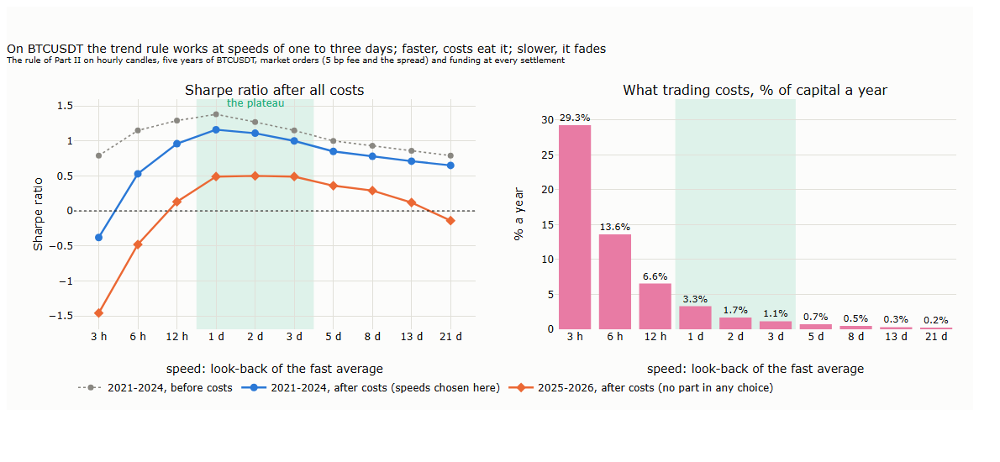

The curve has a plateau, and it lies far faster than on futures: fast spans of **one to three days**, with a Sharpe ratio after all costs of 1.0 to 1.2 in 2021–2024 and about 0.5 in 2025–2026, which played no part in the choice. Faster than half a day, costs eat the rule: at a fast span of three hours it trades its capital about 580 times a year and pays 29% of it in fees. Slower than a week, it fades, and at three weeks it loses money in 2025–2026. The gap between the curve before and after costs shows where costs matter: at the fast end. On this market and sample, bitcoin's tradable trends last days, not months; whether that holds on other cryptocurrencies, or in other years, is an open question.

**How often to look?** The speed is how much history the rule weighs; the candle is how often it looks. A fast span of one day is about 24 hourly candles, or 288 five-minute candles, or a single daily one. The same speeds, measured in hours of history, on candles from five minutes to a day:

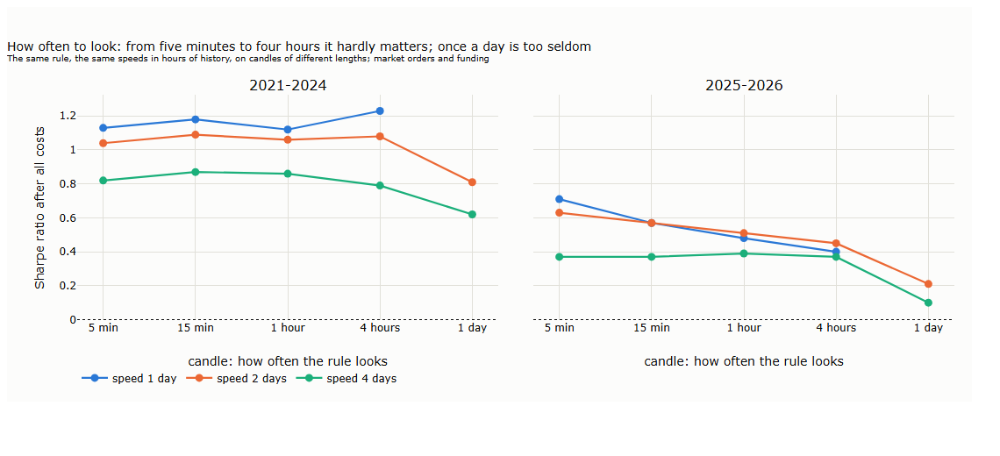

From five minutes to four hours, the candle hardly matters: in 2021–2024 the Sharpe ratios lie within about 0.15 of each other at every speed. In 2025–2026 finer candles do a little better, by amounts that two years of data cannot tell from chance. Once a day is too seldom: a rule that sees only the daily close reacts a day late to trends that last a few days, and loses a third of its Sharpe ratio or more. Looking once an hour is therefore enough, and simpler to run than looking every five minutes.

**The rule for the rest of the lecture.** Hourly candles; the three speeds of the plateau, fast spans of 1, 2 and 3 days, blended with equal weights, following the rule of Part II: drop the speeds that do not work and keep all those that do, rather than the single best. The blend has a Sharpe ratio after all costs of 1.14 in 2021–2024 and 0.52 in 2025–2026; it pays 2.0% of its capital a year in fees and 1.4% in funding, and turns its capital over about 40 times a year. Every section that follows changes one thing in this rule, and measures what it adds.

## 3. The information clock

Section 1 showed how an hourly rule can read a value computed on dollar bars. This section asks whether it should, for the trend measure itself. The test keeps everything else fixed: the rule decides at every hourly close, with the same sizing, the same market orders, the same buffer and the same funding; only the information it reads changes.

| Version | What the rule reads at each hourly close | What it isolates |
|---|---|---|
| **A: hourly closes** | The trend measure of §2, on hourly closes | The baseline |
| **B: dollar bars, average per bar** | The same measure computed on dollar bars, with spans counted in bars (48 a day on average), read from the last finished bar | The market's clock in full: averages that move fast when trading is busy and stand still when it is quiet |
| **C: dollar bars, average fading by time** | Dollar-bar prices, averaged with weights that fade with the time elapsed, not with the number of bars | Only the sampling: when the prices are taken, not how fast they are forgotten |

The distinction between B and C has a name in the literature on unevenly spaced data: an average whose weights depend on the number of samples changes when the sampling changes, one whose weights depend on elapsed time does not (Zumbach and Müller, 2001). C is the second kind.

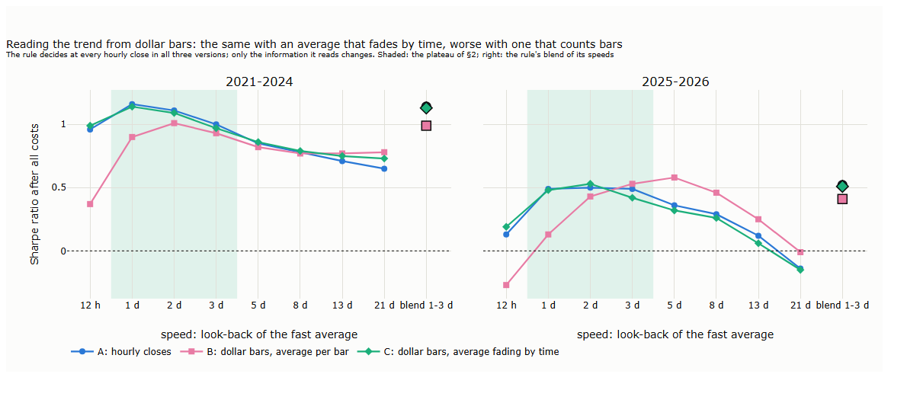
<b>How to read the figure.</b> Each line is one version of the rule, by speed; the large markers on the right are the rule of §2, the three plateau speeds blended. <b>Blue (A):</b> the trend read from hourly closes. <b>Pink (B):</b> read from dollar bars, the average counted in bars. <b>Green (C):</b> read from dollar bars, the average fading with time. The shaded band is the plateau of §2. Left, 2021–2024; right, 2025–2026.

**C is A.** Dollar-bar prices averaged by elapsed time give almost the same signal as hourly closes (correlation 0.99) and the same Sharpe ratio: 1.13 against 1.14 in 2021–2024, 0.51 against 0.52 in 2025–2026, for the blend. Sampling the price when dollar bars finish adds no information that hourly closes lack. It does change one thing: the signal is updated less often in quiet hours, so the rule trades a little less, and its costs fall from 2.0% to 1.4% of capital a year.

**B is worse where the rule earns.** An average counted in dollar bars gives a different signal (correlation 0.84 to 0.98 with A), and on the plateau a worse one: for the blend, a Sharpe ratio of 0.99 against 1.14 in 2021–2024 and 0.41 against 0.52 in 2025–2026; at a speed of half a day, 0.37 against 0.96. For slow rules, off the plateau, B does slightly better in both periods (at three weeks, 0.78 against 0.65 and −0.01 against −0.14), but there the rule earns little anyway.

**Why.** An average counted in bars runs with the market's activity. In a burst, such as the afternoon of figure 16_01 with fifteen bars in an hour, it moves fifteen steps in an hour and follows the burst; at night it moves one step an hour, or none. Bursts of activity on BTCUSDT often reverse: flow in the direction of the trend partly comes back, and a sweep with the trend is taken back within the hour (Lecture 15, §2 and §3). A fast rule that follows bursts therefore buys late and sells late. A slow rule weighs so many bars that a burst moves it little, and freezing at night costs it nothing; that is why B stops hurting as the rule slows down.

**The same holds for a breakout.** A breakout rule, which trades on price levels rather than averages, was checked the same way, with its channel taken from hourly closes or from dollar bars: where it works, at channels of eight to thirteen days, dollar bars make it worse.

> **Box: López de Prado's bars, and what the tests found.** López de Prado (2018) recommends sampling the market by volume or dollars rather than by time, for the statistical properties of the resulting returns, and builds on such bars a pipeline that goes beyond a trend rule: a filter that picks out moments when the price has drifted far enough (the CUSUM filter), labels set by profit-taking, stop-loss and time limits, and a machine-learning model that decides which moments to act on. Two tests on bitcoin bear on it. On bitcoin and ether from 2018 to 2023, the pipeline earned after costs, but the part that helped was the CUSUM filter, not the volume or dollar bars (Grądzki, Wójcik and Lessmann, 2025). On the Binance bitcoin perpetual, dollar bars had the best statistics and no better predictions (Fayyaz et al., 2026, preprint). This section's result points the same way for a trend rule: what dollar bars measure well is not what makes a trend rule earn. Exercise 2 (§9.2) lets the rule decide only at CUSUM events.

**Our results and the literature.**

| The literature | Our result on BTCUSDT | |
|---|---|---|
| Returns are closer to normal when measured in trading time rather than clock time (Clark, 1973; Ané and Geman, 2000) | Lecture 13 found the same on dollar bars | in line |
| An average weighted by the number of samples depends on the sampling; one weighted by elapsed time does not (Zumbach and Müller, 2001) | The time-weighted version on dollar bars matches hourly closes; the per-bar version does not | in line |
| On the Binance bitcoin perpetual, the statistical quality of bars and their predictive power are largely unrelated (Fayyaz et al., 2026, preprint) | The trend measure gains nothing from dollar bars | in line |
| In a bitcoin trading pipeline, the CUSUM event filter helped, not the bar type (Grądzki, Wójcik and Lessmann, 2025) | — | not tested here; exercise 3 |
| — | A trend measure counted in dollar bars hurts fast trend rules, because it follows bursts that reverse | a result on this sample |

**Key message.** Information from another clock is easy to plug into an hourly rule: measure on the other clock, read the last finished bar at each decision. For a trend rule on BTCUSDT it adds nothing: sampled on dollar bars but averaged by time, it is the same as hourly closes, only a little cheaper to trade; averaged by bars, it follows bursts that reverse and hurts the rule where it earns. If a trend measure is taken from another clock, its average should fade with time, not with bars. The rule keeps reading hourly closes.

## 4. Risk

The rule sizes each position by the market's volatility over the past 36 days of hourly returns: the plainest estimate there is. Lecture 14 showed that measures built from inside the bar forecast the next bars' risk better, and Lecture 15 that risk clusters hour by hour. This section asks what that sharper knowledge of risk is worth to the trend rule, in two steps: what an hour's risk is made of, and what sizing by a forecast of it does.

**Two parts of risk.** An hour's risk, its realised variance from one-minute returns, is the product of two quantities: how much is traded in the hour, its **activity** (dollars traded, over a typical hour), and how far each dollar traded moves the price, its **risk per dollar**. The first is the number of dollar bars the hour will contain; the second is the risk each of them carries.

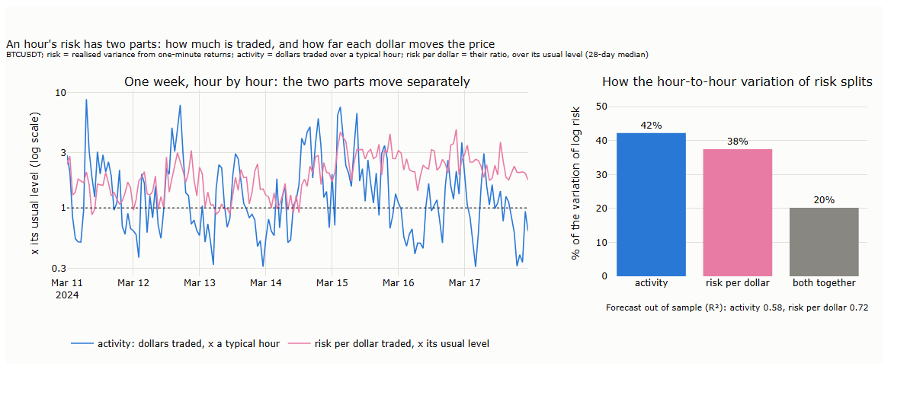
<b>How to read the figure.</b> <b>Left:</b> one week, 11 to 17 March 2024, hour by hour, on a log scale where 1 is the usual level. <b>Blue:</b> activity, the dollars traded in the hour over a typical hour. <b>Pink:</b> risk per dollar, the hour's realised variance over its activity, relative to its usual level (the 28-day median). <b>Right:</b> over five years, the share of the hour-to-hour variation of log realised variance that comes from each part, and from the two moving together.

The two parts move separately, and each carries a large share of the variation: activity 42%, risk per dollar 38%, and the two together another 20%. Both can be forecast from what is known at the start of the hour, with the same kind of model, a regression on the last hour, the last day and the last week (Corsi, 2009), plus the same hour of the week and the scheduled releases:

| Forecast of the next hour, out of sample (2025–2026) | R² |
|---|---|
| Activity, from the last hour alone | 0.45 |
| Activity, full model with the hour of the week and the release hours | 0.58 |
| Risk per dollar, full model | 0.72 |
| Risk itself, directly | 0.70 |
| Risk as forecast activity × forecast risk per dollar | 0.70 |

*R² of the logarithm. A release hour carries about four times a typical hour's activity.*

Forecasting the two parts separately gives the same accuracy as forecasting risk directly. The split does not make the forecast sharper; it tells what kind of risky hour is coming. A busy hour, high activity at a normal risk per dollar, is largely foreseeable from the clock and the release calendar: a rule can plan around it. A thin hour, a high risk per dollar, is the state of liquidity that Lecture 15 found before cascades: a rule should hold less in it.

**Sizing by forecast risk.** The test replaces the 36-day volatility in the position size with a forecast of the coming risk, built from one-minute data, and compares four ways of measuring the risk the rule sizes by:

| Sizing by | What it uses |
|---|---|
| **Plain** | The past 36 days' volatility of hourly returns |
| **Next-day forecast, raw** | A forecast of the next 24 hours' realised variance, from the last hour, day and week, updated every hour |
| **Next-day forecast, smoothed** | The same forecast, averaged over a day, so that the position is not resized every hour |
| **Forecast over the holding period** | The same model, forecasting as far ahead as the rule typically holds: one day for the one-day speed, eight days for the eight-day speed |

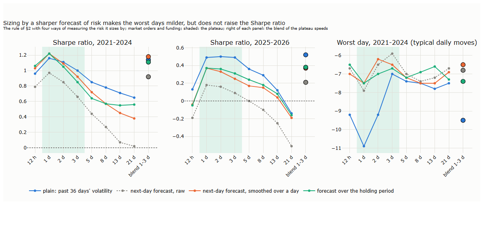
<b>How to read the figure.</b> Each line is one way of sizing, by speed; the large markers on the right of each panel are the rule's blend of the three plateau speeds. <b>Left and middle:</b> the Sharpe ratio after all costs, 2021–2024 and 2025–2026. <b>Right:</b> the worst day of 2021–2024, the largest loss over 24 hours, in units of the rule's typical daily move: closer to zero is milder. The shaded band is the plateau of §2.

For the rule's blend:

| Sizing by | Sharpe ratio, 2021–2024 / 2025–2026 | Worst day | Month-to-month spread of risk | Costs a year |
|---|---|---|---|---|
| Plain | **1.14 / 0.52** | −9.5 | 0.58 | 2.0% |
| Next-day forecast, raw | 0.92 / 0.21 | −6.8 | 0.45 | 5.8% |
| Next-day forecast, smoothed | **1.18** / 0.37 | **−6.5** | **0.46** | 1.8% |
| Forecast over the holding period | 1.11 / 0.38 | −7.4 | 0.48 | 1.7% |

*Worst day: the largest 24-hour loss in units of the rule's typical daily move. Spread of risk: the standard deviation of monthly realised volatility over its average.*

First, how good is each measure as a forecast of risk? Against the next 24 hours' realised variance, with each measure scaled to the same average level on 2021–2024:

| Forecast of the next 24 hours' risk | QLIKE, 2021–2024 / 2025–2026 (lower is better) |
|---|---|
| Plain: past 36 days | 0.38 / 0.32 |
| Next-day forecast, raw | **0.26 / 0.23** |
| Next-day forecast, smoothed over a day | 0.29 / 0.25 |
| The larger of raw and smoothed | 0.27 / 0.24 |

*QLIKE: the loss function for variance forecasts that is robust to noise in the measured variance (Patton, 2011; Lecture 14, §5.3).*

The forecast from one-minute data is a much better measure of the coming risk than the 36-day volatility, and smoothing it over a day gives up only part of the gain: out of sample it keeps about three quarters of the raw forecast's advantage. Then, what does each do in the rule? Three results stand out.

- **The raw forecast is a trap.** It moves from hour to hour, the position follows it, and the rule pays 5.8% of its capital a year in fees instead of 2.0%. Smoothed over a day, the forecast keeps most of its information and loses the churn. A middle way, sizing by the larger of the raw and the smoothed forecast, so that the position is cut at once when risk jumps and grows back slowly when it falls, brings much of the churn back (3.4% a year in fees) and makes the worst day no milder (−6.8): smoothing is the cheaper way to use the forecast.
- **A sharper forecast of risk steadies the rule.** Sized by the smoothed forecast, the rule's worst day is −6.5 typical daily moves instead of −9.5, and its risk varies less from month to month. That is what a forecast of risk is for, and it delivers it.
- **It does not raise the return per unit of risk.** The Sharpe ratio is about the same in 2021–2024 (1.18 against 1.14) and lower in 2025–2026 (0.37 against 0.52); at every speed in 2025–2026 the plain sizing does best. Forecasting over the holding period instead of the next day helps the slow rules, for which tomorrow's risk is the wrong number, but does not close the gap. One explanation, to be tested rather than assumed: bitcoin's large trends tend to come with rising volatility, and a rule that cuts its position as soon as risk rises holds less during the moves it lives on; the slow 36-day estimate reacts later and keeps more of them.

**Our results and the literature.**

| The literature | Our result on BTCUSDT | |
|---|---|---|
| Realised volatility is well forecast by its own last day, week and month, a simple model that mimics long memory (Corsi, 2009) | The same model forecasts an hour's risk with an R² of 0.70 out of sample, and each of its two parts as well | in line |
| Volatility targeting raises the Sharpe ratio only for risk assets such as equities and credit, negligibly for bonds, currencies and commodities, but makes extreme returns and left-tail events smaller in every asset class (Harvey, Hoyle, Korgaonkar, Rattray, Sargaison and Van Hemert, 2018) | Sizing by a sharper forecast makes the worst day milder (−6.5 against −9.5) without raising the Sharpe ratio | in line: bitcoin behaves like the second group |
| Scaling factor portfolios by their recent variance raised their Sharpe ratios (Moreira and Muir, 2017; for momentum, Barroso and Santa-Clara, 2015); later work finds the gains weaker out of sample and after costs | The sharper forecast does not raise the Sharpe ratio after costs | consistent with the later work |
| Much of the reported performance of time-series momentum comes from scaling its positions by volatility (Kim, Tse and Wald, 2016) | All versions here are scaled by volatility; scaling by a sharper measure adds nothing to the return | a different question: how well, not whether, to scale |
| — | An hour's risk splits about equally between activity and risk per dollar, each forecastable | a result on this sample |

**Key message.** An hour's risk on BTCUSDT has two parts of about equal weight: how much is traded, largely foreseeable from the clock and the release calendar, and how far each dollar moves the price, the state of liquidity. Forecasting them separately is no more accurate than forecasting risk directly, but tells what kind of hour is coming. Sizing a trend rule by a sharper forecast of risk, smoothed so that it does not churn, makes its worst days milder and its risk steadier, but does not raise its return per unit of risk; on this sample the plain, slow estimate did as well or better. The choice is between steadier risk and the last part of the return, and it is the investor's, not the data's. The capstone of Lecture 11 met the same trap from the other side: its floor on measured volatility kept positions from jumping when volatility briefly collapsed. The rule of the following sections keeps the plain sizing; §7 shows the alternative beside it.

## 5. The execution clock

The rule decides at the hourly close; nothing says it must trade at that instant, with a market order. Lecture 15 (§6) measured the alternative on the tick tape: a resting order one tick inside the price, cancelled and re-posted at the current price every five seconds, and sent as a market order if it is still unfilled after a minute. It is filled as a resting order most of the time, follows the price instead of waiting at a level the market has left, and chases the rest. Measured against a market order sent at the decision, it saved 1.96 bp per unit traded, with the worst 5% of cases costing about 5 bp more.

The patient entry changes only the execution clock: the decision times, the signal, the sizing and the funding stay as they were.

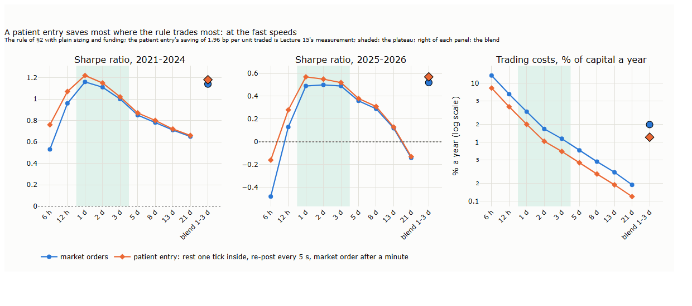
<b>How to read the figure.</b> <b>Blue:</b> the rule of §2 with market orders at the hourly close. <b>Orange:</b> the same rule with the patient entry. <b>Left and middle:</b> the Sharpe ratio after all costs, 2021–2024 and 2025–2026. <b>Right:</b> trading costs, % of capital a year, on a log scale. Large markers on the right of each panel: the rule's blend of the plateau speeds. Shaded: the plateau.

| The rule's blend | Sharpe ratio, 2021–2024 / 2025–2026 | Trading costs a year |
|---|---|---|
| Market orders at the hourly close | 1.14 / 0.52 | 2.0% |
| Patient entry | **1.18 / 0.57** | **1.2%** |

The patient entry cuts the rule's trading costs by about 40% and raises its Sharpe ratio in both periods. The gain grows with how much the rule trades: at a speed of six hours, which turns its capital over about 270 times a year, the Sharpe ratio rises from 0.53 to 0.76 in 2021–2024 and from −0.48 to −0.16 in 2025–2026; at three weeks, which trades a few times a year, it barely moves. A cheaper entry does not make a fast rule good, but it moves the point at which costs start to eat it.

Two cautions. The saving was measured on small orders, at the size that traded within the minute, and with fills simulated from the tape, which can differ from real ones (Lo, MacKinlay and Zhang, 2002); the live capstone of Part III can measure it on real orders. And it holds only while the rule's orders are small next to the market: §7 asks when they stop being small.

**Key message.** Deciding on the hour does not mean trading on the hour. Worked over the following minute, re-posted every five seconds and chased if necessary, the rule's orders cost about 40% less, and its Sharpe ratio rises in both periods, most for the fast speeds that trade the most.

## 6. Holding

Funding, set out in §1, is what the rule pays to hold its positions. This section measures what it cost the rule, asks whether the premium behind it tells the rule anything, and whether the rule's longs are better held in spot.

**What it cost the rule.** Charged at every settlement on the position open at that moment, funding cost the rule 1.4% of its capital a year in 2021–2024 and 0.3% in 2025–2026. The rule's long side paid 1.7% a year in 2021–2024; its short side received 0.3%. A long-only holder paid far more, 4 to 12% a year in each full year (Lecture 15, §7). A backtest without funding therefore overstates rules that are mostly long, and understates rules that are often short.

**Does the premium tell the rule anything?** Split by the premium known at each snapshot (figure 16_09, right, in §1), bitcoin's next 24 hours show no ordering that holds in both periods: after a low premium the price rose 27 bp in 2021–2024 (t 2.4) and fell 2 bp in 2025–2026; after a high one, +3 bp and +11 bp, neither distinguishable from zero. The rule's long and short legs over the next eight hours show no pattern either. The premium is what a long pays, not where the price goes.

**Perpetual or spot?** Holding the rule's longs in spot avoids funding, at the price of spot's higher fee, 10 bp for a regular account against 5 bp, and of the capital a spot position ties up, which forgoes the risk-free rate:

| The rule's longs held in | Sharpe ratio, 2021–2024 / 2025–2026 | Trading costs | Funding | Risk-free rate given up |
|---|---|---|---|---|
| The perpetual | **1.18 / 0.57** | 1.2% | 1.4% | — |
| Spot (shorts in the perpetual) | 1.16 / 0.49 | 2.8% | −0.3% | 0.6% |

*% of capital a year, 2021–2024. A negative funding figure is funding received, on the shorts.*

Spot saves about 1.7% a year in funding, and gives back 1.6% in fees and 0.6% in the risk-free rate forgone: for a rule that trades its capital about 40 times a year, the perpetual is cheaper. For a slow rule that trades a few times a year, the balance would tip the other way.

**Key message.** Funding is the component of a perpetual strategy to watch: paid every eight hours, set by the premium, and highest when the crowd is long, so that long positions pay most in the years they earn most. It cost the rule 1.4% a year and a long-only holder up to 12%, and a backtest must charge it at every settlement. The premium behind it says what a long pays, not where the price goes. For this rule, which trades often, the perpetual's lower fee outweighs the funding; spot pays only for rules that trade rarely.

## 7. The rule built up

Each section changed one thing in the rule and measured it. Put together:

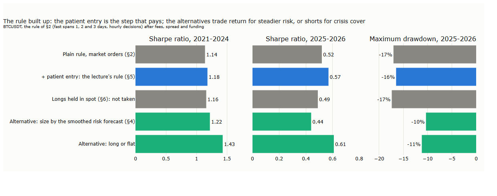
<b>How to read the figure.</b> Each bar is one version of the rule, after fees, spread and funding. <b>Grey:</b> the plain rule of §2, and the step tested and not taken (longs in spot, §6). <b>Blue:</b> the lecture's rule, the plain rule with the patient entry of §5. <b>Green:</b> two alternatives to it. <b>Left and middle:</b> Sharpe ratio, 2021–2024 and 2025–2026. <b>Right:</b> the largest fall from a peak, 2025–2026.

| Version | Sharpe ratio, 2021–2024 / 2025–2026 | Largest fall, 2021–2024 / 2025–2026 | Worst day | Costs / funding a year |
|---|---|---|---|---|
| Plain rule, market orders (§2) | 1.14 / 0.52 | −15% / −17% | −9.5 | 2.0% / 1.4% |
| **+ patient entry: the lecture's rule (§5)** | **1.18 / 0.57** | −15% / −16% | −9.5 | 1.2% / 1.4% |
| Longs held in spot (§6), not taken | 1.16 / 0.49 | −16% / −17% | −9.5 | 2.8% / −0.3% |
| Alternative: size by the smoothed risk forecast (§4) | 1.22 / 0.44 | −13% / −10% | **−6.5** | 1.1% / 1.1% |
| Alternative: long or flat | **1.43 / 0.61** | −13% / −11% | −8.3 | 0.7% / 1.7% |

*Worst day: the largest 24-hour loss, in units of the rule's typical daily move. Costs and funding: % of capital a year, 2021–2024; negative funding is received.*

Of the tape's tools, one step pays on its own: the patient entry. Sizing by the sharper forecast of risk is an alternative, not a step: it makes the worst day a third milder and the largest fall smaller, at the cost of the Sharpe ratio in 2025–2026. The other alternative, long or flat, changes the rule itself, and needs a closer look.

**The long and the short leg.** The rule is long about half the time and short the other half. Split by the side it holds, year by year:

| Year | Bitcoin | The rule's long leg | Its short leg | The rule | Long or flat |
|---|---|---|---|---|---|
| 2022 | −64% | −10.5% | **+16.9%** | **+6.4%** | −10.4% |
| 2023 | +156% | +49.3% | −4.9% | +44.3% | +49.1% |
| 2024 | +121% | +24.3% | −5.7% | +18.6% | +24.5% |
| 2025 | −6% | −0.4% | −10.8% | −11.2% | −0.3% |
| 2026, to September | −5% | +12.0% | **+16.2%** | **+28.2%** | +11.7% |

*Legs: % of the rule's capital, after costs and funding. Bitcoin: its change over the year.*

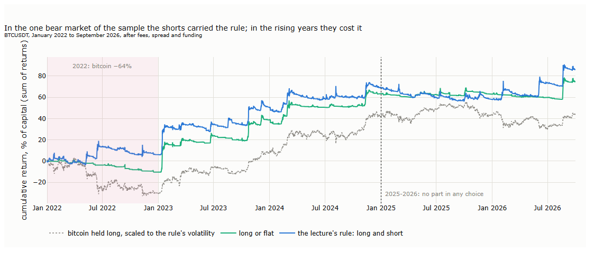
<b>How to read the figure.</b> Cumulative return, the sum of returns as % of capital, after fees, spread and funding. <b>Blue:</b> the lecture's rule, long and short. <b>Green:</b> the same rule, long or flat. <b>Grey, dotted:</b> bitcoin held long, scaled to the rule's volatility. Shaded: 2022, the one bear market in the sample. Right of the dotted line: 2025–2026, which played no part in any choice.

Over the five years the short leg added little on average, and long or flat has the higher Sharpe ratio in both periods: bitcoin rose, and shorts in rising or sideways years lose. But the shorts earned in the two falling years, and in 2022 they turned a loss of 10% into a gain of 6% while bitcoin lost two thirds of its value. This is the protection trend following is known for, and the capstone of Lecture 11 found the same on futures: long or flat kept the Sharpe ratio and lost most of the protection in crises. Which version to run is a view on how many falling years the future holds, a question five mostly rising years cannot settle.

**Capacity.** The rule trades about 1,900 times a year, each trade a median 2.2% of its capital, and turns its capital over about 42 times a year. With the square-root law of Lecture 15 (§7), the daily volume and volatility of 2021–2024 and a constant Y of 0.5 to 0.9:

| Capital | Each trade | In minutes of the market's trading | Impact per trade | Impact a year |
|---|---|---|---|---|
| $10 million | $0.2 million | 0.02 | 0.5–0.9 bp | 0.2–0.4% |
| $100 million | $2.2 million | 0.2 | 1.6–2.9 bp | 0.7–1.2% |
| $1 billion | $22 million | 2.4 | 5–9 bp | 2–4% |
| $5 billion | $110 million | 12 | 12–21 bp | 5–9% |

*Impact = Y × daily volatility × √(trade ÷ daily volume); impact a year = impact per trade × turnover. Before costs the rule earns about 65 bp per unit traded.*

Up to about $100 million, each trade is a fraction of a minute's trading, the patient entry of §5 applies as measured, and impact costs about 1% a year. At $1 billion a trade takes a few minutes of the market's volume: the entry must be spread over several minutes, its saving shrinks, and impact takes 2 to 4% a year of a gross return of about 25%. At $5 billion the rule gives up a fifth to a third of its return to impact. These are estimates from the law, not measurements: Donier and Bonart (2015) measured it on bitcoin trades of minutes to an hour, the duration of these trades.

**Key message.** On BTCUSDT the trend rule of Part II works at speeds of one to three days, decided once an hour. Of the tape's tools, the patient entry pays on its own; a sharper forecast of risk is an option for steadier risk, not for more return; the market's other clocks and the perpetual's premium add nothing to the signal; and funding must be charged, not modelled away. The rule's shorts earned little on average and much in the one bear market of the sample. It can grow to hundreds of millions of dollars before impact takes a large part of its return.

## 8. For the grid

Lecture 17 applies Part III to the second example, an intraday grid. "Grid" covers several strategies; the one Lecture 17 builds is the classic two-sided grid, and it is the opposite of the rule of this lecture.

**What a grid is.** A grid places buy orders at levels below the price and sell orders at levels above it, each a fixed step apart, and waits. It is a **mean-reversion strategy that trades by providing liquidity**: it bets that the price swings back, and it never sends a market order of its own; it rests its orders and is filled when someone in a hurry trades against them. In that it resembles a market maker, but it works far from the price and slowly: its orders rest several typical moves away instead of one tick, and it holds what it buys for hours instead of seconds.

**How the paired grid works.**

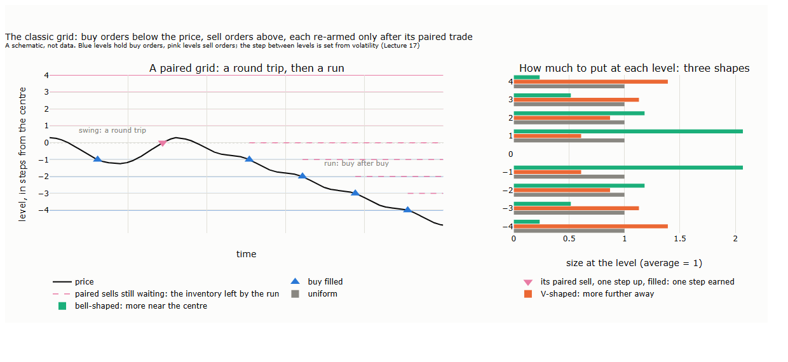
<b>How to read the figure.</b> A schematic, not data. <b>Left:</b> blue lines are levels holding buy orders, pink lines levels holding sell orders, the dotted line the centre. On the swing, the buy at −1 fills (blue triangle) and its paired sell one step up fills (pink triangle): one step earned. On the run, buy after buy fills, and their paired sells (dashed) wait above the price: the inventory the run leaves behind. <b>Right:</b> three ways of spreading the grid's capital across its levels, each averaging 1 per level.

| Step | What happens |
|---|---|
| 1. Start | A ladder of levels a step apart: buy orders at the levels below the price, sell orders at the levels above |
| 2. A buy fills at a level | That buy is removed, and a sell for the same unit is placed one step above |
| 3. The paired sell fills | The round trip earns one step, less two maker fees; only now is the buy at the lower level put back |
| 4. Above the price | The mirror image: a sell fills, a buy one step below closes it, then the sell is put back |

A level is re-armed **if and only if** its paired trade has filled, so a level never holds more than one position and the grid's inventory is bounded by the number of its levels. The grid engine of the open-source Hummingbot framework re-arms its levels the same way, one side per grid; a long grid below the price and a short grid above it make the classic two-sided grid.

**Its shapes.** Three choices shape a grid's risk, and Lecture 17 tests them: the **step**, set from volatility (Lecture 14); the **spacing**, in fixed dollars or in a fixed percentage of the price; and the **size profile**, how its capital is spread across the levels (figure, right). A uniform profile puts the same size everywhere. A V-shaped profile puts more size further from the centre: small fills near the price and larger ones further out, a mild form of averaging down; with the same capital it holds less than the other profiles on the way down and the same at the cap (Lecture 17, §4.1). A bell-shaped profile puts more size near the centre: most of the capital works on the frequent small swings, and a run fills only small orders far out.

**The opposite of the trend rule.**

| | The trend rule (this lecture) | The grid (Lecture 17) |
|---|---|---|
| Earns when | the price runs | the price swings back |
| Loses when | the price swings without direction | the price runs one way |
| Trades with | market orders, worked patiently | resting orders only |
| Holds for | days | minutes to hours |
| Payoff | convex: small, frequent losses and rare large gains | concave: small, frequent gains and rare large losses |

Trend followers' returns resemble a long position in options that pay on large moves (Fung and Hsieh, 2001), and a trend rule's profit is roughly the long-term variance of the price minus its short-term variance (Dao et al., 2016): it earns when moves add up, as on the explosive days of Lecture 14 (§3). The grid's payoff is the mirror image, our inference rather than a published result: it earns when moves cancel, and its loss is the inventory a run leaves behind. Its central risk is the trend rule's profit, which makes the tools that warn of runs its brakes.

**What the grid takes from this lecture.**

| From this lecture | What the grid takes |
|---|---|
| The instrument (§1, §6) | Funding is charged on whatever inventory the grid holds at 00:00, 08:00 and 16:00 UTC; a grid that holds inventory pays or receives it |
| The clocks (§3) | Dollar bars add nothing to a trend measure; whether they help a grid, whose levels and spacing respond to activity, is a separate question for Lecture 17 |
| Risk (§4) | Busy hours are largely foreseeable from the clock and the release calendar; thin hours, a high risk per dollar, are when a grid should widen its steps or step aside |
| Execution (§5) | The grid trades only with resting orders: its cost per fill is the maker fee plus a small adverse selection (Lecture 15, §5), not the taker fee |
| The legs (§7) | In the one bear market of the sample, a trend rule's shorts earned what a grid would have lost |

Left for Lecture 17: the step and the size profile, when to re-centre the ladder, when to step aside, and what to do with inventory left by a run, a question best answered with the order book.

## 9. Summary, exercises and reading

### 9.1 Seven takeaways

1. **Three clocks, not one.** A strategy decides on one clock, measures on another and trades on a third. Fixing the decision clock on the calendar lets each of the others be tested alone.
2. **The clocks communicate through timestamps.** A value from another clock is read as of the last finished bar; a bar still forming would use the future.
3. **Bitcoin's tradable trends last days.** The rule works at fast spans of one to three days, looks once an hour, and fails faster than half a day, where costs eat it.
4. **Nicer statistics are not a better signal.** A trend measure from dollar bars adds nothing when it is averaged by time, and hurts the fast rules when it is averaged by bars, because bursts reverse.
5. **Risk has two parts, activity and risk per dollar.** A sharper forecast of risk makes the worst days milder and the risk steadier, but does not raise the return per unit of risk; the raw forecast is a trap that churns.
6. **Deciding on the hour does not mean trading on the hour.** A patient entry, re-posted every few seconds and chased after a minute, cuts the rule's trading costs by about 40%.
7. **Funding is the component to watch.** It is paid on positions open at each snapshot, highest when the crowd is long, and cost a long-only holder up to 12% a year; the premium behind it says what a long pays, not where the price goes.

### 9.2 Exercises

- [ ] Run the rule of §2 on SOLUSDT or ETHUSDT for one year. Where is the plateau of speeds, and does it lie as fast as on bitcoin?
- [ ] Let the rule decide not every hour but only when a CUSUM filter on the price fires (Lecture 13, §3; the box of §3). Does sampling by events, which helped the machine-learning pipeline of Grądzki, Wójcik and Lessmann (2025), help a trend rule?
- [ ] Size the capstone portfolio of Lecture 11 by a range-based volatility from daily highs and lows instead of close-to-close returns. Does it steady the risk, and does it change the Sharpe ratio, as §4 found on bitcoin?
- [ ] A rule may close its position just before a funding snapshot and reopen it just after. From the funding history and the costs of Lecture 15, at what funding rate does this start to pay, and how often was the rate that high? Keep in mind Lecture 12, §6.2: others sell into the snapshot when funding is high.
- [ ] Compare the rule and its long-or-flat version on the 2022 bear market alone, and on 2023–2024 alone. How many bear years in ten would make the full rule the better choice?
- [ ] Pick one result of this lecture and test it on a market of your choice.

### 9.3 Reading

For the clock of a market and the returns measured on it, Clark (1973) and Ané and Geman (2000); for averages on unevenly spaced data, Zumbach and Müller (2001). For forecasting realised volatility, Corsi (2009); for what volatility targeting does and does not do, Harvey et al. (2018). For trend following as an option-like strategy, Fung and Hsieh (2001), and for its convexity, Dao et al. (2016). For perpetual futures and funding, the reading of Lecture 15 and Binance's funding documentation.

## References

- Ané, T. and Geman, H. (2000). Order flow, transaction clock, and normality of asset returns. *Journal of Finance* 55(5), 2259–2284. — returns in trading time (§1, §3).
- Barroso, P. and Santa-Clara, P. (2015). Momentum has its moments. *Journal of Financial Economics* 116(1), 111–120. — risk-managed momentum (§4).
- Binance. Introduction to Binance Futures funding rates (FAQ). — the funding formula, its interest part and clamp (§1).
- Clark, P. K. (1973). A subordinated stochastic process model with finite variance for speculative prices. *Econometrica* 41(1), 135–155. — returns on a clock driven by trading (§1, §3).
- Corsi, F. (2009). A simple approximate long-memory model of realized volatility. *Journal of Financial Econometrics* 7(2), 174–196. — the HAR model (§4).
- Dao, T.-L., Nguyen, T.-T., Deremble, C., Lempérière, Y., Bouchaud, J.-P. and Potters, M. (2016). Tail protection for long investors: trend convexity at work. *Journal of Investment Strategies*; arXiv 1607.02410. — trend profit and the variance of long and short horizons (§8).
- Donier, J. and Bonart, J. (2015). A million metaorder analysis of market impact on the Bitcoin. *Market Microstructure and Liquidity* 1(2), 1550008. — square-root impact on bitcoin (§7).
- Fayyaz, M. T., Jabbar, A., Qureshi, F. A. and Jalil, S. Q. (2026). A frequency-controlled comparison of tick- and minute-based information bars for cryptocurrency markets. arXiv preprint 2608.26158. — bar statistics and predictability on the Binance bitcoin perpetual (§1, §3).
- Fung, W. and Hsieh, D. A. (2001). The risk in hedge fund strategies: theory and evidence from trend followers. *Review of Financial Studies* 14(2), 313–341. — trend following as lookback straddles (§8).
- Grądzki, P., Wójcik, P. and Lessmann, S. (2025). Algorithmic crypto trading using information-driven bars, triple barrier labeling and deep learning. *Financial Innovation* 11. — sampling and labelling on bitcoin and ether (§3).
- Harvey, C. R., Hoyle, E., Korgaonkar, R., Rattray, S., Sargaison, M. and Van Hemert, O. (2018). The impact of volatility targeting. *Journal of Portfolio Management* 45(1), 14–33. — volatility targeting by asset class (§4).
- Kim, A. Y., Tse, Y. and Wald, J. K. (2016). Time series momentum and volatility scaling. *Journal of Financial Markets* 30, 103–124. — the role of volatility scaling in trend returns (§4).
- Lo, A. W., MacKinlay, A. C. and Zhang, J. (2002). Econometric models of limit-order executions. *Journal of Financial Economics* 65(1), 31–71. — simulated against real fills (§5).
- López de Prado, M. (2018). *Advances in Financial Machine Learning*. Wiley. — bars sampled by activity, the CUSUM filter (§1, §3).
- Moreira, A. and Muir, T. (2017). Volatility-managed portfolios. *Journal of Finance* 72(4), 1611–1644. — scaling factors by their variance (§4).
- Patton, A. J. (2011). Volatility forecast comparison using imperfect volatility proxies. *Journal of Econometrics* 160(1), 246–256. — the QLIKE loss (§4).
- Zumbach, G. and Müller, U. A. (2001). Operators on inhomogeneous time series. *International Journal of Theoretical and Applied Finance* 4(1), 147–177. — averages on unevenly spaced data (§3).
