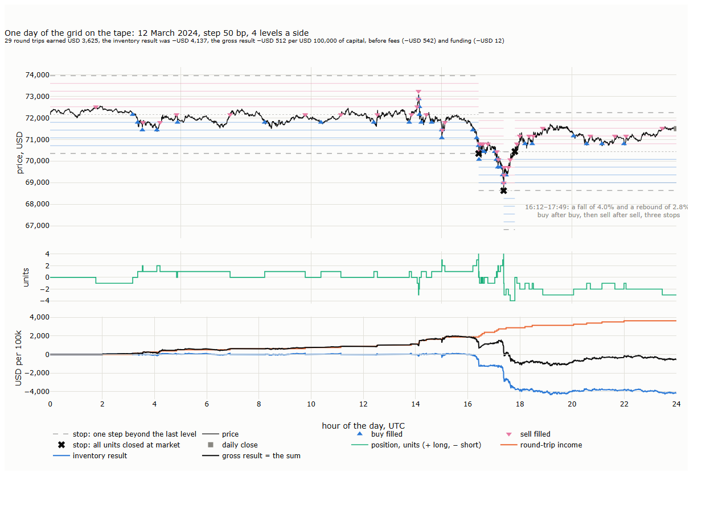
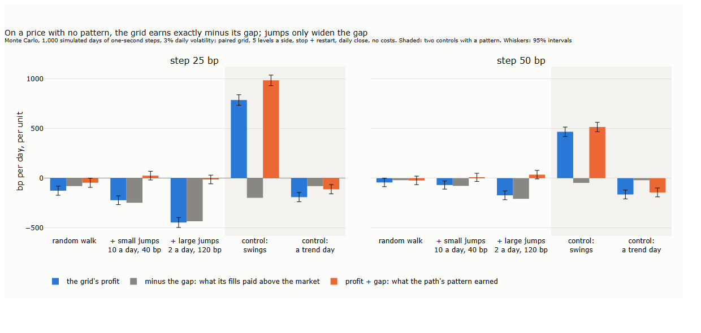
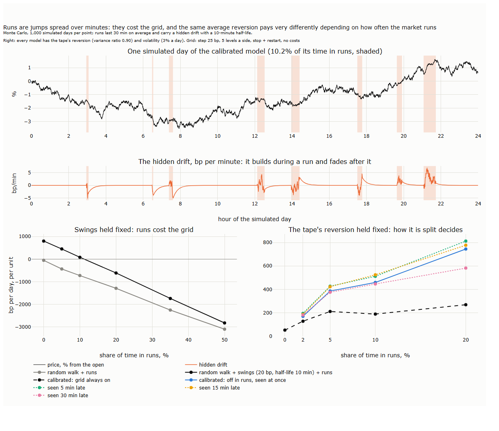
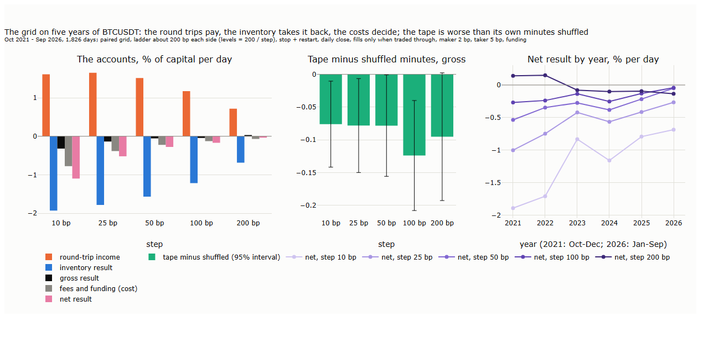
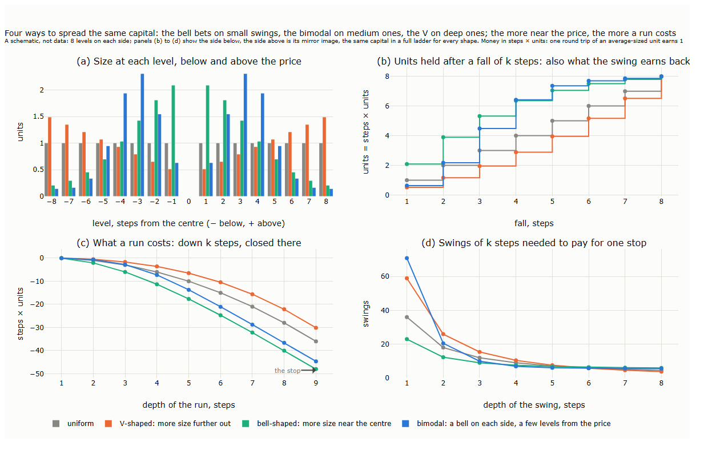
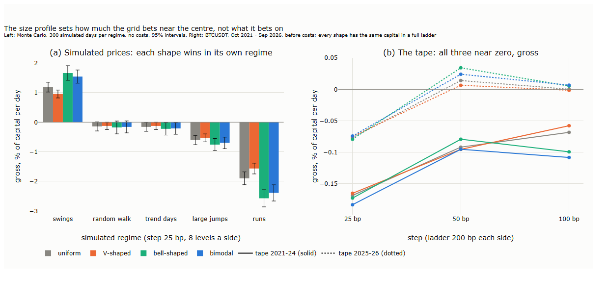
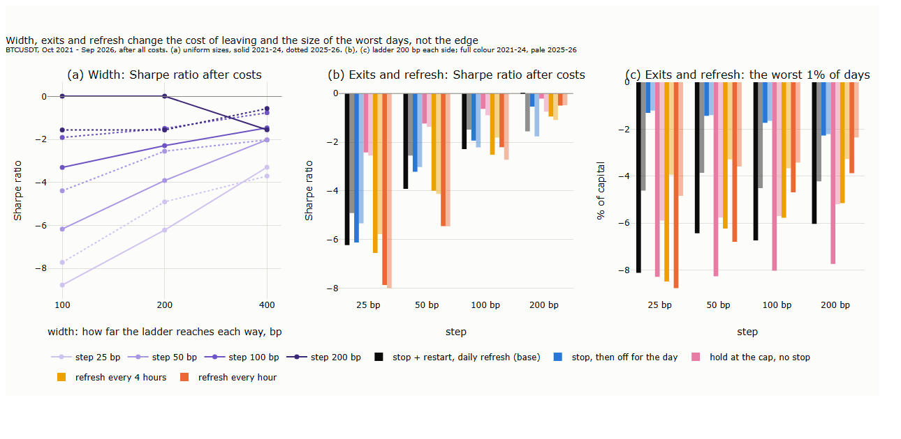
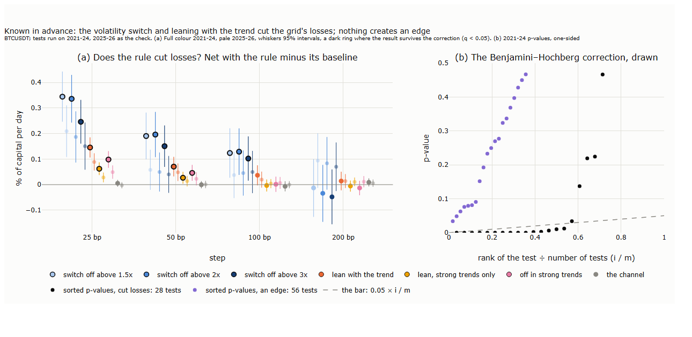
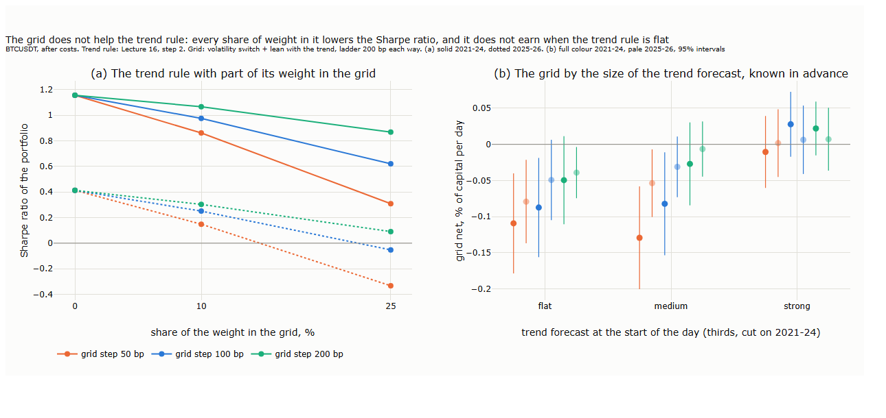

# Lecture 17: An Intraday Grid on the Tape: Swings, Runs and What a Grid Earns

*Systematic Trading: Lecture Notes (MSc) · Oct 28, 2026 · Max Gnesi*

Lecture 16 applied the tape to a trend rule, a strategy that earns when the price runs. This lecture applies it to the opposite, a grid, which earns when the price swings back, on the same five years of BTCUSDT. A grid is a strategy whose result is decided by the path between bars, so it can only be tested on the tape. The lecture asks where a grid's profit comes from, measures it with fills counted conservatively and all costs charged, and tests whether anything known in advance improves it.

> **What to take away**
>
> 1. **A grid's result has two parts:** the round trips it completes, each worth one step, and the result of the inventory it is left holding. On a price with no pattern the two cancel before costs: every dollar a grid earns comes from the price reverting at the scale of its step.
> 2. **Runs are the grid's risk.** A run is a jump spread over minutes; how much of its time the market spends running decides what a given amount of reversion pays the grid.
> 3. **On five years of BTCUSDT, with fills counted conservatively, the grid loses after costs at every step** tried, and the tape treats it worse than the same minutes in random order.
> 4. **Stepping aside after a violent hour and leaning the inventory with the trend cut the losses** without creating an edge. Where a grid's machinery pays is in lowering the cost of strategies that have an edge of their own.

## 1. How a grid earns

A grid earns one step on every round trip and loses on the inventory a run leaves it holding; this section takes the mechanics apart and follows one real day fill by fill. The rest of the lecture is organised as follows:

| § | Step | Question |
|---|---|---|
| 2 | Where the profit comes from | What does a grid earn on a price with no pattern, with jumps, with runs? |
| 3 | The tape | What does it earn on five years of BTCUSDT, after costs, and against the same minutes in random order? |
| 4 | The levers | Size profile, width, exits and refresh: what does each change, and does any setting hold across a wide range? |
| 5 | Known in advance | Do a switch on volatility, a lean with the trend, a channel or the hour of the day help? |
| 6 | Next to the trend rule | Does the grid improve the trend rule of Lecture 16? |
| 7 | Where grids pay | Costs, rebates and strategies with an edge of their own |
| 8 | Summary, exercises and reading | |

### 1.1 The grid of this lecture

The grid is the classic two-sided paired grid of Lecture 16, §8: buy orders at levels below the price, sell orders at levels above it, a fixed step apart, each level re-armed only after its paired trade has filled. Its settings throughout the lecture:

| Setting | Value | Why |
|---|---|---|
| Step | 10 to 200 bp of the price at which the ladder is laid | From a few one-minute moves to about two-thirds of a day's move (daily volatility about 3%) |
| Levels | 200 bp ÷ step on each side, so the ladder reaches about 200 bp each way at every step | Every step is tested with the same reach, so a change in results comes from the step, not from the width |
| Size | The same at every level, one unit = capital ÷ number of levels on a side | A full ladder on one side is exactly the capital; §4 tests the alternatives |
| Stop | One step beyond the last level | §1.3 |
| Daily close | The last second of the UTC day | §1.3 |

**The whole grid in one number.** In paired form, the grid's state is the last level it filled, and its position follows from it:

```math
q_t = -\frac{r_t - c}{s}
```

| Symbol | Meaning | Financial interpretation |
|---|---|---|
| $`q_t`$ | Position, in units (+ long, − short) | What the grid holds after its last fill |
| $`r_t`$ | Reference level: the last level filled | Where the market last traded through the grid |
| $`c`$ | Centre: the price at which the ladder was laid | The price the grid treats as fair until it is restarted |
| $`s`$ | Step, in dollars | The swing the grid is paid for |

The grid is long one unit for every step the price has fallen below the centre and short one for every step it has risen above it: a position that leans against the move. Its resting orders follow from $`r_t`$ alone: a buy one step below it and a sell one step above it, with the farther levels of the ladder resting behind them.

### 1.2 The life of a level

Each level goes through the same four states. For a level one step below the centre:

| Step | What happens | Position | What is earned |
|---|---|---|---|
| 1. Armed | A resting buy order waits at the level | 0 | — |
| 2. Filled | An aggressive seller trades below the level: the buy is filled, and a sell for the same unit is placed one step above | +1 | — |
| 3a. Paired sell fills | The price returns one step: the unit is sold, and only now is the buy at the level re-armed | 0 | One step × one unit: a round trip |
| 3b. Or the price runs on | Lower levels fill in turn; at the last level the next trade through closes every unit at the market (the stop) | up to the cap, then 0 | The loss of every unit against its own buy price |

A level never holds more than one unit, so the position is bounded by the number of levels. What is not bounded is the loss when the price runs through all of them: that is what the stop and the daily close are for.

### 1.3 Fills, exits and costs

**Fills counted conservatively.** A resting buy at a level is counted as filled only if an aggressive seller traded *below* it in that second; a resting sell only if an aggressive buyer traded above it (Lecture 14, §4.3). Touching the level is not enough: an order there would wait in a queue, and it may not be its turn. Trading through it is: every order resting at the level must then have been filled. On BTCUSDT a level that is visited is traded through more than 99.7% of the time (Lecture 14, §4.3), so the rule loses little; it rules out counting the fills that are least likely, on the turning points. The simulation runs second by second, on the highest price paid by aggressive buyers, the lowest price received by aggressive sellers and the last price in every second of the tape:

| Rule | In the simulation |
|---|---|
| A sweep through several levels | Fills all of them in the same second |
| An order re-armed by a fill | Is live from the next second, never in the same one |
| Both sides traded through in one second | The order of the trades is unknown (Lecture 14, §2): the side on which the second closed is taken, and the second is counted. Fewer than one fill in a hundred falls in such a second at a 10 bp step, and almost none at 100 bp |

**Two exits.** The **stop** fires when the position is at the cap and the price trades through one level more: every unit is closed at the worst aggressive price of that second, as a market order, and a new ladder is laid around the price (Lecture 14, §4.3 measured how far such a stop can slip). The **daily close** closes whatever is left in the last second of the UTC day, also at the market. The grid is therefore flat at the 00:00 funding settlement; it pays or receives funding at 08:00 and 16:00 on whatever it holds then (Lecture 16, §1).

**Costs.** A regular account's fees: 2 bp on every resting fill, 5 bp on every stop and close (Lecture 15, §5).

**The accounts.** Every result in this lecture is split into the same parts:

```math
\text{gross} = \underbrace{N_{\mathrm{trips}} \times s \times u}_{\text{round-trip income}} + \text{inventory result}, \qquad
\text{net} = \text{gross} - \text{maker fees} - \text{taker fees} + \text{funding}
```

| Part | How it is computed | Financial interpretation |
|---|---|---|
| Round-trip income | Round trips $`N_{\mathrm{trips}}`$ × step $`s`$ × unit size $`u`$ | What the swings paid: each unit bought and sold one step higher, or sold and bought back one step lower |
| Inventory result | Gross minus round-trip income | What the runs cost: the units closed at stops and at the daily close, against their own fill prices |
| Maker fees | 2 bp of every resting fill | The price of resting orders |
| Taker fees | 5 bp of every stop and close | The price of leaving in a hurry |
| Funding | Position × price × rate, at 08:00 and 16:00 | The cost, or income, of holding inventory through a settlement |

Round-trip income can only grow. The inventory result is where the risk sits: the grid holds inventory exactly when the price has moved away from the centre, and closes it when the move has gone furthest.

### 1.4 One day, fill by fill

Lecture 16's reference day, 12 March 2024, with a step of 50 bp and four levels on each side, on USD 100,000 of capital. The ladder was laid at the day's first price, USD 72,156, so the step was USD 360.78 and one unit was USD 25,000, or 0.3465 BTC. A round trip earned 0.3465 × 360.78 = **USD 125**.


<sub><b>How to read the figure.</b> <b>Top:</b> the price (the last trade of every 10 seconds); blue lines are the buy levels below each centre, pink lines the sell levels above it, the dotted line the centre, the dashed lines the stops. Blue triangles are buys filled, pink triangles sells filled, black crosses stops, after which a new ladder is laid around the price. <b>Middle:</b> the position, in units. <b>Bottom:</b> the result so far, before fees and funding: the round-trip income (orange), the inventory result (blue, the open units marked to the price) and their sum, the gross result (black).</sub>

The day falls into three parts:

| UTC | What the price did | What the grid did | Round trips | Gross result at the end |
|---|---|---|---|---|
| 00:00–16:12 | Swung within about 1.5% of the open | Bought dips and sold rallies, never more than three units in either direction | 15 | +USD 1,769 |
| 16:12–17:49 | Fell 4.0%, then rebounded 2.8% | Bought four units on the way down and was stopped; bought four more and was stopped again; sold four into the rebound and was stopped a third time | 8 | −USD 907 |
| 17:49–24:00 | Drifted up | Sold rallies; was short three units into the close | 6 | −USD 512 |

| The day's accounts, per USD 100,000 | USD |
|---|---|
| Round-trip income: 29 × 125 | +3,625 |
| Inventory result: three stops and the close | −4,137 |
| **Gross result** | **−512** |
| Maker fees: 73 resting fills | −360 |
| Taker fees: three stops and the close | −182 |
| Funding: the position held at 08:00 and 16:00 | −12 |
| **Net result** | **−1,066** |

Fifteen round trips took sixteen hours to earn USD 1,875; the run took an hour and a half to cost the inventory about twice that, USD 3,676, while its own eight round trips earned USD 1,000. This is the grid's profile in one day: small, frequent gains and rare large losses (Lecture 16, §8). The figures are ours, from a step-by-step copy of the simulator that logs every fill; its totals agree with the simulator to the last digit.

## 2. Where the profit comes from

On a price with no pattern a grid earns nothing before costs, apart from what its own fills give away; every dollar it makes comes from the price reverting at the scale of its step, and every dollar it loses from the price running. This section shows it in simulations where the truth is known, and then asks what kind of pattern a grid needs.

### 2.1 A price with no pattern

**Why nothing.** On a price that is a martingale, a price whose expected next value is its current value, no rule of buying and selling at the market price has an expected profit: whatever the rule, the expected gain on each unit held over the next instant is zero. This is a standard result of probability theory (Williams, 1991, ch. 10). A grid does not trade at the market price, however, but at its levels: when the price jumps through a buy level between two seconds, the order is filled at the level, above the price at which the market now trades. The difference is the **gap**, what the grid's fills paid above the market, and on a martingale it is the only thing the grid's expected profit can come from:

```math
\mathrm{E}[\text{gross}] = -\,\mathrm{E}[\text{gap}] \quad \text{on a price with no pattern}
```

Profit plus gap is therefore what the path's pattern earned the grid. It is zero when there is no pattern, positive when the price swings back, negative when it runs.

**The test.** A Monte Carlo simulation, in which the truth is known by construction:

| Setting | Value |
|---|---|
| Days | 1,000 simulated days of 86,400 one-second steps |
| Price | A random walk with 3% daily volatility |
| Grid | As in §1, 5 levels on each side, steps of 25 and 50 bp, stop and restart, daily close |
| Fills | At the level, also when the price jumps through it; stops and the close at the market price |
| Costs | None |
| Result | Per day, in bp of one unit's value |

Five price paths, three without a pattern and two with one:

| Path | Construction | Pattern |
|---|---|---|
| Random walk | Normal one-second steps | None |
| + small jumps | 10 jumps a day of 40 bp on average; 18% of the variance | None: jumps are as likely up as down |
| + large jumps | 2 jumps a day of 120 bp on average; 32% of the variance | None |
| Control: swings | Random walk + a part that reverts with a half-life of 10 minutes, about 20 bp in size | Reversion |
| Control: a trend day | Random walk + a drift for the whole day, different every day, 2% a day on average in either direction | Persistence |


<sub><b>How to read the figure.</b> For each simulated price path: <b>blue</b>, the grid's average profit per day; <b>grey</b>, minus the gap, what its fills paid above the market; <b>orange</b>, their sum, what the path's pattern earned the grid. Whiskers are 95% intervals. The shaded paths are the two controls, which have a pattern by construction. Left, a step of 25 bp; right, 50 bp.</sub>

On the three prices without a pattern, the grid loses exactly its gap: profit plus gap is within two standard errors of zero in all six cases. Jumps make the grid lose more, 445 bp a day per unit with large jumps at a 25 bp step, but only because they widen the gap; they do not change the identity. A jump adds much to the variance and crosses few levels (Lecture 14, §4.1), and every level it does cross is filled above the market. The controls behave as they must: at a 25 bp step the grid earns 785 bp a day per unit on swings and loses 190 on trend days. The grid has no edge of its own. It sells the price's swings and buys its runs, and it is paid only if swings dominate at the scale of its step.

### 2.2 Runs: jumps spread over minutes

**What a run is.** A jump moves the price in one instant. A run moves it the same distance over minutes, step by step, and fills the grid's levels one after the other on the way, exactly as on the afternoon of 12 March. On the tape, Lecture 14 (§3) found both: on ordinary days the price turns back, and its variance ratio, the variance of one-hour returns divided by what one-minute returns imply, is about 0.9; on explosive days it runs, and the ratio is above 1. A simulation of runs therefore needs a price that switches between the two.

**How a run is simulated.** The price is the sum of a random walk, a hidden drift and a reverting part, and at every second it is in one of two states, calm or running:

| Step | Calculation, every second | Financial interpretation |
|---|---|---|
| 1. State | Calm → run with probability $`p_{\mathrm{in}}`$, run → calm with probability $`p_{\mathrm{out}} = 1/1{,}800`$ | Runs start without warning and last 30 minutes on average; $`p_{\mathrm{in}}`$ sets the share of time in runs, $`\pi = p_{\mathrm{in}} / (p_{\mathrm{in}} + p_{\mathrm{out}})`$ |
| 2. Hidden drift | In a run: $`d_t = a\,d_{t-1} + b\,\varepsilon_t`$; when calm: $`d_t = a\,d_{t-1}`$, with $`a = 2^{-1/600}`$ | A push in one direction that builds and turns within a run, with a half-life of 10 minutes, and fades after it; its direction is random |
| 3. Random walk | $`w_t = w_{t-1} + d_t + \sigma\,\eta_t`$ | The news: unpredictable moves, plus the drift |
| 4. Reverting part | When calm: $`y_t = a\,y_{t-1} + e\,\zeta_t`$; frozen in a run | Temporary pressure that is undone within minutes: the swings a grid lives on |
| 5. Price | $`p_t = w_t + y_t`$ | What trades |

Here $`\varepsilon_t`$, $`\eta_t`$ and $`\zeta_t`$ are independent standard normal draws, and $`b`$ and $`e`$ set the sizes of the drift and the reverting part. The drift is never seen by the grid; it is only felt, as levels filled one after another.

**Calibration.** For each share of time in runs, the model is fitted to two facts of the tape, so that every model below has the same average behaviour and differs only in how it is split between swings and runs:

| Step | What is set | To match |
|---|---|---|
| 1 | The strength of the drift, fixed for all models: its standard deviation is 0.07 times the random walk's per second | Runs that move the price visibly within half an hour |
| 2 | The size of the reverting part, by bisection | A variance ratio of one-hour to one-minute returns of 0.90, as on the tape |
| 3 | Every part scaled by the same factor | A daily volatility of 3%, as on the tape; the ratio is unchanged by the scaling |

**Switching off.** A grid that knew it was in a run would close its position at the market and pause, and restart around the price when the run ended. The simulation tests this with the true state seen at once, and seen 5, 15 or 30 minutes late.


<sub><b>How to read the figure.</b> <b>Top:</b> one simulated day of the calibrated model with 10% of its time in runs; the shaded bands are the run episodes. <b>Middle:</b> the hidden drift, in bp per minute: it moves only in a run and fades with a 10-minute half-life afterwards. <b>Bottom left:</b> the grid's average profit per day, by the share of time in runs, with the swings held fixed: on a random walk (grey) and on a random walk with swings (black); volatility is not held fixed here and rises with the runs. <b>Bottom right:</b> every model calibrated to the tape's variance ratio and volatility: the grid always on (dashed), and switched off during runs seen at once or 5, 15 or 30 minutes late. Step 25 bp, 5 levels a side, no costs.</sub>

Two results, one from each lower panel:

1. **With the swings held fixed, runs cost the grid.** With a reverting part of 20 bp, the grid earns 800 bp a day per unit when the price never runs; with 5% of the time in runs it earns 450, with 10% about 80, and with 20% it loses 610. On a random walk with runs it loses at every share. Runs do to the grid what jumps do, spread over minutes, and the gap is no longer the channel: the grid is filled at its levels, one after another, and loses on the inventory.
2. **With the tape's average held fixed, the split decides.** When every model has the tape's variance ratio, a market that runs more often must swing back harder in between. The grid always on earns 53 bp a day per unit when the market never runs and 130 to 270 when it does, a fraction of what the swings offer: the runs take most of it back. Switched off during the runs, the grid keeps up to three times as much: 1.3 times at 2% of the time in runs, 2.8 times at 20%. Seen 5 or 15 minutes late, the switch loses nothing and even gains a little: the drift outlives the run's label, so a grid that restarts a little late also avoids the drift's tail. Seen 30 minutes late, the switch loses part of its value.

**What the simulations say about the tape.** The grid earns nothing from a price without a pattern, and the tape's average reversion is no guarantee of profit: what matters is how the reversion and the runs are spread over the day, and whether the runs can be recognised early enough to step aside. Two things in these simulations are kinder than the tape. Fills are counted at the level, whereas the tape fills only what is traded through; and the reversion of the simulated price happens over minutes, whereas part of the tape's reversion is the bounce between buyers and sellers within the same second, which no resting order a step away can earn. Section 3 measures what is left on the tape.

## 3. The tape

On five years of BTCUSDT the grid loses after costs at every step, and before costs it does worse than the same minutes would in random order: over minutes and hours, the tape's order works against it.

**The experiment.**

| Setting | Value |
|---|---|
| Data | The BTCUSDT perpetual on Binance, October 2021 to September 2026, 1,826 days, second by second (§1.3) |
| Grid | §1.1: steps of 10, 25, 50, 100 and 200 bp, the ladder reaching about 200 bp each way, stop and restart, daily close |
| Fills | Only when traded through (§1.3) |
| Costs | Maker 2 bp, taker 5 bp, funding at every settlement |
| Result | Per day, in % of capital |
| Benchmark | The same days with their minutes shuffled |

**The shuffled benchmark.** To tell what the tape's order does to the grid, each day is replayed with its minutes in random order:

| Step | What is done | What it keeps, and what it removes |
|---|---|---|
| 1. Cut | Each UTC day is cut into its minutes | |
| 2. Shuffle | The minutes are put in a random order (one fixed seed) | |
| 3. Chain | Each minute keeps its own moves relative to the last price before it, and is attached to the end of the minute placed before it | Keeps every trade within a minute, the bounce between buyers and sellers, the day's volatility and its total move |
| 4. Run | The same grid, the same fills and costs | Removes only the order of the minutes: every swing and every run longer than a minute |

If the tape's order did nothing for the grid, the tape and the shuffled days would give the same result. The shuffle keeps one thing that may still flatter both: the reversion within a minute, which no resting order a step away can earn but which the shuffled days carry as well.


<sub><b>How to read the figure.</b> <b>Left:</b> the daily average of each part of the accounts (§1.3), by step, in % of capital: round-trip income (orange), inventory result (blue), their sum, the gross result (black), fees and funding as a cost (grey), and the net result (pink). <b>Middle:</b> the gross result on the tape minus that on the same days with their minutes shuffled, with 95% intervals; below zero, the tape's order costs the grid. <b>Right:</b> the net result by year, one line per step, light for the narrowest step and dark for the widest; 2021 covers October to December, 2026 January to September.</sub>

| Step | Round trips a day | Stops a day | Net result, % a day | Sharpe ratio, net | Worst 1% of days, % |
|---|---|---|---|---|---|
| 10 bp | 322 | 1.6 | −1.10 | −9.4 | −10.5 |
| 25 bp | 53 | 1.4 | −0.52 | −5.8 | −7.1 |
| 50 bp | 12 | 1.1 | −0.28 | −3.5 | −5.4 |
| 100 bp | 2.3 | 0.7 | −0.17 | −2.0 | −6.0 |
| 200 bp | 0.4 | 0.4 | −0.04 | −0.4 | −4.8 |

<sub><b>How to read the table.</b> Daily averages over 1,826 days. Sharpe ratio: the mean of the daily net result over its standard deviation, annualised with 365 days. Worst 1% of days: the net result that only 1% of days were worse than.</sub>

Four results:

1. **The round trips pay, and the inventory takes it back.** Round trips earn 0.7% to 1.7% of the capital a day. The inventory result takes back more than that at every step up to 100 bp, so the gross result is negative there: −0.32% a day at 10 bp, −0.06% at 50 bp, and slightly positive only at 200 bp, +0.03%. The gap that decided the simulations is small on the tape, and at steps of 50 bp and more it is slightly favourable: on average a filled buy was below, and a filled sell above, the last price of the second in which it filled, so the trades that went through the level were followed by trades back within the same second. The losses come from the inventory, not from the fills.
2. **Costs decide.** With a gross result near zero, the fees become the result. At 10 bp, where round trips are many, the maker fees alone are 0.68% a day, and the net loss is 1.10% a day: such a grid would lose its capital in about three months. At 200 bp the fees are small, and the grid loses 0.04% a day.
3. **The tape's order works against the grid.** At every step the gross result on the tape is 0.08 to 0.12 percentage points a day below that of the same minutes shuffled, with t-statistics between −1.9 and −2.9. With the same minutes, in random order, the grid would have done better. This need not contradict Lecture 14's variance ratio below one, an average over all hours: §2.2 showed that what reversion pays a grid depends on how it is spread between swings and runs, and §1.4 how many round trips a single run can take back.
4. **Every year, at every step up to 100 bp, the net result is negative.** Only the widest grid earned, in 2021 and 2022, and it lost in each year since. At the narrow steps the losses have shrunk over the years, but not to zero.

These are results on one market with conservative fills: every fill on a turning point that did not trade through is missed, so they are a lower bound on what a real order would get. Part IV, with the order book, measures how much better the fills could be. Sections 4 and 5 ask whether the grid's settings, or something known in advance about the hours ahead, change the picture.

## 4. The levers

No setting of the grid gives it an edge. The size profile, the width, the exits and the refresh change how much the grid bets near the price, what leaving costs and how large its worst days are; before costs, every setting stays within a few hundredths of a percent a day of zero. One lever has a clear mechanism and a large effect on the tail: staying out for the rest of the day after a stop.

### 4.1 The size profile

**Four ways to spread the same capital.** Lecture 16, §8 drew three size profiles; a fourth places the size a few levels away from the price:

| Profile | Where the size sits, on each side of the price |
|---|---|
| Uniform | The same at every level |
| V-shaped | Little next to the price, rising towards the ends of the ladder |
| Bell-shaped | Most next to the price, falling towards the ends: one bell centred on the price |
| Bimodal | Two bells, one below and one above the price, each peaking a few levels away from it (here at 40% of the ladder's reach) |

With the same capital in a full ladder, the profiles differ only in where that capital sits, and so in what each kind of path pays:


<sub><b>How to read the figure.</b> A schematic, not data: eight levels on each side and the same capital in a full ladder for every profile. Money is in steps × units, so one round trip of an average-sized unit earns 1. <b>(a)</b> The size at each level, below (−) and above (+) the price. Panels (b) to (d) show the side below; the side above is its mirror image. <b>(b)</b> The units held after the price has fallen k steps, which is also what the swing earns when the price comes back: every unit bought on the way down is sold one step higher. <b>(c)</b> What a run costs when the price falls k steps and the units are closed there; the last point is the stop. <b>(d)</b> How many swings of k steps pay for one stop.</sub>

| Profile | Units held after a fall of 2 steps | What the stop costs | Swings of one step that pay for one stop | Swings of four steps that pay for one stop |
|---|---|---|---|---|
| Uniform | 2.0 | 36 | 36 | 9.0 |
| V-shaped | 1.2 | 30 | 59 | 10.5 |
| Bell-shaped | 3.9 | 48 | 23 | 7.6 |
| Bimodal | 2.2 | 45 | 71 | 7.0 |

<sub><b>How to read the table.</b> From the schematic: eight levels a side, money in steps × units.</sub>

Panel (b) carries the mechanism. What the grid holds at each depth is exactly what a swing to that depth earns when it returns, and at the stop every unit bought j levels from the price loses the remaining distance to the stop. Size near the price therefore earns on small swings and costs most on a run; size far out costs little on a run and earns only on deep swings. Each profile is a bet on how far the price swings back: the bell on small swings, the bimodal on medium ones, the V on deep ones.

The figure also corrects a common description of the V, which Lecture 16, §8 repeated: with the same capital, the V does not hold the most inventory when the price runs. It holds less than the others on the way down and the same at the cap, and it loses the least at the stop.

**Where to put the peaks.** For the bimodal profile, the distance of the two peaks from the price is a dial between the bell and the V:

| The two peaks at level… (of 8) | What the stop costs | Swings of one step that pay for one stop | Swings of four steps that pay for one stop |
|---|---|---|---|
| 1: next to the price, close to the bell | 54 | 16 | 7.5 |
| 3 | 46 | 59 | 6.9 |
| 5 | 33 | 215 | 11 |
| 8: at the ends of the ladder, close to the V | 18 | 94 | 23 |

<sub><b>How to read the table.</b> From the schematic: the same capital, the two bells moved outwards together. A swing pays only on the size it reaches.</sub>

Moving the peaks outwards makes the stop cheaper, from 54 to 18, and moves the swings that pay out to where the peaks are. Placing the peaks is a choice of which depth of swing to bet on; the cost of the stop follows from it.

**Each profile in its regime.** On simulated prices, where the regime is known, the reasoning can be checked: the same tape simulator, run on one-second paths of five kinds (§2), 300 days each, with eight levels a side, a step of 25 bp and no costs.


<sub><b>How to read the figure.</b> <b>(a)</b> The gross result per day, in % of capital, on simulated prices of five kinds, for each profile; whiskers are 95% intervals. <b>(b)</b> The gross result on the tape, ladder 200 bp each way, by step and profile: solid 2021–2024, dotted 2025–2026. Grey uniform, orange V-shaped, green bell-shaped, blue bimodal.</sub>

Each profile wins where the path matches its bet: the bell where the price swings back by about a step, +1.66% a day against +1.19% for uniform sizes, and the V where it runs, jumps or trends. The bimodal profile lies between the bell and uniform sizes in every regime, because none of the five offers the swings of three to four steps it bets on. The order of the others never reverses: in every regime the bell's result, gain or loss, is about 1.4 times that of uniform sizes, and the V's smaller. The profile decides how much the grid bets near the price and at which depth; it does not decide whether the bet pays. A grid that knew which regime was coming could choose its profile; §5 asks whether anything known in advance tells.

**On the tape** the four profiles are all near zero before costs, within about 0.05 percentage points a day of each other at every step and width tested. The mechanism shows in the accounts: the bell and the bimodal profile have the largest round-trip income, the largest inventory losses and the worst days, the V the smallest of each. After costs the V comes out slightly best, because it trades least near the price and pays the fewest fees. Split by yesterday's volatility, which is known in the morning, no profile does better than another by more than one to two standard errors.

### 4.2 Width, exits and refresh

Each lever was varied on its own, around the grid of §3, at steps of 25 to 200 bp:

| Lever | Variants | What it changes |
|---|---|---|
| Width | The ladder reaching 100, 200 or 400 bp each way, with the same capital | How far a run must go before the stop, and how large each unit is |
| Exit | Stop and restart (the base); stop, then off for the rest of the day; no stop, holding at the cap until the daily close | What happens when the price runs through the whole ladder |
| Refresh | The ladder re-centred once a day (the base), every 4 hours or every hour; a refresh closes the inventory at the market and lays a new ladder around the price | How often the grid accepts the market's new level |


<sub><b>How to read the figure.</b> All after costs, BTCUSDT, October 2021 to September 2026. <b>(a)</b> The Sharpe ratio by width, uniform sizes, one line per step, light for 25 bp and dark for 200 bp; solid 2021–2024, dotted 2025–2026. At 200 bp the widths of 100 and 200 bp give the same single level. <b>(b)</b> The Sharpe ratio by exit and refresh rule, ladder 200 bp each way; full colour 2021–2024, pale 2025–2026. <b>(c)</b> The worst 1% of days for the same rules, in % of capital.</sub>

| Rule, step 50 bp | Sharpe ratio, 2021–24 | Sharpe ratio, 2025–26 | Worst 1% of days, 2021–24 | Worst 1% of days, 2025–26 | Stops a day, 2021–24 / 2025–26 |
|---|---|---|---|---|---|
| Stop and restart (base) | −3.9 | −2.5 | −6.4% | −3.9% | 1.3 / 0.7 |
| **Stop, then off for the day** | −3.2 | −3.0 | **−1.4%** | **−1.4%** | 0.6 / 0.4 |
| No stop, hold at the cap | −1.2 | −1.4 | −8.3% | −5.8% | 0 / 0 |
| Refresh every hour | −5.4 | −5.5 | −6.8% | −3.6% | 0.6 / 0.2 |

<sub><b>How to read the table.</b> Sharpe ratio: annualised, of the daily net result. Worst 1% of days: the net result that only 1% of days were worse than, in % of capital.</sub>

**Off for the rest of the day after a stop.** A stop means the price has run through the whole ladder, and on a running day it rarely runs once: on 12 March the first stop was followed by two more within ninety minutes (§1.4). A grid that steps aside after the first stop avoids the second and the third. At every step, in both periods, this cuts the worst 1% of days from between −4% and −8% of capital to between −1.2% and −2.3%. Its Sharpe ratio is about that of the base: it reshapes the tail more than the average, which is what a stop rule should do.

The other levers, compactly:

- **Width.** A wider ladder raises the Sharpe ratio at every step up to 100 bp, in both periods, because the price reaches the stop less often and the taker fee at the stop is paid less often. With the same capital, a wider ladder also means smaller units: at its widest the grid barely holds anything, and its result tends to zero. It loses less because it trades less, not because it earns more.
- **No stop.** Holding at the cap avoids every stop and its fee, and raises the Sharpe ratio for the same reason; it has the worst days of all the rules, −8.3% of capital on the worst 1% of days in 2021–2024.
- **Refresh.** Re-centring more often lowers the Sharpe ratio at 25 and 50 bp, in both periods: every refresh closes the inventory at the market, pays the taker fee and gives up the units that would have come back.

**What the levers say.** Every setting that loses less does so by paying less to leave, or by trading less; none adds a swing the market does not offer. The choices that hold across the whole range tested, and have a reason, are a wide ladder and stepping aside after a stop. Section 5 asks whether something known in advance can tell the grid when to trade at all.

## 5. Known in advance

Two rules known in advance cut the grid's losses, and the cut survives the correction for many tests and holds out of sample: switching the grid off after a violent hour, and leaning its inventory with the trend. Neither creates an edge. Of 56 tests for a positive result before costs, none survives the correction.

### 5.1 The rules and the tests

Every rule uses only what is known at the moment it acts: values of the last **finished** hour, never of the hour, or the day, still running. Splits by the day's own volatility, known only afterwards, describe where losses sit but cannot be traded, and are not used.

| Rule | What it uses | What the grid does | Why it might help |
|---|---|---|---|
| **Volatility switch**, K = 1.5, 2 or 3 | The volatility ratio (below) | Off while the ratio is at least K: the inventory is closed at the market and the grid pauses; when the ratio falls back, a new ladder is laid around the price | Runs come in violent hours, and violent hours cluster (Lecture 15, §4) |
| **Lean with the trend** | The trend forecast of Lecture 16 (below) | Holds long units only while the forecast is positive, short units only while it is negative; when the sign turns against the inventory, the inventory is closed at the market | A run in the trend's direction no longer fills the grid against it |
| Lean in strong trends only | The same | Leans only when the forecast is larger than 1 in size, in either direction; otherwise trades both sides | The lean costs round trips; spend it only when the trend is clear |
| Off in strong trends | The same | Off while the forecast is larger than 1 in size | Step aside instead of leaning |
| The channel | The highest and lowest hourly close of the last 10 days | On only while the price is inside the channel, or outside it by less than 10% of its width | A price that breaks out of a long range is starting to run |
| The hour of the day | The clock, UTC | On in one four-hour block only; six blocks | Lecture 13: activity, and with it the kind of trading, changes through the day |

The first five rules are tested at steps of 25 to 200 bp, with the ladder reaching about 200 bp each way, as in §3; the lean, the channel and the strong-trend rules are added to the volatility switch with K = 2. The two inputs:

| Input | Calculation, at the close of every hour | Financial interpretation |
|---|---|---|
| Volatility ratio | The hour's realised variance (the sum of squared one-minute log returns) divided by the median of the previous 672 hours (28 days) | How violent the last hour was compared with a normal hour of the last four weeks; 2 means twice the normal variance |
| Trend forecast | The trend rule of Lecture 16, §2: EWMAC with fast spans of 1, 2 and 3 days, blended, divided by its average size | The direction and strength of the trend of the last days; a typical forecast has size 1 |

**Two questions.** A rule can help in two ways, and they are tested separately:

| Question | Measured by | Tests |
|---|---|---|
| **Q1: does the rule cut losses?** | The daily net result with the rule minus that of its baseline on the same day (always on for the switch, the switch for the rules added to it) | 7 rules × 4 steps = 28 |
| **Q2: does it create an edge?** | The gross result above zero, before costs | Every rule and baseline, the six blocks of the day included: 56 |

The hour of the day is tested only for Q2, since a grid that trades a sixth of the day loses less for that reason alone. The tests are run on 2021–2024; 2025–2026 is the check.

**Many tests, one correction.** With 56 tests at the usual 5% level, about three would look significant by chance even if no rule had an edge. Every result is therefore corrected for the number of tests (Benjamini and Hochberg, 1995), as in Lectures 13 and 15. The correction controls the **false discovery rate**: the share of false findings among the results declared as findings. It works in four steps:

| Step | What is done | Why |
|---|---|---|
| 1 | Sort the m p-values from the smallest to the largest | The strongest results are judged first |
| 2 | Give the i-th smallest a bar of 0.05 × i ÷ m: the smallest must beat 0.05 ÷ m, the last 0.05 | A single strong result among many must be very strong to count |
| 3 | Find the largest i whose p-value is below its bar | When many results are strong together, they cannot all be luck, and later ones are judged more leniently |
| 4 | That test and every test with a smaller p-value count as findings | |

The same verdict in one number is the adjusted p-value, q = p × m ÷ i (made non-decreasing in i): a result counts if q is below 0.05. The stricter alternative, demanding p below 0.05 ÷ m of every test (Bonferroni), protects against even one false finding, and in doing so throws away many true ones.

### 5.2 Results


<sub><b>How to read the figure.</b> <b>(a)</b> For each rule and step, the daily net result with the rule minus that of its baseline, in % of capital, with 95% intervals; above zero, the rule cuts losses. Full colour 2021–2024, pale 2025–2026; a dark ring marks a result that survives the correction. <b>(b)</b> The correction drawn: the p-values of each question, sorted, against the bar 0.05 × i ÷ m (dashed); the tests up to the last one below the bar count. Black: Q1, 28 tests; purple: Q2, 56 tests; p-values above 0.5 lie outside the panel.</sub>

| Grid, after costs | Sharpe ratio, 2021–24 | Sharpe ratio, 2025–26 | Worst 1% of days, 2021–24 | Worst 1% of days, 2025–26 |
|---|---|---|---|---|
| Step 50 bp, always on | −3.9 | −2.5 | −6.4% | −3.9% |
| + volatility switch, K = 2 | −3.1 | −3.1 | −3.0% | −1.9% |
| + lean with the trend | −2.4 | −2.3 | −2.4% | −1.4% |
| Step 100 bp, always on | −2.3 | −1.5 | −6.7% | −4.5% |
| + volatility switch, K = 2 | −1.7 | −1.6 | −3.1% | −1.8% |
| + lean with the trend | −1.4 | −1.4 | −2.3% | −1.6% |

<sub><b>How to read the table.</b> Sharpe ratio: annualised, of the daily net result. Worst 1% of days: the net result that only 1% of days were worse than, in % of capital.</sub>

Five results:

1. **The volatility switch cuts losses, and the cut is robust.** At steps of 25 to 100 bp it survives the correction at every K from 1.5 to 3, and points the same way in 2025–2026: a plateau, not a single good setting. It works on the tail, halving the worst 1% of days, while the gross result stays near zero: the switch avoids runs, it does not find swings. Its Sharpe ratio improves in 2021–2024 but not in 2025–2026 at 50 and 100 bp, where the smaller loss comes with a smaller spread. At 200 bp, where the grid rarely trades, it changes nothing.
2. **Leaning with the trend cuts losses further,** by 0.15 percentage points a day at 25 bp and 0.07 at 50 bp, both surviving the correction, with t-statistics of 5.2 and 2.8 in 2025–2026. The mechanism is the one of §2: a grid that holds no units against the trend is not filled by runs in the trend's direction, and that the lean helps this much suggests, as our inference, that such runs are a large part of what hurts. Leaning only in strong trends, or stepping aside in them, helps less: the sign of the trend matters, not only its strength.
3. **The channel adds nothing measurable** beyond the volatility switch, at any step, in either period.
4. **No rule creates an edge.** Of the 56 tests of Q2 none survives the correction. The best is the grid on only from 12:00 to 16:00 UTC, the US morning, with a gross t-statistic of 1.8 at 100 bp and 1.6 in 2025–2026; as the best of 56, its adjusted p-value is 0.72. It is a lead, not a finding.
5. **Cheaper fees do not rescue it.** With a maker fee of zero, the switched grid still loses after costs (a Sharpe ratio of −1.5 at 50 bp), because the taker fee at stops, switches and closes remains and the gross result is about zero. Section 7 asks what rebate would close the gap.

**What the tests say.** The grid's losses come from runs, and runs can partly be seen coming: after a violent hour, and in the direction of the trend. Seeing them coming lets the grid lose less, not earn. A positive result would need swings the grid can recognise in advance, and none of the rules finds them.

## 6. Next to the trend rule

The grid does not improve the trend rule of Lecture 16. Every share of the portfolio given to it lowers the Sharpe ratio, in both periods and at every step, and it does not earn when the trend rule has little to do.

**The hope.** The two strategies bet on opposite things: the trend rule on runs, the grid on swings (Lecture 16, §8). If the grid earned in the quiet periods in which the trend rule waits, it could improve a portfolio of the two even while losing money on its own. Two tests answer this, both with nothing but results known at the time.

**The rule for adding a strategy.** Adding a strategy B, in a small amount, to a strategy A raises the Sharpe ratio of the portfolio only if

```math
\mathrm{SR}_B > \rho_{AB} \times \mathrm{SR}_A
```

| Symbol | Meaning | Financial interpretation |
|---|---|---|
| $`\mathrm{SR}_A`$, $`\mathrm{SR}_B`$ | The Sharpe ratios of the strategy held and of the one added | What each earns per unit of its own risk |
| $`\rho_{AB}`$ | The correlation of their daily results | How much of B's risk is A's risk again |

A strategy that loses money can improve a portfolio only if it is negatively correlated with it, and strongly enough: it must act as a hedge.

**The experiment.** The trend rule of Lecture 16 (§7, step 2: the rule in the perpetual with the re-posted entry), its hourly results summed per UTC day; the grid of §5 with the volatility switch and the lean with the trend, ladder 200 bp each way; both after costs. The grid is scaled to the trend rule's volatility and given 10% or 25% of the weight.


<sub><b>How to read the figure.</b> <b>(a)</b> The Sharpe ratio after costs of the trend rule alone (left) and with 10% or 25% of the weight in the grid, one line per step; solid 2021–2024, dotted 2025–2026. <b>(b)</b> The grid's daily net result, in % of capital, by the size of the trend forecast at the start of the day (the last finished hour before 00:00 UTC), in thirds cut on 2021–2024; full colour 2021–2024, pale 2025–2026, whiskers 95% intervals.</sub>

| Grid step | Correlation with the trend rule, 2021–24 / 2025–26 | The grid's Sharpe ratio, 2021–24 / 2025–26 | It would need to exceed, 2021–24 / 2025–26 |
|---|---|---|---|
| 50 bp | +0.20 / +0.18 | −2.4 / −2.3 | +0.23 / +0.07 |
| 100 bp | +0.16 / +0.15 | −1.4 / −1.4 | +0.18 / +0.06 |
| 200 bp | +0.10 / +0.09 | −0.6 / −0.9 | +0.11 / +0.04 |

<sub><b>How to read the table.</b> The last column is the correlation times the trend rule's Sharpe ratio (1.16 in 2021–2024, 0.41 in 2025–2026): the Sharpe ratio the grid would need for a small share of it to raise the portfolio's.</sub>

Three results:

1. **The grid is no hedge for the trend rule.** Without the lean its daily results are uncorrelated with the trend rule's (between −0.04 and +0.01); with the lean, which makes it hold inventory in the trend's direction, slightly positively (+0.09 to +0.20). Neither comes close to the strongly negative correlation a losing strategy would need.
2. **Every share of the grid lowers the Sharpe ratio**, by more the larger the share and the narrower the step: at 50 bp, a quarter of the weight in the grid takes the trend rule's Sharpe ratio from 1.16 to 0.31 in 2021–2024 and from 0.41 to −0.33 in 2025–2026.
3. **The grid does not earn when the trend rule has little to do.** At every step and in both periods, it loses more on days that start with a small or medium trend forecast than on days that start with a strong one, when it loses least. The grid without the lean shows the same order. The differences are within one to two and a half standard errors, a lead rather than a finding. One possible reason, for readers to test: the forecast is divided by volatility, so a small forecast often marks a volatile market without a direction, the kind of market in which a grid is run over.

**What it means.** A grid and a trend rule are opposite bets on the path, but not offsetting ones: the trend rule earns from runs, the grid loses on them, and the grid's earnings on swings are too small to pay for that. As a second strategy beside the trend rule, the grid adds risk and subtracts return.

## 7. Where grids pay

A grid on its own is a bet on swings, and on this market, with fills counted conservatively, the bet has not paid. What a grid also is, however, is a machine for providing liquidity: it rests orders and lets those in a hurry trade against them, as a market maker does, far from the price and slowly (Lecture 16, §8). That machinery has uses in which the edge comes from somewhere else, and the cost of trading decides whether the edge survives. This section sets out the view these notes take, with what our results say about each use; others may have found ways of earning from providing liquidity that are not tested here.

| Use | Where the edge comes from | What the grid's machinery adds | What our results say |
|---|---|---|---|
| **Cutting a strategy's costs** | The strategy's own signal, such as the trend rule of Lecture 16 | Resting orders instead of market orders: the maker fee instead of the taker fee, and part of the spread earned instead of paid | The re-posted entry of Lecture 15, §6 saves about 2 bp per unit traded, and it is the step of the trend rule's build-up that paid (Lecture 16, §5) |
| **Being paid for liquidity** | The exchange, through a rebate on resting fills | Volume filled passively, several times the capital a day | Below: the rebate at which the grid of §5 breaks even |
| **Inside other strategies** | Price differences between venues (cross-exchange market making and arbitrage) or between related assets (statistical arbitrage) | The cheap side of the trade: resting orders on one venue, hedged when filled; a ladder that works a position at low cost | Not tested here: it needs a second venue's data, and the order book to judge fills. Very cheap execution decides whether such strategies pay, and that is what a ladder of resting orders provides |

**The rebate that would close the gap.** With a gross result near zero, the grid's loss is almost entirely its costs, and most of what remains at a zero maker fee is the taker fee at stops, switches and closes. A venue that paid a rebate on every resting fill would close the gap at:

| The grid of §5 (switch + lean), step | Dollars filled passively a day, × capital | Rebate needed, bp per dollar filled, 2021–24 | Rebate needed, 2025–26 |
|---|---|---|---|
| 25 bp | 3.8 / 2.2 | 1.4 | 1.4 |
| 50 bp | 1.9 / 1.1 | 2.3 | 2.3 |
| 100 bp | 0.9 / 0.5 | 3.4 | 3.9 |

<sub><b>How to read the table.</b> The rebate is what the exchange would pay on each dollar of resting fills, the maker fee being minus that rebate instead of +2 bp; the taker fee stays at 5 bp. Dollars filled: 2021–2024 / 2025–2026. Our calculation, from the results of §5.</sub>

The bar is stable across the two periods. The narrow grid needs a small rebate on a large volume, the wide grid a larger rebate on a small one. Whether any venue's programme for liquidity providers pays this much, and to whom, is to be checked against its current terms; we make no claim about them. A grid that cleared the bar would earn the rebate, not the market: its result would rest on the venue's pricing, which can change.

**Open questions.** These results hold on one market, BTCUSDT, from 2021 to 2026, with fills counted only when the price trades through. They leave questions that readers are invited to test, on this market and on others:

- How much better are real fills than the conservative bound? Part IV, with the order book, measures queue positions and what a resting order really gets.
- Does the grid's lead in the US morning, 12:00 to 16:00 UTC, survive on more data or other markets (§5)?
- Is there a regime of swings of three to four steps, the one the bimodal profile bets on, and can it be recognised in advance (§4)?
- Does the grid behave differently on a thinner market, such as SOLUSDT, where swings may be larger relative to costs?
- Does a ladder of resting orders, hedged on a second venue when filled, earn what this grid does not?

## 8. Summary, exercises and reading

### 8.1 Seven takeaways

1. **A grid's accounts have two parts.** Round trips each earn one step and can only add up; the inventory a run leaves behind is where the risk sits. Gross = round trips × step × unit + inventory result.
2. **No pattern, no profit.** On a price with no pattern, a grid earns minus its gap before costs, with or without jumps: every dollar it makes comes from the price reverting at the scale of its step.
3. **Runs are jumps spread over minutes.** They fill the ladder level by level and cost the grid more than jumps do. With the same average reversion, what the grid earns depends on how the reversion is spread between swings and runs.
4. **On five years of BTCUSDT the grid loses after costs at every step,** with fills counted only when the price trades through. Before costs it is near zero or below, and worse than on the same minutes in random order.
5. **The levers change costs and tails, not the edge.** The size profile decides how much the grid bets near the price and on which depth of swing; a wide ladder and stepping aside after a stop make losses and the worst days smaller.
6. **Runs can partly be seen coming; swings cannot.** Switching off after a violent hour and leaning with the trend cut losses, robustly and out of sample; none of 56 tests finds an edge.
7. **The grid's machinery is worth more than the grid.** It is no hedge for a trend rule, but resting orders cut the costs of strategies with an edge of their own, and a rebate of about 1.4 to 3.9 bp per dollar filled would close the grid's gap.

### 8.2 Exercises

- [ ] Simulate a random walk at one-second steps and run the grid of §2 on it, with fills at the level. Check that profit plus gap is about zero. Then count fills only when the price trades through the level: what changes, and why?
- [ ] Build a regime of swings of three to four steps, a reverting part with a larger size and a longer half-life than in §2. Does the bimodal profile win there, and where should its peaks sit?
- [ ] Replace "off for the rest of the day" after a stop (§4.2) by off for 1, 4 or 12 hours, fixed in advance. Is there a plateau, and does it keep the cut in the worst days?
- [ ] Run the grid of §5 on SOLUSDT for one year. Does a thinner market offer more swings relative to its costs?
- [ ] Find one venue's published fee schedule for liquidity providers. At what volume would the grid of §5 reach the rebate of §7, and what would that volume require in capital?
- [ ] Pick one result of this lecture and test it on a market of your choice.

### 8.3 Reading

For why no rule of trading at the market can beat a price with no pattern, the martingale transform and optional stopping in Williams (1991, ch. 10). For the correction for many tests, Benjamini and Hochberg (1995). For the grid's opposite, the convex payoff of trend following, Fung and Hsieh (2001) and Dao et al. (2016), as in Lecture 16, §8. For market making as a problem of quoting against inventory risk, the starting point of Part IV, Avellaneda and Stoikov (2008).

## References

- Avellaneda, M. and Stoikov, S. (2008). High-frequency trading in a limit order book. *Quantitative Finance* 8(3), 217–224. — market making with inventory risk, for Part IV (§8.3).
- Benjamini, Y. and Hochberg, Y. (1995). Controlling the false discovery rate: a practical and powerful approach to multiple testing. *Journal of the Royal Statistical Society, Series B* 57(1), 289–300. — the correction for many tests (§5).
- Dao, T.-L., Nguyen, T.-T., Deremble, C., Lempérière, Y., Bouchaud, J.-P. and Potters, M. (2016). Tail protection for long investors: trend convexity at work. *Journal of Investment Strategies*; arXiv 1607.02410. — the convexity of trend following (§8.3).
- Fung, W. and Hsieh, D. A. (2001). The risk in hedge fund strategies: theory and evidence from trend followers. *Review of Financial Studies* 14(2), 313–341. — trend following as lookback straddles (§8.3).
- Williams, D. (1991). *Probability with Martingales*. Cambridge University Press. — no trading rule beats a martingale (§2.1).
