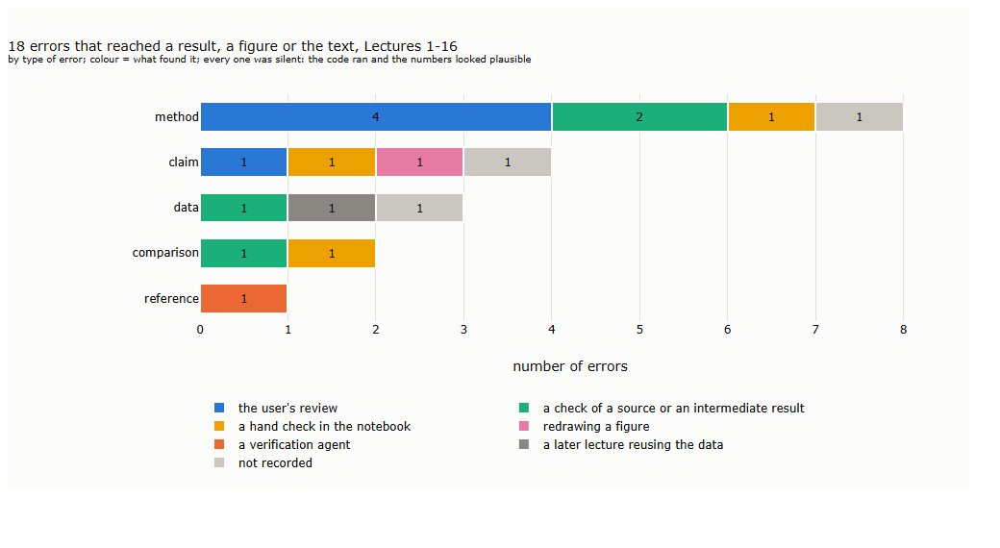
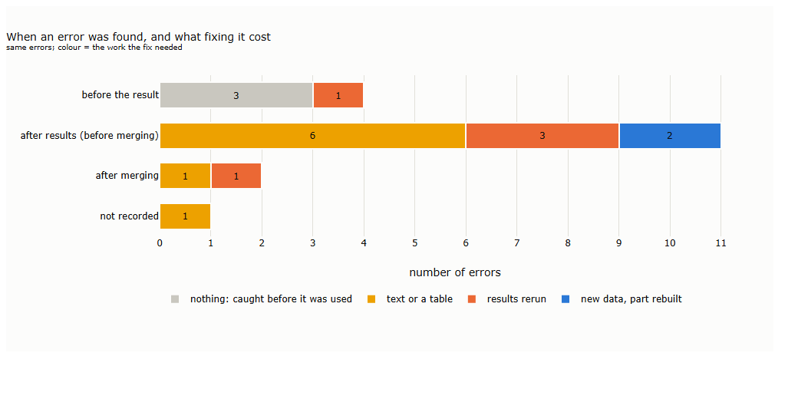

# Lecture 17: Research with AI

*Systematic Trading: Lecture Notes (MSc) · draft, Nov 16, 2026 · Max Gnesi*

**Part IV: the portfolio, closing.** Lectures 1-16 built the base layer. This lecture is about the method behind them: the notes were researched and written with an AI assistant, and doing that well is now part of the craft. Part V then goes below the daily bar.

An AI assistant makes a try cheap: it writes the code, downloads the data, runs a grid of backtests and drafts the text in minutes. The researcher's time moves from doing the work to deciding what the work should be and checking what comes back. This lecture is a practical guide to that shift: what to delegate, how to brief, how to lock the scope before a search, and which habits catch the errors an assistant makes. It uses the course's own record as the case study: every error in Lectures 1-16 that reached a result, a figure or the text, what kind it was, what found it and what fixing it cost. The plan, including the classification, was fixed before anything was counted, and the changes made while classifying are dated and labelled ([results/hypotheses.md](results/hypotheses.md)).

## 1. The record of this course

| § | Topic | Question |
|---|---|---|
| 1 | The key chart | Which errors got through, and what found them? |
| 2 | What an assistant changes | Where does the researcher's time go now? |
| 3 | The brief | How do you ask so the answer is to your question? |
| 4 | The lock | What must be fixed before a search starts, and how may it change? |
| 5 | Verification habits | Which checks catch the errors that do not crash? |
| 6 | The audit | What does the record show, error by error? |
| 7 | The workflow and transparency | What to copy, and how to disclose AI use |
| 8 | Summary | Takeaways, exercises, reading |

<b>How to read the figure.</b> <b>Axes.</b> x: number of errors; y: the type of error (method: a construction choice that was wrong; claim: text stronger than or different from the evidence; data: a missing or wrong series; comparison: two numbers on unlike samples; reference: a detail of a paper). Colours: what found the error. Each segment is labelled with its count. Source: the dated corrections in the plan files and the git history of Lectures 1-16 ([results/audit.csv](results/audit.csv), one row per error with its source).

Eighteen errors got through to a result, a figure or the text. **All eighteen were silent**: the code ran and the numbers looked plausible. Most were method errors, and the user's review, that is the author's, found half of those, including every method error that changed a rule. The four errors that changed a rule or a verdict were all found after the results were in and before the lecture was published. None of this is a rate: the record covers one project, and errors never found are not in it (§6.3).

## 2. What an assistant changes

| Delegate | Keep |
|---|---|
| Data pipelines and downloads; code; backtests and robustness grids; notebooks; literature searches; checks of a result against a published series; first drafts | The question; the expectation, written down before the test; the judgement on method, mechanism and evidence; the decision to keep or drop a change |

<b>How to read the table.</b> Left: work an assistant does well and fast. Right: decisions that stay with the researcher, because an assistant can return a confident, plausible answer to a badly posed question. The same table opens Lecture 1 §5.5.

**A try becomes cheap, and so does overfitting.** Lecture 15 tried 21 versions of carry within two days; by hand, each would have taken days. Every try is another draw from the noise, so the best of many looks better than it is (Lecture 1 §5.3). The deflated Sharpe ratio (Bailey and López de Prado 2014) counts the tries; it only works if every try is logged, including the ones that were dropped.

**The bottleneck moves to judgement.** When code and text arrive in minutes, the scarce resource is the researcher's attention: reading what came back, asking whether it answers the question, and checking the few numbers everything else rests on. The audit below shows where that attention paid off.

**The assistant is not a second researcher.** It does not know which result would surprise an expert, which construction the literature uses, or which choice was meant by an ambiguous sentence. It can find out when asked, and it often proposes good checks, but it will also continue confidently down a path the researcher would have stopped. Treat its output as a draft from a fast, well-read colleague who has never traded.

## 3. The brief

A brief states the goal, what is already ruled out, and the constraints. A vague brief returns a polished answer to a different question.

| | A wish | A brief |
|---|---|---|
| Example | "Build some carry strategies." | "Carry across currencies, commodities, government bonds and equity indices, as in Koijen et al. (2018); free data only; signals known at the previous month end; compare countries, not maturities; equity carry is the earnings yield minus the real bill rate; the rule, rivals and robustness grid fixed in the plan before any return." |
| What comes back | Whatever is easiest to build: two US Treasury funds as "bonds", the dividend yield as equity carry, total-return series | The construction the question needs, or a stated reason why the data cannot give it |

<b>How to read the table.</b> Left: a request that leaves every design choice to the assistant. Right: a brief in the form Lecture 15 ended with. Several of its clauses were added only after the first version came back wrong (§6.2, errors N and O): writing a good brief is itself iterative.

**Ambiguity is resolved silently.** In Lecture 12, "robust across all" meant robust across all markets *within* each asset class; the assistant read it as across all markets, ran the rule, and reported results (error E). Nothing crashed; the results were reasonable for the question it had answered. The fix is cheap: ask the assistant to restate the question and the rule in its own words before it runs anything, and read the restatement.

**State what is ruled out.** Knowing what has already failed, or is excluded by design, stops the assistant from rediscovering it. A sentence such as "no clipping of outputs; no paid data; no look-ahead in any signal" removes whole classes of answers.

## 4. The lock

Cheap tries make it tempting to try until something works. The defence is to fix the scope and the tests before the search starts, in writing and dated, as each lecture's `results/hypotheses.md` does.

| Locked in advance | Example from this course |
|---|---|
| The question and the rule | "Hold trend and carry at equal risk, judged as an addition to 60/40" (Lecture 16) |
| The variants and the search budget | Lecture 15's robustness grid, fixed before results; every later try added to the count |
| The tests and what counts as success | Luck baseline with 1,000 random strategies; expectations stated in advance; evidence weighed as a probability |
| The data held back | 1990-2005, untouched until Lecture 16's test |
| What would change the plan, and how | Allowed, but dated, labelled, counted as a try and judged on new data |

<b>How to read the table.</b> Left: the five things fixed before a search. Right: where this course fixed them. The same table is guardrail 1 of Lecture 1 §5.5.

**Adapting is allowed, with discipline.** Changing a strategy because of what the research found is how research works; refusing to use a robust finding would be foolish, whoever or whatever found it. What the lock adds is that each change is visible and priced. A change is judged by its cost (complexity, one more try, trading cost) against its measured benefit, and by its robustness (a plateau rather than a peak, other periods and markets, a mechanism) (Lecture 7 §5). Lecture 15 rebuilt its bond and equity groups across countries after seeing results; both changes are dated in the plan, and both were tested again in Lecture 16 on years neither had seen.

**The lock removes the search's selection, not all selection.** The ideas that enter a plan were themselves selected by experience and the literature (Lecture 1 §5.3). Locking the scope makes this project's own search honest; it does not make the literature's.

## 5. Verification habits

Every error in the audit was silent. A check therefore has to look for something specific: a number that should match, a share that should be plausible, a source that should agree. Five habits did the work in this course.

| Habit | What it catches | Example (error) |
|---|---|---|
| **Provenance**: record each dataset's source and check what was saved, not only what was requested | Missing or truncated series | VUSTX: the download failed without an error, and the file held one fund instead of two (H) |
| **Look at intermediate results** before any return: signal shares, extremes, dates | Constructions that measure the wrong thing | Natural gas "cheap" on 100% of days: value measured on a series dominated by roll losses (L) |
| **Hand checks**: recompute a lecture's key numbers in the notebook from the raw data | Numbers carried over from an earlier build; measures that misbehave | Three unrelated markets counted as about one bet (C); agreement with AQR quoted from an earlier build (P) |
| **Redraw figures from the data**, not from the text | Text that says more than the figure shows | An expectation said to hold on both datasets held on one (I) |
| **Check references at the source**, with a second reader | Invented or altered details | Authors' initials, a paper's wording, page numbers that could not be verified (R) |

<b>How to read the table.</b> One row per habit. Middle: the kind of error it catches. Right: an error from this course's audit that it caught, with its letter in [results/audit.csv](results/audit.csv).

**Compare on matched samples.** Two numbers that cover different months, markets or costs are not comparable, however close their labels. Lecture 16 first reported that monthly Sharpe ratios run a fifth above daily ones; on the same months the difference was 1-6%, and the rest was the start date (Q). An assistant computes what it is asked; it does not always notice that two of its own numbers rest on different samples.

**Read the source's notes.** Shiller's monthly earnings are quarterly figures spread over the months, so a month's value depends on a report published later. Using them three months after the month would have used earnings not yet known (K). The data provider's notes said so; the code could not.

## 6. The audit

### 6.1 How it was done

The source was fixed in the plan: the dated corrections in each lecture's `results/hypotheses.md` and the git history of Lectures 1-16. One error is one mistake that reached a results entry, a figure or the lecture text; typos and layout fixes are excluded. Each was classified by type, by what found it, by when it was found (before the result it affects, after results but before the lecture was published, or after) and by what fixing it cost. Two classes of "what found it" had to be added while classifying, a check of a source or an intermediate result and a later lecture reusing the data, because the fixed list had no place for them; one entry, the reference errors, is known only from the session record. All three changes are dated in the plan.

<b>How to read the figure.</b> <b>Axes.</b> x: number of errors; y: when the error was found (before the result it affects; after results but before the lecture was published; after publishing; not recorded). Colours: the work the fix needed, from nothing (caught before it was used) to new data and a rebuilt part of the strategy. Same 18 errors as the key chart ([results/audit.json](results/audit.json)).

### 6.2 What it shows

**Three expectations were fixed before counting.** Each is read against the record.

| Expectation | What the record shows | Reading |
|---|---|---|
| 1. Most errors found after publishing are silent | All 18 errors were silent, including both found after publishing | Holds, but by construction: an error that crashes never reaches a result |
| 2. Human review catches method and claim errors; automated checks catch data and reference errors | Method: the author's review 4 of 8, checks of intermediate results 2, a hand check 1. Claims: spread across four sources. Data: a later reuse, the source's notes, one not recorded. References: a verification agent | Holds for method errors only; no data error was caught by an automated check |
| 3. Errors caught early cost least | Before the result: 3 of 4 cost nothing. After publishing: 2, no verdict changed, but one meant rerunning three lectures. Rules and verdicts changed only for errors found in between | Partly holds |

<b>How to read the table.</b> Left: the expectation, as fixed in the plan. Middle: the counts behind it ([results/audit.json](results/audit.json)). Right: a short labelled reading; the reader may weigh it differently.

**The costly errors were design errors, found by a person.** Four errors changed a rule or a verdict. Three were method errors found by the author's review after the first results: the misread brief in Lecture 12 (E), and in Lecture 15 bonds compared across two US maturities instead of across countries (N), and equities as two US indices instead of countries (O). The last two needed new data and a rebuilt part of the strategy. In each case the assistant had produced a working, internally consistent strategy; what was wrong was the question it answered. That is the class of error a reader who knows the field sees at once and a check of numbers never will.

**The silent data error was the most expensive after publishing.** VUSTX was missing from a saved file for two days because the download had failed without an error (H). Lectures 13 and 14 were published on one Treasury fund instead of two. It was found when Lecture 15 needed the second fund; three lectures were rerun, Sharpe ratios moved by 0.01 to 0.03, and no verdict changed. A check that the saved file holds what was requested would have caught it the day it happened.

**Errors before the result cost nothing.** Three of the four errors found before the result they affect needed no rework at all: the earnings delay (K), value on total-return series (L) and value against a past average (M) were found by looking at the source and at the signals before any return was computed. This is the lock's practical payoff: when the plan says "signals first, returns later", the signals get looked at.

### 6.3 What the record cannot show

- **Errors never found.** The audit counts what was caught. A clean record is not evidence of no errors.
- **Lectures 1-10 show only two errors.** They were written before plan files existed, and their corrections went into commit messages, if at all. A thinner record, not a cleaner period.
- **One project, one assistant, one researcher.** The counts describe this course. They are not rates for AI-assisted research in general.
- **The classification is ours.** Whether an error is a method or a claim, and what found it, are judgements; [results/audit.csv](results/audit.csv) lists each one so a reader can reclassify.
- **No comparison with research without an assistant.** The record cannot say whether there were more or fewer errors than there would have been by hand.

## 7. The workflow and transparency

### 7.1 The workflow to copy

1. **Write the plan first.** Question, rule, rivals, search budget, tests, held-back data, three expectations; dated (§4).
2. **Brief, then ask for a restatement.** Goal, ruled-out answers, constraints; read the assistant's restatement before it runs (§3).
3. **Signals before returns.** Look at shares, extremes and dates of every signal before computing any profit (§5).
4. **Check the saved data**, not only the download: rows, dates, columns, one value against its source (§5).
5. **Log every try and every correction** in the plan file, with the date and what found it. The audit in §6 was possible only because of this log.
6. **Hand-check the key numbers** in a notebook from the raw data, and redraw every figure from data.
7. **Read the results as a domain expert** before reading them as a statistician: is this the question I asked?
8. **Verify references at the source**, with a second reader or a verification agent, and drop what cannot be verified.
9. **Adapt with discipline.** Changes after results are dated, counted as tries, priced and tested on new data (§4).

### 7.2 Transparency

Readers judge research partly by how it was made. These notes say so in the README ("How these notes were made"): the course design, the questions, the expectations and the judgement on methods and results are the author's; the assistant wrote most of the code, ran the analyses, drafted the text and checked references, under that direction and review. The plan files and this audit make the division visible: who decided what, what was corrected and by whom. Not disclosing AI use would be neither honest nor useful to a reader who wants to reproduce or extend the work, and the dated record is what makes the work checkable regardless of who typed it.

## 8. Summary

### 8.1 Takeaways

1. **An assistant makes tries cheap; count them.** Speed moves the researcher's time from doing to deciding and checking, and makes overfitting as cheap as research (§2).
2. **Brief, don't wish.** State the goal, what is ruled out and the constraints; ambiguity is resolved silently (§3).
3. **Lock the scope before the search.** Question, budget, tests, held-back data and the rules for change, written and dated; adapting on findings is fine when it is visible, priced and tested again (§4).
4. **Every error that got through was silent.** Checks must look for something specific: the saved data, intermediate results, hand-checked numbers, redrawn figures, references at the source (§5).
5. **The costly errors were questions, not code.** On this course's record, the errors that changed rules were design choices found by a person who knew the field; the assistant had answered a different question well (§6).

**The method in one sentence.** Let the assistant do the work fast, keep the question and the judgement, fix the plan before the search, and log every try and correction so the work can be checked.

### 8.2 Exercises

1. **Lock and run.** Write a dated plan for your own variant of a Lecture 15 rule, including the search budget; run it with an assistant; log every try and correction in the same format as [results/audit.csv](results/audit.csv). Report the deflated Sharpe ratio with your count of tries.
2. **Audit a project of your own.** Classify the errors in one of your past projects with the scheme of §6.1. Which habit of §5 would have caught each one earliest?
3. **Reclassify.** Take [results/audit.csv](results/audit.csv) and reclassify the errors you would judge differently. Do the readings of §6.2 change?
4. **A brief and its restatement.** Write a brief for Lecture 14's correlation filter, ask an assistant to restate it, and list every point where the restatement differs from what you meant.

### 8.3 Reading

- Lecture 1 §5.3-5.5 (overfitting, many small edges, working with an AI assistant), Lecture 7 §5 (robustness as a plateau), Lecture 15 §6 (the count of tries), Lecture 16 (the held-back test).
- Bailey, D. H. and López de Prado, M. (2014). The deflated Sharpe ratio: correcting for selection bias, backtest overfitting, and non-normality. *Journal of Portfolio Management* 40(5), 94-107.
- Harvey, C. R., Liu, Y. and Zhu, H. (2016). … and the cross-section of expected returns. *Review of Financial Studies* 29(1), 5-68.
- Simmons, J. P., Nelson, L. D. and Simonsohn, U. (2011). False-positive psychology: undisclosed flexibility in data collection and analysis allows presenting anything as significant. *Psychological Science* 22(11), 1359-1366.
- Nosek, B. A., Ebersole, C. R., DeHaven, A. C. and Mellor, D. T. (2018). The preregistration revolution. *Proceedings of the National Academy of Sciences* 115(11), 2600-2606.
- Koijen, R. S. J., Moskowitz, T. J., Pedersen, L. H. and Vrugt, E. B. (2018). Carry. *Journal of Financial Economics* 127(2), 197-225.
