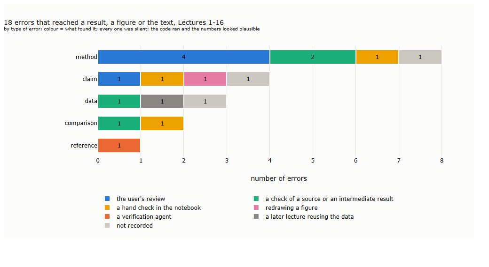
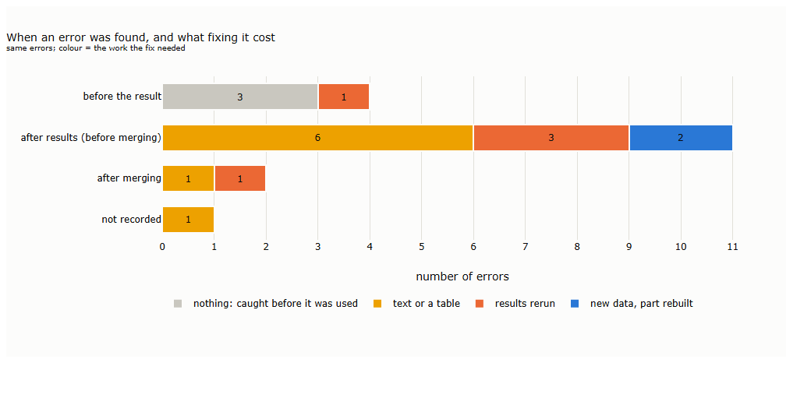

# Lecture 17: Research with AI

> An AI assistant makes a try cheap: the researcher's time moves from doing the work to deciding what the work should be and checking what comes back.

Part IV · Pipeline stage: the feedback loop (the research method)

---

# The record of this course

> Eighteen errors got through to a result, a figure or the text. All eighteen were silent: the code ran and the numbers looked plausible.

- Most were method errors; the author's review found half of those
- The four that changed a rule or verdict: found after results, before publishing
- One project: none of this is a rate

---

# What to delegate, what to keep

> An assistant can return a confident, plausible answer to a badly posed question: the question and the judgement stay with the researcher.

| Delegate | Keep |
|---|---|
| Data pipelines and downloads; code; backtests and robustness grids; notebooks; literature searches; checks against a published series; first drafts | The question; the expectation, written down before the test; the judgement on method, mechanism and evidence; the decision to keep or drop a change |

Treat its output as a draft from a fast, well-read colleague who has never traded.

---

# A try becomes cheap, and so does overfitting

> Lecture 15 tried 21 versions of carry within two days; every try is another draw from the noise, so the best of many looks better than it is.

- The deflated Sharpe ratio counts the tries; it only works if every try is logged, including the ones that were dropped
- The bottleneck moves to judgement: reading what came back, asking whether it answers the question, checking the few numbers everything else rests on

---

# The brief

> A brief states the goal, what is already ruled out, and the constraints. A vague brief returns a polished answer to a different question.

| | A wish | A brief |
|---|---|---|
| Example | "Build some carry strategies." | Four groups, as in Koijen et al. (2018); free data only; compare countries, not maturities; rule, rivals and grid fixed in the plan before any return |
| What comes back | Whatever is easiest to build: two US Treasury funds as "bonds" | The construction the question needs, or a stated reason why the data cannot give it |

- **Ambiguity is resolved silently:** ask for a restatement of the question and the rule before anything runs
- **State what is ruled out:** "no clipping of outputs; no paid data; no look-ahead in any signal"

---

# The lock

> Cheap tries make it tempting to try until something works: fix the scope and the tests before the search starts, in writing and dated.

| Locked in advance | Example from this course |
|---|---|
| The question and the rule | Trend and carry at equal risk, judged as an addition to 60/40 |
| The variants and the search budget | Lecture 15's robustness grid; every later try added to the count |
| The tests and what counts as success | 1,000 random strategies; expectations stated in advance |
| The data held back | 1990-2005, untouched until Lecture 16's test |
| What would change the plan, and how | Allowed, but dated, labelled, counted as a try and judged on new data |

---

# Adapting is allowed, with discipline

> Changing a strategy because of what the research found is how research works; the lock makes each change visible and priced.

- A change is judged by its **cost** (complexity, one more try, trading cost) against its measured benefit
- And by its **robustness:** a plateau rather than a peak, other periods and markets, a mechanism
- Lecture 15 rebuilt its bond and equity groups after seeing results; both changes were dated and tested again in Lecture 16 on years neither had seen
- The lock removes the search's selection, not all selection: the ideas that enter a plan were themselves selected

---

# Verification habits

> Every error in the audit was silent, so a check has to look for something specific: a number that should match, a share that should be plausible, a source that should agree.

| Habit | Example it caught |
|---|---|
| **Provenance:** check what was saved, not only what was requested | VUSTX: the download failed without an error |
| **Look at intermediate results** before any return | Natural gas "cheap" on 100% of days |
| **Hand checks** of key numbers from the raw data | Agreement with AQR quoted from an earlier build |
| **Redraw figures from the data**, not from the text | An expectation said to hold on both datasets held on one |
| **Check references at the source**, with a second reader | Page numbers that could not be verified |

---

# Errors caught early cost least

> Three of the four errors found before the result they affect needed no rework at all: the signals were looked at before any return was computed.

- This is the lock's practical payoff: "signals first, returns later"
- After publishing: VUSTX missing, three lectures rerun
- Sharpe ratios moved by 0.01 to 0.03; no verdict changed

---

# The costly errors were design errors, found by a person

> Four errors changed a rule or a verdict; three were method errors found by the author's review after the first results.

- **Lecture 12:** "robust across all" meant within each asset class; the assistant read it as across all markets
- **Lecture 15:** bonds compared across two US maturities instead of across countries
- **Lecture 15:** equities as two US indices instead of countries
- In each case the assistant had produced a working, internally consistent strategy; what was wrong was the question it answered

---

# What the record cannot show

> The counts describe one project, one assistant, one researcher: they are not rates for AI-assisted research in general.

- **Errors never found:** a clean record is not evidence of no errors
- **Lectures 1-10 show only two errors:** a thinner record, not a cleaner period
- **The classification is ours:** each error is listed so a reader can reclassify
- **No comparison with research without an assistant**

---

# The workflow to copy

> Plan, brief, look, check, log: the audit was possible only because every try and correction was logged.

1. **Before:** write the plan first (question, rule, rivals, search budget, tests, held-back data, three expectations); brief, then ask for a restatement
2. **During:** signals before returns; check the saved data, not only the download; log every try and every correction
3. **After:** hand-check the key numbers and redraw every figure from data; read the results as a domain expert; verify references at the source
4. **Adapt with discipline:** changes after results are dated, counted as tries, priced and tested on new data

---

# Transparency

> Disclose AI use: the dated record is what makes the work checkable regardless of who typed it.

- The course design, the questions, the expectations and the judgement on methods and results are the author's
- The assistant wrote most of the code, ran the analyses, drafted the text and checked references, under that direction and review
- The plan files and the audit make the division visible: who decided what, what was corrected and by whom

---

# Takeaways

1. **An assistant makes tries cheap; count them**
2. **Brief, don't wish:** state the goal, what is ruled out and the constraints; ambiguity is resolved silently
3. **Lock the scope before the search;** adapting on findings is fine when it is visible, priced and tested again
4. **Every error that got through was silent:** checks must look for something specific
5. **The costly errors were questions, not code:** the assistant had answered a different question well

> The method in one sentence: let the assistant do the work fast, keep the question and the judgement, fix the plan before the search, and log every try and correction so the work can be checked.
