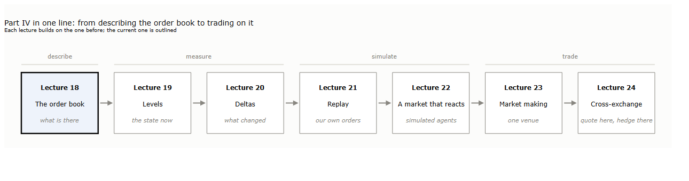
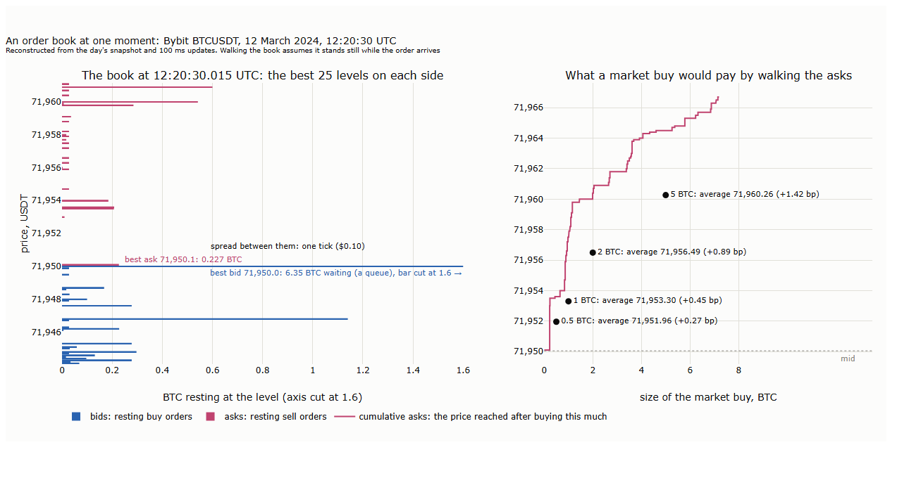
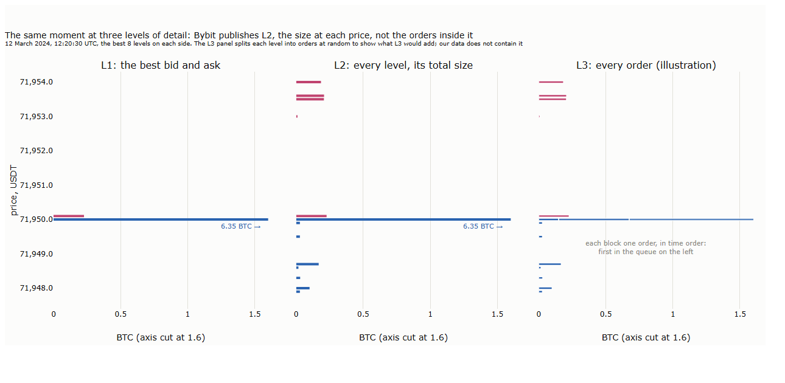
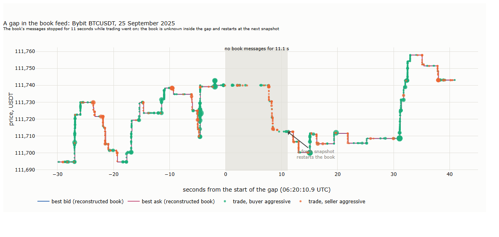
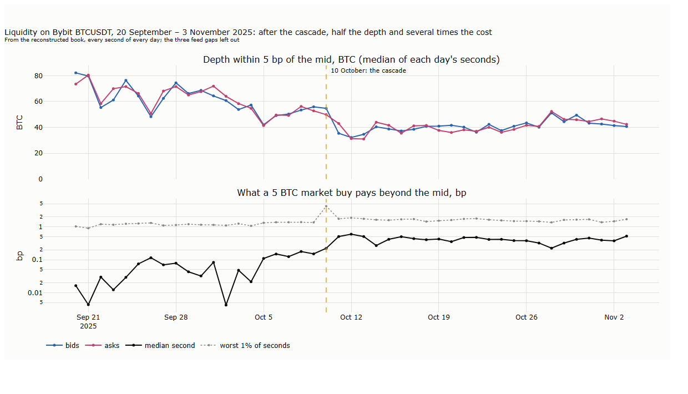
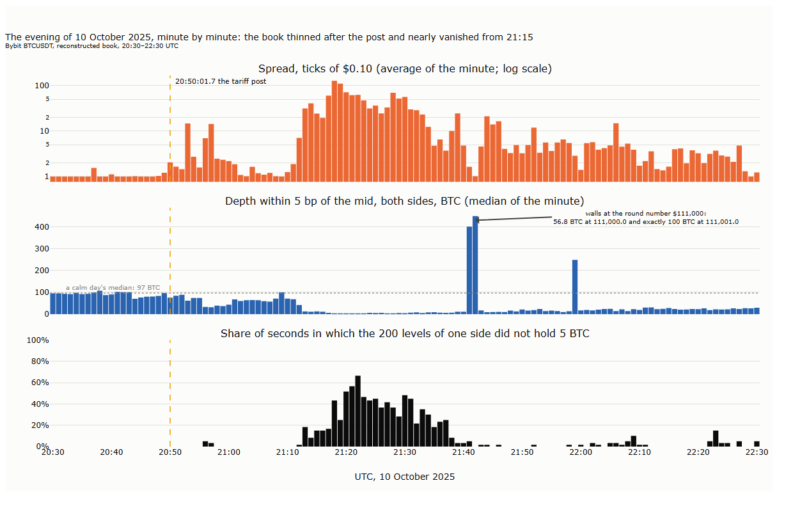
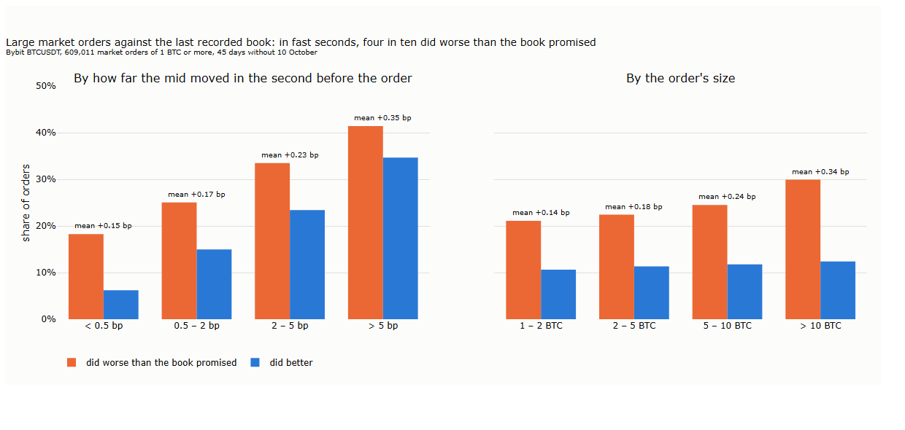
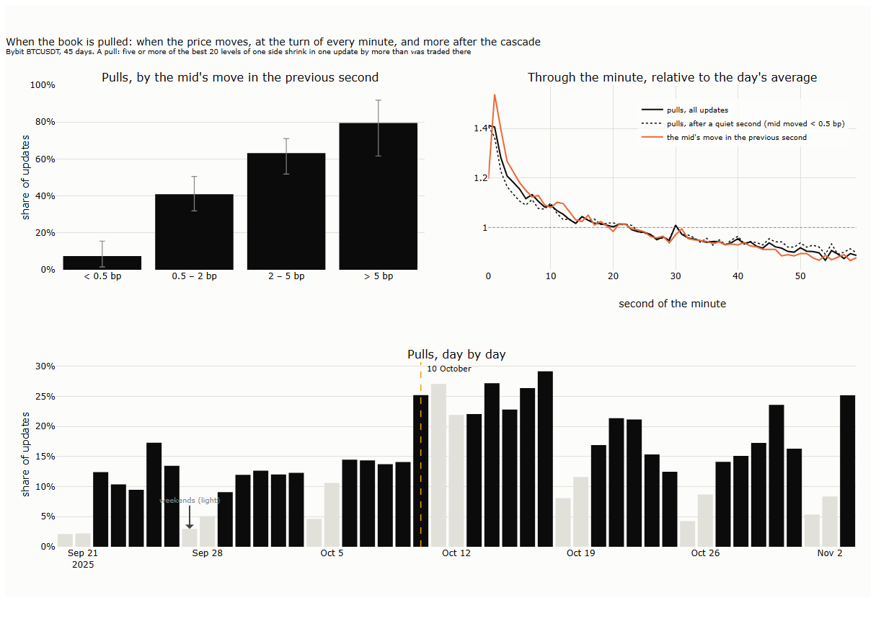

# Lecture 18: The Order Book: What It Shows and How to Reconstruct It

*Systematic Trading: Lecture Notes (MSc) · Oct 29, 2026 · Max Gnesi*

Part III worked with the tape: every trade, the moment two orders met. This lecture opens Part IV by turning to the orders themselves, those waiting in the order book to be met. It explains what an order book is and how much of it public data show, how to obtain the data and rebuild the book from it, and what the rebuilt book reveals about a market's liquidity. The data are Bybit's BTCUSDT perpetual from 20 September to 3 November 2025, around the liquidation cascade of 10 October; one day of 2024 serves to illustrate the data's format.

## 1. The order book

Part IV moves from describing the order book to trading on it, one step per lecture:


<sub><b>How to read the figure.</b> Each box is one lecture of Part IV, each building on the one before; this lecture is outlined. Above the boxes, the four stages: describing the book, measuring it, simulating our own orders in it, and trading strategies on it.</sub>

This lecture is the first stage: what the book is, what public data show of it, and what it reveals before anything is measured or traded. It runs as follows:

| § | Step | Question |
|---|---|---|
| 1 | The order book | What is in it, and what does a market order do to it? |
| 2 | Three levels of detail | What do L1, L2 and L3 data show, and what does L2, the level we have, leave out? |
| 3 | Getting the data | How do readers download the book and the trades themselves, and why both? |
| 4 | Reconstructing the book | How is the book rebuilt from the data, and how do we know it is right? |
| 5 | What the book shows | Spread, depth, the cost of a market order, refill and cancellations, on calm days and on 10 October |
| 6 | Summary, exercises and reading | |

### 1.1 What is in it

An order book is the list of orders waiting to trade at each price. Every term the rest of Part IV uses is defined here once:

| Term | Meaning | Financial interpretation |
|---|---|---|
| **Limit order** | An order to buy or sell up to a given size at a given price or better | A trader willing to wait for a better price, at the risk of not trading |
| **Resting order** | A limit order that could not trade at once and waits in the book | Liquidity offered to others: the maker's side of a trade (Lecture 12, §3) |
| **Market order** | An order to trade a given size at once, at whatever prices are available | A trader in a hurry: the taker's side, who pays the spread and more |
| **Bid, ask** | A resting order to buy (bid) or to sell (ask) | The two sides of the book |
| **Level** | One price with resting orders | On BTCUSDT, prices come in ticks of $0.10, so levels are at least a tick apart |
| **Best bid, best ask** | The highest bid and the lowest ask | The prices at which a small market order sells or buys |
| **Spread** | Best ask minus best bid | The cost of buying and selling at once; on BTCUSDT usually one tick |
| **Mid** | The average of the best bid and the best ask | The usual reference price between trades |
| **Depth** | The size resting within a distance of the mid, on one side | How much can be traded before the price moves that far |
| **Queue** | The orders resting at one level, in the order they arrived | Who trades first when a market order comes: first come, first served (price-time priority) |

**One moment of the book.** The book of 12 March 2024 at 12:20:30 UTC, rebuilt from Bybit's data (§4 shows how):


<sub><b>How to read the figure.</b> <b>Left:</b> the best 25 levels on each side, bids (resting buy orders) in blue below the price, asks (resting sell orders) in pink above it; each bar is the size waiting at that price. The horizontal axis is cut at 1.6 BTC so that the small levels show; the best bid's bar runs on to 6.35 BTC. <b>Right:</b> the asks added up from the best ask outwards (pink): the price a market buy reaches after buying a given amount. Black dots: the average price of market buys of 0.5, 1, 2 and 5 BTC, and how far it lies above the mid.</sub>

At that moment the best bid was $71,950.0, with 6.35 BTC queued, and the best ask one tick higher, $71,950.1, with 0.23 BTC: a spread of one tick. The book was lopsided. Within $10 of the mid, 14.7 BTC waited to buy against 2.0 BTC to sell. About three seconds later, buyers took the thin asks and the price rose $35. Whether such an imbalance predicts the next move is the question of Lecture 19.

### 1.2 What a market order does to it

A market order takes the best price first and then the next, level by level, until it is filled: it **walks the book**. Its average price is the cost of its hurry:

| Market buy at 12:20:30 | Levels taken | Average price | Above the mid | Last price paid |
|---|---|---|---|---|
| 0.5 BTC | 4 | 71,951.96 | 0.27 bp | 71,953.6 |
| 1 BTC | 12 | 71,953.30 | 0.45 bp | 71,957.5 |
| 2 BTC | 22 | 71,956.49 | 0.89 bp | 71,960.4 |
| 5 BTC | 40 | 71,960.26 | 1.42 bp | 71,964.5 |

<sub><b>How to read the table.</b> Our calculation from the rebuilt book: the asks taken in order from the best, until the size is filled. bp: basis points of the mid, $71,950.05.</sub>

The cost grows faster than the size, because each additional bitcoin is bought further from the mid. Walking the book this way assumes the book stands still while the order travels to the exchange, and it does not.

**The book moves while the order travels.** An order needs time to reach the exchange, its **latency**. In that time market makers, who see the market and react faster, can revise or cancel their quotes, above all when the price starts to move, which is when a trader most wants to trade. This is **quote fading**: the order arrives at worse prices than it was sent against. Part of the displayed depth was never meant to trade at all: over a third of limit orders on Nasdaq's book are cancelled within two seconds, **fleeting orders** in the term of Hasbrouck and Saar (2009), and a trade on one venue is followed within 100 milliseconds by cancellations on others (van Kervel, 2015). Practitioners call the result the **liquidity mirage**: depth that is displayed but gone when it is reached. Our recorded book adds its own delay, since it is updated every 100 milliseconds. The costs above are therefore a lower bound; §5 measures by how much real market orders did worse, and Lecture 21 makes latency a setting of every replay.

A figure of the book shows how much rests at each price. It does not show who stands behind those amounts, which depends on how much detail the data contain.

## 2. Three levels of detail

Public order-book data come at three levels of detail, and the level decides which questions can be answered:

| Level | What it shows | Example |
|---|---|---|
| **L1** | The best bid and the best ask, with their sizes | Binance's best bid and ask, used in Lecture 15, §5 |
| **L2** | Every level, with the total size resting there | **Bybit's book, used in Part IV**: 500 levels a side until mid-2025, 200 since, updated every 100 milliseconds |
| **L3** | Every single order: when it arrived, at which price and size, and when it was filled or cancelled | Some venues publish it live; historical L3 data are rare and usually paid for |


<sub><b>How to read the figure.</b> The book of figure 18_02 drawn as three ladders, the way trading screens show a book: one row per level, asks (pink) above, bids (blue) below, the price on the left and the size in BTC written in each row; bars are full at 1 BTC, and ▶ marks a larger size. <b>L1:</b> only the best bid and ask; the other rows are not in L1 data. <b>L2:</b> every level and its total size. <b>L3:</b> each level split into its individual orders, the first to arrive on the left. The split is invented for the illustration: our data do not contain it.</sub>

L2 is the level of most public crypto data, and it answers most questions about liquidity: where the depth is, how wide the spread, what a market order costs. What it cannot show is the queue inside a level, and that matters to anyone whose order waits in it.

**What L2 cannot tell: one real window of 100 milliseconds.** On 12 March 2024, between 12:00:27.215 and 12:00:27.314 UTC, the size at the best bid of $72,117.20 changed as follows:

| What the data show | BTC | From |
|---|---|---|
| Resting at the best bid, before | 3.883 | The book (L2) |
| Sold into it by market orders, three trades | 0.132 | The trades |
| Resting at the best bid, after | 0.747 | The book (L2) |
| **Removed otherwise:** cancellations minus new orders that joined | **3.004** | The difference |

The book alone shows that the size fell by 3.136 BTC. Only the trades say that 0.132 BTC of that was filled; without them, a fall of the queue through trading could not be told from orders being withdrawn. Even with both, the last row is a net figure: L2 cannot say whether 3.004 BTC were cancelled, or 4 BTC were cancelled while 1 BTC of new orders joined.

**Why it matters for a waiting order.** Suppose our own order had been waiting at the back of that queue. The trades took 0.132 BTC from its front, so our order moved up by that much. Of the remaining orders ahead of us, some were cancelled. Since only 0.747 BTC rest at the level afterwards, at most 0.747 BTC can still be ahead of us, and as little as nothing if the orders that remain all joined behind us. Our position after 100 milliseconds is somewhere between the front of the queue and 0.747 BTC behind it. With L3, the exact position would be known. With L2, it must be estimated by a model of where in the queue cancellations happen, and the estimate becomes a range. Lecture 21 builds such models; the fills it simulates come as ranges for this reason.

The window has already used the two kinds of data that Part IV needs: the book, for what rests, and the trades, for what traded. Section 3 shows how to obtain both.

## 3. Getting the data

Bybit publishes the history of its book and its trades as daily files, free and without an account. This section shows what the files contain, what they look like as tables, and how to download and convert them, so that every number in Part IV can be rebuilt by the reader.

### 3.1 Two files a day

The two kinds of data of §2 come as two files per day and market:

| File | Address (for BTCUSDT on 14 October 2025) | Size of one day | Content |
|---|---|---|---|
| **The book** | `https://quote-saver.bycsi.com/orderbook/linear/BTCUSDT/2025-10-14_BTCUSDT_ob200.data.zip` | 70–300 MB zipped, about 1.7 GB unpacked | One message every 100 milliseconds: a full snapshot of the book at the start, then the changes |
| **The trades** | `https://public.bybit.com/trading/BTCUSDT/BTCUSDT2025-10-14.csv.gz` | 10–120 MB zipped | Every trade, with its time, side, size and price |

The depth of the book changed over time: 500 levels a side (`ob500`) from at least March 2024 to mid-2025, 200 levels (`ob200`) from September 2025. A study should use months of one format; ours, 20 September to 3 November 2025, are all `ob200`. Busy days give larger files: 10 October, the day of the cascade, holds 8.7 million trades against about 2 million on a quiet day.

### 3.2 What a raw line looks like

**The book.** Each line of the unpacked file is one message, written in JSON, a text format of named fields. The first two lines of 14 October 2025, shortened to three levels a side:

```json
{"topic":"orderbook.200.BTCUSDT","type":"snapshot","ts":1760400000045,"cts":1760400000042,
 "data":{"s":"BTCUSDT","b":[["115116.60","1.815"],["115116.50","0.014"],["115116.40","0.001"], ...],
                       "a":[["115116.70","4.549"],["115116.80","0.005"],["115116.90","0.005"], ...],
         "u":22309861,"seq":464864378412}}
{"topic":"orderbook.200.BTCUSDT","type":"delta","ts":1760400000144,"cts":1760400000142,
 "data":{"s":"BTCUSDT","b":[["115116.60","2.679"],["115112.60","0.663"], ...],
                       "a":[["115116.70","4.550"],["115128.30","0"], ...],"u":22309862,"seq":464864378513}}
```

| Field | Meaning | Reading of the lines above |
|---|---|---|
| `type` | `snapshot`: the whole book (200 levels a side); `delta`: only the levels that changed | The day starts with a snapshot; every later line is a change |
| `ts` | When Bybit sent the message, in milliseconds since 1 January 1970, UTC | 00:00:00.045, then 00:00:00.144: one message every 100 ms |
| `cts` | When the matching engine produced the state, in the same unit | A few milliseconds before `ts`; the time to align with the trades (§4) |
| `b`, `a` | Bids and asks as pairs of price and size; in a delta, the **new** size at that price, and `"0"` when the level is gone | The best bid of 115,116.60 grew from 1.815 to 2.679 BTC; the ask at 115,128.30 disappeared |
| `u` | Update number, rising by exactly 1 per message | 22309861, then 22309862: a gap would mean a lost message (§4) |
| `seq` | The matching engine's own sequence number | Rises by more than 1 per message, with the engine's events in between; not used here |

A delta does not say what happened at a price, only what the size is now. Whether 0.864 BTC were added to the best bid by one order or several, and whether the ask at 115,128.30 was filled or cancelled, the message cannot tell; that is the L2 limit of §2.

**The trades.** A plain table, one line per trade, the first three of the same day:

| `timestamp` | `side` | `size` | `price` | Reading |
|---|---|---|---|---|
| 1760400000.1565 | Buy | 0.018 | 115116.70 | 00:00:00.157 UTC: a buyer takes 0.018 BTC at the best ask of the snapshot above |
| 1760400000.5906 | Buy | 0.295 | 115116.70 | Another buy at the same price, $33,959 |
| 1760400000.9542 | Buy | 0.006 | 115116.70 | And a small one |

<sub><b>How to read the table.</b> `side` is the aggressor: `Buy` means the buyer took a resting ask, `Sell` that a seller hit a resting bid, the information that Binance's tape coded as `is_buyer_maker` (Lecture 12, §3.2). The file has more columns: a trade ID, a tick direction, the value in dollars, and since 2025 a column `RPI`, which marks trades against Bybit's retail-price-improvement orders; on our BTCUSDT perpetual data it is 0 on every trade, so it is not used.</sub>

### 3.3 The same data as tables

Text that must be parsed line by line is slow to work with. Each day is therefore converted once into two tables in Parquet, the column format used since Lecture 12, with prices stored as whole ticks of $0.10 so that they compare exactly:

| Book table: one row per level that changed | | Trades table: one row per trade | |
|---|---|---|---|
| `ts`, `cts` | Sent and engine time, ms | `ts` | Time, ms |
| `u`, `seq` | Update and sequence numbers | `side` | +1 buyer aggressive, −1 seller aggressive |
| `snap` | 1 for the rows of a snapshot | `tick` | Price in ticks of $0.10 |
| `side` | +1 bid, −1 ask | `size` | BTC |
| `tick` | Price in ticks of $0.10 | `id` | Bybit's trade ID |
| `size` | The new size at that price, BTC; 0: level gone | | |

Reading the first changes of 1 October 2025 takes two lines of code:

```python
import polars as pl
book = pl.read_parquet("data/bybit/parquet/orderbook/BTCUSDT/2025-10-01.parquet")
book.filter(pl.col("snap") == 0).head(6)          # in pandas: pd.read_parquet(path).query("snap == 0").head(6)
```

| `ts` | `u` | `side` | `tick` | `size` | Reading |
|---|---|---|---|---|---|
| 1759276800045 | 11085543 | 1 | 1140137 | 6.454 | 00:00:00.045: the bid at $114,013.70 now holds 6.454 BTC |
| 1759276800045 | 11085543 | 1 | 1140054 | 0.005 | In the same message, the bid at $114,005.40: 0.005 BTC |
| 1759276800045 | 11085543 | 1 | 1140046 | 0 | The bid at $114,004.60 is gone |
| 1759276800045 | 11085543 | 1 | 1140045 | 0.077 | The bid at $114,004.50: 0.077 BTC |

<sub><b>How to read the table.</b> All four rows belong to one message, update 11085543: each row is one price whose size changed. The columns `cts`, `seq` and `snap` are left out here for width.</sub>

A day becomes 40 to 80 million rows of book changes, 140 to 230 MB of Parquet, and the trades 40 to 200 MB.

### 3.4 Downloading it yourself

| Step | What to do | What it checks |
|---|---|---|
| 1. Space | About 0.3 GB a day for the raw files and about the same for the tables; our 45 days take 13 GB raw | Free disk space before starting |
| 2. Download | `python bybit_download.py ROOT BTCUSDT 2025-09-20 2025-11-03`: both files for every day, with whichever book depth exists | Every file against the size Bybit's server reports; failed downloads are retried, and days already complete are skipped, so it can be restarted |
| 3. Convert | `python bybit_to_parquet.py ROOT BTCUSDT`: each day into the two tables of §3.3 | That the book rebuilt from the table matches Bybit's own snapshot (§4), and that no trade is lost |
| 4. Clean up | The script deletes a day's raw files only if its checks pass | Days that fail keep their raw files for inspection (§4) |

Downloading takes about a minute a day, converting and checking three to six minutes. The two scripts are in the lecture's `scripts/` folder; the notebook runs them.

**Why both files.** The window of §2 showed it: the book says how much rests at each price, the trades say how much of a change was trading. A study of liquidity needs the book; anything about fills, queues or cancellations needs both, aligned in time. Section 4 rebuilds the book from its file, aligns it with the trades and checks that the two agree.

## 4. Reconstructing the book

The book of every moment can be rebuilt from Bybit's files, and on our 45 days the rebuilt book matches Bybit's own snapshots exactly, apart from three gaps of about ten seconds in which the feed stopped. This section shows how the book is rebuilt, how we know it is right, what the gaps are, and how the book lines up with the trades.

### 4.1 The method

| Step | What is done | Why |
|---|---|---|
| 1. Start | Read the day's first message, a snapshot: 200 levels a side, each with its size | The book at midnight |
| 2. Apply each change | For every later message, set each listed price to its new size; remove the price if the size is 0 | A delta lists only the levels that changed, and the size it gives is the new total, not a change |
| 3. Restart at a snapshot | When another snapshot arrives, replace the book with it | Bybit sends one at midnight and after an interruption (§4.3) |
| 4. Time it | Stamp each state with the matching engine's time, `cts` | The clock that lines the book up with the trades (§4.4) |

The book of any moment is the result of these steps up to that moment. The viewer of this lecture (`tools/orderbook_viewer`) rebuilds it the same way, once per day, and keeps a copy of the book at every full minute so that any moment can be reached quickly.

### 4.2 How we know it is right

Each day file ends with the next midnight's snapshot: the last message of the file for 1 October is Bybit's full book at 2 October, 00:00:00.043. That gives a strict test. Rebuild the whole day from its first snapshot, about 860,000 messages and 40 to 80 million changes, and compare the result with that final snapshot, level by level:

| Test | Result on 45 days |
|---|---|
| Update numbers rise by 1 from message to message, apart from the restarts of §4.3 | Every day |
| The book rebuilt over the whole day equals Bybit's end-of-day snapshot at every one of its 400 levels, sizes to the last digit | **Every day**, and on the three days of §4.3 for the part after the restart |
| No trade lost in the conversion: rows and total size equal those of the raw file | Every day |

<sub><b>How to read the table.</b> Our checks for these notes, run by the conversion script of §3.4 on every day.</sub>

A single error in reading the files, or in the rules of §4.1, would carry forward and show at the end of the day. None does.

### 4.3 Three gaps in the feed

On three days the book's messages stop for about ten seconds, and the next message is a fresh snapshot:

| Day | Gap, UTC | Length | What follows | Trades during the gap |
|---|---|---|---|---|
| 25 September | 06:20:10.9 – 06:20:22.0 | 11.1 s | Snapshot; update numbers jump by 110 | 132 |
| 14 October | 06:14:22.6 – 06:14:32.9 | 10.3 s | Snapshot; update numbers restart at 1 | 247 |
| 23 October | 02:52:44.8 – 02:52:54.6 | 9.8 s | Snapshot; update numbers restart at 1 | 41 |


<sub><b>How to read the figure.</b> The best bid (blue) and best ask (pink) of the rebuilt book in the minute around the gap of 25 September, and every trade as a dot: green when a buyer was aggressive, orange when a seller was. The shaded band is the gap: no book messages for 11.1 seconds. Trades continue through it; the book restarts at the snapshot that ends it.</sub>

Trading went on during every gap: Bybit's matching engine kept working, and only the book's data feed stopped. Twice the update numbers start again from 1, the mark of a restarted data service. During a gap the book is unknown, but the trades still show where the price went: on 25 September it fell $27. After each gap the rebuilt book matches Bybit's end-of-day snapshot exactly again.

What follows for any study of this book: the book is unknown for 31 seconds of the 45 days, and those seconds are recorded in a register (`BTCUSDT_book_gaps.csv`), which every later lecture leaves out. The viewer marks them as grey bands.

**Testing the test.** The first version of our check compared the rebuilt book with the day's second snapshot, wherever it came. On the three gap days that snapshot came after the gap, when the price had already moved, and the check reported hundreds of differing levels: a failure of the check, not of the data. It was found because the raw files of failing days are kept until the cause is understood (§3.4), and corrected so that the book is compared at every snapshot that follows continuous data and a gap is recorded, not failed. A check needs checking too, on the cases where it fails.

### 4.4 Lining up the book with the trades

The book and the trades come from different files with different clocks: each book message has two times, `ts` (sent) and `cts` (produced by the matching engine), and each trade one. The right clock is the one under which the trades fit the book. On 1 October, for every trade, we took the book as of its last message before the trade and asked whether the trade's price was a level resting on the side it traded against:

| Clock for the book | Trades at a price resting just before |
|---|---|
| `ts`, the time sent | 90.4% |
| **`cts`, the matching engine's time** | **90.6%** |
| `cts` shifted 100 ms earlier | 30.4% |
| `cts` shifted 100 ms later | 86.4% |

<sub><b>How to read the table.</b> Our calculation for 1 October 2025, 1.73 million trades. A shift of one update interval in either direction makes the fit clearly worse.</sub>

`cts` fits best, and is used throughout. The remaining tenth of trades happen at prices that the book of up to 100 milliseconds earlier did not show: orders that arrived and were filled between two messages.

**Where in the book trades happen.** Measured against the best price just before them, most trades seem not to happen at the best at all:

| Trade's price, against the best price of the book just before it | All trades | The first trade of each millisecond |
|---|---|---|
| At the best | 34% | **72%** |
| Deeper in the book | 63% | 24% |
| Better than the best | 3% | 4% |

<sub><b>How to read the table.</b> Our calculation for 1 October 2025. A buy is compared with the best ask, a sell with the best bid. Deeper: a buy above the best ask, a sell below the best bid. Better: the book had moved since its last message.</sub>

The two columns tell one story. One market order often fills against several levels in the same millisecond: the first fill at the best, the next ones deeper, as in §1.2. Counted fill by fill, most trades are therefore deeper than the best. Counted by the first trade of each millisecond, close to one market order, almost three in four take the best price; most of the rest, presumably, found the best already taken by another order within the last 100 milliseconds, and a few found the book moved. The trades and the rebuilt book agree; what the low figure measured was sweeps and the 100-millisecond interval of the record.

With the book rebuilt, checked and aligned with the trades, Section 5 turns to what it shows.

## 5. What the book shows

On an ordinary day the BTCUSDT book on Bybit is deep and tight: one tick of spread, about 48 BTC within 5 bp of the mid on each side, and a quarter of a basis point for a 5 BTC market order. After the cascade of 10 October it stayed about half as deep for the rest of our sample. This section measures the book's liquidity second by second over the 45 days; every number can be checked in the viewer of §4.1, whose day strip draws each of these measures through the day.

### 5.1 Spread and depth

| Measure | How it is computed, every second | Calm days, 20 September – 3 November without 10 October |
|---|---|---|
| **Spread** | Best ask minus best bid | One tick ($0.10) in 99.8% of seconds |
| **Depth** | BTC resting within 5 bp of the mid, on each side; at a price of $110,000, 5 bp is $55 | Median 48 BTC of bids and 49 BTC of asks, about $5 million each |
| **Book imbalance** | Bids minus asks among the best 5 levels, divided by their sum: from −1 (only asks) to +1 (only bids) | Swings widely: a standard deviation of 0.63 |

<sub><b>How to read the table.</b> Our measurement for these notes, over 3,801,555 seconds of the reconstructed book; the three feed gaps of §4.3 are left out.</sub>

The spread hardly ever opens beyond its minimum of one tick: so many orders compete at the best prices that a level emptied by a trade is refilled at once. Depth within 5 bp is larger than a typical aggressive order by a wide margin; it is not evenly spread, though, since the imbalance shows the best levels often heavily on one side. Whether that tilt says where the price goes next is the question of Lecture 19.

### 5.2 What a market order costs

Walking the book of every second (§1.2) gives the cost of a market order of a given size: how far above the mid a buy's average price lies, and below it a sell's.

| Market buy | Median second | The worst 1% of seconds |
|---|---|---|
| 1 BTC | 0.005 bp: half a tick, the best ask | |
| 5 BTC | 0.23 bp | 1.5 bp |

<sub><b>How to read the table.</b> bp beyond the mid; sells cost about the same (0.23 bp for 5 BTC). Our measurement on the calm days, as in §5.1.</sub>

A market order of 1 BTC almost always fills at the best ask alone. One of 5 BTC walks a few levels and pays about a quarter of a basis point, rising to a basis point and a half in the most expensive seconds. Through the day, the cost is lowest in the European morning, about 0.2 bp from 05:00 to 12:00 UTC, and highest in US trading hours, 0.25 to 0.29 bp from 13:00 to 22:00, while depth hardly changes: what changes is how fast the book is being taken. These costs assume that the book stands still while the order travels; Section 5.5 measures how much worse real orders did.

### 5.3 Forty-five days


<sub><b>How to read the figure.</b> <b>Top:</b> for each day, the median over its seconds of the depth within 5 bp of the mid, bids (blue) and asks (pink). <b>Bottom:</b> what a 5 BTC market buy pays beyond the mid by walking the book: the median second (black) and the worst 1% of seconds (grey, dotted), on a log scale. The dashed line marks 10 October.</sub>

| Period | Depth within 5 bp, per side, daily median | A 5 BTC market buy, daily median |
|---|---|---|
| 20 September – 9 October | 41 – 82 BTC | 0.004 – 0.18 bp |
| 11 October – 3 November | 31 – 52 BTC | 0.22 – 0.60 bp |

<sub><b>How to read the table.</b> The range of the daily values in each period; our measurement.</sub>

The cascade divided the sample in two. In the three weeks before it, depth within 5 bp was 41 to 82 BTC a side and a 5 BTC market order cost close to nothing. On every day after it, depth was lower, 31 to 52 BTC, and the same order cost two to four times as much, without a sign of returning to the earlier level by 3 November. Why the market makers quoted less after the cascade the book cannot tell; losses on the day, and the higher volatility that followed it, would both be reasons to, and the question is open for readers with a longer sample.

### 5.4 The cascade


<sub><b>How to read the figure.</b> 20:30 to 22:30 UTC on 10 October, one bar per minute. <b>Top:</b> the spread in ticks, averaged over the minute's seconds, on a log scale. <b>Middle:</b> the depth within 5 bp of the mid on both sides together, the median of the minute's seconds; the dotted line is a calm day's median. <b>Bottom:</b> the share of the minute's seconds in which all 200 levels of one side together held less than 5 BTC. The dashed line marks the tariff post at 20:50:01.7 (Lecture 20).</sub>

The evening ran in three stages:

| UTC | What the book did |
|---|---|
| Before 20:50 | Normal: one tick of spread, about 90 BTC within 5 bp on both sides |
| 20:50 – 21:10 | Strained: the spread opened to 15 ticks within three minutes of the post, depth fell, at times to 30 BTC, and the book almost always still held 5 BTC on each side |
| 21:12 – 21:40 | Nearly gone: the spread averaged 60 to 128 ticks, $6 to $13, from 21:16 to 21:22; depth within 5 bp was, at its lowest, 2 to 4 BTC; in up to two thirds of the seconds, the whole visible book of one side held less than 5 BTC |

The book did not empty because of one large order. It emptied over minutes, while trading went on (the reconstruction has no gap that evening), as the resting orders that normally refill the best levels stopped coming. In the middle of it, at 21:41 and again at 21:59, depth spiked to five times its normal level: walls at the round price of $111,000, among them a level of exactly 100.000 BTC, a size that suggests one large order. **To check in the viewer:** 10 October from 21:10, a 30-minute window, then the cursor at 21:41:30 for the walls in the ladder.

### 5.5 The book in motion

Sections 5.1 to 5.4 read the book as a still picture, second by second. It moves faster than that. Large market orders paid, on average, nearly twice what the last recorded book promised; the gap sits in a minority of orders and grows when the price is moving. In the same moments the quotes near the price are withdrawn most, and they are withdrawn, too, at the turn of every minute, whatever the price does.

**Quote fading, measured.** Section 1.2 walked the book as if it stood still while the order travelled. Here that assumption is tested on every market order of 1 BTC or more, all fills of one side in the same millisecond, as in §4.4: 609,011 orders on the 44 days without 10 October. For each, the book as of its last message before the order gives the price that walking it predicted; the trades give the average price actually paid.

| A market order of 1 BTC or more | What walking the last recorded book promised | What the order paid |
|---|---|---|
| The median order | 0.005 bp: half a tick, the best price | 0.006 bp |
| The average order | 0.21 bp | 0.38 bp |

<sub><b>How to read the table.</b> bp beyond the mid; our measurement. 22% of the orders did worse than promised, by more than 0.05 bp; 11% did better; the rest paid what the book promised.</sub>

The median order got what it saw. The average order paid nearly twice as much, because about one order in five paid more, some of them much more. Which orders those were, the figure shows:


<sub><b>How to read the figure.</b> Market orders of 1 BTC or more, on the 44 days without 10 October. <b>Orange:</b> the share of orders that paid more than walking the last recorded book promised, by more than 0.05 bp; <b>blue:</b> the share that paid less. Above each pair, the mean fade: what the orders paid beyond the promise, in bp of the mid, on average. <b>Left:</b> by how far the mid moved in the second before the order; <b>right:</b> by the order's size.</sub>

Two results stand out. First, the book is a poor guide when the price is moving: after a second in which the mid moved more than 5 bp, 41% of the orders did worse and 35% did better than promised, against 18% and 6% after a quiet second, and the mean fade more than doubled. Second, larger orders, which reach more levels, each of which may have changed, did worse more often: 30% of the orders above 10 BTC, against 21% of those of 1 to 2 BTC. In the direction, the result held on every one of the 45 days: on each, more orders did worse than better, and the mean fade was positive. On 10 October itself, 30% did worse and 27% better: the evening's book was wrong in both directions almost equally often.

The measure has a limit that belongs with it. An order did worse either because quotes were cancelled while it travelled or because other orders took them first, in the same 100 milliseconds; L2 data recorded every 100 milliseconds cannot tell the two apart. The numbers are therefore what a trader working from this feed would have faced, not the fading of the market makers alone; a trader on a faster feed sees a younger book. Lecture 21 turns latency into a setting of the replay and measures the cost at each value.

**Refill.** A large market order takes depth near the price; how fast does it come back? For every market order of 2 BTC or more, we measured the depth within 5 bp of the mid on the side it took, just before, and the time until that side held 90% of it again.

| Market orders of 2 BTC or more | Back by the next update, within 0.2 s | Within 1 s | Not within a minute |
|---|---|---|---|
| All, 280,582 orders | 63% | 79% | 1.8% |
| Those that took a quarter of that depth or more, 28,362 orders | 72% | 85% | 0.9% |

<sub><b>How to read the table.</b> Our measurement on the 44 days without 10 October. Depth: BTC within 5 bp of the mid, on the side the order took.</sub>

Depth near the price was back, in most cases, by the next update of the record. The measure is a first one and is generous: it is taken around the new mid, so part of the refill is the band moving onto levels that were resting already, and for small orders 90% of the depth was never lost. That the larger orders refilled faster than the smaller ones points the same way. Who refills, and at which prices, is a question for the replay of Lecture 21.

**Pulls.** The flip side of a refill is a withdrawal. L2 data do not show cancellations, but a burst of them leaves a trace: an update in which several levels near the price shrink by more than was traded at them. We call an update a **pull** when five or more of the best 20 levels of one side shrink in it by more than the trades at those prices explain. On the median day, 13.7% of all updates were pulls.


<sub><b>How to read the figure.</b> A pull: an update in which five or more of the best 20 levels of one side shrink by more than was traded at them. <b>Top left:</b> the share of updates that are pulls, by how far the mid moved in the second before: the median day (bar) and the range over the 45 days (whisker). <b>Top right:</b> through the minute, by its second, relative to the day's average (1 = average); solid, all updates; dotted, only updates after a second in which the mid moved less than 0.5 bp; orange, the mid's move in the second before; the median over the 45 days. <b>Bottom:</b> the share of updates that are pulls, day by day; weekends light.</sub>

| What drives the pulls | Our result | Reading |
|---|---|---|
| **The price moving** | 7% of updates after a quiet second, 41% after a move of 0.5 – 2 bp, 79% after a move of more than 5 bp; on every one of the 45 days | When the price moves, market makers cancel and repost at the new prices. The book is pulled when it is needed most: the mechanism behind the fade above |
| **The clock** | 1.4 times the day's average in the first seconds of every minute, decaying to 0.9 times by its end; a smaller bump at second 30; on every one of the 45 days, and as strong after a quiet second | Pulls that answer to the clock, not to the price |
| **The day** | Weekdays: 12.5% before 10 October, 21% after; weekends: 4% and 8.5% | After the cascade the book was pulled about 1.7 times as often on weekdays and twice as often at weekends, while it held half the depth (§5.3) |

<sub><b>How to read the table.</b> Our measurement over the 45 days; daily medians.</sub>

The clock result needs a word on what it is and what it is not. If the pulls at the start of a minute were a reaction to the price, they would follow a move; they are as frequent after a quiet second as after any other. At 100 milliseconds, the finest the record allows, the pulls and the price's own moves jump in the same interval, within 200 milliseconds after the full minute, to 1.5 and 1.9 times their averages, and neither comes first. Activity that starts at the same instant, on every day, points to a common trigger: the clock. Strategies that act on one-minute bars, execution algorithms that send a slice every minute, and market makers who refresh their quotes on a schedule would all produce it; the record cannot say which. This is the identification by timing that Lecture 20 takes further: withdrawals one after another point to traders reacting to each other; withdrawals at the same instant point to a shared trigger, a clock or a piece of news. Whether the minute effect is the same on other venues and other pairs is an open question that the same scripts can answer.

The book of §5.1 is therefore deep in a calm second and least reliable in the seconds in which a trader most wants it: when the price moves and, less obviously, at the turn of each minute.
