# Lecture 18: The Tape and Its Clocks

*Systematic Trading: Lecture Notes (MSc) · draft, Nov 16, 2026 · Max Gnesi*

*Pipeline stage (Lecture 1 §2.1): data (the record of every trade, and the clocks that cut it into bars).*

**Part V: a deep dive into high frequency.** Parts I to IV built the base layer on bars: a day of trading compressed into an open, high, low, close and volume. Part V goes underneath the bar, to the record of every trade and to the order book. It works with bitcoin, for a practical reason: the one market whose tick and order-book data are complete, free and open every hour of the year. It is a first hands-on with tick and order-book data, and a practical tool: with the tape and the book, a live strategy can check its own execution, comparing each fill with the market at the moment of the order, and verify that it trades as its backtest assumed. It is an example and the beginning of a direction: the same analysis should be done on traditional markets, where the data are harder to get; the methods are not specific to crypto. Its lessons on execution also matter for the base layer: a daily portfolio is still traded order by order, and its costs decide whether a small edge survives (Lecture 16 §6).

Part V has six lectures and a capstone: the tape and its clocks (18); path, flow and costs (19); two strategies on the tape, a trend rule and an intraday grid (20); the order book (21); replay and a market that reacts (22); trading styles and market making (23); and the capstone, a live trend bot (24). Each is a condensed version of longer lectures that stay in the repository as *extended lectures*, cited as E18 to E30, and links to them for details.

This lecture describes the record of every trade, which practitioners call the tape: how to obtain and check five years of it, what the market's activity looks like, how trades form prices, and what a bar loses. It then builds bars on the market's own clocks and maps the market's rhythms in calendar time. The two halves belong together: the market's clocks take the rhythm out of the bars, while seasonality maps that rhythm in calendar time, where orders are placed. The lecture is descriptive and builds no strategy.

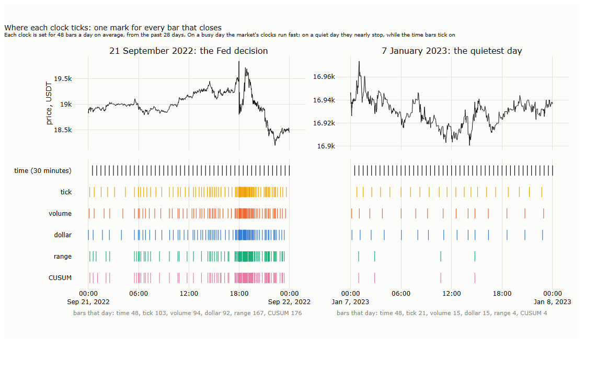
<b>How to read the figure.</b> <b>Axes.</b> Time of day, UTC (x). Top: price (y). Bottom: one row per clock. <b>Left:</b> 21 September 2022, the day of the Fed decision; <b>right:</b> 7 January 2023, the quietest day of the five years. The top panels show the BTCUSDT price through the day; below, each vertical mark is one bar closing on that clock: time (black), tick (yellow), volume (orange), dollar (blue), range (green) and CUSUM (pink). Every clock is set for 48 bars a day on average, from the past 28 days; the bar counts of each day are printed under the panels.

Time bars tick on regardless: 48 on both days. The market's clocks run twice as fast as usual on the busiest day (92 dollar bars, 167 range bars) and at a third of the usual pace on the quietest (15 and 4): they follow the market. The activity clocks bunch where trading is heavy, around the decision at 18:00 UTC; the price clocks bunch where the price moves, and almost stop on a day when it barely moves at all.

| § | Topic | Question |
|---|---|---|
| 1–2 | The bar and the instrument | What does the tape add, and what is traded? |
| 3 | The record | What does one row mean, and which orders stand behind it? |
| 4–5 | Getting and inspecting the data | How do we obtain five years of it, and can we trust it? |
| 6 | The market's activity | How much is traded, and when? |
| 7 | How prices form | How do trades turn into prices? |
| 8 | What a candle loses | What exactly does a bar throw away? |
| 9–10 | The market's clocks | Which clocks are there, do they differ, and are their returns closer to normal? |
| 11 | Imbalance bars *(deep dive)* | Does the published construction work, and what does a stable one look like? |
| 12 | Seasonality | Which calendar effects survive a test? |
| 13 | Backtesting on the tape | Which rules keep a replay honest? |

Deep dives can be skipped on a first reading; everything left out is in [E18](../extended/18-tick-data-the-tape/lecture.md) and [E19](../extended/19-bars-not-cut-by-time/lecture.md).

> **What to take away**
>
> 1. **The tape records every trade with its side:** the order flow that bars can only estimate (Lecture 3).
> 2. **Tick data must be checked before use, and nothing is deleted:** after repairs, 99.9988% of the trades Binance recorded are in the data; unusual prints stay in with a flag.
> 3. **Activity is uneven and risk is concentrated:** volatility follows the number of trades, and 1% of the minutes hold a third of five years' variance.
> 4. **We do not choose the time; we choose the clock, and the clock decides when we trade.** Activity clocks bring returns closer to normal, but not all the way.
> 5. **The calendar tells when, not which way.**

## 1. What a bar hides

Lecture 2 described a bar as compression: thousands of trades reduced to five numbers. The tape keeps it all: every price traded, the size of every trade, the millisecond, and who traded, recorded as whether the buyer or the seller was the aggressor, where Lecture 3 could only estimate it from the bar. One market gives hundreds of millions of rows a year, against 365 daily bars. The market throughout is the **BTCUSDT perpetual** on Binance: the most traded futures contract in crypto, open every hour of the year, with a free and complete public archive; the sample runs from October 2021 to September 2026.

## 2. The instrument: a perpetual future

A perpetual future is a futures contract that never expires. There is no roll, so none of the machinery of Lecture 10, §3, is needed. What replaces expiry is a payment that keeps the contract's price close to the price of the coin itself.

| Element | How it works on the BTCUSDT perpetual |
|---|---|
| Index, last and mark price | The index is a weighted average of the bitcoin price on several spot exchanges; the last price is that of the latest trade, what the tape records; the mark price is the index adjusted by a smoothed basis, used to trigger liquidations, so that one trade cannot force them |
| **Funding** | Every 8 hours, at 00:00, 08:00 and 16:00 UTC, longs pay shorts (or shorts pay longs, if the rate is negative) a percentage of their position: a fixed interest part of 0.01% per period and a premium part that rises when the contract trades above the index |
| **Liquidation** | When losses consume a position's margin, the exchange closes it with a market order; leverage of up to 125 times is allowed for small positions |
| Tick and lot | Prices move in steps of $0.10 (since February 2022; $0.01 before), quantities in steps of 0.001 bitcoin |

**Funding is the perpetual's carry**, paid in instalments, three times a day, on the positions open at those moments. Over the five years, 5,478 payments averaged 0.0066% each, 85% of them positive: longs paid shorts **7.3%** a year, about what a holder of crude oil futures lost through its rolls in Lecture 10 (6.9% a year). The sign reflects demand: more traders want to be long with leverage than short, and they pay for it.

**Liquidations are forced trades.** When the price moves fast, positions that run out of margin are closed with market orders, which push the price further and can liquidate the next layer. These are the liquidation cascades of Lecture 5, §3.2, here visible in the tape as bursts of aggressive trades on one side.

## 3. The record: what a row represents

### 3.1 An aggregated trade and its fields

A trade happens when an aggressive order meets a resting order. The resting order was waiting in the order book: its owner is the **maker**, who supplied liquidity. The aggressive order crossed the spread to take it: its owner is the **taker**. On USDⓈ-M futures, Binance combines all fills within 100 milliseconds at the same price on the same side into one aggregated trade.

| Field | Meaning |
|---|---|
| `agg_trade_id` | Sequence number of the aggregated trade, increasing by one: a gap is a missing trade (§5) |
| `price`, `quantity` | The price of the fills in USDT per bitcoin, and their total size in bitcoin; in dollars, price × quantity |
| `first_trade_id`, `last_trade_id` | The first and last single fill inside the aggregate |
| `transact_time` | Milliseconds since 1 January 1970, UTC |
| **`is_buyer_maker`** | **True: the buyer's order was resting, so the seller was the aggressor. False: the buyer was the aggressor.** The name inverts the usual reading, so it is safest to define a sign once: +1 for aggressive buying (`false`), −1 for aggressive selling (`true`) |

The first rows of September 2026:

| `price` | `quantity` | `is_buyer_maker` | Reading |
|---|---|---|---|
| 78549.6 | 0.025 | false | 3 ms after midnight UTC, a buyer takes 0.025 BTC ($1,964) at the ask, in 2 fills |
| 78549.5 | 0.016 | true | 13 ms later, a seller hits the bid 10 cents lower: 5 fills |
| 78549.6 | 0.038 | false | A buy at the ask again |

The price bounces between 78,549.5 and 78,549.6 as buyers take the ask and sellers hit the bid: the **bid-ask bounce**. Measured from trade to trade, the price seems to move although the market has not; §7.2 measures it.

**One month at a glance.** September 2026 holds 36.0 million aggregated trades, about 14 a second, worth $344 billion. The median trade is worth $232, the mean $9,532: most trades are small, and a few very large ones carry much of the volume. Buying and selling aggression balance over the month (50.0% of trades with an aggressive buyer), but not over minutes.

### 3.2 The orders behind the trades

Every row of the tape is the meeting of two orders, and the kind of order decides whether it trades at all, at what price, and whether it pays the maker or the taker fee. The fee follows what the order does, not its name: a limit order that can trade at once on arrival pays the taker fee; only the part that waits in the book pays the maker fee.

| Order | What the exchange does with it | Fee | Used in |
|---|---|---|---|
| **Market** | Trades the size at once against the best resting orders, walking deeper if needed; on Bybit, only within a band around the mark price | Taker | L19, L21 |
| **Limit** | Buys up to the size at the given price or lower (sells at it or higher); what can trade at once does, the rest waits in the book | Taker for the part that trades at once, maker for the part that rests | L18 §13, L20, L21, L23 |
| **Time in force** | GTC: rests until filled or cancelled. IOC: trades what it can at once, cancels the rest. FOK: the whole size at once or nothing | As above | L22 |
| **Post-only** | A limit order that must rest: if it would trade on arrival, it is cancelled | Always maker | L20, L23 |
| **Stop-market** | Waits, unseen in the book, until a trigger price is reached, then becomes a market order | Taker | L9, L10, L19 |
| **Stop-limit** | On the trigger, becomes a limit order: the price is capped, the fill is not guaranteed | Taker or maker | L19 |
| **Take-profit**, **trailing stop** | A stop triggered by a move in the position's favour; a stop whose trigger follows the best price reached, at a set distance | As the stop | L9 |
| **Reduce-only** | Can only shrink a position, never open or reverse one | As the order | L23 |
| **Iceberg, TWAP** | Strategies run by the exchange's servers: slices placed one after another, or at fixed intervals | Per slice | L21 |
| **Liquidation** | When the mark price reaches a position's liquidation price, the exchange closes it at the market | Forced | L19, L21 |

<b>How to read the table.</b> One row per type, as documented by Bybit and Binance USDⓈ-M (Bybit, n.d.; Binance, n.d.), checked in October 2026; the venues' own API names are in E18 §3.4. GTC: good till cancelled; IOC: immediate or cancel; FOK: fill or kill; TWAP: time-weighted average price. "Used in": the lectures that rely on the type, in the current numbering.

**Which price fires a stop.** The last traded price can be pushed through a stop by a single large trade in a thin book; the mark price (§2) cannot, and both venues let the trader choose it. Liquidations always use the mark price. In a cascade the choice decides whether a stop is set off by the spike or only by the move it belongs to. Lecture 19 ([E20 §4.3](../extended/20-volatility-and-the-path/lecture.md)) measures what a stop pays once it fires; Lecture 21 ([E24 §1.3](../extended/24-the-order-book/lecture.md)) shows where in the exchange each rule is applied.

## 4. Getting the data

Binance publishes its market data as daily and monthly files at data.binance.vision, free and without an account: single fills (`trades`), **aggregated trades (`aggTrades`)**, candles (`klines`), the best bid and ask (`bookTicker`) and funding. Single fills multiply the number of rows by about 2.7 without adding information a trader can act on, so aggregated trades are the standard unit for research on the tape. The data are kept as Parquet, a compressed column format:

| Step | What |
|---|---|
| 1. Download one month | `BTCUSDT-aggTrades-YYYY-MM.zip` from `futures/um/monthly/aggTrades/BTCUSDT/` |
| 2. Verify | Compare the file's SHA-256 hash with the `.CHECKSUM` file published next to it |
| 3. Convert | Read the CSV with explicit column types, write Parquet with zstd compression |
| 4. Check the Parquet file | Same number of rows as the CSV; trade identifiers increase by exactly one; no timestamp earlier than the one before |
| 5. Delete the zip, log the month | Only after step 4 passes, into a manifest of what was checked |

**Sizes.** September 2026 alone: 437 MB as a zip, 285 MB as Parquet, converted and checked in 77 seconds. The five years come to about 20 GB of Parquet.

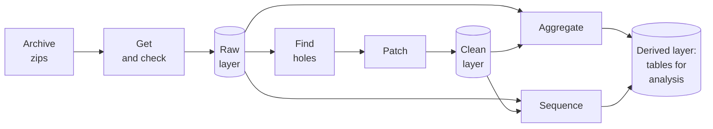

Four principles make the pipeline repeatable: the raw layer is never changed; every correction is a separate, logged file; every stage can be rerun alone; and memory is bounded by design, one chunk and one job at a time. The tools (the Polars library, chunked statistics, each stage's memory and time) are in [E18, Appendix A](../extended/18-tick-data-the-tape/lecture.md).

## 5. Inspecting the data

### 5.1 The process, and what it found

| Step | What it does |
|---|---|
| 1. Check on arrival | Checksum, row count, ID continuity, time order (§4) |
| 2. Find holes | Lists every jump and every repeat in the trade IDs across all files |
| 3. Fix from a second source | Fills holes from the daily files; each patch must close its hole exactly: a fix that cannot be verified is not a fix |
| 4. Flag | Runs a fixed set of rules on every day and records every hit |
| 5. Inspect the flags | Tests what each kind of flag really is, and whether the rule itself is right: a flag is a question, not a verdict |
| 6. Record what remains | States every hole that could not be filled and every flag left unexplained |

Nothing is deleted at any step. A trade in the exchange's own record almost certainly happened, even when it looks strange; the flags describe it, and each analysis states which flagged trades it uses. The literature on high-frequency data applies the same principles to stock-market data (Brownlees and Gallo, 2006; Dacorogna et al., 2001).

| Issue | What was done |
|---|---|
| **Eight days missing** from Binance's monthly files, in August to November 2022 | Filled from the daily files; each patch closes its hole exactly: for 28–30 August, 1,065,533 + 1,407,753 + 1,504,285 = 3,977,571 trades, the size of the jump |
| **Two days duplicated**: 12 and 13 September 2022 | Each trade kept once in the clean month |
| **Six minutes missing from the whole archive**: 6 September 2022, 17:14–17:20 UTC, about 31,600 trades | Cannot be filled; flagged, and left out by every analysis that needs a complete day |
| **Exchange outages**: seven silences of more than a minute, the longest 35 minutes (28 May 2022) | Recorded; times when nobody could trade |
| **Prices off the tick grid** after the change to $0.10: about 294,000 trades | Kept: real trades, forming ladders of orders, the fingerprint of a grid-trading bot |

<b>How to read the table.</b> One row per kind of problem found over the five years, and what was done; nothing was deleted.

### 5.2 The flag register

Over five years, 2.6 billion trades on 1,826 days:

| Flag | Rule | Count | Days |
|---|---|---|---|
| Unusual print, reverting | At least 0.5% from the median of the 50 trades before it, and more than ten of their standard deviations; the next trades return | 456 | 118 |
| Unusual print, persisting | The same distance, but the price stays | 1,597 | 187 |
| Very large trade | Over $5 million | 42,014 | 1,753 |
| Activity burst | A minute with more than 20 times the day's median number of trades | 3,195 minutes | 929 |

<b>How to read the table.</b> One row per flag rule: how many trades (or minutes) it flags, and on how many of the 1,826 days. The rules for missing trades, silences and prices off the tick grid are in E18 §5.3.

The days with the most unusual prints are recognisable: 21 September 2022, when the Federal Reserve raised rates by 0.75 points; 13 September and 13 October 2022, US inflation releases; 4 December 2021, a weekend crash; 10 October 2025, a day of record liquidations. A rule that singles out these days is measuring stress, not noise.

**A rule must be tested too.** The first version of the unusual-print rule measured distance only in local standard deviations. When the last 50 trades were all at the same price, a one-tick move counted as extreme: the rule flagged 109,000 trades, almost all of them trivial. Adding a minimum distance in price, 0.5%, is the "granularity" term of Brownlees and Gallo (2006); with it, the rule flags 2,053 trades, concentrated on the days above.

### 5.3 Unusual prints, tested

A flagged trade can be a fast market, a poor execution in a thin book, or an error. Four tests on the tape alone tell them apart:

| Test | Error | Genuine fast market |
|---|---|---|
| Persistence: where is the price a few trades later? | Back where it was | Near the new level, or further |
| Path: were the prices in between traded? | One isolated jump | The price walks through the levels |
| Participation: how much trading surrounds it? | One trade, often small | Many trades, real volume |
| Order flow: does the side fit the move? | Random | Aggressive selling on the way down, buying on the way up |

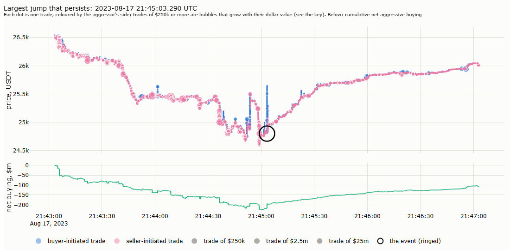
<b>How to read the figure.</b> <b>Axes.</b> Time, UTC (x). Top: trade price (y). Bottom: net aggressive buying (y). Every trade on BTCUSDT two minutes either side of the largest persisting print, 17 August 2023, one dot per trade: blue when the buyer was the aggressor, pink when the seller was. Trades of USD 250,000 or more are drawn as bubbles that grow with their dollar value; the black ring marks the flagged print. <b>Bottom:</b> cumulative net aggressive buying from the start of the window, in USD millions.

| | Largest persisting print: 17 August 2023, 21:45:03 UTC | Largest reverting print: 6 September 2022, 17:12:26 UTC |
|---|---|---|
| The print | $24,800, 3.1% below the median of the trades before it | $28,368.26, 48% above a market at about $19,100, at a two-decimal price |
| Persistence | 98% of the fall still there ten trades later; recovered, and more, within a minute | Gone at once |
| Path | A gap of 2.3% between two consecutive trades | Nothing traded in between |
| Participation | 26 times the usual number of trades, 33 times the dollars | 14 times the usual trades |
| Order flow | Mixed: 46% of aggressive volume in the direction of the fall | Mostly against the move: 29% |
| Reading | A flash crash through an empty book: forced selling gapped the price down, then it snapped back | The closest to an erroneous print in five years: isolated, far away, instantly reversed, and two minutes before the six minutes missing from Binance's own archive |

<b>How to read the table.</b> The four tests applied to the two most extreme flagged prints; the last row is our reading. E18 §5.4 draws the second as well.

**Neither is deleted.** The first is the market; the second is in the exchange's record and stays there, with its flag; where a measure reacts strongly to a single extreme, the result is shown with the outliers marked (§8.2). Two other flags are extreme without being suspicious: the largest single trade, $118.9 million at one price on 27 April 2026, met by resting orders at a single level; and the busiest minute, 21 September 2022 at 18:01 UTC, just after the Fed decision, at 62 times the day's usual pace of trades ([E18 §5.4](../extended/18-tick-data-the-tape/lecture.md)).

## 6. The market's activity

### 6.1 Activity over five years

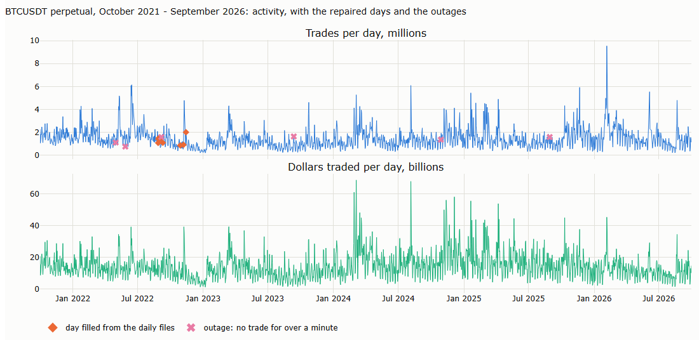
<b>How to read the figure.</b> <b>Axes.</b> Day (x). Top: trades per day, millions (y). Bottom: dollars traded per day, USD billions (y). BTCUSDT perpetual, October 2021 to September 2026. Orange diamonds mark the days filled from the daily files (§5.1); pink crosses mark the outages, days with no trade for more than a minute.

| | Trades per day | Dollars per day |
|---|---|---|
| Median | 1.3 million | $13.0 billion |
| Busiest | 9.5 million | $68.8 billion (5 March 2024) |
| Quietest | 189,000 (7 January 2023) | |
| Average by year | 1.1 million (2023) to 1.6 million (2021, 2026) | $11.5 billion (2023) to $17.8 billion (2024) |

<b>How to read the table.</b> Daily totals over the five years: the typical day, the extremes, and the range of the yearly averages.

Activity moves in regimes, and the number of trades and the dollars traded do not move together: in 2026 there are as many trades as in 2021 but fewer dollars. A bar that closes after a fixed number of trades or dollars therefore means something different in different years, which §9.3 takes up.

### 6.2 Time of day, and the funding times

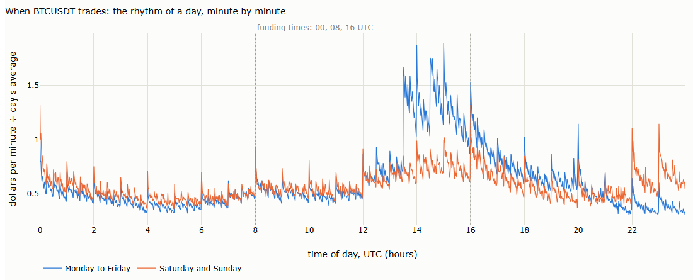
<b>How to read the figure.</b> <b>Axes.</b> Minute of the day, UTC (x); dollars traded in that minute divided by the day's average minute (y). Averaged over the five years, separately for Monday to Friday (blue) and for Saturday and Sunday (orange). A value of 1 is the day's average pace. Dotted vertical lines mark the funding times, 00:00, 08:00 and 16:00 UTC.

| Measure | Benchmark | Result |
|---|---|---|
| Busiest hour: share of weekday dollars | 1/24 = 4.2% | 14:00–15:00 UTC, 8.6% |
| Quietest hour | 4.2% | 23:00–00:00 UTC, 2.6% |
| Busiest minutes, relative to the day | 1 | 15:00, 14:00, 14:30, 13:31 UTC: 1.7 to 1.9 times the average |
| Weekends: dollars per day, relative to a weekday | 1 | 0.51 |

<b>How to read the table.</b> Each row compares a part of the day or week with an even spread of trading (Benchmark).

Crypto trades around the clock, but not evenly: the US afternoon dominates, and the quietest hour has a third of the busiest one's activity. The US stock market opens at 13:30 or 14:30 UTC, depending on daylight saving time, and US economic data are released at 12:30, 13:30, 14:00 or 15:00 UTC: bitcoin trades on the US calendar (§12.3). Weekends have half the activity: the professional participants trade on working days.

**Do traders trade around funding?** Funding is paid only on positions open at the funding times (Binance, funding rate FAQ). When funding is high, a long has a reason to close shortly before the payment and reopen after. The test compares the ten minutes before and after each of the 5,477 funding times:

| Funding rate at the payment | Payments | Net aggressive buying, 10 minutes before | 10 minutes after |
|---|---|---|---|
| Above the default 0.01%: longs pay most | 395 | −2.8% (± 0.8%) | −1.0% (± 0.8%) |
| Exactly 0.01% | 1,605 | −1.0% (± 0.4%) | −0.8% (± 0.4%) |
| Positive, below 0.01% | 2,674 | +0.2% (± 0.4%) | +0.1% (± 0.4%) |
| Zero or negative: shorts pay | 803 | −0.8% (± 0.6%) | +1.1% (± 0.6%) |

<b>How to read the table.</b> Net aggressive buying: aggressive buys minus aggressive sells, as a share of the dollars traded; in brackets, the standard error. Over all days, the average is −0.4%.

When funding is highest, net aggressive selling before the payment is about three standard errors from the average, and it fades after. This is consistent with longs closing positions to avoid the payment, but it is small, and it is one result among four groups: a hypothesis, not a finding. Around the payments the price moves by a few basis points, much smaller than the cost of trading them: a round trip pays the fee for aggressive orders twice, 0.05% each way on the standard tier (Binance, fee schedule) ([E18 §6.2](../extended/18-tick-data-the-tape/lecture.md)).

**Waits, sizes and sides, in brief** ([E18 §6.3–§6.5](../extended/18-tick-data-the-tape/lecture.md)). 51% of trades share their millisecond with the previous trade, and waits cluster (a correlation of 0.45 between one wait and the next): the market has its own clock. 55% of trades are worth under $1,000, while the largest 1% carry 34% of the dollars: a count of trades describes the small traders, a sum of dollars the large ones, the difference between tick and dollar bars (§9). Aggressive buying is 49.8% of each day's dollars on average, yet the correlation between the day's aggressive buying and the day's return is 0.66: flow and price move together, which does not mean that flow predicts the price.

## 7. How prices form

### 7.1 Order flow persists, prices do not

Is a buy more likely to be followed by another buy? On stock markets, yes: the signs of trades are correlated over thousands of trades, and the correlation fades like a power law, roughly as lag^−0.6 on the London Stock Exchange (Lillo and Farmer, 2004). The main cause is **order splitting**: a large investor cuts a large order into many small ones, all on the same side. Because Binance merges fills into rows, the measures below use lags of five trades or more, per trade and per order (trades in the same millisecond on the same side merged), and the net aggressive dollars of each second.

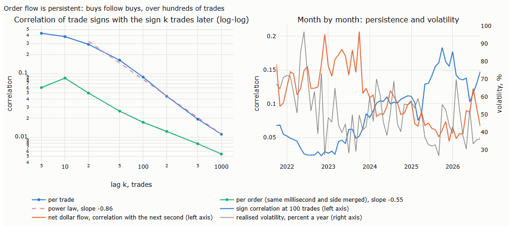
<b>How to read the figure.</b> <b>Axes.</b> Left: lag k in trades (x, log); sign correlation (y, log). Right: month (x); correlation (left y), realised volatility, % a year (right y). <b>Left:</b> correlation of a trade's sign (+1 buy, −1 sell) with the sign k trades later, over the five years, per trade (blue) and per order, with trades in the same millisecond on the same side merged (green); the pink dashed line is a power law fitted to the per-trade curve. <b>Right:</b> month by month, the sign correlation at 100 trades (blue) and the correlation of one second's net dollar flow with the next second's (orange), both on the left axis, and realised volatility (grey) on the right axis.

| Measure | Result | What it means |
|---|---|---|
| Sign correlation, per trade, 10, 100 and 1,000 trades later | 0.39, 0.09, 0.01; slope −0.86 | Buys follow buys over hundreds of trades; the correlation fades slowly, without a cut-off |
| Sign correlation, per order | 0.09, 0.02, 0.005; slope −0.55 | Weaker, but the slope is close to the −0.6 of stocks: the same slow decay |
| Net dollar flow, one second to the next | 0.11; 0.03 at 10 seconds, 0.006 at a minute | Persistent in money too, over a few seconds |
| Returns, one second to the next | 0.06 | Much weaker than the flow |

<b>How to read the table.</b> Correlations over the five years; 0 would mean no persistence. Compare the last two rows: the flow is persistent, the returns much less.

The last two rows contain the central puzzle of this literature: the flow is predictable, at least a little, and the price almost not. The explanation is that liquidity adapts: when a run of buying is under way, sellers expect more of it, place more resting orders, and each new buy moves the price less. The impact of a trade is not permanent but fades over time, and the persistence of the flow and the fading of the impact offset each other (Bouchaud, Gefen, Potters and Wyart, 2004). What moves prices is the part of the flow that was not expected. Lecture 19 asks whether that part can be measured and used, and what it costs to trade against it: the impact of one's own orders, which grows roughly with the square root of their size, on bitcoin as on other markets (Donier and Bonart, 2015).

### 7.2 The bid-ask bounce and the signature plot

From one trade to the next, returns have a correlation of −0.65: the price alternates between the bid and the ask, so trade-to-trade returns are mostly noise. From one second to the next the bounce has gone (+0.07).

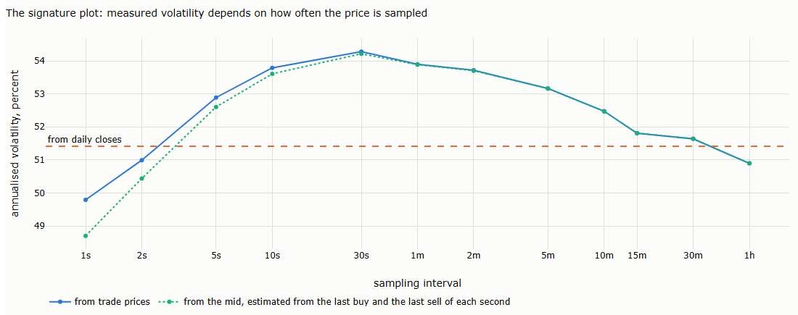
<b>How to read the figure.</b> <b>Axes.</b> Sampling interval, one second to one hour (x, log); annualised volatility, percent (y). Realised volatility averaged over the five years, measured from returns at each interval: from trade prices (blue) and from the mid estimated from the last buy and the last sell of each second (green, dotted). The orange dashed line is the volatility of daily close-to-close returns. A flat curve would mean returns are independent.

Realised volatility adds up squared returns over short intervals. The chart, a **signature plot** (Andersen, Bollerslev, Diebold and Labys, 2000), shows annualised volatility for each interval:

| Sampling interval | 1 second | 30 seconds | 5 minutes | 1 hour | Daily closes |
|---|---|---|---|---|---|
| From trade prices | 49.8% | 54.3% | 53.2% | 50.9% | 51.4% |
| From the mid, estimated | 48.7% | 54.2% | 53.2% | 50.9% | |

<b>How to read the table.</b> Annualised realised volatility at each sampling interval. If returns were independent, every interval would give the same answer; where it rises with the interval, moves continue; where it falls, they reverse.

For many stocks, the textbook curve is highest at the shortest intervals, where the bid-ask bounce adds noise. Here the bounce is too small to matter (half a tick is $0.05 on a price of $20,000 or more), and the estimated mid differs from trade prices only at one second. What the curve shows instead is continuation over the first 30 seconds and a slight reversal beyond; Hansen and Lunde (2006) report that microstructure noise is correlated with changes in the underlying price, which can produce a curve of this shape. The spread estimated from the last buy and sell of each second is one tick in 77% of the seconds in which both sides trade, but reaches 5.8 basis points on the worst day: the bounce matters exactly when the market is under stress.

### 7.3 What drives large moves

The tape splits volume into two parts: how many trades, and how large each one is. For stocks, prices move with the rate at which information arrives, measured well by the number of trades (Clark, 1973); hour by hour, volatility follows the number of trades, and the average trade size adds almost nothing (Jones, Kaul and Lipson, 1994).

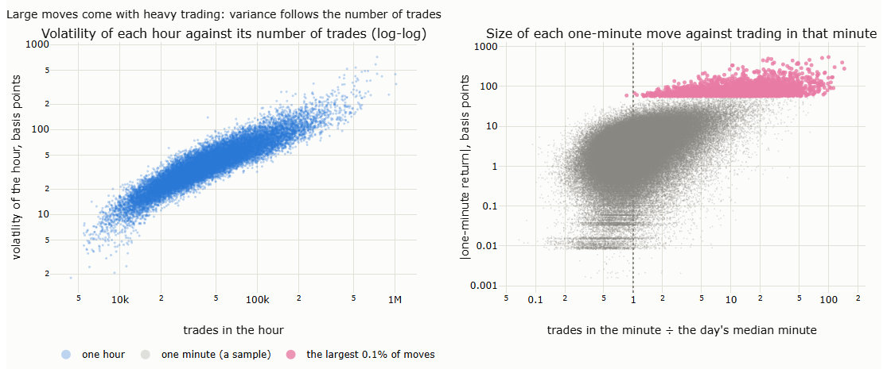
<b>How to read the figure.</b> <b>Axes.</b> Left: trades in the hour (x, log); volatility of the hour, basis points (y, log). Right: trades in the minute ÷ day's median minute (x, log); size of the one-minute return, basis points (y, log). <b>Left:</b> one dot per hour of the five years (blue), its volatility measured from one-minute returns. <b>Right:</b> a sample of one-minute moves (grey), with the largest 0.1% of moves shown in pink; the dotted vertical line at 1 marks a minute with the day's median number of trades.

| Explaining the variance of an hour by… | Share of the variation explained (R²) |
|---|---|
| The number of trades | 85% |
| The average trade size | 1% |
| Dollar volume | 74% |
| The number of trades and the average size together | 85% |

<b>How to read the table.</b> Each of the 43,818 hours of the five years; the regression uses logarithms: the logarithm of each hour's variance on the logarithms of the explanatory variables.

BTCUSDT behaves like the stocks of Jones, Kaul and Lipson. The coefficient on the number of trades is 1.5: an hour with twice the trades has about 2.8 times the variance; in busy hours each trade moves the price more. The number of trades is the market's clock, the observation behind the bars of §9 (Ané and Geman, 2000).

A large one-minute move almost never happens in a quiet minute: the largest 0.1% of moves, 57 basis points or more, came with 13.3 times the trades of the day's median minute, and of the 2,630 largest moves of the five years, one happened in a minute with less trading than usual. Heavy trading and thin books are not alternatives: when the price starts to move, stop orders and liquidations add trades, and resting orders are withdrawn.

| Minutes | Share of all minutes | Share of the variance |
|---|---|---|
| The largest 0.1% of moves | 0.1% | 17% |
| The largest 1% of moves | 1% | 37% |
| The busiest 1% of minutes, by number of trades | 1% | 22% |
| The bursts flagged in §5 (more than 20 times the day's median minute) | 0.12% | 10% |

<b>How to read the table.</b> Each row picks a small set of minutes and gives the share of five years' variance of one-minute returns they hold; an even spread would give the same share in both columns.

A third of the risk of five years sits in 1% of its minutes. A volatility estimate that misses those minutes, or a backtest that assumes trading in them at normal cost, misses much of the risk. Lecture 19 studies these minutes: how cascades start, and whether trades trigger further trades.

## 8. What a candle loses

### 8.1 Order flow from a candle

Lecture 3, §7 estimated order flow from bars. The **tick rule** gives all of a bar's volume to buyers if the close rose and to sellers if it fell. **Bulk volume classification** (Easley, López de Prado and O'Hara, 2012) splits the volume by the size of the move: the share bought is Φ(return ÷ volatility), with the volatility measured over past bars only. The tape gives the true answer for every bar:

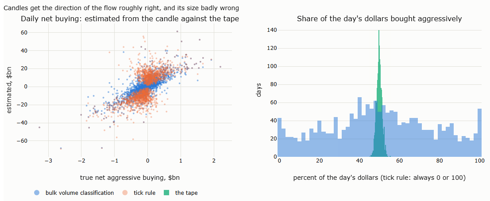
<b>How to read the figure.</b> <b>Axes.</b> Left: true net aggressive buying, USD billions (x); estimate from the candle, USD billions (y). Right: percent of the day's dollars bought aggressively (x); number of days (y). One observation per day over the five years. <b>Left:</b> one dot per day, estimated by bulk volume classification (blue) and by the tick rule (light orange); a perfect estimate would lie on the diagonal. <b>Right:</b> histograms of the share bought aggressively, estimated by bulk volume classification (blue) and true from the tape (green); the tick rule is not drawn, since it always gives 0 or 100.

| Measure | One minute | One hour | One day |
|---|---|---|---|
| Direction right: share of bars where the estimate has the sign of the true net buying | 77% | 79% | 79% |
| Correlation with true net buying: tick rule / bulk volume classification | 0.74 / 0.78 | 0.67 / 0.73 | 0.67 / 0.78 |
| Error in the share bought: tick rule / bulk volume classification | 38 / 13 points | 47 / 14 points | 49 / 19 points |
| True imbalance: typical net buying, share of the bar's dollars | 27% | 6% | 1.8% |
| Imbalance estimated by bulk volume classification | 37% | 33% | 39% |

<b>How to read the table.</b> Each row compares an estimate from the candle with the truth from the tape, on bars of one minute, one hour and one day. Compare the last two rows: the true imbalance shrinks as bars get longer, the estimated one does not.

The candle gets the direction of the flow right four times in five, and its size badly wrong: on a typical day, bulk volume classification estimates more than twenty times the true imbalance, and the tick rule assumes 100%. The candle only knows that the price moved.

### 8.2 Volatility from a candle

Lecture 3, §4.4 argued that every range estimate is biased down. The tape gives the benchmark: realised volatility from five-minute returns (§7.2), compared over 28-day windows:

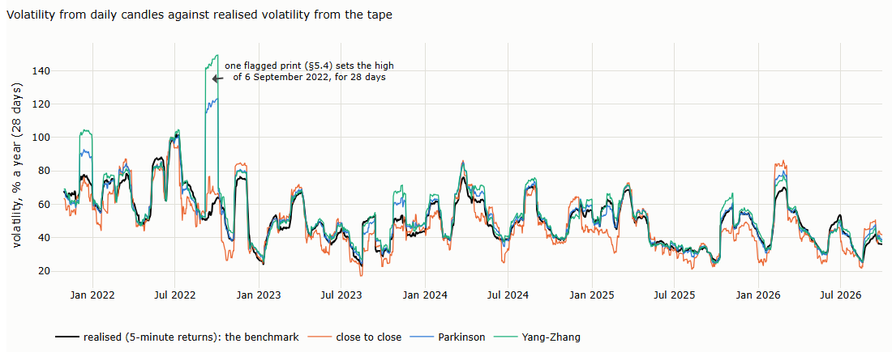
<b>How to read the figure.</b> <b>Axes.</b> Date (x); volatility over the past 28 days, % a year (y). Realised volatility from five-minute returns on the tape (black), the benchmark, against three estimators from daily candles: close to close (orange), Parkinson (blue) and Yang–Zhang (green). The arrow marks the 28 days after 6 September 2022, when one flagged print (§5.3) set the day's high.

| Estimator | Uses | Level relative to realised volatility | Typical error over 28 days | Correlation with realised variance, day by day |
|---|---|---|---|---|
| Close to close | Closes | 0.97 | 15% | 0.53 |
| Parkinson | High, low | 1.06 | 11% | 0.91 |
| Garman–Klass, Rogers–Satchell | Open, high, low, close | 1.09, 1.12 | 12%, 14% | 0.92, 0.90 |
| Yang–Zhang | All four, with the gap between the previous close and the open | 1.10 | 13% | — |

<b>How to read the table.</b> Level: the estimator's average variance over its windows relative to realised, as a volatility. Typical error: the standard deviation of the logarithm of the ratio. Yang–Zhang is defined over a window, not for one day.

The range-based estimators track realised variance far better than the close alone, but on this market they overstate volatility by 6% to 12%: the tape records every trade, so the downward bias of discrete sampling is gone, and the high and low include brief extremes that realised variance at five minutes smooths away. **One print can dominate:** on 6 September 2022, the isolated print at $28,368 set the day's high. Parkinson's estimate for that day is 548% a year; realised volatility, 61%.

### 8.3 The close against the average price

The **volume-weighted average price (VWAP)** is the average price of all the bar's trades, weighted by size: the price a patient trader, spreading an order over the bar, would roughly have paid. The daily close lies 0.66% (66 basis points) from the daily VWAP on a typical day, and more than 2.2% one day in ten; within a minute the two differ by 1.5 basis points. Daily returns close to close and VWAP to VWAP have a correlation of 0.67, and volatilities of 51% and 42% a year. A backtest of a daily strategy that trades at the close, as in Parts I and II, assumes a price that only the last trade of the day got.

### 8.4 Summary: what a candle loses

| The candle reports | What it loses | Evidence |
|---|---|---|
| Open and close | Everything between: the close differs from the day's average traded price by 0.66% on a typical day | §8.3 |
| High and low | Whether the extremes were traded or touched: brief spikes and flagged prints set them, and range-based volatility is 6% to 12% too high | §8.2 |
| Volume | Which side was aggressive, and by how much: estimates get the direction four times in five and overstate the imbalance twentyfold | §8.1 |
| One shape per bar | The path and the flow inside it: identical candles can hold opposite flows | E18 §8.2 |
| Four prices | Where the trading happened, and which side pressed at each price | E18 §8.6 |
| A published series | Its own conventions and errors: Binance's candles miss 192 minutes of trading | E18 §8.1 |

<b>How to read the table.</b> One row per part of a candle: what it reports, what it leaves out, and where the evidence is, in this lecture or in the extended lecture [E18](../extended/18-tick-data-the-tape/lecture.md).

## 9. Bars on the market's clocks

Every bar closes when a counter reaches a threshold. For a one-hour bar the counter is seconds, and the threshold is 3,600. The counter can be anything that rises as the market trades: the number of trades, the dollars traded, the distance the price has moved. This counter is the bar's **clock**: business or intrinsic time (Mandelbrot and Taylor, 1967; Dacorogna et al., 2001), the transaction clock (Ané and Geman, 2000), the volume clock (Easley, López de Prado and O'Hara, 2012).

**Why change the clock.** Activity is very uneven, and volatility follows the number of trades, not the passing of time (§7.3). A bar that closes after a fixed amount of trading should hold a more constant amount of information, and its returns should be closer to the normal distribution (Clark, 1973; Ané and Geman, 2000). The claim is contested on stock data (Murphy and Izzeldin, 2005); §10 tests it on ours.

### 9.1 The four families

| Family | The counter | A bar closes when… | Examples |
|---|---|---|---|
| **Time** | Seconds | a fixed time has passed | One-minute, one-hour, daily bars |
| **Activity** | Trades, coins or dollars | a fixed amount of trading has happened | Tick, volume and dollar bars |
| **Information** | One-sided trading | buying or selling has become more one-sided than usual | Imbalance and run bars |
| **Price** | Price movement | the price has moved a fixed distance | Range bars, Renko bricks, the CUSUM filter |

Every family still produces bars with an open, high, low, close and volume: what changes is only when a bar ends. Dollar bars represent the activity family, as López de Prado (2018, ch. 2) recommends: tick bars change with what counts as one trade, and a coin is worth very different amounts over time. The CUSUM filter (Page, 1954) is a sampling rule rather than a bar: a trigger for *when to look*. Three rules apply to every clock: a bar is known only when it closes, and an order sent on it fills at a later trade (§13); thresholds use past data only; and clocks are compared at the same number of bars per day, since a clock that closes more often looks smoother only because it is finer.

### 9.2 One rule for every clock

A counter runs through the trades, and a bar closes at the trade that takes it past a threshold:

| Clock | The counter | The threshold on day *t* |
|---|---|---|
| Time | Seconds | 30 minutes |
| Tick | Trades | Median number of trades per day over days *t*−28 to *t*−1, divided by 48 |
| Volume | Bitcoin traded | The same, for bitcoin |
| Dollar | Dollars traded | The same, for dollars |
| Range | High minus low of the bar, in log price | A fixed multiple of the typical daily volatility over days *t*−28 to *t*−1, divided by √48 |
| CUSUM | The cumulative move since the last event, up or down (Page, 1954) | The same form as for range bars |

<b>How to read the table.</b> 48 bars a day is the target for every clock: the number of 30-minute bars in a day, so that all clocks are compared at the same frequency.

A bar does not break at midnight. The two price clocks are scaled once, on the first three months of data, October to December 2021, so that they produce as many bars as the dollar clock there, and never changed: 1.43 for range bars, 1.44 for CUSUM. Over the five years the clocks produce 48.0 (time) to 57.3 (range) bars a day: slightly above target, since a few very busy days lift the average above the median. How each clock runs through a week is in [E19 §3.2–§3.3](../extended/19-bars-not-cut-by-time/lecture.md).

### 9.3 Thresholds from the past

| Dollar bars per day | 2021 | 2022 | 2023 | 2024 | 2025 | 2026 |
|---|---|---|---|---|---|---|
| Fixed threshold | 44.7 | 38.8 | 34.9 | 53.6 | 50.6 | 35.4 |
| Adaptive threshold | 49.3 | 50.1 | 55.0 | 53.0 | 50.1 | 50.1 |

<b>How to read the table.</b> A fixed threshold is set once, from the first 28 days; the adaptive one is the median of the past 28 days. 2021 covers October to December. The target is 48 bars a day.

A fixed threshold makes a bar mean something different each year: in the quiet year 2023 it produces a third fewer bars than in 2024. The adaptive threshold keeps about three weeks in four within 25% of the target, against half the weeks with the fixed threshold. **Is 28 days a lucky choice?** A setting that works only at one value is a fitted parameter, not a method (Lecture 7, §6). With a window of 14, 28 and 56 days, 74%, 74% and 65% of weeks lie within 25% of the target: any window from two to four weeks works.

### 9.4 A price clock needs a price

The first version of the range clock read every trade, and on the day of the Fed decision it produced over a thousand bars in the ten minutes after 18:00. The trades were real; the clock was not measuring what it should. At 18:00:02.805 UTC, a single sell order filled at 49 prices, from $20,090 down to $19,880, 1% of the price, in one millisecond; moments later buy orders swept it back. A clock that reads every fill counts each of these sweeps as a move of 1%. (The largest sweep of the five years, two seconds after the low of the crash of 10 October 2025, filled one buy order at 407 prices, 2.8% in one millisecond: [E19 §3.5](../extended/19-bars-not-cut-by-time/lecture.md).)

**Why it explodes, and why one price per second does not.** A range bar closes each time the price has moved a fixed distance *R*, so the number of bars in a day is roughly the day's realised variance divided by *R*²: a range clock counts variance. Measured from every fill, realised variance contains a noise term that grows with the number of observations (§7.2). In a burst, the count follows the number of fills instead of the movement of the price. Measured at a resolution where the signature plot is flat, the noise term is negligible. The price clocks therefore follow one price per second, the volume-weighted average price of that second's trades.

| The clock's price | Busiest day ÷ typical day | Fed decision ÷ typical day | Bars of three trades or fewer |
|---|---|---|---|
| Every fill | 109 | 109 | 21% |
| 100 milliseconds | 11 | 6.9 | 0% |
| 1 second | 9.9 | 3.9 | 0% |
| 30 seconds | 5.9 | 2.2 | 0% |

<b>How to read the table.</b> Range bars at 48 a day on 62 days spread over the five years; typical day: the median of the 62 days. The busiest day had 25 times the typical day's realised variance, the Fed decision 7.8 times: a clock that counts variance should not exceed these ratios. E19 §3.5 adds 5 seconds and the CUSUM clock, with the same picture.

Every fill fails: a hundredfold explosion and a fifth of the bars made of three trades or fewer. Every resolution from 100 milliseconds to 30 seconds works. The rule that carries over to any market: a price clock samples the price where the signature plot is flat.

## 10. Do the clocks differ, and are returns closer to normal?

### 10.1 The clocks fall into three groups

Count each clock's bars hour by hour over the five years, and correlate the counts: clocks that close their bars in the same hours are, for practical purposes, the same clock.

| Correlation of bars per hour | Tick | Volume | Dollar | Range | CUSUM |
|---|---|---|---|---|---|
| Tick | 1 | 0.93 | 0.92 | 0.89 | 0.88 |
| Volume | | 1 | 0.96 | 0.83 | 0.82 |
| Dollar | | | 1 | 0.82 | 0.80 |
| Range | | | | 1 | 1.00 |
| *Dollars per bar: dispersion (standard deviation ÷ mean); time bars 1.20* | 0.39 | 0.31 | 0.29 | 0.83 | 0.84 |

<b>How to read the table.</b> Correlation of the number of bars each clock closes in each hour; 1 means the two clocks close their bars in the same hours. Time bars close twice every hour, so their count does not vary. The last row: how unequal the dollars per bar are (0 would mean every bar holds the same dollars).

The clocks fall into three groups: **time bars**, whose dollars per bar vary by more than their own average; **the activity clocks** (tick, volume, dollar), which close in the same hours, dollar bars with a quarter of the dispersion of time bars; and **the price clocks** (range, CUSUM), the same clock twice, shortest in a burst and longest in a calm, as in the opening figure. Activity and price clocks differ more (0.80 to 0.89): a busy hour is not always a volatile one. One clock represents each group from here on: **dollar bars**, **range bars**, and **time bars** as the benchmark.

### 10.2 Are returns closer to normal?

The test uses the return from one bar's close to the next on each clock, all at about 48 bars a day over the same five years.

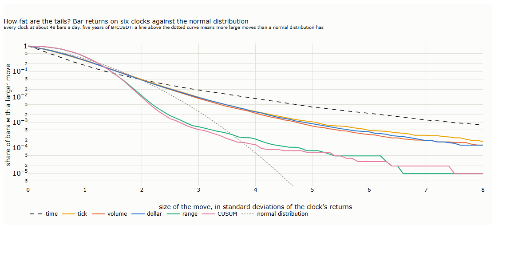
<b>How to read the figure.</b> <b>Axes.</b> Size of the move, in standard deviations of the clock's own returns (x); share of bars with a larger move (y, log). Bar-to-bar returns of BTCUSDT over the five years, every clock at about 48 bars a day: time (black, dashed), tick (yellow), volume (orange), dollar (blue), range (green) and CUSUM (pink). The grey dotted curve is the normal distribution; a line above it has more large moves than the normal distribution allows.

| Measure | Normal distribution | Time | Tick | Volume | Dollar | Range | CUSUM |
|---|---|---|---|---|---|---|---|
| Excess kurtosis: how fat the tails are | 0 | 23.8 | 4.3 | 2.6 | 4.4 | −1.0 | −1.1 |
| Moves beyond 4 standard deviations, per 10,000 bars | 0.6 | 86 | 27 | 23 | 26 | 2.2 | 1.3 |
| Skew: whether large moves lean one way | 0 | −0.33 | −0.04 | −0.01 | −0.04 | 0.01 | 0.01 |
| Return, one bar to the next: correlation | 0 | −0.01 | −0.02 | −0.02 | −0.02 | 0.00 | 0.00 |
| Squared return, one bar to the next: volatility clustering | 0 | 0.22 | 0.28 | 0.26 | 0.25 | 0.35 | 0.33 |

<b>How to read the table.</b> One row per property of bar-to-bar returns, one column per clock; the first column is what independent, normally distributed returns would give. Excess kurtosis is the fourth moment of the standardised returns minus 3.

**The activity clocks bring returns much closer to normal, but not all the way.** On 30-minute bars, moves beyond four standard deviations happen 140 times as often as under the normal distribution; on dollar bars, a third as often as on time bars, and the lean towards large falls almost disappears. This is the effect Mandelbrot and Taylor (1967), Clark (1973) and Ané and Geman (2000) predicted: much of the fat tail of time-bar returns comes from bars that hold very different amounts of trading. The tails that remain are still forty times the normal, as Murphy and Izzeldin (2005) found on stock data.

**The price clocks are thin-tailed by construction, not by nature.** A range bar closes when the price has moved a set distance, so most of its returns are close to that distance by design; the rare large returns that remain are gaps, as in a sweep (§9.4).

**Volatility clustering stays on every clock**, with correlations of 0.22 to 0.35 between successive squared returns: a clock that follows activity spreads the busy periods over more bars, but it does not make the size of moves independent. Lecture 19 measures and forecasts this clustering. **Returns are almost unpredictable on every clock**: no clock turns the price into something a simple rule could predict.

## 11. Imbalance bars: the published construction and a stable one

*Deep dive: can be skipped on a first reading.*

Give a buy the sign +1 and a sell the sign −1, multiply by the dollars traded, and add up from the start of a bar: the running total is the bar's **imbalance**, θ (theta), the net dollars that buyers have pushed into the market since the bar opened. When one side takes over, a large investor working an order or a cascade of forced liquidations, θ grows quickly in one direction; an imbalance bar closes when θ has become larger than usual. Both constructions below read **orders**, not fills: trades in the same millisecond on the same side are merged, so that a sweep (§9.4) does not look like a long run of buyers.

### 11.1 López de Prado's construction, and how it breaks

López de Prado (2018, ch. 2) closes a bar when |θ| reaches E[T] × |E[bv]|: the expected number of orders in a bar, a moving average of the lengths of past bars, times the expected net dollars per order, a moving average of past signed dollars (b is the order's sign, v its dollars). The construction is self-referential: the threshold is set by past bars, and past bars were cut by the threshold. Nothing outside the clock anchors the size of a bar. The moving average of signed dollars can run over the **orders** of recent bars or over the **bars** themselves; both readings fail on our tape:

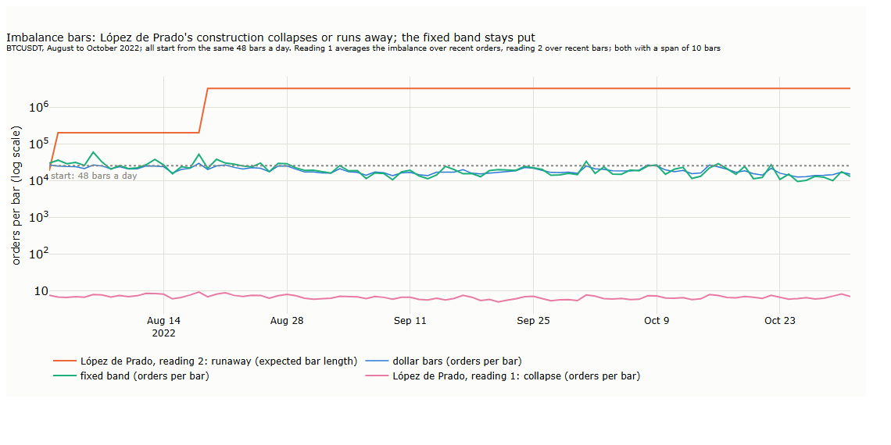
<b>How to read the figure.</b> <b>Axes.</b> Day (x), orders per bar (y, log). BTCUSDT, August to October 2022; all constructions start from the same 48 bars a day (grey dotted line). López de Prado's construction in reading 1, averaging over orders (pink), the fixed band of §11.3 (green) and dollar bars (blue) show the orders per bar. For reading 2, averaging over bars (orange), the line is the expected bar length, since almost no bars close. Moving averages use a span of 10 bars.

| Reading | What goes wrong | On our tape |
|---|---|---|
| 1. Average over orders | **Collapse.** Buying and selling are nearly balanced (49.8% of dollars, §6.2). E[bv] is close to zero, so the threshold is close to zero, and a bar closes after a handful of orders | A median of 6.6 orders per bar and about 140,000 bars a day, in August to October 2022 and again in January to March 2023 |
| 2. Average over bars | **Runaway.** A bar closes only once its imbalance is large, so each finished bar reports a large imbalance per order. The threshold rises, the next bar takes longer, and the threshold rises again | No bar at all on 89 of 92 days; the expected bar length climbs to 3.3 million orders, two to three days of trading |

<b>How to read the table.</b> Our measurement for these notes. Spans of 3, 10 and 30 bars and starting values from a tenth to ten times the target end in the same two places.

Practitioners who implemented the bars report the same: on bitcoin, the bar sizes "end up exploding ... in a positive-feedback loop that keeps increasing the candle size until infinity" (Martínez, 2019). We found no academic study that tests the stability of these bars.

### 11.2 Why caps are not a repair

The common remedy is to cap the bars, or to floor the expected imbalance. Such limits replace the construction: Martínez (2019) capped the expected size at 200 ticks and found that every bar soon became 200 ticks long, a tick clock. A cap also cuts off the longest bars, which hold the largest moves, so returns look closer to normal because the clock has been clipped, not because of the market. A rule that needs a cap to behave is the wrong rule.

### 11.3 A threshold anchored outside the clock

The repair is to give the threshold an anchor outside the clock's own bars, as every other clock in this lecture has: the past 28 days. Measuring θ in standard deviations of random signs does not work: that boundary grows at exactly the speed at which a random walk spreads, and the time to leave it has an infinite expected value (Blackwell and Freedman, 1964). **A fixed band** does: close the bar when |θ| reaches a level h fixed for the day. A random walk leaves a fixed band in a finite time, and Wald's identity (Wald, 1944) gives that time:

| Flow in the bar | Expected number of orders before the bar closes | What it means |
|---|---|---|
| Balanced: buys and sells offset on average | h² ÷ σ², with σ² the variance of the flow per order | The bar takes its normal length |
| One-sided, with an average push of μ dollars per order | about h ÷ \|μ\| | The more one-sided the flow, the sooner the bar closes |

<b>How to read the table.</b> How long a bar lasts under the fixed band when the flow is balanced (first row, which sizes the band) and when one side pushes (second row, what an imbalance clock is for).

**Persistence: the flow wanders faster than random signs.** Sized from the variance of single orders, the band produced 208 bars on the Fed day instead of 48. Order signs are persistent (§7.1), so net flow drifts further than independent signs would allow: on our tape, the variance of the net flow over five minutes is about ten times the sum of the squared sizes of its orders. The remedy follows from the reason: measure the variance of the flow over the time a bar lasts, 30 minutes at 48 bars a day, fixed before any test is run. The band is h = K × √(Q ÷ 48), where Q is the median, over the past 28 days, of each day's sum of squared half-hour net flows; K = 0.82 is set once on October to December 2021, so that the band closes as many bars as the dollar clock there. In plain words: **a bar closes when the flow has become as one-sided as it normally becomes in a whole half hour.**

### 11.4 Does it work?

**It is stable, in and out of sample, with no limit imposed.** In the stress window of August to October 2022 it closed 48 bars a day on average (fewest 9, most 136); out of sample, September to November 2025, run once after every setting had been fixed, 44, with 156 on the crash day of 10 October 2025 and 46 the day after. Across its settings the tails show no systematic change ([E19 §6.6](../extended/19-bars-not-cut-by-time/lecture.md)). It is a third kind of clock: on the Fed day it went quiet for five hours after midnight, when there was trading but it was two-sided, and only 23% to 39% of its closes fall within a minute of a dollar bar's close.

**Its returns are no closer to normal than on dollar bars** (E19 §6.6 draws the tails):

| Moves beyond 4 standard deviations, per 10,000 bars | Time bars | Dollar bars | Fixed band |
|---|---|---|---|
| Two windows of the comparison | 94 | 15 | 14 |
| Out of sample | 53 | 29 | 40 |
| Out of sample without 10–11 October 2025 | 63 | 12 | 26 |

<b>How to read the table.</b> Our measurement for these notes; each window standardised on its own, no bar capped or cut. With about 4,000 bars per window, one bar more or less changes the measure by 2.5.

The reason lies in what the clock counts. When the price moves hard with heavy trading on both sides, a two-sided panic, the flow stays balanced, the band does not fill, and one bar holds the whole move. A clock that follows one-sidedness was never designed to equalise the amount of trading per bar, and so it does not equalise the size of moves either.

**What we take from it.** The published construction does not work as published, and caps hide the problem. Our fixed band, our design for these notes and not an established method, is stable, but it is a different clock, not a better one for returns: dollar bars remain the activity clock. Whether its bars carry information is a question about order flow for Lecture 19.

## 12. Seasonality: when the market trades

Whatever clock a strategy follows, its trades happen at a particular hour of a particular day, in a deep or a thin market. Calendar effects are easy to find and hard to trust: with five years of minutes, almost any slot will look special in some respect. This section therefore states first what we expect and why, fixes the slots in advance from published schedules, measures every slot in the same way against a control, and corrects for the number of tests.

### 12.1 How to test a calendar effect

**Five hypotheses**, stated before looking at the data: activity bunches in calendar slots set by people and machines (H1); the size of moves follows activity, since variance follows the number of trades (H2, §7.3); some slots carry one-sided flow (H3); some slots have a predictable direction (H4); and the first move in a slot carries on, or turns back (H5). Economic reasoning expects the first two to hold and the last three to be weak: the market can hardly hide when it is busy, but a direction that everyone can see in the calendar should be traded until it disappears.

| Rhythm | Slots | Window | Control |
|---|---|---|---|
| Time of day | The opening hours of Tokyo (9:00), London (8:00) and New York (9:30), the hour around the New York close and a night hour in New York (2:00), each in its own local time, on weekdays | One hour | The average full hour of a weekday |
| Week | Saturday, Sunday, Monday, Friday, US public holidays on a weekday | One day | An ordinary weekday |
| Round times | The first minute of the hour, with and without a funding payment, of the half hour, of the quarter hours, and the last minute of the hour | One minute | Minutes nobody schedules: :07, :17, :37 and :47 |
| Releases | US inflation releases (CPI, 8:30 New York) and Fed decisions (14:00 New York) | Five minutes | The same minutes a week earlier |
| Option expiries | Deribit's settlement window, 07:30 to 08:00 UTC, on quarterly, monthly and weekly expiry Fridays | 30 minutes | The same window on Thursdays |

<b>How to read the table.</b> The twenty slots, each fixed by a schedule before looking at the data, with the control it is compared with. Local times follow each country's daylight saving time.

Each slot is measured against its control on activity and the size of moves (both relative to the past 28 days), net aggressive buying, the return in and before the window, and follow-through into the next window. Twenty slots, six comparisons each: 120 tests, of which six would look significant at 5% by pure chance, so every result is corrected for the number of tests (Benjamini and Hochberg, 1995). And significance is not size: with 30,000 occurrences, a difference of a tenth of a basis point can be significant and still be worth nothing.

### 12.2 The results

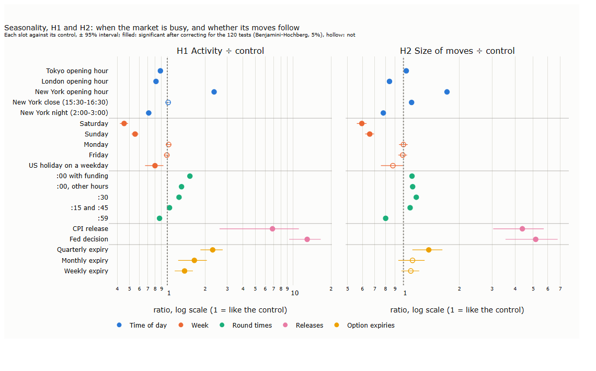
<b>How to read the figure.</b> <b>Axes.</b> Left: activity ÷ control (x, log), one slot per row (y). Right: size of moves ÷ control (x, log), same rows. Each dot is a slot's ratio to its control, with its 95% interval as a horizontal bar; the dotted line at 1 means the slot is like its control. Colours group the slots by rhythm: time of day (blue), week (orange), round times (green), releases (pink) and option expiries (yellow). A filled dot survives the Benjamini-Hochberg correction for the 120 tests at 5%, a hollow one does not.

| Hypothesis | The plain question | Verdict | Where it holds, with the key numbers |
|---|---|---|---|
| H1 Activity bunches | Is the market busier at some times? | **Holds** | The New York opening hour trades at 2.36 times the average hour, the openings of Tokyo and London *less* (0.88, 0.81); Saturday 0.45 of a weekday; CPI releases 6.86 and Fed decisions 12.94 times the same minutes a week earlier |
| H2 Moves follow activity | Do prices move more when more is traded? | **Holds** | Every slot, with a correlation of 0.98; moves after CPI releases 25% larger than their activity predicts, option expiries 17% to 19% smaller: news moves more than its trading predicts, hedging less |
| H3 One-sided flow | Does one side press harder at some times? | **Weak** | The funding minute and the New York close: about one percentage point of net buying |
| H4 Predictable direction | Does the price tend to go one way at some times? | **Rejected for trading** | Round minutes and the funding minute, reliably but tiny: 0.1 to 0.6 bp. The drift before Fed decisions, a hypothesis: +25 bp in the 30 minutes before, against −5 a week earlier, on 40 occasions |
| H5 Moves carry on or turn back | Does the first move keep going? | **Holds in places** | CPI releases: the first five minutes' move followed in the next 30 with a correlation of +0.45, in 2021 to 2023 only; small elsewhere |

<b>How to read the table.</b> One row per hypothesis. Ratios are slot ÷ control (1 = like the control); effects listed as holding survive the correction for the 120 tests; the H2 percentages are departures from the fitted line of moves on activity. bp: basis points. Every slot, with intervals, standard errors and adjusted p-values: [E19 §7.2–§7.4 and Appendix A](../extended/19-bars-not-cut-by-time/lecture.md).

The calendar tells a strategy *when* the market is deep, thin, crowded or volatile, reliably and by large factors. It tells it almost nothing about *which way* the price will go: seasonality is a tool for timing execution and sizing risk, not a source of direction. In US stocks, Lucca and Moench (2015) found a drift before scheduled Fed announcements that essentially disappeared after 2015 (Kurov, Wolfe and Gilbert, 2021). The follow-through after CPI releases belonged to the inflation shock: the median first move was 187 bp in 2021–2022 and 43 bp in 2024–2026, and the correlation with the next 30 minutes was +0.13 in 2024–2026. An effect found in one regime can vanish in the next.

**Option expiries.** Bitcoin options on Deribit expire on Fridays at 08:00 UTC, settled on the average of an index from 07:30 to 08:00 UTC (Deribit, Settlement). On quarterly expiry days, trading rises from 07:30, exactly when the settlement window opens; moves are smaller than that trading predicts, and there is no reliable flow, direction or follow-through ([E19 §7.5](../extended/19-bars-not-cut-by-time/lecture.md)).

### 12.3 Whose day is it?

The US moves its clocks twice a year, Europe on different dates and Asia not at all. If bitcoin's busiest hours follow the US, they must move by an hour, in UTC, when the US changes its clocks:

| | US summer time | US winter time |
|---|---|---|
| The US stock market opens (9:30 a.m. in New York) | 13:30 UTC | 14:30 UTC |
| Bitcoin's busiest hour | 14:00 to 15:00 UTC | 15:00 to 16:00 UTC |
| Jump in activity in the minute of the US open, against the minute before | 2.5 times | 2.4 times |

<b>How to read the table.</b> Weekdays, October 2021 to September 2026, split into US summer time and US winter time.

They do: a large part of the money that trades bitcoin keeps US hours. The US share of the trading day rose from 35% to 42% between 2021 and 2023 and has stayed there since; the rise came before the US bitcoin funds started trading in January 2024, so they did not cause it. The tape shows the timing; who exactly trades is not on it.

**Round times: a crowd of ten seconds.** Activity stays above twice its average for 7 seconds after the full hour, and for 2 at the half hour. These rhythms come from how people and machines trade: execution algorithms start their schedules on round times, and every system built on hourly or 15-minute candles, as in Parts I and II, computes its signal at :00, :15, :30 and :45, all at the same moment.

### 12.4 When each clock makes you trade

A strategy on bars takes one decision each time a bar closes. It does not choose the time it trades; it chooses a clock, and the clock decides when the decisions fall:

| Share of bar closes… | Time | Dollar | Range | For comparison |
|---|---|---|---|---|
| in the busiest quarter of the week's hours | 25% | 42% | 44% | These hours carry 42% of all dollars |
| in the quietest quarter | 25% | 14% | 13% | These hours carry 14% of all dollars |
| at :00, :15, :30 or :45 | 100% | 8% | 8% | 4 minutes in 60 is 6.7% |
| in a burst minute (over 20 times the day's median pace) | 0.09% | 3.4% | 5.5% | Burst minutes are 0.12% of all minutes |

<b>How to read the table.</b> Our measurement for these notes: where each clock's decisions fall in calendar time; the last column is what an even spread would give. Tick and volume bars are close to dollar bars, CUSUM to range bars.

**Time bars** decide whatever the market does: a quarter of their decisions in the quietest quarter of the week's hours, all of them on a round minute, with every other clock-driven order. **Activity clocks** decide where the money is. **The price is bursts:** one dollar-bar decision in 30 falls in a burst, 28 times as often as decisions spread evenly in time would; for range bars, one in 18. Bursts are the most expensive moments to trade: spreads widen, the flow is one-sided, prices jump (§7.3). Which execution profile is cheaper, the crowd at the round minute or the bursts, is a question of costs: Lecture 19 measures them, and Lecture 20 applies them to a trend rule on time and on dollar bars.

## 13. Backtesting on the tape: the rules

A backtest on trades is a replay: the recorded trades are run forward, the strategy decides at each moment, and its orders are filled against what was recorded. The replay is **non-reactive**: the market on the tape does not know the strategy exists. This is acceptable for small orders and wrong for large ones. Eight rules keep the replay honest:

| Rule | What it means |
|---|---|
| 1. Decide only on the past | A signal at time t uses only trades stamped before t, and only bars already closed |
| 2. Add latency | The order reaches the exchange some time after the signal, for example 100 to 300 milliseconds from a rented server |
| 3. Fill on your side | A buy fills at the price of the first buyer-initiated trade after the order arrives; a sell, at the first seller-initiated one |
| 4. Keep the size small | The order is no larger than the trades around it, or is priced with an impact model |
| 5. Pay the costs | The fee for aggressive orders on every fill (0.05% on the standard tier), and funding on positions held across 00:00, 08:00 and 16:00 UTC |
| 6. Respect the gaps | No trading during silences or data holes (§5) |
| 7. Show the unusual prints | Results are reported with and without fills at flagged prints (§5.3) |
| 8. Limit orders only if traded through | A resting buy at a price is filled only if later trades happen below it: trades at exactly that price may have filled the orders ahead in the queue |

Rules 1 to 3 and 5 to 7 can be applied exactly with the tape alone; rules 4 and 8 are approximations, and they are where results on the tape stop being reliable. Large orders need an impact model (Lecture 19); passive orders and strategies that move the market need the order book and a model of how others react (Lectures 21 and 22).

## Back to the base layer

*Food for thought.*

| | |
|---|---|
| **The idea** | Execute the daily portfolio's rebalancing in the market's deep hours |
| **What our results already say** | The busiest weekday hour carries 8.6% of the dollars, the quietest 2.6% (§6.2); but volatility follows the number of trades (§7.3), and dollar bars, which follow the money, place one decision in 30 in a burst (§12.4) |
| **What a test would need** | Costs by hour for the portfolio's own rebalancing orders, measured on the tape and the book (Lectures 19 and 21); the first thing that could kill it: the deep hours are also the volatile ones, so a narrower spread may be lost to larger moves while the order works |
| **Status** | Not tested in this course; a research direction |

<b>How to read the card.</b> Food for thought, not a result: the idea, only numbers this lecture has shown, what a test would need, and its status.

## 14. Summary, exercises and reading

### 14.1 Seven takeaways

1. **The tape is the record behind every bar:** every trade with its time, size and the side of the aggressor, the order flow that Lecture 3 could only estimate.
2. **Inspect, fix from a second source, flag, never delete.** The archive had eight missing days, two duplicated days and six minutes missing everywhere; every unusual print stays in with its flag.
3. **Volatility follows the number of trades, and risk is concentrated:** 85% of the variation in hourly variance, and a third of five years' variance in 1% of the minutes.
4. **Order flow is persistent, prices are not:** liquidity absorbs the flow that can be anticipated.
5. **A candle loses the flow, the path and where trading happened:** it gets the direction of the flow right four times in five and its size twenty times too large.
6. **A clock must be stable by design, not by patches.** Dollar bars have a third as many moves beyond four standard deviations as 30-minute bars, still forty times the normal; López de Prado's imbalance bars collapse or run away, our fixed band does not.
7. **The calendar tells when, not which way; we choose the clock, and the clock decides when we trade.** Time bars decide on round minutes and in thin hours; dollar bars in the deep hours and in bursts.

### 14.2 Exercises

- [ ] Run the pipeline for one month of your choice, including the hole check. How long does each stage take, and how much memory does it use on your machine?
- [ ] Change the rule for unusual prints from 0.5% to 0.3% and to 1%. How many prints are flagged, and on which days?
- [ ] Compute Parkinson's estimator for September 2022 with and without the flagged print of 6 September. How much does one trade change a month's volatility (§8.2)?
- [ ] Build dollar bars at 24 and at 96 bars a day and repeat the tail measures of §10.2. Does the reduction in fat tails depend on how fine the bars are?
- [ ] Repeat the daylight-saving test of §12.3 for ETHUSDT. Does it keep US hours too?

### 14.3 Reading

For high-frequency data and its cleaning, Dacorogna et al. (2001) and Brownlees and Gallo (2006). For realised volatility and microstructure noise, Andersen, Bollerslev, Diebold and Labys (2000) and Hansen and Lunde (2006). For order flow and its persistence, Lillo and Farmer (2004) and Bouchaud, Gefen, Potters and Wyart (2004). For volume and volatility, Jones, Kaul and Lipson (1994). For prices in trading time, Mandelbrot and Taylor (1967), Clark (1973) and Ané and Geman (2000), with the comment of Murphy and Izzeldin (2005). For bars on activity and information clocks, López de Prado (2018, ch. 2) and Easley, López de Prado and O'Hara (2012).

Full versions: [E18](../extended/18-tick-data-the-tape/lecture.md) and [E19](../extended/19-bars-not-cut-by-time/lecture.md).

### 14.4 Next

Lecture 19 goes inside the bars: the path between them, volatility measured and forecast on the tape, order flow, and what trading costs. Lecture 20 then applies Part V to two strategies, which use this lecture in opposite ways. A trend rule decides at each bar's close, so its clock decides when it trades: it runs on time bars and on dollar bars at the same number of bars per day, and Lecture 20 prices both execution profiles. A grid leaves buy orders below the price and sell orders above it, and fears a one-way move that runs through all its orders: it takes the calendar, a spacing that follows volatility through the day and the week, and the scheduled releases, known in advance. The trend rule takes a clock, the grid takes a calendar.

## References

- Binance. Introduction to Binance Futures funding rates (FAQ, updated March 2026). — funding paid only on positions open at the funding times (§2, §6.2).
- Binance. Futures trading fee rates (FAQ). — 0.02% for resting orders, 0.05% for aggressive orders, standard tier (§6.2).
- Binance (n.d.). USDⓈ-M futures API documentation: new order; new algo order; change log (conditional orders moved to the algo service, 9 December 2025). developers.binance.com. — order types and trigger prices (§3.2).
- Bybit (n.d.). V5 API documentation: place order; set trading stop; create strategy. bybit-exchange.github.io/docs/v5; Help Center: post-only order, insurance fund, auto-deleveraging. — order types, trigger prices and liquidation (§3.2).
- Andersen, T. G., Bollerslev, T., Diebold, F. X. and Labys, P. (2000). Great realizations. *Risk* 13, 105–108. — the volatility signature plot (§7.2).
- Ané, T. and Geman, H. (2000). Order flow, transaction clock, and normality of asset returns. *Journal of Finance* 55(5), 2259–2284. — the transaction clock; normality in trading time (§7.3, §9).
- Benjamini, Y. and Hochberg, Y. (1995). Controlling the false discovery rate: a practical and powerful approach to multiple testing. *Journal of the Royal Statistical Society, Series B* 57(1), 289–300. — the correction for many tests (§12.1).
- Blackwell, D. and Freedman, D. (1964). A remark on the coin tossing game. *Annals of Mathematical Statistics* 35(3). — leaving a square-root boundary takes infinitely long on average (§11.3).
- Bouchaud, J.-P., Gefen, Y., Potters, M. and Wyart, M. (2004). Fluctuations and response in financial markets: the subtle nature of 'random' price changes. *Quantitative Finance* 4(2), 176–190. — persistent flow, transient impact (§7.1).
- Brownlees, C. T. and Gallo, G. M. (2006). Financial econometric analysis at ultra-high frequency: data handling concerns. *Computational Statistics & Data Analysis* 51(4), 2232–2245. — outlier detection with a granularity term (§5).
- Clark, P. K. (1973). A subordinated stochastic process model with finite variance for speculative prices. *Econometrica* 41(1), 135–155. — volatility and the rate of information (§7.3, §9).
- Dacorogna, M. M., Gençay, R., Müller, U. A., Olsen, R. B. and Pictet, O. V. (2001). *An Introduction to High-Frequency Finance*. Academic Press. — filtering as a process; intrinsic time (§5, §9).
- Deribit. Settlement, support centre. — settlement on the 30-minute time-weighted average of the index, 07:30 to 08:00 UTC (§12.2).
- Donier, J. and Bonart, J. (2015). A million metaorder analysis of market impact on the Bitcoin. arXiv:1412.4503. — square-root impact on bitcoin (§7.1).
- Easley, D., López de Prado, M. and O'Hara, M. (2012). Flow toxicity and liquidity in a high-frequency world. *Review of Financial Studies* 25(5), 1457–1493. — bulk volume classification (§8.1).
- Easley, D., López de Prado, M. and O'Hara, M. (2012). The volume clock: insights into the high-frequency paradigm. *Journal of Portfolio Management*, Fall 2012. — the volume clock (§9).
- Hansen, P. R. and Lunde, A. (2006). Realized variance and market microstructure noise. *Journal of Business & Economic Statistics* 24(2), 127–161. — noise correlated with the efficient price (§7.2).
- Jones, C. M., Kaul, G. and Lipson, M. L. (1994). Transactions, volume, and volatility. *Review of Financial Studies* 7(4), 631–651. — number of trades versus trade size (§7.3).
- Kurov, A., Wolfe, M. H. and Gilbert, T. (2021). The disappearing pre-FOMC announcement drift. *Finance Research Letters* 40, 101781. — the drift in US stocks after 2015 (§12.2).
- Lillo, F. and Farmer, J. D. (2004). The long memory of the efficient market. *Studies in Nonlinear Dynamics & Econometrics* 8(3). — persistence of order signs (§7.1).
- Lucca, D. O. and Moench, E. (2015). The pre-FOMC announcement drift. *Journal of Finance* 70(1), 329–371. — US stocks rise before Fed announcements (§12.2).
- López de Prado, M. (2018). *Advances in Financial Machine Learning*. Wiley, ch. 2. — tick, volume, dollar, imbalance and run bars; the CUSUM filter (§9, §11).
- Mandelbrot, B. and Taylor, H. M. (1967). On the distribution of stock price differences. *Operations Research* 15(6), 1057–1062. — prices in transaction time (§9).
- Martínez, G. (2019). Information-driven bars for financial machine learning: imbalance bars. *Towards Data Science*, 20 May 2019. — runaway bar sizes on bitcoin; a cap turns into a fixed size (§11.1, §11.2).
- Murphy, A. and Izzeldin, M. (2005). Order flow, transaction clock and normality of asset returns: a comment on Ané and Geman (2000). Working paper. — the limits of normality in trading time (§9, §10.2).
- Page, E. S. (1954). Continuous inspection schemes. *Biometrika* 41(1/2), 100–115. — the CUSUM test (§9).
- Wald, A. (1944). On cumulative sums of random variables. *Annals of Mathematical Statistics* 15(3), 283–296. — Wald's identity (§11.3).
