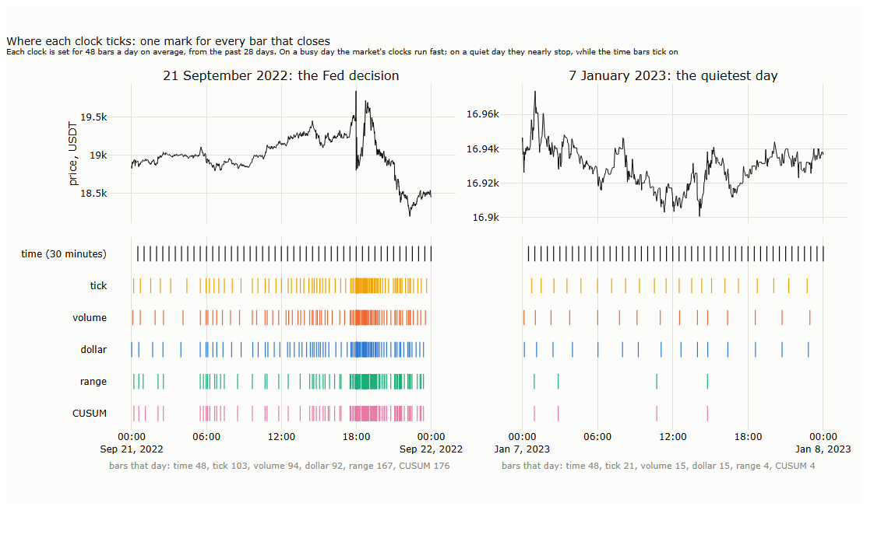
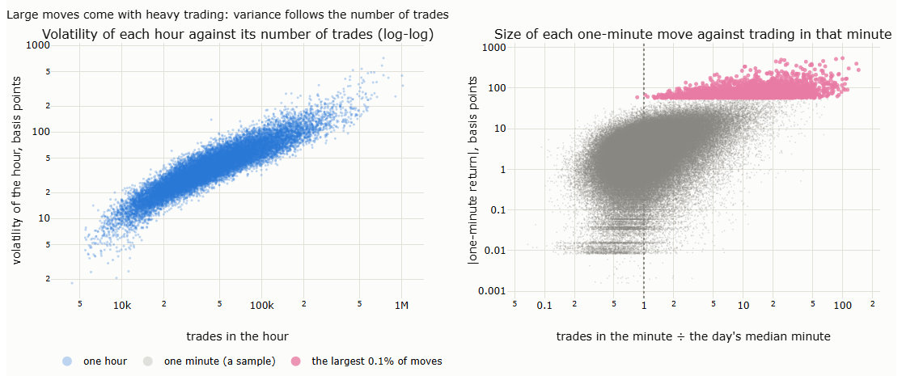
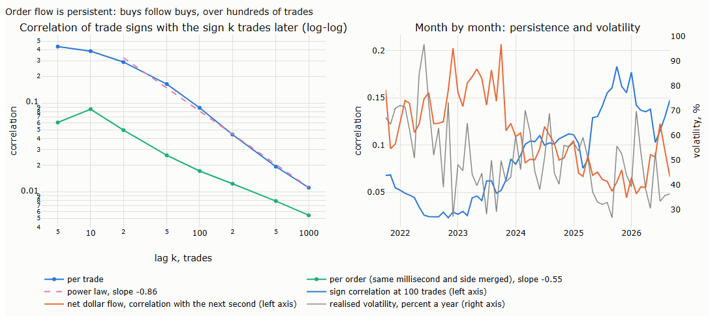
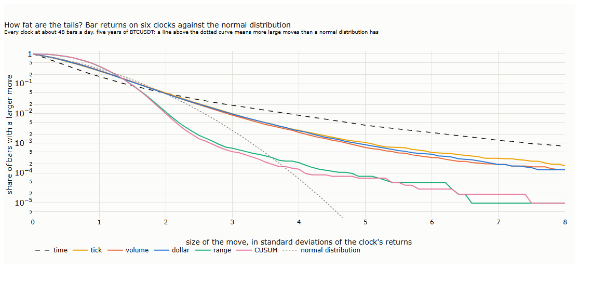
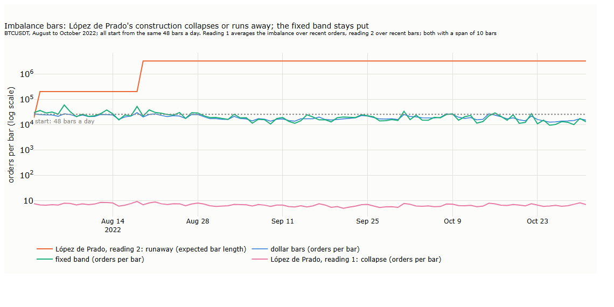
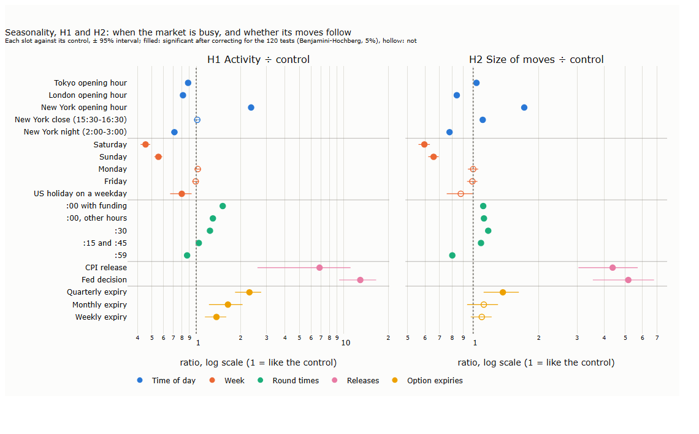

# Lecture 18: The Tape and Its Clocks

> The tape records every trade with its side; the clock that cuts it into bars decides what the bars show and when a strategy trades.

Part V · Pipeline stage: data (the record of every trade, and the clocks that cut it into bars)

---

# We choose the clock, not the time

> Time bars tick on regardless; the market's clocks follow the market, twice as fast on the busiest day and at a third of the pace on the quietest.

- Time bars: 48 on both days
- Fed day: 92 dollar bars, 167 range bars; quietest day: 15 and 4
- Activity clocks bunch where trading is heavy; price clocks where the price moves

---

# The tape: one row per trade

> The tape records every trade with its time, size and the side of the aggressor: the order flow that bars can only estimate (Lecture 3).

- **The market:** the BTCUSDT perpetual on Binance, October 2021 to September 2026; a future that never expires
- **Funding is its carry:** every 8 hours; longs paid shorts 7.3% a year
- **The side:** `is_buyer_maker` false means an aggressive buyer (+1), true an aggressive seller (−1)
- **September 2026:** 36.0 million trades; the median trade USD 232, the mean USD 9,532

---

# Check, fix, flag, never delete

> After repairs, 99.9988% of the trades Binance recorded are in the data; unusual prints stay in with a flag.

| Issue | What was done |
|---|---|
| Eight days missing, 2022 | Filled from the daily files; each patch closes its hole exactly |
| Two days duplicated | Each trade kept once |
| Six minutes missing from the whole archive | Flagged; left out where a complete day is needed |
| About 294,000 trades off the tick grid | Kept: real trades of a grid-trading bot |

**A rule must be tested too:** a minimum distance of 0.5% cut the flagged prints from 109,000 to 2,053, concentrated on days of stress.

---

# Volatility follows the number of trades

> Risk is concentrated: 1% of the minutes hold a third of five years' variance.

- Hourly variance: the number of trades explains 85%, trade size 1%
- The largest 1% of moves hold 37% of the variance
- The largest moves came with 13.3 times the median minute's trades

---

# Order flow persists, prices do not

> Buys follow buys over hundreds of trades, yet returns barely follow returns: liquidity absorbs the flow that can be anticipated.

- Sign correlation: 0.39 at 10 trades, 0.09 at 100
- One second to the next: net dollar flow 0.11, returns 0.06
- What moves prices is the part of the flow nobody expected

---

# What a candle loses

> A candle gets the direction of the flow right four times in five, and overstates its size twentyfold.

| The candle reports | What it loses |
|---|---|
| Open and close | Everything between: the close is 0.66% from the day's average traded price |
| High and low | Whether the extremes were traded: range-based volatility is 6% to 12% too high |
| Volume | Which side was aggressive, and by how much |

**One print can dominate:** on 6 September 2022, Parkinson's estimate was 548% a year; realised volatility, 61%.

---

# Bars on the market's clocks

> Every bar closes when a counter reaches a threshold: the counter is the bar's clock.

| Family | A bar closes when… | Example |
|---|---|---|
| Time | a fixed time has passed | 30-minute bars |
| Activity | a fixed amount of trading has happened | Dollar bars |
| Information | buying or selling is more one-sided than usual | Imbalance bars |
| Price | the price has moved a fixed distance | Range bars, CUSUM |

- **Thresholds from the past 28 days**, 48 bars a day: any window from two to four weeks works
- **A price clock needs a price:** on every fill, the busiest day gave 109 times the typical day's bars; one price per second

---

# Closer to normal, but not all the way

> Activity clocks bring returns much closer to normal; the tails that remain are still forty times the normal.

- Moves beyond 4 standard deviations per 10,000 bars: time 86, dollar 26, normal 0.6
- Price clocks are thin-tailed by construction, not by nature
- Volatility clustering stays on every clock: 0.22 to 0.35

---

# Imbalance bars: stable by design, not by caps

> López de Prado's imbalance bars collapse or run away on our tape; a band anchored in the past 28 days is stable.

- Collapse: 6.6 orders per bar; runaway: no bar on 89 of 92 days
- A cap hides the problem: every bar becomes the cap
- Fixed band $h = K\sqrt{Q/48}$: stable, but no closer to normal than dollar bars

---

# The calendar tells when, not which way

> The calendar tells a strategy when the market is deep, thin or volatile, by large factors; it tells almost nothing about which way the price will go.

- Twenty slots fixed in advance; 120 tests, corrected for their number
- Fed decisions: 12.94 times the activity; the New York open 2.36
- Direction: reliable at round minutes, but tiny: 0.1 to 0.6 bp

---

# The clock decides when you trade

> Time bars decide in thin hours and on round minutes; dollar bars decide in the deep hours and in bursts.

| Share of bar closes… | Time | Dollar | Range | Even spread |
|---|---|---|---|---|
| in the busiest quarter of the week's hours | 25% | 42% | 44% | 42% of all dollars |
| in the quietest quarter | 25% | 14% | 13% | 14% of all dollars |
| at :00, :15, :30 or :45 | 100% | 8% | 8% | 6.7% |
| in a burst minute | 0.09% | 3.4% | 5.5% | 0.12% |

Bursts are the most expensive moments to trade: Lecture 19 measures the costs, Lecture 20 prices both profiles.

---

# Back to the base layer

> Food for thought: execute the daily portfolio's rebalancing in the market's deep hours.

| | |
|---|---|
| **The idea** | Rebalance in the deep hours, when spreads should be narrow |
| **What our results say** | The busiest weekday hour carries 8.6% of the dollars, the quietest 2.6%; but volatility follows the number of trades |
| **What a test would need** | Costs by hour for the portfolio's own orders, on the tape and the book (Lectures 19 and 21); the deep hours are also the volatile ones |
| **Status** | Not tested here; a research direction |

---

# Takeaways

1. **The tape is the record behind every bar:** every trade with its time, size and the side of the aggressor
2. **Inspect, fix from a second source, flag, never delete:** every unusual print stays in with its flag
3. **Volatility follows the number of trades, and risk is concentrated:** a third of five years' variance in 1% of the minutes
4. **A candle loses the flow, the path and where trading happened:** direction right four times in five, size twenty times too large
5. **A clock must be stable by design, not by patches:** dollar bars bring returns closer to normal, not all the way
6. **The calendar tells when, not which way; the clock decides when we trade**

> We do not choose the time; we choose the clock, and the clock decides when we trade.
