# Lecture 19: Path, Flow and Costs

*Systematic Trading: Lecture Notes (MSc) · draft, Nov 16, 2026 · Max Gnesi*

*Pipeline stage (Lecture 1 §2.1): data and execution (the path inside a bar, the order flow, and what trading costs).*

Lecture 18 described the tape and cut it into bars on the market's own clocks. This lecture goes inside the bar and asks three questions. The **path**: what happens between a bar's four prices, and how volatility, the number that summarises how much a price moves, should be measured. The path decides whether a stop or a target is hit first, how often a grid's orders fill and how far a position runs against its owner; volatility decides how large a position may be and where a stop belongs. The **flow**: only one side of each trade was in a hurry, and what does that hurry tell us about the next move? The **costs**: what a trade really pays, when a resting order is filled, and how large a strategy can grow before its costs eat its edge. The data are those of Lecture 18; Lecture 20 applies the results to two strategies.

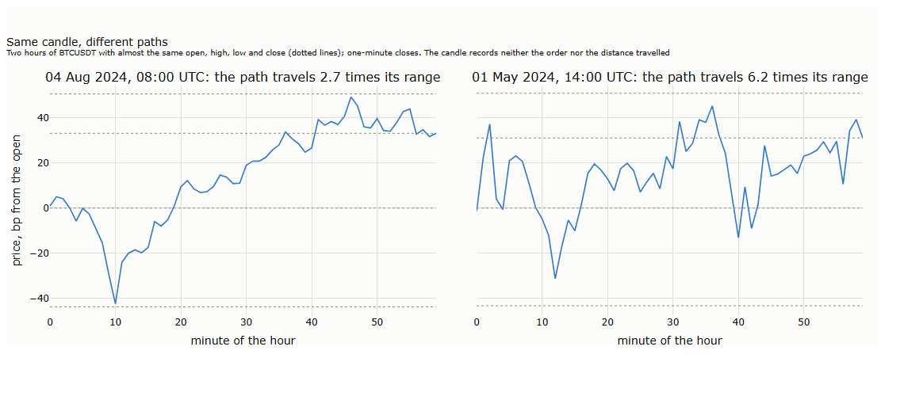
<sub><b>How to read the figure.</b> <b>Axes.</b> Minute of the hour (x), price in bp from the open (y). Two hours of BTCUSDT, one-minute closes: <b>Left:</b> 4 August 2024, 08:00 UTC; <b>Right:</b> 1 May 2024, 14:00 UTC. The dotted lines mark each hour's open, high, low and close, almost the same in both panels; the blue line is the path between them. The panel titles give the distance travelled as a multiple of the hour's range.</sub>

The two hours in the figure have the same candle to within a few basis points. The first rose almost steadily from its low; the second swung back and forth and travelled more than twice as far. A trend rule sees no difference; a grid, which earns each time the price swings through one of its levels, would have earned more than twice as much in the second hour.

| § | Topic | Question |
|---|---|---|
| 1 | Units, words and data | How is a move measured, and who was in a hurry? |
| 2 | What a candle loses | What does a bar not record about the path? |
| 3 | The path against a random walk | Does the price have a memory, and on every day? |
| 4 | Levels on the path | How often is a level crossed, how far does a position run against its owner, what does a stop get? |
| 5 | Volatility, built up | Where should volatility be measured, and which measure forecasts the next bars? |
| 6 | Risk on any clock | How is risk measured on dollar or range bars? |
| 7 | Does one-sided flow predict the price? | After strong net buying, does the price carry on or come back? |
| 8 | Sweeps and absorption | When one order sweeps through the book, does the price come back? |
| 9 | Cascades | Can the explosive regime of §3 be recognised within the day? |
| 10 | What a trade costs | What does a market order pay, and a resting one lose? |
| 11 | Resting orders | How often is a resting order filled, what does it miss, and how long should it wait? |
| 12 | Capacity and funding | How large can a strategy trade, and what does holding cost? |
| 13 | Summary, exercises and reading | What the two strategies of Lecture 20 take from this lecture |

Sections 2 to 6 follow the path, 7 to 12 the flow and the costs; the explosive days of §3 link them. Everything left out is in [E20](../extended/20-volatility-and-the-path/lecture.md) and [E21](../extended/21-order-flow-and-costs/lecture.md).

> **What to take away**
>
> 1. **A candle loses the order and the distance travelled:** the better guess at which extreme came first is wrong on one bar in eight, as for a random walk, and a typical hour travels four times its range.
> 2. **The path is close to a random walk, but not on every day:** on BTCUSDT it turns back on ordinary days and runs on explosive ones; √t overstates the variance of a position held for hours by 5% to 13%.
> 3. **Volatility is best measured inside the bar,** in any of its forms, and on any clock a day's risk is the number of bars times the risk per bar.
> 4. **One-sided flow moves the price while it lasts and keeps almost all of its impact;** risk clusters, and the best warning of a cascade is the turbulence already under way.
> 5. **On BTCUSDT a trade's cost is the exchange fee:** the spread is one tick, a resting order re-posted every few seconds saves about 2 bp, and funding, not impact, limits a trend rule.

## 1. Units, words and data

**A unit.** Every statement about the path needs a scale: is a move of 50 basis points large or small? The scale is volatility, the typical size of the price's moves over a given time. Square each one-minute return of a day and add them up: the sum is the day's **realised variance**, its square root the day's volatility:

```math
\mathrm{RV}_{\text{day}} = \sum_{i=1}^{1440} r_i^{2}, \qquad \sigma_{\text{day}} = \sqrt{\mathrm{RV}_{\text{day}}}
```

where $`r_i`$ is the return of the day's $`i`$-th minute, the move a position's value went through in that minute. A random walk spreads its moves evenly, so its variance grows in proportion to time and its volatility with the square root of time, √t: four times the time, twice the move. §3 tests whether the price follows that rule.

**Three words.** The **aggressor** of a trade is the side that sent the order which executed at once (Lecture 18, §3.1). **Net aggressive buying**, or flow, is the dollars bought by aggressors minus the dollars sold by aggressors, here divided by all dollars traded, so that it runs from −1 (only sellers in a hurry) to +1 (only buyers). The **spread** is the gap between the best bid and the best ask; a market order pays at least half of it.

**Data.** The tape of Lecture 18, BTCUSDT on Binance from October 2021 to September 2026, followed minute by minute and, where single trades matter, trade by trade. The best bid and ask (§10) exist only from May 2023 to March 2024; those results are labelled with that period.

## 2. What a candle loses

Lecture 18 (§8) measured what a candle loses about the flow, about volatility and about the average traded price. A candle also records neither **what happened first** nor **how far the price travelled** in between.

**What came first.** A backtest on candles must guess whether the high or the low came first; on the tape, the order is known. The better of two common guesses, "the bar's direction" (a rising bar went to its low first), is right on 90% of five-minute bars and 88% of hourly and daily ones; "the open nearer the high" (then the high came first) on 80% to 81%. A random walk gives 89% and 81%. The better guess is wrong on about one bar in eight, at every bar length, and a random walk gets it wrong just as often. The error is not a feature of bitcoin; it is built into candles.

It matters only when two levels lie inside the same bar, as for a rule that enters at the open with a stop and a target the same distance away. On hourly bars of BTCUSDT:

| Stop and target, × the typical range of an hour | Bars that touch both | The best guess right, on those |
|---|---|---|
| 0.25 | 40% | 68% |
| 0.5 | 13% | 76% |
| 1 | 2% | 80% |

<sub><b>How to read the table.</b> Our measurement for these notes; the truth from the first minute in which each level was touched; the typical range is the median of the past 28 days.</sub>

**The distance travelled.** Measured minute by minute, the typical hour travels about four times its own range: up, down and up again before it closes. Among hours with almost the same candle, the distance runs from 3 to 5.3 times the range (10th to 90th percentile); the opening figure shows two of them.

**What it means.** A candle backtest can be trusted for stops wide against a bar's range; tight ones are guessed wrong on a large share of bars. Everything that depends on the distance travelled, a grid's earnings or a measure of volatility, needs the path, not the candle.

## 3. The path against a random walk

A random walk has no memory: after a move up, the next move is up or down with equal chance. A grid needs the price to turn back; a trend rule needs it to carry on. The question for both: after the price has moved one step, does it move another step the same way, or turn back?

**How it is measured.** Lay a ladder of levels a fixed step apart over five years of one-minute prices, and count how often the next rung reached lies in the same direction as the last. For a random walk the answer is one half.

**The benchmark matters.** Counted this way, the price of bitcoin seems to carry on far more often than a random walk: two steps in three at 10 basis points. But the same count on the same one-minute returns **shuffled into a random order**, which keeps every move's size and removes all memory, gives almost the same result: a minute that jumps over several rungs makes all of them look like continuation. The fair comparison is the tape against its own shuffled returns, not against one half.

| Step | Tape: continues | Shuffled: continues | Difference, points | In every year? |
|---|---|---|---|---|
| 10 bp | 66.8% | 68.8% | −2.0 | yes |
| 20 bp | 61.3% | 62.7% | −1.4 | yes |
| 50 bp | 56.4% | 57.2% | −0.8 | yes, more weakly |
| 100 bp | 54.6% | 54.8% | −0.2 | no difference |

<sub><b>How to read the table.</b> Our measurement for these notes; one-minute closes, October 2021 to September 2026. Continues: the share of steps followed by a step in the same direction; a negative difference means the tape turns back more often than its own shuffled returns.</sub>

At small steps bitcoin turns back slightly more often than a path without memory; at a percent and more there is no difference. That five-year average hides two different markets.

**Two regimes.** The same test, with the days grouped by their realised variance:

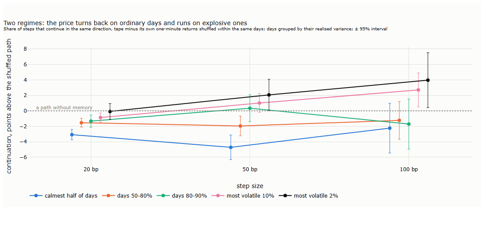
<sub><b>How to read the figure.</b> <b>Axes.</b> Step size (x), continuation in points above the shuffled path (y). For each step of the ladder (20, 50 and 100 bp), the share of steps that continue in the same direction on the tape minus the same share on its own one-minute returns shuffled within the same days. Each colour is a group of days ranked by realised variance, from the calmest half (blue) to the most volatile 2% (black); whiskers are 95% intervals. The dotted line at 0 is a path without memory; the points of each step are offset sideways so the groups do not overlap.</sub>

| Days | 20 bp | 50 bp | 100 bp |
|---|---|---|---|
| The calmest half (913 days) | −3.1 | −4.7 | −2.2 |
| The most volatile 10% (183 days) | −0.9 | +1.0 | +2.7 |
| The most volatile 2% (37 days) | −0.1 | +2.1 | +4.0 |

<sub><b>How to read the table.</b> Points of continuation, tape minus its own returns shuffled within the same days; the figure shows all groups with their 95% intervals.</sub>

On calm and ordinary days the price turns back clearly more often than chance, at every step size. On the most volatile days the picture reverses at larger steps: moves of half a percent and more tend to carry on. The average of five years describes neither: a grid that relies on it is right on ordinary days and wrong on exactly the days that can ruin it.

**Can the regime be seen in advance?** Grouped by the *previous* day's volatility, which is known in the morning, the runs disappear: yesterday's volatility does not say whether today will be an explosive day. The regime has to be recognised within the day; §9 looks for such signals.

**And √t?** If the price turns back, its moves over longer horizons are smaller than √t predicts from one-minute moves. The **variance ratio** measures by how much: the variance of returns over a horizon, divided by what the one-minute returns of the same weeks imply.

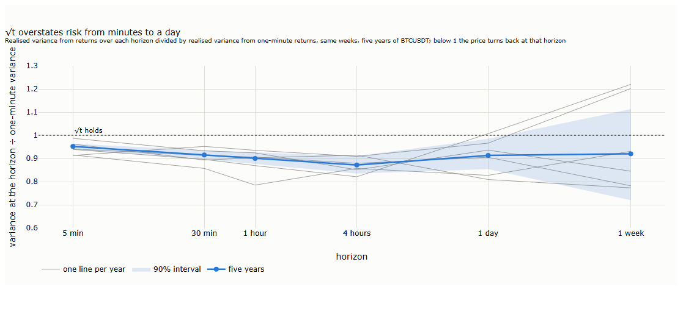
<sub><b>How to read the figure.</b> <b>Axes.</b> Horizon (x, log), variance ratio (y). The variance of returns over each horizon, from five minutes to a week, divided by the variance that one-minute returns of the same weeks imply. The blue line is the five-year value with its 90% interval (shaded); each grey line is one year. The dotted line at 1 is where √t holds; below 1 the price turns back at that horizon.</sub>

At four hours the variance is 13% below what one-minute returns imply (90% interval: 9% to 16%), and the shortfall appears in every year. Scaling one-minute volatility with √t overstates the variance of a position held for hours by 5% to 13%, every year; at a day by about 9%; beyond a day the data cannot tell. Risk should be measured at a fine interval and scaled to the horizon a strategy holds with the measured ratio, not with √t.

**Key message.** Bitcoin's path is close to a random walk, but not quite, and not in the same way every day: it turns back on ordinary days and runs on explosive ones. A rule built on the average is built for a market that does not exist.

## 4. Levels on the path

A grid lives on the number of times the price crosses its levels; a stop on what happens when the price reaches it.

### 4.1 Crossings: what a grid can earn

For a random walk the number of steps of a given size per day is simple: the day's variance divided by the step squared. A grid that expects that many round trips is disappointed:

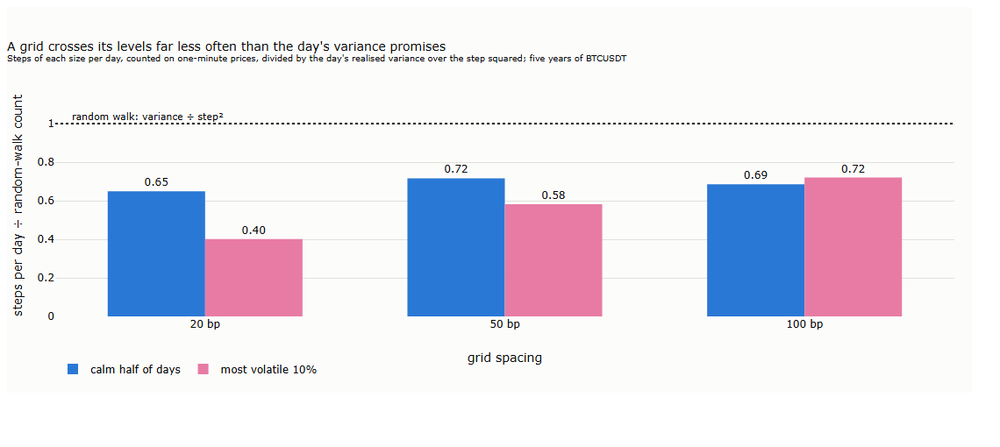
<sub><b>How to read the figure.</b> <b>Axes.</b> Grid spacing (x), steps per day ÷ random-walk count (y). For steps of 20, 50 and 100 bp, the steps per day counted on one-minute prices, divided by the count a random walk would give, the day's realised variance over the step squared. Blue bars are the calm half of days, pink the most volatile 10%. The dotted line at 1 is the random-walk count.</sub>

The price completes only 40% to 72% of the steps the day's variance promises. The main reason is the size of the moves, not their order: a jump of 3% crosses six levels 50 bp apart, but it counts in the variance like 36 small moves. Large moves inflate variance much more than they cross levels, which is why the shortfall is largest for tight grids on volatile days. On calm days the turning back of §3 costs crossings as well: a price that keeps returning does not travel far. **A grid's spacing should be planned on counted crossings, not on variance.**

### 4.2 Excursions: what a position must survive

Open a position at every full hour, hold it four hours, and record the worst move against it, in units of the volatility expected for four hours (σ√T, with σ from the past 28 days):

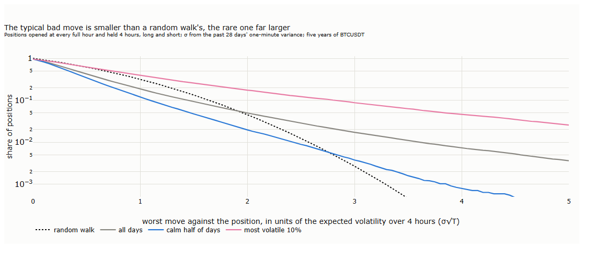
<sub><b>How to read the figure.</b> <b>Axes.</b> Worst move against the position in units of σ√T (x), share of positions (y, log). Positions opened at every full hour and held four hours, long and short; for each k on the x-axis, the share whose worst move exceeds k times the expected four-hour volatility, with σ from the past 28 days' one-minute variance. Lines: all days (grey), calm half (blue), most volatile 10% (pink), and a random walk (black, dotted).</sub>

The typical bad move is smaller than a random walk's: 0.64 σ√T on average, against 0.80. The rare one is far larger: a move beyond 3 σ√T, which a random walk makes 0.27% of the time, comes in 1.7% of positions, six times as often, and in 8.8% on the most volatile days, thirty times. A stop set on √t is too wide most of the time and too close in the tail. An active stop, which ends a trade that is not working, belongs where the typical excursion would rarely reach; a ring-fence, which only guards against disaster, is reached in the tail, and there the question is what it gets.

### 4.3 Gaps: what a stop gets

Measured with the right side of the trades (a sell stop is filled by sellers, at the bids), the path hardly ever skips a level on BTCUSDT: at the trigger, the first trade on the stop's side lies within 0.2 bp of the level in 99% of cases, on calm and on volatile days. And a resting order at a level was traded through, filled for certain, on more than 99.7% of visits: with a tick of ten cents the price almost never turns at exactly that price, so the place in the queue rarely decides whether it is filled. On a market with a coarser tick it would.

**What a stop gets, approximately.** The tape does not show the order book, so it cannot say what a stop-market order (Lecture 18, §3.2) would have received; it shows what the sellers who followed the trigger actually got, within a second for an instant order, within ten seconds for a larger one spread over time. The worst price any of them got is a conservative estimate, valid for orders no larger than what traded in that time.

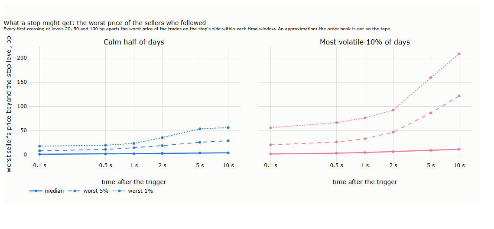
<sub><b>How to read the figure.</b> <b>Axes.</b> Time after the trigger (x, log), worst seller's price beyond the stop level in bp (y). <b>Left:</b> calm half of days. <b>Right:</b> most volatile 10%. For every first crossing of levels 20, 50 and 100 bp apart, the worst price of the trades on the stop's side within each time window: median (solid), worst 5% (dashed) and worst 1% (dotted). It approximates what a stop gets; the order book is not on the tape.</sub>

| Worst seller's price beyond the level | Median | Worst 5% | Worst 1% |
|---|---|---|---|
| Within 1 second, calm days | 2 bp | 14 bp | 23 bp |
| Within 1 second, volatile days | 4 bp | 33 bp | 76 bp |
| Within 10 seconds, volatile days | 11 bp | 122 bp | 209 bp |

<sub><b>How to read the table.</b> Our measurement for these notes; every first crossing of levels 20, 50 and 100 bp apart, 120 calm and 183 volatile days. Even in a slow second, at least $0.3 million (calm) to $0.7 million (volatile) was sold in nine cases out of ten.</sub>

A typical stop costs a few basis points; the tail is fat and depends on the regime. The worst cases are short runs: the price breaks a level and runs 50 to 100 bp in a few seconds, often ending at a round price (19,200; 30,250; 105,000), where resting orders seem to stand. That is a hypothesis; the order book would show it.

**A building block for backtests.** *A stop fills at the worst price of the next second, at a chosen percentile of this distribution*: an explicit, conservative fill rule that a backtest on bars can use without the tape. It is valid up to the size that traded in that second, and the regime must be judged from what is known at the trigger, such as the volatility of the last hour. Lecture 21 measures the order book, how much size a level absorbs and how fast it recovers.

## 5. Volatility, built up

There are many ways to measure the same day's risk, and each captures a different shade of it.

### 5.1 How the number is built

Every volatility measure adds up the price's moves in some way. Realised variance squares each move between sampling points and adds them (§1); a range estimator takes the distance between the highest and the lowest price (Parkinson's estimator, the basis of ATR); bipower adds up products of neighbouring moves, so that a single sudden jump among calm neighbours hardly counts. Measured on every single trade, realised variance would look absurd: each sweep through the book (Lecture 18, §9.4) counts as a move.

Over five years, realised variance at five minutes stays within 20% of the one-minute value on four days in five, bipower within 13%, while a single close-to-close return is almost useless for one day ([E20 §5.1](../extended/20-volatility-and-the-path/lecture.md) draws each estimator; Lecture 18, §8.2 the range estimators from daily candles).

Each captures a different shade of risk: return-based measures describe the net moves a position's value goes through, ranges describe how far the price reaches, and bipower how much of the risk comes in jumps. Close to close sees nothing inside the bar; a range needs enough trades per bar (§5.2), and one wild print sets it; realised variance counts noise if the interval is too fine; bipower misses jumps on purpose.

**Bipower: smooth moves and jumps.** The difference between realised variance and bipower is the part of a day's risk that came as jumps: on a typical day 4%, on one day in ten 13% or more. Its use is not forecasting (§5.3) but knowing what kind of risk the market is producing: smooth risk is the kind a stop handles well, jump risk the kind that makes it slip (§4.3). On bitcoin jumps are not moves without trades: minutes with jumps have four to fourteen times the trades of a typical minute.

### 5.2 Where to measure

§3 found that realised variance changes with the interval it is measured at. The other measures change too, but differently:

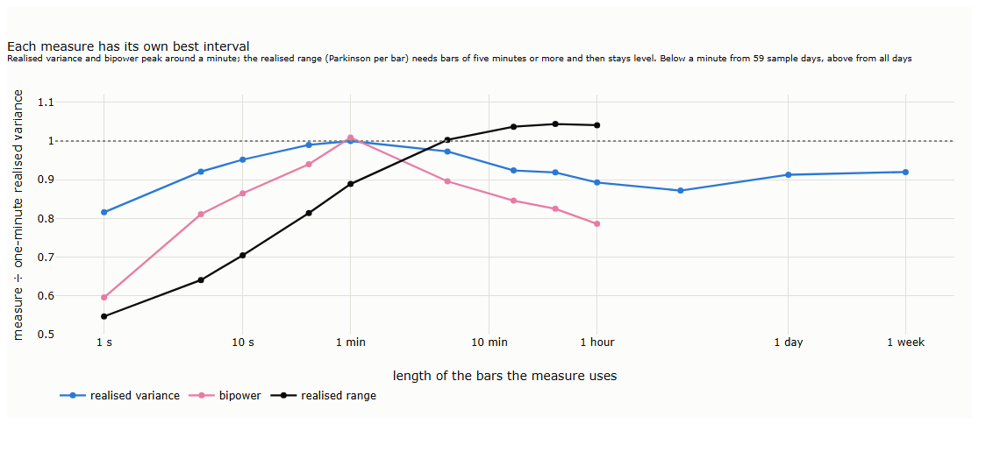
<sub><b>How to read the figure.</b> <b>Axes.</b> Length of the bars the measure uses (x, log, one second to a week), measure ÷ realised variance from one-minute returns (y). Lines: realised variance (blue), bipower (pink) and the realised range, Parkinson per bar (black). Points below a minute come from 59 sample days, the rest from all days. The dotted line at 1 is the one-minute realised variance.</sub>

Realised variance and bipower peak around one minute: below it, trades continue in the same direction for a few seconds and the measures fall short; above it, the turning back of §3 lowers them. The range does the opposite. On short bars it is far too low, because a one-second bar has only a few trades and its high and low miss much of the movement; from about five minutes on it is reliable and stays level up to an hour, because a candle's high and low capture the extremes that the turning back hides from closing prices.

So each measure has its own best interval. Realised variance belongs at about a minute; ranges belong to bars of five minutes and more. On hourly bars, the hourly ranges give about the right level of risk (1.04 times the one-minute value), while squared hourly returns understate it by 11%.

### 5.3 Which measure forecasts the next bars?

A strategy needs the risk of its next bars. The test: on hourly bars, forecast the realised variance of the next 1, 4 and 24 hours from each measure over the past 24 hours, adjusted for the time of day (Lecture 18, §6.2); fit one constant on October 2021 to June 2023; score the forecasts from July 2023 to September 2026.

**The yardstick must not be built like the forecast.** Scored against a target made of one-minute returns, the one-minute measure wins at every horizon, but partly at home: forecast and target share the same construction and its quirks. Scored against targets built differently, from five-minute returns or from the ranges of five-minute bars, each measure does best against the yardstick built like itself. A forecast should be judged against a target that does not share its construction.

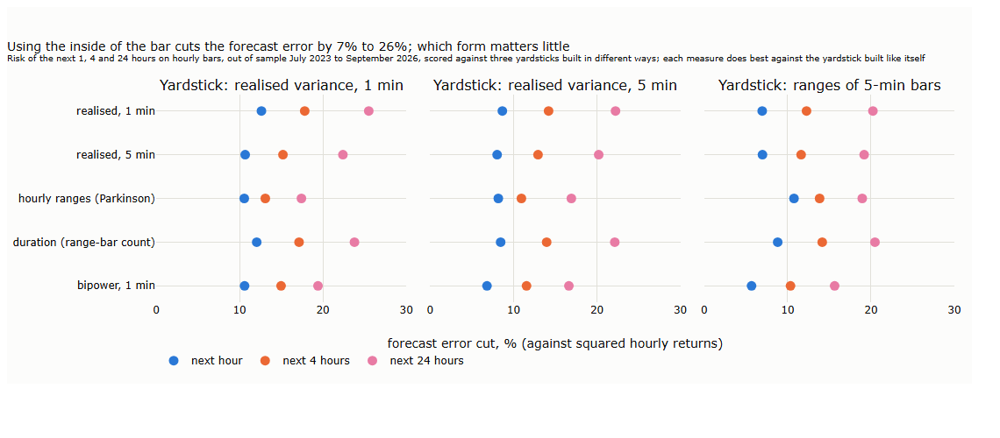
<sub><b>How to read the figure.</b> <b>Axes.</b> Less forecast error than squared hourly returns, % (x); one row per measure. Each panel scores the forecasts against a different yardstick: <b>Left:</b> realised variance at 1 minute. <b>Middle:</b> realised variance at 5 minutes. <b>Right:</b> ranges of 5-minute bars. Each dot is the reduction in forecast error, out of sample from July 2023 to September 2026, for the next hour (blue), 4 hours (orange) and 24 hours (pink); 0 means no better than squared hourly returns. The duration measure, a count of range bars, is introduced in §6.</sub>

What survives every yardstick: any measure that uses the inside of the bar beats the bar's own squared returns, by 7% to 26% less forecast error, more for longer horizons. Which form of the inside matters little; ranges from ordinary candles do about as well as minute data. Bipower alone forecasts slightly worse: the jumps it leaves out carry information about the risk ahead. Given both parts, smooth and jumps, with separate weights, it forecasts as well as realised variance, and slightly better for the next day against the return-based yardsticks only: no gain that holds across yardsticks.

**Key message.** Each measure captures a different shade of the same risk, and any measure that uses the inside of the bar forecasts the next bars better than the bar's own returns. Whether choosing the measure by the risk being managed, returns for sizing, ranges for stops and grid levels, improves those decisions is open: Lecture 20 tests it for sizing.

## 6. Risk on any clock

On time bars, √t turns the risk of one bar into the risk of a day. On the clocks of Lecture 18 (§9) the number of bars in a day is itself random. How is risk measured there?

**One identity.** On any clock, a day's variance is the number of bars in the day times the average variance of a bar's move:

```math
\mathrm{Var}_{\text{day}} = N_{\text{day}} \times \overline{\sigma^{2}}_{\text{bar}}
```

where $`N_{\text{day}}`$ is how many bars the clock closed that day, the speed of the clock, and $`\overline{\sigma^{2}}_{\text{bar}}`$ the average variance of one bar's move, the risk a position carries from one decision to the next. Which of the two carries the day's risk depends on the clock:

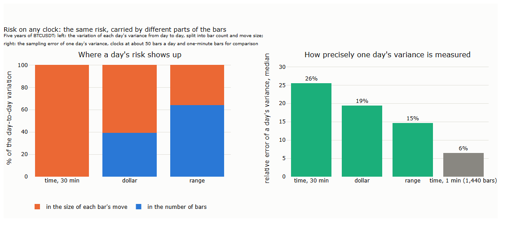
<sub><b>How to read the figure.</b> <b>Axes.</b> Left: clock (x), % of the day-to-day variation (y). Right: clock (x), median relative error of one day's variance, % (y). <b>Left:</b> the day-to-day variation of each day's variance on 30-minute time, dollar and range bars, split into the part due to the size of each bar's move (orange) and the part due to the number of bars (blue). <b>Right:</b> the sampling error of one day's variance on clocks of about 50 bars a day (green), and on one-minute time bars, 1,440 a day (grey), for comparison. Five years of BTCUSDT.</sub>

On time bars the number of bars never changes, so all of the risk is in the size of the moves: volatility feels like a property of time because, on a time clock, it is one. On price clocks each bar's move is about the same by construction, so most of the risk is in how many bars there are: volatility becomes the speed of the clock. Dollar bars lie between: busier days have more bars and, on top, larger moves per bar.

**The square-root rule on a random clock.** If a period contains a random number of bars, each with variance σ² and no drift, the period's variance is the expected number of bars times σ² (Wald's identity, met in Lecture 18, §11.3): its volatility is σ times the square root of the expected number of bars. The rule assumes that the number of bars and the size of their moves are unrelated:

| Clock | Average daily variance ÷ (bars per day × variance per bar) |
|---|---|
| Time, 30 minutes | 1.00 |
| Range | 0.97 |
| Dollar | 1.15 |

<sub><b>How to read the table.</b> Our measurement for these notes, five years. 1: the square-root rule with the expected bar count is right; above 1 it understates the day's variance.</sub>

On price clocks the rule holds almost exactly. On dollar bars it underestimates a day's variance by 15%, about 7% in volatility, because the two factors move together (a correlation of +0.42 between a day's bar count and its variance per bar). The random number of bars has a second effect: a period made of a random number of moves has fatter tails than one made of a fixed number, the explanation of the fat tails of time-bar returns in Lecture 18, §10.2.

**Precision.** At the same number of bars, one day's variance has a sampling error of 26% on 30-minute bars, 19% on dollar bars and 15% on range bars; but the number of samples matters more than the clock: one-minute time bars, 1,440 a day, give 6%.

**A measure made for price clocks: the duration.** On a range clock, risk can be read from how fast the bars come. For a random walk, a range bar (high minus low reaches R) takes on average R²/(2σ²), so a day's variance is about the number of range bars times R²/2 (Andersen, Dobrev and Schaumburg, 2008, a working paper; Nolte, Taylor and Zhao add half a bar for the bar left open at the end of the day). The range clock of Lecture 18 therefore yields a volatility measure for free: a count of events, without squaring any return.

On our sample it is precise, as tight as realised variance at five minutes (0.71 to 0.99 times the one-minute value on four days in five), and in the forecasting test of §5.3 it comes first or close behind against every yardstick: the only measure without a home advantage, because it is built from something else, a count.

It runs low, by 14%, and the bias can be taken apart: run the same clock on a simulated random walk with a set variance, then add the market's features one at a time:

| Simulated market, one price per second, about 48 bars a day | Estimate ÷ true variance |
|---|---|
| A random walk | 0.92 |
| + busy and quiet hours | 0.94 |
| + fat-tailed moves | 0.92 |
| + a component that turns back over minutes, and the clock's averaged price | 0.83 |
| BTCUSDT | 0.86 |

<sub><b>How to read the table.</b> Our simulation; the market's features added one at a time. 1 would be an unbiased measure.</sub>

About a third of the bias belongs to the method: a clock that looks at the price once a second misses ranges completed and reversed between two looks. It has a textbook correction, a slightly larger threshold in the formula, R plus 1.165 times the typical one-second move (our check of the barrier correction of Broadie, Glasserman and Kou, 1997, for ranges), which lifts the estimate from 0.86 to 0.91. The rest belongs to the market: bitcoin's turning back over minutes (§3) completes fewer ranges than a random walk would. The remaining bias is stable across regimes, so one constant per setting corrects it.

**In the literature.** Intraday measures forecast volatility better than daily returns (Andersen, Bollerslev, Diebold and Labys, 2003, on currencies), and forecasts are ranked correctly only against a target without bias of its own (Patton, 2011): both in line with §5.3. Duration estimators are precise, biased down by discrete sampling, and correctable (Andersen, Dobrev and Schaumburg, 2008; Hong, Nolte, Taylor and Zhao, 2023): we find all three. No published study reports bitcoin's variance ratio at these horizons; ours is a result on this sample ([E20 §6](../extended/20-volatility-and-the-path/lecture.md) has the full comparison, including bitcoin studies and jumps).

**Key message.** On any clock, a day's risk is the number of bars times the risk per bar: price clocks put most of it into the clock's speed, dollar bars split it, and the square-root rule fails by 15% where count and size move together.

## 7. Does one-sided flow predict the price?

The path half asked how the price moves; the flow half asks who moved it. When buyers hurry, the price rises; the question is what comes next. If the buyers knew something, the price should stay up or rise further; if they only needed to trade, the market makers who sold to them should push it partly back (Bouchaud, Gefen, Potters and Wyart, 2004).

**How it is measured.** Cut five years into windows of equal length: 1, 5 and 30 minutes. In each window measure the flow and sort the windows into fifths, from most selling to most buying. For each fifth, record the return during the window, the impact, and over the next window of the same length, what follows. Repeat for three volatility regimes, defined by the last hour's realised variance against its median over the past 28 days, so that the regime is known before the window starts.

| | 1 minute | 5 minutes | 30 minutes |
|---|---|---|---|
| Return during the window, most selling to most buying | −5 to +5 bp | −11 to +12 bp | −27 to +28 bp |
| Next window, most buying minus most selling | −0.08 bp | −0.51 bp | −0.99 bp |
| Same, in volatile hours | −0.21 bp | −0.91 bp | −3.02 bp |

<sub><b>How to read the table.</b> Our measurement for these notes; the differences in the second row are 4.5 to 7.7 standard errors from zero, with days as clusters. A negative value in the last two rows means the price came back after the flow.</sub>

Flow moves the price strongly while it happens. Afterwards a small part comes back: about 1 bp after a move of 28 bp in 30 minutes, a few percent of the impact, and almost all of it in volatile hours. The reversal is reliable, but far smaller than what a market order costs (§10): it is not a strategy on its own.

**With or against the trend?** Split by the slower trend (the past three days' return, divided by its typical size), the strongest flow comes back reliably in one corner only: after flow **with** the slower trend, in normal and volatile hours, by 0.2 to 0.5 bp after five-minute windows and 1.7 bp after thirty-minute windows in volatile hours. When the market piles in on the side the trend already favours, at a moment of stress, the price overshoots and gives some back ([E21 §2](../extended/21-order-flow-and-costs/lecture.md) draws the full matrix).

**At scheduled releases**, the first five minutes' **move** predicts the next thirty minutes (a correlation of +0.45 for CPI releases, −0.32 for Fed decisions, Lecture 18, §12.2 and [E19 §7.4](../extended/19-bars-not-cut-by-time/lecture.md)), but the first five minutes' **flow** does not (+0.15 and −0.10, neither distinguishable from zero): the book reprices itself, and the aggressive trades are only part of it.

**In the literature.** Order flow moves the price strongly within the same interval (Cont, Kukanov and Stoikov, 2014), and the impact of trades is partly transient (Bouchaud, Gefen, Potters and Wyart, 2004; for bitcoin, Donier and Bonart, 2015): in line with ours. The dependence on the slower trend we did not find in the literature.

**Key message.** On BTCUSDT, one-sided flow moves the price while it lasts and leaves almost all of its impact in place; the small part that comes back appears after flow with the slower trend in stressed hours, and none of it pays a market order's cost by itself.

## 8. Sweeps and absorption

Section 7 looked at flow added up over minutes. A single order can do the same in a millisecond: a market order larger than the depth at the best price takes the next level, and the next, until it is filled. This is a **sweep** (Lecture 18, §9.4). Behind the price it leaves a gap, and the question is who fills it and how fast. If the book refills quickly, most of the move comes back; if the sweep carried news, it stays.

**Hypotheses.** Fixed before the measurement:

| | Hypothesis | Why one might expect it |
|---|---|---|
| H1 | A large part of a sweep's move comes back within seconds | The gap behind the sweep is refilled by new resting orders: the book's resilience |
| H2 | A sweep against the slower trend comes back more than one with it | It fights the market's direction; a sweep with the trend joins it |

**How it is measured.** A sweep is one aggressive order, all fills in the same millisecond on the same side, that moves the price by at least 5, 10 or 20 bp from its first to its last fill. Sweeps come in bursts, so only the first in each 10-minute block is kept; with a clear slower trend, this leaves about 19,000, 5,800 and 1,600 independent sweeps for the three sizes. For each, the price is read just before it, at its last fill, and 10 seconds, 1 minute, 10 minutes and 1 hour later. The slower trend is the one of §7, the past three days' return divided by its typical size, read in the minute before the sweep.

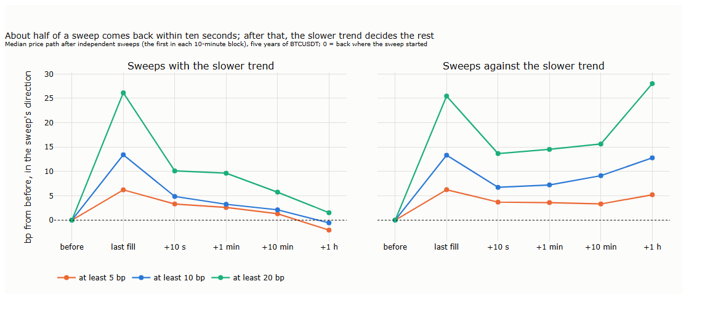
<sub><b>How to read the figure.</b> <b>Axes.</b> Time from the sweep (x, in steps, not to scale), price in bp from before the sweep, in the sweep's direction (y). Left: sweeps with the slower trend. Right: sweeps against it. Each line is the median price path after independent sweeps (the first in each 10-minute block) of at least 5 bp (orange), 10 bp (blue) and 20 bp (green), read just before the sweep, at its last fill and 10 seconds to 1 hour later. 0 means the price is back where the sweep started.</sub>

**H1 holds.** Within ten seconds, about half of the move is gone: a sweep of 13 bp is at 5 to 7 bp after ten seconds, one of 26 bp at 10 to 14. This is the same for both directions and all sizes. The gap fills almost at once.

**H2 fails, the other way round.** After the first ten seconds, the two kinds part:

- A sweep **with** the slower trend keeps losing ground and is back near where it started within the hour. The buyer who chases a rising market overshoots, and the market takes it back.
- A sweep **against** the slower trend keeps the half that survived the first ten seconds. Over the next ten minutes the price drifts a few basis points back towards the trend, and after an hour nothing is distinguishable from zero.

The control is the same return at moments without a sweep, every tenth minute with a clear trend, in the same volatility regime. There the trend's direction says nothing about the next ten minutes or the next hour (between −3 and +2 bp on average). The table gives the return in the trend's direction after the sweep's last fill, minus that control:

| Sweep | Size | Next 10 minutes | Next hour |
|---|---|---|---|
| with the trend | ≥ 5 bp | −4.8 bp (−8.8)\*\*\* | −7.4 bp (−4.3)\*\*\* |
| | ≥ 10 bp | −11.4 bp (−9.9)\*\*\* | −14.8 bp (−5.6)\*\*\* |
| | ≥ 20 bp | −20.6 bp (−6.6)\*\*\* | −26.1 bp (−5.0)\*\*\* |
| against the trend | ≥ 5 bp | +2.8 bp (4.9)\*\*\* | +1.2 bp (0.7) |
| | ≥ 10 bp | +4.1 bp (3.4)\*\* | −1.6 bp (−0.6) |
| | ≥ 20 bp | +7.5 bp (2.4)\* | −12.7 bp (−2.1)\* |

<sub><b>How to read the table.</b> Our measurement for these notes. Negative: the price moves back against the trend, that is against the sweep. In brackets the t-statistic, with days as clusters; stars after the Benjamini–Hochberg correction over the 16 tests (including the hourly-block variant below): \* q < 0.05, \*\* q < 0.01, \*\*\* q < 0.001.</sub>

**Robustness.** The reversal after sweeps with the trend appears in every year from 2021 to 2026 (between −5 and −16 bp after ten minutes for sweeps of at least 10 bp), in calm, normal and volatile hours, and when only the first sweep per hour is kept (−8.6 bp after ten minutes, t −6.6). After sweeps against the trend only the ten-minute drift towards the trend survives the hourly blocks (t 4.0); the hour after changes sign from year to year.

**In the literature.** After large trades the book is replenished quickly (Biais, Hillion and Spatt, 1995), and the impact of aggressive orders is partly reversed while a longer-term effect remains (Degryse, de Jong, van Ravenswaaij and Wuyts, 2005): in line; the dependence on the slower trend is a result on this sample.

**Key message.** About half of a sweep comes back within seconds, whatever its direction; a sweep that chases the slower trend is taken back within the hour, one against it keeps its remaining half. For a grid, this is the difference between a fill that is soon in profit and one that stays at a loss.

## 9. Cascades

Some of the explosive hours of §3 feed on themselves: the price falls, leveraged buyers are liquidated, their forced sales push it further, and more liquidations and stop orders follow. Both are market orders fired by a price (Lecture 18, §3.2), which is why they arrive together. This is a **cascade**. For a strategy the question is practical: can it be seen coming, early enough to cut size, widen stops or pull resting orders?

**Fuel and spark.** Two kinds of warning were tested, each read from data known at the start of the hour and counted when in its top (or bottom) fifth. **Fuel** is the state that would make a cascade possible: open interest high against its 28-day median, funding far from its usual 0.01%, a lopsided ratio of long to short accounts, calm, a long time in a tight band. **Spark** is what would show in the last 15 minutes once the self-feeding has begun: open interest falling fast, net flow on one side minute after minute, the price moving more per dollar traded, a sweep of 10 bp or more (§8).

**How it is measured.** A cascade is an hour whose move, over its typical size, is in the top 1%: at least 4.3 typical hourly moves. Each warning must add something to the simplest one, the last hour's own volatility, so the chance of a cascade is regressed on the warning and on the fifth of the last hour's realised variance, with days as clusters. Cut-offs are set on 2021–2024 and applied unchanged to 2025–2026. There is no public archive of individual liquidations, so falling open interest, from Binance's five-minute statistics, stands in for them.

**Risk clusters.**

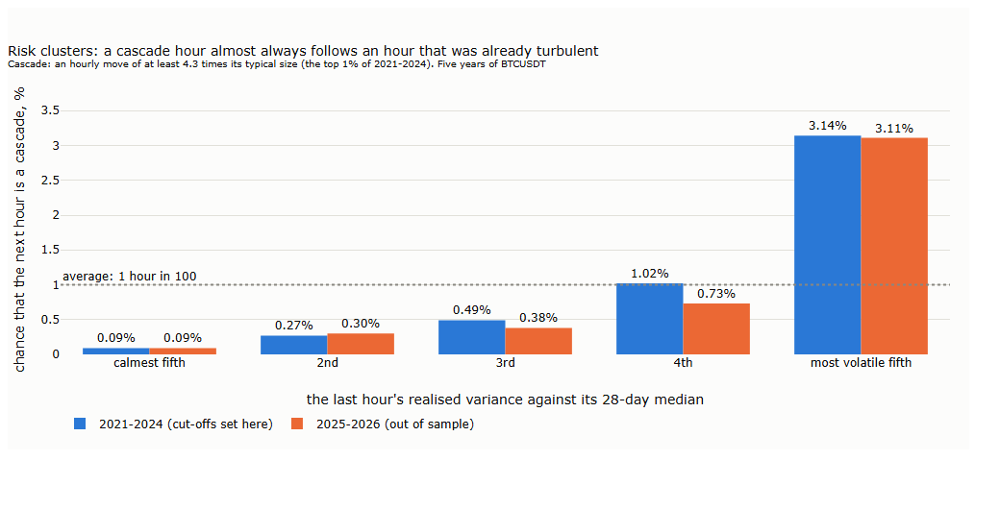
<sub><b>How to read the figure.</b> <b>Axes.</b> Fifth of the last hour's realised variance against its 28-day median (x), chance that the next hour is a cascade, % (y). Blue bars are 2021–2024, where the cut-offs were set; orange bars are 2025–2026, out of sample. A cascade is an hour whose move is at least 4.3 times its typical size; the dotted line is the average rate, 1 hour in 100.</sub>

After the calmest fifth of hours the next hour is a cascade about once in a thousand; after the most volatile fifth, three times in a hundred, in both periods. The reason is the mechanism itself: a cascade takes time to build, each round of forced selling triggering the next, so its first stages are visible in the volatility before the worst hour comes. This is volatility clustering (§5.3) at its extreme, and it answers the question §3 left open: yesterday's volatility does not say whether today will be explosive, but within the day the last hour's volatility does.

**What the warnings add.**

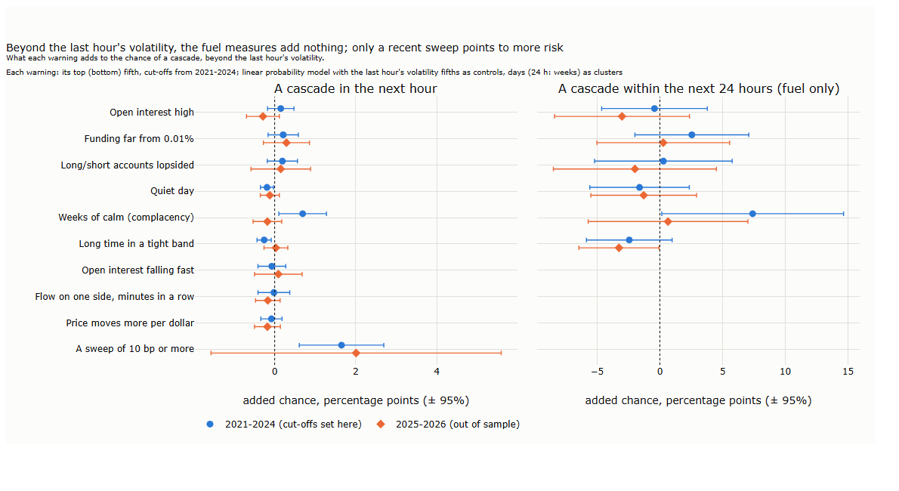
<sub><b>How to read the figure.</b> <b>Axes.</b> Added chance of a cascade, percentage points (x), warning (y). Left: next hour. Right: within 24 hours, fuel measures only. Each marker is what a warning in its top (or bottom) fifth adds to the chance of a cascade beyond the last hour's volatility fifths, with a 95% interval: blue dots for 2021–2024, where the cut-offs were set, orange diamonds for 2025–2026, out of sample. The dashed line at 0 means no added risk; the two panels have different scales.</sub>

Only a sweep adds to the warning: after one in the last 15 minutes, the next hour is a cascade four to five times as often, 1.7 percentage points beyond the control in 2021–2024 (t 3.1). A single order that clears several levels shows that the book is thin, where forced sales move the price most. Out of sample the effect is as large but not significant: a lead, not an established result.

The fuel measures add nothing. At the next hour the intervals are narrow (about ±0.4 percentage points on a base rate of 1%), so a warning that raised the risk by half would have shown; within 24 hours they are wide, and there the honest verdict is only "not found". Falling open interest does come with cascades, but adds nothing once the last hour's volatility is known: it describes the turbulence rather than announcing it. The squeeze fails too: breaks after long stays in a tight band are not larger than after short ones ([E21 §4](../extended/21-order-flow-and-costs/lecture.md) adds two later checks, the direction of crowding and the extremes; none passes the Benjamini–Hochberg correction).

**In the literature.** Volatility clusters (Cont, 2001); on our sample the last hour's volatility raises the chance of a cascade thirty-five-fold, the same at the extreme. A high crypto carry predicts crashes at daily and longer horizons (Schmeling, Schrimpf and Todorov, BIS working paper, 2023): a different horizon from ours, not a contradiction. Across seven bitcoin perpetual cascades, no early-warning variable holds for every event (Garcia Seuma, 2026, preprint), in line with ours. A market maker's optimal spread widens with the variance of the price (Avellaneda and Stoikov, 2008): the rule below follows.

**Key message.** Risk clusters: the best early warning of a cascade is the turbulence already under way, and a recent sweep may add to it. For a market maker or a grid the rule to test is therefore reactive rather than predictive: widen or pull the quotes as the last hour's volatility rises, and step aside for a few minutes after a sweep.

## 10. What a trade costs

A market order pays the exchange's fee, half the spread (it buys at the ask, not at the mid) and, if it is large, the impact of walking through several price levels. A resting order pays a lower fee and earns the half-spread, but it is filled exactly when someone in a hurry wants to trade with it, and the price often moves on against it.

**Hypotheses.** Fixed before the measurement:

| | Hypothesis | Measure |
|---|---|---|
| H1 | The quoted spread is almost always one tick, so the fee dominates the cost of small orders | Quoted half-spread over time, against the fee |
| H2 | The cost of a market order rises with its size and in volatile hours | Effective half-spread: the order's average fill price against the mid just before it |
| H3 | The resting side loses to adverse selection: the price moves against it after the fill by more than the half-spread it earns | Realised half-spread: the fill against the mid 1, 10 and 60 seconds later |

**How it is measured.** Binance published its best bid and ask, every change of them, only from May 2023 to March 2024; every fourth day of that window is used, 80 days and 1,903 hours. Each aggressive order (all fills in the same millisecond on the same side, as in §8) is matched to the best bid and ask in force just before it; The effective half-spread splits into two parts that add up to it: the **impact**, how far the mid moves in the order's direction over the next seconds, and the **realised half-spread**, what the resting side keeps against that later mid. Fees are those of a regular account: 5 bp for a market (taker) order and 2 bp for a resting (maker) order, lower at higher volume tiers.

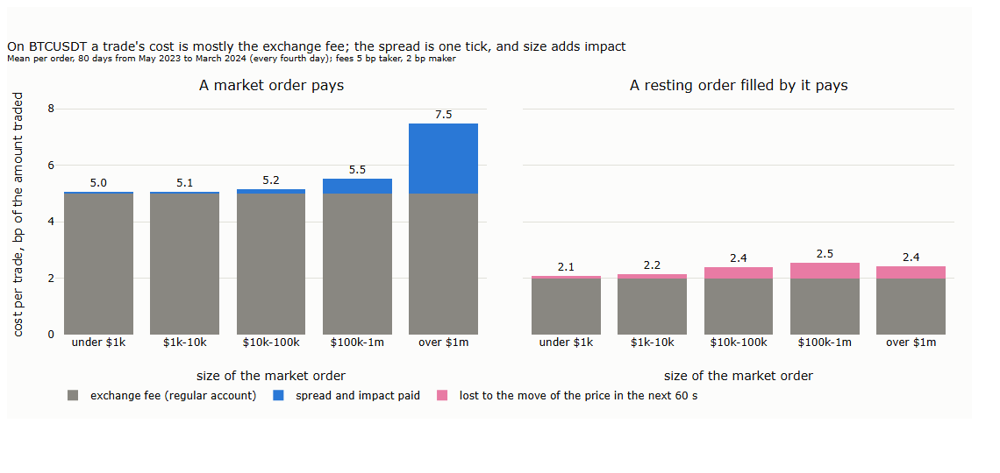
<sub><b>How to read the figure.</b> <b>Axes.</b> Size of the market order (x), cost per trade in bp of the amount traded (y). Left: what the market order pays. Right: what the resting order it fills pays. Mean per order over 80 days from May 2023 to March 2024. Each bar stacks the exchange fee of a regular account (grey, 5 bp taker, 2 bp maker) and, on the left, the spread and impact paid (blue) or, on the right, what is lost to the move of the price in the next 60 seconds (pink); the number on top is the total.</sub>

**H1 holds.** The book sits at one tick 99.6% of the time; the quoted half-spread averages 0.015 bp. For orders under $10,000 the spread and impact together cost 0.04 to 0.07 bp, a hundredth of the 5 bp fee.

**H2 holds.** The cost rises with size, from 0.04 bp under $1,000 to 0.5 bp between $100,000 and $1 million and 2.5 bp above, where an order walks through several levels. It roughly doubles from calm to volatile hours, from 0.05 to 0.12 bp per order. Only the largest orders pay a cost comparable to the fee.

**H3 holds.** For every order size and in every regime, the mid moves against the resting side by more than the half-tick it earned: it keeps −0.13 bp after 60 seconds in calm hours and −0.22 bp in volatile ones (t-statistics from −8 to −34, with days as clusters). The loss is largest, in basis points, against large orders (−0.55 bp against orders of $100,000 to $1 million). One reading, not tested here: a large order is more likely to carry information, or to start a move. In the minute after a sweep the resting side does better for the first ten seconds, when half of the sweep comes back (§8), and the same as at any other time after sixty ([E21 §5](../extended/21-order-flow-and-costs/lecture.md) draws it by regime).

**What this means.** For a strategy that can wait to be filled, a resting order costs about 2.1 to 2.5 bp against 5.0 to 5.5 bp for a market order: the saving is the fee difference, less a small loss to adverse selection. Market making for the spread itself does not pay at these fees: Binance's largest market makers earned rebates of 0.1 to 0.5 bp per resting fill in 2023 (negative maker fees), about the size of the adverse-selection loss measured here.

**In the literature.** The effective spread splits into price impact and a realised spread (Huang and Stoll, 1996); informed traders alone create a spread (Glosten and Milgrom, 1985); with a one-tick spread the observed spread no longer measures the cost of trading (Dayri and Rosenbaum, 2015); and on Binance's bitcoin perpetual, the more likely a resting order is filled, the worse the return after the fill (Albers, Cucuringu, Howison and Shestopaloff, 2025, preprint). Our results are in line with all four.

**Key message.** On BTCUSDT the spread is one tick and the cost of a trade is the exchange's fee, 5 bp for a market order and 2 bp for a resting one, with impact adding to it only above about $100,000. Backtests should charge the taker fee plus the effective half-spread for market orders, the maker fee plus the adverse selection for resting ones.

## 11. Resting orders

A resting order pays 2 bp where a market order pays 5 (§10). But it is filled only if the price comes to it, and the orders that are not filled are not a random selection. Whether waiting pays depends on how often it is filled, what it misses, and how long it waits before sending a market order.

**Hypotheses.** Fixed before the measurement:

| | Hypothesis | Why |
|---|---|---|
| H1 | The chance of a fill falls quickly with the distance from the price | The price must travel to the order (§4.1) |
| H2 | Fills are adverse and misses run away | An order is filled when the price comes against it; the trades it misses are those that moved the other way |
| H3 | For a trend rule's entries, buying after a rise, a resting order costs more than it saves; for a grid's entries, buying after a fall, it saves | A trend entry chases a moving price; a grid entry waits for one to come back |

**How it is measured.** At every seventh minute of the five years a trader decides to buy, and, mirrored, to sell, so that the drift of the price cancels. The choice is between a market order at once, paying the taker fee and the half-spread of §10, and a resting order one tick or a few basis points inside the last price, which pays the maker fee if filled. If it is not filled by a cut-off, it becomes a market order at the price then. Both choices end with the same position. A resting order counts as filled only when a later trade goes strictly through its price, a conservative rule, since our place in the queue is unknown. Distances and waiting times use one-minute bars over the five years, cut-offs under a minute the tick tape on every tenth day, 180 days; t-statistics use days as clusters. The fills are simulated, and simulated fills can differ from real ones (Lo, MacKinlay and Zhang, 2002).

**H1 holds.** One tick inside, an order is filled 79% of the time within a minute and 94% within ten; 5 bp away, 26% and 66%; 20 bp away, 2% and 22%. Moving the order away from the price does not pay: it is filled less often, and the chases eat what the better price saves. One tick inside is the best distance at every waiting time.

**H2 holds.** The orders that are filled are those the price came against: after the fill it moves on against them by a further 1 to 1.7 bp. The orders that are not filled are those it ran away from. 5 bp away with a ten-minute wait, over all entries, the price an hour later is 6 bp against the filled orders and 11 bp in favour of the missed ones; for trend and grid entries, decided after a larger hourly move, the missed ones end 24 and 21 bp in favour. Much of this is geometry, but for a strategy with an edge it is decisive: dropping the misses removes the trades that moved its way ([E21 §6](../extended/21-order-flow-and-costs/lecture.md) draws fill rates and misses by distance).

**H3 is rejected, provided the order chases.** Trend entries and grid entries alike save about 1.7 bp with a one-minute cut-off (t −65 and −51), because a resting order one tick inside is filled so often that the rare chases cost less than the fee saved. Without the chase the trend rule would lose its runaway entries, which is where its profit comes from (Lecture 20).

**The cut-off.** Measured on the tick tape, one tick inside:

| Cut-off, one tick inside | 10 s | 30 s | 1 min | 10 min | 60 min |
|---|---|---|---|---|---|
| Filled before the cut-off | 58% | 72% | 79% | 94% | 98% |
| Average against a market order | −1.2 bp | −1.5 bp | −1.6 bp | −1.9 bp | −2.0 bp |
| Average of the worst 5% | +5.7 bp | +8.2 bp | +9.9 bp | +18.6 bp | +17.7 bp |
| 95th percentile among the chased orders | +5 bp | +9 bp | +12 bp | +45 bp | +117 bp |

<sub><b>How to read the table.</b> Our measurement for these notes; tick tape, every tenth day from November 2021 to September 2026. The averages are 48 to 77 standard errors from zero. Percentiles are over all orders; the last row is among those that reached the cut-off. Negative: cheaper than a market order sent at once.</sub>

The average saving grows slowly, and half of it is there after five seconds; the tail grows fast. A long wait rarely ends in a chase, but when it does the price has run: after an hour, by more than 100 bp at the 95th percentile. A resting order with a long cut-off is in effect a short option: it collects a little almost always and pays a lot when the price moves away.

**Re-posting the order.** The tail comes from waiting at a price the market has left. An order that is cancelled and re-posted one tick inside the current price every five seconds follows the price in small steps instead, and pays a runaway move a little at a time:

| One tick inside | Average against a market order | Average of the worst 5% | Sent as a market order at the end |
|---|---|---|---|
| Re-posted every 5 s, market order after 30 seconds | −1.8 bp | +5.0 bp | 13% |
| Re-posted every 5 s, market order after 60 seconds | −2.0 bp | +4.9 bp | 6% |

<sub><b>How to read the table.</b> Same sample as above; t-statistics from −68 to −86. Negative: cheaper than a market order sent at once; the last column is the share of orders that end as a market order. Compare the static order of the table above: −1.6 bp with a worst 5% of +9.9 bp after 1 minute, −1.9 bp and +18.6 bp after 10 minutes.</sub>

Re-posted every five seconds with a market order after a minute, the order saves more than a static order waiting ten minutes, with a quarter of its tail, after two re-posts on average. The most any resting order could save is about 3 bp, the fee difference and the half-spread less the tick it gives away; this keeps two thirds of it.

**In the literature.** The comparison is implementation shortfall, the cost measured against the price at the decision (Perold, 1988); limit orders outperform market orders even after a penalty for not being executed (Harris and Hasbrouck, 1996), and a posted quote is an option written to the market (Copeland and Galai, 1983). That re-posting every few seconds keeps the saving and removes the tail is a result on this sample.

**Key message.** A resting order one tick inside saves 1 to 2 bp against a market order, provided it chases its misses, the trades where the price ran away; re-posted every five seconds and sent as a market order after a minute, it saves about 2 bp with the worst cases near 5 bp. For a grid, which never chases, the misses are its risk: they are the trends.

## 12. Capacity and funding

A strategy's edge per trade is fixed by its rule; its costs are not. The fee and the spread of §10 are the same for every trade, impact grows with the size of the trade, and funding with the time a position is held. Capacity is the size at which these costs take the edge.

**Size as a share of the market.** Size is measured as the trade's share of a day's volume, Q / V. BTCUSDT traded a median of $10 to 16 billion a day in each year from 2021 to 2026, with a daily volatility of 190 to 330 bp.

**Impact: the square-root law.** Across markets, the price impact of a metaorder, a trade split into many small orders over hours, follows

```math
\text{impact} = Y \times \sigma \times \sqrt{Q / V}
```

| Symbol | Financial meaning |
|---|---|
| impact | the average move of the price against the trade while it is executed |
| Q | the size of the trade, in dollars |
| V | the market's volume over a day, in dollars |
| σ | the market's volatility over a day |
| Y | a constant of order one |

The impact grows with the square root of size: a trade four times as large moves the price twice as much (Tóth et al., 2011). On bitcoin, Donier and Bonart (2015) measured Y = 0.9 (standard deviation 0.35) on a million metaorders, close to the values of mature markets; their metaorders lasted minutes to an hour, so applying the law to trades executed over a day, as below, extends it beyond their data. Our tape cannot calibrate it: it is anonymous, so one trader's metaorder cannot be told apart. What it can measure, the net flow of all traders together, is a different object, aggregate impact, which on our tape rises close to linearly with size (Patzelt and Bouchaud, 2018; [E21, Appendix](../extended/21-order-flow-and-costs/lecture.md)).

**The capacity map.** With a cost of 3 bp per trade for fee and spread (the re-posted entry of §11) and impact from the square-root law, the largest trade at which costs take half or all of a given edge is:

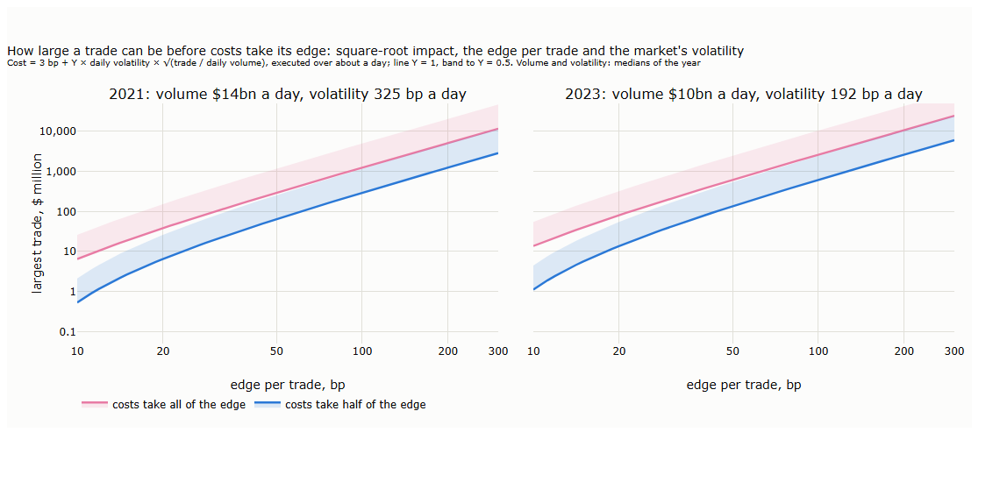
<sub><b>How to read the figure.</b> <b>Axes.</b> Edge per trade, bp (x, log), largest trade, USD million (y, log). Left: 2021. Right: 2023. The largest trade at which costs take all (pink) or half (blue) of the edge, with costs of 3 bp plus square-root impact for a trade executed over about a day, using the year's median volume and volatility. The line is for a constant Y = 1; the shaded band reaches to Y = 0.5.</sub>

A trend trade with an edge of 50 bp loses half of it to costs at about $65 million in 2021 and $135 million in 2023, all of it at about $290 million and $620 million. The capacity rises with the square of the edge left after the fixed cost and falls with the square of volatility: the calm year 2023 allowed twice the size of the volatile 2021. A grid's fills are passive: for them the binding cost is the adverse selection of §10, not impact.

**Funding: the cost of holding.** Every eight hours longs pay shorts, or shorts pay longs, an amount that keeps the perpetual's price close to spot (Lecture 18, §2). On BTCUSDT longs paid in 74 to 99% of the eight-hour periods each year, and a long perpetual paid 4 to 12% a year in each full year. A long perpetual needs only margin, so the rest of its capital can earn interest; in every full year the funding was the larger, most of all in the rising year 2024, when longs paid 12% against 5% on cash.

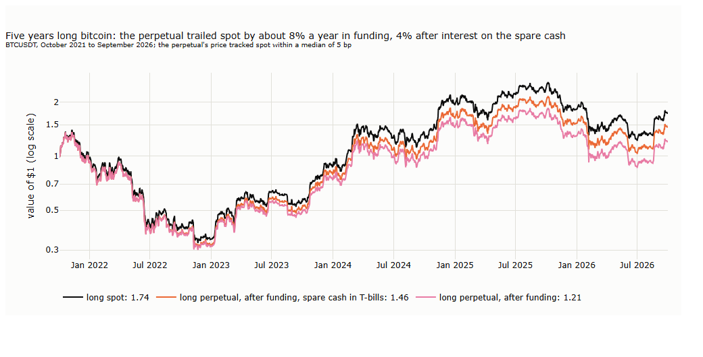
<sub><b>How to read the figure.</b> <b>Axes.</b> Date (x), value of USD 1 invested (y, log). Long spot (black), long perpetual after funding with the spare cash in T-bills (orange), and long perpetual after funding alone (pink), October 2021 to September 2026; the legend gives each final value.</sub>

Over the five years the perpetual's price tracked spot within a median of 5 bp, but a dollar held long grew to $1.74 in spot, $1.21 in the perpetual after funding, and $1.46 with the spare cash in Treasury bills: the perpetual trailed spot by about 8% a year, and by 4% after interest. The basis, the perpetual's price over spot, ended where it began, so the gap is the funding (Lecture 20, [E22 §6](../extended/22-trend-on-the-tape/lecture.md), measures the long-spot, short-perpetual structure that earns it). A trend trade held long for 20 days paid 16 to 110 bp in funding, depending on the year, against 4 to 10 bp to enter and leave; a short received it.

**In the literature.** The perpetual's price is tied to spot by funding, with deviations larger in crypto than in traditional markets and shrinking over time (He, Manela, Ross and von Wachter, working paper, 2022–2026): in line with the 5 bp tracking we measure.

**Key message.** Impact limits a trade on BTCUSDT only at tens to hundreds of millions of dollars, later in calm years than in volatile ones; the cost a trend rule cannot avoid is funding: a long perpetual trailed long spot by about 4% a year after interest, while a short received it.

## Back to the base layer

*Food for thought.*

| | |
|---|---|
| **The idea** | Rebalance the daily portfolio with resting orders that chase their misses, instead of paying the spread and fee of market orders (Lecture 16 §6: carry's edge is sensitive to costs) |
| **What our results already say** | On BTCUSDT the spread is one tick and the cost of a trade is the fee; impact matters only above about $100,000 (§10); a resting order one tick inside, re-posted every few seconds and chasing its misses, saves about 2 bp against a market order (§11) |
| **What a test would need** | The portfolio's own rebalancing orders on futures and ETF venues; the first thing that could kill it: wider spreads and longer queues than on bitcoin |
| **Status** | Not tested in this course; a research direction |

<sub><b>How to read the card.</b> Food for thought, not a result: the idea, only numbers this lecture has shown, what a test would need, and its status.</sub>

## 13. Summary, exercises and reading

### 13.1 Seven takeaways

1. **A candle records neither the order nor the distance travelled:** the better guess at the order is wrong on one bar in eight, as for any random walk; a typical hour travels four times its range.
2. **Two regimes, not one average:** against its own shuffled returns, BTCUSDT turns back on ordinary days and carries on at larger steps on explosive ones; √t overstates its variance by 5% to 13%.
3. **Levels are reached less often and passed more violently than variance suggests:** fewer crossings, a fat tail of excursions, stops cheap in the median and expensive in the tail.
4. **Measure volatility inside the bar and judge it against a yardstick not built like itself;** on any clock, a day's risk is the number of bars times the risk per bar.
5. **Flow moves the price and keeps almost all of its impact;** half of a sweep comes back within seconds, and what remains depends on the trend.
6. **Risk clusters:** a cascade grows out of turbulence that is already visible; the measures said to load the market add nothing.
7. **The spread is one tick and the cost is the fee;** a resting order is cheaper only if it chases its misses, and funding, not impact, is the cost a trend rule cannot trade away.

### 13.2 Exercises

- [ ] Repeat the step test of §3 on ETHUSDT and SOLUSDT for one year, with and without the shuffled benchmark. Is the turning back weaker on the thinner market?
- [ ] Choose a yardstick of your own for §5.3, for instance realised variance from 15-minute returns. Which measure wins at home, and which survives?
- [ ] Use the stop-fill distribution of §4.3 in a stop-loss backtest on hourly bars. How much does the result change between the median and the worst 1%?
- [ ] Simulate the re-posted entry of §11 with re-posts every 1, 5 and 20 seconds. Where does the saving stop growing, and where does the tail start to grow?
- [ ] How much funding would a rule that is long when the 50-day average is above the 200-day, and flat otherwise, have paid over the five years? Compare it with the rule's return.

### 13.3 Research questions

The results hold on BTCUSDT, 2021 to 2026 (the best bid and ask, May 2023 to March 2024). Open, for readers to test here and on other markets:

- Does sizing by a measure from inside the bar keep risk more constant after the cost of resizing, and do stops placed by measured excursions beat stops placed by √t?
- Does a sweep against the trend in volatile hours mark the turn of a trend, and do extreme funding or long calm warn of cascades beyond a day?
- Are the simulated fills of §4.3 and §11 those a real order gets? The order book (Lectures 21 and 22) would show it.
- Does the square-root law hold for bitcoin trades executed over a day? Only data that identify traders can tell.
- Do the two regimes, the duration measure and the re-posted entry hold on a thinner market, such as SOLUSDT, or on a market that closes?

### 13.4 Reading

For realised variance and forecasting with it, Andersen, Bollerslev, Diebold and Labys (2003); for comparing forecasts fairly, Patton (2011). For volatility from price durations, Andersen, Dobrev and Schaumburg (2008) and Hong, Nolte, Taylor and Zhao (2023). For order flow and price changes, Cont, Kukanov and Stoikov (2014). For the components of the spread, Glosten and Milgrom (1985) and Huang and Stoll (1996). For limit orders against market orders, Harris and Hasbrouck (1996); for implementation shortfall, Perold (1988). For the square-root law, Tóth et al. (2011), and on bitcoin, Donier and Bonart (2015). For perpetual futures and funding, He, Manela, Ross and von Wachter (working paper).

Full versions: [E20](../extended/20-volatility-and-the-path/lecture.md) and [E21](../extended/21-order-flow-and-costs/lecture.md).

### 13.5 Next: two strategies on the tape

Lecture 20 applies Part V to two strategies at opposite ends of the holding period: a trend rule held for days, which needs the move to carry on, and an intraday grid held for minutes, which needs the price to come back.

| From this lecture | The trend rule (held for days) | The grid (held for minutes) |
|---|---|---|
| Path and levels (§2–§4) | Candle backtests hold for stops wider than a bar's range; moves beyond 3 σ√T are six times as frequent as a random walk implies | 40% to 72% of the crossings variance promises; explosive days run, and yesterday does not tell which day it is |
| Risk (§5–§6) | A measure from inside the bar forecasts risk 7% to 26% better; on dollar bars, bars × risk per bar is 15% low | Stops fill at the worst seller of the next second, a conservative rule |
| Flow and sweeps (§7–§9) | Chasing a sweep with the trend pays the overshoot; size by the last hour's volatility | After a sweep with the trend the price returns within the hour; widen or pull the orders as volatility rises |
| Costs (§10–§11) | 5 bp taker fee plus 0.04 to 2.5 bp; rest, re-post and chase: about 2 bp saved | 2 bp maker fee plus 0.13 to 0.22 bp of adverse selection; the misses are the trends |
| Holding (§12) | Longs paid 4 to 12% a year in funding; book it at every settlement | Passive fills: the limit is adverse selection, not impact |

<sub><b>How to read the table.</b> One row per part of this lecture; the two columns give what the trend rule and the grid of Lecture 20 take from it, with the section where it was measured.</sub>

The trend rule lives on the moves that run, so it must pay to catch them and survive their tails; the grid lives on the moves that come back, so its risk is exactly the runs the trend rule wants.

## References

- Albers, J., Cucuringu, M., Howison, S. and Shestopaloff, A. Y. (2025). The market maker's dilemma: navigating the fill probability vs. post-fill returns trade-off. arXiv preprint 2502.18625. — fill probability and the return after the fill on Binance's bitcoin perpetual (§10).
- Andersen, T. G., Bollerslev, T., Diebold, F. X. and Labys, P. (2003). Modeling and forecasting realized volatility. *Econometrica* 71(2), 579–625. — intraday measures forecast volatility better than daily returns (§6).
- Andersen, T. G., Dobrev, D. and Schaumburg, E. (2008). Duration-based volatility estimation. Working paper. — passage times, their bias and their correction (§6).
- Avellaneda, M. and Stoikov, S. (2008). High-frequency trading in a limit order book. *Quantitative Finance* 8(3), 217–224. — the market maker's spread widens with variance (§9).
- Biais, B., Hillion, P. and Spatt, C. (1995). An empirical analysis of the limit order book and the order flow in the Paris Bourse. *Journal of Finance* 50(5), 1655–1689. — the book refills after large trades (§8).
- Bouchaud, J.-P., Gefen, Y., Potters, M. and Wyart, M. (2004). Fluctuations and response in financial markets: the subtle nature of 'random' price changes. *Quantitative Finance* 4(2), 176–190. — the impact of a trade is transient (§7, §8).
- Broadie, M., Glasserman, P. and Kou, S. G. (1997). A continuity correction for discrete barrier options. *Mathematical Finance* 7(4), 325–349. — the barrier shift for discrete monitoring (§6).
- Cont, R. (2001). Empirical properties of asset returns: stylized facts and statistical issues. *Quantitative Finance* 1(2), 223–236. — volatility clustering (§9).
- Cont, R., Kukanov, A. and Stoikov, S. (2014). The price impact of order book events. *Journal of Financial Econometrics* 12(1), 47–88. — order flow imbalance and price changes (§7).
- Copeland, T. E. and Galai, D. (1983). Information effects on the bid-ask spread. *Journal of Finance* 38(5), 1457–1469. — a posted quote as an option written to the market (§11).
- Dayri, K. and Rosenbaum, M. (2015). Large tick assets: implicit spread and optimal tick size. *Market Microstructure and Liquidity* 1(1), 1550003. — when the spread is one tick (§10).
- Degryse, H., de Jong, F., van Ravenswaaij, M. and Wuyts, G. (2005). Aggressive orders and the resiliency of a limit order market. *Review of Finance* 9(2), 201–242. — impact partly reversed, partly permanent (§8).
- Donier, J. and Bonart, J. (2015). A million metaorder analysis of market impact on the Bitcoin. *Market Microstructure and Liquidity* 1(2), 1550008. — square-root impact on bitcoin, Y = 0.9 (§7, §12).
- Garcia Seuma, R. M. (2026). Where does the criticality live? Early-warning signals are event-heterogeneous across seven crypto-perpetual liquidation cascades. arXiv preprint 2607.27070. — no early warning holds for every cascade (§9).
- Glosten, L. R. and Milgrom, P. R. (1985). Bid, ask and transaction prices in a specialist market with heterogeneously informed traders. *Journal of Financial Economics* 14(1), 71–100. — the spread from informed trading (§9, §10).
- Harris, L. and Hasbrouck, J. (1996). Market vs. limit orders: the SuperDOT evidence on order submission strategy. *Journal of Financial and Quantitative Analysis* 31(2), 213–231. — limit orders beat market orders after non-execution (§11).
- He, S., Manela, A., Ross, O. and von Wachter, V. (2022). Fundamentals of perpetual futures. arXiv preprint 2212.06888. — perpetual prices, funding and their deviations (§12).
- Hong, S. Y., Nolte, I., Taylor, S. J. and Zhao, X. (2023). Volatility estimation and forecasts based on price durations. *Journal of Financial Econometrics* 21(1), 106–144. — duration estimators in forecasting (§6).
- Huang, R. D. and Stoll, H. R. (1996). Dealer versus auction markets: a paired comparison of execution costs on NASDAQ and the NYSE. *Journal of Financial Economics* 41(3), 313–357. — components of execution cost (§10).
- Lo, A. W., MacKinlay, A. C. and Zhang, J. (2002). Econometric models of limit-order executions. *Journal of Financial Economics* 65(1), 31–71. — execution times and simulated fills (§11).
- Nolte, I., Taylor, S. J. and Zhao, X. (2016). Working paper, precursor of Hong et al. (2023). — the count-based estimator and its end-of-day correction (§6).
- Patton, A. J. (2011). Volatility forecast comparison using imperfect volatility proxies. *Journal of Econometrics* 160(1), 246–256. — robust loss functions (§6).
- Patzelt, F. and Bouchaud, J.-P. (2018). Universal scaling and nonlinearity of aggregate price impact in financial markets. *Physical Review E* 97(1), 012304. — aggregate impact (§12).
- Perold, A. F. (1988). The implementation shortfall: paper versus reality. *Journal of Portfolio Management* 14(3), 4–9. — measuring cost against the decision price (§11).
- Schmeling, M., Schrimpf, A. and Todorov, K. (2023). Crypto carry. BIS Working Paper 1087. — carry predicts crashes (§9).
- Tóth, B., Lempérière, Y., Deremble, C., de Lataillade, J., Kockelkoren, J. and Bouchaud, J.-P. (2011). Anomalous price impact and the critical nature of liquidity in financial markets. *Physical Review X* 1(2), 021006. — the square-root law (§12).
