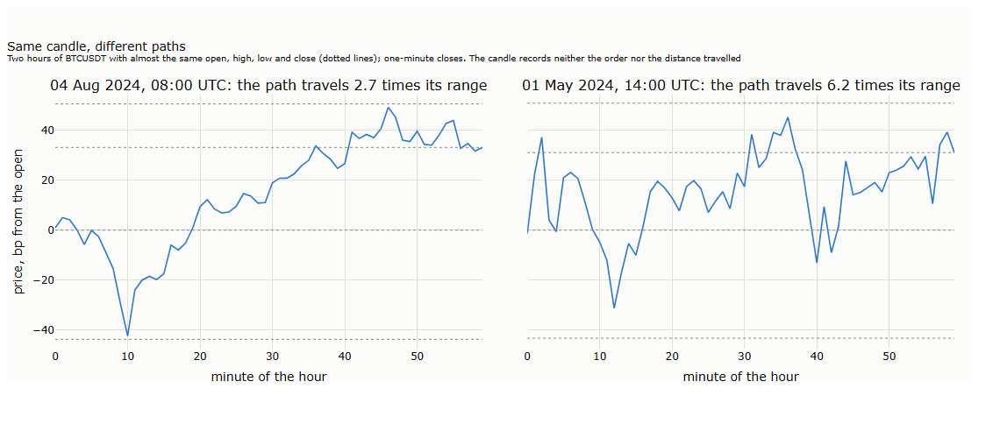
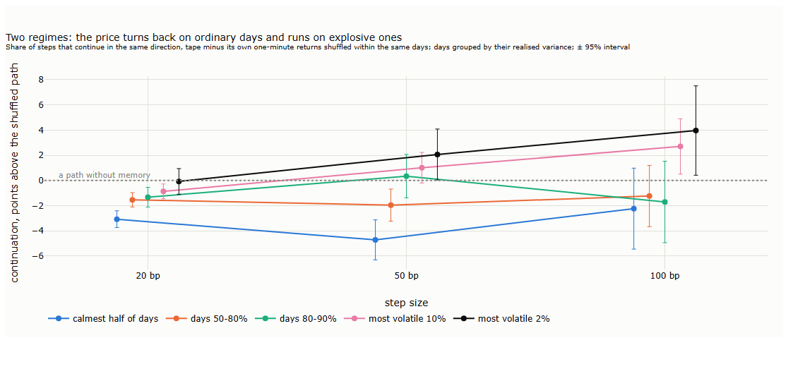
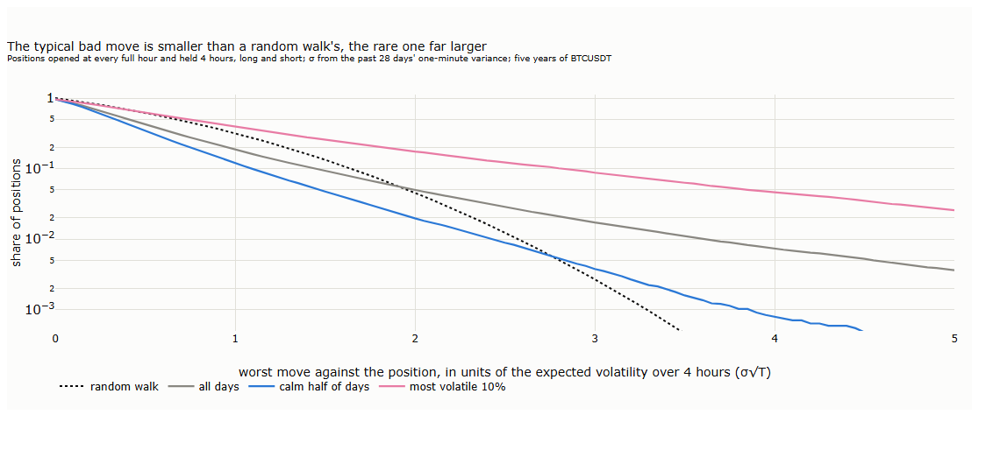
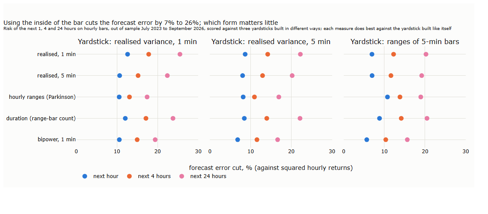
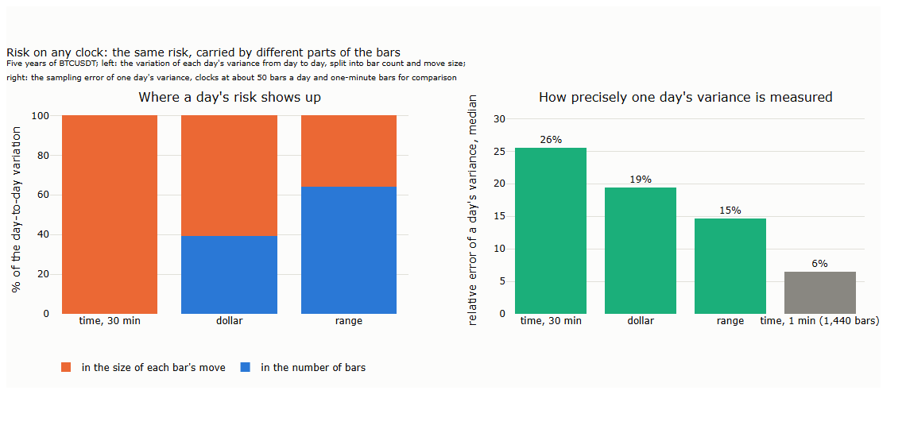
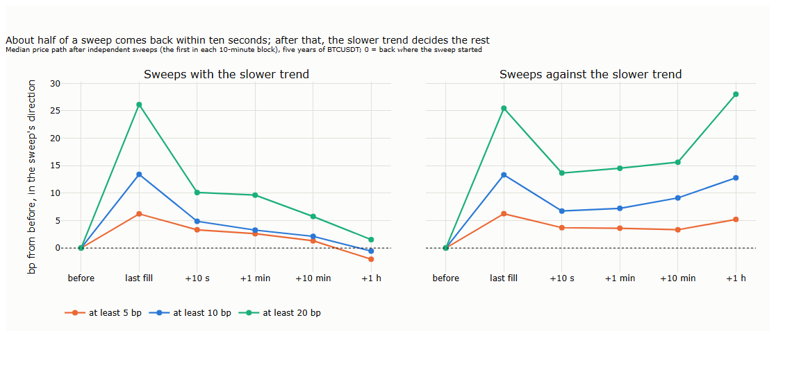
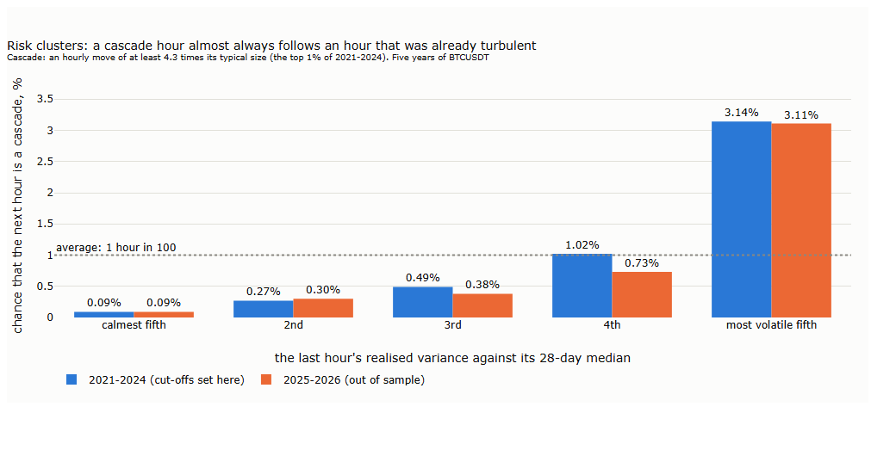
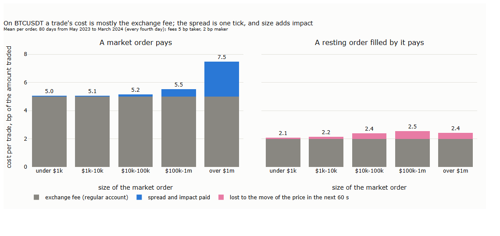
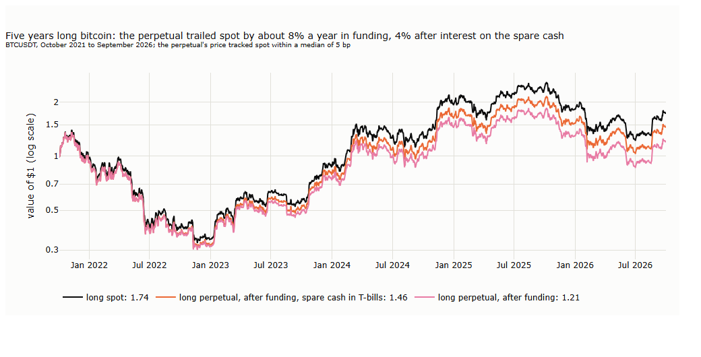

# Lecture 19: Path, Flow and Costs

> Inside the bar: how the price travels, what one-sided flow does to it, and what a trade really costs.

Part V · Pipeline stage: data and execution (the path inside a bar, the order flow, and what trading costs)

---

# Same candle, different paths

> A candle records neither what came first nor how far the price travelled: a typical hour travels four times its range.

- The better guess at which extreme came first is wrong on one bar in eight, as for a random walk
- Almost the same candle: 3 to 5.3 times the range travelled
- A trend rule sees no difference; a grid earns on the distance

---

# Two regimes, not one average

> Against its own shuffled returns, bitcoin turns back on ordinary days and runs at larger steps on explosive ones.

- Calmest half, 50 bp steps: −4.7 points; most volatile 2%, 100 bp: +4.0
- Yesterday's volatility does not tell which day it is
- √t overstates the variance of a position held for hours by 5% to 13%

---

# Levels: reached less often, passed more violently

> Fewer crossings and a fat tail of excursions than variance suggests: a stop set on √t is too wide most of the time and too close in the tail.

- A grid gets 40% to 72% of the steps the day's variance promises
- Beyond 3 σ√T: 1.7% of positions against 0.27% for a random walk
- A stop costs a few basis points in the median; the tail is fat

---

# Measure volatility inside the bar

> Any measure that uses the inside of the bar forecasts the next bars better than the bar's own squared returns.

- 7% to 26% less forecast error, more for longer horizons
- Judge a forecast against a yardstick not built like itself
- Ranges from ordinary candles do about as well as minute data

---

# Risk on any clock

> On any clock, a day's variance is the number of bars times the average variance of a bar's move.

$$\mathrm{Var}_{\text{day}} = N_{\text{day}} \times \overline{\sigma^{2}}_{\text{bar}}$$

- Time bars: all risk in the size of moves; price clocks: in the clock's speed
- Dollar bars: the square-root rule understates a day's variance by 15%

---

# One-sided flow moves the price and stays

> Flow moves the price strongly while it lasts and keeps almost all of its impact; the small part that comes back pays no market order's cost.

| | 1 minute | 5 minutes | 30 minutes |
|---|---|---|---|
| Return during the window, most selling to most buying | −5 to +5 bp | −11 to +12 bp | −27 to +28 bp |
| Next window, most buying minus most selling | −0.08 bp | −0.51 bp | −0.99 bp |
| Same, in volatile hours | −0.21 bp | −0.91 bp | −3.02 bp |

- About 1 bp comes back after a move of 28 bp in 30 minutes, almost all of it in volatile hours

---

# Sweeps: half comes back within seconds

> About half of a sweep comes back within ten seconds; one that chases the slower trend is taken back within the hour, one against it keeps its remaining half.

- A sweep of 13 bp is at 5 to 7 bp after ten seconds
- With the trend, ≥ 10 bp: −14.8 bp in the next hour, against the control
- For a grid: a fill soon in profit, or one that stays at a loss

---

# Cascades: risk clusters

> The best early warning of a cascade is the turbulence already under way; the measures said to load the market add nothing.

- After the calmest fifth of hours: about once in a thousand; the most volatile: three in a hundred
- A recent sweep adds 1.7 percentage points: a lead, not established
- Rule to test: widen or pull quotes as volatility rises

---

# On BTCUSDT a trade's cost is the fee

> The spread is one tick 99.6% of the time; a market order pays the 5 bp fee, a resting one 2 bp plus a small loss to adverse selection.

- Spread and impact under USD 10,000: 0.04 to 0.07 bp
- Resting side keeps −0.13 bp after 60 seconds (calm), −0.22 bp (volatile)
- Resting about 2.1 to 2.5 bp, market 5.0 to 5.5 bp

---

# Resting orders: chase the misses, re-post

> A resting order one tick inside saves 1 to 2 bp, provided it chases its misses; re-posted every five seconds, it keeps the saving and cuts the tail.

| One tick inside | Against a market order | Average of the worst 5% |
|---|---|---|
| Market order after 1 min | −1.6 bp | +9.9 bp |
| Market order after 10 min | −1.9 bp | +18.6 bp |
| Re-posted every 5 s, market order after 60 seconds | −2.0 bp | +4.9 bp |

- **A long wait is a short option:** it collects a little and pays a lot when the price runs
- **For a grid, which never chases, the misses are its risk:** they are the trends

---

# Funding, not impact, limits a trend rule

> Impact binds only at tens to hundreds of millions of dollars; a long perpetual trailed long spot by about 4% a year after interest.

- USD 1 grew to USD 1.74 in spot, 1.46 in the perpetual with T-bills
- A 50 bp edge loses half to costs at about USD 65 million (2021)
- A short received the funding

---

# Back to the base layer

> Food for thought: rebalance the daily portfolio with resting orders that chase their misses.

| | |
|---|---|
| **The idea** | Resting orders that chase their misses instead of market orders (Lecture 16 §6: carry's edge is sensitive to costs) |
| **What our results say** | On BTCUSDT the spread is one tick and the cost is the fee; re-posted and chasing, a resting order saves about 2 bp |
| **What a test would need** | The portfolio's own orders on futures and ETF venues; the first threat: wider spreads and longer queues than on bitcoin |
| **Status** | Not tested here; a research direction |

---

# Takeaways

1. **A candle loses the order and the distance:** a typical hour travels four times its range
2. **Two regimes, not one average:** bitcoin turns back on ordinary days, runs on explosive ones
3. **Measure volatility inside the bar;** on any clock, risk is bars times risk per bar
4. **Flow keeps almost all of its impact;** half of a sweep comes back within seconds
5. **Risk clusters:** a cascade grows out of turbulence that is already visible
6. **The cost is the fee;** rest and chase the misses; funding is what a trend rule cannot avoid
