# Lecture 19: Statistics of the Book: Imbalance, Microprice, Queues and Markouts

*Systematic Trading: Lecture Notes (MSc) · Oct 29, 2026 · Max Gnesi*

Lecture 18 rebuilt Bybit's BTCUSDT book and measured how deep and how tight it is. This lecture asks what the book's state at one moment says about what comes next: which side outweighs the other, where the price is likely to be once it has moved, how long a queue will last, and what a resting order is worth once it is filled. It first introduces each statistic on invented books, so that what it is meant to capture is clear, and then applies all of them to the 45 days of Lecture 18, 20 September to 3 November 2025, the liquidation cascade of 10 October included.

## 1. The book as a state

Part IV moves from describing the order book to trading on it, one step per lecture:

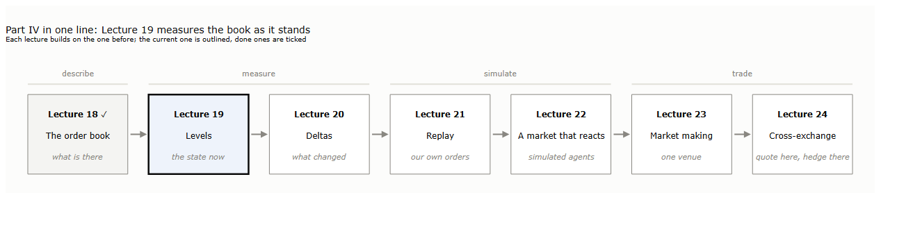
<b>How to read the figure.</b> Each box is one lecture of Part IV, each building on the one before; this lecture is outlined, Lecture 18 is done. Above the boxes, the four stages: describing the book, measuring it, simulating our own orders in it, and trading strategies on it.

The idea of the lecture fits in one chart. On the left, a moment of Lecture 18: the best bid holds 28 times the size of the best ask. On the right, every update of our 45 days, sorted by that imbalance, and what the mid did next:

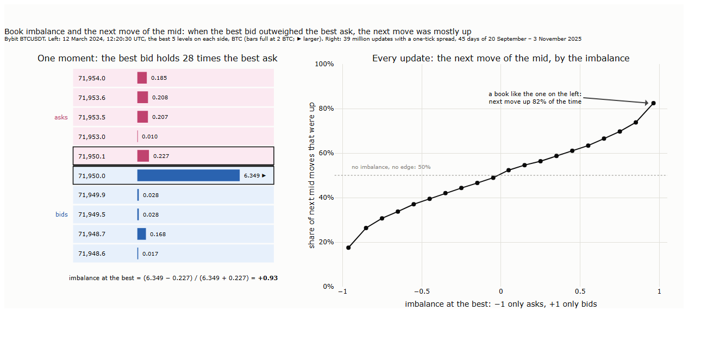
<b>How to read the figure.</b> <b>Left:</b> Bybit BTCUSDT on 12 March 2024, 12:20:30 UTC (the moment of Lecture 18, §1), the best 5 levels on each side, sizes in BTC; the best bid and ask are outlined, and the imbalance at the best is worked out below. <b>Right:</b> every update of the 45 days in which the spread was one tick, 39 million, sorted into 20 bands of the imbalance at the best just before; each point is the share of those updates after which the mid's next move was up. The dotted line is 50%, a coin flip. The measure follows Gould and Bonart (2015); the data and the calculation are ours.

When the two best queues were balanced, the next move of the mid was up about half the time. The more the best bid outweighed the best ask, the more often the next move was up: 82% of the time when the bid held almost everything, 17% when the ask did. Gould and Bonart (2015) found the same kind of relationship on ten Nasdaq stocks, strongest on those whose spread is nearly always one tick, which is the case of BTCUSDT on Bybit (Lecture 18, §5.1).

The chart does not yet say that the imbalance is worth anything. The move it forecasts is the next change of the mid. The spread is nearly always one tick, but when the mid moves between two updates of the book it jumps, by a median of 44 ticks on our data, about $4.40 or 0.4 bp, and mostly within a few hundred milliseconds (Section 3). A market order sent to profit from it pays Bybit's base taker fee of 0.055%, 5.5 bp, more than ten times the move. Its value, if it has one, lies with orders that already rest in the book: whether to stay in the queue or step out of it. Whether the relationship holds day by day, after the cascade and once the mechanics of small queues are accounted for, Section 3 tests; Section 2 first introduces the statistics.

This lecture and the next are the measuring stage. They measure two different kinds of quantity, and the difference runs through both:

| Kind | What it is | Like, in accounts | Lecture |
|---|---|---|---|
| **A level** | The state of the book at one moment: how much rests where | A balance sheet: what is there on a given day | 19 |
| **A delta** | What changed over an interval: orders added, cancelled, filled | A cash-flow statement: what came in and went out over a period | 20 |

<b>How to read the table.</b> The same word can name both kinds: Lecture 20 opens with an imbalance of the book (a level) next to an imbalance of the flow (a delta).

This lecture runs as follows:

| § | Step | Question |
|---|---|---|
| 1 | The book as a state | What can a level say about the next move? |
| 2 | The statistics | What do imbalance, the microprice, the shape of the book, queues and markouts each capture, shown on invented books? |
| 3 | On our 45 days | What do they look like on Bybit, and do they predict what they are meant to predict? |
| 4 | 10 October | Did any of them flag the cascade before it came? |
| 5 | Summary, exercises and reading | |

## 2. The statistics

Each statistic is introduced the same way: what it is meant to capture, how it is computed, a picture of invented books that shows it at work, and what it misses. The books are invented so that each case is clean; Section 3 measures the same statistics on the data.

### 2.1 Book imbalance

**Key message.** Book imbalance says which side of the book outweighs the other. When one side's best queue is much smaller, a few trades can empty it, and the mid moves towards that side.

| Step | Calculation | Financial meaning |
|---|---|---|
| 1 | Take the size at the best bid, $`q^b`$, and at the best ask, $`q^a`$ | What a seller and a buyer can trade at the best price right now |
| 2 | Imbalance at the best: $`I = \frac{q^b - q^a}{q^b + q^a}`$ | −1: only asks; 0: balanced; +1: only bids |
| 3 | The same with the total size of the best 5 levels, or of all levels within x bp of the mid | How lopsided the book is a little deeper |

<b>How to read the table.</b> Sizes in BTC; the formula is the queue imbalance of Gould and Bonart (2015).

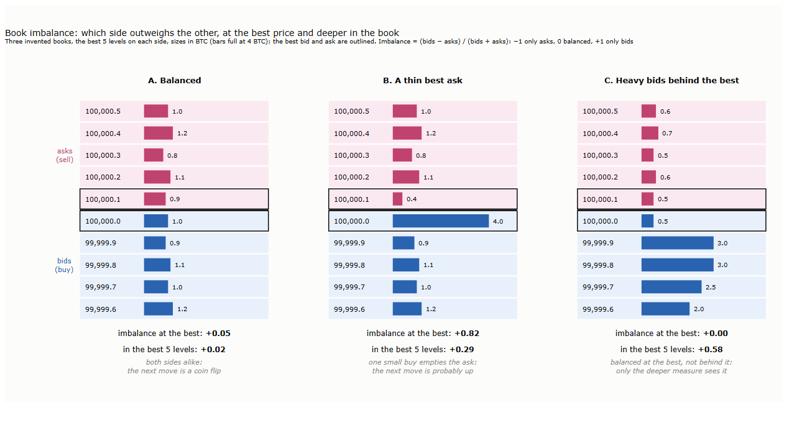
<b>How to read the figure.</b> Three invented books, the best 5 levels on each side, sizes in BTC (bars full at 4 BTC); the best bid and ask are outlined. Under each book, the imbalance at the best and in the best 5 levels, and what it suggests.

Book A is balanced at the best and deeper: there is no lean, and the next move is as likely up as down. Book B has a thin best ask, 0.4 BTC against 4.0 BTC of bids: one small buy order empties it, and the mid moves up; the imbalance at the best is +0.82. Book C is balanced at the best, 0.5 BTC on each side, but the bids behind the best are four times the asks; the imbalance at the best reads zero, the one over the best 5 levels +0.58.

**What it misses.** Book C is the first blind spot: a measure at the best price does not see what stands behind it, and a deeper measure must choose how deep to look. The second is that the imbalance counts size, not intentions: an order can be cancelled the moment it is approached (Lecture 18, §5.5), and part of the lean in book B may vanish before a trade reaches it. The third is mechanical: a small queue is emptied by one ordinary trade, so part of what imbalance predicts is the arithmetic of queue sizes rather than information about the price; Section 3 separates the two.

**Can it be gamed?** A statistic that traders act on invites traders who want them to act. The simplest way to move book imbalance is to place a large order that is not meant to trade: a wall a few levels behind the best price, where it is unlikely to be filled, cancelled before the price reaches it. Other traders read a heavy book and lean the wrong way; the one who placed the wall trades against them. This is **spoofing**. Two weights make the imbalance harder to move: depth far from the best counts less, since a wall must stand back to stay unfilled, and depth that has only just arrived counts less, since a spoof is short-lived by design.

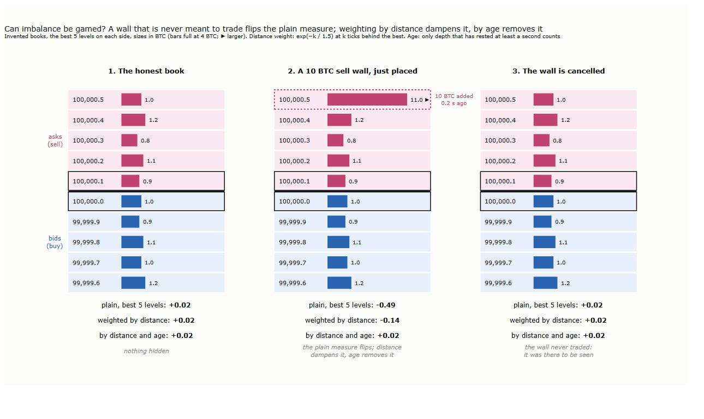
<b>How to read the figure.</b> Three moments of one invented book, the best 5 levels on each side, sizes in BTC (bars full at 4 BTC; ▶ larger). <b>2:</b> a sell order of 10 BTC is added at the fifth ask (dotted). Under each book, three versions of the imbalance over the best 5 levels: plain; weighted by distance, each level counting $`e^{-k/1.5}`$ at $`k`$ ticks behind the best; and weighted by distance counting only depth that has rested at least a second.

The wall turns the plain imbalance from +0.02 to −0.49, a book that seems to lean heavily towards the sellers. Weighting by distance dampens the swing to −0.14; leaving out the depth that arrived within the last second removes it. Neither weight is free. The distance weight needs a setting, how fast the weight falls, and Section 3 tests a wide range of them rather than one; the age weight needs the age of the orders, which L2 data do not show and Section 2.4 estimates. An order book also has honest orders that are short-lived: market makers revise their quotes many times a second (Lecture 18, §5.5), and a patient spoofer can let a wall age, at the price of a real chance of being filled. Weighting by age, as far as we know, is not a published measure; it is our construction, built on what the literature below says about spoofs.

Spoofing is one of several practices that work through the order book:

| Practice | What is done | What it is meant to achieve | What our data can show (L2 every 100 ms, trades, no accounts) |
|---|---|---|---|
| **Spoofing** | A large order not meant to trade, cancelled before execution | Make others lean the wrong way, and trade against them | Orders that look like spoofs: large, behind the best, removed without trades as the price approaches. Not the intent |
| **Layering** | Spoofing at several prices at once | The same, more convincingly | The same, over several levels |
| **Quote stuffing** | A flood of orders and cancellations | Congest the matching engine and the data feeds, so that others see the market late | Little: within 100 milliseconds, the messages net out |
| **Momentum ignition** | A burst of aggressive orders | Start a fast move that triggers others' stops or liquidations, and trade against it | Bursts of aggression followed by a reversal. Not the intent |
| **Wash trading** | Trading with oneself | Fake volume, to lift a venue's or a token's standing | Only statistically, in the trades: round sizes, odd patterns of digits |
| **Pinging** | Small orders sent to probe | Find hidden size, such as icebergs (Section 2.4) | Many trades of the minimum size, 0.001 BTC on Bybit. Often a search for information rather than manipulation |

<b>How to read the table.</b> Spoofing and layering: Lee, Eom and Park (2013); Cartea, Jaimungal and Wang (2020). Quote stuffing: Gai, Yao and Ye (2013). Momentum ignition: SEC (2010). Wash trading on crypto exchanges: Cong et al. (2023).

Some facts put the table in proportion. In US futures markets, spoofing has been explicitly unlawful since the Dodd-Frank Act of 2010, which forbids "bidding or offering with the intent to cancel the bid or offer before execution"; the offence turns on intent, which market data cannot show, and regulators prove it with account records, not with the book. On the Korea Exchange, where accounts could be identified, about 0.8% of all orders were spoofs, and they paid (Lee, Eom and Park, 2013). On crypto exchanges, the distance at which a large order is posted is what makes it able to move prices, and by one estimate 31% of large orders could have been used to spoof (Fabre and Challet, 2025). Quote stuffing works because every link of the chain handles messages one at a time: on Nasdaq, a burst of messages in one stock slowed trading in other stocks that shared its data channel, and not in the rest (Gai, Yao and Ye, 2013). Venues defend themselves with caps on messages per account; Bybit counts requests per account and second, and its public feed, bundled into 100-millisecond updates, does not pass a flood on to other traders one message at a time.

**Where the profit of a flood comes from.** Quote stuffing earns nothing by itself; it earns by delaying other traders' cancellations. When the price jumps on another venue, every market maker on Bybit sends a cancellation of the quotes that are now too cheap, and the matching engine takes messages strictly in the order they arrive (Lecture 18, §1.3). A trader who sends a buy order first and a flood of junk messages straight after puts the junk between the buy and the cancellations:

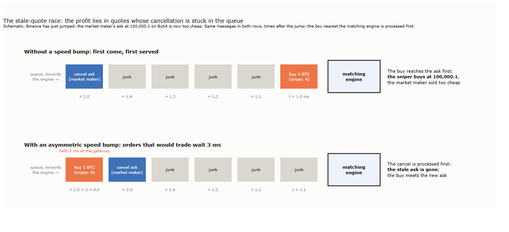
<b>How to read the figure.</b> Schematic. The price has just jumped on Binance; a market maker's ask at 100,000.1 on Bybit is now too cheap. The same messages in both rows, labelled with the time they reach the exchange after the jump; the box nearest the matching engine is processed first. <b>Top:</b> first come, first served. <b>Bottom:</b> orders that would trade at once are held 3 milliseconds at the gateway; all other messages pass.

In the top row the buy reaches the stale ask before the cancellation: the sniper buys at the old price, and the market maker has sold too cheaply. The profit lies in **stale quotes**, quotes that should have been cancelled but whose cancellation is stuck in the queue; the junk only makes the queue longer. The same race runs without any junk whenever a faster trader reacts to another venue before the market makers do, which is why it is the central risk of quoting on one venue against another (Lecture 24).

Exchanges can take the reward away. In the bottom row, an **asymmetric speed bump** holds orders that would trade at once for a few milliseconds and lets cancellations through, so the cancellation wins: TSX Alpha has delayed such orders by a random 1 to 3 milliseconds since 2015, and Eurex its aggressive orders in French equity options by 3 milliseconds since 2019, after which spreads narrowed and depth grew. Such delays are contested, since they favour one group of traders over another. A more radical design abolishes the race: **frequent batch auctions** collect orders over a short interval and match them together at one price, so that being a microsecond faster no longer counts (Budish, Cramton and Shim, 2015). Hyperliquid comes close to both: it gathers orders into blocks and, within each block, processes cancellations before orders that take liquidity. Caps on messages per account raise the cost of a flood; delays and batches remove its reward.

**How to deal with it.** A trader who uses imbalance cannot tell who placed a wall, but can make the measure hard to move and can check it against what actually trades:

| Defence | What it does |
|---|---|
| Weight depth by distance and by age | Fake depth stands back and is young; honest depth is mostly neither |
| Require persistence | Act on a lean only if it lasts, not on a single update |
| Check against the trades | A wall that is real is traded against; a lean that no trade confirms is suspect (the flow, Lecture 20) |
| Watch for walls that vanish | Count large orders removed without trades as the price approaches; many of them make the book less trustworthy |
| Know the venue's delay | When the exchange's own delay between matching and publishing jumps, the book on screen is older than usual (Section 4) |

<b>How to read the table.</b> Detection in the literature follows the same lines: rules on the size, distance and fate of cancelled orders (Tuccella, Nadler and Serban, 2021), and statistical alarms when the book behaves unlike its normal self (Tao et al., 2020). None of them proves intent; they flag candidates. Section 3.2 tests the first two defences on our data.

### 2.2 The microprice

**Key message.** The mid is halfway between the best bid and ask whatever the queues look like. The microprice is the mid to expect once the price has moved: it leans towards the side that is likely to give way.

| Estimate | Calculation | Financial meaning |
|---|---|---|
| **Mid** | $`m = \frac{1}{2}(b + a)`$, with $`b`$ the best bid and $`a`$ the best ask | The price halfway between buying and selling, blind to the queues |
| **Weighted mid** | $`\frac{q^a\, b + q^b\, a}{q^b + q^a}`$ | Each price weighted by the size on the other side: it moves towards the thin side, as if that side were sure to be taken |
| **Microprice** | The expected mid after the price has moved, given the imbalance and the spread, estimated from data (Stoikov, 2018) | Where the price is likely to be, on average, once the next moves have happened |

<b>How to read the table.</b> $`b`$, $`a`$: best bid and ask prices; $`q^b`$, $`q^a`$: the sizes there. Stoikov defines the microprice as the expected mid in the limit of many future moves; the figure shows its first step.

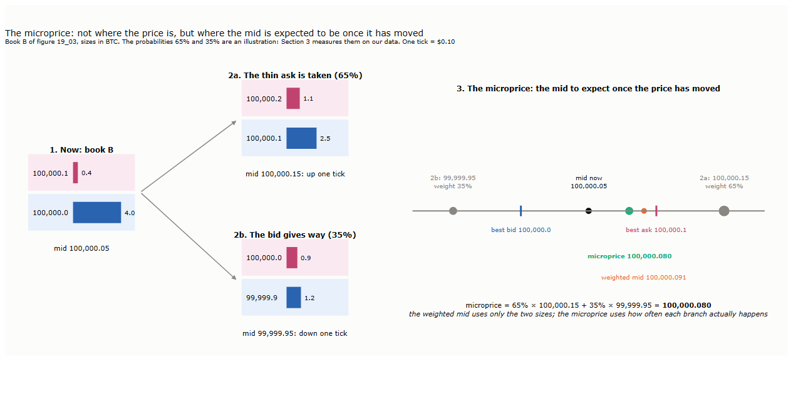
<b>How to read the figure.</b> <b>1:</b> book B of figure 19_03, sizes in BTC. <b>2a, 2b:</b> the two ways the mid can move next, one tick up when the thin ask is taken, one tick down when the bid gives way, each with the book as it would look afterwards and an illustrative probability. <b>3:</b> on a ruler of prices, the mid now, the two future mids (larger dot, more likely), their probability-weighted average, the microprice, and the weighted mid for comparison. The probabilities are an illustration; Section 3 measures them.

In book B the weighted mid, 100,000.091, sits almost at the best ask: it treats the thin ask as good as gone. The microprice takes into account that the bid sometimes gives way instead; with the illustrative probabilities of the figure, it is 100,000.080. How far the price really tends to move from such a book is not a matter of formula but of data, which is why the microprice is estimated rather than calculated.

**What it misses.** The microprice is only as good as the data it is estimated from: in a regime unlike its sample, a cascade for example, its probabilities may no longer hold. It also inherits the blind spots of the imbalance it is built on: size that is cancelled before it trades, and depth behind the best that it does not use.

### 2.3 The shape of the book

**Key message.** Depth within a given distance of the mid is one number; the shape of the book says how that depth builds up level by level. Two books with the same depth can charge very different prices for the same order, and imbalance at the best price says nothing about it.

| Step | Calculation | Financial meaning |
|---|---|---|
| 1 | Cumulative depth: the size in the best $`k`$ levels of one side, for $`k = 1, 2, \ldots`$ | How much can be traded before the price has moved $`k`$ levels |
| 2 | Slope: the depth added per tick, or per basis point, as the price moves away from the best | A steep book adds much depth close to the price; a flat or hollow one little (Næs and Skjeltorp, 2006) |
| 3 | The cost of a given size: walk the cumulative depth until the size is filled (Lecture 18, §1.2) | What the shape means for an order |

<b>How to read the table.</b> One side of the book at a time: asks for a buy, bids for a sell.

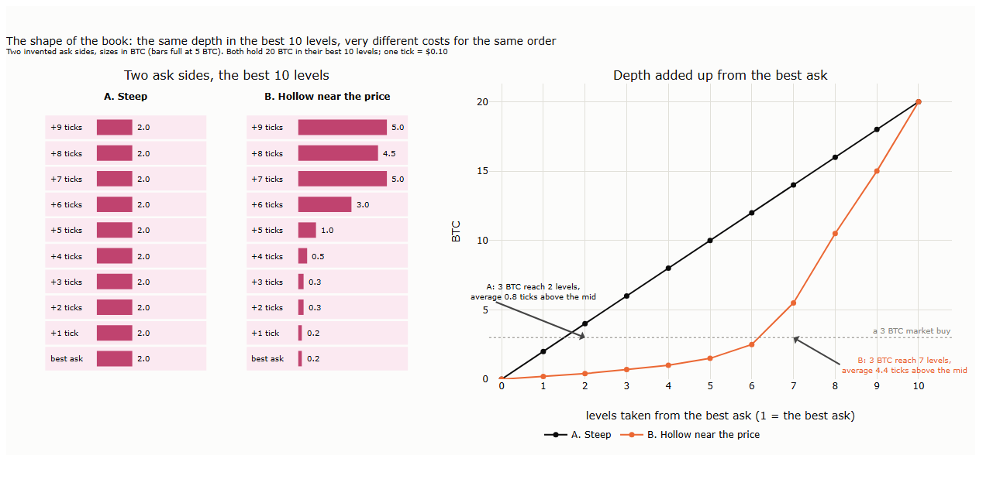
<b>How to read the figure.</b> <b>Left:</b> two invented ask sides, the best 10 levels, sizes in BTC (bars full at 5 BTC). <b>Right:</b> their depth added up from the best ask, level by level; the dotted line is the size of a 3 BTC market buy, and the arrows mark how far it reaches in each.

Both sides hold 20 BTC in their best 10 levels, so a measure of depth within 10 ticks would call them equal. A 3 BTC market buy disagrees: on the steep side it takes 2 levels and pays on average 0.8 ticks above the mid, on the hollow one it takes 7 levels and pays 4.4 ticks, more than five times as much. A small order sees only the best level; how a book is shaped behind it matters for every order larger than the best queue.

**What it misses.** The shape is that of one moment: orders arrive while a large order walks the book, and depth taken is often replaced within a tenth of a second (Lecture 18, §5.5). The deep levels that make a book look steep are also where walls stand that are not meant to trade (Section 2.1). And the shape changes with the market: Næs and Skjeltorp (2006) find that flatter books go with more trading and higher volatility, so a shape measured on a calm day is not one to rely on in a fast one.

### 2.4 Queues

**Key message.** The size at a price is not one order but a line of orders, served first come, first served.\* How long the line at the best price lasts says how long the price holds; where an order stands in it says when that order will be filled. L2 shows only the length of the line, so both have to be inferred from how the length changes.

| Step | Calculation | Financial meaning |
|---|---|---|
| 1 | Queue size at the best: $`q^b`$, $`q^a`$, read from L2 | What must trade or be withdrawn before the price moves |
| 2 | Split each change of a queue: $`\Delta q = \text{added} - \text{traded} - \text{cancelled}`$, with the traded part taken from the trades at that price and the rest of a decrease counted as cancelled | Whether the line shortens because others trade against it or because its own members leave |
| 3 | Time to empty: $`q`$ divided by the rate at which the line shortens, traded plus cancelled minus added, per second | How long the price is likely to hold |
| 4 | Replay the changes through a first-in, first-out line: additions join the back, trades take from the front, cancellations by assumption | How much stands in front of an order of ours, and how long the depth has rested |

<b>How to read the table.</b> \* The standard rule of continuous books, price then time, not stated in Bybit's or Binance's documents (Lecture 18, §1.3). Steps 2 to 4 combine the book with the trade feed, matched by time. Within one 100-millisecond update only the net change is seen: an order that arrives and is cancelled inside it leaves no trace, and an addition and a cancellation of the same size look like nothing.

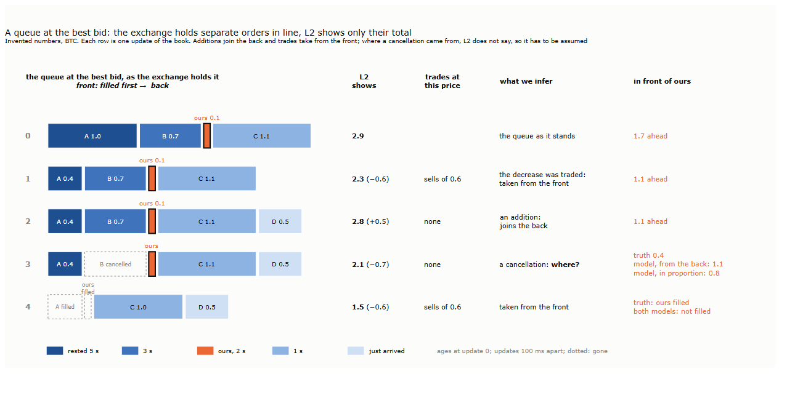
<b>How to read the figure.</b> One invented queue at the best bid over five updates of the book, 100 ms apart, sizes in BTC. <b>Left:</b> the orders as the exchange holds them, the front (filled first) on the left, shaded by how long each had rested at update 0; ours is the small outlined order; dotted outlines mark orders that have just gone. <b>Middle:</b> what L2 shows, the total and its change, and what the trade feed shows at this price. <b>Right:</b> what we infer from the two, and how much stands in front of our order: the truth, and two models where the truth cannot be seen.

Updates 1 and 2 can be read without doubt: a decrease matched by trades at that price was taken from the front of the line, and an increase is a new order at the back. Update 3 cannot. 0.7 BTC left the queue without a trade, and L2 does not say whose order it was. In truth it was B, ahead of ours, and only 0.4 BTC now stand in front of us. A model that assumes cancellations come from the back of the line still counts 1.1 BTC in front; one that spreads them over the line in proportion to the size in front of and behind our order counts 0.8 (Rigtorp, 2013). At update 4, sells of 0.6 BTC arrive: in truth they fill our order, under both models they do not.

This is the choice every backtest of resting orders has to make (Lecture 21), and open-source backtesters offer both models (hftbacktest documentation). Assuming that cancellations come from the back is the cautious choice for fills: what stands in front of us then shrinks only through trades, so the model never fills our order earlier than the truth would. It is not cautious about what the fills are worth: the fills it keeps are those that come with large trades, which are often the ones the price moves against (Section 2.5). The same replay gives each part of a line the time it joined, which is the age of the depth that the age-weighted imbalance of Section 2.1 needs; every level of the book is its own line, so the age can be estimated at every level, not only at the best.

Queues matter beyond a single order. In the model of Cont and de Larrard (2013), in which orders arrive and leave at random, the price moves when one of the two best queues empties: the next move is a race between two lines, and its odds depend on their lengths. This is the mechanics behind book imbalance, which Section 3 separates from information (hypothesis H5). A place near the front of a line is also worth money in itself: in large-tick stocks, whose spread is nearly always one tick as that of BTCUSDT on Bybit is, the value of a position in the queue can be of the order of the spread (Moallemi and Yuan, 2016).

**Hidden size: icebergs and pinging.** An iceberg shows only part of a large order. On venues where the exchange holds the hidden part, the visible part is refilled as it trades, and traders send small orders, **pinging**, to find out whether more lies behind a level. On Bybit, an iceberg is a tool that places the next slice of a large order once the previous slice has traded (Bybit, n.d.-a); each slice is a new order and joins the back of the line, so the large order gives up its place every time a slice is used up, the price of hiding its size. Built-in icebergs on other venues, CME's among them, generally lose priority in the same way when the visible part is refilled. Any trader can run the same loop with their own orders. In the data it leaves a signature: a level that is taken and refilled at the same price by a similar size, again and again, so that the trades at that price add up to more than the level ever showed. Section 3 counts such levels.

**What it misses.** Where a cancellation comes from is an assumption, not an observation, and the estimated position and age are only as good as that assumption. Within one update, orders that come and go are not seen, and a trade that falls close to the edge of an update can be matched to the wrong one. Rates of arrival and departure are not constant: Huang, Lehalle and Rosenbaum (2015) find that they depend on the size of the queue itself, so a time to empty computed from average rates is a first approximation. And when the best price changes, the line at the new best price is a different one, with its own history.

### 2.5 Markouts

**Key message.** The statistics so far describe the book before a trade; a markout looks after it. It measures how the mid moved after a fill, from the side of whoever was filled. For a resting order, it shows whether the spread it earned was kept or lost to a price that moved against it: the cost of trading with someone who knew more, **adverse selection**.

| Step | Calculation | Financial meaning |
|---|---|---|
| 1 | Markout of a fill at price $`p`$, on side $`s`$ ($`+1`$ bought, $`-1`$ sold), at horizon $`h`$: $`M(h) = s\,(m_{t+h} - p)`$ | What the fill was worth $`h`$ seconds later, valuing the position at the mid |
| 2 | At the fill: $`M(0) = s\,(m_t - p)`$ | The half spread: earned by the resting order, paid by the market order |
| 3 | Split: $`M(h) = s\,(m_t - p) + s\,(m_{t+h} - m_t)`$ | The spread earned, plus the move of the price after the fill; for a resting order the move is usually against it, the **price impact** of the trade |
| 4 | Average over many fills, horizon by horizon: the markout curve | Whether fills are good on average, and at what horizon the damage is done |

<b>How to read the table.</b> $`m_t`$: the mid at the fill; $`m_{t+h}`$: the mid $`h`$ seconds later. Signs are such that positive means earned by whoever was filled; the taker's markout is minus the maker's. The split is the classic decomposition of the effective spread into a realized spread and a price impact (Huang and Stoll, 1996); US brokers report realized spreads at horizons from under a millisecond to five minutes (SEC, 2024).

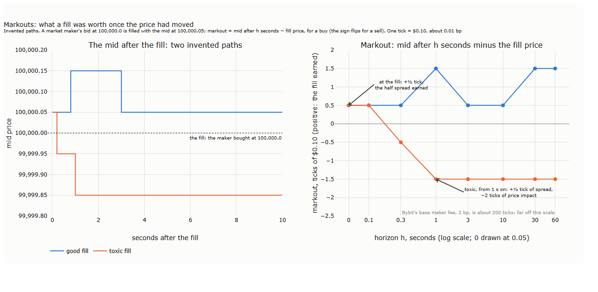
<b>How to read the figure.</b> <b>Left:</b> a market maker's bid at 100,000.0 is filled, the maker bought, with the mid at 100,000.05; two invented paths of the mid over the next 10 seconds. <b>Right:</b> the markout of the same two fills, mid after $`h`$ seconds minus the fill price, in ticks of $0.10, by horizon on a log scale. Above zero, the fill earned; below, it lost.

Both fills earn half a tick at the moment they happen. The good one keeps it, and gains more when the price rises; the toxic one loses it within a third of a second and ends 1.5 ticks down, half a tick of spread against two ticks of price impact. The seller who hit the bid was ahead of the price, and the market maker paid for it.

The scale matters. One tick of BTCUSDT is about 0.01 bp, while the base maker fee on Bybit is 0.02% of the value traded, 2 bp, about 200 ticks (Bybit, n.d.-b). At the base fee, a market maker on BTCUSDT cannot live off the spread at all: whatever makes market making pay here lies in fees far below the base tier, and in markouts that, on average, do not turn against it. Lecture 23 takes this up.

Markouts are where the statistics of this section meet. A resting order on the thin side of an imbalanced book (Section 2.1) is likely to be filled just before the price moves through it: imbalance says when to step out of the queue. An order at the back of a long queue (Section 2.4) is filled only when a large trade sweeps the whole line, and large trades are the ones most often followed by a move. And the quote fading of Lecture 18 (§5.5) is the same exchange seen from the taker's side.

**What it misses.** A markout values the position at the mid, not at what it would cost to close: closing pays a spread and a fee. The verdict depends on the horizon: a fill that looks good after one second can look bad after a minute, so a markout is reported as a curve, not as one number. Horizons shorter than one update of the book cannot be measured on our data. And we have no fills of our own: Section 3 measures the markouts of the trades in the feed, from the side of the resting order each trade hit, which is the average fill of a resting order at the time, not that of a particular strategy. The fills of a strategy come with the replay of Lecture 21.

### 2.6 The statistics side by side

| Statistic | What it captures | Main blind spot | Section 3 measures |
|---|---|---|---|
| Book imbalance | Which side of the book outweighs the other | Size, not intentions; the mechanics of small queues | Its forecast of the next mid move (H1–H5); distance-, age-weighted and smoothed versions (H6, H7) |
| Microprice | Where the mid is likely to be once the price has moved | Estimated in one regime, used in another | Its table estimated on the calm days, checked on the days after (H8) |
| Shape of the book | The cost of orders larger than the best queue | One moment; walls that are not meant to trade | Depth near the price against the size of the next 5-minute move (H9) |
| Queues | How long the price holds; where an order stands, and how old the depth is | Where a cancellation came from | The split of changes into traded and cancelled (H10); time to empty (H11); refilling levels |
| Markouts | What a fill was worth once the price had moved | The horizon; no fills of our own | Markout curves of the feed's trades, from the resting side (H12, H13) |

<b>How to read the table.</b> One row per statistic of Sections 2.1 to 2.5. The last column says what Section 3 does with each on the 45 days of Bybit BTCUSDT; all hypotheses were fixed before the results ([results/hypotheses.md](results/hypotheses.md)).

## 3. On our 45 days

Section 2 showed each statistic on invented books. This section measures them on the 45 days of Bybit BTCUSDT, 20 September to 3 November 2025. The hypotheses were fixed before any result was computed, together with their tests and the settings of every weighted version ([results/hypotheses.md](results/hypotheses.md)).

**How the tests are set up.** The days are split in three. The 20 calm days before the cascade, 20 September to 9 October, are **in sample**: every quantity that has to be estimated, such as the slope of a fit or the microprice's table, is estimated on them only. The 24 days after the cascade, 11 October to 3 November, are **out of sample**: the tests are run on them. 10 October stands alone. A forecast of the direction of the next move is scored by its **AUC**: the probability that a randomly chosen moment before an up move gets a higher score than a randomly chosen moment before a down move. An AUC of 0.5 is a coin flip and 1 is a perfect ranking. Uncertainty comes from resampling whole days (2,000 times), so that days, not millions of correlated updates, count as the observations. With 13 hypotheses, some would pass by luck alone. The Benjamini-Hochberg procedure controls the share of false discoveries among those that pass at 5%; Section 3.6 applies it to all of them together.

| § | Statistic | Hypotheses | Figure |
|---|---|---|---|
| 3.1 | Book imbalance | H1–H5: direction, stability, regime, depth, mechanics | 19_10 |
| 3.2 | Imbalance that resists gaming | H6–H7: power of the weighted versions; response to spoof candidates | 19_11 |
| 3.3 | Microprice | H8: a better forecast of the mid than the mid | 19_12 |
| 3.4 | Shape of the book and queues | H9–H11 and icebergs | 19_13 |
| 3.5 | Markouts | H12–H13: adverse selection, and by size | 19_14 |
| 3.6 | Verdicts | All 13, corrected for multiple tests | |
| 3.7 | The book's clock (added) | H19–H23: pulls, spread and depth at round times; who refreshes | 19_16 |

<b>How to read the table.</b> One row per subsection, in the order of Section 2. Each subsection opens with its result, then the figure, then each hypothesis in turn.

### 3.1 Book imbalance

**Result.** Imbalance at the best ranks the next move of the mid correctly about nine times in ten, on every one of the 45 days, after the cascade as before it. Most of that accuracy comes from small queues and from moves that are about to happen.

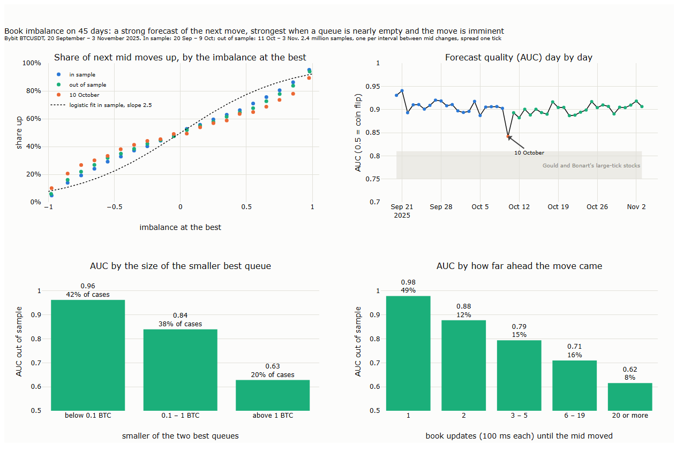
<b>How to read the figure.</b> One sample per interval between two changes of the mid, the book at a random update inside it, kept when the spread is one tick: 2.4 million samples (Gould and Bonart, 2015). <b>Top left:</b> the share of samples whose next mid move was up, in 20 bands of the imbalance at the best; the dotted curve is the logistic fit on the in-sample days. <b>Top right:</b> the AUC of each day (blue in sample, green out of sample, orange 10 October); the grey band is the range Gould and Bonart report for large-tick Nasdaq stocks. <b>Bottom left:</b> the AUC out of sample, by the size of the smaller of the two best queues, with the share of samples in each group. <b>Bottom right:</b> the same, by the number of book updates (100 ms each) until the mid moved.

The curve in the top left is steeper than in figure 19_02, which counted every update, 82% at the extremes rather than about 95%. The difference is the sampling. Figure 19_02 gives a long quiet interval as many points as it has updates, and long intervals are those with large queues, in which imbalance says less; here each interval counts once. The logistic curve misses the shape at the edges, but the AUC does not depend on it.

- **H1 (direction) holds.** The slope of the in-sample fit is $`x_1 = 2.47`$, at the top of the range of 2 to 2.7 that Gould and Bonart report for large-tick stocks. The AUC is 0.904 in sample and 0.897 out of sample (95% interval 0.894–0.901), above their 0.75 to 0.81.
- **H2 (stability) holds.** The slope is positive and the AUC above 0.5 on all 45 days; the daily AUC lies between 0.84 and 0.94, the slope between 1.8 and 3.0.
- **H3 (regime) holds.** The AUC is 0.897 out of sample and 0.842 on 10 October (0.840–0.844), the lowest day of the 45 but far above a coin flip.
- **H4 (depth) fails.** Adding the imbalance over the best five levels to that at the best leaves the AUC where it was, 0.8970 against 0.8972. On its own, the five-level imbalance scores 0.894: what stands behind the best adds nothing that the best does not already say.
- **H5 (mechanics) holds.** When the smaller of the two best queues holds less than 0.1 BTC, which is 42% of the samples, the AUC is 0.96; between 0.1 and 1 BTC it is 0.84; above 1 BTC, 0.63. The difference, 0.33 (0.33–0.34), is the largest effect in this section.

H5 and the last panel describe the same mechanics from two sides. A queue of less than 0.1 BTC, about $11,000, is emptied by one ordinary market order, and when it empties the mid moves to its side. On the bottom right, half the moves came at the very next update of the book, and there the AUC is 0.98. When the move came 20 or more updates later, 2 seconds or more, it was 0.62. Imbalance forecasts the next move best when that move is about to happen anyway; how much of it is information about the price, and how much is the arithmetic of a queue about to run out, our data cannot separate further. The move is large when it comes: a median of 44 ticks, about $4.40, and in only 5% of the samples one tick. Half the time it comes within 200 ms.

### 3.2 Can imbalance be made hard to game?

**Result.** None of the three defences of Section 2.1 works as hoped on our data. Weighting by distance costs no forecasting power, but it does not damp walls; it makes them louder. Smoothing over time damps everything, the forecast included. Counting only depth that has rested turns the forecast upside down.

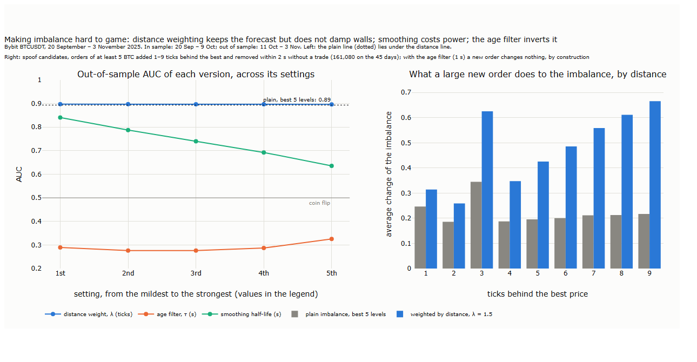
<b>How to read the figure.</b> <b>Left:</b> the out-of-sample AUC of each version of the five-level imbalance at each of its five settings, fixed beforehand (blue: distance weight, $`\lambda`$ = 0.5, 1, 1.5, 3, 5 ticks; orange: age filter, depth that has rested at least $`\tau`$ = 0.25, 0.5, 1, 2, 5 s, with $`\lambda`$ = 1.5; green: an exponentially weighted average over time with half-life 0.2, 0.5, 1, 2, 5 s). The dotted line is the plain five-level imbalance, the grey line a coin flip. <b>Right:</b> spoof candidates, additions of at least 5 BTC 1 to 9 ticks behind the best that were removed within 2 s without a trade at their price. Bars show the average absolute change of the imbalance at the moment each arrived: plain (grey) and weighted by distance (blue).

- **H6 (no loss of power) holds for distance weighting only.** Across all five settings of $`\lambda`$, the distance-weighted imbalance scores 0.897, slightly above the plain five-level version, 0.894: a plateau, not a lucky setting. Smoothing fails at every setting: a half-life of 0.2 s already costs 0.05 of AUC, one of 5 s costs 0.26. The age filter fails worst, with an AUC between 0.28 and 0.33, below a coin flip.
- **H7 (resistance) holds as fixed, but only by construction.** The hypothesis compared the plain imbalance with the version weighted by both distance and age. A depth that has rested less than a second does not count in the latter, so a new order cannot move it at all; H7 holds on all 45 days and all nine combinations of size and lifetime. The informative half of the test is distance alone, and there the plain imbalance moved less than the weighted one on every day and in every combination.

Both failures have a mechanism, and both come back to the thin best queues of H5. **Distance weighting** makes walls louder because the weighted measure is dominated by the best queue, and that queue is often tiny. A wall of 5 BTC nine ticks back gets a weight of $`e^{-9/1.5} \approx 0.0025`$, about 0.012 BTC, yet when the best queue holds 0.01 BTC that is enough to swing the measure. The plain version divides the same wall by all the depth in five levels, which is larger. The invented book of figure 19_05 had full queues at the best; the real one usually does not.

**The age filter** inverts because of how the mid moves. Successive changes of the mid run in the same direction about three times in four (75% and 78% on two days we checked). After a move, the side that moved has a new best level, all of it young, and the age filter leaves it out. The filtered measure therefore leans towards the side that did not move, and so against the move that usually follows: on the same two days it pointed against the last move 75% and 64% of the time. A spoof is young, but so is every honest level that has just formed.

**Smoothing** costs power for a simpler reason: half the moves come within 200 ms (Section 3.1), and an average over the last second still remembers a book that is gone. A spoof has to last to move a smoothed measure, but so does genuine information.

Spoof candidates are common. Of 979,000 additions of at least 2 BTC 1 to 9 ticks behind the best, 78% were removed within 5 seconds without a trade at their price. Most are probably market makers moving their quotes, not spoofs (Section 2.1); L2 data cannot tell the two apart. We found no published imbalance measure shown to resist spoofing on real data. The literature flags candidates with rules or alarms (Tuccella, Nadler and Serban, 2021; Tao et al., 2020) and notes that spoofs stand back from the best to stay unfilled (Fabre and Challet, 2025). Whether confirming a lean with the trades that follow, the third defence of Section 2.1, resists walls without losing the forecast is a question for Lecture 20, where the flow is measured.

### 3.3 The microprice

**Result.** An imbalanced book predicts a move of tens of ticks, not the fraction of a tick the weighted mid allows. A microprice built from the in-sample days cuts the squared error of the mid's forecast by 19% at the next change and 13% over one second, out of sample. Over ten seconds, almost nothing is left.

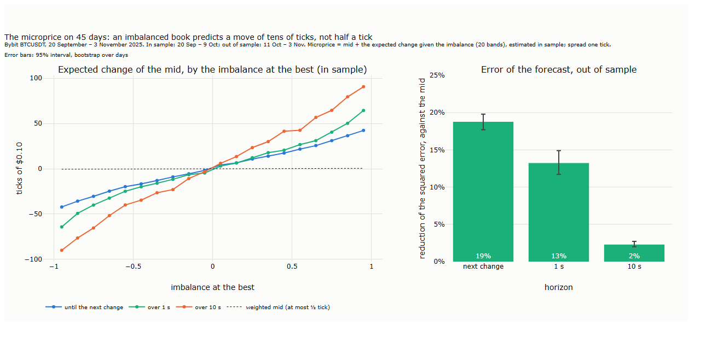
<b>How to read the figure.</b> <b>Left:</b> on the in-sample days, the average change of the mid in ticks of $0.10 until its next change (blue), over 1 s (green) and over 10 s (orange), in 20 bands of the imbalance at the best, spread one tick. The microprice is the mid plus this curve. The dotted line is the weighted mid's correction, which is never more than half a tick. <b>Right:</b> out of sample, the reduction of the mean squared error of the microprice against the mid, at three horizons; error bars are 95% intervals from resampling days.

- **H8 holds.** At the next change, the microprice's error is 19% below the mid's (17.7–19.8%). Over 1 s the reduction is 13% (11.7–14.9%), over 10 s 2.3% (2.0–2.7%). The weighted mid barely improves on the mid, by less than 0.5% at every horizon: its correction stays within half a tick, while the move it should anticipate is tens of ticks.

The curve on the left is the empirical version of Stoikov's (2018) idea: the microprice is where the mid is expected to be once it has moved, and the expectation is read off the data rather than imposed by a formula. On BTCUSDT that move is large compared with the spread, so the weighted mid, built on the assumption that the price moves by one tick, is the wrong tool. On 10 October the same table, estimated on calm days, still cut the error, by 6% at the next change and 1% over 1 s; that is less, since the moves of that day were far larger than any in sample.

### 3.4 The shape of the book and its queues

**Result.** A thin book comes before larger moves, though weakly. The best queues shrink mostly by cancellation, on every day: of each 100 BTC that left a best queue, about 92 were cancelled and 8 traded. Levels that are refilled again and again, the signature of icebergs, were found on 39 of the 45 days, most of all on 10 October.

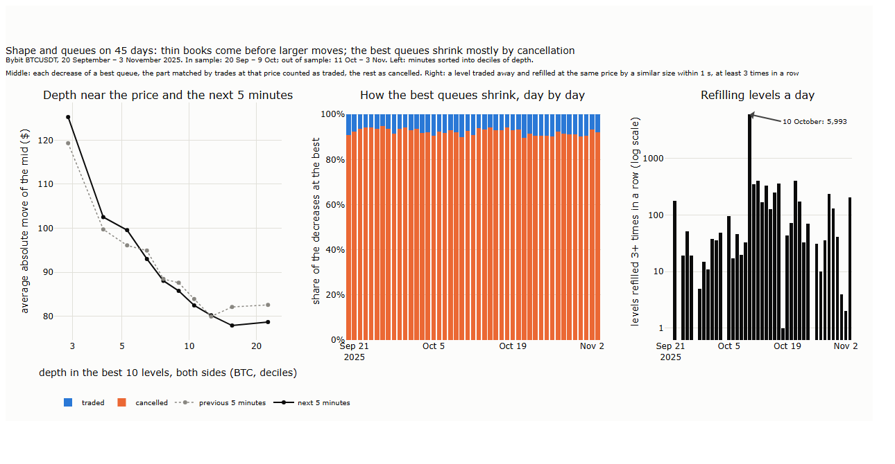
<b>How to read the figure.</b> <b>Left:</b> every minute of the 45 days, sorted into ten groups by the depth in the best 10 levels of both sides at its start (log scale); each point is a group's average absolute move of the mid over the next 5 minutes (black) and the previous 5 minutes (grey dotted), in dollars. <b>Middle:</b> each day's decreases of the best bid and ask queues, split into traded (the part matched by trades at that price in the interval) and cancelled (the rest). <b>Right:</b> levels traded away and refilled at the same price by a similar size within 1 s, at least 3 times in a row, per day (log scale; days with none are empty).

- **H9 (depth and moves) holds, weakly.** Controlling for the previous 5 minutes, the rank correlation between depth and the size of the next 5-minute move is −0.10 over all minutes (−0.14 to −0.05) and negative on 29 of the 45 days. In the thinnest tenth of minutes the mid moved $125 on average over the next 5 minutes, in the deepest about $79. But the previous 5 minutes show almost the same pattern, so depth mostly reflects how active the market already is. Within a day the relation is faint (median −0.02). It is strongest on 10 October (−0.17), which Section 4 takes up. H9 also passes the multiple-test correction only just.
- **H10 (cancellations dominate) holds.** On every day, 90% to 95% of the decreases of the best queues were cancellations. For every BTC traded at the best, about five BTC were added. A best queue is mostly orders that come and go, which is what makes the plain imbalance easy to move and what Section 3.2 tried, and failed, to correct.
- **H11 (queue race) fails.** Adding the race between the two queues' times to empty does not raise the AUC: 0.896 against 0.897. Two caveats. The time to empty is infinite on both sides in 59% of the samples, because neither queue was shrinking over the previous second. And the hypothesis named the logarithm of the ratio of the two times, which is undefined when both are infinite. We used the bid's share of the two times instead, set to one half when both are infinite. This is a change to the fixed test, and we state it.

The iceberg count is descriptive, with no test. Over the 45 days, 10,092 levels were refilled at least three times in a row, a median of 38 a day. On 10 October there were 5,993, more than on all other days together. Such chains are what an iceberg or any repeated quoting at one price leaves behind, and our data cannot tell which of the two produced them. A large order cut into slices gives up its place in the queue with every slice (Section 2.4), so the count measures size that was willing to lose priority to stay hidden.

### 3.5 Markouts

**Result.** The resting side of an average trade earns the spread at the fill and loses it, and more, within a second. Measured against the mid, the price moved against it by about 170 ticks per BTC within 1 s, out of sample. The larger the trade, the larger the move.

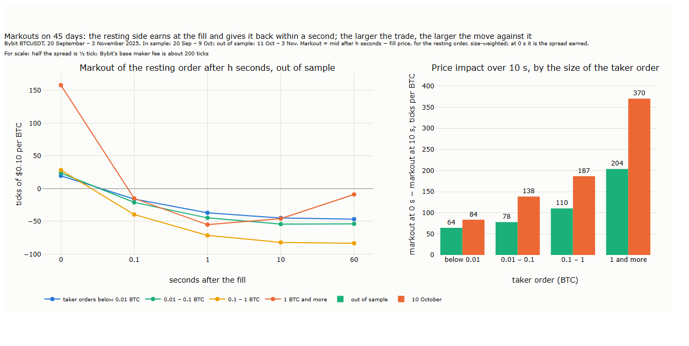
<b>How to read the figure.</b> One fill per taker order: the trades with the same millisecond and side, sizes summed, the price weighted by size. <b>Left:</b> out of sample, the markout of the resting side, the mid after $`h`$ seconds minus the fill price, signed for the resting side, size-weighted, in ticks of $0.10 per BTC, by size of the taker order. At 0 s it is the spread the resting order earned against the mid. <b>Right:</b> the price impact over 10 s, the markout at 0 s minus that at 10 s, by size, out of sample (green) and on 10 October (orange).

- **H12 (adverse selection) holds.** Over all sizes, the price impact out of sample is 171 ticks per BTC at 1 s (161–182) and 169 at 10 s (154–185). The markout itself turns negative within 100 ms and stays negative: −59 ticks, about −$5.90 per BTC, at 1 s.
- **H13 (size) holds.** The impact over 10 s grows with the size of the taker order: 64 ticks for orders below 0.01 BTC, 78, 110, and 204 for orders of 1 BTC and more. The difference between the largest and the smallest is 140 ticks (118–163). On 10 October each size moved the price further, 370 ticks for the largest.

At 0 s, large orders earn the resting side much more, 158 ticks per BTC, because they walk through several levels and the deeper levels fill further from the mid. Part of it is our measurement: the mid is that of the last book update before the trade, and in a fast market that update can be up to 100 ms old. The impact at 0.1 s carries the same caveat; from 1 s on, it no longer matters. For scale, Bybit's base maker fee, 0.02%, is about 200 ticks per BTC at these prices, larger than the spread at the fill for every size. A resting order at the base fee tier that is filled by the average taker loses on two counts, the move and the fee. Who can rest profitably, at which fee and with which choice of fills, is the subject of Lectures 21 to 23.

### 3.6 Verdicts

| Hypothesis | Measured on | Main number | p | Verdict after correction |
|---|---|---|---|---|
| H1 direction | Out of sample | AUC 0.897 | < 0.001 | Holds |
| H2 stability | Each day | 45 of 45 days | < 0.001 | Holds |
| H3 regime | Out of sample; 10 Oct | AUC 0.897; 0.842 | < 0.001 | Holds |
| H4 depth adds | Out of sample | AUC −0.0002 | 1.00 | Fails |
| H5 small queues | Out of sample | AUC 0.96 vs 0.63 | < 0.001 | Holds |
| H6 distance weight | Out of sample | AUC 0.897 at every λ | < 0.001 | Holds |
| H6 age filter | Out of sample | AUC 0.28–0.33 | 1.00 | Fails (inverted) |
| H6 smoothing | Out of sample | AUC 0.84 to 0.64 | 1.00 | Fails |
| H7 resistance | Each day, 9 settings | 45 of 45 days | < 0.001 | Holds by construction; distance alone fails |
| H8 microprice | Out of sample | Error −19% | < 0.001 | Holds |
| H9 depth and moves | All minutes; each day | −0.10; 29 of 45 days | 0.036 | Holds, weak |
| H10 cancellations | Each day | 92% cancelled | < 0.001 | Holds |
| H11 queue race | Out of sample | AUC −0.0015 | 1.00 | Fails |
| H12 adverse selection | Out of sample | Impact 171 ticks at 1 s | < 0.001 | Holds |
| H13 size | Out of sample | 204 vs 64 ticks | < 0.001 | Holds |

<b>How to read the table.</b> One row per hypothesis of [results/hypotheses.md](results/hypotheses.md); H6 is split into its three families, so 15 tests in all. "p" is one-sided, from 2,000 resamples of days or from a sign test over days; "< 0.001" means no resample went against the hypothesis. The Benjamini-Hochberg procedure at 5% ranks the 15 p-values and accepts the k smallest if the k-th is at most k × 0.05 / 15. Ten p-values are below 0.001; the eleventh, H9's 0.036, is just under its limit of 0.037, so eleven hold and four fail.

Three caveats apply to all of Section 3. The book is published every 100 ms, so "the next update" covers everything that happened in that interval, and moves within it cannot be seen. Every quantity is measured on BTCUSDT on one venue over 45 days; the second venue and the feed's own delay come in Section 4. And none of the results is a trading result: a forecast that ranks moves nine times in ten is worth something only to those who can act on it in time and at a cost below the move. The move is a median of 44 ticks and the fees are hundreds; that question belongs to Lecture 23.

Several questions remain open, and we invite independent tests:

- How much of imbalance's forecast is information, and how much the arithmetic of a queue about to empty? A model in the style of Cont and de Larrard (2013), with the measured rates, would give the share of mechanics alone.
- Does an imbalance confirmed by the trades that follow resist walls without losing its forecast (Lecture 20)?
- Do the age filter's inversion and the continuation of mid changes hold on other venues and with a model that cancels in proportion rather than from the back?
- Do the refilling chains of 10 October come from icebergs or from market makers requoting one price, and did they rise before the cascade?

### 3.7 Does the book have a clock?

*Added after the results above, on the model of Lecture 13 §7; its hypotheses, H19 to H23, were fixed before any of them was computed ([results/hypotheses.md](results/hypotheses.md)) and are corrected for multiple tests on their own.*

Lecture 13 found that trading bunches at round times: the first minute of the hour, above all when funding is paid (00:00, 08:00 and 16:00 UTC), the half and quarter hours. Lecture 18 found a clock in the book's cancellations: more of them in the first seconds of every minute. This section asks whether the book itself changes at the round times of the trades. If it does, a market maker quoting then (Lecture 23) meets a different book, and a replay (Lecture 21) must place our orders into it.

**How the test is set up.** The slots of Lecture 13, one minute each, fixed by the schedule: minute :00 with funding, minute :00 without, minute :30, minutes :15 and :45, minute :59. The control: minutes :07, :17, :37 and :47, which nobody schedules. Each measure in a slot is divided by its own average over the hour that ends 5 minutes before the slot, so that the comparison is local; the same for the control; the test is whether the slot's ratio exceeds the control's, with a bootstrap over the 44 days without 10 October. Two quantities planned at first were left out before any result: the refilling chains of §3.4, about 38 a day, too rare to compare minutes, and the rate of book updates, which Bybit's 100 ms publication caps at about ten a second all day.

**Result.** The book has a clock, and it is not the one we expected. Quotes are withdrawn and replaced at the start of every minute, and much more so at the start of minutes :00 and :30; at those moments depth near the price does not thin, it jumps. The spread widens a little more often at round times, for a few seconds in all. And in the first seconds of :00 and :30, taker orders follow the direction of the last half hour, while the new depth goes to both sides.

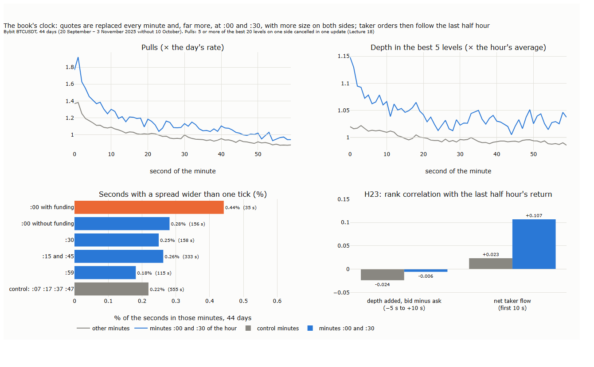
<b>How to read the figure.</b> Bybit BTCUSDT, 44 days without 10 October. <b>Top:</b> by second of the minute, in minutes :00 and :30 of the hour (blue) and in all other minutes (grey). Left, the share of book updates with a pull (5 or more of the best 20 levels on one side losing size beyond trades, Lecture 18), relative to the day's share; right, the depth in the best 5 levels of both sides, relative to its average in the same clock hour; 1 is ordinary. <b>Bottom left:</b> the share of seconds whose spread was wider than one tick, by slot, with the number of such seconds. <b>Bottom right:</b> H23, the rank correlation, averaged over days, between the mid's return over the 30 minutes before the start of the minute and, left, the change in depth on the bid minus the ask from 5 s before to 10 s after; right, the net taker flow over the first 10 s; in minutes :00 and :30 (blue) and in the control minutes (grey).

- **H21 (pulls) holds at :00 and :30.** The question: are quotes withdrawn more at round times than at minutes nobody schedules? Over the slot minute, pulls ran at 1.45 times their rate in the hour before at :00 with funding, 1.18 at other minutes :00 and 1.11 at :30, against 1.05 in the control minutes (p ≤ 0.001 for all three), with the same sign in and out of sample. The quarter hours did not differ (1.06, p = 0.25). The control minutes carry Lecture 18's clock too, so this is more than that clock. Second by second, the clock has two layers: at second 0 of an ordinary minute pulls run at 1.37 times the day's rate and fade over 10 to 20 seconds; at second 0 of minutes :00 and :30 they run at 1.77, and 1.92 a second later. The bump at second 30 that Lecture 18 reported is faint here (1.00 against 0.95 to 0.97 around it). Minute :59 runs the other way: pulls 0.80 times the hour's rate against 1.05, a quiet minute before the burst at :00.
- **H19 (spread) holds, but the effect is small in absolute terms.** The question: does crossing the spread cost more at round times? The spread is one tick almost always: wider in 0.22% of the seconds of the control minutes. It was wider in 0.44% of the seconds of the funding minutes, 35 seconds over 18 of the 44 days, in 0.28% of the other minutes :00 and 0.26% of the quarter hours (p = 0.012, < 0.001 and 0.012); not at :30 (0.25%, p = 0.23) nor at :59 (0.18%). The test's own ratios are larger, because seconds of a wider spread are so rare that a few of them move a day's ratio a lot; the shares are the numbers to quote.
- **H20 (depth thins) fails, and the data point the other way.** The question: is there less to trade against at round times, or already in the seconds before? Over the slot minute, depth relative to the hour before was 1.02 to 1.05 against 0.99 in the control, the opposite of the hypothesis at every slot. Second by second, depth jumps at the very start of minutes :00 and :30, to 1.15 times the hour's average, at the moment of the burst of pulls, and stays raised for 20 to 30 seconds; at the start of an ordinary minute it rises by about 2%. In the 10 seconds before the slot there was no thinning either (H20b), except in the funding minutes, where depth stood at 0.89 to 0.92 of its hourly average in the last three seconds before 00:00, 08:00 and 16:00; that rests on 132 minutes and is not a result. Pulls and more depth together mean quotes cancelled and replaced with more size. That was not a hypothesis, so we report it as a result on our sample with a mechanism to test, not as a tested claim.
- **H22 (the funding minute is special) fails.** The question: does the book change more at the funding minute than at other minutes :00, as trading does? For the spread it leans that way (p = 0.077); for depth it does not (p = 0.48).
- **H23 (who refreshes at :00 and :30?) holds for the taker orders, not for the depth.** The question: do the orders at :00 and :30 follow the last half hour, as signals recomputed when a 30-minute or hourly bar closes would, or do they have no direction, as a liquidity provider's refresh would not? The net taker flow over the first 10 seconds followed the return of the last 30 minutes with a rank correlation of +0.107, against +0.023 in the control minutes (difference +0.084, 95% interval +0.040 to +0.129, p < 0.001, positive on 36 of 44 days, in sample and out of sample); the flow was also larger, 9.2 BTC in absolute value against 5.4. The change in depth, bid minus ask, did not follow it: −0.006 against −0.024 (p = 0.25). The rule fixed in advance for a mixed outcome was to report it as mixed.

| The question in plain words | Hypothesis | Main number | p | Verdict after correction |
|---|---|---|---|---|
| Are quotes withdrawn more at round times? | H21 | 1.45 (:00 funding), 1.18 (:00), 1.11 (:30) against 1.05 | ≤ 0.001 (three slots) | Holds at :00 and :30; fails at :15/:45 and :59 |
| Is the spread wider than a tick more often? | H19 | 0.44% (:00 funding), 0.28% (:00), 0.26% (:15/:45) against 0.22% of seconds | 0.012, < 0.001, 0.012 | Holds at three slots; small |
| Is there less depth during the round minute? | H20a | 1.02–1.05 against 0.99 | 0.74 to 1.00 | Fails at every slot: more depth, not less |
| Do makers pull back before it? | H20b | No thinning in the 10 s before | 0.53 to 1.00 | Fails at every slot |
| Is the funding minute special beyond other :00 minutes? | H22 | Spread leans so; depth not | 0.077; 0.48 | Fails |
| Does the depth added follow the last half hour? | H23a | −0.006 against −0.024 | 0.25 | Fails |
| Do taker orders follow the last half hour? | H23b | +0.107 against +0.023 | < 0.001 | Holds |

<b>How to read the table.</b> One row per hypothesis of [results/hypotheses.md](results/hypotheses.md); H19 to H21 are tested at each of five slots and H22 for the spread and depth, 22 tests corrected together by Benjamini-Hochberg at 5%, of which six hold; H23 has two parts, corrected on their own. "Against" gives the control minutes. "p" is one-sided, from 2,000 resamples of days; "< 0.001" means no resample went against the hypothesis. 44 days, without 10 October.

What the clock means can be told only partly from public data, and we keep the reading to what our sample shows. Directional orders do act when bars close: buying after an up half hour and selling after a down one, though a correlation of 0.1 leaves most of that flow unexplained. The depth added at the same moment goes to both sides, so it is not the same traders, and it is not a liquidity provider refreshing every 30 minutes for its own sake, since market makers requote in milliseconds. One reading, which we have not tested: liquidity providers know that flow arrives at :00 and :30 and put out more size, on both sides, to meet it. For a resting order this cuts both ways: more competition in the queue at those moments, and a burst of taker flow in the direction of the last bar, that is, fills against the trend.

Several questions remain open, and we invite independent tests:

- Do the same clocks appear on Binance's book and on other symbols, and do they follow the minutes of the hour in UTC or the bars of particular trading platforms?
- Is the depth added at :00 and :30 filled more, or cancelled again within seconds? Following each order through the queues (§2.4) would tell.
- Do resting orders filled in the first seconds of :00 and :30 have worse markouts (§3.5) than those filled at other times?

## 4. 10 October

On the evening of 10 October 2025, after a post announcing 100% US tariffs on China at 20:50:01.7 UTC, Bybit's BTCUSDT fell from about $117,000 to about $103,100 within 35 minutes, and more than $19 billion of leveraged positions were liquidated across crypto venues (Lecture 5; Lecture 18, §5.4). This section asks whether any statistic of Section 3 changed before the fall: whether the book gave a warning that a trader watching it could have used.

**How the test is set up.** The start of the cascade, **T0**, is fixed by a rule rather than chosen by eye: the first minute of 10 October whose move of the mid was larger than any one-minute move on the 20 calm days. The rule gives 21:14 UTC, a minute in which the mid fell by $977. The **pre-window** is the two hours before T0, 19:14 to 21:14. Its value of each measure is compared with every two-hour window of the other 44 days that starts at the same time of day, 526 windows in all. The p-value is the share of those windows that are at least as extreme. Five hypotheses, fixed before any result was computed ([results/hypotheses.md](results/hypotheses.md)), cover the refilling chains of Section 3.4 (H14), depth (H15), Bybit's own delay between matching an order and publishing the update (H16), the imbalance forecast (H17), and Binance's price against Bybit's (H18). Binance's prices are the last trades of its BTCUSDT perpetual, from its public archive (Binance, n.d.).

One fact matters for reading the results. The fall did not begin at T0 but with the post, 24 minutes earlier: between 20:49 and 20:54 the mid dropped by about $1,700 (Lecture 18, §5.4, describes the book in those minutes). The last 24 minutes of the pre-window therefore already belong to the cascade; what came before them is the part that could have been a warning.

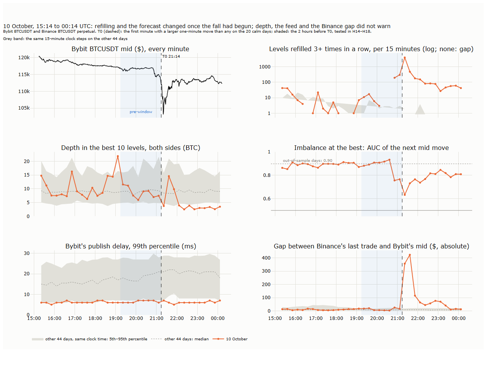
<b>How to read the figure.</b> 10 October 15:14 to 11 October 00:14 UTC, in 15-minute steps; the dashed line is T0, 21:14, and the shaded area the two-hour pre-window. In every panel but the top left, the orange line is 10 October and the grey band the 5th to 95th percentile of the same 15-minute steps on the other 44 days, with their median dotted. <b>Top left:</b> Bybit's mid every minute. <b>Top right:</b> levels refilled at least three times in a row (Section 3.4), log scale; steps with none are left empty. <b>Middle left:</b> depth in the best 10 levels of both sides. <b>Middle right:</b> the AUC of the imbalance at the best for the next mid move (Section 3.1); the dotted line is the out-of-sample value. <b>Bottom left:</b> the 99th percentile of Bybit's publish delay, the time between the matching engine's stamp and the publication of each update. <b>Bottom right:</b> the average absolute gap between the last trade on Binance and Bybit's mid.

**Result.** No statistic of the book changed before the price began to fall. Two changed with it: refilling surged and the imbalance forecast weakened. After T0, depth collapsed and the two venues parted by hundreds of dollars. Bybit's feed stayed fast throughout.

- **H14 (refilling chains) holds as fixed, but not as a warning.** The pre-window had 530 chains, against a median of none and a maximum of 204 in the reference windows (p = 0.002). But 493 of the 530 came in the last 30 minutes, once the fall had begun. In the 90 minutes before, there were 37, within the range of ordinary days: the busiest 5% of the reference windows had 47 or more. Refilling rose with the fall, not ahead of it.
- **H15 (depth) fails.** Average depth in the pre-window was 8.6 BTC, against a median of 9.3 (p = 0.43). After T0 it fell to about 3 BTC and stayed there for the rest of the evening, below the 5th percentile of the other 44 days at that time of day.
- **H16 (publish delay) fails.** The 99th percentile of Bybit's publish delay was 6 milliseconds in the pre-window, below the reference median of 18. It never exceeded 7 ms in any 15-minute step of the evening; the longest single delay during the fall was 38 ms. On other days the 99th percentile ranges from 8 to 27 ms. Bybit's chain from matching to publishing did not congest. What happened between Bybit and a trader's machine is not in the data.
- **H17 (imbalance through the cascade) holds.** The AUC stayed above 0.5 in every 15-minute step from T0 − 2 h to T0 + 2 h (p < 0.001). Before the fall it was 0.88 to 0.93, as on any day. In the step in which the fall began it dropped to 0.76; at T0, to 0.63. Over the next two hours it recovered only partly, to between 0.73 and 0.85. Imbalance kept working through the cascade, less well; as the moves grew, the book a few hundred milliseconds old said less about the next one.
- **H18a (Binance gap) fails.** The average absolute gap between Binance's last trade and Bybit's mid was $12.7 in the pre-window, against a median of $8.5 (p = 0.25). After T0 it widened to an average of $420 over the 15 minutes from 21:29: for half an hour two of the largest venues disagreed on the price of bitcoin by hundreds of dollars.
- **H18b (lean towards Binance) holds, but the effect is tiny.** On 10 October, from T0 − 2 h to T0 + 2 h, the rank correlation between Bybit's imbalance and the gap (Binance minus Bybit) is +0.02 (0.003–0.040, p = 0.011). On the 20 calm days the same correlation is negative on 19 days, typically about −0.09. On a normal day, Bybit's book leans away from Binance's last price, not towards it. One possible reading, which we have not checked: the gap mostly reflects Bybit's own last move, which Binance's last trade has not yet followed, and after a move Bybit's imbalance points the way the move continues (Section 3.2). Which venue leads which is a question for Lecture 20.

| Hypothesis | 10 October | Reference (median) | p | Verdict after correction |
|---|---|---|---|---|
| H14 refilling chains, pre-window | 530 (37 before the fall began) | 0 | 0.002 | Holds; rose with the fall, not before it |
| H15 depth, pre-window | 8.6 BTC | 9.3 BTC | 0.43 | Fails |
| H16 publish delay, 99th percentile | 6 ms | 18 ms | 1.00 | Fails |
| H17 imbalance AUC, every 15 minutes | 0.63 to 0.93 | 0.90 (out of sample) | < 0.001 | Holds |
| H18a Binance gap, pre-window | $12.7 | $8.5 | 0.25 | Fails |
| H18b imbalance and the gap | +0.02 | −0.09 (calm days) | 0.011 | Holds, tiny |

<b>How to read the table.</b> One row per hypothesis of Section 4 in [results/hypotheses.md](results/hypotheses.md). The reference is the median of the 526 two-hour windows of the other 44 days at the same time of day; for H17, the out-of-sample AUC of Section 3.1; for H18b, the median of the 20 calm days. The Benjamini-Hochberg procedure at 5% over these six p-values accepts the three smallest.

The cascade was set off by news, and a book does not anticipate news; that none of its statistics moved before the price did is the result one would expect, and it is now measured rather than assumed. What the book did show is how the market behaved once the news was out: as soon as the price began to fall, many levels began to be refilled again and again, the queues at the best stopped being a good guide to the next move, and, after T0, depth thinned to a third and the venues drifted apart. These are the conditions that the replay of Lecture 21 has to reproduce, and in which the market maker of Lectures 23 and 24 would have had to decide whether to keep quoting.

Questions that remain open:

- Between the first drop and T0, refilling rose and the forecast weakened. Did these changes come before the acceleration of the fall, and do they do so on other days with a sharp first move? Answering this needs more such events than one evening provides.
- Do the refilling chains of the cascade come from icebergs of large sellers, from market makers requoting one price, or from the liquidation engine?
- During the half hour in which the venues parted by hundreds of dollars, which led? This is the lead-lag question of Lecture 20 and the central risk of Lecture 24.

## 5. Summary, exercises and reading

### 5.1 Seven takeaways

1. **A level is the state of the book at one moment; it says where orders rest, not how they got there.** Imbalance, the microprice, the shape of the book and the queues are all read from one such state. What changed in between, the flow, is the subject of Lecture 20.
2. **The imbalance at the best ranks the next move of the mid nine times in ten.** On 45 days of Bybit BTCUSDT its AUC was 0.90 out of sample, on every day, and still 0.84 on 10 October. Most of this is mechanics: when the smaller of the two best queues holds less than 0.1 BTC, one ordinary market order empties it, and the forecast is 0.96; two seconds or more before the move, it is 0.62. Deeper levels add nothing.
3. **We found no way to make imbalance hard to game without losing its forecast.** Weighting levels by distance changed nothing; smoothing over time weakened the forecast; keeping only depth that had rested a while turned it upside down, because the side that just moved holds only young orders. No published measure has been shown to resist spoofing on real data either.
4. **The microprice is a better guess of the price than the mid, and on BTCUSDT it must be estimated, not computed.** Read off the data, it cut the error of the next mid by 19% out of sample. The weighted mid assumes moves of one tick; here the mid jumps a median of 44 ticks.
5. **Resting orders are mostly cancelled, and filled ones lose.** 92% of the size that left the best was withdrawn rather than traded. One second after a fill, the average resting order was 59 ticks per BTC under water; over 10 seconds the price moved against it by 64 ticks after the smallest takers and 204 after the largest. This is adverse selection, and it comes on top of a base maker fee of about 200 ticks.
6. **No statistic of the book warned of 10 October before the price began to fall.** Refilling surged and the forecast weakened once the fall had begun; after it, depth fell to a third and Bybit and Binance parted by hundreds of dollars, while Bybit's own feed stayed fast. News set off the cascade, and a book does not anticipate news.
7. **The book has a clock.** Quotes are withdrawn and replaced at the start of every minute, and much more so at the start of minutes :00 and :30, when depth near the price rises rather than falls and taker orders follow the last half hour. The spread widens a little more often at round times, for seconds. On this one symbol and 44 days; whether it holds elsewhere is open.

### 5.2 Exercises

- [ ] Redraw the key chart of Section 1 (figure 19_02) for ETHUSDT on one day. Is imbalance as strong, and does the share of tiny best queues explain the difference?
- [ ] Simulate the race of two queues in the style of Cont and de Larrard (2013), with arrival, cancellation and market-order rates measured on one of our days. What AUC does mechanics alone give, against the 0.90 we measured (§3.1)?
- [ ] Repeat the age filter of §3.2 with cancellations taken in proportion to the queue rather than from the back (§2.4). Does the inversion survive?
- [ ] Take the spoof candidates of §3.2 and test the "flip": in the second after a candidate is removed, is aggressive volume on the opposite side larger than at random moments? Check that the answer holds across the thresholds of size, distance and time.
- [ ] Count the refilling chains of §3.4 by hour of the day and by day of the week. Is there a clock in hidden size, as Lecture 18 found in cancellations?
- [ ] Deep levels change less often than the best ones. Carry levels beyond the 50th forward for 1 second and fill only the top 50 from the data. How large is the error in depth within 5 bp, on calm seconds and on fast ones?
- [ ] On the calm days, Bybit's book leans away from Binance's last price (H18b). Split the samples by which venue's price moved last. Does that explain the sign?
- [ ] Repeat §3.7 at another round time of your choice, for example Deribit's option settlement at 08:00 on expiry Fridays (Lecture 13 §7.5). Does the book refresh there too?
- [ ] Pick one result of this lecture and test it on a market of your choice.

### 5.3 Reading

For the imbalance at the best as a forecast, Gould and Bonart (2015), whose measure Section 3 repeats; for the microprice, Stoikov (2018). For the price as a race between queues, Cont and de Larrard (2013), and Huang, Lehalle and Rosenbaum (2015) for queues whose rates depend on their size; Moallemi and Yuan (2016) for what a place in the queue is worth. For the book and the trades together, Bouchaud et al. (2018), the reference for this lecture and the next. For manipulation of the book, Lee, Eom and Park (2013) on spoofing in real data and Cartea, Jaimungal and Wang (2020) for a model; for markouts and the realized spread, Huang and Stoll (1996).

## References

- Bouchaud, J.-P., Bonart, J., Donier, J. and Gould, M. (2018). *Trades, Quotes and Prices: Financial Markets Under the Microscope*. Cambridge University Press. — the book and the trades that move it (§5.3).
- Budish, E., Cramton, P. and Shim, J. (2015). The high-frequency trading arms race: frequent batch auctions as a market design response. *Quarterly Journal of Economics* 130(4), 1547–1621. — frequent batch auctions (§2.1).
- Binance (n.d.). Binance public data: USDⓈ-M futures, daily aggregate trades, BTCUSDT. data.binance.vision. — Binance's last trade price (§4).
- Bybit (n.d.-a). How to use iceberg orders. *Bybit Learn*, bybit.com/en/learn/bybit-guide/how-to-use-iceberg-orders. — icebergs on Bybit as slices placed one after another (§2.4).
- Bybit (n.d.-b). Perpetual futures contract fees explained. *Bybit Help Center*. — maker 0.02%, taker 0.055% at the base tier, VIP 0 (§2.5).
- Cartea, Á., Jaimungal, S. and Wang, Y. (2020). Spoofing and price manipulation in order-driven markets. *Applied Mathematical Finance* 27(1–2), 67–98. — a model of a spoofing seller (§2.1).
- Cong, L. W., Li, X., Tang, K. and Yang, Y. (2023). Crypto wash trading. *Management Science* 69(11), 6427–6454. — wash trading on crypto exchanges (§2.1).
- Cont, R. and de Larrard, A. (2013). Price dynamics in a Markovian limit order market. *SIAM Journal on Financial Mathematics* 4(1), 1–25. — the next price move as a race between the two best queues (§2.4).
- Fabre, T. and Challet, D. (2025). Learning the spoofability of limit order books with interpretable probabilistic neural networks. arXiv 2504.15908. — distance and spoofing on crypto exchanges (§2.1).
- Gai, J., Yao, C. and Ye, M. (2013). The externalities of high frequency trading. Working paper, SSRN. — quote stuffing across Nasdaq's channels (§2.1).
- Gould, M. D. and Bonart, J. (2015). Queue imbalance as a one-tick-ahead price predictor in a limit order book. arXiv 1512.03492. — the imbalance at the best and the next mid move (§1, §2.1).
- hftbacktest documentation (n.d.). Queue models. hftbacktest.readthedocs.io. — cautious and probabilistic models of queue position in an open-source backtester (§2.4).
- Huang, R. D. and Stoll, H. R. (1996). Dealer versus auction markets: a paired comparison of execution costs on NASDAQ and the NYSE. *Journal of Financial Economics* 41(3), 313–357. — effective spread, realized spread and price impact (§2.5).
- Huang, W., Lehalle, C.-A. and Rosenbaum, M. (2015). Simulating and analyzing order book data: the queue-reactive model. *Journal of the American Statistical Association* 110(509), 107–122. — arrival and cancellation rates that depend on the queue size (§2.4).
- Lee, E. J., Eom, K. S. and Park, K. S. (2013). Microstructure-based manipulation: strategic behavior and performance of spoofing traders. *Journal of Financial Markets* 16(2), 227–252. — spoofing on the Korea Exchange (§2.1).
- Moallemi, C. C. and Yuan, K. (2016). A model for queue position valuation in a limit order book. Working paper, Columbia Business School. — the value of a place in the queue (§2.4).
- Næs, R. and Skjeltorp, J. A. (2006). Order book characteristics and the volume–volatility relation: empirical evidence from a limit order market. *Journal of Financial Markets* 9(4), 408–432. — the slope of the book (§2.3).
- Rigtorp, E. (2013). Estimating order queue position. Blog post, rigtorp.se, 8 June 2013. — estimating queue position from market-by-level data (§2.4).
- SEC (2010). Concept release on equity market structure. Release No. 34-61358, *Federal Register* 75, 3594. — momentum ignition (§2.1).
- SEC (2024). Disclosure of order execution information. Release No. 34-99679, *Federal Register* 89, 26428. — realized spreads at horizons up to five minutes (§2.5).
- Stoikov, S. (2018). The micro-price: a high-frequency estimator of future prices. *Quantitative Finance* 18(12), 1959–1966. — the microprice (§2.2).
- Tao, X., Day, A., Ling, L. and Drapeau, S. (2020). On detecting spoofing strategies in high frequency trading. arXiv 2009.14818. — statistical alarms (§2.1).
- Tuccella, J.-N., Nadler, P. and Serban, O. (2021). Protecting retail investors from order book spoofing using a GRU-based detection model. arXiv 2110.03687. — rules and a model for detection (§2.1).
