# Lecture 20: Statistics of the Flow: Order-Flow Imbalance, Impact, VPIN, Hawkes Processes and Lead-Lag

*Systematic Trading: Lecture Notes (MSc) · Oct 31, 2026 · Max Gnesi*

Lecture 19 read the book at one moment: which side outweighs the other, and what that says about the next move. This lecture measures what changes between moments: orders added, cancelled and filled over an interval, which together are called the flow. It asks how much of a price move the flow accounts for, whether it forecasts the next one, how long a trade's impact lasts, whether one-sided flow warns of a crash, how far trading feeds on itself, and whether Bybit or Binance moves first. As in Lecture 19, each statistic is first introduced on invented examples and then measured on the same 45 days of Bybit BTCUSDT, 20 September to 3 November 2025, with the trades of Binance beside them. The hypotheses were fixed before any result was computed ([results/hypotheses.md](results/hypotheses.md)).

## 1. The flow as a delta

Part IV moves from describing the order book to trading on it, one step per lecture:

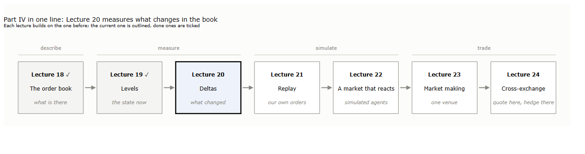
<b>How to read the figure.</b> Each box is one lecture of Part IV, each building on the one before; this lecture is outlined, Lectures 18 and 19 are done. Above the boxes, the four stages: describing the book, measuring it, simulating our own orders in it, and trading strategies on it.

Lecture 19 distinguished two kinds of quantity: a **level**, the state of the book at one moment, like a balance sheet, and a **delta**, what changed over an interval, like a cash-flow statement. The same word, imbalance, names one of each. **Book imbalance** compares the sizes resting at the best bid and the best ask at one moment (Lecture 19, §2.1). **Order-flow imbalance** adds up, over an interval, everything that pushed on the best prices: size added to the best bid or taken from the best ask pushes the price up; size added to the best ask or taken from the best bid pushes it down, whether it was taken by a trade or by a cancellation (Cont, Kukanov and Stoikov, 2014; Section 2.1 gives the calculation). **Trade imbalance** counts only the trades: size bought by takers minus size sold, the net aggressive flow of Lecture 15.

The idea of the lecture fits in one chart. On the left, one minute of our data; on the right, the whole of that day:

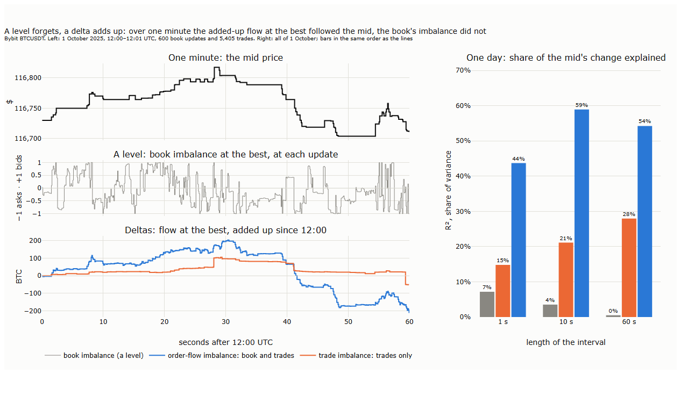
<b>How to read the figure.</b> <b>Left:</b> Bybit BTCUSDT, 1 October 2025, 12:00 to 12:01 UTC, 600 book updates and 5,405 trades. Top, the mid; middle, the book imbalance at the best after each update, from −1 (only asks) to +1 (only bids); bottom, the order-flow imbalance at the best (blue) and the trade imbalance (orange), each added up from 12:00, in BTC. <b>Right:</b> every interval of 1, 10 and 60 seconds of the same day; each bar is the share of the variance of the mid's change over the interval explained by one quantity alone (R², from a straight-line fit): the book imbalance just before the interval (grey), the trade imbalance during it (orange), the order-flow imbalance during it (blue). One day of the in-sample period; Section 3 measures all 45 days.

The book imbalance changed sign 69 times in the minute. Each value describes the book at that moment and nothing earlier: when the queue at the best is used up and the price moves, the new best queue starts afresh, and the imbalance with it. The added-up order-flow imbalance followed the mid almost step for step. Three moments of the minute show why:

| Seconds after 12:00 | What happened | Mid | Trade imbalance | Order-flow imbalance |
|---|---|---|---|---|
| 0 to 39.5 | A steady rise | +$42 | +78 BTC | +90 BTC |
| 27.5 to 31 | Two buys 5 ms apart, 11.5 and 37.5 BTC, filled in 496 trades over $17 of prices | +$11 | +48 BTC | +63 BTC |
| 39.5 to 49 | The fall: new asks placed at lower and lower prices | −$68 | −57 BTC | −261 BTC: −50 at the bid, −211 at the ask |
| 59.35 | One sell of 71 BTC, filled in 809 trades over $29 of prices | the mid ends the minute at $116,711 | −71 BTC | falls with it |

<b>How to read the table.</b> Mid: change of the mid over the stretch. The trade imbalance counts only trades; the order-flow imbalance counts trades and the size added and cancelled at the best. A single buy or sell is all trades of one taker order, which share the same millisecond (Lecture 19).

In the rise both measures agree, because takers did most of the pushing. In the fall they part. The price dropped $68 while takers sold a net 57 BTC. At the bid, the order-flow imbalance lost 50 BTC, about what sellers took; the larger push came from the ask side, where sellers placed new resting orders at lower and lower prices, 211 BTC counted at the best ask as it came down. Those orders never traded in the interval, so the trade imbalance cannot see them; the order-flow imbalance does. Over the whole day the picture is the same. Measured over ten-second intervals, the order-flow imbalance explains 59% of the variance of the mid's change, the trade imbalance 21%, and the book imbalance at the start of the interval 4%.

Two cautions keep the chart in proportion. First, the flow and the change of the mid are measured over the same interval: the flow describes how the price moved, it does not say in advance that it will move. A forecast needs the flow of the past interval and the move of the next one, which is hypothesis H2. Second, the bars are one day of the in-sample period, fitted on that day. Whether the order-flow imbalance explains more than the trades on days it was not fitted on is hypothesis H1, and the literature disagrees: on 50 US stocks, Cont, Kukanov and Stoikov (2014) found 65% against 32%, while on the BitMEX bitcoin perpetual the trades explained more (Silantyev, 2019).

This lecture runs as follows:

| § | Step | Question |
|---|---|---|
| 1 | The flow as a delta | What does a delta show that a level does not? |
| 2 | The statistics | What do order-flow imbalance, impact over time, VPIN, Hawkes processes and lead-lag each capture, shown on invented flows? |
| 3 | On our 45 days | Does the flow explain and forecast the price, how long does impact last, does VPIN warn, how far does trading feed on itself, and which venue moves first? |
| 4 | 10 October | When did the news arrive, did the flow move before it, and did any statistic of the book or the flow warn of the fall? |
| 5 | Summary, exercises and reading | |

## 2. The statistics

Each statistic is introduced the same way as in Lecture 19: what it is meant to capture, how it is computed, an invented example that shows it at work, and what it misses. The examples are invented so that each case is clean; Section 3 measures the same statistics on the data.

### 2.1 Order-flow imbalance

**Key message.** Order-flow imbalance adds up everything that pushed on the best prices over an interval: trades, new orders and cancellations. It measures the pressure that moves the price, of which the trades are only one part.

| Step | Calculation | Financial meaning |
|---|---|---|
| 1 | Bid side of update $`n`$: if the best bid rose, $`+q^b_n`$, the size at the new best bid; if it stayed, $`+(q^b_n - q^b_{n-1})`$, the change of its size; if it fell, $`-q^b_{n-1}`$, the size that was there | Buying interest arriving at the top of the book, or leaving it: filled, cancelled or outbid |
| 2 | Ask side, with the opposite sign: if the best ask fell, $`-q^a_n`$; if it stayed, $`-(q^a_n - q^a_{n-1})`$; if it rose, $`+q^a_{n-1}`$ | Selling interest arriving at the top, or leaving it |
| 3 | Contribution of the update: $`e_n`$ = bid side + ask side; over an interval, $`\text{OFI} = \sum_n e_n`$ | The net pressure on the price over the interval, in BTC: positive pushes it up |
| 4 | Fit the change of the mid over the interval, $`\Delta m = \beta \cdot \text{OFI}`$ | How far one BTC of pressure moves the price; $`\beta`$ is roughly inversely proportional to the depth at the best (Cont, Kukanov and Stoikov, 2014) |

<b>How to read the table.</b> $`q^b_n, q^a_n`$: size at the best bid and ask after update $`n`$, in BTC. Steps 1 and 2 are the formula of Cont, Kukanov and Stoikov (2014), $`e_n = \mathbb{1}\{P^b_n \ge P^b_{n-1}\}\,q^b_n - \mathbb{1}\{P^b_n \le P^b_{n-1}\}\,q^b_{n-1} - \mathbb{1}\{P^a_n \le P^a_{n-1}\}\,q^a_n + \mathbb{1}\{P^a_n \ge P^a_{n-1}\}\,q^a_{n-1}`$, with $`P^b_n, P^a_n`$ the best bid and ask prices; $`\mathbb{1}\{\cdot\}`$ is 1 if the condition holds and 0 otherwise. The trade imbalance is the part of the same pressure that came from trades: taker buys minus taker sells.

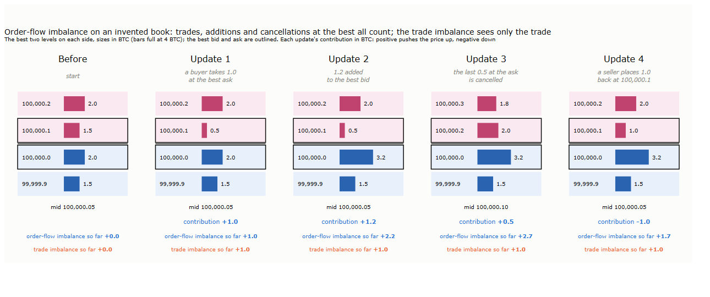
<b>How to read the figure.</b> One invented book over four updates, the best two levels on each side, sizes in BTC (bars full at 4 BTC); the best bid and ask are outlined. Above each book, the event that led to it. Below: the mid, the contribution of the update to the order-flow imbalance, and both imbalances added up so far.

The four updates show each case of the formula. A buyer takes 1.0 BTC at the best ask: the ask queue shrinks at an unchanged price, +1.0, and the trade imbalance records the same. Then 1.2 BTC is added to the best bid: +1.2, and no trade happens. The last 0.5 BTC at the best ask is cancelled, so the best ask rises a tick: the size that was there has left, +0.5, and the mid rises half a tick. A seller then places 1.0 BTC back at 100,000.1: the best ask falls, −1.0, and the mid returns. After four updates the order-flow imbalance stands at +1.7 BTC and the trade imbalance at +1.0: the extra 0.7 is pressure that came from placing and cancelling orders.

**Walls at the best cancel themselves out.** An order placed at the best and cancelled within the same interval adds its size and then takes it away: its net contribution is zero. Added up over an interval longer than a wall's life, the order-flow imbalance is immune to walls at the best price, which book imbalance (Lecture 19, §2.1) is not. A wall placed behind the best price does not enter at all, because only the best levels count; a version over several levels would see it, and would be exposed to it.

**What it misses.** First, depth behind the best: the flow at deeper levels also moves the price, and versions over the best 10 levels explain more of it on stocks (Xu, Gould and Howison, 2019; Cont, Cucuringu and Zhang, 2023); Section 3 reports them beside the best level. Second, what happens inside one update: our book arrives every 100 ms, and a trade followed by a refill of the same size within one update shows as no change at all (Lecture 18, §2). Third, intentions: it counts size, not who placed it or why. Fourth, timing: measured over the same interval as the price change, it describes the move; a forecast needs the flow of one interval and the move of the next, which is hypothesis H2.

### 2.2 Impact over time

**Key message.** Lecture 19 found that after a fill the price kept moving against the resting order for a minute. Either each trade's own impact keeps growing, or each trade's impact fades and more trades on the same side follow. The propagator model separates the two: it splits the move after a trade into the trade's own impact and the impact of the orders that follow it.

| Step | Calculation | Financial meaning |
|---|---|---|
| 1 | Sign of each taker order, $`\varepsilon_i = +1`$ (buy) or $`-1`$ (sell); its autocorrelation $`C(\ell)`$, the average of $`\varepsilon_i \varepsilon_{i+\ell}`$ | Do buys follow buys? A large order split into many small ones makes them |
| 2 | Response: $`R(\ell)`$, the average of $`\varepsilon_i\,(m_{i+\ell} - m_i)`$ | How far the mid moved in the direction of an order, $`\ell`$ orders later: what a maker filled by it sees, as in a markout (Lecture 19, §2.5) |
| 3 | Propagator model: $`m_t = \sum_{i<t} G(t-i)\,\varepsilon_i`$ + noise | Each order leaves a bare impact $`G`$ that may fade with the number of orders since |
| 4 | Then $`R(\ell) = \sum_{n>0} G(n)\,C(\lvert n-\ell \rvert) - \sum_{n>0} G(n)\,C(n)`$; given $`R`$ and $`C`$, solve for $`G`$ by least squares | The response mixes an order's own impact with that of the orders that follow it; the solution separates them |
| 5 | Over an interval: $`\Delta m = \lambda \cdot \text{TI}`$ | **Kyle's lambda**: the price of one BTC of net taker flow, the classic measure of how much trades move a market (Kyle, 1985) |

<b>How to read the table.</b> $`i`$ counts taker orders (trades with the same millisecond and side, Lecture 19); $`m_i`$: the mid just before order $`i`$, in ticks; $`C(0) = 1`$. Steps 3 and 4 follow Bouchaud, Gefen, Potters and Wyart (2004). TI: trade imbalance, taker buys minus taker sells, in BTC.

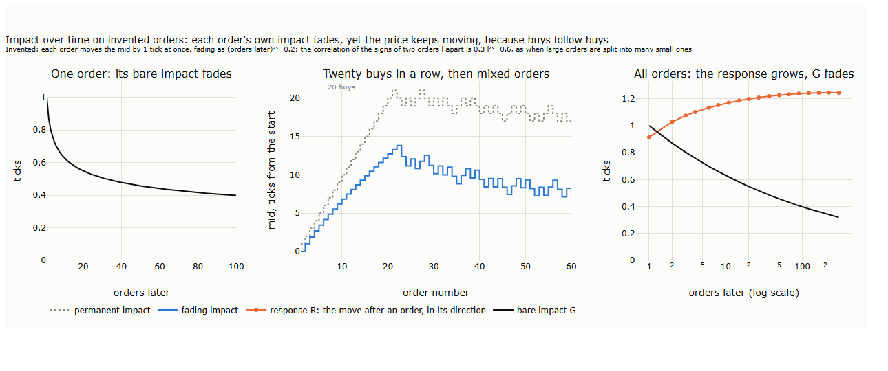
<b>How to read the figure.</b> Invented. <b>Left:</b> the bare impact of one order, 1 tick at once, then fading. <b>Middle:</b> twenty buys in a row, then forty orders of mixed sign; the mid if each order's impact were permanent (dotted) and if it fades as on the left (blue). <b>Right:</b> the response $`R`$ (orange), computed with the propagator model from the bare impact $`G`$ (black) and a correlation of signs that falls from 0.3 at the next order to 0.01 300 orders later; log scale.

With fading impact, twenty buys lift the mid by 12.7 ticks, not 20, and once orders turn mixed it drifts back to about 7: impact that fades is partly temporary. On the right, each order's own impact falls from 1 tick to 0.32 ticks over 300 orders, yet the response rises from 0.92 to 1.24 ticks: the orders that follow on the same side more than replace what fades. Seen from a maker, the price keeps moving after the fill, though no single trade's impact grows. In this example the two effects balance exactly, a fade of $`\ell^{-0.2}`$ against signs correlated as $`\ell^{-0.6}`$, and the price neither trends nor reverts. Bouchaud et al. (2004) found the bare impact on the Paris Bourse fading in this way and called it the central result of their paper: it is how a market whose order flow is predictable, since buys follow buys, can still have prices that are not.

**What it misses.** It is linear and an average: one large order and one small one count the same, and so do calm hours and a cascade. The same holds for Kyle's lambda, and there it matters: impact grows more slowly than the size traded, so a price per BTC falls whenever trading is heavy (Section 4.3). Time runs in orders, not seconds: on 1 October, 300 taker orders took 20 seconds in the busiest hour and about 3 minutes in the quietest. And the model has no cancellations: it describes trades only, while Section 2.1 showed that much of the pressure comes from orders that never trade.

### 2.3 VPIN

**Key message.** VPIN measures how one-sided trading has been, counted in volume rather than in time. Its authors built it as a warning of **toxic flow**, flow that is informed and that market makers lose to, and reported that it stood high hours before the US flash crash of 6 May 2010 (Easley, López de Prado and O'Hara, 2012). A later study found that it peaked after the crash, not before, and that it mostly tracks how much is being traded (Andersen and Bondarenko, 2014). Which reading holds on our data is hypothesis H4.

| Step | Calculation | Financial meaning |
|---|---|---|
| 1 | Cut the trades into buckets of equal volume $`V`$, one fiftieth of an average day's volume | A clock that ticks with trading: in a busy hour buckets fill in minutes, at night in hours |
| 2 | In each bucket, the volume bought by takers, $`V^B`$, and sold, $`V^S`$ | Who was in a hurry within the bucket |
| 3 | Imbalance of the bucket: $`\lvert V^B - V^S \rvert / V`$ | 0: as much bought as sold; 1: all on one side |
| 4 | VPIN: the average imbalance over the last 50 buckets | How one-sided about the last day's volume has been |
| 5 | Alarm: VPIN above the 90th percentile of its own history | The original use: a signal to widen quotes or step back |

<b>How to read the table.</b> VPIN: volume-synchronized probability of informed trading. The original estimates the sides of step 2 without trade-by-trade data, by **bulk volume classification**: within one-minute bars, the share of a bar's volume counted as bought is $`\Phi(\Delta p / \sigma)`$, with $`\Delta p`$ the bar's price change, $`\sigma`$ its standard deviation and $`\Phi`$ the normal distribution function. Bybit records the taker side of every trade, so we use the true sides and report the estimated version beside them.

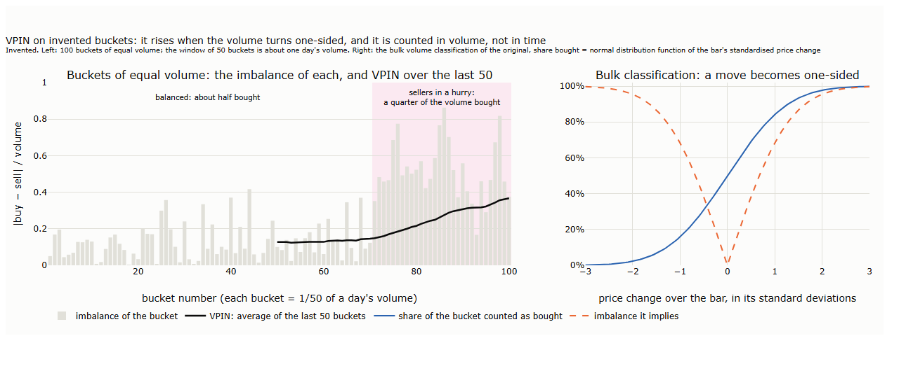
<b>How to read the figure.</b> Invented. <b>Left:</b> 100 buckets of equal volume; grey bars: the imbalance of each bucket; black line: VPIN, the average of the last 50 buckets, drawn once 50 buckets exist. Buckets 71 to 100 (shaded): sellers take the lead, about a quarter of each bucket's volume is bought. <b>Right:</b> under bulk classification, the share of a bar counted as bought (blue) and the imbalance this implies (dashed), against the bar's price change in standard deviations.

On the left, VPIN stands at 0.15 while the buckets are balanced and climbs to 0.37 as the selling buckets fill its window. It moves slowly by design: one new bucket replaces one of fifty. Because buckets are counted in volume, the 30 selling buckets may last half a day in a quiet market or an hour in a busy one, and VPIN rises faster in clock time when the volume comes faster.

The right panel shows one source of trouble with the original's estimated sides. Under bulk classification, a bar whose price moved by two standard deviations is counted as 98% bought, whoever actually traded: large moves turn into one-sided volume by construction, so VPIN partly measures volatility. Andersen and Bondarenko (2014) found a second, separate link: VPIN rises mechanically with trading intensity, and once intensity is accounted for it adds nothing to the forecast of volatility; its authors replied in the same journal, and the exchange did not settle the question. With the true sides the first link disappears and the second remains: whether VPIN says anything about the next hour that the last hour's volume and volatility do not already say. That is what H4 tests.

**What it misses.** It has settings that matter: the bucket size, the window of 50, and for the original the classification. It counts trades only, not the orders placed and cancelled that Section 2.1 showed. And a one-sided bucket does not show who was informed: a large trader working an order looks the same as one who knows something.

### 2.4 Hawkes processes

**Key message.** Trades and cancellations come in clusters: one event raises the chance of more. A Hawkes process models this directly (Hawkes, 1971). It splits activity into events that come from outside, such as news or a trader's own decision, and events triggered by earlier events, such as the orders of a split order, traders reacting to a trade, or market makers reacting to each other. The **branching ratio** is the share that is triggered: how far the market feeds on itself.

| Step | Calculation | Financial meaning |
|---|---|---|
| 1 | Outside rate $`\mu`$, events per second | Activity that does not depend on the market's own recent past |
| 2 | Intensity $`\lambda(t) = \mu + \sum_{t_j < t} \phi(t - t_j)`$ | The expected rate of events now: each past event adds a bump $`\phi`$ that fades with time |
| 3 | Branching ratio $`n = \int_0^\infty \phi(s)\,ds`$ | The number of events one event triggers directly, on average; also the share of all events that are triggered |
| 4 | Average rate $`\mu / (1 - n)`$ | With $`n`$ = 0.5 activity is twice the outside rate; with $`n`$ = 0.9 ten times; at $`n`$ = 1 it would never settle |
| 5 | Fit $`\mu`$ and $`\phi`$ by maximum likelihood, hour by hour | So that the daily rise and fall of activity is not read as one event triggering another |

<b>How to read the table.</b> $`t_j`$: times of past events. We use for $`\phi`$ a sum of exponentials with decay times from 1 ms to 100 s, each with its own weight (Bacry, Mastromatteo and Muzy, 2015); the branching ratio is the sum of the weights. Step 5 follows Filimonov and Sornette (2015), who showed that ignoring the daily pattern, outliers or changes of regime makes $`n`$ look larger than it is.

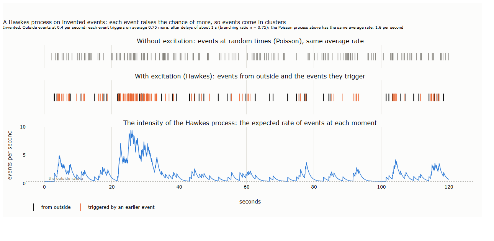
<b>How to read the figure.</b> Invented, 120 seconds. <b>Top:</b> events at independent random times, 1.6 per second on average. <b>Middle:</b> a Hawkes process with the same average rate: events from outside (black) at 0.4 per second, each triggering on average 0.75 more after about a second (orange). <b>Bottom:</b> its intensity, the expected rate of events at each moment; the dotted line is the outside rate.

Both rows hold about the same number of events, but they look different. Without excitation the events are spread evenly; with it they bunch: around 25 seconds one outside event sets off a cascade, and the intensity climbs to almost ten events a second, more than 20 times the outside rate, before it fades. In this simulation 73% of the events were triggered, close to the branching ratio of 0.75 that generated them. A market close to $`n`$ = 1 would be one where small shocks can set off very large bursts. Filimonov and Sornette (2012) estimated that the share rose from about 0.3 in 1998 to above 0.7 from 2007 on S&P 500 futures, and Hardiman, Bercot and Bouchaud (2013), with a kernel that fades more slowly, found it close to 1; whether BTCUSDT stays clearly below 1 is hypothesis H5.

**Two causes of a burst.** A burst of cancellations can be a chain, one market maker reacting to another, or a common trigger, many reacting at once to the same news. The Hawkes kernel separates the two by timing: a chain spreads out with delays of about one reaction time; a common trigger arrives all at once, more events in the same instant than the kernel can explain. Our book arrives every 100 ms and market makers react in milliseconds, so for cancellations a whole chain can fit within one update and look simultaneous. Trades carry millisecond times, which is why Section 3 fits the model to taker orders and reports cancellations only from 100 ms upwards.

**What it misses.** The branching ratio depends on the kernel: a fast-fading kernel and one with a long tail give different answers on the same data, which is part of why the literature disagrees. Excitation in the model is always positive; it does not let one event make others less likely. And a triggered event is a statistical attribution, not an observed cause.

### 2.5 Lead and lag between venues

**Key message.** BTCUSDT trades on many venues at once, and when the price moves, one venue usually moves first and the others follow within milliseconds. Correlating the price changes of two venues at different lags shows how far one is behind the other. On our data the two venues are Bybit and Binance; which one leads is hypothesis H6, and the answer matters to anyone who quotes on one venue and watches the other (Lecture 24).

| Step | Calculation | Financial meaning |
|---|---|---|
| 1 | The two price series, each at its own trade times | Prices as they were actually traded, without filling gaps |
| 2 | Shift the times of one venue by a lag $`\tau`$ | Ask: does B, read $`\tau`$ later, move with A? |
| 3 | Correlation of the price changes, from all pairs of changes whose time intervals overlap | The Hayashi-Yoshida estimator, built for prices that change at different times (Hayashi and Yoshida, 2005; Hoffmann, Rosenbaum and Yoshida, 2013) |
| 4 | Repeat for $`\tau`$ from −1 s to +1 s; the lead is the lag with the highest correlation | How long the follower takes |
| 5 | Lead-lag ratio: the sum of squared correlations at positive lags divided by that at negative lags | Above 1: A leads on balance (Huth and Abergel, 2014) |

<b>How to read the table.</b> Resampling both series on a common clock and taking the last price in each interval biases correlations towards zero at short intervals; the Hayashi-Yoshida estimator avoids this by never resampling.

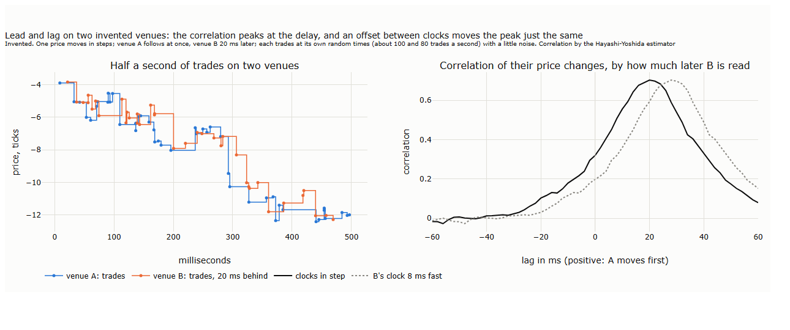
<b>How to read the figure.</b> Invented. <b>Left:</b> half a second of trades on two venues that follow the same price, venue B 20 ms behind venue A. <b>Right:</b> the Hayashi-Yoshida correlation of their price changes by lag; positive lags mean A moves first. Solid: both clocks correct; dotted: the same trades with B's clock running 8 ms fast.

The correlation peaks at 20 ms, the delay that was built in, and the lead-lag ratio is 18: A clearly leads. The dotted line shows the limit of the method. If B's timestamps run 8 ms fast, the peak moves to 28 ms, and nothing in the prices tells the two cases apart. Bybit and Binance stamp their trades with their own clocks, and an offset of a few milliseconds between them is plausible. A lead measured on their data is therefore a lead plus an unknown constant. Two things help. A lead much larger than any plausible offset is real. And an offset is the same at all times, so a lead that changes with market conditions, larger in calm hours than in a cascade, cannot be an offset alone.

**What it misses.** It measures who moves first on average, not why: the follower may be slower, or traders may arbitrage the gap from one side only. A lead of a few milliseconds is visible but not usable by a trader whose orders take longer to arrive. And correlation sees only linear co-movement; a venue can lead in large moves and follow in small ones.

### 2.6 The statistics side by side

| Statistic | Kind | What it captures | From | Blind spot | Tested in |
|---|---|---|---|---|---|
| Book imbalance (Lecture 19) | Level | Which side of the book outweighs the other | The book at one moment | What happened before; walls | Lecture 19 |
| Order-flow imbalance | Delta | Pressure on the best prices: trades, additions, cancellations | Book updates | Deeper levels; events within one update | H1, H2 |
| Trade imbalance | Delta | Net taker buying | Trades | Orders that never trade | H1 (as the rival) |
| Kyle's lambda | Delta | The price move per BTC of net taker flow | Trades and mid | Time: it is one number per interval | Section 4 (H9) |
| Propagator | Delta | Each order's own impact over time, apart from the orders that follow | Trades and mid | Size; cancellations | H3 |
| VPIN | Delta | How one-sided the volume has been | Trades | What volume and volatility already say | H4, H9 |
| Hawkes branching ratio | Delta | How far activity triggers more activity | Times of taker orders | The choice of kernel; causes | H5, H9 |
| Lead and lag | Delta | Which venue moves first, by how much | Trades of both venues | Offsets between clocks | H6, H7 |

<b>How to read the table.</b> Kind: a level is a state at one moment; a delta is a change over an interval (Section 1). Tested in: the hypotheses of [results/hypotheses.md](results/hypotheses.md), fixed before the results; Section 4 tests some of the same statistics on 10 October.

All statistics but the first are deltas, and all but order-flow imbalance are built from trades alone. They share one limit: they see what was done, not who did it or why. A one-sided hour can be informed selling or a fund rebalancing; a burst of triggered events can be traders reacting to each other or to a common piece of news; a lead can be speed or a clock. Section 3 measures what each says on the 45 days; Section 4 asks whether any of them changed before the fall of 10 October.

## 3. On our 45 days

Section 2 showed each statistic on invented flows. This section measures them on the 45 days of Bybit BTCUSDT, 20 September to 3 November 2025, with the trades of Binance beside them. The hypotheses, their tests and every setting were fixed before any result was computed ([results/hypotheses.md](results/hypotheses.md)). Every result below is a result on this sample: one symbol, two venues, 45 days that include one crash. On this data sample we cannot generalise, in either direction. A hypothesis that holds here may fail on another market or in another year, and one that fails here does not refute the study that proposed it, which was usually made on other markets, with other data and over other periods.

**How the tests are set up.** As in Lecture 19, the days are split in three. The 20 calm days before the cascade, 20 September to 9 October, are **in sample**: every slope and every setting that has to be estimated is estimated on them only. The 24 days after it, 11 October to 3 November, are **out of sample**, and the tests are run on them. 10 October stands alone. The share of a price move that a statistic explains is measured by the out-of-sample $`R^2`$: one minus the squared errors of the in-sample fit, divided by the squared deviations of the moves from their in-sample mean. It is 0 for a fit that does no better than the average move and 1 for a perfect one. Uncertainty comes from resampling whole days, 2,000 times. Nine hypotheses with their parts make twelve tests, and some would pass by luck alone; Section 3.6 applies the Benjamini-Hochberg correction to all twelve together.

| § | The question in plain words | Statistic | Hypotheses | Figure |
|---|---|---|---|---|
| 3.1 | Does the pressure on the book explain the price's moves better than the trades alone, and does it tell us where the price goes next? | Order-flow imbalance | H1, H2 | 20_08 |
| 3.2 | When a trade pushes the price, does the push last or fade? | Propagator | H3 | 20_09 |
| 3.3 | When trading turns one-sided, is a storm coming? | VPIN | H4 | 20_10 |
| 3.4 | How much of the trading is a reaction to trading? | Hawkes branching ratio | H5 | 20_11 |
| 3.5 | Which exchange moves first, and why did Bybit's book seem to lean against Binance's price? | Lead and lag | H6, H7 | 20_12, 20_13 |
| 3.6 | Which answers survive the correction for testing many questions? | | All | |

<b>How to read the table.</b> One row per subsection, in the order of Section 2. Each subsection opens with its question and its result, then the figure, then each hypothesis in turn. Checks that were not fixed in advance, made to understand a result, are labelled <b>follow-up</b>: they suggest explanations, they do not test them.

### 3.1 Order-flow imbalance

**The question.** A price moves because someone pushed it: a taker who bought or sold, but also a market maker who placed new orders at a better price or pulled the ones that were there. The trade imbalance sees only the first kind of push; the order-flow imbalance adds the second. If the second matters, a trader who watches only the trades misses part of what moves the price. And if the push of the last ten seconds carries over into the next ten, it is a forecast.

**Result.** On our sample, the pressure on the book explains about twice as much of the price's move over ten seconds as the trades alone, on days it was not fitted on. It forecasts the next ten seconds by a margin that is real but far too small to trade. On 10 October the book's pressure lost most of its grip and the trades explained more.

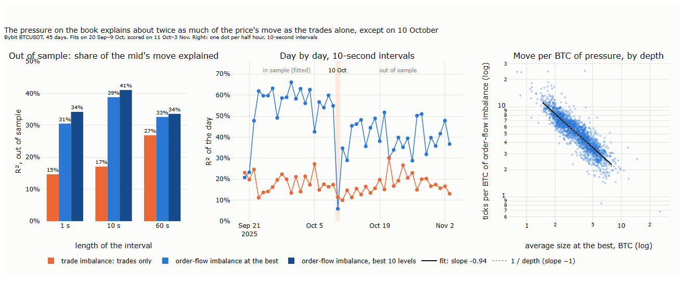
<b>How to read the figure.</b> <b>Left:</b> the out-of-sample R² for intervals of 1, 10 and 60 seconds: the share of the variance of the mid's change over the interval explained by a straight line fitted on the in-sample days, for the trade imbalance (orange), the order-flow imbalance at the best (blue) and the order-flow imbalance over the best 10 levels (dark blue). <b>Middle:</b> the same R² day by day, 10-second intervals, with the in-sample slope; 10 October is shaded. <b>Right:</b> one dot per half hour: the slope of the mid's change on the order-flow imbalance, in ticks per BTC, against the average size at the best bid and ask; black: fitted line; dotted: a slope of exactly −1, the move per BTC inversely proportional to depth.

- **H1, does the pressure on the book explain more than the trades? Holds.** Over 10 seconds, the order-flow imbalance explains 39% of the variance of the mid's change out of sample and the trade imbalance 17%. The difference, 22 percentage points, has a 95% interval of 17 to 26 points, and none of the 2,000 resamples went the other way. The order is the same over 1 second (31% against 15%) and over 60 seconds (33% against 27%), where the gap narrows: over a minute the trades catch up with the orders that were placed and pulled in it. Day by day, the book's pressure explains more on 43 of the 45 days. The two exceptions are 20 September, the quietest day of the sample, and 10 October.
- **H2, does the pressure of the last ten seconds forecast the next ten? Holds, but the forecast is tiny.** The out-of-sample R² is 0.10% (0.04% to 0.17%): positive, and so too small to matter. One BTC of net pressure in the last ten seconds is followed by about 0.4 ticks in the same direction over the next ten, against about 3.8 ticks during the ten seconds in which it happened. Over 1 second the forecast explains 1.6%, over 60 seconds nothing (0.01%). On our sample the flow describes how the price moved far better than it tells where it will move.

Three measurements were reported, not tested. **The best 10 levels** add little to the best alone: 41% against 39% over 10 seconds, less than on the US stocks of Xu, Gould and Howison (2019). **Depth**: per half hour, the price move per BTC of pressure falls with the size resting at the best, with a slope of −0.94 on the log scale, close to the −1 that Cont, Kukanov and Stoikov (2014) derived: a book twice as deep moves about half as far per BTC. **Kyle's lambda**, the move per BTC of net taker flow, had a median of 10 ticks ($1) per BTC per half hour, and it too falls with depth, but more slowly (slope −0.59). It also falls with the volume traded, which Section 4.3 shows matters for its use as a warning.

The depth result explains part of the drop from in sample to out of sample, 56% to 39%. After 10 October the size at the best halved, from about 4 BTC to about 2, so the same pressure moved the price further than the slope fitted on the calm days predicts. **Follow-up:** fitted on 20 October itself, the order-flow imbalance explains 57%, against 52% with the in-sample slope.

**Follow-up: 10 October.** With the in-sample slope, the order-flow imbalance explained 6% of that day's moves and the trades 11%. Refitted on the day itself, the order-flow imbalance explains 7% and the trades 19%, so a wrong slope is not the reason. Hour by hour, between 18:00 and 20:00 UTC the book's pressure explained 56% to 66% and the trades 18%, a normal day; from 20:00 to 23:00, the hours of the post and the cascade, it explained 5% to 21% and the trades 31% to 38%, and the move per BTC of pressure tripled, from about 6 to about 20 ticks. We have not established why. One candidate is the 100 ms book: when takers sweep several levels and market makers requote within one update, what the book shows at the best between updates may say little about the pressure. We invite tests on data with finer book updates.

### 3.2 Impact over time

**The question.** Lecture 19 found that after a resting order was filled, the price kept moving against it for a minute. A maker needs to know why. Either each trade's push keeps growing after it, which would mean every fill is worse than it looks, or each push fades and more trades on the same side follow, which would mean the danger is in the flow that comes after, not in the one trade. The propagator separates the two (Section 2.2).

**Result.** On our sample, a taker order's own impact builds for about a dozen orders and then fades; by 500 orders later it has lost about a third of its peak. The price keeps moving because buys follow buys: the move a maker sees is about nine times the order's own impact at its peak.

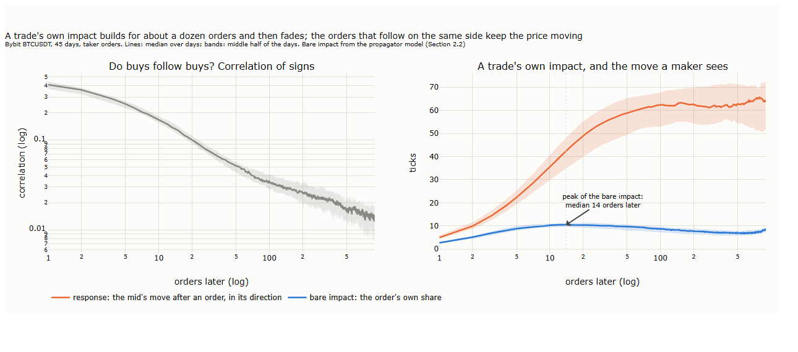
<b>How to read the figure.</b> Taker orders (trades with the same millisecond and side) of each day; lines are the median over the 45 days, bands the middle half of the days; log scale on the horizontal axes. <b>Left:</b> the correlation between the sign of an order (+1 buy, −1 sell) and the sign of the order $`\ell`$ orders later, log scale. <b>Right:</b> the response, how far the mid moved in the direction of an order $`\ell`$ orders later (orange), and the bare impact of the propagator model, the order's own share of that move (blue), both in ticks of $0.10. The dotted line marks where the bare impact peaks. Lags beyond 900 are left out: near the end of the window the least-squares solution is unstable.

- **H3, has a trade's own impact faded 500 orders later, below where it started? Fails.** The bare impact 500 orders later is above its value at the first order on all 45 days: 6.9 ticks against 2.7 (medians). The hypothesis assumed that impact would be largest at once and then fade, as Bouchaud et al. (2004) found on the Paris Bourse. On our data it is not largest at once.

**Follow-up.** The bare impact rises from 2.7 ticks at the first order to a peak of 10.5 ticks, at a median of 14 orders later, and then fades: by 500 orders it is 6.9 ticks, about two thirds of the peak, and it is below its value at 10 orders on all 45 days. Because the rise is the opposite of what the literature leads one to expect, we checked for a mistake before reading it. **First, the solver:** on a mid simulated from 1 October's real sequence of signs with a known impact that fades from the first order, it recovers that impact to two decimals at every lag. **Second, the clock of the book:** after a taker order the mid jumps at the very next book update, a median 50 ms later (by 22 ticks for orders below 0.1 BTC, 43 for 0.1 to 2 BTC, 86 above), so the book does not show trades late. **Third, the 100 ms book:** the same simulated mid, seen only at book updates as in our data, produces a rise up to 4 orders later, not 14; part of the rise is our measurement. **Fourth, time measured in book updates instead of orders:** the real impact still builds, from 9.9 ticks one update later to 14 five updates later, about half a second, before it fades. What remains is real movement of the price after a trade, which the model attributes to the order because Bybit's own orders are all it sees. One candidate, which we have not tested: the mid had already risen by about 9 ticks over the three updates before an average buy, so Bybit's takers follow moves that have started, plausibly on Binance (Section 3.5), and the model credits part of the move that continues on its own to the orders that followed it.

The signs explain the rest. An order's sign correlates 0.41 with the next order's, 0.17 ten orders later, 0.03 a hundred later and still 0.01 a thousand later. The correlation fades slowly, roughly as a power of the lag with exponent 0.47, close to the 0.6 that Lillo and Farmer (2004) found on the London Stock Exchange. So the response, what a maker sees, keeps climbing long after the bare impact has peaked: 5 ticks one order later, 35 ten orders later, about 62 from a hundred on. On our sample, the answer to Lecture 19's question is mostly the flow that follows: a maker filled by a buy is likely to face more buys.

### 3.3 VPIN

**The question.** When most of the volume is bought, or most is sold, someone may know something, and market makers who keep quoting lose to them. VPIN measures how one-sided the volume has been, and its authors proposed it as a warning that turbulence was coming (Section 2.3). If it works, it should say something about the next hour's volatility that the last hour's volatility and volume, which every trader already sees, do not.

**Result.** On our sample, it does not. With the sides that Bybit records, VPIN's rank correlation with the next hour's volatility, after the last hour's volatility and volume are accounted for, is zero. Computed the original way, with sides estimated from price moves, its apparent warning largely echoes the moves that have already happened.

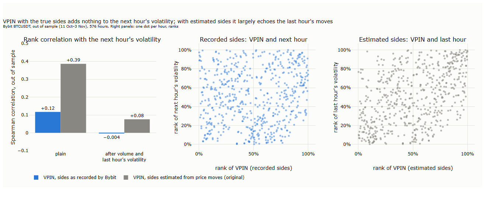
<b>How to read the figure.</b> One value per hour, at the start of the hour, on the 24 out-of-sample days. <b>Left:</b> the Spearman rank correlation of VPIN with the realised volatility of the next hour, plain and after removing what the last hour's realised volatility and volume explain (a partial correlation), for VPIN from the sides Bybit records (blue) and from bulk volume classification over one-minute bars, as the original (grey). <b>Middle:</b> ranks of VPIN with recorded sides against ranks of the next hour's volatility. <b>Right:</b> ranks of VPIN with estimated sides against ranks of the last hour's volatility.

- **H4, does VPIN warn of volatility beyond what volume and the last hour already show? Fails.** The partial rank correlation is −0.004, with a 95% interval of −0.09 to +0.08, over 576 hours. Without the controls it is +0.12, and VPIN itself rises with the last hour's volume (rank correlation 0.24): what little VPIN appears to say is the activity that everyone can already see.

The original's estimated sides tell a different story at first sight. Without controls their VPIN correlates +0.39 with the next hour's volatility, and +0.46 with the last hour's. Bulk classification counts a bar as bought in proportion to how far its price rose (Section 2.3), so a volatile hour shows up as one-sided volume whoever traded. After the controls, +0.08 remains. On our sample, the warning from estimated sides comes largely from the past moves it is built from, in line with the critique of Andersen and Bondarenko (2014). Our sample cannot refute VPIN as its authors used it: they built it for futures markets without trade sides, on other periods, and as a warning of rare events, of which our 24 out-of-sample days contain none.

### 3.4 Hawkes processes

**The question.** Some trading starts from outside the market: news, a fund's decision, a client's order. The rest reacts to trading: the next slice of a split order, a trader chasing a move, market makers reacting to each other. The branching ratio is the share of the second kind (Section 2.4). The closer it is to 1, the more a small shock can feed on itself, and the more fragile the market.

**Result.** On our sample, most of the trading is a reaction to trading: in the median hour, 84% of taker orders were attributed to earlier orders. The market nevertheless stayed below the critical point of 1 in all but 2 of 1,080 hours.

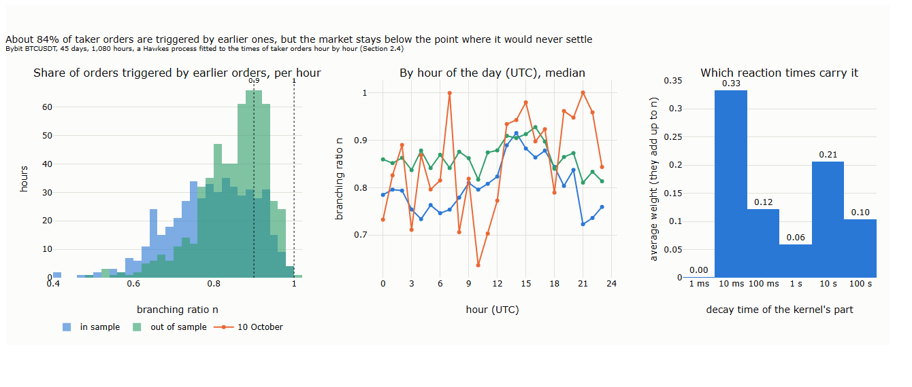
<b>How to read the figure.</b> A Hawkes process fitted to the times of Bybit's taker orders, one hour at a time, with an outside rate that is constant within the hour and a kernel made of six exponentials with decay times from 1 ms to 100 s (Section 2.4); a median hour had 12,500 orders. <b>Left:</b> the branching ratio of each hour, in sample (blue) and out of sample (green); dotted lines at 0.9 and 1. <b>Middle:</b> the median by hour of the day, UTC, and 10 October hour by hour (orange). <b>Right:</b> the average weight of each part of the kernel; the weights add up to the branching ratio.

- **H5, does the market stay clearly below the point where trading would never settle? Holds.** The branching ratio was below 0.9 in 74% of hours (95% interval 70% to 78%), with a median of 0.84; 5% of hours were below 0.64 and 5% above 0.96. Two hours reached 1. Our estimator, checked on simulated data, is close to unbiased at these values (0.83 for a true 0.8) but finds 0.07 where there is no excitation at all.

The ratio was higher after the cascade than before it, a median of 0.87 against 0.80, and on the median day it was highest from 13:00 to 17:00 UTC, the hours when US markets are open, at about 0.9. On 10 October it was 1.00, to two decimals, at 07:00 UTC and again at 21:00, the hour of the cascade, but the day's median, 0.86, was not unusual. Our values lie between the 0.7 that Filimonov and Sornette (2012) found on S&P 500 futures and the values close to 1 of Hardiman, Bercot and Bouchaud (2013). Most of the weight sits at two reaction times: 10 ms (0.33) and 10 s (0.21). The first is the speed of machines reacting to machines; what the second is, our data cannot say, only that it is slower than any algorithm needs to be. The answer depends on the kernel. Ours stops at 100 s, and a kernel with a longer tail would attribute more of the slow clustering to excitation and raise the ratio, which is part of why the literature disagrees.

### 3.5 Lead and lag between venues

**The question.** When bitcoin moves, it moves on every venue, but not at the same instant. If one venue moves first, a market maker on the other venue who watches it can see a move coming a few milliseconds before it arrives, and one who does not is the one who gets picked off. Binance trades almost twice Bybit's volume, so it is the natural candidate to lead.

**Result.** On our sample, Binance moves first: its price changes correlate most with Bybit's about 40 to 50 milliseconds later, on almost every day. The registered test still fails, because over a whole second the correlation on the Bybit-first side adds up to more.

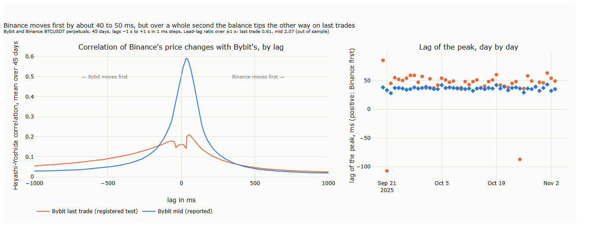
<b>How to read the figure.</b> <b>Left:</b> the Hayashi-Yoshida correlation of Binance's price changes with Bybit's, Bybit read τ milliseconds later, averaged over the 45 days; positive lags mean Binance moves first. Orange: Bybit's last trade, the registered test; blue: Bybit's mid. <b>Right:</b> the lag of the peak on each day, for the last trade (dots) and the mid (diamonds).

- **H6, does Binance lead? Fails.** The hypothesis had two parts, and both had to hold. The first holds: the correlation peaks at a positive lag on 43 of 45 days, at a median of 48 ms (one-sided sign test, p < 0.001). The second fails: the lead-lag ratio, the squared correlations at positive lags over those at negative lags, is 0.61 out of sample (0.57 to 0.66). Near the peak, Binance-first lags dominate; beyond about 300 ms, the correlation on the Bybit-first side is larger, it fades more slowly, and over 1,000 lags on each side the tail outweighs the peak.

With Bybit's mid instead of its last trade, reported and not tested, the picture is clean: a peak of 0.59 at a median of 36 ms, positive on all 45 days, within a narrow range of 28 to 43 ms, and a lead-lag ratio of 2.07. On 10 October the peak was at 35 ms on last trades and 37 on the mid, the same as on calm days. A lead that does not change with conditions cannot be told apart from a constant offset between the two venues' clocks (Section 2.5): from prices alone, our data cannot exclude that part of the 36 ms is an offset. Alexander and Heck (2020) found that perpetual swaps and futures on the large unregulated venues of their sample (Huobi, OKEx and BitMEX) led bitcoin price discovery, and regulated futures and US spot exchanges followed. Binance and Bybit were not among their venues; our first result is in the same spirit, for one pair of venues over 45 days.

Because the two parts of H6 disagree, we checked the estimator on a case with a known answer. On the real trade times of both venues, 12:00 to 14:00 on 1 October, we simulated one price that Binance's trades show at once and Bybit's 40 ms later. The peak lands exactly at 40 ms, but the lead-lag ratio over ±1 s is only 1.31: with prices that change only when a trade happens, every long gap between Bybit's changes overlaps many of Binance's, so the correlation stays raised far from the true lead, on both sides. On this data the registered ratio would barely exceed 1 even under a perfect lead; it had little power. The narrower the window, the closer the real data comes to the simulation:

| Lags included | Simulation: Binance leads by exactly 40 ms | Real, Bybit last trade, out of sample | Real, Bybit mid, out of sample |
|---|---|---|---|
| ±50 ms | 1.11 | 1.16 | 1.77 |
| ±100 ms | 1.18 | 1.16 | 2.24 |
| ±200 ms | 1.25 | 0.95 | 2.25 |
| ±1 s (registered) | 1.31 | 0.61 | 2.07 |

<b>How to read the table.</b> Lead-lag ratio, the squared correlations at positive lags (Binance first) over those at negative lags, within the stated range. Simulation: a random walk in ticks per millisecond, read at the real trade times of each venue, 1 October 12:00 to 14:00; adding a bid-ask bounce to either venue's trades changes nothing. Real: the mean correlation over the 24 out-of-sample days.

Within ±100 ms the real last trades behave as a 40 ms lead predicts. Beyond about 200 ms they do not: the correlation with Bybit's later moves falls away faster than in the simulation, and the Bybit-first side carries more. Why, we have not established; a random walk is the simplest model of the price, and the real one reverts and trends at these scales. We invite tests with other venue pairs and with exchange-synchronised clocks.

**The Lecture 19 puzzle.** Lecture 19 found that on calm days Bybit's book imbalance correlated negatively with the gap between Binance's last trade and Bybit's mid. That is puzzling if Binance leads: when Binance trades above Bybit, Bybit's book should lean up, not down. H7 tested one mechanical explanation, the bounce of Binance's last trade between its bid and its ask.

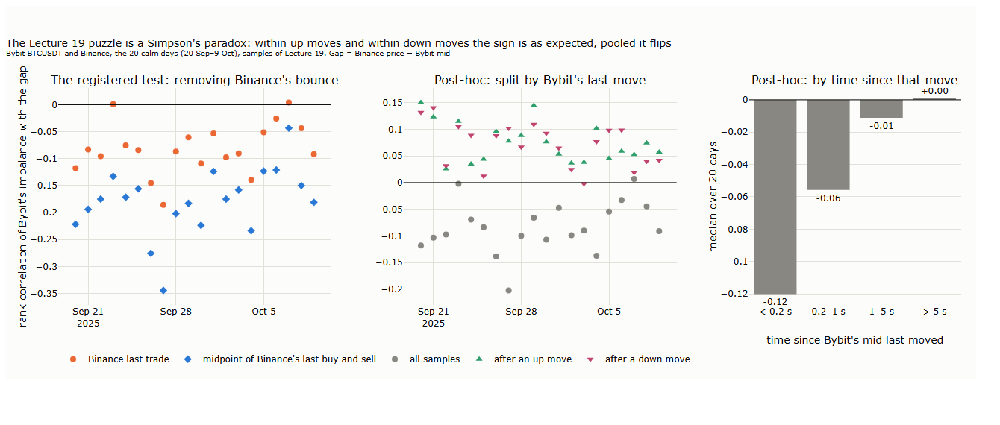
<b>How to read the figure.</b> The samples of Lecture 19 (one per interval between two changes of Bybit's mid, spread of one tick) on the 20 in-sample days. Each value is the Spearman rank correlation of Bybit's imbalance at the best with the gap, Binance's price minus Bybit's mid. <b>Left:</b> Binance's last trade (orange) against the midpoint of its last taker buy and last taker sell within the past second (blue), the registered test. <b>Middle,</b> follow-up: all samples (grey), samples after Bybit's mid last moved up (green) and down (red). <b>Right,</b> follow-up: the median over the 20 days by time since Bybit's mid last moved.

- **H7, does Binance's bounce explain the puzzle? Fails.** With the bounce removed, the correlation is more negative, not less, on all 20 days: a median of −0.18 against −0.09.

**Follow-up: a Simpson's paradox.** Splitting the samples by the direction of Bybit's last move dissolves the puzzle. After an up move, the correlation is positive on all 20 days (median +0.07); after a down move, on 19 of 20 (+0.08). Pooled, it is negative, because the last move pushes the two quantities in opposite directions. After Bybit's mid moves up, Bybit's imbalance leans up (rank correlation +0.69 with the sign of the move: successive moves of the mid tend to continue, Lecture 19, §3.2), while the gap to Binance falls (−0.18), because Bybit's mid has just jumped and Binance's last trade has not caught up. Mixing the two groups gives a negative correlation that neither group has, the pattern that Simpson (1951) described. The effect is strongest right after the move, −0.12 within 0.2 seconds, and gone after a second (−0.01 between 1 and 5 seconds, 0.00 after 5). This is the reading Lecture 19 suggested and did not check. On our sample, the puzzle is mechanical: within each direction, Bybit's book leans towards Binance's price, as a Binance lead would suggest, though weakly.

### 3.6 Verdicts

| The question in plain words | Hypothesis | Main number | p | Verdict after correction |
|---|---|---|---|---|
| Does the pressure on the book explain more of a move than the trades? | H1 | R² 39% against 17% | < 0.001 | Holds |
| Does the last ten seconds' pressure forecast the next ten? | H2 | R² 0.10% | < 0.001 | Holds, too small to trade |
| Has a trade's own impact faded below where it started? | H3 | Above on 45 of 45 days | 1.00 | Fails: impact builds for about 14 orders, partly our 100 ms book |
| Does VPIN warn of volatility beyond volume and the last hour? | H4 | Partial correlation −0.004 | 0.53 | Fails |
| Does the market stay clearly below the critical point? | H5 | Below 0.9 in 74% of hours | < 0.001 | Holds |
| Does Binance lead Bybit? | H6 | Peak at +48 ms; ratio 0.61 | 1.00 | Fails: the peak leads; the ratio had little power on last trades |
| Does Binance's bounce explain the Lecture 19 puzzle? | H7 | More negative on 20 of 20 days | 1.00 | Fails: a Simpson's paradox instead |
| Was there net selling on Bybit in the hour before the post? | H8a | Net buying, +2,241 BTC | 1.00 | Fails (Section 4) |
| Was there net selling on Binance in the hour before the post? | H8b | Net buying, +434 BTC | 0.85 | Fails (Section 4) |
| Was trading unusually one-sided in the two hours before? | H9a | VPIN 0.255 against 0.191 | 0.018 | Fails, narrowly (Section 4) |
| Was the market feeding on itself more than usual? | H9b | Branching ratio 0.94 against 0.88 | 0.13 | Fails (Section 4) |
| Did each BTC traded move the price more than usual? | H9c | 2.2 against 6.7 ticks per BTC | 0.99 | Fails: lower, mostly an effect of measuring per BTC (Section 4) |

<b>How to read the table.</b> One row per test of [results/hypotheses.md](results/hypotheses.md); H8 and H9 are split into their parts, twelve tests in all; Section 4 presents H8 and H9. "p" is one-sided, from 2,000 resamples of days, a sign test over days, or, for H8 and H9, the rank of 10 October among the same clock windows of the other 44 days; "< 0.001" means no resample went against the hypothesis. The Benjamini-Hochberg procedure at 5% ranks the twelve p-values and accepts the k smallest if the k-th is at most k × 0.05 / 12. Three p-values are below 0.001; the fourth, H9a's 0.018, is above its limit of 0.017, so three hold and nine fail.

Three hypotheses hold and nine fail. The failures are results too, and several say more than a pass would have: impact on our data builds before it fades, VPIN's warning is mostly the activity everyone sees, and the Lecture 19 puzzle is a mixing of two groups. All of them are results on one symbol, two venues and 45 days, measured on a book that updates every 100 ms; on this data sample we cannot generalise. None of them is a trading result: an $`R^2`$ of 39% describes a move as it happens, and a forecast that explains 0.1% would not pay the fees.

Several questions remain open, and we invite independent tests:

- Why does the book's pressure lose its grip in a cascade, while the trades keep theirs? Would a book with faster updates, or an order-flow imbalance over more levels, keep it?
- How much of the build-up of a trade's own impact over the first dozen orders is real, and how much the 100 ms book?
- Does VPIN with recorded sides warn of anything on markets with rare, large events, or on futures where its authors used it?
- What trades on a 10-second reaction time, the second peak of the Hawkes kernel?
- Is the 36 ms lead of Binance over Bybit a lead or partly an offset between clocks, and why does the tail of the last trade lean the other way? Exchange-synchronised timestamps, or a third venue, could tell.

## 4. 10 October

**The question.** Lecture 19 asked whether the book gave a warning before the fall of 10 October; it found none before the price began to move. This section asks the same of the flow. If anyone traded on the news before it was public, the flow would be the place to see it: net selling before the post, one-sided volume, trading that feeds on itself, trades that move the price more than usual. Answering requires knowing exactly when the news arrived, which Section 4.1 establishes to the millisecond, before Section 4.2 looks at the flow and Section 4.3 at every warning measure of Lectures 19 and 20 together.

One event cannot separate informed trading from chance, and it is not evidence of what anyone knew. No trader is named or identifiable in our data, and none is accused. The question is narrower: did the flow, on this day, look different from the same hours of the other 44 days?

### 4.1 Timing the news

There were two posts that day. At 14:57:52 UTC a first post on Truth Social criticised China's export controls; at 20:50:01.702 UTC a second announced an additional tariff of 100% on Chinese goods. News reports give times like "shortly before 5 pm", and the exact time matters: a flow that moved at 20:48 moved before the news, one that moved at 20:51 after it. The method below works for any post or announcement whose platform gives it a numeric ID, and readers can reuse it for their own event studies.

| Step | Source | What it gives for the second post | How far to trust it |
|---|---|---|---|
| 1 | News reports | "Shortly before 5 pm" Eastern time | Rough; written after the fact |
| 2 | Time an article was published | CNBC's report, 4:57 pm Eastern | An upper bound: the post came before |
| 3 | Archives that copy posts to X | 4:50 pm in one, 4:53 pm in another | They disagree; one copy was posted later (see the box) |
| 4 | The American Presidency Project's log of the posts (American Presidency Project, 2025) | 1:50 pm Pacific = 20:50 UTC; the first post 7:57 am Pacific = 14:57 UTC | A primary log, to the minute |
| 5 | The post's ID on Truth Social | 20:50:01.702 UTC; the first post 14:57:52.308 UTC | To the millisecond, set by the platform when the post was created |
| 6 | Cross-check | The decoded times fall in the logged minutes | Two independent sources agree |
| 7 | What not to do | Time the news from the price | Circular: it assumes the price did not move before the news, which is the question |

<b>How to read the table.</b> Each step narrows the time; step 5 gives the time used in this lecture. The American Presidency Project (University of California, Santa Barbara) publishes the posts with their times in Pacific time. The X copy in step 3 decodes to 20:53:04.101 UTC: it was posted three minutes after the original.

> **Box: Time inside an ID.** A large platform creates thousands of posts a second on many servers. If every server had to ask one central counter for the next number, that counter would be a bottleneck and a single point of failure. In 2010 Twitter, moving its storage to a database without such a counter, announced a scheme it called Snowflake: each server builds the ID itself from parts that make it unique without asking anyone (King, 2010). On X today, the ID of a post has four parts: a sign bit, 41 bits counting milliseconds since 4 November 2010, 01:42:54.657 UTC, 10 bits naming the machine, and 12 bits counting the IDs that machine made in that millisecond. It works like a ticket from a machine that prints the time, its own number and a counter: no two tickets are alike, and no machine needs to talk to another. The time comes first so that sorting posts by ID sorts them by time, and so the time of a post can be read from its ID as a by-product: shift away the lower 22 bits and add the 2010 starting point. Mastodon, on which Truth Social is built, uses a variant (Mastodon, n.d.): the upper 48 bits count milliseconds since 1 January 1970 and the lower 16 are a sequence. The second post's ID, 115351840469973590, divided by $`2^{16}`$ and rounded down, is 1,760,129,401,702 milliseconds since 1970, which is 20:50:01.702 UTC. Three cautions. The ID records when the post was created, not when people read it; the delay between the two is part of what an event study measures. The platform's clock may be off by a few milliseconds. And a copy of a post, on another platform or account, carries its own, later ID, which is why the archives in step 3 disagree.

### 4.2 The flow before the post

**The question.** If the news leaked, those who knew would sell before it was public, and the flow in the hour before the post would lean to selling (H8). In the two hours before, trading would become one-sided, feed on itself and move the price more per BTC than usual (H9). Each is compared with every window of the same length on the other 44 days, aligned to the same time past the hour.

**Result.** On this day, the flow before the post looked unusual, but not in the way a leak would suggest. The hour before the post had net buying, among the highest of all hours. The selling came earlier: in the hour of the first post and again between 18:50 and 19:50 UTC, when nothing we can time was published.

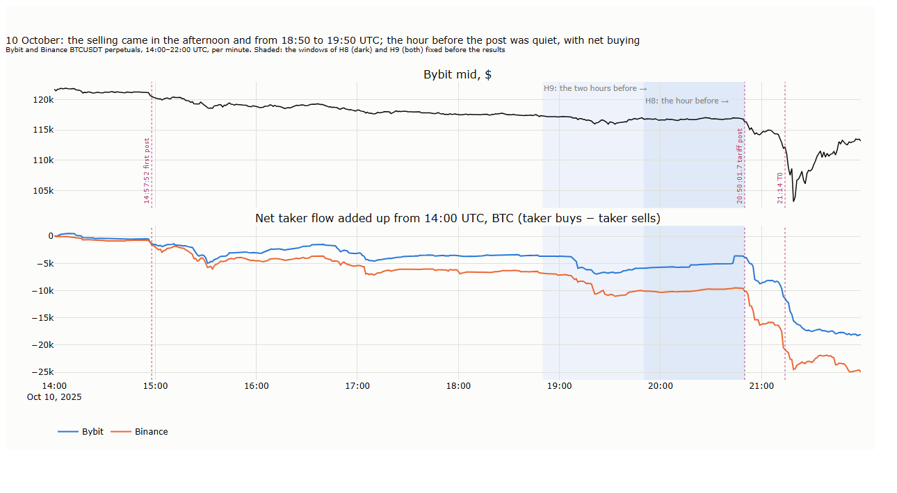
<b>How to read the figure.</b> <b>Top:</b> Bybit's mid at the end of each minute. <b>Bottom:</b> taker buys minus taker sells, added up from 14:00 UTC, in BTC: Bybit (blue) and Binance (orange); a falling line is net selling. Dotted lines: the first post (14:57:52), the tariff post (20:50:01.7) and T0 (21:14), the start of the cascade by Lecture 19's rule. Shaded: the two hours before the post (H9), the darker part the hour before it (H8).

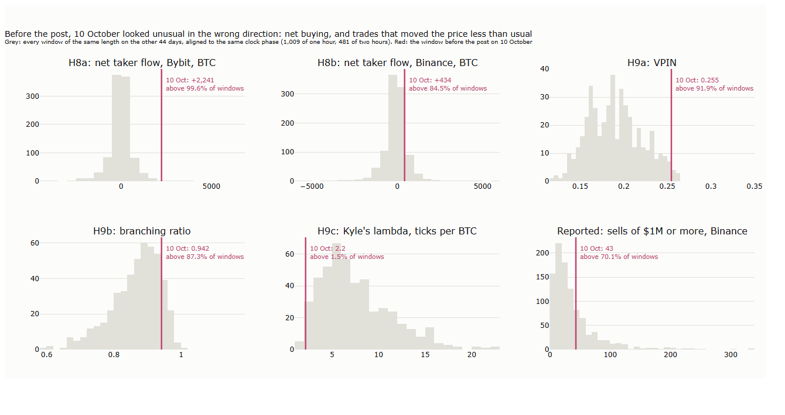
<b>How to read the figure.</b> In each panel, grey bars: the distribution over the reference windows, of one hour for net taker flow and large sells (1,009 windows) and of two hours for VPIN, the branching ratio and Kyle's lambda (481 windows); windows touching a gap in the book's feed are left out. Red line: the window before the post on 10 October, with the share of reference windows below it.

- **H8, was there net selling in the hour before the post? Fails, on both venues.** On Bybit takers bought a net 2,241 BTC, more than in 99.6% of the reference hours; on Binance they bought a net 434 BTC, more than in 85%.
- **H9a, was trading unusually one-sided over the two hours? Fails, narrowly.** VPIN averaged 0.255, above 92% of reference windows (p = 0.018), which does not pass the correction (Section 3.6). VPIN stood above its usual range mostly during the selling hour, 18:50 to 19:50 (Section 4.3).
- **H9b, was the market feeding on itself more than usual? Fails.** The branching ratio was 0.94, above 87% of reference windows (p = 0.13).
- **H9c, did each BTC traded move the price more than usual? Fails, the other way.** Kyle's lambda was 2.2 ticks per BTC, below all but 1.5% of reference windows. **Follow-up:** this is mostly how the measure is built. A price per BTC falls when much is traded (Section 4.3), and these two hours were busy. With either square-root version of Section 4.3, the two hours before the post were ordinary: in the published form of Hasbrouck (2009) above 17% of the 527 reference windows (p = 0.83), in our variant above 49% (p = 0.51).

**A burst of buying, reported and not tested.** Most of Bybit's net buying in the hour came in 46 seconds. Between 20:43:52 and 20:44:38 UTC, six minutes before the post, 15 taker buy orders of 50 to 122 BTC each, mostly exactly 100, bought 1,495 BTC, about $175 million, in 13,107 trades. Several came exactly 500 milliseconds apart, as from a program releasing slices on a timer. Each walked far up a book with only about 6 to 11 BTC in its best ten levels, paying on average $88 per BTC above the mid, and each time the book refilled within seconds, so the minute ended where it began, near $117,000. It was the largest minute of large taker buys in our 45 days, though not by far: other days reached 900 to 1,145 BTC. Without it, the hour still had net buying of about 750 BTC. Who bought, and who sold to them through the refilling orders, the data cannot say; nor whether the timing had anything to do with the post. We report it because it is the largest single feature of the hour before the news, and because a reader who looks at that hour will find it.

**The selling, a follow-up.** The two hours with the heaviest selling of the afternoon were 14:50 to 15:50, which contains the first post, and 18:50 to 19:50. In both, net taker flow was below 99% of the reference hours on both venues (Bybit −2,219 BTC and Binance −3,211 BTC in the second), and the number of sells of $1 million or more was above 99%. What drove the selling between 18:50 and 19:50, we have not established; it came an hour before the window that H8 tested, which was fixed in advance and could not be moved after the fact. The two large Binance sells that a first look found about 160 seconds before the post (results/hypotheses.md, disclosure) were ordinary: in the hour before the post Binance had 43 sells of $1 million or more, more than 70% of reference hours.

### 4.3 Did any statistic warn?

**The question.** A market maker who widens or pulls quotes when a measure turns extreme would like it to turn before the news, not after. The early-warning table asks this of every measure of Lectures 19 and 20 with one rule, fixed in advance: a measure **flags** when it stays beyond the 99th percentile of the calm days' minutes (below the 1st for depth) for five minutes in a row. The lead time is the time from the first flag to the post; the price of a warning is its false alarms, counted on the other 44 days.

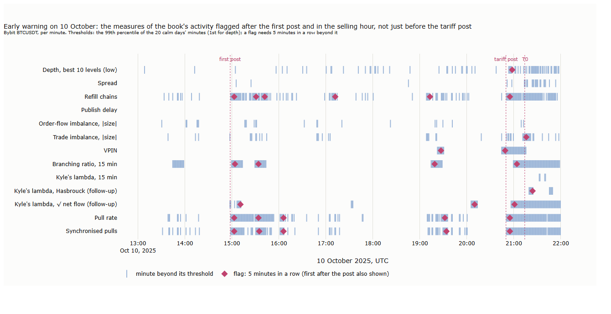
<b>How to read the figure.</b> One row per measure, per minute, Bybit BTCUSDT. Light marks: minutes beyond the measure's threshold; red diamonds: flags, raised at the end of the fifth minute in a row; for each measure the first flag after the post is shown too. Dotted lines: the first post, the tariff post and T0. Every measure uses only data up to the end of its minute.

| Measure | What it captures | Flags in the 6 hours before the post (UTC) | First flag after the post | False alarms per day: calm / after 10 Oct |
|---|---|---|---|---|
| Depth, best 10 levels | Liquidity resting near the price | None | +8 min | 0.00 / 7.12 |
| Spread | Cost of crossing | None | None | 0.00 / 0.00 |
| Refill chains (L19) | Levels refilled again and again | 15:03, 15:31, 15:42, 17:12, 19:13 | +5 min | 0.15 / 1.96 |
| Publish delay (L19) | Congestion of the exchange's feed | None | None | 0.00 / 0.08 |
| Order-flow imbalance | Pressure on the best prices | None | None | 0.00 / 0.00 |
| Trade imbalance | Net taker flow | None | +26 min | 0.05 / 0.00 |
| VPIN | One-sided volume | 19:27, 20:49 | (already flagged) | 0.30 / 0.17 |
| Branching ratio, 15 min | Trading feeding on itself | 15:04, 15:34, 19:19 | +14 min | 0.80 / 2.46 |
| Kyle's lambda, 15 min | Price move per BTC traded | None | None | 1.10 / 4.00 |
| Kyle's lambda, Hasbrouck form, 15 min (follow-up) | Return per square root of dollars, summed over orders | None | +34 min | 1.10 / 10.00 |
| Kyle's lambda, square root of net flow, 15 min (follow-up) | Price move per square root of net BTC | 15:11, 20:10 | +11 min | 1.10 / 10.12 |
| Pull rate | Orders pulled from the best 20 levels | 15:03, 15:34, 16:06, 19:32 | +5 min | 0.70 / 4.29 |
| Synchronised pulls | Pulls on both sides at once | 15:03, 15:35, 16:06, 19:34 | +5 min | 0.40 / 4.29 |

<b>How to read the table.</b> A flag needs five minutes in a row beyond the threshold, so the earliest possible flag after an event is five minutes later. The signed flows enter as absolute values; VPIN is its last value, the branching ratio the fit on the last complete 15 minutes and Kyle's lambda the slope over the last 15 minutes, so every measure is known at the end of its minute (choices made before looking at 10 October). False alarms: flag episodes per day on the 20 calm days, from which the thresholds come, and on the 24 days after the cascade.

**Result.** By the rule fixed in advance, four measures flagged almost six hours before the post: refill chains, the pull rate, synchronised pulls and the branching ratio, first at 15:03 and 15:04. But that is five and six minutes after the first post, the earliest a five-minute rule can respond. They reacted to news; they did not anticipate it. The same four, joined by VPIN, flagged again between 19:13 and 19:34, during the selling hour. In the last hour before the post, only VPIN flagged, at 20:49, after the burst of buying at 20:44 had made the volume one-sided. Order-flow imbalance, trade imbalance, depth, spread and the exchange's delay did not flag before the post.

After the post, refill chains and both pull measures flagged at the earliest possible moment, 20:55, nineteen minutes before T0; depth followed at 20:58 and the branching ratio at 21:04. A market maker using them would have stepped back before the worst of the fall, but after the news, not before it. Kyle's lambda never flagged, even in the cascade: its highest values come in quiet minutes (its rank correlation with the last 15 minutes' volume is −0.60 on the calm days), so as built it marks quiet, not stress. The price of the warnings is visible in the last column. On calm days the activity measures raise up to one false alarm a day; after the cascade, when the market stayed busier and the book thinner, two to seven, and depth, whose threshold came from the deeper books before the cascade, was below it in about a quarter of all minutes.

**Follow-up: a Kyle's lambda that does not fall with volume.** The per-BTC lambda is not wrong as arithmetic, but it has the wrong shape for a warning. Price impact grows more slowly than the size traded: on our 20 calm days, the 15-minute lambda fell with the volume traded as volume to the power −0.46, close to the −0.5 that a square-root law implies. For the total impact of one large order executed over time, such a law is among the best-documented regularities of markets (Tóth et al., 2011); ours is the same shape for all traders together over 15 minutes, not the same law. A price per BTC therefore falls whenever trading is heavy, and a cascade is when trading is heaviest.

The literature has a standard answer. Hasbrouck (2009) measures price impact as the slope, without intercept, of the return on the sum, over trades, of each trade's sign times the square root of its dollar volume; Goyenko, Holden and Trzcinka (2009) use it, over five-minute intervals, as the benchmark against which other liquidity measures are judged. We compute it over 10-second intervals and with taker orders in place of trades, so that a 15-minute block has 90 points. Taking the square root trade by trade still lets many small orders add up to a large total, so that busy periods look less sensitive; we therefore also report a variant of our own that takes the square root of the net flow of each interval, as if the interval's net flow were one order.

| Block length | Rank correlation with volume: per BTC / Hasbrouck / net flow | Highest percentile in the cascade: per BTC / Hasbrouck / net flow | Highest percentile in the 2 hours before the post: per BTC / Hasbrouck / net flow |
|---|---|---|---|
| 5 min | −0.55 / −0.28 / +0.03 | 98.1 / 99.7 / 100 | 95.3 / 88.8 / 98.7 |
| 15 min | −0.60 / −0.31 / +0.07 | 98.6 / 99.7 / 100 | 83.4 / 85.3 / 99.0 |
| 30 min | −0.61 / −0.31 / +0.13 | 99.6 / 97.8 / 100 | 40.2 / 87.6 / 95.8 |
| 60 min | −0.57 / −0.29 / +0.22 | 95.0 / 96.5 / 100 | 9.6 / 85.9 / 78.8 |
| 120 min | −0.57 / −0.26 / +0.31 | 98.8 / 98.8 / 100 | 3.3 / 34.2 / 80.0 |

<b>How to read the table.</b> Blocks of the given length on all 45 days, aligned so that one ends at 20:50 on 10 October. Per BTC: slope of the mid's change on the net taker flow over 10-second intervals. Hasbrouck: slope, without intercept, of the mid's log return in basis points on the sum over taker orders of sign × √(dollar volume). Net flow: slope of the mid's change on the signed square root of the net taker flow. Percentiles are against the calm days' blocks; the cascade is 20:50 to 22:50 on 10 October.

Both square-root versions depend less on volume than the per-BTC lambda, the net-flow variant hardly at all over short blocks, and both put the cascade at or near the top of the calm days' range at every block length. As warnings, with the same rule as the other measures, the Hasbrouck form did not flag before the post and first flagged 34 minutes after it, once the cascade was under way; the net-flow variant flagged at 15:11, thirteen minutes after the first post, at 20:10, forty minutes before the tariff post, and at 21:01. Both raise about one false alarm a day on calm days and about ten after the cascade, when the book stayed thin; with that rate, one flag in the six hours before the post is weak evidence of anything. Both were added after the results, so they are follow-ups, not tests. Brennan, Chordia, Subrahmanyam and Tong (2012) go one step further and estimate separate lambdas for buy and sell orders; on equities, the sell side carried the liquidity premium. A buy-and-sell version on our data is an open question below.

On this sample, the flow and the book recorded the news quickly, within the five minutes the rule needs, and none of their measures anticipated the tariff post. One day, one venue and one event cannot show that warnings are impossible; they show that on this day, none of these measures gave one that the news itself did not.

Several questions remain open, and we invite independent tests:

- What drove the selling between 18:50 and 19:50 UTC? A timed source, news or another market, would tell whether it was a reaction or an anticipation.
- Who absorbed the 1,495 BTC bought at 20:44, and do bursts of this kind, sliced on a timer and absorbed by refilling orders, recur before other events? Data with order IDs (L3) would show whether one participant refilled.
- Does a warning rule that adapts its thresholds to the current regime keep its false alarms down after a cascade without losing its speed?
- Do the square-root lambdas keep their link with stress on other markets and periods, and what exponent fits there? Do separate lambdas for buy and sell orders, as in Brennan et al. (2012), show the sell side thinning before a fall?
- On how many other days do the activity measures react within five minutes to a timed post or a scheduled release? An event study over many posts would turn one day into a sample.

*Section 5 follows.*

## References

- Alexander, C. and Heck, D. F. (2020). Price discovery in Bitcoin: the impact of unregulated markets. *Journal of Financial Stability* 50, 100776. — perpetuals on unregulated venues led bitcoin price discovery (§3.5).
- American Presidency Project (2025). Truth Social posts, October 10, 2025. University of California, Santa Barbara. presidency.ucsb.edu/documents/truth-social-posts-october-10-2025. — the logged times of both posts (§4.1).
- Andersen, T. G. and Bondarenko, O. (2014). VPIN and the flash crash. *Journal of Financial Markets* 17, 1–46. — the critique of VPIN (§2.3).
- Bacry, E., Mastromatteo, I. and Muzy, J.-F. (2015). Hawkes processes in finance. *Market Microstructure and Liquidity* 1(1), 1550005. — survey; kernels and estimation (§2.4).
- Bouchaud, J.-P., Gefen, Y., Potters, M. and Wyart, M. (2004). Fluctuations and response in financial markets: the subtle nature of 'random' price changes. *Quantitative Finance* 4(2), 176–190. — the propagator model (§2.2).
- Brennan, M. J., Chordia, T., Subrahmanyam, A. and Tong, Q. (2012). Sell-order liquidity and the cross-section of expected stock returns. *Journal of Financial Economics* 105(3), 523–541. — separate lambdas for buy and sell orders (§4.3).
- Cont, R., Cucuringu, M. and Zhang, C. (2023). Cross-impact of order flow imbalance in equity markets. *Quantitative Finance* 23(10), 1373–1393. — order-flow imbalance over several levels (§2.1).
- Cont, R., Kukanov, A. and Stoikov, S. (2014). The price impact of order book events. *Journal of Financial Econometrics* 12(1), 47–88. — order-flow imbalance (§1).
- Easley, D., López de Prado, M. and O'Hara, M. (2012). Flow toxicity and liquidity in a high-frequency world. *Review of Financial Studies* 25(5), 1457–1493. — VPIN (§2.3).
- Filimonov, V. and Sornette, D. (2012). Quantifying reflexivity in financial markets: towards a prediction of flash crashes. *Physical Review E* 85(5), 056108. — the branching ratio of S&P 500 futures, 1998–2010 (§2.4).
- Filimonov, V. and Sornette, D. (2015). Apparent criticality and calibration issues in the Hawkes self-excited point process model: application to high-frequency financial data. *Quantitative Finance* 15(8), 1293–1314. — what biases the branching ratio upwards (§2.4).
- Goyenko, R. Y., Holden, C. W. and Trzcinka, C. A. (2009). Do liquidity measures measure liquidity? *Journal of Financial Economics* 92(2), 153–181. — Hasbrouck's lambda as the price-impact benchmark (§4.3).
- Hardiman, S. J., Bercot, N. and Bouchaud, J.-P. (2013). Critical reflexivity in financial markets: a Hawkes process analysis. *European Physical Journal B* 86(10), 442. — a branching ratio close to 1 (§2.4).
- Hasbrouck, J. (2009). Trading costs and returns for U.S. equities: estimating effective costs from daily data. *Journal of Finance* 64(3), 1445–1477. — lambda on the signed square root of dollar volume (§4.3).
- Hawkes, A. G. (1971). Spectra of some self-exciting and mutually exciting point processes. *Biometrika* 58(1), 83–90. — the Hawkes process (§2.4).
- Hayashi, T. and Yoshida, N. (2005). On covariance estimation of non-synchronously observed diffusion processes. *Bernoulli* 11(2), 359–379. — correlation without resampling (§2.5).
- Hoffmann, M., Rosenbaum, M. and Yoshida, N. (2013). Estimation of the lead-lag parameter from non-synchronous data. *Bernoulli* 19(2), 426–461. — lead and lag (§2.5).
- Huth, N. and Abergel, F. (2014). High frequency lead/lag relationships — empirical facts. *Journal of Empirical Finance* 26, 41–58. — the lead-lag ratio (§2.5).
- King, R. (2010). Announcing Snowflake. Twitter Engineering blog, 1 June 2010. blog.x.com/engineering/en_us/a/2010/announcing-snowflake. — IDs built from time, machine and sequence (§4.1).
- Kyle, A. S. (1985). Continuous auctions and insider trading. *Econometrica* 53(6), 1315–1335. — Kyle's lambda (§2.2).
- Lillo, F. and Farmer, J. D. (2004). The long memory of the efficient market. *Studies in Nonlinear Dynamics & Econometrics* 8(3), 1–35. — slowly fading correlation of order signs (§3.2).
- Mastodon (n.d.). lib/mastodon/snowflake.rb. github.com/mastodon/mastodon. — Mastodon's IDs: milliseconds since 1970 in the upper 48 bits (§4.1).
- Silantyev, E. (2019). Order flow analysis of cryptocurrency markets. *Digital Finance* 1, 191–218. — trade and order-flow imbalance on the BitMEX bitcoin perpetual (§1).
- Simpson, E. H. (1951). The interpretation of interaction in contingency tables. *Journal of the Royal Statistical Society, Series B* 13(2), 238–241. — Simpson's paradox (§3.5).
- Tóth, B., Lempérière, Y., Deremble, C., de Lataillade, J., Kockelkoren, J. and Bouchaud, J.-P. (2011). Anomalous price impact and the critical nature of liquidity in financial markets. *Physical Review X* 1(2), 021006. — the square-root law of impact (§4.3).
- Xu, K., Gould, M. D. and Howison, S. D. (2019). Multi-level order-flow imbalance in a limit order book. *Market Microstructure and Liquidity* 4(3–4), 1950011. — order-flow imbalance over several levels (§2.1).
