# Lecture 20: Two Strategies on the Tape: a Trend Rule and an Intraday Grid

*Systematic Trading: Lecture Notes (MSc) · draft, Nov 16, 2026 · Max Gnesi*

*Pipeline stage (Lecture 1 §2.1): signals, sizing and execution, end to end on the tape (a trend rule held for days, a grid held for minutes).*

Lectures 18 and 19 measured what the tape adds to bars: when the market trades, how the price moves inside a bar, who is in a hurry and what a trade costs. This lecture applies those measurements to two strategies that use the tape in opposite ways, on the same five years of BTCUSDT. The first is the trend rule of Part II, which earns when the price runs and holds for days; it is organised around one idea, that a strategy runs on three clocks, each chosen separately. The second is a grid, which earns when the price swings back and holds for minutes to hours; its result is decided by the path between bars, so it can only be tested on the tape, with fills counted conservatively and all costs charged.

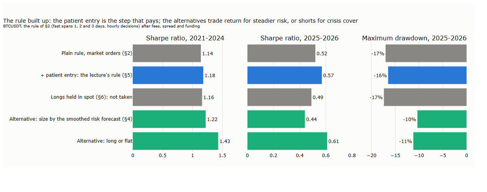
<sub><b>How to read the figure.</b> <b>Axes.</b> One bar per version (y). Left and middle: Sharpe ratio (x). Right: maximum drawdown, % (x). Each bar is one version of the rule, after fees, spread and funding. <b>Grey:</b> the plain rule of §2, and the step tested and not taken (longs in spot, §6). <b>Blue:</b> the lecture's rule, the plain rule with the patient entry of §5. <b>Green:</b> two alternatives to it. <b>Left and middle:</b> Sharpe ratio, 2021–2024 and 2025–2026. <b>Right:</b> the largest fall from a peak, 2025–2026.</sub>

The figure is where the first half ends: the trend rule, rebuilt for bitcoin, earns after all costs in both periods, and of the tape's tools one step pays on its own, the patient entry (§5). The grid of the second half loses at every step (§10), and next to the trend rule it lowers the portfolio's Sharpe ratio (§13).

| § | Topic | Question |
|---|---|---|
| 1 | Three clocks | When does a rule decide, what does it measure on, how does it trade, and how do the clocks communicate? |
| 2 | The rule on BTCUSDT | Which speeds work on this market, and how often should the rule look? |
| 3 | The information clock | Does a trend measure taken from dollar bars help an hourly rule? |
| 4 | Risk | Does sizing by a sharper forecast of risk improve the rule? |
| 5 | The execution clock | What does a patient entry save? |
| 6 | Holding | What does it cost to hold a perpetual, and does the premium predict? |
| 7 | The rule built up | What does each step add, after all costs? |
| 8 | How a grid earns | How does a grid differ from the trend rule, and how are its accounts kept? |
| 9 | No pattern, no profit | What does a grid earn on a price with no pattern, with jumps, with runs? |
| 10 | The tape | What does it earn on BTCUSDT after costs, against the same minutes in random order? |
| 11 | The levers | Size profile, width, exits and refresh: what does each change? |
| 12 | Known in advance | Do a switch on volatility, a lean with the trend, a channel or the hour of the day help? |
| 13 | Next to the trend rule | Does the grid improve the trend rule? |
| 14 | Where grids pay | Costs, rebates and strategies with an edge of their own |
| 15 | Summary, exercises and reading | |

Sections 1 to 7 follow the trend rule, 8 to 14 the grid. Everything left out is in [E22](../extended/22-trend-on-the-tape/lecture.md) and [E23](../extended/23-an-intraday-grid/lecture.md).

> **What to take away**
>
> 1. **A strategy runs on three clocks:** when it decides, what it measures on, and how it trades. Keeping the decision on the calendar makes every test fair.
> 2. **On BTCUSDT the trend rule works at speeds of one to three days, decided once an hour;** activity clocks add nothing to its signal, the patient entry pays, and a sharper forecast of risk steadies it without raising its return.
> 3. **Funding is the cost of holding a perpetual and must be charged at every settlement.**
> 4. **A grid's result has two parts,** round trips and the inventory it is left holding; on a price with no pattern they cancel before costs, and runs are its risk.
> 5. **On five years of BTCUSDT the grid loses after costs at every step;** rules known in advance cut its losses without creating an edge, and where its machinery pays is in lowering the cost of strategies with an edge of their own.

## 1. Three clocks

**What the evidence says.** Bars cut by activity give returns that behave better (Lecture 18, §10; Clark, 1973; Ané and Geman, 2000), and López de Prado (2018) recommends them for this reason. Better-behaved returns are a statement about measurement, not about profit: we found no published study showing that a trend rule earns more on them, and the closest test, on the Binance bitcoin perpetual, finds that dollar bars have the best statistical properties yet predict no better (Fayyaz et al., 2026, preprint). The usual way of putting the question, time bars against dollar bars, mixes three choices that a strategy makes separately:

| Clock | The question it answers | In this lecture's rule |
|---|---|---|
| **Decision clock** | When does the rule decide? | At every hourly close |
| **Information clock** | On which samples are its measurements built? | Hourly closes, or dollar bars |
| **Execution clock** | How is an order worked once it is decided? | A patient entry, worked over seconds (§5) |

The decision clock stays on the calendar throughout. This makes every test fair: when the decision times are fixed, a change in the result can only come from the information the rule uses or from the way it trades, not from the moments it happens to decide.

**How the clocks communicate.** The clocks share one thing: time. Every trade on the tape carries an exchange timestamp to the millisecond, so every dollar bar carries one too, the moment its last trade happened.

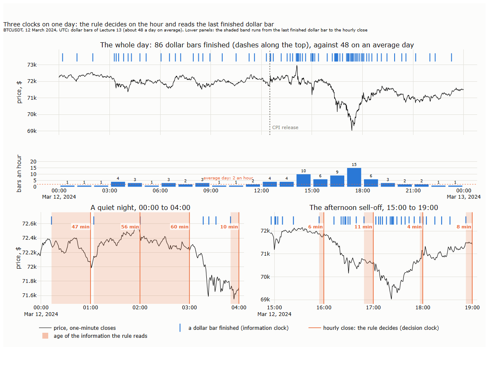
<sub><b>How to read the figure.</b> <b>Axes.</b> Top: price (y) over the day, UTC (x). Middle: dollar bars finished in each hour (y). Bottom: price (y) over four hours (x), left the night, right the afternoon. <b>Black line:</b> the price, from one-minute closes. <b>Blue dashes along the top of each panel:</b> each marks the moment a dollar bar finished, when another fixed amount of dollars, about a 48th of a typical day's trading, had changed hands (the information clock). <b>Columns:</b> how many dollar bars finished in each hour; the dotted line is an average day's two an hour. <b>Orange lines (lower panels):</b> the hourly closes, at which the rule decides (the decision clock). <b>Shaded bands (lower panels):</b> from the last dollar bar finished before an hourly close to that close; the width written above each is how old the newest dollar-bar information is when the rule decides.</sub>

Dollar bars are sparse at night, one an hour from midnight to 03:00, and bunch when the market is busy: on this day 86 of them, against 48 on an average day, 15 in the single hour of the afternoon sell-off. The hourly closes do not move. A value computed on dollar bars is therefore a staircase in clock time: it steps when a bar finishes and stays flat until the next one. At 17:00 the rule reads the value of the bar that ended at 16:48:42, eleven minutes earlier; at 03:00 it reads a bar that is an hour old ([E22 §1](../extended/22-trend-on-the-tape/lecture.md) draws the staircase). Three rules make this exact:

| Step | What to do | Why |
|---|---|---|
| 1. Measure on the other clock | Compute the value on dollar bars, bar by bar | The measurement uses the clock it was designed for |
| 2. Read it as of the decision | At each hourly close, take the value of the last bar that has **finished**; in code, an "as-of join" on timestamps | A bar still forming contains trades after the decision: reading it would use the future |
| 3. Convert the units if needed | A trend measure has no units; a risk per dollar bar becomes a risk per hour by multiplying by the number of bars expected in the hour | The decision is about the next hour, not the next bar |

**Data.** The tape of Lecture 18, the BTCUSDT perpetual on Binance from October 2021 to September 2026, as hourly closes and as dollar bars (Lecture 18, §9; about 48 a day, thresholds from the past 28 days). Costs come from Lecture 19 (§10): 5 bp for a market order and 2 bp for a resting one, a regular account's fees, plus the measured spread. Funding, the perpetual's cost of holding (Lecture 18, §2), is charged at every eight-hour settlement on the position open at that moment. Every choice of speed or setting is made on 2021–2024; 2025–2026 is shown as well, and played no part in any choice.

## 2. The rule on BTCUSDT

The rule is the one Part II built and the capstone of Lecture 10 carried into its final portfolio: EWMAC, the gap between a fast and a slow exponentially weighted moving average of the price, divided by the volatility of price changes, so that a trend is measured in units of its own noise. Its parts on bitcoin:

| Part | On BTCUSDT |
|---|---|
| Signal | Fast average minus slow average, the slow span four times the fast, divided by the volatility of price changes, on hourly closes |
| Scale | The signal divided by its own average absolute size so far, so that 1 is a typical signal; no cap on large signals, so that the rule's output is not trimmed by hand |
| Position | Signal × target volatility ÷ the market's volatility, here a 10% annual target and the past 36 days' volatility of hourly returns |
| Trading | Only when the target is more than 10% of its average size away from the position held: a buffer that keeps the rule from paying fees for small adjustments |
| Costs | The 5 bp fee of a market order, the measured half-spread, and funding at every settlement |

Without a cap, the rule's realised volatility comes out near 19% a year rather than the 10% it targets; the comparisons below are in Sharpe ratios, which the scale of the positions does not change.

**Which speeds?** Part II found a plateau of fast spans from about 16 to 128 days on futures (Lecture 10, §8.1). Bitcoin is a different market, so the speed is chosen again, on 2021–2024 only: fast spans from 3 hours to 3 weeks, each about 1.6 times the last.

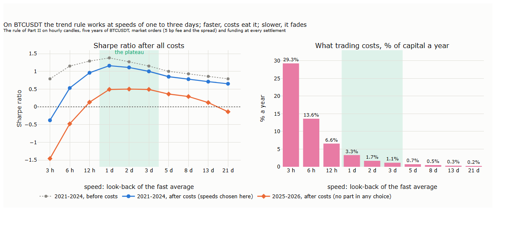
<sub><b>How to read the figure.</b> <b>Axes.</b> Speed, the look-back of the fast average, from 3 hours to 21 days (x). Left: Sharpe ratio (y). Right: trading costs, % of capital a year (y). The rule of §2 on hourly candles, run at one speed at a time, with market orders, the spread and funding at every settlement. <b>Left, grey dotted:</b> 2021–2024 before costs. <b>Blue:</b> 2021–2024 after all costs, the period on which the speeds are chosen. <b>Orange:</b> 2025–2026 after all costs, which played no part in any choice. <b>Right, pink bars:</b> fees and spread paid at each speed, with the value written above each bar. Shaded: the plateau, fast spans of one to three days; each speed is about 1.6 times the last.</sub>

The curve has a plateau, and it lies far faster than on futures: fast spans of **one to three days**, with a Sharpe ratio after all costs of 1.0 to 1.2 in 2021–2024 and about 0.5 in 2025–2026, which played no part in the choice. Faster than half a day, costs eat the rule: at a fast span of three hours it trades its capital about 580 times a year and pays 29% of it in trading costs. Slower than a week, it fades. On this market and sample, bitcoin's tradable trends last days, not months; whether that holds on other cryptocurrencies, or in other years, is an open question.

**How often to look?** From five-minute to four-hour candles, the Sharpe ratios lie within about 0.15 of each other at every speed in 2021–2024; a rule that sees only the daily close reacts a day late and loses about a quarter of its Sharpe ratio in 2021–2024 and more than half in 2025–2026 ([E22 §2](../extended/22-trend-on-the-tape/lecture.md)). Looking once an hour is enough.

**The rule for the rest of the lecture.** Hourly candles; the three speeds of the plateau, fast spans of 1, 2 and 3 days, blended with equal weights, following the rule of Part II: drop the speeds that do not work and keep all those that do, rather than the single best. The blend has a Sharpe ratio after all costs of 1.14 in 2021–2024 and 0.52 in 2025–2026; it pays 2.0% of its capital a year in trading costs and 1.4% in funding, and turns its capital over about 40 times a year. Every section that follows changes one thing in this rule, and measures what it adds.

## 3. The information clock

Should the hourly rule read its trend measure from dollar bars? The test keeps everything else fixed, the decision at every hourly close, the sizing, the market orders, the buffer and the funding; only the information it reads changes.

| Version | What the rule reads at each hourly close | What it isolates |
|---|---|---|
| **A: hourly closes** | The trend measure of §2, on hourly closes | The baseline |
| **B: dollar bars, average per bar** | The same measure computed on dollar bars, with spans counted in bars (48 a day on average), read from the last finished bar | The market's clock in full: averages that move fast when trading is busy and stand still when it is quiet |
| **C: dollar bars, average fading by time** | Dollar-bar prices, averaged with weights that fade with the time elapsed, not with the number of bars | Only the sampling: when the prices are taken, not how fast they are forgotten |

An average whose weights depend on the number of samples changes when the sampling changes, one whose weights depend on elapsed time does not (Zumbach and Müller, 2001). C is the second kind.

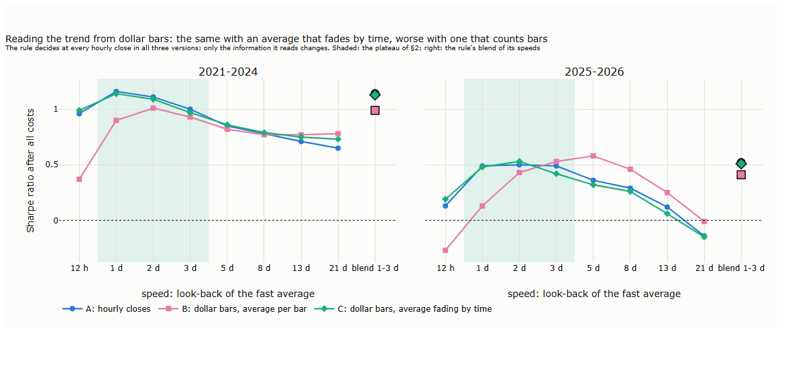
<sub><b>How to read the figure.</b> <b>Axes.</b> Speed, the look-back of the fast average (x); Sharpe ratio after all costs (y). Each line is one version of the rule, by speed; the large markers on the right are the rule of §2, the three plateau speeds blended. <b>Blue (A):</b> the trend read from hourly closes. <b>Pink (B):</b> read from dollar bars, the average counted in bars. <b>Green (C):</b> read from dollar bars, the average fading with time. The shaded band is the plateau of §2. Left, 2021–2024; right, 2025–2026.</sub>

**C is A.** Dollar-bar prices averaged by elapsed time give almost the same signal as hourly closes (correlation 0.99) and the same Sharpe ratio: 1.13 against 1.14 in 2021–2024, 0.51 against 0.52 in 2025–2026, for the blend. Sampling the price when dollar bars finish adds no information that hourly closes lack; the signal is updated less often in quiet hours, so the rule trades a little less, and its costs fall from 2.0% to 1.4% of capital a year.

**B is worse where the rule earns.** An average counted in dollar bars gives a different signal (correlation 0.84 to 0.98 with A), and on the plateau mostly a worse one: for the blend, a Sharpe ratio of 0.99 against 1.14 in 2021–2024 and 0.41 against 0.52 in 2025–2026; at a speed of half a day, 0.37 against 0.96. Only for slow rules, which earn little, does B do slightly better.

**Why.** An average counted in bars runs with the market's activity: in the afternoon burst of the figure in §1 it moves fifteen steps in an hour; at night one step, or none. Bursts of activity on BTCUSDT often reverse: flow in the direction of the trend partly comes back, and a sweep with the trend is taken back within the hour (Lecture 19, §7 and §8). A fast rule that follows bursts therefore buys late and sells late. A slow rule weighs so many bars that a burst moves it little; that is why B stops hurting as the rule slows down. A breakout rule, checked the same way, gives the same answer: where it works, at channels of eight to thirteen days, dollar bars make it worse.

The literature points the same way. On bitcoin and ether, López de Prado's pipeline earned after costs, but the part that helped was the CUSUM event filter, not the volume or dollar bars (Grądzki, Wójcik and Lessmann, 2025); exercise 2 lets the rule decide only at CUSUM events.

**Key message.** Information from another clock is easy to plug into an hourly rule, but for a trend rule on BTCUSDT it adds nothing: averaged by time, it is the same as hourly closes; averaged by bars, it follows bursts that reverse and hurts the rule where it earns. The rule keeps reading hourly closes.

## 4. Risk

The rule sizes each position by the volatility of the past 36 days of hourly returns: the plainest estimate there is. Lecture 19 showed that measures built from inside the bar forecast the next bars' risk better (§5.3), and that risk clusters hour by hour (§9). What is that sharper knowledge of risk worth to the trend rule?

**Two parts of risk.** An hour's risk, its realised variance from one-minute returns, is the product of two quantities: how much is traded in the hour, its **activity** (dollars traded, over a typical hour), and how far each dollar traded moves the price, its **risk per dollar**. It is the identity of Lecture 19 (§6), the number of bars times the risk per bar, applied hour by hour.

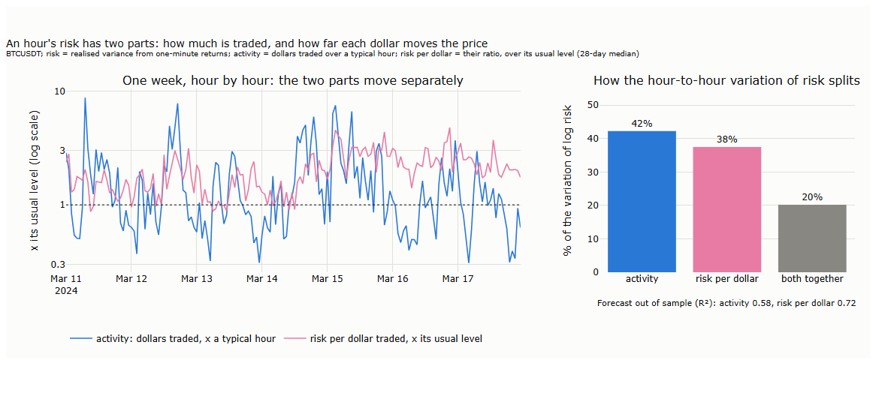
<sub><b>How to read the figure.</b> <b>Axes.</b> Left: hour (x); level over its usual level (y, log). Right: part of risk (x); share of the variation of log risk, % (y). <b>Left:</b> one week, 11 to 17 March 2024, hour by hour, on a log scale where 1 is the usual level. <b>Blue:</b> activity, the dollars traded in the hour over a typical hour. <b>Pink:</b> risk per dollar, the hour's realised variance over its activity, relative to its usual level (the 28-day median). <b>Right:</b> over five years, the share of the hour-to-hour variation of log realised variance that comes from each part, and from the two moving together.</sub>

The two parts move separately, and each carries a large share of the variation: activity 42%, risk per dollar 38%, and the two together another 20%. Both can be forecast from what is known at the start of the hour, with a regression on the last hour, the last day and the last week (Corsi, 2009), plus the same hour of the week and the scheduled releases: out of sample, with an R² of 0.58 for activity and 0.72 for risk per dollar. Their product forecasts risk with an R² of 0.70, the same as forecasting risk directly. The split does not make the forecast sharper; it tells what kind of risky hour is coming: a busy hour is largely foreseeable from the clock and the release calendar, while a thin hour, a high risk per dollar, is the state of liquidity that Lecture 19 (§9) found before cascades.

**Sizing by forecast risk.** The test replaces the 36-day volatility in the position size with a forecast of the next 24 hours' realised variance from one-minute data, from the last hour, day and week, updated every hour (**raw**); the same averaged over a day, so that the position is not resized every hour (**smoothed**); and the same model forecasting as far ahead as the rule typically holds (**over the holding period**). Each is asked how well it forecasts the next day's risk, and what it does in the rule.

| Sizing by | Forecast error (QLIKE), 2021–2024 / 2025–2026 | Sharpe ratio, 2021–2024 / 2025–2026 | Worst day | Month-to-month spread of risk | Costs a year |
|---|---|---|---|---|---|
| Plain: past 36 days | 0.38 / 0.32 | **1.14 / 0.52** | −9.5 | 0.58 | 2.0% |
| Next-day forecast, raw | **0.26 / 0.23** | 0.92 / 0.21 | −6.8 | 0.45 | 5.8% |
| Next-day forecast, smoothed | 0.29 / 0.25 | **1.18** / 0.37 | **−6.5** | **0.46** | 1.8% |
| Forecast over the holding period | — | 1.11 / 0.38 | −7.4 | 0.48 | 1.7% |

<sub><b>How to read the table.</b> One row per way of measuring the risk the rule sizes by, for the rule's blend. QLIKE: the loss for variance forecasts that is robust to noise in the measured variance (Patton, 2011; Lecture 19, §5.3), scored against the next 24 hours' realised variance; lower is better; the forecast over the holding period was not scored against the next day. Sharpe ratio after all costs. Worst day: the largest 24-hour loss in units of the rule's typical daily move; closer to zero is milder. Spread of risk: the standard deviation of monthly realised volatility over its average. Costs: trading costs, % of capital a year. [E22 §4](../extended/22-trend-on-the-tape/lecture.md) draws the same by speed.</sub>

The forecast from one-minute data is a much better measure of the coming risk than the 36-day volatility, and smoothing it over a day keeps about three quarters of the raw forecast's advantage out of sample. In the rule, three results stand out.

- **The raw forecast is a trap.** It moves from hour to hour, the position follows it, and the rule pays 5.8% of its capital a year in trading costs instead of 2.0%. Smoothed over a day, the forecast keeps most of its information and loses the churn.
- **A sharper forecast of risk steadies the rule.** Sized by the smoothed forecast, the rule's worst day is −6.5 typical daily moves instead of −9.5, and its risk varies less from month to month.
- **It does not raise the return per unit of risk.** The Sharpe ratio is about the same in 2021–2024 (1.18 against 1.14) and lower in 2025–2026 (0.37 against 0.52); at every speed in 2025–2026 the plain sizing does best. One explanation, to be tested rather than assumed: bitcoin's large trends tend to come with rising volatility, and a rule that cuts its position as soon as risk rises holds less during the moves it lives on; the slow 36-day estimate reacts later and keeps more of them.

This is in line with Harvey et al. (2018): volatility targeting raises the Sharpe ratio only for risk assets such as equities and credit, but makes left-tail events smaller in every asset class; bitcoin behaves like the second group. The gains from scaling factor portfolios by their recent variance (Moreira and Muir, 2017; for momentum, Barroso and Santa-Clara, 2015) are weaker out of sample and after costs in later work, consistent with ours.

**Key message.** Sizing a trend rule by a sharper forecast of risk, smoothed so that it does not churn, makes its worst days milder and its risk steadier, but does not raise its return per unit of risk. The choice is between steadier risk and the last part of the return, and it is the investor's, not the data's. The capstone of Lecture 10 met the same trap from the other side, with its floor on measured volatility (Lecture 10, §5.3). The rule keeps the plain sizing; §7 shows the alternative beside it.

## 5. The execution clock

The rule decides at the hourly close; nothing says it must trade at that instant, with a market order. Lecture 19 (§11) measured the alternative: a resting order one tick inside the price, re-posted at the current price every five seconds, and sent as a market order if it is still unfilled after a minute. Against a market order sent at the decision, it saved 1.96 bp per unit traded, with the worst 5% of cases costing about 5 bp more. The patient entry changes only the execution clock.

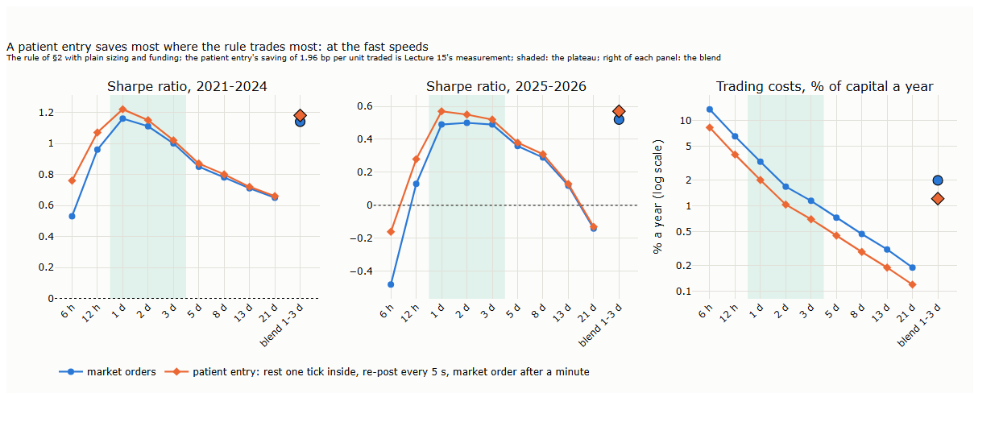
<sub><b>How to read the figure.</b> <b>Axes.</b> Speed (x). Left and middle: Sharpe ratio (y). Right: trading costs, % of capital a year (y, log). <b>Blue:</b> the rule of §2 with market orders at the hourly close. <b>Orange:</b> the same rule with the patient entry. <b>Left and middle:</b> the Sharpe ratio after all costs, 2021–2024 and 2025–2026. <b>Right:</b> trading costs, % of capital a year, on a log scale. Large markers on the right of each panel: the rule's blend of the plateau speeds. Shaded: the plateau.</sub>

For the rule's blend, the patient entry lowers trading costs from 2.0% to **1.2%** of capital a year and raises the Sharpe ratio from 1.14 to **1.18** in 2021–2024 and from 0.52 to **0.57** in 2025–2026: it cuts the rule's trading costs by about 40%. The gain grows with how much the rule trades: at a speed of six hours, which turns its capital over about 270 times a year, the Sharpe ratio rises from 0.53 to 0.76 in 2021–2024 and from −0.48 to −0.16 in 2025–2026; at three weeks it barely moves. A cheaper entry does not make a fast rule good, but it moves the point at which costs start to eat it.

The saving was measured on small orders, with fills simulated from the tape, which can differ from real ones (Lo, MacKinlay and Zhang, 2002); the order book (Lectures 21 to 23) takes up how much.

**Key message.** Deciding on the hour does not mean trading on the hour: worked over the following minute, the rule's orders cost about 40% less.

## 6. Holding

Funding, paid every eight hours between longs and shorts (Lecture 18, §2; Lecture 19, §12), is what the rule pays to hold its positions. On Binance the rate is the interval's average premium plus an interest part of 0.01% per interval, with the difference between the two clamped to ±0.05%, so that it stays at 0.01% unless the premium moves far. The **premium index**, Binance's construction from the order book, is the input to funding; it moves with, but is not the same number as, the **basis**, log(perpetual ÷ spot), what a trader sees on the screen.

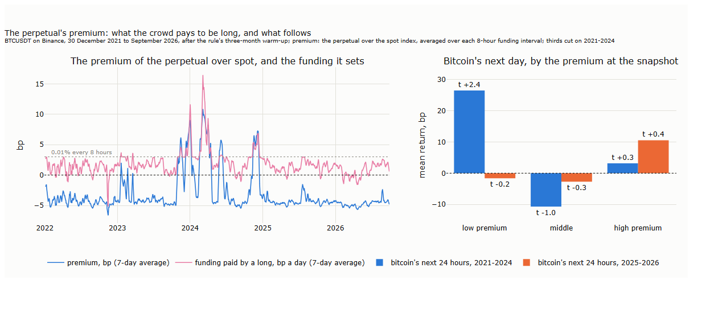
<sub><b>How to read the figure.</b> <b>Axes.</b> Left: date (x); premium and funding, bp (y). Right: third of the premium (x); mean return over the next 24 hours, bp (y). <b>Left, blue:</b> the premium of the perpetual over the spot index, averaged over each 8-hour funding interval, then over 7 days, in bp. <b>Left, pink:</b> the funding paid by a long, bp per day, 7-day average; the dotted line is the usual 0.01% every 8 hours. <b>Right:</b> bitcoin's mean return over the 24 hours after each snapshot, by the third of the premium at that snapshot (thirds cut on 2021–2024), with the t-statistic, days as clusters.</sub>

The premium sits slightly below zero most of the time, about −4 bp, and funding near its usual 0.01% per interval; both jump together when the crowd wants to be long, as in the rallies of early and late 2024, when a long paid up to about 16 bp a day. Funding is highest exactly when the market rises and the rule is long.

**The pure premium.** The premium can be earned without any view on the price: buy spot and sell the perpetual in the same amount. The price moves of the two legs cancel, and what remains is the funding received, minus the change in the basis, minus the fees on both legs. Over five years the basis returned to where it started, so the structure earned the funding and nothing else: about 7.5% a year, and about 3.6% a year more than the 3-month Treasury bill ([E22 §1](../extended/22-trend-on-the-tape/lecture.md) has the accounts and their caveats: margin, top-ups in a rally, one exchange).

**What it cost the rule.** Charged at every settlement on the position open at that moment, funding cost the rule 1.4% of its capital a year in 2021–2024 and 0.3% in 2025–2026. The rule's long side paid 1.7% a year in 2021–2024; its short side received 0.3%. A long-only holder paid far more, 4 to 12% a year in each full year (Lecture 19, §12). A backtest without funding therefore overstates rules that are mostly long, and understates rules that are often short.

**Does the premium tell the rule anything?** Split by the premium known at each snapshot (the figure above, right), bitcoin's next 24 hours show no ordering that holds in both periods: after a low premium the price rose 27 bp in 2021–2024 (t 2.4) and fell 2 bp in 2025–2026; after a high one, +3 bp and +11 bp, neither distinguishable from zero. The premium is what a long pays, not where the price goes.

**Perpetual or spot?** Holding the rule's longs in spot avoids funding, at the price of spot's higher fee, 10 bp for a regular account against 5 bp, and of the risk-free rate the capital in spot forgoes. With the patient entry, the rule's longs held in spot give a Sharpe ratio of 1.16 / 0.49 against 1.18 / 0.57 in the perpetual: spot saves about 1.7% a year in funding, and gives back 1.6% in fees and 0.6% in the risk-free rate forgone. For a rule that trades its capital about 40 times a year, the perpetual is cheaper; for a slow rule that trades a few times a year, the balance would tip the other way.

**Key message.** Funding is the component of a perpetual strategy to watch: highest when the crowd is long, so that long positions pay most in the years they earn most, and a backtest must charge it at every settlement. The premium says what a long pays, not where the price goes.

## 7. The rule built up

Each section changed one thing in the rule and measured it. Put together, as in the opening figure:

| Version | Sharpe ratio, 2021–2024 / 2025–2026 | Largest fall, 2021–2024 / 2025–2026 | Worst day | Costs / funding a year |
|---|---|---|---|---|
| Plain rule, market orders (§2) | 1.14 / 0.52 | −15% / −17% | −9.5 | 2.0% / 1.4% |
| **+ patient entry: the lecture's rule (§5)** | **1.18 / 0.57** | −15% / −16% | −9.5 | 1.2% / 1.4% |
| Longs held in spot (§6), not taken | 1.16 / 0.49 | −16% / −17% | −9.5 | 2.8% / −0.3% |
| Alternative: size by the smoothed risk forecast (§4) | 1.22 / 0.44 | −13% / −10% | **−6.5** | 1.1% / 1.1% |
| Alternative: long or flat | **1.43 / 0.61** | −13% / −11% | −8.3 | 0.7% / 1.7% |

<sub><b>How to read the table.</b> One row per version, after fees, spread and funding. Largest fall: the largest fall from a peak. Worst day: the largest 24-hour loss, in units of the rule's typical daily move. Costs and funding: % of capital a year, 2021–2024; negative funding is received.</sub>

Of the tape's tools, one step pays on its own: the patient entry. Sizing by the sharper forecast of risk is an alternative, not a step: it makes the worst day a third milder and the largest fall smaller, at the cost of the Sharpe ratio in 2025–2026. The other alternative, long or flat, changes the rule itself.

**The long and the short leg.** The rule is long about half the time and short the other half. Split by the side it holds, year by year:

| Year | Bitcoin | The rule's long leg | Its short leg | The rule | Long or flat |
|---|---|---|---|---|---|
| 2022 | −64% | −10.5% | **+16.9%** | **+6.4%** | −10.4% |
| 2023 | +156% | +49.3% | −4.9% | +44.3% | +49.1% |
| 2024 | +121% | +24.3% | −5.7% | +18.6% | +24.5% |
| 2025 | −6% | −0.4% | −10.8% | −11.2% | −0.3% |
| 2026, to September | −5% | +12.0% | **+16.2%** | **+28.2%** | +11.7% |

<sub><b>How to read the table.</b> Legs: % of the rule's capital, after costs and funding. Bitcoin: its change over the year. [E22 §7](../extended/22-trend-on-the-tape/lecture.md) draws the cumulative return of both versions against bitcoin.</sub>

Over the five years the short leg added little on average, and long or flat has the higher Sharpe ratio in both periods. But the shorts earned in the two falling years, and in 2022 they turned a loss of 10% into a gain of 6% while bitcoin lost two thirds of its value: the protection trend following is known for, as the capstone of Lecture 10 found on futures (Lecture 10, §9.2). Which version to run is a view on how many falling years the future holds, a question five mostly rising years cannot settle.

**Capacity.** The rule turns its capital over about 42 times a year. With the square-root law of Lecture 19 (§12) and a constant Y of 0.5 to 0.9, impact costs about 1% a year up to about $100 million of capital, where each trade is a fraction of a minute's trading; at $1 billion it takes 2 to 4% a year of a gross return of about 25%, and at $5 billion a fifth to a third of the return. These are estimates from the law, not measurements ([E22 §7](../extended/22-trend-on-the-tape/lecture.md) has the table).

**Key message.** Of the tape's tools, the patient entry pays on its own; a sharper forecast of risk is an option for steadier risk, not for more return; the market's other clocks and the perpetual's premium add nothing to the signal; and funding must be charged, not modelled away. The rule's shorts earned little on average and much in the one bear market of the sample.

## 8. How a grid earns

**What a grid is.** A grid places buy orders at levels below the price and sell orders at levels above it, each a fixed step apart, and waits. It is a **mean-reversion strategy that trades by providing liquidity**: it bets that the price swings back, and it never sends a market order to enter; it rests its orders and is filled when someone in a hurry trades against them. In that it resembles a market maker, but it works far from the price and slowly: its orders rest several typical moves away instead of one tick, and it holds what it buys for hours instead of seconds.

**The opposite of the trend rule.** In the table each row is one aspect (what each bets on, on which of the three clocks of §1 it acts, how long it holds, what it needs from the tape that bars cannot give, the shape of its payoff, what it earned after all costs on our sample) and each column one strategy, with the section where the entry is measured.

| | The trend rule (§1–§7) | The grid (§8–§14) |
|---|---|---|
| Bets on | Runs: earns when the price runs, loses when it swings without direction | Swings: earns when the price swings back, loses when it runs one way |
| Clock | Decides at every hourly close, measures on hourly closes, trades with a patient entry over the following minute (§1, §5) | No decision times: resting orders are filled whenever the price trades through a level, second by second; flat at the end of each UTC day (§8.3) |
| Holds for | Days | Minutes to hours |
| What it takes from the tape | A cheaper entry (Lecture 19, §11), funding at every settlement, a forecast of risk (§4–§6) | The path between bars: which levels are traded through, in what order, and what a stop gets (Lecture 19, §2–§4) |
| Payoff | Convex: small, frequent losses and rare large gains | Concave: small, frequent gains and rare large losses |
| Result after costs, BTCUSDT | Sharpe ratio 1.18 in 2021–2024, 0.57 in 2025–2026 (§7) | Loses at every step, from −1.10% of capital a day at a 10 bp step to −0.04% at 200 bp (§10) |

<sub><b>How to read the table.</b> One row per aspect, one column per strategy; the last row is the result after fees, spread and funding on five years of BTCUSDT, in the units each section reports. Full comparison: [E22 §8](../extended/22-trend-on-the-tape/lecture.md).</sub>

Trend followers' returns resemble a long position in options that pay on large moves (Fung and Hsieh, 2001), and a trend rule's profit is roughly the long-term variance of the price minus its short-term variance (Dao et al., 2016): it earns when moves add up. The grid's payoff is the mirror image, our inference rather than a published result: it earns when moves cancel, and its loss is the inventory a run leaves behind. Its central risk is the trend rule's profit, which makes the tools that warn of runs its brakes.

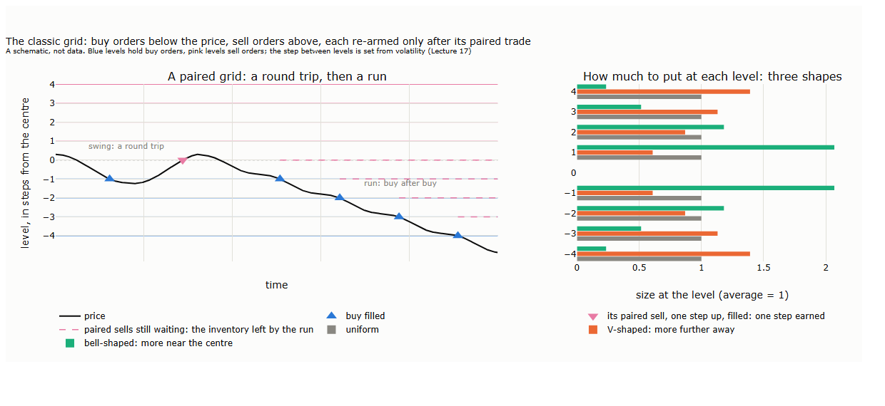
<sub><b>How to read the figure.</b> <b>Axes.</b> Left: time (x); level, in steps from the centre (y). Right: size at each level, average 1 (x), by level (y). A schematic, not data. <b>Left:</b> blue lines are levels holding buy orders, pink lines levels holding sell orders, the dotted line the centre. On the swing, the buy at −1 fills (blue triangle) and its paired sell one step up fills (pink triangle): one step earned. On the run, buy after buy fills, and their paired sells (dashed) wait above the price: the inventory the run leaves behind. <b>Right:</b> three ways of spreading the grid's capital across its levels, each averaging 1 per level.</sub>

### 8.1 The grid of this lecture

The grid is paired, as in the open-source Hummingbot framework: a level is re-armed **if and only if** its paired trade has filled, so a level never holds more than one position and the grid's inventory is bounded by the number of its levels. Its settings: a **step** of 10 to 200 bp of the price at which the ladder is laid, from a few one-minute moves to about two-thirds of a day's move; **levels** of 200 bp ÷ step on each side, so that every step is tested with the same reach; the same **size** at every level, one unit = capital ÷ number of levels on a side, so that a full ladder on one side is exactly the capital; a **stop** one step beyond the last level; and a **daily close** in the last second of the UTC day.

**The whole grid in one number.** In paired form, the grid's state is the last level it filled, and its position follows from it:

```math
q_t = -\frac{r_t - c}{s}
```

| Symbol | Meaning | Financial interpretation |
|---|---|---|
| $`q_t`$ | Position, in units (+ long, − short) | What the grid holds after its last fill |
| $`r_t`$ | Reference level: the last level filled | Where the market last traded through the grid |
| $`c`$ | Centre: the price at which the ladder was laid | The price the grid treats as fair until it is restarted |
| $`s`$ | Step, in dollars | The swing the grid is paid for |

The grid is long one unit for every step the price has fallen below the centre and short one for every step it has risen above it: a position that leans against the move.

### 8.2 The life of a level

Each level goes through the same four states. For a level one step below the centre:

| Step | What happens | Position | What is earned |
|---|---|---|---|
| 1. Armed | A resting buy order waits at the level | 0 | — |
| 2. Filled | An aggressive seller trades below the level: the buy is filled, and a sell for the same unit is placed one step above | +1 | — |
| 3a. Paired sell fills | The price returns one step: the unit is sold, and only now is the buy at the level re-armed | 0 | One step × one unit: a round trip |
| 3b. Or the price runs on | Lower levels fill in turn; at the last level the next trade through closes every unit at the market (the stop) | up to the cap, then 0 | The loss of every unit against its own buy price |

Above the price the mirror image holds. The position is bounded by the number of levels; what is not bounded is the loss when the price runs through all of them: that is what the stop and the daily close are for.

### 8.3 Fills, exits and costs

**Fills counted conservatively.** A resting buy at a level is counted as filled only if an aggressive seller traded *below* it in that second; a resting sell only if an aggressive buyer traded above it. Touching the level is not enough: an order there would wait in a queue. On BTCUSDT a level that is visited is traded through more than 99.7% of the time (Lecture 19, §4.3), so the rule loses little. The simulation runs second by second: a sweep through several levels fills all of them in the same second, and an order re-armed by a fill is live from the next second.

**Exits and costs.** The **stop** fires when the position is at the cap and the price trades through one level more: every unit is closed at the worst aggressive price of that second, as a market order, and a new ladder is laid around the price (Lecture 19, §4.3 measured how far such a stop can slip). The **daily close** closes whatever is left at the market, so the grid pays or receives funding only at 08:00 and 16:00 (§6). Fees are a regular account's: 2 bp on every resting fill, 5 bp on every stop and close (Lecture 19, §10); live, the maker fee needs post-only orders (Lecture 18, §3.2).

**The accounts.** Every result in the second half is split into the same parts:

```math
\text{gross} = \underbrace{N_{\mathrm{trips}} \times s \times u}_{\text{round-trip income}} + \text{inventory result}, \qquad
\text{net} = \text{gross} - \text{maker fees} - \text{taker fees} + \text{funding}
```

| Part | How it is computed | Financial interpretation |
|---|---|---|
| Round-trip income | Round trips $`N_{\mathrm{trips}}`$ × step $`s`$ × unit size $`u`$ | What the swings paid: each unit bought and sold one step higher, or sold and bought back one step lower |
| Inventory result | Gross minus round-trip income | What the runs cost: the units closed at stops and at the daily close, against their own fill prices |
| Maker fees | 2 bp of every resting fill | The price of resting orders |
| Taker fees | 5 bp of every stop and close | The price of leaving in a hurry |
| Funding | Position × price × rate, at 08:00 and 16:00 | The cost, or income, of holding inventory through a settlement |

Round-trip income can only grow. The inventory result is where the risk sits: the grid holds inventory exactly when the price has moved away from the centre, and closes it when the move has gone furthest.

**One day, in brief.** On 12 March 2024, the day of the figure in §1, a grid with a step of 50 bp on USD 100,000 of capital earned USD 1,875 from fifteen round trips in sixteen hours; the afternoon run took an hour and a half to cost the inventory about twice that, USD 3,676, through three stops: small, frequent gains and rare large losses ([E23 §1.4](../extended/23-an-intraday-grid/lecture.md) follows it fill by fill).

## 9. No pattern, no profit

On a price with no pattern a grid earns nothing before costs, apart from what its own fills give away; every dollar it makes comes from the price reverting at the scale of its step, and every dollar it loses from the price running. This section shows it in simulations where the truth is known.

### 9.1 A price with no pattern

**Why nothing.** On a price that is a martingale, a price whose expected next value is its current value, no rule of buying and selling at the market price has an expected profit (Williams, 1991, ch. 10). A grid trades at its levels, however: when the price jumps through a buy level between two seconds, the order is filled at the level, above the price at which the market now trades. That difference is the **gap**, and on a martingale it is the only thing the grid's expected profit can come from:

```math
\mathrm{E}[\text{gross}] = -\,\mathrm{E}[\text{gap}] \quad \text{on a price with no pattern}
```

Profit plus gap is therefore what the path's pattern earned the grid: zero when there is no pattern, positive when the price swings back, negative when it runs.

**The test.** A Monte Carlo simulation of 1,000 days of 86,400 one-second steps, a random walk with 3% daily volatility, the grid of §8 with 5 levels on each side at steps of 25 and 50 bp, fills at the level also when the price jumps through it, and no costs. Five price paths, three without a pattern and two with one:

| Path | Construction | Pattern |
|---|---|---|
| Random walk | Normal one-second steps | None |
| + small jumps | 10 jumps a day of 40 bp on average; 18% of the variance | None: jumps are as likely up as down |
| + large jumps | 2 jumps a day of 120 bp on average; 32% of the variance | None |
| Control: swings | Random walk + a part that reverts with a half-life of 10 minutes, about 20 bp in size | Reversion |
| Control: a trend day | Random walk + a drift for the whole day, different every day, 2% a day on average in either direction | Persistence |

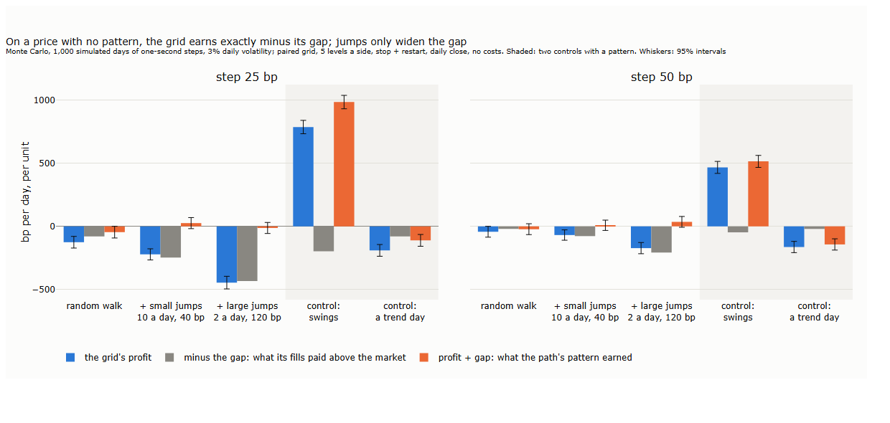
<sub><b>How to read the figure.</b> <b>Axes.</b> Simulated price path (x), one panel per step. Result in bp per day, per unit (y). For each simulated price path: <b>blue</b>, the grid's average profit per day; <b>grey</b>, minus the gap, what its fills paid above the market; <b>orange</b>, their sum, what the path's pattern earned the grid. Whiskers are 95% intervals. The shaded paths are the two controls, which have a pattern by construction. Left, a step of 25 bp; right, 50 bp.</sub>

On the three prices without a pattern, the grid loses exactly its gap: profit plus gap is within two standard errors of zero in all six cases. Jumps make the grid lose more, 445 bp a day per unit with large jumps at a 25 bp step, but only because they widen the gap: a jump adds much to the variance and crosses few levels (Lecture 19, §4.1), and every level it does cross is filled above the market. The controls behave as they must: at a 25 bp step the grid earns 785 bp a day per unit on swings and loses 190 on trend days. The grid has no edge of its own. It sells the price's swings and buys its runs, and it is paid only if swings dominate at the scale of its step.

### 9.2 Runs: jumps spread over minutes

**What a run is.** A jump moves the price in one instant. A run moves it the same distance over minutes, and fills the grid's levels one after the other, as on the afternoon of 12 March. On the tape, Lecture 19 (§3) found both regimes: on ordinary days the price turns back, and its variance ratio, the variance of one-hour returns divided by what one-minute returns imply, is about 0.9; on explosive days it runs. The simulated price is therefore the sum of a random walk, a hidden drift and a reverting part, in one of two states, calm or running, at every second:

| Step | Calculation, every second | Financial interpretation |
|---|---|---|
| 1. State | Calm → run with probability $`p_{\mathrm{in}}`$, run → calm with probability $`p_{\mathrm{out}} = 1/1{,}800`$ | Runs start without warning and last 30 minutes on average; $`p_{\mathrm{in}}`$ sets the share of time in runs, $`\pi = p_{\mathrm{in}} / (p_{\mathrm{in}} + p_{\mathrm{out}})`$ |
| 2. Hidden drift | In a run: $`d_t = a\,d_{t-1} + b\,\varepsilon_t`$; when calm: $`d_t = a\,d_{t-1}`$, with $`a = 2^{-1/600}`$ | A push in one direction that builds and turns within a run, with a half-life of 10 minutes, and fades after it; its direction is random |
| 3. Random walk | $`w_t = w_{t-1} + d_t + \sigma\,\eta_t`$ | The news: unpredictable moves, plus the drift |
| 4. Reverting part | When calm: $`y_t = a\,y_{t-1} + e\,\zeta_t`$; frozen in a run | Temporary pressure that is undone within minutes: the swings a grid lives on |
| 5. Price | $`p_t = w_t + y_t`$ | What trades |

Here $`\varepsilon_t`$, $`\eta_t`$ and $`\zeta_t`$ are independent standard normal draws, and $`b`$ and $`e`$ set the sizes of the drift and the reverting part. For each share of time in runs, the model is calibrated to two facts of the tape, a variance ratio of one-hour to one-minute returns of 0.90 and a daily volatility of 3%, with the drift's standard deviation fixed at 0.07 times the random walk's per second, so that every model has the same average behaviour and differs only in how it is split between swings and runs. A grid that knew it was in a run would close its position and pause; the simulation tests this with the true state seen at once, and seen 5, 15 or 30 minutes late.

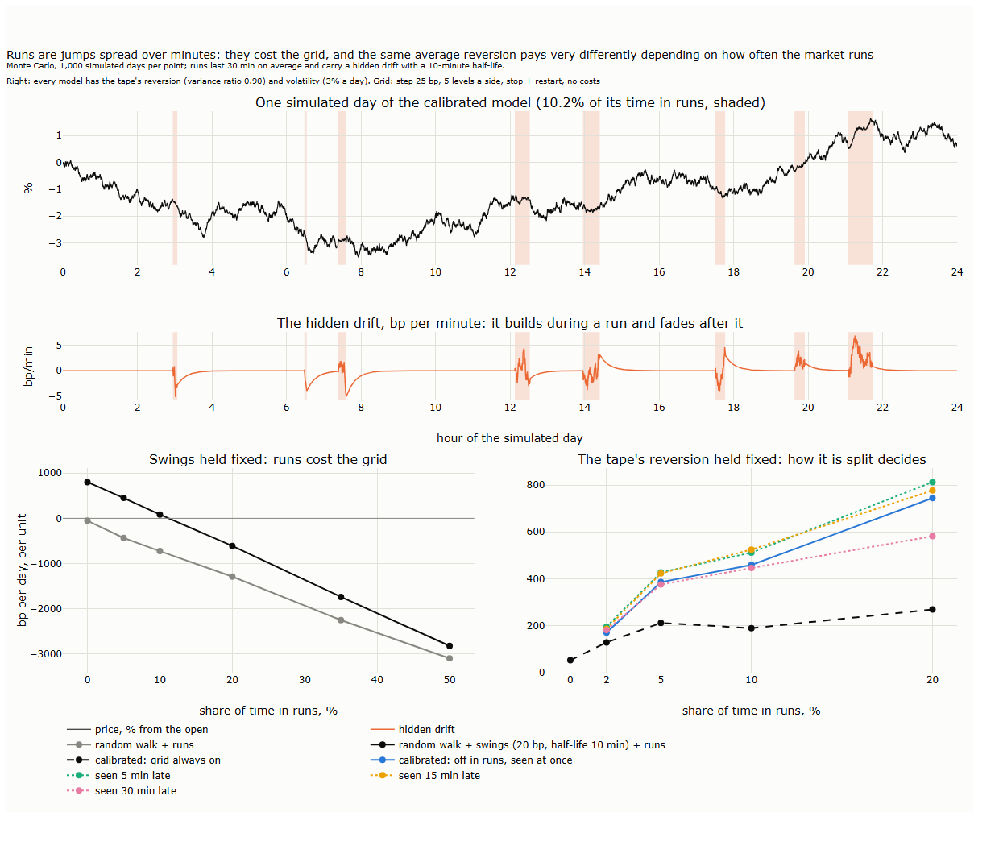
<sub><b>How to read the figure.</b> <b>Axes.</b> Top and middle: hour of the simulated day (x); price in % from the open, then drift in bp per minute (y). Bottom: share of time in runs, % (x); profit in bp per day, per unit (y). <b>Top:</b> one simulated day of the calibrated model with about 10% of its time in runs; the shaded bands are the run episodes. <b>Middle:</b> the hidden drift, in bp per minute: it moves only in a run and fades with a 10-minute half-life afterwards. <b>Bottom left:</b> the grid's average profit per day, by the share of time in runs, with the swings held fixed: on a random walk (grey) and on a random walk with swings (black); volatility is not held fixed here and rises with the runs. <b>Bottom right:</b> every model calibrated to the tape's variance ratio and volatility: the grid always on (dashed), and switched off during runs seen at once or 5, 15 or 30 minutes late. Step 25 bp, 5 levels a side, no costs.</sub>

1. **With the swings held fixed, runs cost the grid.** With a reverting part of 20 bp, the grid earns 800 bp a day per unit when the price never runs; with 5% of the time in runs it earns 450, with 10% about 80, and with 20% it loses 610. Runs do to the grid what jumps do, spread over minutes, and the gap is no longer the channel: the grid is filled at its levels, one after another, and loses on the inventory.
2. **With the tape's average held fixed, the split decides.** When every model has the tape's variance ratio, a market that runs more often must swing back harder in between. The grid always on earns 53 bp a day per unit when the market never runs and 130 to 270 when it does, a fraction of what the swings offer. Switched off during the runs, it keeps up to three times as much: 1.3 times at 2% of the time in runs, 2.8 times at 20%. Seen 5 or 15 minutes late, the switch loses nothing: the drift outlives the run's label. Seen 30 minutes late, it loses part of its value.

The tape's average reversion is therefore no guarantee of profit: what matters is how the reversion and the runs are spread over the day, and whether the runs can be recognised early enough to step aside. The simulations are kinder than the tape: fills are counted at the level, and part of the tape's reversion is the bounce within the same second, which no resting order a step away can earn.

## 10. The tape

On five years of BTCUSDT the grid loses after costs at every step, and before costs it does worse than the same minutes would in random order.

**The experiment.** The BTCUSDT perpetual, 1,826 days, second by second; the grid of §8 at steps of 10, 25, 50, 100 and 200 bp; fills only when traded through; all fees and funding. **The benchmark** is the same days with their minutes shuffled, each minute keeping its own moves relative to the last price before it. The shuffle keeps every trade within a minute, the bounce between buyers and sellers, the day's volatility and its total move; it removes only the order of the minutes, every swing and every run longer than a minute. If the tape's order did nothing for the grid, the two would give the same result.

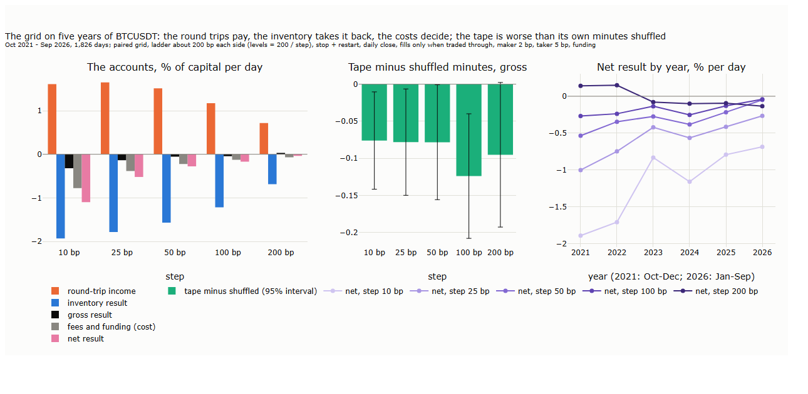
<sub><b>How to read the figure.</b> <b>Axes.</b> Left and middle: step (x); % of capital per day (y). Right: year (x); net result, % of capital per day (y). <b>Left:</b> the daily average of each part of the accounts (§8.3), by step, in % of capital: round-trip income (orange), inventory result (blue), their sum, the gross result (black), fees and funding as a cost (grey), and the net result (pink). <b>Middle:</b> the gross result on the tape minus that on the same days with their minutes shuffled, with 95% intervals; below zero, the tape's order costs the grid. <b>Right:</b> the net result by year, one line per step, light for the narrowest step and dark for the widest; 2021 covers October to December, 2026 January to September.</sub>

| Step | Round trips a day | Stops a day | Net result, % a day | Sharpe ratio, net | Worst 1% of days, % |
|---|---|---|---|---|---|
| 10 bp | 322 | 1.6 | −1.10 | −9.4 | −10.5 |
| 25 bp | 53 | 1.4 | −0.52 | −5.8 | −7.1 |
| 50 bp | 12 | 1.1 | −0.28 | −3.5 | −5.4 |
| 100 bp | 2.3 | 0.7 | −0.17 | −2.0 | −6.0 |
| 200 bp | 0.4 | 0.4 | −0.04 | −0.4 | −4.8 |

<sub><b>How to read the table.</b> Daily averages over 1,826 days. Sharpe ratio: the mean of the daily net result over its standard deviation, annualised with 365 days. Worst 1% of days: the net result that only 1% of days were worse than.</sub>

1. **The round trips pay, and the inventory takes it back.** Round trips earn 0.7% to 1.7% of the capital a day. The inventory result takes back more than that at every step up to 100 bp, so the gross result is negative there: −0.32% a day at 10 bp, −0.06% at 50 bp, and slightly positive only at 200 bp, +0.03%. The gap that decided the simulations is small on the tape: the losses come from the inventory, not from the fills.
2. **Costs decide.** With a gross result near zero, the fees become the result. At 10 bp the maker fees alone are 0.68% a day, and the net loss is 1.10% a day: such a grid would lose its capital in about three months.
3. **The tape's order works against the grid.** At every step the gross result on the tape is 0.08 to 0.12 percentage points a day below that of the same minutes shuffled, with t-statistics between −1.9 and −2.9. This need not contradict Lecture 19's variance ratio below one, an average over all hours: §9.2 showed that what reversion pays a grid depends on how it is spread between swings and runs.
4. **Every year, at every step up to 100 bp, the net result is negative.** Only the widest grid earned, in 2021 and 2022, and it lost in each year since.

These are results on one market with conservative fills, a lower bound on what a real order would get; the order book (Lectures 21 to 23) measures how much better the fills could be.

## 11. The levers

No setting of the grid gives it an edge: across the settings tested the gross result runs from about −0.46% to +0.08% of capital a day, slightly negative in most. The levers change how much the grid bets near the price, what leaving costs and how large its worst days are.

**The size profile.** With the same capital in a full ladder, a profile decides only where that capital sits: uniform, the same at every level; V-shaped, little next to the price and more towards the ends (the figure in §8, right); bell-shaped, most next to the price; bimodal, two bells peaking a few levels away from the price on each side. What the grid holds at each depth is exactly what a swing to that depth earns when it returns, and at the stop every unit loses the remaining distance to the stop:

| Profile | Units held after a fall of 2 steps | What the stop costs | Swings of one step that pay for one stop |
|---|---|---|---|
| Uniform | 2.0 | 36 | 36 |
| V-shaped | 1.2 | 30 | 59 |
| Bell-shaped | 3.9 | 48 | 23 |
| Bimodal | 2.2 | 45 | 71 |

<sub><b>How to read the table.</b> From a schematic, not data: eight levels a side and the same capital in a full ladder for every profile; money in steps × units, so one round trip of an average-sized unit earns 1. [E23 §4.1](../extended/23-an-intraday-grid/lecture.md) has the full set, including where to place the bimodal profile's peaks.</sub>

Each profile is a bet on how far the price swings back: the bell on small swings, the bimodal on medium ones, the V on deep ones. On simulated prices each wins where the path matches its bet (the bell +1.66% a day against +1.19% for uniform sizes where the price swings back by about a step); the profile does not decide whether the bet pays. On the tape the four profiles are within about 0.05 percentage points a day of one another before costs, all slightly negative; after costs the V comes out slightly best, because it trades least near the price and pays the fewest fees.

**Width, exits and refresh.** Each lever was varied on its own, at steps of 25 to 200 bp: a ladder reaching 100, 200 or 400 bp each way; stop and restart (the base), stop and off for the rest of the day, or no stop, holding at the cap until the daily close; and the ladder re-centred once a day (the base), every 4 hours or every hour.

| Rule, step 50 bp | Sharpe ratio, 2021–24 | Sharpe ratio, 2025–26 | Worst 1% of days, 2021–24 | Worst 1% of days, 2025–26 |
|---|---|---|---|---|
| Stop and restart (base) | −3.9 | −2.5 | −6.4% | −3.9% |
| **Stop, then off for the day** | −3.2 | −3.0 | **−1.4%** | **−1.4%** |
| No stop, hold at the cap | −1.2 | −1.4 | −8.3% | −5.8% |
| Refresh every hour | −5.4 | −5.5 | −6.8% | −3.6% |

<sub><b>How to read the table.</b> Sharpe ratio: annualised, of the daily net result. Worst 1% of days: the net result that only 1% of days were worse than, in % of capital. [E23 §4.2](../extended/23-an-intraday-grid/lecture.md) draws every step and width.</sub>

**Off for the rest of the day after a stop** has a clear mechanism: on a running day the price rarely runs once, as on 12 March, when the first stop was followed by two more. At every step, in both periods, stepping aside cuts the worst 1% of days from between −3.9% and −8.1% of capital to between −1.2% and −2.3%, with a Sharpe ratio about that of the base: it reshapes the tail, which is what a stop rule should do. A **wider ladder** raises the Sharpe ratio at every step up to 100 bp, but with the same capital it means smaller units: it loses less because it trades less. **No stop** has the worst days of all the rules; **refreshing** more often pays the taker fee and gives up the units that would have come back. Every setting that loses less does so by paying less to leave, or by trading less; none adds a swing the market does not offer.

## 12. Known in advance

Can anything known in advance tell the grid when to trade? The rules and tests were fixed before the results.

### 12.1 The rules and the tests

Every rule uses only what is known at the moment it acts: values of the last **finished** hour, never of the hour, or the day, still running. The rules, with the reason each might help, were fixed before the tests:

| Rule | What it uses | What the grid does | Why it might help |
|---|---|---|---|
| **Volatility switch**, K = 1.5, 2 or 3 | The volatility ratio (below) | Off while the ratio is at least K: the inventory is closed at the market and the grid pauses; when the ratio falls back, a new ladder is laid around the price | Runs come in violent hours, and violent hours cluster (Lecture 19, §9) |
| **Lean with the trend** | The trend forecast (below) | Holds long units only while the forecast is positive, short units only while it is negative; when the sign turns against the inventory, the inventory is closed at the market | A run in the trend's direction no longer fills the grid against it |
| Lean in strong trends only | The same | Leans only when the forecast is larger than 1 in size, in either direction; otherwise trades both sides | The lean costs round trips; spend it only when the trend is clear |
| Off in strong trends | The same | Off while the forecast is larger than 1 in size | Step aside instead of leaning |
| The channel | The highest and lowest hourly close of the last 10 days | On only while the price is inside the channel, or outside it by less than 10% of its width | A price that breaks out of a long range is starting to run |
| The hour of the day | The clock, UTC | On in one four-hour block only; six blocks | Activity, and with it the kind of trading, changes through the day (Lecture 18, §6.2) |

The two inputs, computed at the close of every hour: the **volatility ratio**, the hour's realised variance (the sum of squared one-minute log returns) divided by the median of the previous 672 hours (28 days), so that 2 means twice the normal variance; and the **trend forecast**, the trend rule of §2, EWMAC with fast spans of 1, 2 and 3 days, blended and divided by its average size, so that a typical forecast has size 1. The rules are tested at steps of 25 to 200 bp, as in §10; the lean, the channel and the strong-trend rules are added to the volatility switch with K = 2.

**Two questions.** A rule can help in two ways, and they are tested separately:

| Question | Measured by | Tests |
|---|---|---|
| **Q1: does the rule cut losses?** | The daily net result with the rule minus that of its baseline on the same day (always on for the switch, the switch for the rules added to it) | 7 rules × 4 steps = 28 |
| **Q2: does it create an edge?** | The gross result above zero, before costs | Every rule and baseline, the six blocks of the day included: 56 |

The hour of the day is tested only for Q2, since a grid that trades a sixth of the day loses less for that reason alone. The tests are run on 2021–2024; 2025–2026 is the check.

**Many tests, one correction.** With 56 tests at the usual 5% level, about three would look significant by chance even if no rule had an edge. Every result is therefore corrected for the number of tests (Benjamini and Hochberg, 1995), as in Lectures 18 (§12.1) and 19 (§8), which controls the **false discovery rate**, the share of false findings among the results declared as findings: sort the m p-values, give the i-th smallest a bar of 0.05 × i ÷ m, and count as findings every test up to the largest i whose p-value is below its bar. A single strong result among many must be very strong to count; many strong results together cannot all be luck.

### 12.2 Results

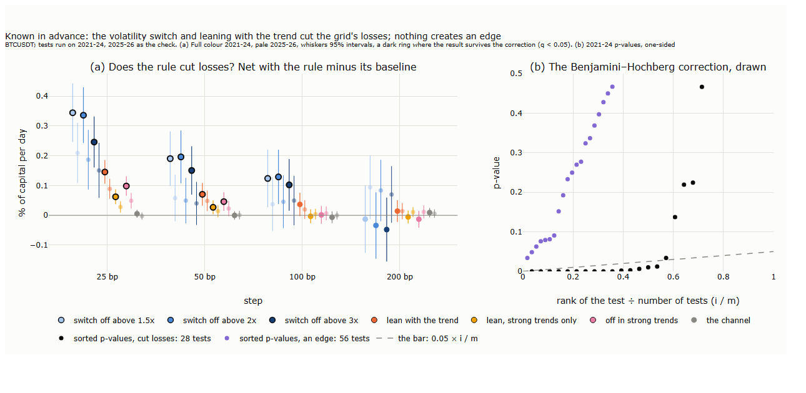
<sub><b>How to read the figure.</b> <b>Axes.</b> (a) step (x), rule minus baseline in % of capital per day (y). (b) rank of the test ÷ number of tests, i/m (x), p-value (y). <b>(a)</b> For each rule and step, the daily net result with the rule minus that of its baseline, in % of capital, with 95% intervals; above zero, the rule cuts losses. Full colour 2021–2024, pale 2025–2026; a dark ring marks a result that survives the correction. <b>(b)</b> The correction drawn: the p-values of each question, sorted, against the bar 0.05 × i ÷ m (dashed); the tests up to the last one below the bar count. Black: Q1, 28 tests; purple: Q2, 56 tests; p-values above 0.5 lie outside the panel.</sub>

| Grid, after costs | Sharpe ratio, 2021–24 | Sharpe ratio, 2025–26 | Worst 1% of days, 2021–24 | Worst 1% of days, 2025–26 |
|---|---|---|---|---|
| Step 50 bp, always on | −3.9 | −2.5 | −6.4% | −3.9% |
| + volatility switch, K = 2 | −3.1 | −3.1 | −3.0% | −1.9% |
| + lean with the trend | −2.4 | −2.3 | −2.4% | −1.4% |
| Step 100 bp, always on | −2.3 | −1.5 | −6.7% | −4.5% |
| + volatility switch, K = 2 | −1.7 | −1.6 | −3.1% | −1.8% |
| + lean with the trend | −1.4 | −1.4 | −2.3% | −1.6% |

<sub><b>How to read the table.</b> Sharpe ratio: annualised, of the daily net result. Worst 1% of days: the net result that only 1% of days were worse than, in % of capital.</sub>

1. **The volatility switch cuts losses, and the cut is robust.** At steps of 25 to 100 bp it survives the correction at every K from 1.5 to 3, and points the same way in 2025–2026: a plateau, not a single good setting. It halves the worst 1% of days while the gross result stays near zero: the switch avoids runs, it does not find swings.
2. **Leaning with the trend cuts losses further,** by 0.15 percentage points a day at 25 bp and 0.07 at 50 bp, both surviving the correction, with t-statistics of 5.2 and 2.8 in 2025–2026. A grid that holds no units against the trend is not filled by runs in the trend's direction; that the lean helps this much suggests, as our inference, that such runs are a large part of what hurts. Leaning only in strong trends, or stepping aside in them, helps less: the sign of the trend matters, not only its strength.
3. **The channel adds nothing measurable** beyond the volatility switch, at any step, in either period.
4. **No rule creates an edge.** Of the 56 tests of Q2 none survives the correction. The best is the grid on only from 12:00 to 16:00 UTC, the US morning, with a gross t-statistic of 1.8 at 100 bp and 1.6 in 2025–2026; as the best of 56, its adjusted p-value is 0.72. It is a lead, not a finding.
5. **Cheaper fees do not rescue it.** With a maker fee of zero, the switched grid still loses after costs (a Sharpe ratio of −1.5 at 50 bp), because the taker fee at stops, switches and closes remains and the gross result is about zero.

**What the tests say.** The grid's losses come from runs, and runs can partly be seen coming: after a violent hour, and in the direction of the trend. Seeing them coming lets the grid lose less, not earn. A positive result would need swings the grid can recognise in advance, and none of the rules finds them.

## 13. Next to the trend rule

The two strategies bet on opposite things: the trend rule on runs, the grid on swings (§8). If the grid earned in the quiet periods in which the trend rule waits, it could improve a portfolio of the two even while losing money on its own.

**The rule for adding a strategy.** Adding a strategy B, in a small amount, to a strategy A raises the Sharpe ratio of the portfolio only if

```math
\mathrm{SR}_B > \rho_{AB} \times \mathrm{SR}_A
```

| Symbol | Meaning | Financial interpretation |
|---|---|---|
| $`\mathrm{SR}_A`$, $`\mathrm{SR}_B`$ | The Sharpe ratios of the strategy held and of the one added | What each earns per unit of its own risk |
| $`\rho_{AB}`$ | The correlation of their daily results | How much of B's risk is A's risk again |

A strategy that loses money can improve a portfolio only if it is negatively correlated with it, and strongly enough: it must act as a hedge.

**The experiment.** The lecture's trend rule of §7 (the rule in the perpetual with the patient entry), its hourly results summed per UTC day; the grid of §12 with the volatility switch and the lean with the trend, ladder 200 bp each way; both after costs. The grid is scaled to the trend rule's volatility and given 10% or 25% of the weight.

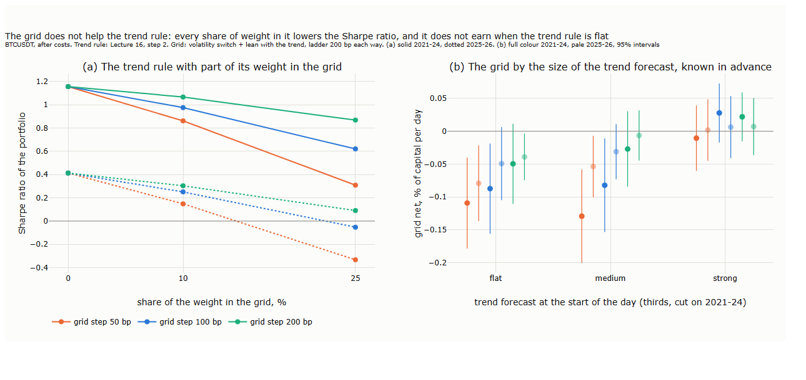
<sub><b>How to read the figure.</b> <b>Axes.</b> (a) grid's share of the weight, % (x), portfolio Sharpe ratio (y). (b) third of the trend forecast (x), grid's net result in % of capital per day (y). <b>(a)</b> The Sharpe ratio after costs of the trend rule alone (left) and with 10% or 25% of the weight in the grid, one line per step; solid 2021–2024, dotted 2025–2026. <b>(b)</b> The grid's daily net result, in % of capital, by the size of the trend forecast at the start of the day (the last finished hour before 00:00 UTC), in thirds cut on 2021–2024; full colour 2021–2024, pale 2025–2026, whiskers 95% intervals.</sub>

The table applies the rule: the two strategies' correlation, the grid's own Sharpe ratio, and the Sharpe ratio the grid would need.

| Grid step | Correlation with the trend rule, 2021–24 / 2025–26 | The grid's Sharpe ratio, 2021–24 / 2025–26 | It would need to exceed, 2021–24 / 2025–26 |
|---|---|---|---|
| 50 bp | +0.20 / +0.18 | −2.4 / −2.3 | +0.23 / +0.07 |
| 100 bp | +0.16 / +0.15 | −1.4 / −1.4 | +0.18 / +0.06 |
| 200 bp | +0.10 / +0.09 | −0.6 / −0.9 | +0.11 / +0.04 |

<sub><b>How to read the table.</b> The last column is the correlation times the trend rule's Sharpe ratio (1.16 in 2021–2024, 0.41 in 2025–2026): the Sharpe ratio the grid would need for a small share of it to raise the portfolio's. <b>Which trend rule.</b> This comparison was run on an earlier version of the trend rule, the patient entry added to sizing by the raw risk forecast (§4), measured on daily results: hence 1.16 and 0.41, not the 1.18 and 0.57 of §7, which add the patient entry to plain sizing. The conclusion does not depend on the version: the grid's own Sharpe ratio is negative and its correlation with the trend rule near zero, so by the rule above a share of it lowers the Sharpe ratio of any trend rule that earns (correction found while condensing, 2026-11-16).</sub>

1. **The grid is no hedge for the trend rule.** Without the lean its daily results are uncorrelated with the trend rule's (between −0.04 and +0.01); with the lean, which makes it hold inventory in the trend's direction, slightly positively (+0.09 to +0.20). Neither comes close to the strongly negative correlation a losing strategy would need.
2. **Every share of the grid lowers the Sharpe ratio**, by more the larger the share and the narrower the step: at 50 bp, a quarter of the weight in the grid takes the trend rule's Sharpe ratio from 1.16 to 0.31 in 2021–2024 and from 0.41 to −0.33 in 2025–2026.
3. **The grid does not earn when the trend rule has little to do.** It loses more on days that start with a flat or medium trend forecast than on days that start with a strong one (panel b of the figure), within one to two and a half standard errors: a lead rather than a finding. One possible reason, for readers to test: the forecast is divided by volatility, so a small forecast often marks a volatile market without a direction, the kind in which a grid is run over.

**What it means.** A grid and a trend rule are opposite bets on the path, but not offsetting ones: the trend rule earns from runs, the grid loses on them, and the grid's earnings on swings are too small to pay for that. As a second strategy beside the trend rule, the grid adds risk and subtracts return.

## 14. Where grids pay

A grid on its own is a bet on swings, and on this market the bet has not paid. But a grid is also a machine for providing liquidity, and that machinery has uses in which the edge comes from somewhere else. This is the view these notes take; others may have found ways of earning from providing liquidity that are not tested here.

| Use | Where the edge comes from | What the grid's machinery adds | What our results say |
|---|---|---|---|
| **Cutting a strategy's costs** | The strategy's own signal, such as the trend rule of §1–§7 | Resting orders instead of market orders: the maker fee instead of the taker fee, and part of the spread earned instead of paid | The re-posted entry of Lecture 19, §11 saves about 2 bp per unit traded, and it is the step of the trend rule's build-up that paid (§5) |
| **Being paid for liquidity** | The exchange, through a rebate on resting fills | Volume filled passively, several times the capital a day | Below: the rebate at which the grid of §12 breaks even |
| **Inside other strategies** | Price differences between venues or between related assets | The cheap side of the trade: resting orders on one venue, hedged when filled | Not tested here: it needs a second venue's data, and the order book to judge fills |

<sub><b>How to read the table.</b> One row per use of a grid's machinery: where the edge would come from, what the resting orders add, and what this lecture or Lecture 19 measured about it.</sub>

**The rebate that would close the gap.** With a gross result near zero, the grid's loss is almost entirely its costs, and most of what remains at a zero maker fee is the taker fee at stops, switches and closes. A venue that paid a rebate on every resting fill would close the gap at:

| The grid of §12 (switch + lean), step | Dollars filled passively a day, × capital | Rebate needed, bp per dollar filled, 2021–24 | Rebate needed, 2025–26 |
|---|---|---|---|
| 25 bp | 3.8 / 2.2 | 1.4 | 1.4 |
| 50 bp | 1.9 / 1.1 | 2.3 | 2.3 |
| 100 bp | 0.9 / 0.5 | 3.4 | 3.9 |

<sub><b>How to read the table.</b> The rebate is what the exchange would pay on each dollar of resting fills, the maker fee being minus that rebate instead of +2 bp; the taker fee stays at 5 bp. Dollars filled: 2021–2024 / 2025–2026. Our calculation, from the results of §12.</sub>

The bar is stable across the two periods. Whether any venue pays this much, and to whom, is to be checked against its current terms; we make no claim about them. A grid that cleared the bar would earn the rebate, not the market.

**Open questions.** These results hold on one market, with fills counted only when the price trades through. Readers are invited to test whether the grid's lead in the US morning survives on more data, whether swings of three to four steps, the regime the bimodal profile bets on, can be recognised in advance, and whether a thinner market, such as SOLUSDT, offers more swings relative to its costs.

## Back to the base layer

*Food for thought.*

| | |
|---|---|
| **The idea** | Intraday trend as another arrow next to the base layer's slow trend: a faster horizon that diversifies (breadth, Lecture 1 §5.4) |
| **What our results already say** | Bitcoin's tradable trends last days: the trend rule works at fast spans of one to three days, decided once an hour (§2); built up with the patient entry, its Sharpe ratio after all costs is 1.18 in 2021–2024 and 0.57 in 2025–2026 (§7); a strategy added in a small amount raises a portfolio's Sharpe ratio only if $`\mathrm{SR}_B > \rho_{AB} \times \mathrm{SR}_A`$ (§13) |
| **What a test would need** | The faster trend's correlation with the base-layer trend portfolio (Lecture 13), combined by the rule above; the first thing that could kill it: funding and trading costs |
| **Status** | Not tested in this course; a research direction |

<sub><b>How to read the card.</b> Food for thought, not a result: the idea, only numbers this lecture has shown, what a test would need, and its status.</sub>

## 15. Summary, exercises and reading

### 15.1 Seven takeaways

1. **Three clocks, not one.** A strategy decides on one clock, measures on another and trades on a third; a value from another clock is read as of the last finished bar.
2. **Bitcoin's tradable trends last days.** The rule works at fast spans of one to three days, looks once an hour, and fails faster than half a day, where costs eat it; a trend measure from dollar bars adds nothing, or hurts, because bursts reverse.
3. **Risk has two parts, activity and risk per dollar.** A sharper forecast of risk makes the worst days milder but does not raise the return per unit of risk; a patient entry cuts the rule's trading costs by about 40%.
4. **Funding is the component to watch.** It cost a long-only holder up to 12% a year; the premium says what a long pays, not where the price goes.
5. **No pattern, no profit.** Gross = round trips × step × unit + inventory result; runs, jumps spread over minutes, fill the ladder level by level and cost the grid more than jumps do.
6. **On five years of BTCUSDT the grid loses after costs at every step,** worse than on the same minutes in random order. The levers change costs and tails, not the edge; switching off after a violent hour and leaning with the trend cut losses out of sample, and none of 56 tests finds an edge.
7. **The grid's machinery is worth more than the grid.** At every share it lowers the trend rule's Sharpe ratio; but resting orders cut the costs of strategies with an edge of their own, and a rebate of about 1.4 to 3.9 bp per dollar filled would close the grid's gap.

### 15.2 Exercises

- [ ] Run the rule of §2 on SOLUSDT or ETHUSDT for one year. Where is the plateau of speeds?
- [ ] Let the rule decide only when a CUSUM filter on the price fires (Lecture 18, §9). Does sampling by events, which helped the pipeline of Grądzki, Wójcik and Lessmann (2025), help a trend rule?
- [ ] A rule may close its position just before a funding snapshot and reopen it just after. At what funding rate does this start to pay after the costs of Lecture 19 (§10), and how often was the rate that high (see Lecture 18, §6.2)?
- [ ] Simulate a random walk at one-second steps and run the grid of §9 on it, with fills at the level. Check that profit plus gap is about zero. Then count fills only when the price trades through the level: what changes, and why?
- [ ] Replace "off for the rest of the day" after a stop (§11) by off for 1, 4 or 12 hours, fixed in advance. Is there a plateau, and does it keep the cut in the worst days?

### 15.3 Reading

For the clock of a market and the returns measured on it, Clark (1973) and Ané and Geman (2000); for averages on unevenly spaced data, Zumbach and Müller (2001). For forecasting realised volatility, Corsi (2009); for what volatility targeting does and does not do, Harvey et al. (2018). For trend following as an option-like strategy, Fung and Hsieh (2001), and for its convexity, Dao et al. (2016). For why no rule of trading at the market can beat a price with no pattern, Williams (1991, ch. 10). For the correction for many tests, Benjamini and Hochberg (1995). For perpetual futures and funding, the reading of Lecture 19 and Binance's funding documentation.

Full versions: [E22](../extended/22-trend-on-the-tape/lecture.md) and [E23](../extended/23-an-intraday-grid/lecture.md).

### 15.4 Next: the order book

Both strategies ran on the tape alone, and both stopped at the same wall: the tape records the trades, not the resting orders behind them. Lecture 21 turns to the order book, what the tape cannot show. The trend rule needs it to know whether its patient entry is filled as the simulation assumed; the grid, which lives on resting orders, needs it to know how much better its real fills are than the conservative bound of trading through, where in the queue its orders stand, and what to do with the inventory a run leaves behind.

## References

- Ané, T. and Geman, H. (2000). Order flow, transaction clock, and normality of asset returns. *Journal of Finance* 55(5), 2259–2284. — returns in trading time (§1).
- Barroso, P. and Santa-Clara, P. (2015). Momentum has its moments. *Journal of Financial Economics* 116(1), 111–120. — risk-managed momentum (§4).
- Benjamini, Y. and Hochberg, Y. (1995). Controlling the false discovery rate: a practical and powerful approach to multiple testing. *Journal of the Royal Statistical Society, Series B* 57(1), 289–300. — the correction for many tests (§12).
- Binance. Introduction to Binance Futures funding rates (FAQ). — the funding formula, its interest part and clamp (§6).
- Clark, P. K. (1973). A subordinated stochastic process model with finite variance for speculative prices. *Econometrica* 41(1), 135–155. — returns on a clock driven by trading (§1).
- Corsi, F. (2009). A simple approximate long-memory model of realized volatility. *Journal of Financial Econometrics* 7(2), 174–196. — the HAR model (§4).
- Dao, T.-L., Nguyen, T.-T., Deremble, C., Lempérière, Y., Bouchaud, J.-P. and Potters, M. (2016). Tail protection for long investors: trend convexity at work. *Journal of Investment Strategies*; arXiv 1607.02410. — trend profit and the variance of long and short horizons (§8).
- Fayyaz, M. T., Jabbar, A., Qureshi, F. A. and Jalil, S. Q. (2026). A frequency-controlled comparison of tick- and minute-based information bars for cryptocurrency markets. arXiv preprint 2608.26158. — bar statistics and predictability on the Binance bitcoin perpetual (§1).
- Fung, W. and Hsieh, D. A. (2001). The risk in hedge fund strategies: theory and evidence from trend followers. *Review of Financial Studies* 14(2), 313–341. — trend following as lookback straddles (§8).
- Grądzki, P., Wójcik, P. and Lessmann, S. (2025). Algorithmic crypto trading using information-driven bars, triple barrier labeling and deep learning. *Financial Innovation* 11. — sampling and labelling on bitcoin and ether (§3).
- Harvey, C. R., Hoyle, E., Korgaonkar, R., Rattray, S., Sargaison, M. and Van Hemert, O. (2018). The impact of volatility targeting. *Journal of Portfolio Management* 45(1), 14–33. — volatility targeting by asset class (§4).
- Lo, A. W., MacKinlay, A. C. and Zhang, J. (2002). Econometric models of limit-order executions. *Journal of Financial Economics* 65(1), 31–71. — simulated against real fills (§5).
- López de Prado, M. (2018). *Advances in Financial Machine Learning*. Wiley. — bars sampled by activity, the CUSUM filter (§1, §3).
- Moreira, A. and Muir, T. (2017). Volatility-managed portfolios. *Journal of Finance* 72(4), 1611–1644. — scaling factors by their variance (§4).
- Patton, A. J. (2011). Volatility forecast comparison using imperfect volatility proxies. *Journal of Econometrics* 160(1), 246–256. — the QLIKE loss (§4).
- Williams, D. (1991). *Probability with Martingales*. Cambridge University Press. — no trading rule beats a martingale (§9.1).
- Zumbach, G. and Müller, U. A. (2001). Operators on inhomogeneous time series. *International Journal of Theoretical and Applied Finance* 4(1), 147–177. — averages on unevenly spaced data (§3).
