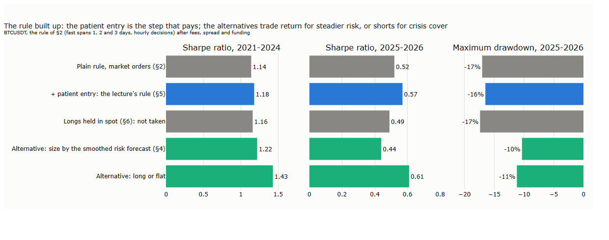
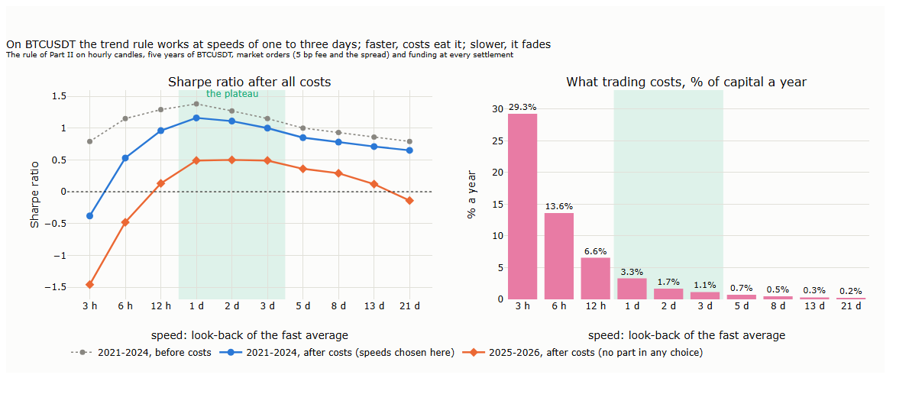
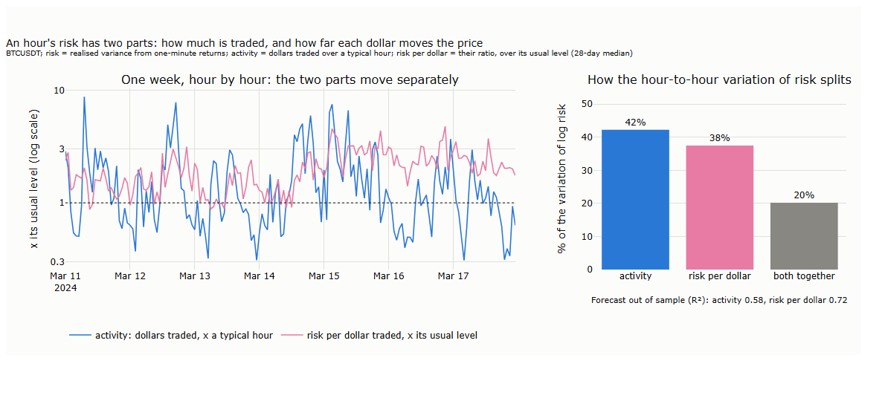
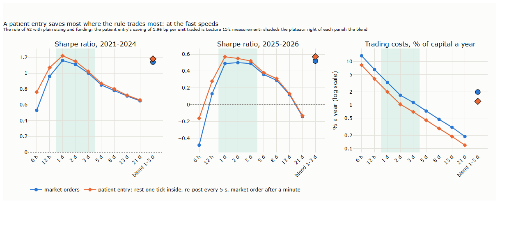
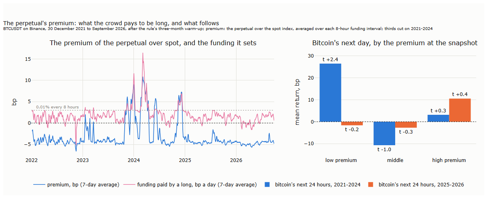
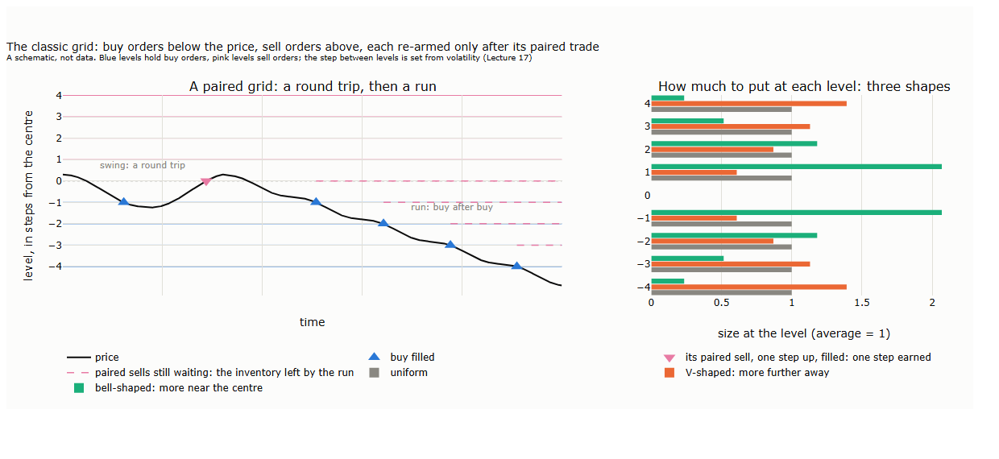
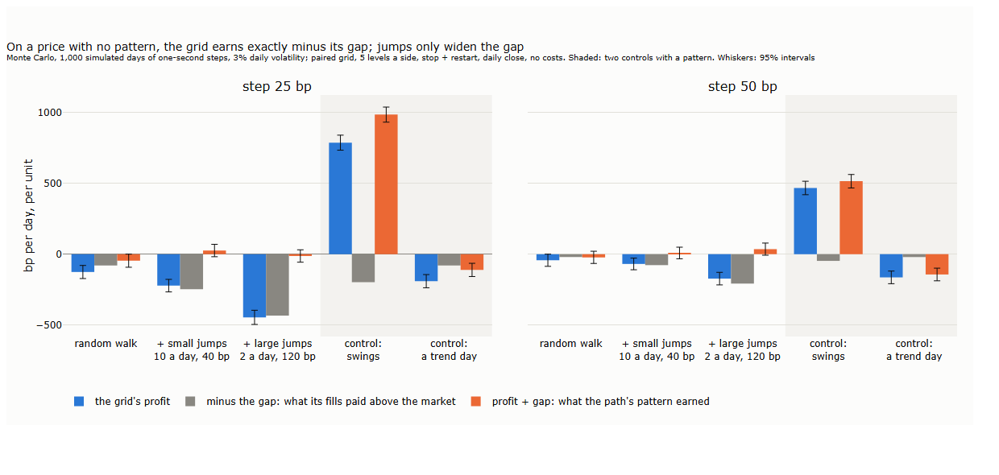
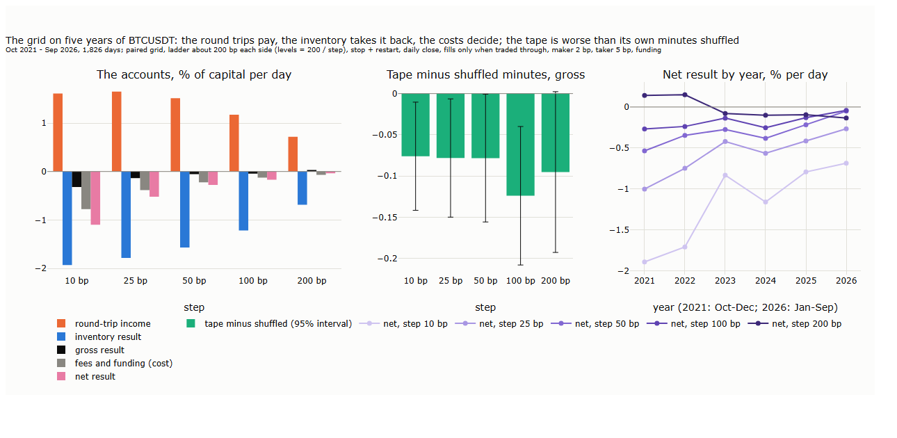

# Lecture 20: Two Strategies on the Tape: a Trend Rule and an Intraday Grid

> Two strategies that use the tape in opposite ways: a trend rule that earns when the price runs, and a grid that earns when it swings back.

Part V · Pipeline stage: signals, sizing and execution, end to end on the tape

---

# The trend rule earns; the grid does not

> Rebuilt for bitcoin, the trend rule earns after all costs in both periods; of the tape's tools, one step pays on its own, the patient entry.

- The lecture's rule: Sharpe ratio 1.18 in 2021–2024, 0.57 in 2025–2026
- The grid loses at every step after costs
- Next to the trend rule, the grid lowers the portfolio's Sharpe ratio

---

# A strategy runs on three clocks

> When a rule decides, what it measures on and how it trades are three separate choices; keeping the decision on the calendar makes every test fair.

| Clock | The question it answers | In this lecture's rule |
|---|---|---|
| **Decision** | When does the rule decide? | At every hourly close |
| **Information** | On which samples are its measurements built? | Hourly closes, or dollar bars |
| **Execution** | How is an order worked once decided? | A patient entry, over seconds |

- **Read another clock as of the last finished bar:** a bar still forming would use the future
- **Dollar bars add nothing to the signal:** averaged by time they are hourly closes (correlation 0.99); averaged by bars they follow bursts that reverse

---

# Bitcoin's tradable trends last days

> The rule works at fast spans of one to three days, decided once an hour; faster than half a day, costs eat it.

- Plateau: Sharpe ratio 1.0 to 1.2 in 2021–2024, about 0.5 in 2025–2026
- At three hours: 29% of capital a year in trading costs
- Hourly looks suffice; the daily close reacts a day late

---

# Risk has two parts

> An hour's risk is activity times risk per dollar; a sharper forecast of risk steadies the rule but does not raise its return.

- Activity 42%, risk per dollar 38%, the two together 20%
- Smoothed forecast: worst day −6.5 typical moves instead of −9.5
- Sharpe ratio 1.18 against 1.14, but 0.37 against 0.52

---

# Decide on the hour, trade over the minute

> Worked over the following minute instead of sent at the close, the rule's orders cost about 40% less.

- Trading costs from 2.0% to 1.2% of capital a year
- Sharpe ratio from 1.14 to 1.18, and from 0.52 to 0.57
- The more the rule trades, the larger the gain

---

# Funding: the cost of holding a perpetual

> Funding is highest when the crowd is long, so a backtest must charge it at every settlement; the premium says what a long pays, not where the price goes.

- The rule paid 1.4% of capital a year in 2021–2024
- A long-only holder paid 4 to 12% a year
- Longs in spot: saves 1.7% in funding, costs 1.6% in fees

---

# How a grid earns: two accounts

> A grid bets on swings, the opposite of the trend rule; its result is round trips plus the inventory a run leaves behind.

$$G = N_{\mathrm{trips}}\, s\, u + I$$

- Round trips × step × unit: small, frequent gains
- Inventory result $I$: rare large losses in runs
- Fills only when the price trades through

---

# No pattern, no profit; runs are the risk

> On a price with no pattern a grid loses exactly its gap before costs; it is paid only if swings dominate, and runs fill its ladder level by level.

- No pattern: profit plus gap within two standard errors of zero
- 25 bp step: +785 bp a day on swings, −190 on trend days
- Runs: 800 bp a day with none, a loss of 610 at 20% of the time

---

# On the tape the grid loses at every step

> On five years of BTCUSDT the grid loses after costs at every step, and does worse than the same minutes in random order.

- Round trips pay 0.7% to 1.7% a day; the inventory takes it back
- Net: −1.10% a day at 10 bp, −0.04% at 200 bp
- Gross 0.08 to 0.12 points a day below the shuffled minutes

---

# Known in advance: fewer losses, no edge

> Switching off after a violent hour and leaning with the trend cut the grid's losses out of sample; none of 56 tests finds an edge.

| Grid, step 50 bp, after costs | Sharpe ratio, 2021–24 / 2025–26 | Worst 1% of days, 2021–24 / 2025–26 |
|---|---|---|
| Always on | −3.9 / −2.5 | −6.4% / −3.9% |
| + volatility switch, K = 2 | −3.1 / −3.1 | −3.0% / −1.9% |
| + lean with the trend | −2.4 / −2.3 | −2.4% / −1.4% |

- **The switch is a plateau:** it survives the correction at every K from 1.5 to 3
- **The lean:** runs in the trend's direction no longer fill the grid
- **The best edge test,** 12:00 to 16:00 UTC: adjusted p-value 0.72, a lead

---

# Next to the trend rule, and where grids pay

> The grid is no hedge for the trend rule; its machinery pays only in lowering the costs of strategies with an edge of their own.

$$\mathrm{SR}_B > \rho_{AB} \times \mathrm{SR}_A$$

- **A losing strategy must be strongly negatively correlated:** the grid's correlation with the trend rule is near zero or slightly positive
- **Every share of the grid lowers the Sharpe ratio:** it adds risk and subtracts return
- **Resting orders cut the trend rule's trading costs** by about 40%
- **A rebate of about 1.4 to 3.9 bp** per dollar filled would close the grid's gap

---

# Back to the base layer

> Food for thought: intraday trend as another arrow next to the base layer's slow trend.

| | |
|---|---|
| **The idea** | A faster horizon that diversifies (breadth, Lecture 1 §5.4) |
| **What our results say** | Bitcoin's trends last days; with the patient entry, Sharpe ratio 1.18 in 2021–2024 and 0.57 in 2025–2026; a small addition helps only if $\mathrm{SR}_B > \rho_{AB} \times \mathrm{SR}_A$ |
| **What a test would need** | The faster trend's correlation with the base-layer trend portfolio (Lecture 13); the first threat: funding and trading costs |
| **Status** | Not tested in this course; a research direction |

---

# Takeaways

1. **Three clocks, not one:** decide, measure and trade on separate clocks; read another clock as of the last finished bar
2. **Bitcoin's tradable trends last days:** fast spans of one to three days, looked at once an hour
3. **A sharper forecast of risk steadies, it does not earn;** a patient entry cuts trading costs by about 40%
4. **Funding is the component to watch:** charge it at every settlement
5. **No pattern, no profit:** a grid's result is round trips plus inventory, and runs are its risk
6. **The grid loses at every step on the tape;** its machinery is worth more than the grid
