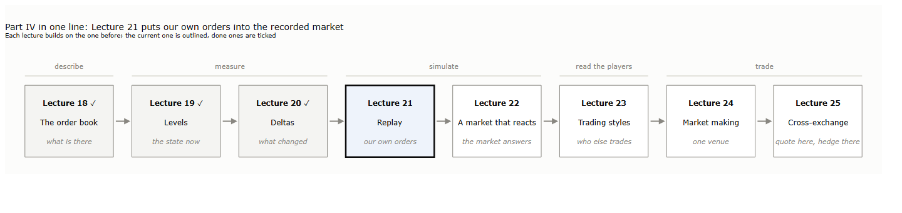
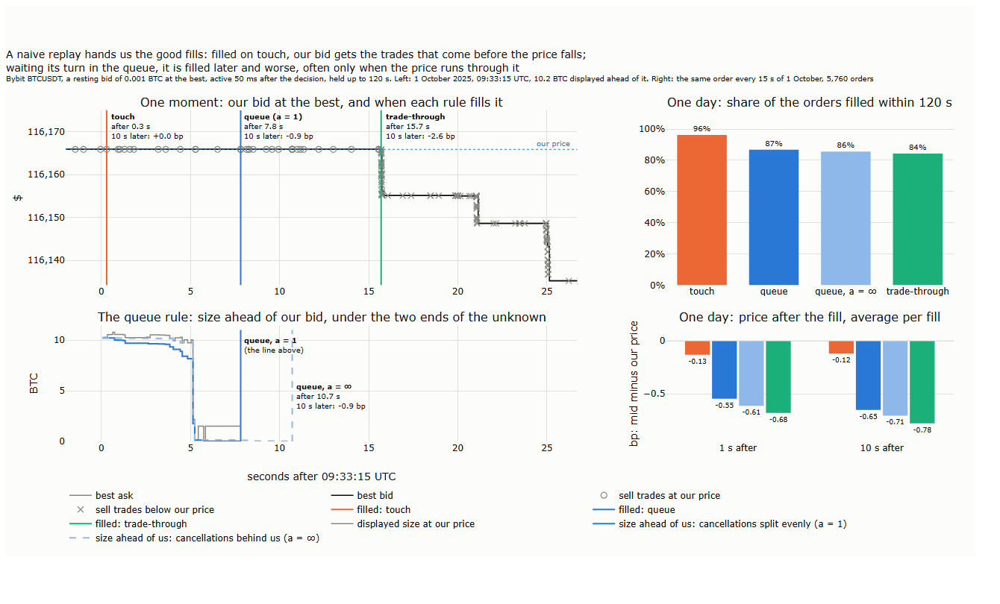
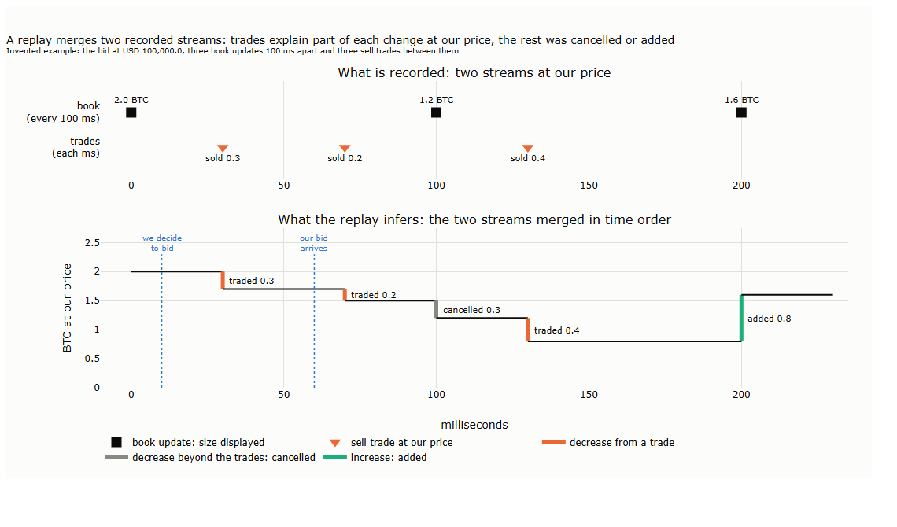
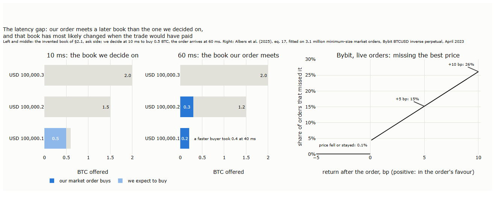
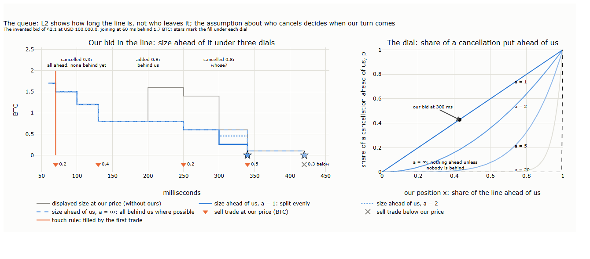
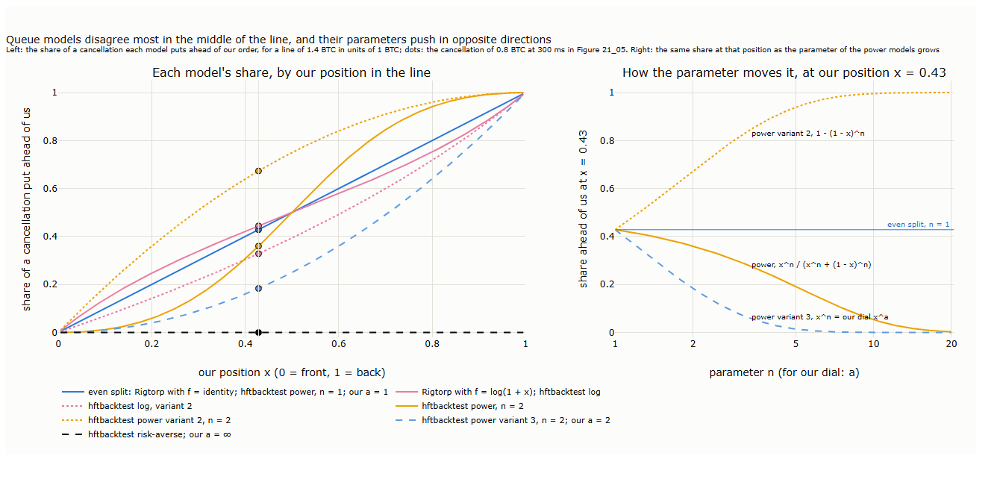
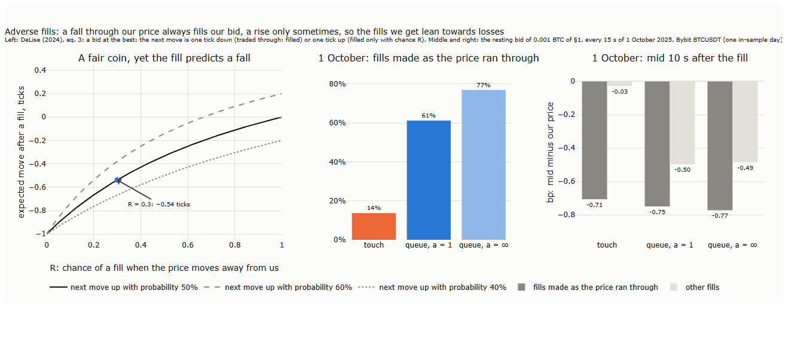
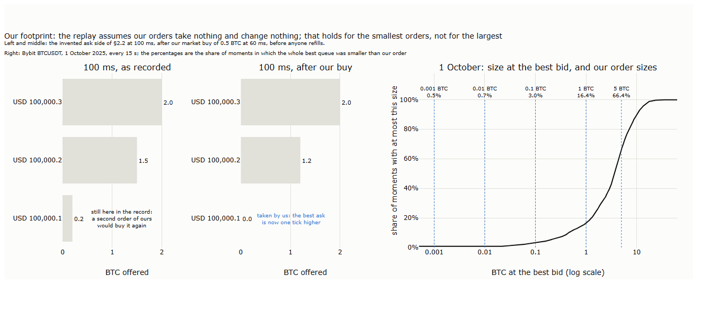
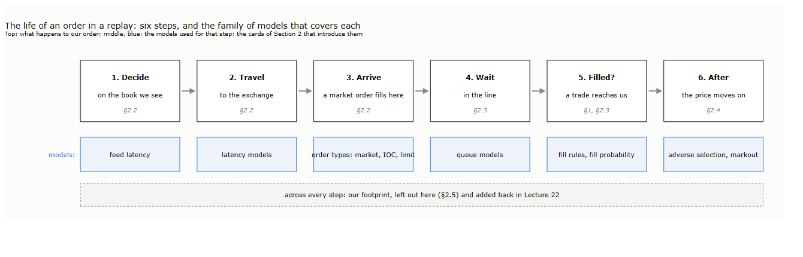
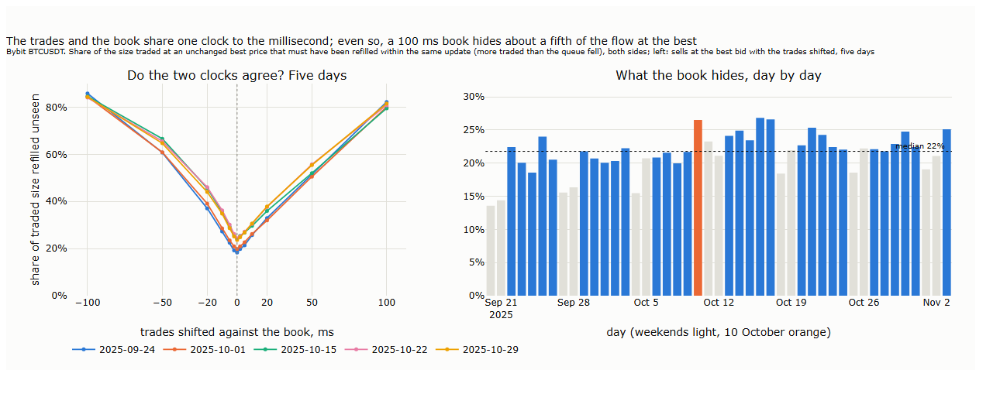

# Lecture 21: Replaying the Exchange: Fill Rules, Queue Position, Latency and Adverse Fills

*Systematic Trading: Lecture Notes (MSc) · Nov 1, 2026 · Max Gnesi*

Lectures 18 to 20 described Bybit's BTCUSDT book, measured its state and measured its flow. This lecture puts our own orders into the recorded market and asks what would have happened to them: when a resting order is filled, at what price a market order is executed, and what the price does afterwards. A replay is only useful if it tells the truth, so the lecture builds one piece by piece and then tests it on the same 45 days, 20 September to 3 November 2025. The hypotheses were fixed before any result was computed ([results/hypotheses.md](results/hypotheses.md)).

*Draft: Sections 1, 2 and 3.1. The rest follows the plan in [results/hypotheses.md](results/hypotheses.md).*

## 1. Three replays of one order

Part IV moves from describing the order book to trading on it, one step per lecture:


<sub><b>How to read the figure.</b> Each box is one lecture of Part IV, each building on the one before; this lecture is outlined, Lectures 18 to 20 are done. Above the boxes, the four stages: describing the book, measuring it, simulating our own orders in it, and trading strategies on it.</sub>

A **replay** runs the recorded book and trades forward in time and inserts hypothetical orders of ours into them. The recorded market does not react to our orders: nobody cancels because our bid appeared, and nobody sells into it because it is there. That reaction is left out on purpose here and is the subject of Lecture 22. A market order in a replay is simple to judge: it trades against the book that stands when it arrives. A resting order is not, because the data never say when it would have been filled. The replay has to supply a **fill rule**, and the three rules in common use give different answers:

| Rule | Our resting bid is filled when | What it assumes |
|---|---|---|
| Touch | the first sell trade occurs at our price | we are first in line at our price |
| Queue | the size that stood ahead of us when we joined has been traded or cancelled, and a sell trade then reaches us | we join at the back of the line; how the cancellations split between ahead of us and behind us is unknown |
| Trade-through | a sell trade occurs below our price | everyone at our price has been filled, us included; Lecture 17's rule |

<sub><b>How to read the table.</b> A sell trade is a trade started by a seller (a taker selling into the bids). The same rules apply to a resting ask with buy trades and prices above. Touch and trade-through need only the trades; the queue rule also needs the size displayed at our price, from the book.</sub>

The idea of the lecture fits in one chart. On the left, one real moment followed under each rule; on the right, the same order placed again and again over one day:


<sub><b>How to read the figure.</b> <b>Axes.</b> Left: time (x); price (top) and size ahead of our bid (bottom); vertical lines = fills. Right: share filled and price after the fill (y), by rule. Bybit BTCUSDT, a resting bid of 0.001 BTC (Bybit's minimum) placed at the best bid; it becomes active 50 ms after the decision and is held up to 120 s, not moved. <b>Left, top:</b> 1 October 2025 from 09:33:15 UTC: the best bid (black) and ask (grey, one tick above), our price (dotted), sell trades at our price (circles) and below it (crosses); a vertical line marks the fill under each rule, labelled with the wait and with the mid 10 s after the fill minus our price, in basis points (bp, hundredths of a percent; 1 bp is about USD 11.6 here). <b>Left, bottom:</b> the size displayed at our price (grey) and the size ahead of us under the queue rule, with cancellations split evenly over the line (dark blue, a = 1) and with every cancellation put behind us where possible (light blue, dashed, a = ∞); vertical lines mark the two queue fills. <b>Right:</b> the same order placed every 15 s over all of 1 October, 5,760 orders. Top, the share filled within 120 s under each rule; bottom, the average over fills of the mid 1 s and 10 s after the fill minus our price, in bp. Below zero means the price fell after our bid was filled. One day of the in-sample period.</sub>

The bid joined at USD 116,165.90 behind 10.2 BTC already displayed there. Four moments decide the story:

| Seconds after 09:33:15 | What happened | Touch | Queue | Trade-through |
|---|---|---|---|---|
| 0.3 | A seller takes 0.003 BTC at our price | **filled** | 10.2 BTC ahead of us | waiting |
| 0.3 to 5.0 | Sellers take 0.26 BTC at our price; some size is cancelled | | ahead: 8.2 BTC (a = 1), 9.7 BTC (a = ∞) | waiting |
| 5.1 to 5.2 | 9.9 BTC is cancelled at our price within two book updates | | ahead: 0.13 BTC (a = 1), 0.16 BTC (a = ∞) | waiting |
| 7.8 and 10.7 | Sellers take 0.05 BTC, then 0.38 BTC at our price | | **filled** at 7.8 s (a = 1), at 10.7 s (a = ∞) | waiting |
| 15.7 | A seller trades below our price | | | **filled** |

<sub><b>How to read the table.</b> One row per event that moves our order; "ahead" is the size in front of our bid under the queue rule, for the two ends of the unknown split of cancellations. Ten seconds after the trade-through, the best bid stood USD 30.7 below our price.</sub>

Under the touch rule the order was filled within a third of a second by the first small seller, at a moment when the price had not moved; the 10.2 BTC ahead of us would in fact have been filled first. Under the queue rule it waited until the line in front of it had gone, and was filled 5 to 8 seconds before the price fell through its level. Under trade-through it was filled only as the fall began, and 10 seconds later the mid was 2.6 bp below its price. The same order, in the same recorded market, earned a 10-second markout of 0.0 bp, −0.9 bp or −2.6 bp, depending only on the rule the replay used.

The moment also shows what the queue rule cannot know. The book reports how much is displayed at our price, not whose orders left. When 9.9 BTC vanished at 5.1 seconds, the rule had to decide how much of it stood ahead of us. Here the answer hardly mattered: only 0.3 BTC stood behind us, so at least 9.6 BTC of the cancelled size must have been ahead, whatever the split. In calmer moments the split decides how long we wait, which is why the lecture carries both ends of it, and the values between, through every result (hypothesis H3).

Over the whole day the picture is the same, and it explains why the naive rule flatters:

| Rule | Filled within 120 s | Median wait (filled orders) | Mid 1 s after, bp | Mid 10 s after, bp | Fills that came only when the price ran through |
|---|---|---|---|---|---|
| Touch | 96% | 0.6 s | −0.13 | −0.12 | |
| Queue, a = 1 | 87% | 5.5 s | −0.55 | −0.65 | 61% |
| Queue, a = ∞ | 86% | 6.1 s | −0.61 | −0.71 | 77% |
| Trade-through | 84% | 6.8 s | −0.68 | −0.78 | 100% |

<sub><b>How to read the table.</b> The order of the figure, placed every 15 s on 1 October 2025, 5,760 orders. "Mid 1 s after" and "Mid 10 s after": the average over fills of the mid 1 s or 10 s after the fill minus our price, in bp; the bid starts half a tick (0.004 bp) above zero, so values near zero mean the price did not move. Last column: the share of the queue rule's fills that came at the trade-through itself, because the line had not been used up before. The fee is not included. Our calculation for these notes.</sub>

The touch rule fills almost every order and quickly, and its fills see the price barely move. The rules that respect the line fill a few orders fewer, later and at worse prices, and most of their fills come only when the price runs through the level. The fills the touch rule adds are the good ones: a seller arrived while the line was long and the price stable. A replay that uses it reports fills a real order at the back of the line would not have had. Lalor and Swishchuk (2024) make the same point for futures: simulations that assume every fill is non-adverse and at the front of the queue are "over-inflated".

Two cautions keep the chart in proportion. First, it is one day of the in-sample period, and the order is held rather than re-posted, so it shows the mechanism, not a result; whether the touch rule flatters out of sample, with the test order of Section 4, is hypothesis H1. Second, all three rules leave out two things that act on a real order: the time our order needs to reach the exchange, during which the book changes, and the market's reaction to our order itself. The first is part of this lecture; the second is Lecture 22.

This lecture runs as follows:

| § | Step | Question |
|---|---|---|
| 1 | Three replays of one order | Does the fill rule change what a replay reports? |
| 2 | The pieces of the puzzle | What is a replay made of: the latency gap, the queue, adverse fills, our footprint, and the families of models used for each? |
| 3 | The replay on our data | How are trades ordered against the book, how does a market order walk the book after a delay, and how is a resting order's place in the line tracked? |
| 4 | Does the replay tell the truth? | Hypotheses H1 to H9: do the naive rules flatter, are trade-through fills the bad ones, does the unknown split decide the answer, is the replay kinder than real fills, and up to what order size does it hold? |
| 5 | 10 October | What would the replay have done to our orders in the cascade? |
| 6 | Summary, exercises and reading | |

## 2. The pieces of the puzzle

Section 1 showed that one choice, the fill rule, changes what a replay reports. A replay rests on several such choices, and this section lays them out before any of them is measured. Each piece gets the same card: the key message, how it is computed, an invented example and what it misses. The examples share one invented book, so each card adds to the last; Section 3 builds the same pieces on our data.

| § | Piece | The question it answers | Built on our data in |
|---|---|---|---|
| 2.1 | What a replay is | What do the recorded data say, and what must a replay infer? | §3.1 |
| 2.2 | The latency gap | What changes between the moment we decide and the moment our order arrives? | §3.2 |
| 2.3 | The queue | How much stands ahead of our resting order, and when does our turn come? | §3.3 |
| 2.4 | Adverse fills | Why are the fills we do get the worse ones? | §3.4 |
| 2.5 | Our footprint | What does a replay leave out on purpose? | Lecture 22 |
| 2.6 | The models side by side | Which families of models exist for each piece, and where is each used? | |

### 2.1 What a replay is

**Key message.** A replay runs the recorded book and trades forward in one time order and inserts our orders into them. Part of what it needs is recorded; the rest, such as how much was cancelled at our price, it must infer. And the recorded market never responds to our orders.

| Step | Calculation | Financial meaning |
|---|---|---|
| 1 | Merge the two recorded streams in time order: the book updates (every 100 ms on Bybit's feed of 200 levels, Lecture 18) and the trades (to the millisecond) | One clock for everything that happened at our price |
| 2 | Between two book updates, every trade at our price lowers the size there by its own size | The part of the change we know: it was filled |
| 3 | At the next update, the change beyond those trades: a decrease was cancelled, an increase was added | The part we infer: the book shows how much is there, not who came or left |
| 4 | Our order, decided at time $`t`$, becomes active at $`t + L`$ and meets what stands then | $`L`$ is the latency: the time our order needs to reach the matching engine (§2.2) |
| 5 | Our resting order is filled by the recorded trades, under a fill rule (§1); the recorded streams themselves stay as they were | Non-reactive: nobody responds to our order, and our fills take nothing out of the recorded book (§2.5) |

<sub><b>How to read the table.</b> Steps 1 to 3 rebuild what happened at one price; steps 4 and 5 add our order. The book's clock is the matching engine's time (cts, Lecture 18); trades between two updates are applied before the update, the event order fixed in [results/hypotheses.md](results/hypotheses.md).</sub>


<sub><b>How to read the figure.</b> <b>Axes.</b> Time in ms (x). Top: what is recorded. Bottom: size at our price (y), coloured by cause. An invented bid at USD 100,000.0. <b>Top:</b> what is recorded: the book, every 100 ms, reports the size displayed at that price (squares); the trades, to the millisecond, report each sale at that price (triangles). <b>Bottom:</b> the size at that price as the replay infers it, with each change coloured by its cause: a trade (orange), a decrease beyond the trades, counted as cancelled (grey), an increase, counted as added (green). Dotted: a bid of ours decided at 10 ms and arriving 50 ms later.</sub>

Between the first two updates the displayed size fell from 2.0 to 1.2 BTC. Trades account for 0.5 of it, 0.3 and then 0.2, so the replay counts the other 0.3 as cancelled. Between the next two, 0.4 BTC was sold and yet the size rose from 1.2 to 1.6: 0.8 was added. Our bid, decided at 10 ms, arrives at 60 ms. The last book the replay has seen still reports 2.0 BTC, but 0.3 has been sold since, so 1.7 BTC stands ahead of our bid when it joins.

**Net, not gross.** The book reports only the net change between two updates. The 0.8 BTC added could have been 1.0 added and 0.2 cancelled, or an order placed and withdrawn twice; a replay built on 100 ms updates cannot tell. Lecture 18 (§4.4) met the same blind spot from the other side: a tenth of the trades happened at prices that the book of up to 100 ms earlier never showed, orders that arrived and were filled between two updates.

**What it misses.** First, the gross flow inside each update, as above. Second, who cancelled: the book says that 0.3 BTC left the price, not whether it stood ahead of our bid or behind it; §2.3 shows why that matters. Third, the exact order of events within the same millisecond, and any difference between the clocks of the two streams, such as Bybit's publish delay (Lecture 19, §4). Fourth, our footprint: in the replay our bid takes part in no trade's record, and its presence changes nobody's behaviour (§2.5).

### 2.2 The latency gap

**Key message.** Our order meets a later book than the one we decided on. In that gap faster traders act, and they act most when the price is about to move: the trades we miss are disproportionately the ones that would have paid.

| Step | Calculation | Financial meaning |
|---|---|---|
| 1 | The book we decide on was published at the last update and reached us after a delay | Feed latency: our picture is already old when we look at it |
| 2 | An order decided at $`t`$ reaches the matching engine at $`t + L`$ | Order-entry latency $`L`$: the time it takes to get our decision to the exchange |
| 3 | A market order walks the book that stands at $`t + L`$; slippage = the average price expected from the book seen at $`t`$ minus the average price paid (for a buy) | The cost of the gap for an order that must be filled |
| 4 | A limit order at the best price seen at $`t`$ (immediate-or-cancel) takes only what stands at that price at $`t + L`$; the rest is not filled | The gap as missed trades, for an order that must not pay more |
| 5 | A cancellation also takes $`L`$ to arrive: a resting order can be filled after we decided to withdraw it | The gap for a resting order: a stale quote picked off |

<sub><b>How to read the table.</b> Steps 1 and 2 add up to the gap between the book we saw and the book our order meets. Steps 3 to 5 are its cost for the three kinds of order of this lecture. A replay applies them by evaluating every order of ours against the recorded book at $`t + L`$, never at $`t`$.</sub>


<sub><b>How to read the figure.</b> <b>Axes.</b> Left and middle: size (x) at each ask price (y). Right: share of orders that missed (y), by the later return (x). <b>Left and middle:</b> the ask side of the invented book of §2.1, best three levels. At 10 ms we decide to buy 0.5 BTC on the book last seen (light blue: what we expect to buy); a faster buyer takes 0.4 BTC at the best ask at 40 ms; our order arrives at 60 ms and buys what stands then (dark blue). Grey: size left in the book. <b>Right:</b> from Albers, Cucuringu, Howison and Shestopaloff (2025), eq. 17 with their Table 6: the share of their own minimum-size market orders on Bybit that could not be filled at the best ask or bid they had seen, against the return over the next ten trigger events of their experiment (a median of 1.14 s), positive when the price moved in the order's favour.</sub>

On the book we saw, 0.6 BTC was offered at USD 100,000.1, enough for our 0.5 at one price. By the time our order arrived, a faster buyer had taken 0.4 of it. A market order still gets its 0.5 BTC, 0.2 at USD 100,000.1 and 0.3 one tick higher, an average of USD 100,000.16 instead of 100,000.1. A limit order at USD 100,000.1 pays no more, but buys only 0.2 BTC. Suppose the faster buyer was right and the ask stands at USD 100,000.6 a second later: the 0.3 BTC the limit order missed is exactly the part that would have earned most.

**A limit order that misses stays in the book.** A plain limit order, unlike an immediate-or-cancel order, is not cancelled when it cannot be filled at once: the part that finds nothing at its price becomes a resting order, with all the questions of §2.3 and §2.4. In the example, a limit buy of 0.5 BTC at USD 100,000.1 buys the 0.2 BTC still offered there and leaves 0.3 BTC resting at USD 100,000.1. The ask there is gone, so the bid becomes the new best bid, alone at the front of its line. If the faster buyer was right and the price rises, the bid is left behind unfilled: we missed the move. If the price comes back down, a seller fills it at once, just when buying was wrong. The order we meant as a trade has turned into a quote, and its fills lean towards the bad ones (§2.4). A replay must therefore know the type of every order: a market order walks the book at $`t + L`$; an immediate-or-cancel order takes what stands at its price and drops the rest; a limit order takes what stands and rests with the remainder, joining the line at its price from $`t + L`$ on. How often our marketable limit orders end up resting, and what their remainders earn, is measured in Section 3, by size.

**Good orders fail.** Albers et al. (2025) measured this live: 3.1 million market orders of the minimum size on Bybit's inverse BTCUSD perpetual in April 2023, sent from a server close to the exchange, each one compared with the best price it had seen. Overall 1.35% could not be filled at that price. When the price then fell or stayed, almost none failed (0.09%); as soon as it rose in the order's favour, the share jumped to 4.2% and grew by 2.2 percentage points per basis point of return: 15% at +5 bp, 26% at +10 bp. Failures were also more frequent in volatile hours. A backtest that fills every order at the price seen at the decision is therefore wrong in a biased way: it keeps the trades that paid and that, in reality, others took first.

**What it misses.** First, $`L`$ itself: it differs by trader, connection and moment, and it rises in busy markets, exactly when it matters; the replay takes it as a fixed parameter and reports results at 10, 50 and 100 ms. Second, the race: the recorded trades show who won each race, not who else was racing. In the replay, our order arrives after every recorded trade that happened before $`t + L`$, even if in reality we might have been faster. Third, the recorded book at $`t + L`$ is itself known only to the last update plus the trades since (§2.1). Fourth, Albers et al.'s numbers come from a different contract (inverse, priced in USD with a 0.5 USD tick) and from 2023; on our data the replay can show the mechanism but cannot measure true failure rates, which only live orders reveal.

### 2.3 The queue

**Key message.** A resting order is filled only when everything ahead of it at its price has traded or left. The book shows how long the line is, not who leaves it, so a replay must assume how cancellations split between ahead of us and behind us. One dial, $`a`$, spans the assumptions, from an even split to "never ahead of us".

Lecture 19 (§2.4) introduced the line and showed that L2 data cannot say whose order was cancelled. This card turns the line into the queue rule of §1.

| Step | Calculation | Financial meaning |
|---|---|---|
| 1 | When our order arrives, the size ahead of it is the size displayed at our price: the last update minus the trades since (§2.1) | We join at the back: everyone already there was first |
| 2 | A sell trade of size $`s`$ at our price: if $`s`$ is larger than the size ahead, we are filled; otherwise the size ahead falls by $`s`$ | Trades serve the line from the front |
| 3 | A cancellation of size $`c`$ at our price (§2.1, step 3): the size ahead falls by $`p \cdot c`$, with $`p = x^a`$ and $`x`$ = ahead / (ahead + behind); never more is taken from behind us than stands there | Someone left the line; $`p`$ is the share assumed to have stood in front of us |
| 4 | An increase at our price joins behind us | Later arrivals queue after us |
| 5 | A sell trade below our price fills whatever is left of our order | The whole line at our price has been served |

<sub><b>How to read the table.</b> $`x`$ is our position in the line, the share of the displayed size that stands ahead of us: 1 at the back, 0 at the front. The dial $`a`$ sets $`p`$: $`a = 1`$ splits a cancellation in proportion to the size on each side, as if every unit of size were equally likely to leave; a larger $`a`$ puts more of it behind us; $`a = \infty`$ puts none ahead unless nobody stands behind us, the "risk-averse" model of hftbacktest. Our results use $`a`$ = 1, 2, 5, 20 and ∞ (hypothesis H3).</sub>


<sub><b>How to read the figure.</b> <b>Axes.</b> Left: time (x), size ahead of us (y), one line per dial. Right: share of a cancellation put ahead of us (y), by our place in the line (x). <b>Left:</b> the bid of §2.1 at USD 100,000.0 joins at 60 ms behind 1.7 BTC, and the invented book runs on to 420 ms. Grey: the size displayed at our price, without our order; blue lines: the size ahead of our bid, under $`a = 1`$ (solid), $`a = 2`$ (dotted) and $`a = \infty`$ (dashed); stars: our fill under each; orange line: the touch rule's fill. Triangles: sell trades at our price, with their size; cross: a sell below our price. <b>Right:</b> $`p = x^a`$ against $`x`$ for $`a`$ = 1, 2, 5 and 20, and $`a = \infty`$ (dashed); the dot marks our bid at 300 ms.</sub>

Until 200 ms the dial plays no part. The cancellation at 100 ms happened before anyone joined behind us, so all of it stood ahead; trades then shorten the line from 1.7 to 0.8 BTC. At 200 ms, 0.8 BTC joins behind us. At 300 ms, 0.8 BTC is cancelled, and now the answer depends on the dial: with 0.6 BTC ahead and 0.8 behind, $`x = 0.43`$.

| Dial | Share of the 0.8 BTC put ahead of us | Size ahead after 300 ms | Filled |
|---|---|---|---|
| Touch rule (no line) | | | at 70 ms, by the first sell of 0.2 BTC |
| $`a = 1`$ | 43% | 0.26 BTC | at 340 ms, by the sell of 0.5 BTC |
| $`a = 2`$ | 18% | 0.45 BTC | at 340 ms, by the sell of 0.5 BTC |
| $`a = \infty`$ | 0% | 0.60 BTC | at 420 ms, when the price runs through |

<sub><b>How to read the table.</b> The invented example of the figure. Under $`a = \infty`$ the sell of 0.5 BTC at 340 ms leaves 0.1 BTC ahead of us, and our turn never comes before the price moves through our level.</sub>

The touch rule fills the bid 270 ms before any version of the line would, while 1.7 BTC still stood in front of it. Among the queue rules, the dial moves the fill from a trade at our price to the moment the price runs through it: the same order becomes a fill at a stable price or a fill just before a fall (§2.4).

**The models in the literature.** Every queue model for L2 data answers the same question as our dial: when the size at our price falls by more than was traded, how much of the cancellation stood ahead of us? The published models differ only in that answer, and they span a wide range:

| Model | Share of a cancellation put ahead of us | Leaning | On the cancellation at 300 ms: share ahead, size ahead after |
|---|---|---|---|
| Rigtorp (2013), $`f`$ = identity; hftbacktest power, $`n = 1`$; our $`a = 1`$ | $`\frac{\text{ahead}}{\text{ahead} + \text{behind}} = x`$ | even | 43%, 0.26 BTC |
| Rigtorp (2013), $`f = \ln(1 + \cdot)`$; hftbacktest log | $`\frac{\ln(1 + \text{ahead})}{\ln(1 + \text{ahead}) + \ln(1 + \text{behind})}`$ | towards the shorter side; depends on the unit of size | 44%, 0.25 BTC |
| hftbacktest log, variant 2 | $`1 - \frac{\ln(1 + \text{behind})}{\ln(1 + \text{ahead} + \text{behind})}`$ | behind us; depends on the unit | 33%, 0.34 BTC |
| hftbacktest power, $`n = 2`$ | $`\frac{x^2}{x^2 + (1 - x)^2}`$ | towards the longer side | 36%, 0.31 BTC |
| hftbacktest power, variant 2, $`n = 2`$ | $`1 - (1 - x)^2`$ | ahead of us | 67%, 0.06 BTC |
| hftbacktest power, variant 3, $`n = 2`$; our $`a = 2`$ | $`x^2`$ | behind us | 18%, 0.45 BTC |
| hftbacktest risk-averse; our $`a = \infty`$ | 0, unless nobody stands behind us | all behind us | 0%, 0.60 BTC |

<sub><b>How to read the table.</b> Ahead and behind: the size in the line in front of our order and after it, in BTC; $`x`$ = ahead / (ahead + behind), our position (0 at the front, 1 at the back). Rigtorp (2013) writes the share ahead as $`p = f(\text{ahead}) / (f(\text{ahead}) + f(\text{behind}))`$ with $`f`$ any increasing function, naming the identity and $`\ln(1 + x)`$. hftbacktest (queue.rs) writes the share behind, $`1 - p`$; its power functions are $`f(x) = x^n`$, its variants 2 and 3 normalise differently. hftbacktest, like our replay, takes the excess from ahead of us when a cancellation is larger than the size behind, and never lets the size ahead exceed the size displayed; Rigtorp (2013) states no such rule. Last column: the cancellation of 0.8 BTC at 300 ms in Figure 21_05, with 0.6 BTC ahead and 0.8 behind.</sub>


<sub><b>How to read the figure.</b> <b>Axes.</b> Left: share of a cancellation put ahead of us (y), by our place in the line (x), one curve per model. Right: the same share (y) as the parameter grows (x). <b>Left:</b> for a line of 1.4 BTC counted in BTC, the share of a cancellation each model of the table puts ahead of our order, against our position $`x`$. Lines above the even split (blue) let our order advance faster than an even split; lines below hold it back. The dots mark the cancellation at 300 ms of Figure 21_05. <b>Right:</b> at that position, $`x = 0.43`$, the share ahead under the three power models as their parameter $`n`$ grows from 1 to 20 (log scale); for our dial, $`n`$ is $`a`$.</sub>

On the same cancellation the models leave between 0.06 and 0.60 BTC ahead of our order, a factor of ten. What separates them is their leaning: an even split; towards whichever side of us is longer (hftbacktest power) or shorter (log); towards the front, which is optimistic for us (power variant 2); or towards the back, which is cautious (power variant 3 and risk-averse).

**How the parameters move the split.** Each family has one parameter, and in each it does something different:

- **Our dial $`a`$, the same as $`n`$ in hftbacktest's power variant 3.** The share ahead is $`x^a`$. Raising $`a`$ means assuming that cancellations come more and more from the late arrivals behind us: at our position $`x = 0.43`$, the share ahead falls from 43% ($`a = 1`$) to 18% ($`a = 2`$), 1.5% ($`a = 5`$) and practically 0 ($`a = 20`$). The effect is strongest near the front of the line; near the back every value of $`a`$ puts almost everything ahead of us, because almost nobody stands behind.
- **$`n`$ in hftbacktest's power model, $`x^n / (x^n + (1 - x)^n)`$.** Raising $`n`$ hands the cancellation to whichever side of us is longer, as if cancellations came from large groups out of proportion to their size. With more size behind us than ahead, as here, it falls from 43% to 36%, 19% and 0.3% for $`n`$ = 1, 2, 5 and 20; with more ahead it would rise instead. The split is even only when we stand in the middle.
- **$`n`$ in hftbacktest's power variant 2, $`1 - (1 - x)^n`$.** Raising $`n`$ puts more of every cancellation ahead of us: 43%, 67%, 94% and 100%. This is the optimistic direction, and the one the evidence below argues against.
- **The unit of size, in the log models.** $`\ln(1 + x)`$ has no parameter, but it is not proportional, so the answer depends on whether size is counted in BTC, in thousandths of a BTC or in contracts. The unit is a hidden parameter:

| Size counted in | Rigtorp, log; hftbacktest log | hftbacktest log, variant 2 |
|---|---|---|
| 10 BTC | 43% | 41% |
| 1 BTC | 44% | 33% |
| 0.01 BTC | 48% | 11% |
| 0.001 BTC, Bybit's minimum order | 49% | 8% |

<sub><b>How to read the table.</b> The share of the cancellation at 300 ms put ahead of our order (0.6 BTC ahead, 0.8 behind, $`x = 0.43`$) by the two log models, with size counted in different units. For comparison, the even split puts 43% ahead at any unit.</sub>

In small units, the first log model puts about half of every cancellation ahead of us wherever we stand (41% at $`x = 0.1`$, 59% at $`x = 0.9`$, counted in 0.001 BTC), and variant 2 puts almost none. Rigtorp suggests the log as an example, not a recommendation, and the unit should be chosen deliberately or the model avoided.

**Reading the code.** hftbacktest's documentation describes its queue models in words; the formulas are only in its source. We took them from the file that implements the models, [`hftbacktest/src/backtest/models/queue.rs`](https://github.com/nkaz001/hftbacktest/blob/master/hftbacktest/src/backtest/models/queue.rs), read on 2 November 2026, and translated each line into the notation of this card. When the size displayed at our price changes, the probabilistic models run these lines (Rust):

```rust
let mut chg = prev_qty - new_qty;      // how much the level fell since the last update
chg -= q.cum_trade_qty;                // minus what was traded there: the rest was cancelled
let front = q.front_q_qty;             // size ahead of our order
let back = prev_qty - front;           // size behind it
let mut prob = self.prob.prob(front, back);
let est_front = front - (1.0 - prob) * chg + (back - prob * chg).min(0.0);
q.front_q_qty = est_front.min(new_qty);
```

| Line | What it does | In this card |
|---|---|---|
| `chg = prev_qty - new_qty - cum_trade_qty` | The decrease of the level beyond the trades | The cancellation $`c`$ of §2.1, step 3 |
| `front`, `back` | Size ahead of and behind our order | ahead, behind; $`x`$ = front / (front + back) |
| `prob` | The share of the cancellation assumed to be **behind** us; the documentation: "the probability of a decrease behind the order's queue position" | $`1 - p`$: hftbacktest counts the other way round |
| `front - (1.0 - prob) * chg` | The size ahead loses its share of the cancellation | ahead − $`p \cdot c`$ |
| `+ (back - prob * chg).min(0.0)` | If more is assigned behind us than stands there, the excess comes from ahead | "never more is taken from behind us than stands there" |
| `.min(new_qty)` | The size ahead never exceeds the size displayed | the same |

<sub><b>How to read the table.</b> Each probabilistic model differs only in `prob`. For the power model, `f(back) / (f(back) + f(front))` with `f(x) = x^n`; for variant 3, `1.0 - f(front / (front + back))`, which makes the share ahead $`x^n`$, our dial. The risk-averse model replaces all of it with `front = front.min(new_qty)`: a cancellation moves us only if the level falls below the size ahead of us. A trade at our price runs `front -= qty`, and our order is filled once `front` is negative. One detail differs from our rule: `back` is computed from `prev_qty`, the level at the last update, which still contains the size traded since; the check below shows that this is the only difference.</sub>

Reading the source rather than the description matters for a replay. The documentation of a tool says what its authors meant; the code says what it does, and a backtest's results come from the code. Here it showed a convention we would otherwise have reversed (`prob` is the share behind us, not ahead) and a detail the documentation does not mention (the size behind measured before the trades).

**Do we reproduce them?** We use three of the models and checked our code against their published rules on 3,000 random sequences of trades and book updates. Our $`a = 1`$ gives the same fill as Rigtorp's rule with $`f`$ = identity in every sequence, and our $`a = \infty`$ the same as hftbacktest's risk-averse model. Our $`x^a`$ is the formula of hftbacktest's power variant 3, and gives the same fill except in 1.8% of the sequences at $`n = 1`$ (0.6% at $`n = 2`$). The difference is one detail of hftbacktest's code: it measures the size behind us from the level before the trades since the last update, so size already traded still counts as behind us. Measured after the trades, as Rigtorp and we do, the two agree in every sequence. The check is our calculation for these notes.

**Which is right?** None of these formulas is derived from the behaviour of traders; each is a convenient shape, and Rigtorp (2013) recommends estimating $`f`$ from one's own fills. Evidence comes only from order-by-order data. Databento (2025) used such data for CME's E-mini S&P 500 future and concluded: "It's evident that cancels are mostly pulled from the back of the queue." They describe the bias with one parameter, from no bias towards a strong pull from the back; the formula in their example code is not legible on the page we read, so we quote only their conclusion. One reason for the back, an argument rather than a measurement: an order that has just joined has the least to lose by leaving, while an order near the front is about to be filled. On Bybit we cannot measure the leaning (no order-by-order data), so the lecture spans it with the dial $`a`$ from 1 to ∞, from the even split to the risk-averse model, and reports whether the answer changes inside that range (hypothesis H3); the models that lean ahead of us, against that evidence, are left out.

**What it misses.** First, the truth: which orders were cancelled is recorded only in order-by-order (L3) data, which Bybit does not publish (Lecture 18, §2), so on our data the dial can be varied but not measured. Second, the split may depend on more than our position: on how long the line is, on how fast the price is moving, on the hour (Lecture 19, §3.7). Third, everything inside one 100 ms update (§2.1): a large order that joins and leaves within it is never seen. Fourth, our own order is not in the displayed size, so the line behind us is the size added after we joined, not including us; for an order of 0.001 BTC this changes nothing, for 5 BTC it does (§2.5).

### 2.4 Adverse fills

**Key message.** A resting order is not filled at random moments. When the price runs through it, it is filled for certain; when the price moves away, it is filled only if a counterparty reaches it first. So the fills an order gets lean towards those followed by a loss, even in a market with no trend. A replay that fills too easily, like the touch rule, hides this.

| Step | Calculation | Financial meaning |
|---|---|---|
| 1 | A fill is **adverse** if, in the interval in which it happens, the best price on our side moves through our level (for a bid: below it); otherwise it is non-adverse | Adverse: we bought just as the price fell through us |
| 2 | A move through our level fills us with certainty | A price cannot pass a resting order without filling it |
| 3 | A move away fills us only with a chance $`R`$ | Someone must sell to us before the price leaves |
| 4 | Expected move after a fill, in ticks: $`E[d \mid \text{fill}] = \dfrac{R \cdot P(U) - P(D)}{P(D) + R \cdot P(U)}`$ | Negative whenever $`R < 1`$ and the market has no trend: the fill itself is bad news |
| 5 | Report the markout of adverse and non-adverse fills separately (hypothesis H2) | Whether the replay's fills are the bad ones, and by how much |

<sub><b>How to read the table.</b> Steps 2 to 4 are the model of DeLise (2024), eq. 3, for a bid at the best: the next move of the price is one tick down with probability $`P(D)`$, which trades through our bid and fills it, or one tick up with probability $`P(U)`$, in which case we are filled only with chance $`R`$. $`d`$ is the move after the fill: −1 tick after a down move, +1 after an up move. Lalor and Swishchuk (2024) define adverse fills the same way in spirit: the first change in the value of the position after the fill is negative. Our definition of step 1 is the one fixed in [results/hypotheses.md](results/hypotheses.md).</sub>


<sub><b>How to read the figure.</b> <b>Axes.</b> Left: move after a fill (y), by fill chance R (x). Middle: share of fills as the price ran through (y). Right: price 10 s after the fill (y), by rule. <b>Left:</b> DeLise's formula of step 4 against $`R`$, for a next move up with probability 50% (black), 60% and 40% (grey); at $`R = 1`$, every touch is a fill and the bias vanishes. <b>Middle and right:</b> the resting bid of 0.001 BTC of §1, every 15 s of 1 October 2025. Middle: the share of each rule's fills that came at the very trade that took the price through our level. Right: the mid 10 s after those fills (dark) and after the others (light), minus our price, in bp. One in-sample day, before the maker fee.</sub>

Take a fair coin: the price is as likely to tick up as down, so it has no drift. If our bid is filled on every down move and on only 30% of up moves, then of every 100 moves, 50 down moves and 15 up moves fill us. The average move after a fill is (15 − 50) / 65 = −0.54 ticks, although the price itself has no trend. The fill is evidence about what happens next.

The running example shows the three cases. The touch rule filled our bid at 70 ms, while the price was steady: non-adverse. With $`a = 1`$, it was filled at 340 ms by a trade at our price: non-adverse by the definition, yet 80 ms before the price ran through. With $`a = \infty`$, it was filled at 420 ms, by the trade below our price: adverse.

On the day of §1 the same picture appears in real data. The touch rule's fills were mostly non-adverse, and the price hardly moved after them. Most of the queue rule's fills came only when the price ran through, and those lost about 0.75 bp in 10 s. Its other fills lost too, about 0.5 bp: they came just before the fall, like the fill at 340 ms. Whether this holds out of sample is hypothesis H2.

**What others measured.** The effect is known from live and recorded orders:

| Study | Market and data | Result |
|---|---|---|
| DeLise (2024) | US 10-year Treasury note future, one day of 2023, 100 fills | Move after a fill: −0.48 ticks predicted by the formula, −0.45 measured |
| Lalor and Swishchuk (2024) | Four CME futures (E-mini S&P 500, E-mini Nasdaq-100, crude oil, 10-year note), one day each of 2024, simulated live orders | Share of fills that were adverse: 66% to 89% |
| Albers et al. (arXiv 2502.18625) | Binance BTCUSDT perpetual, live minimum-size orders at the best, one week of 2024 | Fills more likely before an adverse move; 1-s markout from −0.06 bp (front of a short line) to −1.16 bp (back of long lines) |

<sub><b>How to read the table.</b> Lalor and Swishchuk's shares are our computation from their Table 2: 81.5% (E-mini S&P 500), 65.8% (E-mini Nasdaq-100), 82.9% (crude oil), 88.8% (10-year note). Lalor and Swishchuk also show that simulations which treat every fill as non-adverse and at the front of the line are "over-inflated".</sub>

**What it misses.** First, the definition depends on the interval: a fill just before the price runs through counts as non-adverse, as at 340 ms, so the split understates how bad fills are. Second, size: the formula counts one tick, while a fill before a large fall loses more. Third, $`R`$ is not a constant: it depends on our place in the line (§2.3), on the hour (Lecture 19, §3.7) and on the market. Fourth, scale: Bybit's base maker fee is 0.02%, 2 bp per fill (Lecture 19, §2.5), larger than every markout in the figure, so the sign of a maker's result is decided by fees, rebates and these fractions of a basis point together.

### 2.5 Our footprint

**Key message.** A replay assumes that our orders take nothing from the recorded market and change nobody's behaviour. For the smallest orders this is close to true. As our size grows towards the size of the queues, it fails, and in a direction that flatters us. This lecture measures where it starts to fail; Lecture 22 adds the footprint back.

| Step | What the replay leaves out | Financial meaning |
|---|---|---|
| 1 | What our market order took is still in the recorded book afterwards | Liquidity counted twice: a second order of ours, or a later trader in the record, finds it again |
| 2 | A recorded trade that fills our resting order also filled the recorded orders it filled in reality | Our fill is added to the record, not taken from someone in it |
| 3 | Our trades do not move the recorded price | Impact (Lecture 20, §3.2): a large order pushes the price, and the push fades only slowly |
| 4 | Nobody reacts to our resting size | A large bid can draw sellers to it, or scare others into cancelling or moving ahead (hypothesis H8) |
| 5 | Our trades trigger no further trading | Most trading reacts to trading (Lecture 20, §3.4), and ours would too |

<sub><b>How to read the table.</b> Each step is a way in which the real market would differ from the record if our order had been there. Steps 1 and 2 are mechanical and could be added by bookkeeping; steps 3 to 5 are behaviour and must be measured on other people's orders.</sub>


<sub><b>How to read the figure.</b> <b>Axes.</b> Left and middle: size (x) at each ask price (y). Right: share of moments (y) with at most a given best queue (x, log); dotted = our sizes. <b>Left and middle:</b> the ask side of the invented book of §2.2 at 100 ms. Left, as recorded: what the replay uses. Middle, as it would stand after our market buy of 0.5 BTC at 60 ms, if nobody refilled. <b>Right:</b> Bybit BTCUSDT, 1 October 2025: the size displayed at the best bid at each of the 5,760 moments of §1, as a cumulative share (log scale); dotted lines mark the lecture's order sizes, labelled with the share of moments in which the whole best queue was smaller than the order.</sub>

In the record, 0.2 BTC still stands at USD 100,000.1 at 100 ms; our buy at 60 ms took it. A second buy of ours at 80 ms would be filled from it again, and a buyer in the record who took it at 90 ms would, in reality, have found the best ask a tick higher. One order of 0.5 BTC in a book of a few BTC is enough to make the record wrong about what stood there afterwards.

The scale decides how much this matters. On 1 October the median queue at the best bid was 3.7 BTC:

| Our order | Against the median best queue | Moments the whole best queue was smaller than our order |
|---|---|---|
| 0.001 BTC | 0.03% | 0.5% |
| 0.01 BTC | 0.3% | 0.7% |
| 0.1 BTC | 3% | 3% |
| 1 BTC | 27% | 16% |
| 5 BTC | 137% | 66% |

<sub><b>How to read the table.</b> Our calculation for 1 October 2025, the size displayed at the best bid every 15 s; one in-sample day. The orders of 0.001 BTC are Bybit's minimum and the size of the test order of H1 to H4.</sub>

At 0.001 BTC our order is a speck in the queue, and leaving the footprint out costs almost nothing. At 5 BTC our order is larger than the whole best queue two times in three: it would empty the level, move the price and be seen by everyone. The replay reports results at all five sizes, and two hypotheses measure where it stops being trustworthy. H7 compares what real large market orders paid with what the replay predicts from the book just before them. H8 measures how the market reacted when large size was added at the best, and the smallest addition that moved it sets the size above which replayed resting orders are flagged.

**What it misses.** First, the reaction to *our* orders: H7 and H8 measure the market's reaction to other traders' large orders, and ours might be read differently, for example if they are recognisably the same size every time. Second, the slow part: impact that builds over minutes from many small orders of ours (Lecture 20, §3.2) is not visible in any single order. Third, everything that only live orders reveal. Lecture 22 adds the footprint back as layers on the recorded market, each calibrated on what Lectures 18 to 21 measured: depletion and refill, impact and its decay, triggered trading and the reaction of H8.

### 2.6 The models side by side

Every piece of Sections 2.1 to 2.5 has its own family of models, built for one step of an order's life in a replay:


<sub><b>How to read the figure.</b> Top row: what happens to our order, from the decision to the price after the fill; a market order is filled at step 3, a resting order goes on to steps 4 and 5. Middle row: the family of models used for that step, with the card that introduces it. Bottom: our footprint, which acts at every step and is left out of this lecture.</sub>

| Family | The question it answers | Examples | What it needs | Main blind spot | In this lecture |
|---|---|---|---|---|---|
| Fill rules | When is a resting order filled? | Touch; trade-through (Lecture 17); queue (§2.3); NautilusTrader's probability of a fill when the price touches our order | Trades; the book for the queue rule | Touch ignores the line ahead; trade-through ignores fills at our price | All three, side by side (H1) |
| Queue-position models | How much stands ahead of our order? | Rigtorp (2013); hftbacktest's probabilistic and risk-averse models; Databento (2025) | Book and trades | Who cancels, which L2 does not show | The dial $`a`$ from 1 to ∞ (H3) |
| Fill-probability models | How likely is a fill, and how soon? | Survival models of the time to execution (Lo, MacKinlay and Zhang, 2002); fill probability from the queues (Albers et al., arXiv 2502.18625); $`R`$ for non-adverse fills (Lalor and Swishchuk, 2024; DeLise, 2024) | Real fills: one's own or live experiments | Fitted on one market and period; used elsewhere | Not fitted here; our replay's fills are compared with real fills (H4) |
| Latency models | What does our order meet when it arrives? | A constant delay; delays measured on live orders (hftbacktest); failure given the later return (Albers et al., 2025); latency as a cost to optimise (Cartea, Jaimungal and Sánchez-Betancourt, arXiv 1908.03281) | Measured delays of one's own orders | The race against faster traders | $`L`$ = 10, 50, 100 ms; effective latency (descriptive) |
| Adverse selection | What is a fill worth? | Adverse and non-adverse fills (Lalor and Swishchuk, 2024); the drift after a fill (DeLise, 2024); markouts (Lecture 19, §2.5) | Prices after the fill | The interval that defines "adverse" | Markouts by kind of fill (H2), at round times (H5), on 10 October (H6) |
| Market reaction | How does the market respond to our order? | Impact over time (Lecture 20, §3.2); simulated traders (ABIDES; Byrd, Hybinette and Balch, 2019); queues whose rates depend on their size (Huang, Lehalle and Rosenbaum, 2015) | Reactions measured on others' orders, or live orders | Calibrated on other traders' orders, not ours | Where the replay breaks, by size (H7, H8 and its reaction curve); Lecture 22 |

<sub><b>How to read the table.</b> One row per family of models. "What it needs" is the data required to use or fit it; "Main blind spot" is what no model of the family can know from that data. The last column says what this lecture does with the family on Bybit's data, with the hypotheses of [results/hypotheses.md](results/hypotheses.md). Examples are named for the reader to look up; they are listed in the reading list.</sub>

The first two families decide when our order is filled, the third how often, the fourth what it meets, the fifth what the fill is worth and the last what our order does to the market. A replay needs a choice in each. The touch rule, a constant latency, no queue and no reaction is the simplest replay and the most flattering; each later choice makes it more cautious and asks for data that L2 feeds do not contain. Lo, MacKinlay and Zhang (2002) warned, on stock orders, that hypothetical executions computed from price paths or trades are "very poor proxies" for actual ones. That is the question of Section 4: how far from the truth is our replay, and in which direction?

## 3. The replay on our data

Section 2 laid out the pieces on an invented book. This section builds each of them on Bybit's recorded book and trades, 20 September to 3 November 2025, in the order of an order's life (Figure 21_09): how the two recorded streams line up, what a market order meets after the latency gap, where a resting order stands in the line, and which of its fills are adverse. The measurements here are descriptive; the tests of the replay are Section 4.

| § | Piece of §2 | What is measured on our data |
|---|---|---|
| 3.1 | What a replay is (§2.1) | Whether trades and book share one clock, and how much flow the 100 ms book hides |
| 3.2 | The latency gap (§2.2) | What market, immediate-or-cancel and limit orders meet after 10, 50 and 100 ms |
| 3.3 | The queue (§2.3) | Where our resting order stands, under the dial from $`a = 1`$ to $`a = \infty`$ |
| 3.4 | Adverse fills (§2.4) | Which fills come as the price runs through, and what they are worth |

### 3.1 Ordering trades against the book

**The trades and the book share one clock to the millisecond. Even so, a book published every 100 ms hides about a fifth of the flow at the best price: size that was traded and replaced within the same update.**

A replay merges two streams (§2.1). If their clocks disagree, trades land in the wrong interval between two book updates, and every inference about what was cancelled or added goes wrong with them. Lecture 18 (§4.4) chose the matching engine's time as the book's clock because more trades fit the book under it. Here the same question is asked more sharply, through the quantity the replay infers.

| Step | Calculation | Financial meaning |
|---|---|---|
| 1 | For each pair of consecutive book updates in which the best bid stayed at the same price, the change of its displayed size, $`\Delta q`$ | How the queue at the best moved between two snapshots |
| 2 | The size sold by takers at that price between the two updates, $`T`$ | What certainly left the queue as fills |
| 3 | Added $`= \max(\Delta q + T, 0)`$, cancelled $`= \max(-(\Delta q + T), 0)`$ | The replay's net inference: the rest of the change was new orders or cancellations |
| 4 | Refilled unseen $`= \min(\text{added}, T)`$ | Where more was traded than the queue fell, new size must have arrived within the same update; the book never showed it |
| 5 | Shift the trades by $`d`$ milliseconds against the book and repeat | If the clocks agree, misplaced trades only create refills that never happened: the share is smallest at the right alignment |

<sub><b>How to read the table.</b> The same for the best ask, with taker buys. A trade stamped in the same millisecond as a book update is applied before it, the event order fixed in [results/hypotheses.md](results/hypotheses.md); only 1% of trades fall on such a millisecond, and applying them after the update changes the result by less than one percentage point (1 October).</sub>


<sub><b>How to read the figure.</b> <b>Axes.</b> Left: shift of the trades in ms (x), share of traded size refilled unseen (y), one line per day. Right: day (x), the same share (y). <b>Left:</b> sells at the best bid on five days spread over the sample, with the trades shifted from 100 ms earlier to 100 ms later than recorded. <b>Right:</b> both sides, every day of the 45, at no shift; weekends light, 10 October orange; the dotted line is the median day.</sub>

- **The clocks agree.** On every one of the five days the share is smallest at no shift, and it rises steeply either way: from 18–24% at no shift to 26–36% at 10 ms and 32–46% at 20 ms. A trade's timestamp and the book's engine time are the same clock, to within a few milliseconds. The event order of the replay is right.
- **The book hides a fifth of the flow at the best.** On the median day, 22% of the size traded at an unchanged best price was replaced within the same update, in about a third of the intervals with trades. The share is lower at weekends (14–23%), when trading is thinner, and was among the highest on 10 October (27%).
- **Cancellation still dominates.** Of the size that left the best queues, 92% is inferred as cancelled rather than traded, the same split as Lecture 19 (§3.4) found by the same bookkeeping.

**What it means for the replay.** The net bookkeeping of §2.1 is correct in its order of events but blind to what happens inside 100 ms, and the blind spot has a direction. Trades are all recorded, and an addition always joins the back of the line, so what the book can hide from the queue rule is a cancellation ahead of our order offset by an addition behind it. The replay then counts nothing, and keeps our order further back than it may be. As our reasoning, not a measurement: within one update, the net book never makes the queue rule too optimistic, only too cautious. Feeds that publish more often (Bybit's best level every 10 ms, Lecture 18, §1.3) would shrink the blind spot; how much is an open question we invite readers to test.
