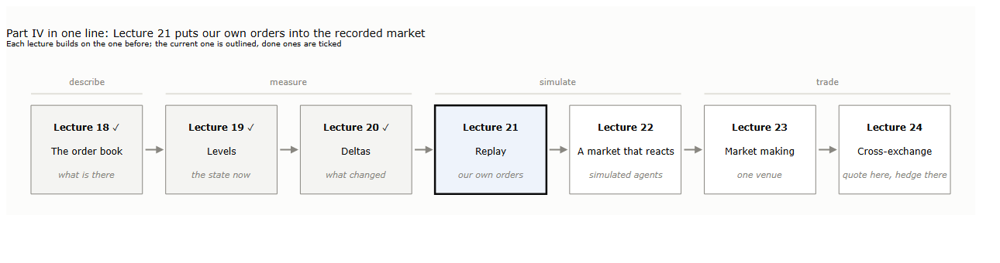
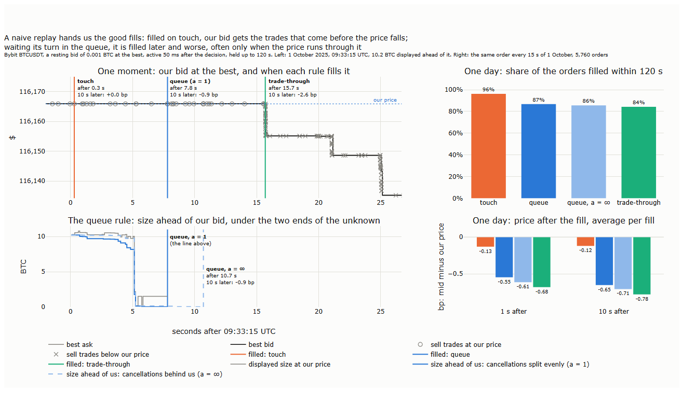
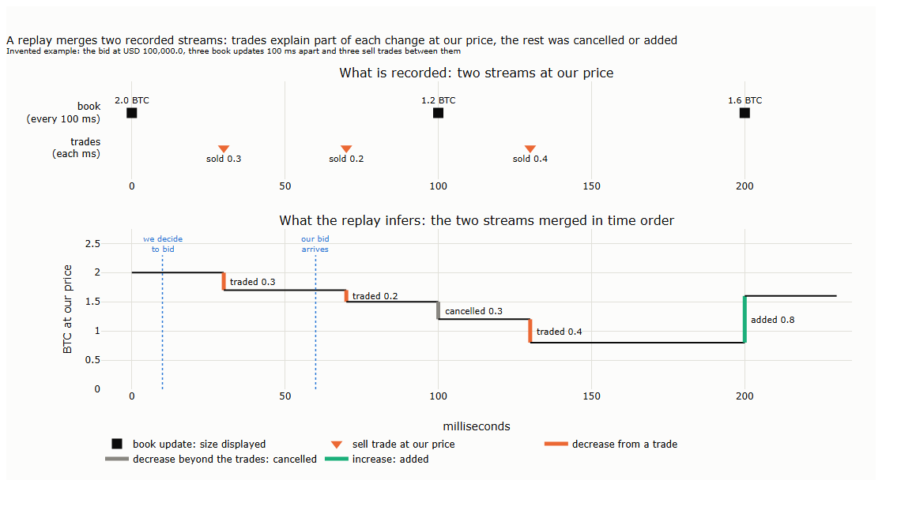

# Lecture 21: Replaying the Exchange: Fill Rules, Queue Position, Latency and Adverse Fills

*Systematic Trading: Lecture Notes (MSc) · Nov 1, 2026 · Max Gnesi*

Lectures 18 to 20 described Bybit's BTCUSDT book, measured its state and measured its flow. This lecture puts our own orders into the recorded market and asks what would have happened to them: when a resting order is filled, at what price a market order is executed, and what the price does afterwards. A replay is only useful if it tells the truth, so the lecture builds one piece by piece and then tests it on the same 45 days, 20 September to 3 November 2025. The hypotheses were fixed before any result was computed ([results/hypotheses.md](results/hypotheses.md)).

*Draft: Sections 1 and 2.1. The rest follows the plan in [results/hypotheses.md](results/hypotheses.md).*

## 1. Three replays of one order

Part IV moves from describing the order book to trading on it, one step per lecture:

<b>How to read the figure.</b> Each box is one lecture of Part IV, each building on the one before; this lecture is outlined, Lectures 18 to 20 are done. Above the boxes, the four stages: describing the book, measuring it, simulating our own orders in it, and trading strategies on it.

A **replay** runs the recorded book and trades forward in time and inserts hypothetical orders of ours into them. The recorded market does not react to our orders: nobody cancels because our bid appeared, and nobody sells into it because it is there. That reaction is left out on purpose here and is the subject of Lecture 22. A market order in a replay is simple to judge: it trades against the book that stands when it arrives. A resting order is not, because the data never say when it would have been filled. The replay has to supply a **fill rule**, and the three rules in common use give different answers:

| Rule | Our resting bid is filled when | What it assumes |
|---|---|---|
| Touch | the first sell trade occurs at our price | we are first in line at our price |
| Queue | the size that stood ahead of us when we joined has been traded or cancelled, and a sell trade then reaches us | we join at the back of the line; how the cancellations split between ahead of us and behind us is unknown |
| Trade-through | a sell trade occurs below our price | everyone at our price has been filled, us included; Lecture 17's rule |

<b>How to read the table.</b> A sell trade is a trade started by a seller (a taker selling into the bids). The same rules apply to a resting ask with buy trades and prices above. Touch and trade-through need only the trades; the queue rule also needs the size displayed at our price, from the book.

The idea of the lecture fits in one chart. On the left, one real moment followed under each rule; on the right, the same order placed again and again over one day:

<b>How to read the figure.</b> Bybit BTCUSDT, a resting bid of 0.001 BTC (Bybit's minimum) placed at the best bid; it becomes active 50 ms after the decision and is held up to 120 s, not moved. <b>Left, top:</b> 1 October 2025 from 09:33:15 UTC: the best bid (black) and ask (grey, one tick above), our price (dotted), sell trades at our price (circles) and below it (crosses); a vertical line marks the fill under each rule, labelled with the wait and with the mid 10 s after the fill minus our price, in basis points (bp, hundredths of a percent; 1 bp is about USD 11.6 here). <b>Left, bottom:</b> the size displayed at our price (grey) and the size ahead of us under the queue rule, with cancellations split evenly over the line (dark blue, a = 1) and with every cancellation put behind us where possible (light blue, dashed, a = ∞); vertical lines mark the two queue fills. <b>Right:</b> the same order placed every 15 s over all of 1 October, 5,760 orders. Top, the share filled within 120 s under each rule; bottom, the average over fills of the mid 1 s and 10 s after the fill minus our price, in bp. Below zero means the price fell after our bid was filled. One day of the in-sample period.

The bid joined at USD 116,165.90 behind 10.2 BTC already displayed there. Four moments decide the story:

| Seconds after 09:33:15 | What happened | Touch | Queue | Trade-through |
|---|---|---|---|---|
| 0.3 | A seller takes 0.003 BTC at our price | **filled** | 10.2 BTC ahead of us | waiting |
| 0.3 to 5.0 | Sellers take 0.26 BTC at our price; some size is cancelled | | ahead: 8.2 BTC (a = 1), 9.7 BTC (a = ∞) | waiting |
| 5.1 to 5.2 | 9.9 BTC is cancelled at our price within two book updates | | ahead: 0.13 BTC (a = 1), 0.16 BTC (a = ∞) | waiting |
| 7.8 and 10.7 | Sellers take 0.05 BTC, then 0.38 BTC at our price | | **filled** at 7.8 s (a = 1), at 10.7 s (a = ∞) | waiting |
| 15.7 | A seller trades below our price | | | **filled** |

<b>How to read the table.</b> One row per event that moves our order; "ahead" is the size in front of our bid under the queue rule, for the two ends of the unknown split of cancellations. Ten seconds after the trade-through, the best bid stood USD 30.7 below our price.

Under the touch rule the order was filled within a third of a second by the first small seller, at a moment when the price had not moved; the 10.2 BTC ahead of us would in fact have been filled first. Under the queue rule it waited until the line in front of it had gone, and was filled 5 to 8 seconds before the price fell through its level. Under trade-through it was filled only as the fall began, and 10 seconds later the mid was 2.6 bp below its price. The same order, in the same recorded market, earned a 10-second markout of 0.0 bp, −0.9 bp or −2.6 bp, depending only on the rule the replay used.

The moment also shows what the queue rule cannot know. The book reports how much is displayed at our price, not whose orders left. When 9.9 BTC vanished at 5.1 seconds, the rule had to decide how much of it stood ahead of us. Here the answer hardly mattered: only 0.3 BTC stood behind us, so at least 9.6 BTC of the cancelled size must have been ahead, whatever the split. In calmer moments the split decides how long we wait, which is why the lecture carries both ends of it, and the values between, through every result (hypothesis H3).

Over the whole day the picture is the same, and it explains why the naive rule flatters:

| Rule | Filled within 120 s | Median wait (filled orders) | Mid 1 s after, bp | Mid 10 s after, bp | Fills that came only when the price ran through |
|---|---|---|---|---|---|
| Touch | 96% | 0.6 s | −0.13 | −0.12 | |
| Queue, a = 1 | 87% | 5.5 s | −0.55 | −0.65 | 61% |
| Queue, a = ∞ | 86% | 6.1 s | −0.61 | −0.71 | 77% |
| Trade-through | 84% | 6.8 s | −0.68 | −0.78 | 100% |

<b>How to read the table.</b> The order of the figure, placed every 15 s on 1 October 2025, 5,760 orders. "Mid 1 s after" and "Mid 10 s after": the average over fills of the mid 1 s or 10 s after the fill minus our price, in bp; the bid starts half a tick (0.004 bp) above zero, so values near zero mean the price did not move. Last column: the share of the queue rule's fills that came at the trade-through itself, because the line had not been used up before. The fee is not included. Our calculation for these notes.

The touch rule fills almost every order and quickly, and its fills see the price barely move. The rules that respect the line fill a few orders fewer, later and at worse prices, and most of their fills come only when the price runs through the level. The fills the touch rule adds are the good ones: a seller arrived while the line was long and the price stable. A replay that uses it reports fills a real order at the back of the line would not have had. Lalor and Swishchuk (2024) make the same point for futures: simulations that assume every fill is non-adverse and at the front of the queue are "over-inflated".

Two cautions keep the chart in proportion. First, it is one day of the in-sample period, and the order is held rather than re-posted, so it shows the mechanism, not a result; whether the touch rule flatters out of sample, with the test order of Section 4, is hypothesis H1. Second, all three rules leave out two things that act on a real order: the time our order needs to reach the exchange, during which the book changes, and the market's reaction to our order itself. The first is part of this lecture; the second is Lecture 22.

This lecture runs as follows:

| § | Step | Question |
|---|---|---|
| 1 | Three replays of one order | Does the fill rule change what a replay reports? |
| 2 | The pieces of the puzzle | What is a replay made of: the latency gap, the queue, adverse fills, our footprint, and the families of models used for each? |
| 3 | The replay on our data | How are trades ordered against the book, how does a market order walk the book after a delay, and how is a resting order's place in the line tracked? |
| 4 | Does the replay tell the truth? | Hypotheses H1 to H9: do the naive rules flatter, are trade-through fills the bad ones, does the unknown split decide the answer, is the replay kinder than real fills, and up to what order size does it hold? |
| 5 | 10 October | What would the replay have done to our orders in the cascade? |
| 6 | Summary, exercises and reading | |

## 2. The pieces of the puzzle

Section 1 showed that one choice, the fill rule, changes what a replay reports. A replay rests on several such choices, and this section lays them out before any of them is measured. Each piece gets the same card: the key message, how it is computed, an invented example and what it misses. The examples share one invented book, so each card adds to the last; Section 3 builds the same pieces on our data.

| § | Piece | The question it answers | Built on our data in |
|---|---|---|---|
| 2.1 | What a replay is | What do the recorded data say, and what must a replay infer? | §3.1 |
| 2.2 | The latency gap | What changes between the moment we decide and the moment our order arrives? | §3.2 |
| 2.3 | The queue | How much stands ahead of our resting order, and when does our turn come? | §3.3 |
| 2.4 | Adverse fills | Why are the fills we do get the worse ones? | §3.4 |
| 2.5 | Our footprint | What does a replay leave out on purpose? | Lecture 22 |
| 2.6 | The models side by side | Which families of models exist for each piece, and where is each used? | |

### 2.1 What a replay is

**Key message.** A replay runs the recorded book and trades forward in one time order and inserts our orders into them. Part of what it needs is recorded; the rest, such as how much was cancelled at our price, it must infer. And the recorded market never responds to our orders.

| Step | Calculation | Financial meaning |
|---|---|---|
| 1 | Merge the two recorded streams in time order: the book updates (every 100 ms on Bybit's feed of 200 levels, Lecture 18) and the trades (to the millisecond) | One clock for everything that happened at our price |
| 2 | Between two book updates, every trade at our price lowers the size there by its own size | The part of the change we know: it was filled |
| 3 | At the next update, the change beyond those trades: a decrease was cancelled, an increase was added | The part we infer: the book shows how much is there, not who came or left |
| 4 | Our order, decided at time $`t`$, becomes active at $`t + L`$ and meets what stands then | $`L`$ is the latency: the time our order needs to reach the matching engine (§2.2) |
| 5 | Our resting order is filled by the recorded trades, under a fill rule (§1); the recorded streams themselves stay as they were | Non-reactive: nobody responds to our order, and our fills take nothing out of the recorded book (§2.5) |

<b>How to read the table.</b> Steps 1 to 3 rebuild what happened at one price; steps 4 and 5 add our order. The book's clock is the matching engine's time (cts, Lecture 18); trades between two updates are applied before the update, the event order fixed in [results/hypotheses.md](results/hypotheses.md).

<b>How to read the figure.</b> An invented bid at USD 100,000.0. <b>Top:</b> what is recorded: the book, every 100 ms, reports the size displayed at that price (squares); the trades, to the millisecond, report each sale at that price (triangles). <b>Bottom:</b> the size at that price as the replay infers it, with each change coloured by its cause: a trade (orange), a decrease beyond the trades, counted as cancelled (grey), an increase, counted as added (green). Dotted: a bid of ours decided at 10 ms and arriving 50 ms later.

Between the first two updates the displayed size fell from 2.0 to 1.2 BTC. Trades account for 0.5 of it, 0.3 and then 0.2, so the replay counts the other 0.3 as cancelled. Between the next two, 0.4 BTC was sold and yet the size rose from 1.2 to 1.6: 0.8 was added. Our bid, decided at 10 ms, arrives at 60 ms. The last book the replay has seen still reports 2.0 BTC, but 0.3 has been sold since, so 1.7 BTC stands ahead of our bid when it joins.

**Net, not gross.** The book reports only the net change between two updates. The 0.8 BTC added could have been 1.0 added and 0.2 cancelled, or an order placed and withdrawn twice; a replay built on 100 ms updates cannot tell. Lecture 18 (§4.4) met the same blind spot from the other side: a tenth of the trades happened at prices that the book of up to 100 ms earlier never showed, orders that arrived and were filled between two updates.

**What it misses.** First, the gross flow inside each update, as above. Second, who cancelled: the book says that 0.3 BTC left the price, not whether it stood ahead of our bid or behind it; §2.3 shows why that matters. Third, the exact order of events within the same millisecond, and any difference between the clocks of the two streams, such as Bybit's publish delay (Lecture 19, §4). Fourth, our footprint: in the replay our bid takes part in no trade's record, and its presence changes nobody's behaviour (§2.5).
